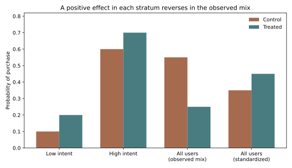
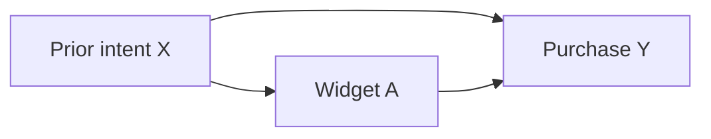

A click-through model can tell me which users are likely to buy. It cannot, by itself, tell me whether showing a new recommendation widget *causes* more purchases. Users who would buy anyway may be more likely to see the widget. Prediction asks for $P(Y\mid X)$; the product decision asks what happens to $Y$ if I *intervene* and change what users see.

I want to make that distinction concrete. In the synthetic example below, a widget raises purchase probability by ten percentage points for both low-intent and high-intent users. Yet the observed treated users buy **thirty points less often** than the untreated users. Every number comes from a specified data-generating process, so I can check each proposed estimator against the known answer. This is a teaching model, not an estimate for a real product.

## Name the effect before estimating it

Let $A_i=1$ mean user $i$ sees the widget, and $Y_i=1$ mean they buy. Potential outcomes $Y_i(1)$ and $Y_i(0)$ are what would happen to that same user under the two choices. The individual effect $Y_i(1)-Y_i(0)$ is usually unobservable: only one treatment is assigned. I can still define a population target, the average treatment effect (ATE):

$$
\mathrm{ATE}=E[Y(1)-Y(0)].
$$

The average treatment effect on the treated (ATT), $E[Y(1)-Y(0)\mid A=1]$, answers a different question: what was the effect for the users who actually got the widget? That may matter for a rollout audit, while the ATE may be the closer target for a policy covering everyone. If effects vary by user type, these averages need not match. The estimand also specifies the outcome window, target population, treatment version, and assignment unit. “Does the widget work?” leaves all four ambiguous.

To connect potential outcomes to observed data, I need **consistency**: a user assigned the specified treatment has observed outcome $Y=Y(1)$, and likewise for control. “Widget on” must be a sufficiently well-defined intervention; silently mixing several designs weakens that claim. I also need to consider the stable unit treatment value assumption (SUTVA): one user's outcome should not depend on another user's assignment, and the treatment should not hide relevant versions. A social widget or marketplace change may violate the no-interference part. These are design claims, not statistical diagnostics. Hernán and Robins develop the potential-outcome framework and its identification conditions in detail. 

Even with consistency, $E[Y\mid A=1]-E[Y\mid A=0]$ compares *different people*. It equals the ATE only under suitable assignment conditions. When every assigned user receives the assigned treatment, randomization makes exposure independent of both potential outcomes in expectation. In observational data, I must argue for **conditional exchangeability**, $(Y(1),Y(0))\perp A\mid X$: after conditioning on measured pre-treatment variables $X$, treatment choice is as good as random. **Positivity** additionally requires $0<P(A=1\mid X=x)<1$ in every target-population stratum. If high-intent users never receive the widget, their treated outcome is missing; no test of the recorded data can recover it without extrapolation assumptions. 

## The reversal in one small population

Let half the users have low prior purchase intent and half high intent. Their purchase probabilities under control are 0.10 and 0.60. The widget adds 0.10 in each group, making the treated probabilities 0.20 and 0.70. Thus the true ATE is $0.5(0.20-0.10)+0.5(0.70-0.60)=+0.10$.

Suppose the widget is offered to 90% of low-intent users but only 10% of high-intent users. Both arms contain half the population, yet the treated arm is 90% low intent and the control arm 90% high intent:

| Prior intent | Control purchase rate | Widget purchase rate | $P(A=1\mid X)$ | Share among treated | Share among control |
|:--|--:|--:|--:|--:|--:|
| Low | 0.10 | 0.20 | 0.90 | 0.90 | 0.10 |
| High | 0.60 | 0.70 | 0.10 | 0.10 | 0.90 |
| Observed aggregate | **0.55** | **0.25** | — | — | — |

The aggregate contrast is $0.25-0.55=-0.30$. The groups are being weighted differently, which is why this is a Simpson reversal. There is no contradiction: both within-group effects are $+0.10$. The figure is generated by the [attached Python example](example.py).



The graph I have in mind is $X\rightarrow A$, $X\rightarrow Y$, and $A\rightarrow Y$. Intent is a **confounder** because it precedes and affects both assignment and outcome. The path through $X$ creates an association between $A$ and $Y$ even apart from the causal arrow. Adjusting for intent can block that backdoor path *if* intent captures all common causes relevant to this comparison. That last clause is substantive; a nice-looking graph does not prove it.



## What to adjust for, and what to leave alone

A causal graph is useful because “put every available field in a regression” is not a safe rule. Consider three structures:

| Structure | Example | Why adjustment changes the question |
|:--|:--|:--|
| $X\rightarrow A,\ X\rightarrow Y$ | Prior intent affects exposure and purchase | Adjusting for a measured pre-treatment confounder can remove a backdoor path. |
| $A\rightarrow M\rightarrow Y$ | Widget changes clicks, which lead to purchase | Adjusting for clicks blocks part of the *total* effect; it targets a different, direct-effect question and needs additional assumptions. |
| $A\rightarrow C\leftarrow U\rightarrow Y$ | Widget and latent enthusiasm both affect whether a user opens a detail page | Restricting analysis to openers conditions on collider $C$, opening a spurious association between assignment and enthusiasm. |

The collider issue also appears when I keep only users who remained active, completed onboarding, or generated a log event. If treatment and outcome-related behavior both affect selection, the retained sample may be biased even after random assignment. I draw the graph *before* choosing variables, using temporal order and product knowledge. A graph encodes assumptions; it cannot infer missing arrows from a table. Pearl's discussion cautions against automatic adjustment for all measured covariates. 

The graph also fixes the time at which covariates are measured. “Intent” estimated from clicks *after* exposure is not the same variable as prior intent. It may partly measure the treatment's effect and therefore behave like a mediator. A feature store can obscure this if it records only the latest value. I would write down the assignment timestamp, freeze pre-treatment covariates as of that time, and check how outcome logging is triggered. These are causal design decisions, even though they look like data-engineering details.

## Standardization and weighting recover this toy effect

Under consistency, conditional exchangeability, and positivity, I can identify the ATE by **standardization**. For each intent group, estimate the treated and control outcome means, then apply the same target-population group weights to both:

$$
E[Y(a)]=\sum_x E[Y\mid A=a,X=x]P(X=x).
$$

Here the standardized treated rate is $0.5(0.20)+0.5(0.70)=0.45$, and the standardized control rate is $0.5(0.10)+0.5(0.60)=0.35$. Their difference is $+0.10$. Standardization does not mean “subtract group means and hope”; it requires an outcome model or enough data in each relevant group. If I change the target population, I must change $P(X)$ and may change the estimand.

**Inverse probability weighting** (IPW) instead models the propensity $e(X)=P(A=1\mid X)$. A treated low-intent user gets weight $1/0.9$; a treated high-intent user gets weight $1/0.1$. The latter user represents many similar people who rarely received the widget. With known propensities, a population Horvitz–Thompson expression is

$$
E[Y(1)] = E\left[\frac{AY}{e(X)}\right],\qquad E[Y(0)] = E\left[\frac{(1-A)Y}{1-e(X)}\right].
$$

For $n$ sampled users, replace those expectations with sample means. With true propensities and iid sampling, each sample mean is unbiased for its potential-outcome mean under the identification assumptions. A commonly used *normalized* or Hájek version divides the weighted outcome sum in each arm by that arm's sum of weights. It often behaves more stably in finite samples, but a ratio estimator is not exactly unbiased in general. Both approaches need valid propensity estimation and overlap; weighting cannot repair unmeasured confounding. Hernán and Robins show the population equivalence of IPW and standardization under the stated conditions. 

The [runnable script](example.py) prints exact population contrasts and a seeded 200,000-user Bernoulli sample, then writes the SVG above. Run it with `python3 example.py` after installing NumPy and Matplotlib. The exact results are:

```text {title="Exact population results"}
True ATE: +0.10
Observational: E[Y|A=1]=0.25, E[Y|A=0]=0.55, crude=-0.30, standardized=+0.10, IPW=+0.10
Randomized: E[Y|A=1]=0.45, E[Y|A=0]=0.35, crude=+0.10, standardized=+0.10, IPW=+0.10
```

The sample estimates will differ from these exact expectations. In my seeded run, the crude contrast was $-0.304$, standardization $+0.093$, Horvitz–Thompson IPW $+0.086$, and normalized IPW $+0.093$. Those differences are sampling noise, not a performance benchmark or proof that one estimator is generally better. If I replace $e(\text{high})=0.10$ by zero, the treated high-intent cell disappears and $1/e(\text{high})$ is undefined. Even when $e$ is merely near zero, a few users receive huge weights and variance can explode. Inspect the propensity distributions and effective weighted sample size before trusting a narrow error bar. An outcome model may extrapolate into an empty cell, but then the estimate depends on that extrapolation, not identification from observed comparisons.

In a real observational analysis, the propensity and outcome means are estimated rather than supplied by the data-generating process. I would separate model fitting from evaluation when flexible models are used, inspect calibration and overlap, and report sensitivity to reasonable modeling choices. Agreement between IPW and standardization is reassuring but not decisive: both can share a missing confounder or bad outcome measurement. Conversely, disagreement can reveal model misspecification or unstable weights. Neither pattern is a formal test of the exchangeability assumption. The strongest claim I can make must remain conditional on what I measured and on the intervention I defined.

## Design the experiment around the intervention

A user-level A/B test with a stable assigned variant is the clearest design for this widget *if users do not affect one another*. Let $Z$ denote randomized assignment and retain $A$ for actual exposure. Randomization breaks the link between prior intent and $Z$ in expectation. In this toy population I assume full compliance, $A=Z$, so assigning each intent group at 50% yields treated and control rates of 0.45 and 0.35. A finite experiment can still have chance imbalances, missing outcomes, noncompliance, logging errors, or treatment versions. I would define eligibility, exposure, primary outcome, and measurement window before looking at outcomes. Randomization secures the assignment mechanism; it does not fix every measurement or interference problem. Athey and Imbens discuss design-based analysis and interactions between units in randomized experiments. 

If users can ignore an assigned widget, $Z$ and $A$ differ. I would first report the **intention-to-treat** effect, $E[Y\mid Z=1]-E[Y\mid Z=0]$: compare by randomized assignment, whether or not users actually saw or interacted with it. This estimates the effect of the *assignment policy*, not necessarily the earlier ATE of exposure $A$. Comparing users who actually saw or clicked the widget with those who did not is an **as-treated** comparison and can reintroduce intent bias. A causal effect of actual exposure or use requires further assumptions and a different estimand; assignment alone does not make those groups exchangeable.

If treatment affects other users through a shared marketplace, individual assignment may contaminate both groups. Randomizing whole markets or communities can contain interference within clusters, at the cost of fewer independent assignment units. For a change that must apply system-wide, a **switchback** design can randomize time blocks. Then demand cycles and carryover matter: an effect from the previous block may persist into the next. Block length, washout, and analysis should reflect plausible carryover rather than treating each event as independent. Switchback design papers make those assumptions explicit. 

Uncertainty must follow the assignment unit. If markets were randomized, thousands of users within one market do not provide thousands of independent treatment assignments. I would use an analysis at the cluster or time-block level, or a method that accounts for that dependence, and report an interval for the chosen estimand. The existing posts on [confidence intervals, bootstrap, and permutation](/blog/confidence-intervals-bootstrap-permutation/) and [power](/blog/hypothesis-testing-p-values-power/) cover those tools; here the causal design decides *which units* can be resampled or permuted. More data cannot remove confounding from an invalid assignment mechanism.

Before an observational comparison, I would sketch a target trial: who would be eligible, what exactly would be assigned, when assignment happens, how long follow-up lasts, and what outcome is counted. Then I would ask whether the logs contain a defensible imitation of each component. A common mistake is to define treatment using future behavior, such as “users who clicked within seven days,” but start follow-up at signup. Those users had to remain observable long enough to qualify, which builds selection into the comparison. Aligning eligibility, treatment assignment, and the start of follow-up is part of identifying the effect; an impressive regression cannot repair a misaligned timeline. 

## Questions I would ask in an interview

1. **Why isn't $E[Y\mid A=1]-E[Y\mid A=0]$ automatically causal?** The two groups may differ in potential outcomes before treatment. Assignment or defensible adjustment must address that difference.
2. **What is the difference between ATE and ATT?** ATE averages over the target population; ATT averages effects over those who were treated. They differ under effect heterogeneity and treatment selection.
3. **What does consistency require?** Observed outcomes must equal the potential outcome for the treatment actually received, with the intervention sufficiently specified.
4. **Can I test no unmeasured confounding from the observed table?** No. I can inspect balance and design, but conditional exchangeability includes claims about unobserved potential outcomes.
5. **Why does Simpson's paradox appear here?** Low-intent users dominate the treated arm while high-intent users dominate control. Different mixing weights reverse the within-group contrast.
6. **Should I always adjust for a variable correlated with the outcome?** No. A mediator changes the estimand; a collider can create bias. Its causal position matters more than predictive power.
7. **What does positivity buy me?** It ensures each target stratum has observable treated and control comparisons. Without it, the missing counterfactual cell requires extrapolation.
8. **Why can IPW be noisy with good propensity estimates?** Propensities near zero or one create large weights, so a few observations dominate the estimate.
9. **What does an A/B test estimate when assigned users do not comply?** The assignment contrast estimates intention-to-treat for the specified eligible population. The as-treated contrast is generally confounded.
10. **When is user-level randomization inappropriate?** When one user's treatment changes another's outcome, as with shared supply or network effects. Choose an assignment unit that captures the interference.
11. **What is the uncertainty unit in a market-level experiment?** The independent market assignment, not each user event. Time-block assignments also need attention to temporal dependence.
12. **What does the toy simulation prove?** It verifies the arithmetic and code under a known mechanism. It cannot validate exchangeability, overlap, or model choices in a real deployment.


