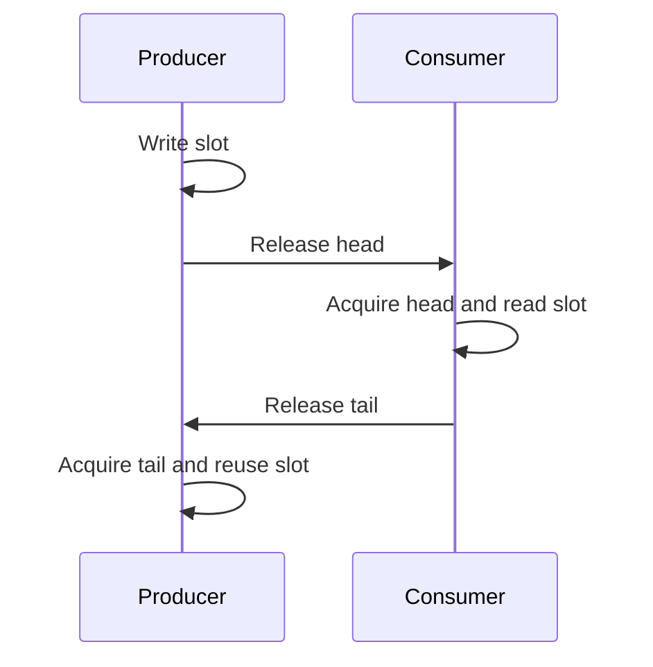

`std::atomic` makes an operation on one object indivisible. That is useful, but it does not automatically make an entire data structure safe. When I hand a value from one thread to another, I need to answer three separate questions: Which accesses are atomic? What orders the producer's write before the consumer's read? Who owns the storage while each access happens?

The [single-producer, single-consumer queue](spsc.cpp) below gives those questions a concrete home. It carries integers through eight reusable slots, with one thread writing and one reading. I will derive its release/acquire edges, then explain where relaxed operations, sequential consistency, compare-exchange, and memory reclamation fit. The C++ working draft, rather than observations from one CPU, is the source for the language guarantees. 

## A race is not necessarily a data race

A **race condition** is a broad statement that timing affects the result. Two threads may legitimately race to win a compare-exchange; exactly one succeeds. A **data race** is the C++ rule for conflicting accesses to the same memory location, at least one a write, from different threads, with no happens-before relation, when at least one access is non-atomic. A data race gives undefined behavior. “It printed the right value on my machine” does not narrow that rule. 

Consider `++count` from two threads. For a plain `int`, the unsynchronized read and write conflict. With `std::atomic<int> count`, `count.fetch_add(1, std::memory_order_relaxed)` makes each increment indivisible and avoids that data race. `relaxed` can be sufficient when the only contract is an exact count after both threads have joined. It does **not** publish other non-atomic data written before an increment. Atomicity is about the counter's operations; ordering is about relationships among operations on other objects.

Every atomic object has a **modification order**: a single order of its writes and read-modify-write operations. Relaxed operations still participate in it. That does not create one total order over *all* objects. The useful cross-thread relation is **happens-before**. Within a thread, earlier sequenced operations precede later ones. Across threads, a release operation on an atomic synchronizes with an acquire operation on that atomic when the acquire reads from the release (or its release sequence). That synchronization transfers earlier writes into the consumer's happens-before history. Merely using the words “release” and “acquire” somewhere in a program is insufficient; the read-from connection matters. 

I find it helpful to distinguish *coherence* from *publication*. Coherence stops two threads from inventing conflicting histories of writes to one atomic object; a later atomic load still has rules about which values it may read. Publication connects a write to one object with a read of another object. I can make a flag perfectly atomic and still race on the plain payload it supposedly protects. The condition to check is concrete: does the consumer's observation establish a happens-before path from every producer write it will read? If not, choosing a “stronger-looking” atomic type for the flag has not solved the payload problem.

## Publication is a handshake

Here is the small publication pattern. Only the producer writes `payload`; the consumer reads it after observing `ready`.

```cpp
int payload = 0;
std::atomic<bool> ready{false};

// Producer thread
payload = 42;
ready.store(true, std::memory_order_release);

// Consumer thread
if (ready.load(std::memory_order_acquire)) {
    use(payload); // sees the producer's 42
}
```

The release store is sequenced after `payload = 42`. If the acquire load reads that `true`, the store synchronizes with the load, so the payload write happens-before `use(payload)`. There is no data race on `payload` in this one-shot example. If the load sees `false`, it cannot read the payload yet. Replacing both operations with `relaxed` preserves atomicity of `ready` but removes the synchronization that protects the plain `int`.

This example says nothing about changing `payload` again, destroying it, or reusing its address while the consumer might still read. A second handshake is needed to transfer ownership back. Thinking in terms of ownership makes release/acquire less mysterious: the producer publishes completed work, and the consumer later announces that the storage is free.



The arrows in this diagram correspond to actual atomic read-from relationships, not messages sent by the hardware. A load that still sees an older counter value has not received the new publication; the queue simply reports empty or full and retries.

## A bounded queue with explicit ownership

The [complete C++20 program](spsc.cpp) creates one producer and one consumer, transfers one million increasing integers, checks every value in order, and joins both threads. It needs no dynamic allocation. These are the queue operations at its center:

```cpp
bool try_push(std::uint64_t value) {
    const auto head = head_.load(std::memory_order_relaxed);
    const auto tail = tail_.load(std::memory_order_acquire);
    if (head - tail == capacity) return false;
    slots_[head & (capacity - 1)] = value;
    head_.store(head + 1, std::memory_order_release);
    return true;
}

bool try_pop(std::uint64_t& value) {
    const auto tail = tail_.load(std::memory_order_relaxed);
    const auto head = head_.load(std::memory_order_acquire);
    if (head == tail) return false;
    value = slots_[tail & (capacity - 1)];
    tail_.store(tail + 1, std::memory_order_release);
    return true;
}
```

`head_` is written only by the producer; `tail_` only by the consumer. Each owner can load its own counter with `relaxed`, since it is the sole writer and its own earlier operations are sequenced before the load. To check the other side, it loads that side's counter with `acquire`. When the producer sees space, it writes a plain integer into a slot and advances `head_` with `release`. A consumer that observes that head value acquires the completed slot before reading it. After reading, the consumer advances `tail_` with `release`; a producer that sees the new tail acquires permission to overwrite the slot. That second edge is as important as the first: it prevents a read and a later overwrite of the same plain slot from being unordered. 

The capacity is eight, a power of two. A slot index uses `position & (capacity - 1)`. The counters are unsigned 64-bit integers, so subtracting positions wraps modulo $2^{64}$; the queue maintains a distance from zero to eight. Because eight divides $2^{64}$, the slot index still cycles correctly if a counter eventually wraps. The queue has exactly one writer for each counter and one producer and consumer for the data. Adding a second producer or consumer invalidates the ownership proof. I would not generalize this code to arbitrary `T` without addressing object construction, destruction, and exception behavior.

A stale opposite-side load can make `try_push` report full or `try_pop` report empty for a while. It cannot grant ownership too early: the producer only reuses a slot after seeing a tail value that follows the consumer's read, and the consumer only reads after seeing a head value that follows the producer's write. The queue's `try_` operations may fail transiently, and the test program yields and retries. The queue must outlive both threads; the joins in `main` enforce that for this example.

There is a useful asymmetry here. A producer always publishes the slot before incrementing `head_`, and a consumer always finishes reading before incrementing `tail_`. The counter value is therefore a *permission boundary*, not just a size estimate. If I moved the head store above the slot write, a consumer could claim an unwritten slot. If I moved the tail store above the slot read, a producer could overwrite the value while the consumer read it. Release and acquire preserve the intended order only because the program places the operations on the correct sides of that boundary. No choice of memory order can fix an algorithm that publishes a slot before filling it.

Compile and run from this post's directory:

```bash
g++ -std=c++20 -O2 -Wall -Wextra -Wpedantic -pthread spsc.cpp -o spsc
./spsc
```

```text
received 1000000 values in order
```

This execution is a useful regression check, not a proof of correctness across all allowed C++ implementations. The proof comes from ownership, counter invariants, and happens-before edges. Repeating a stress test or running ThreadSanitizer can catch some mistakes; a clean run cannot enumerate every weak-memory execution.

The test checks more than a final checksum: it verifies every item arrives once and in the producer's order. That catches loss, duplication, and reordering in executions the test actually reaches. It does not exercise a second producer, because that would violate the queue's contract rather than stress it. It also does not establish a throughput claim. Changing the capacity, scheduler, compiler, and processor may change observed speed and schedules without changing the C++ correctness argument.

## Relaxed and sequentially consistent operations

For a counter that carries no other data, `fetch_add(relaxed)` can be enough. For a publication flag, relaxed leaves out the needed synchronization. `memory_order_seq_cst` adds a single total order over **sequentially consistent operations** consistent with their required constraints. It does not turn unrelated non-atomic data races into defined behavior, and it does not make every operation in a mixed-order program sequentially consistent. Sequential consistency is often a good starting point for reasoning; use weaker orders only when I can state the exact handoff they preserve. 

A classic two-atomic litmus makes the distinction visible. Both `x` and `y` start at zero:

```cpp
// Thread 1                    // Thread 2
x.store(1, order);            y.store(1, order);
r1 = y.load(order);           r2 = x.load(order);
```

With all four operations `relaxed`, the outcome `r1 == 0 && r2 == 0` is permitted by the C++ model. It is also permitted if the stores are release and the loads acquire: both loads read the initial zero, so neither acquire reads from a release store and no cross-thread synchronization is established. With all four operations `seq_cst`, both-zero would demand that each load precede the other thread's store in the total order, while each store precedes its own load. Those constraints form a cycle, so that outcome is forbidden. This is a model statement, not a promise that a stress test on a particular processor will ever show a permitted weak outcome. 

## Compare-exchange is a separate tool

A multi-writer counter can be updated with `fetch_add`; a conditional state transition may need compare-exchange. `compare_exchange_weak(expected, desired, success, failure)` compares against `expected`, writes `desired` on success, and updates `expected` with the observed value on failure. A *weak* operation can fail spuriously, even when the values match, so it normally belongs in a loop. The failure ordering describes a load, so it cannot be `release` or `acq_rel`. The working draft specifies these details directly. 

```cpp
std::atomic<unsigned> state{0};
unsigned expected = state.load(std::memory_order_relaxed);
while (!state.compare_exchange_weak(
    expected, expected + 1,
    std::memory_order_relaxed, std::memory_order_relaxed)) {
    // expected was replaced with the value observed on failure.
}
```

This loop atomically increments `state`, though `fetch_add` is clearer for that exact job. The success and failure orders are both relaxed because no payload is being published or consumed. A CAS that publishes a node may need release semantics on success; one that reads a published node may need acquire semantics. The order must follow the data-flow proof, not a template copied from another algorithm. Also, CAS on a pointer is not enough to make a pointer-based structure safe: node lifetime and reuse remain separate problems.

## Progress and memory reclamation

“Lock-free” is a progress property, not a synonym for “uses atomics” or “faster.” Informally, lock-free means system-wide progress despite a stalled contender; wait-free gives every operation a bounded number of its own steps. `is_lock_free()` reports a property of a particular atomic type's implementation. It does not certify a surrounding queue or a retry loop. In this example, the queue's `try_` methods return promptly, but a producer repeatedly seeing a full queue cannot complete a push until the consumer acts. The outer retry loops are therefore not wait-free methods for delivering a value. The working draft describes atomic lock-free properties and forward progress separately. 

A pointer CAS can see address A, lose a race while another thread changes A to B and then back to A, and succeed even though the underlying object changed. This **ABA** pattern is one reason dynamic lock-free structures are difficult. Worse, a thread can hold a pointer to a node that another thread frees. Hazard pointers or epoch-based reclamation can delay reuse until readers are safe; they require their own protocol and proof. The fixed array here avoids node reclamation, but its slots still need the release/acquire reuse handshake. Michael's hazard-pointer paper treats reclamation as a central part of safe lock-free design. 

Finally, performance is contextual. A shared atomic counter can become a contention point. Even independent `head_` and `tail_` atomics may sit close enough in memory to cause **false sharing**, where coherence traffic moves a cache line that contains both. C++ exposes `std::hardware_destructive_interference_size` as an implementation-provided spacing hint, but padding costs memory and does not replace measurement. Benchmark the real workload and compare with a mutex or the [locks and condition variables post](/blog/locks-mutexes-semaphores-condition-variables/), especially when blocking is acceptable. The C++20 working draft specifies the interference-size constant. 

## Questions I would ask in an interview

1. **How does a race condition differ from a data race?** A race condition is timing-sensitive behavior; a C++ data race is a specific pair of unordered, conflicting accesses with at least one non-atomic access and causes undefined behavior.
2. **What does a relaxed atomic guarantee?** Indivisible access and participation in that object's modification order. It does not by itself order adjacent plain-data accesses across threads.
3. **Why is a release store alone insufficient for publication?** The consumer needs an acquire operation that reads from that release or its release sequence to establish synchronization.
4. **When may a consumer safely read a plain slot?** After an acquire of the producer's published head that covers the slot write, while the producer cannot reuse the slot yet.
5. **Why does the queue release `tail_`?** It announces that the consumer finished reading the slot. The producer acquires that announcement before overwriting the slot.
6. **Can acquire/release forbid both-zero in the two-atomic litmus?** No. If both loads read zero, neither reads from a release store, so the required synchronizes-with edges do not arise.
7. **What extra order does `seq_cst` provide?** One total order over seq-cst operations consistent with the model's constraints. It does not repair plain-data races.
8. **Why does weak CAS usually need a loop?** It can fail spuriously; on failure it updates `expected` to the observed value for the next attempt.
9. **Why can't CAS failure use release ordering?** Failure performs a load, not a write that could release prior operations.
10. **Does `atomic<T>::is_lock_free()` prove my queue is lock-free?** No. It describes that atomic implementation, not the queue's algorithm or its dependence on another thread.
11. **What is the ABA problem?** A value can leave state A and return to A, fooling equality-based CAS even though the object or history changed.
12. **Why doesn't a passing stress test prove the memory orders?** It samples executions on one compiler and machine; the language permits other schedules and hardware behaviors.


