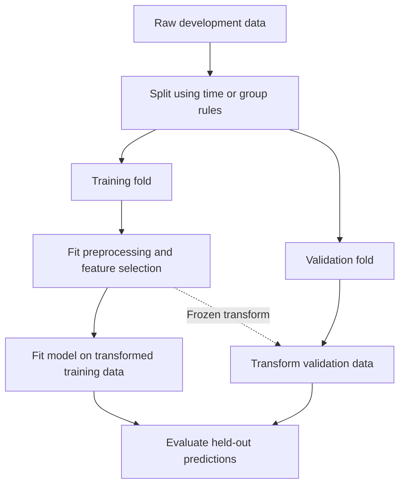

A classifier gets 100% validation accuracy. Its only feature is a customer ID, and the labels were generated randomly. There is no rule to learn for a new customer.

The result is possible because the same customers appear on both sides of a random row split. The classifier remembers them. The experiment measures recognition of known customers, although the product needs predictions for new ones.

This is where I start when evaluating a model: **what future situation does this split actually simulate?** Choosing a metric comes next. The [metrics post](/blog/ml-nlp-metrics/) explains how to score predictions; here I want to establish when that score deserves belief.

## Start with the prediction contract

Before selecting a split, I write down four things: the unit being predicted, the moment of prediction, the information available then, and the population the model will encounter.

For example: *At the beginning of each week, predict whether an existing subscriber will cancel during the next seven days, using information available by Monday morning.*

That sentence rules out a surprising amount of otherwise convenient data. A cancellation reason is unavailable at prediction time. A feature computed from the entire following week includes future events. A training label for the current week has not matured yet.

It also determines the holdout. Future weeks for existing subscribers test one use case. Entirely new subscribers test another. I might need both evaluations, but I would report them separately.

| Deployment question | Useful starting split | What to inspect |
| --- | --- | --- |
| Another independent observation from the same population | Random or stratified folds | Duplicates and hidden dependencies |
| A customer, device, or document never seen in training | Group holdout | Shared entities across folds |
| A later time period | Forward chronological holdout | Future features and label availability |
| A new geography or acquisition channel | Domain holdout | Whether the held-out domain represents deployment |
| Future observations from new customers | Combined time and entity restrictions | Whether both restrictions actually hold |

These are experimental designs, not a universal ranking of splitters. Excluding every shared user would be unnecessarily restrictive if the product deliberately uses a known user's history. Allowing shared users would be misleading if the claimed capability is cold start.

## Train, validation, and test have different jobs

Training data fits parameters. Validation data guides choices: features, model family, regularization, number of trees, stopping time, calibration, and decision threshold. Test data assesses the resulting procedure after those choices are fixed.

Those roles depend on usage, not file names. If I inspect `test.csv` every afternoon and redesign the model around its mistakes, it has become development data.

With $K$-fold cross-validation, partition the development set into folds $V_1,\ldots,V_K$. For each fold, fit on the other folds and evaluate on the held-out one. If $A$ denotes the complete learning procedure and $\ell$ an example-level loss, an out-of-fold estimate is

$$
\widehat R_{\mathrm{CV}}
=\frac{1}{n}\sum_{k=1}^{K}\sum_{i\in V_k}
\ell\!\left(y_i,A(D\setminus V_k)(x_i)\right).
$$

Each example is evaluated by a fit that excluded its fold. The important symbol is $A$: preprocessing, feature selection, and model fitting all belong inside it.

For equal-sized folds this equals the mean fold loss. For unequal folds, row weighting and equal fold weighting answer different questions. Metrics such as F1 and AUC are not additive losses, so computing them on pooled out-of-fold predictions is generally different from averaging fold metrics. Cross-fold score scales can also differ, which matters when pooling rankings.

Cross-validation estimates performance of models trained on less than the full development set. It is not an exact measurement of the final refit, nor a guarantee against distribution shift.

## Leakage can happen before the model sees the data

The usual rule is to fit learned preprocessing only on the training partition and apply the resulting transform to the held-out partition. This includes scaling, imputation, PCA, and feature selection. A pipeline passed into cross-validation keeps these fitted steps inside each fold.

For one feature, the training mean and scale are

$$
\mu_T=\frac{1}{|T|}\sum_{i\in T}x_i,
\qquad
s_T^2=\frac{1}{|T|}\sum_{i\in T}(x_i-\mu_T)^2.
$$

Both partitions use $(x-\mu_T)/s_T$. Computing a separate mean for validation changes the transformation; computing one global mean uses held-out information. The damage from a particular leak varies, but the information boundary is the same.

Here is the intended flow:



A pipeline cannot repair information that was already placed in the raw columns. If `last_week_spend` accidentally includes tomorrow, fitting the scaler correctly does nothing to remove that future event.

Nor does the rule forbid deterministic operations such as converting an agreed unit from metres to centimetres. The question is whether an operation learns from data reserved for evaluation, or uses information unavailable in the intended prediction setting.

### Feature selection can discover the validation labels

The accompanying [NumPy script](leakage_demo.py) generates 400 rows of random noise and independent random binary labels. It selects 25 of 2,000 columns by their association with the labels, then fits a ridge least-squares classifier on the first 200 rows.

Only the selection step changes: it either sees all labels, or just the training labels. Both models are fitted and evaluated on the same partitions. Running the script gives:

```text
selection sees validation labels: accuracy=0.695
selection uses training only: accuracy=0.525
```

These are one seeded synthetic run, not expected values or a benchmark. The population has no predictive signal, so an independent evaluation is at chance in expectation. Selecting columns using validation labels discovers accidental associations with that particular holdout. Fitting the final weights on training rows cannot undo that selection.

This is why I review the whole experiment rather than checking only the arguments to `model.fit`.

### Target encoding needs another boundary

Replacing a category with its average target creates a special problem. If a category occurs once, its unregularized target mean equals that row's label. A downstream model can learn from its own answer even inside a training fold.

Cross-fitting addresses this: generate each training row's encoded value using other subfolds. For external validation, fit the mapping on the entire outer training fold and apply it without validation labels. Smoothing and a fallback for unseen categories are also useful. scikit-learn documents internal cross-fitting for this purpose.

The inner folds must respect the same dependencies as the task. Random cross-fitting is not enough if encodings are supposed to represent only past events.

## A perfect score from memorizing identities

Here is the customer example in full. There are 100 customers, each with ten observations and one random binary label. The learner remembers a label for each seen ID; for unseen IDs it predicts the majority training label.

```python {title="Compare row and customer holdouts"}
import numpy as np

rng = np.random.default_rng(17)
groups = np.repeat(np.arange(100), 10)
group_labels = rng.integers(0, 2, size=100)
y = group_labels[groups]
order = rng.permutation(len(y))

splits = {
    "random rows": (order[:800], order[800:]),
    "unseen groups": (
        np.flatnonzero(groups < 80),
        np.flatnonzero(groups >= 80),
    ),
}

for name, (train, valid) in splits.items():
    remembered = {
        int(g): int(y[train][groups[train] == g].mean() >= 0.5)
        for g in np.unique(groups[train])
    }
    fallback = int(y[train].mean() >= 0.5)
    pred = np.array([remembered.get(int(g), fallback) for g in groups[valid]])
    shared = len(set(groups[train]) & set(groups[valid]))
    print(f"{name}: accuracy={np.mean(pred == y[valid]):.3f}, "
          f"shared groups={shared}")
```

```text
random rows: accuracy=1.000, shared groups=94
unseen groups: accuracy=0.450, shared groups=0
```

The random split holds out rows from 94 customers, and all 94 occur in training. The group split holds out 20 entirely new customers. Its 200 validation rows contain only 20 independently drawn labels; treating them as 200 independent outcomes would overstate the evidence.

`GroupKFold` keeps a group out of the paired training fold. `StratifiedKFold` approximately preserves class proportions instead. Stratification helps avoid folds missing rare classes; it does not remove entity overlap or time leakage. Group-aware stratification can help balance labels when the group structure permits it.

Oversampling also belongs inside each training fold. Duplicating minority examples before splitting can put copies of one observation on both sides. Evaluating on a balanced synthetic holdout would additionally change the class prevalence from deployment.

## Time splits need more than sorted timestamps

Suppose the model trains on June 1 and predicts cancellation within seven days. A row dated May 31 does not yet have a complete target on June 1. Its label is only known after the outcome window finishes, possibly with another reporting delay.

I distinguish three times:

| Timestamp | Meaning |
| --- | --- |
| Event time | When the underlying event happened |
| Availability time | When the prediction system could actually access it |
| Label maturity time | When the complete target became knowable |

Training at a historical cutoff must respect label maturity. Features for each example must respect that example's prediction time and availability constraints. A database row backfilled today with an old event timestamp was not necessarily available back then.

Forward validation trains on earlier periods and evaluates on later ones. An expanding window retains past data; a sliding window limits training to recent history. The choice represents how the deployed model will be retrained.

`TimeSeriesSplit` provides forward splits and an optional `gap`, measured in numbers of samples. Equal spacing is needed for its equal-count test folds to represent equal durations. A gap does not inspect feature timestamps or label intervals for you.

For a seven-day target, I would exclude training rows whose outcome windows cross the simulated training cutoff. With irregular timestamps, that restriction should use actual times, not blindly remove seven rows. Overlapping windows and group dependencies may require a custom splitter.

## Tuning overfits the validation procedure

Even without leaked features, trying enough configurations can overfit a noisy validation score. Cawley and Talbot analyze this model-selection bias: optimizing an estimated generalization criterion can exploit its sampling variation.

For intuition, suppose all $m$ candidate models have the same true score $s$, but their validation estimates are

$$
\hat s_j=s+\epsilon_j.
$$

Choosing $j^*=\arg\max_j\hat s_j$ also chooses a large noise realization. Under independent zero-mean Gaussian noise with standard deviation $\sigma$, the maximum noise grows approximately as $\sigma\sqrt{2\log m}$ for large $m$. This is an illustrative approximation; real model errors are correlated and have unequal variances. The selection effect remains the concern.

Changing the random seed until the score improves is another search. So is looking at a validation error and adding a feature specifically to fix it.

### Nested cross-validation evaluates the search

The inner loop selects a configuration using only the outer training partition. The outer loop evaluates that selected procedure on data the search did not see. This is the distinction illustrated by scikit-learn's nested cross-validation example.

```text
For each outer split:
    For each candidate configuration:
        Evaluate the entire pipeline on inner splits of outer-training data.
    Select a configuration using only inner results.
    Refit it on all outer-training data.
    Evaluate once on the outer holdout.

Aggregate the outer evaluations.
For deployment, run the fixed search procedure on all development data and refit.
```

The outer scores assess a selection procedure, rather than one parameter setting chosen across all data. If I use them to redesign the search repeatedly, they too become part of development. Nested CV is not immunity from adaptive experimentation.

An untouched final holdout is often simpler when data is plentiful. Nested CV is particularly useful when comparing selection procedures with limited data. Both still require splits that match deployment.

Early stopping and threshold tuning belong inside the training side of the outer evaluation. Choosing the best boosting round using the outer holdout means that holdout helped fit the effective model.

## Uncertainty is about independent information

I do not read five fold scores as five independent experiments. Their training sets overlap. Bengio and Grandvalet show that there is no universally unbiased estimator of the variance of $K$-fold CV under all distributions. That result cautions against treating fold variation as an automatic confidence interval.

For a fixed model on a genuinely independent test sample, uncertainty can be estimated at the appropriate sampling unit. If rows are clustered by customer, a customer-level bootstrap resamples customers with their rows together. For temporal dependence, a suitable block-resampling design may be needed. The assumptions should be stated, and these estimates need not include variability from retraining or model selection.

When comparing two models, evaluating both on the same held-out examples allows a paired comparison. I would also inspect slices: new customers, uncommon categories, recent periods, and high-cost errors. An average improvement can hide a regression in the part of the product that matters most.

## Interview questions and follow-ups

### 1. Why split before standardizing if standardization uses no labels?

The means and variances still summarize the held-out feature distribution. For ordinary inductive evaluation, that information is reserved for evaluation. Fit the transformation on training data, then apply it unchanged. A deliberately transductive setting is a different stated problem.

### 2. Is stratified cross-validation always the safest choice?

It preserves class ratios, which is useful for classification. It does not enforce temporal order or separate customers. Those restrictions can be more important than perfect class balance.

### 3. Does a pipeline prevent all leakage?

It can keep learned transformations inside folds. It cannot detect a future-derived raw feature, duplicated entity, inappropriate splitter, or repeatedly inspected test set.

### 4. Why can training-only target encoding still overfit?

A row's own label can contribute directly to its encoded feature. Use cross-fitted training encodings, with subfolds that respect time and groups, and a training-fitted mapping for external validation.

### 5. Can the same user appear in training and testing?

Yes, when evaluating future predictions for known users and using only information available at each prediction. No, if the evaluation claims generalization to unseen users. The prediction contract decides.

### 6. Why not use leave-one-out everywhere?

It needs many fits, has strongly overlapping training sets, and does not fix dependence or leakage. Its error-estimation variance is not universally lower than that of other fold choices. Computational cost and the intended deployment structure matter more than maximizing $K$.

### 7. Is the highest cross-validation score an unbiased estimate of the selected model?

Not generally. Selection favors configurations with favorable estimation noise. An independent holdout or outer CV evaluates the selection without reusing those same comparisons as the final score.

### 8. Where do oversampling, calibration, and threshold tuning belong?

Oversampling acts only on training partitions. Calibration and threshold selection require predictions that support their own validation strategy, inside the development process. The final evaluation distribution should reflect the stated deployment population.

### 9. Does a temporal gap eliminate future leakage?

Only if the actual leakage mechanism is covered by that gap. A feature computed using future events can remain invalid regardless of row spacing. Check feature availability and label windows explicitly.

### 10. Should I average fold F1 values or compute F1 from all out-of-fold predictions?

They estimate different aggregations. Define whether the target is average fold performance or performance across pooled predictions, and report the choice. Do not assume nonlinear metrics commute with averaging.

### 11. Can I train on validation data after choosing hyperparameters?

Yes, refitting on all development data is common once the procedure is fixed. That larger fit has not itself been evaluated by the old validation predictions; keep an independent final evaluation if one is required.

### 12. My offline score improved but production did not. What do I inspect first?

I would check whether the offline split reproduces production users, time, feature availability, label definition, and candidate population. Then inspect serving differences and shifts in data. A more complex model cannot repair an experiment that measures the wrong situation.


