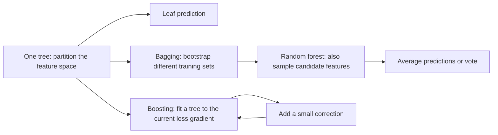

A decision tree asks a sequence of simple questions: is a feature below a threshold, and which branch should this row take? A sufficiently deep tree can fit complicated interactions, but a small change in the training sample can produce a different sequence of questions. Random forests use many such unstable trees and average them. Gradient boosting builds trees one after another, each aimed at reducing the current model's loss.

Those three sentences are enough to remember the family resemblance. For an interview, I want one level deeper: what exactly makes a split good, why averaging helps only when trees disagree, and what a "tree fitted to residuals" really means for a loss other than squared error.



## One tree: a greedy partition

At a node containing a set $S$ of training rows, a numerical split sends rows with $x_j \le t$ left and the rest right. The candidate is judged by the **weighted** impurity after the split, because a pure leaf containing one row cannot cancel out a messy leaf containing hundreds. For classification, let $p_k$ be the fraction of rows in class $k$. Two common impurities are

$$
I_{\text{Gini}}(S)=1-\sum_k p_k^2,\qquad
I_{\text{entropy}}(S)=-\sum_k p_k\log_2 p_k,
$$

where $0\log 0$ is defined as zero. Gini can be read as the probability that two independent labels drawn from the node's class proportions differ. Entropy measures the uncertainty of a label in bits. Both are zero for a pure node; for balanced binary classes, Gini is $0.5$ and entropy is $1$ bit. They often choose similar splits, but they are different objectives and can rank candidates differently. 

For left and right children $S_L,S_R$, the gain is

$$
\Delta I=I(S)-\frac{|S_L|}{|S|}I(S_L)-\frac{|S_R|}{|S|}I(S_R).
$$

Consider eight ordered feature values $x=1,\ldots,8$ with labels $[0,0,1,0,1,1,1,1]$. There are three zeros and five ones, so root Gini is $1-(3/8)^2-(5/8)^2=0.46875$. At threshold $4.5$, the left child has three zeros and one one: Gini $1-(3/4)^2-(1/4)^2=0.375$. The right child has four ones and Gini zero. Weighted child Gini is $(4/8)(0.375)+(4/8)(0)=0.1875$, giving gain $0.28125$. At threshold $2.5$, weighted Gini is $0.208333$ and gain $0.260417$. Among these candidates, $4.5$ wins. The script below checks the arithmetic.

For regression with squared-error loss, a leaf predicts its target mean $\bar y_S$. Its training loss is the within-leaf sum of squared errors,

$$
\operatorname{SSE}(S)=\sum_{i\in S}(y_i-\bar y_S)^2.
$$

The best split minimizes $\operatorname{SSE}(S_L)+\operatorname{SSE}(S_R)$, or equivalently maximizes the reduction from the parent's SSE. Some explanations use variance instead: $\operatorname{SSE}(S)=|S|\operatorname{Var}_{\mathrm{pop}}(S)$. The child variances therefore **must** be weighted by child sizes. For targets $[1,2,9,10]$, the root mean is $5.5$ and SSE is $65$. Splitting into $[1,2]$ and $[9,10]$ leaves means $1.5$ and $9.5$, with SSE $0.5+0.5=1$. The split reduces SSE by $64$. A classification leaf usually reports its class frequencies as probabilities and picks the largest class for a hard label; a regression leaf reports the mean for squared error. 

The algorithm evaluates candidate features and thresholds at the current node, chooses the largest immediate gain, and repeats in each child. It does not search all possible trees. This **greedy** choice is computationally useful, but it can miss a pattern whose first split has no immediate reward. XOR is the clean example: four equally weighted rows with $(x_1,x_2)\in\{0,1\}^2$ and target $x_1\oplus x_2$. Splitting on either feature leaves one positive and one negative in each child, so Gini gain is zero. A depth-two tree represents XOR exactly *if* it is allowed to take that first zero-gain split. A rule that requires strictly positive gain stops at the root. The limitation is the search rule, not the representation capacity.

## Keeping a tree from memorizing the sample

Without constraints, a tree can keep splitting until leaves contain single rows. Training impurity falls, while variance often rises: another sample can put thresholds somewhere else. Maximum depth limits the number of successive questions. A minimum leaf size prevents a split that isolates a handful of observations. A minimum gain or maximum number of leaves limits how readily the tree spends complexity. They solve related problems but are not interchangeable: a shallow tree can still create a tiny leaf, and a large minimum leaf can still allow many levels on a big data set.

An alternative is to grow a larger tree and prune it. Cost-complexity pruning selects a subtree $T$ by balancing training error against its number of leaves: $R_\alpha(T)=R(T)+\alpha |T|$. Larger $\alpha$ favors fewer leaves. The impurity used in $R$ depends on the task, and the best $\alpha$ must be selected using training-only validation, not by reading the final test result. 

Threshold trees do not need feature scaling in the same way that distance-based models do: a strictly increasing transform preserves the ordering of a numeric feature and thus the possible partitions. That does **not** make preprocessing irrelevant. Native categorical splits, one-hot encoding, ordinal codes, and missing-value routing vary by implementation. An arbitrary integer code for an unordered category imposes an order; a threshold tree can then group only consecutive codes with one split. One-hot encoding avoids that artificial order but can increase width and spread one category across several features. Missing values may need imputation or may be routed by a library's learned rule. If imputing or encoding learns anything from the data, fit it inside each training fold. I would test these choices as part of the model, rather than assume every tree library handles them alike.

## Bagging and the random forest

Bagging draws a **bootstrap sample** of $n$ rows with replacement from the $n$ training rows, trains a tree, repeats, then averages regression predictions or aggregates classification votes. A row has probability $(1-1/n)^n$ of being absent from one bootstrap sample, approaching $e^{-1}\approx0.368$ as $n$ grows. The remaining sampled positions include duplicates; "about 63.2% unique rows" is an expectation in the large-$n$ limit, not a train/test split. Unstable base learners such as deep trees are especially suitable for this averaging idea. 

Why should an average be steadier? Suppose each tree's prediction error at a fixed input has variance $\sigma^2$, and every distinct pair of tree errors has correlation $\rho$. For the mean of $B$ trees,

$$
\operatorname{Var}\left(\frac{1}{B}\sum_{b=1}^{B} E_b\right)
=\sigma^2\left(\rho+\frac{1-\rho}{B}\right).
$$

This follows by summing $B$ variance terms and $B(B-1)$ covariance terms, then dividing by $B^2$. It assumes equal variances and equal pairwise correlations at the input being discussed. It is a variance calculation, not a promise about classification accuracy or total test error. As $B$ grows, the $\rho\sigma^2$ term remains. If all trees make the same mistakes, more averaging does little.

A random forest adds a second source of difference: at each split it considers a random subset of features. A dominant predictor is then less likely to take every root split, so trees have a better chance of discovering different useful structures. The tradeoff is that too few candidate features can weaken individual trees. Bagging tackles tree variance; feature sampling tries to reduce the correlation left in the average. Breiman's analysis expresses the classification tradeoff in terms of tree strength and correlation, rather than claiming that decorrelation alone always improves a forest. 

**Out-of-bag (OOB) evaluation** reuses the bootstrap omissions. For training row $i$, predict using only trees whose bootstrap samples omitted $i$, then compare that aggregate with $y_i$. It is a convenient internal error estimate for ordinary independent, identically distributed rows when the *entire* feature pipeline was fitted without using that row. It is not automatically safe for grouped people, repeated observations, time series, target encoding, or preprocessing fitted on all rows: those can leak information across the apparent holdout. OOB predictions also use fewer trees per row than the deployed forest. I would use [a split or cross-validation design matching the data](/blog/cross-validation-and-data-leakage/) to make the final model comparison.


## Gradient boosting: corrections in sequence

The forest's trees can be trained independently, because each learns from a sampled version of the original problem. Boosted trees are sequential: tree $m$ sees the predictions produced by trees $1,\ldots,m-1$ and adds a correction. Write the model as

$$
F_M(x)=F_0(x)+\eta\sum_{m=1}^{M} f_m(x),
$$

where $F_0$ is an initial constant, $f_m$ is a small regression tree, and $0<\eta\le1$ is the learning rate or shrinkage factor. The trees may be shallow, but they need not be literal stumps. A depth-one tree can express one threshold; deeper trees can express interactions. Adding depth changes the complexity of each correction and how readily the ensemble fits noise.

For a differentiable loss $\ell(y,F)$, the target at training row $i$ in round $m$ is the **negative gradient**

$$
r_{im}=-\left.\frac{\partial \ell(y_i,F)}{\partial F}\right|_{F=F_{m-1}(x_i)}.
$$

Fit a tree to these targets, then choose its leaf values or a step size to reduce the actual loss. The tree approximates a direction in function space; its leaf values need not equal the raw pseudo-residual averages for every loss. This is Friedman's gradient boosting view. 

With half squared error, $\ell(y,F)=\tfrac12(y-F)^2$, the gradient is $F-y$, so $r=y-F$: ordinary residuals. That is where the common interview shorthand comes from. With binary cross-entropy, let $F$ be the **logit**, $p=\sigma(F)=1/(1+e^{-F})$, and

$$
\ell(y,F)=-y\log p-(1-y)\log(1-p),\qquad
\frac{\partial\ell}{\partial F}=p-y.
$$

The negative gradient is $y-p$. It is a probability-space difference used as the direction for changing the **logit**; it is not $y-F$, and adding it directly to a probability would be the wrong update. In the second-order version below, the Hessian $p(1-p)$ also matters. For other losses, "fit the residuals" can be even less accurate as a description.

Shrinkage makes each correction smaller. A smaller $\eta$ often calls for more trees to reach a similar training fit; it does not guarantee generalization. I tune learning rate and tree count together, monitor a validation metric, and stop when adding trees no longer improves it. The validation set must be separate from fitting the trees and all learned preprocessing. Repeatedly choosing among many configurations on that same validation set can itself overfit the selection process; the [evaluation post](/blog/cross-validation-and-data-leakage/) handles the outer test boundary.

Boosting can reduce underfitting by repeatedly fixing systematic mistakes, but its sequential fitting can also chase mislabeled rows or unusual outliers, depending on the loss and regularization. A forest's averaging is often easier to tune and parallelize; boosted trees can be strong on structured tabular data when carefully validated. Neither is universally better. I would compare them on the *same* folds and metric, with comparable handling of missing values, categories, and class imbalance.

## The second-order split in XGBoost

XGBoost makes the correction step more explicit. At one boosting round, let the new tree send row $i$ to leaf $q(i)$ with leaf weight $w_{q(i)}$. Define $g_i=\partial\ell_i/\partial F_i$ and $h_i=\partial^2\ell_i/\partial F_i^2$, evaluated at the current prediction. A second-order Taylor expansion of the loss, together with a penalty for $T$ leaves and their weights, gives the approximate objective

$$
\widetilde{\mathcal L}
=\sum_i\left[g_iw_{q(i)}+\frac12 h_iw_{q(i)}^2\right]
  +\gamma T+\frac{\lambda}{2}\sum_{j=1}^{T}w_j^2.
$$

Here $\gamma\ge0$ charges for each leaf, and $\lambda\ge0$ penalizes large leaf weights. For leaf $j$, write $G_j=\sum_{i:q(i)=j}g_i$ and $H_j=\sum_{i:q(i)=j}h_i$. Its part of the objective is $G_jw_j+\tfrac12(H_j+\lambda)w_j^2+\gamma$. Setting the derivative with respect to $w_j$ to zero yields

$$
w_j^*=-\frac{G_j}{H_j+\lambda}.
$$

Substitution gives an optimized leaf contribution of $-\tfrac12G_j^2/(H_j+\lambda)+\gamma$. Thus the improvement from splitting a parent into left and right leaves is

$$
\operatorname{Gain}
=\frac12\left[
\frac{G_L^2}{H_L+\lambda}
+\frac{G_R^2}{H_R+\lambda}
-\frac{(G_L+G_R)^2}{H_L+H_R+\lambda}
\right]-\gamma.
$$

The subtraction of $\gamma$ appears because two leaves cost one more leaf than the unsplit parent. A split with nonpositive gain is not worth taking under this local approximation. Implementations can add constraints and approximation strategies, but this objective explains the role of the core terms. 

Take four binary labels $[0,0,1,1]$ with current logit $F=0$ for every row. Then $p=0.5$, gradients are $[0.5,0.5,-0.5,-0.5]$, and Hessians are all $0.25$. Let $\lambda=1$ and $\gamma=0.1$, and split the first two rows from the last two. The parent has $(G,H)=(0,1)$. The left has $(1,0.5)$ and the right $(-1,0.5)$. Both child score terms are $1^2/(0.5+1)=2/3$, so gain is $\tfrac12(2/3+2/3)-0.1=0.566667$. The optimal leaf weights are $-2/3$ and $+2/3$. With shrinkage $\eta=0.3$, the logits move only to $-0.2$ and $+0.2$, giving probabilities about $0.450166$ and $0.549834$. The direction is sensible: the left contains negatives and its predicted probability falls.

This is a **local, regularized** score, not the exact reduction in held-out loss. A larger $\lambda$ shrinks weights and usually makes splits less attractive; a larger $\gamma$ directly raises the gain needed to add a leaf. For logistic loss the Hessian is $p(1-p)$, so confident predictions have lower local curvature; constraints on minimum child Hessian can prevent leaves supported by too little effective information. The calculation is also why an answer such as "XGBoost just fits residuals faster" misses its objective and regularization.

## Run the numbers yourself

This self-contained NumPy script enumerates two candidate Gini splits and computes the one-step logistic gain above. It is also available as [split_and_boost.py](split_and_boost.py).

```python {title="split_and_boost.py"}
import numpy as np

def gini(labels):
    if len(labels) == 0:
        return 0.0
    proportions = np.bincount(labels, minlength=2) / len(labels)
    return 1.0 - np.sum(proportions**2)

x = np.arange(1, 9)
y = np.array([0, 0, 1, 0, 1, 1, 1, 1])
parent = gini(y)
for threshold in (2.5, 4.5):
    left, right = y[x <= threshold], y[x > threshold]
    children = (len(left) * gini(left) + len(right) * gini(right)) / len(y)
    print(f"threshold={threshold:.1f}, weighted Gini={children:.6f}, gain={parent - children:.6f}")

labels = np.array([0, 0, 1, 1])
probability = 1 / (1 + np.exp(-np.zeros(4)))  # current logits are zero
gradients = probability - labels
hessians = probability * (1 - probability)
regularization, split_penalty = 1.0, 0.1

def score(index):
    G, H = gradients[index].sum(), hessians[index].sum()
    return G**2 / (H + regularization), -G / (H + regularization)

left_score, left_weight = score(np.array([0, 1]))
right_score, right_weight = score(np.array([2, 3]))
parent_score, _ = score(np.arange(4))
gain = 0.5 * (left_score + right_score - parent_score) - split_penalty
print(f"boost gain={gain:.6f}, leaf weights=({left_weight:.6f}, {right_weight:.6f})")
```

```text {title="Output"}
threshold=2.5, weighted Gini=0.208333, gain=0.260417
threshold=4.5, weighted Gini=0.187500, gain=0.281250
boost gain=0.566667, leaf weights=(-0.666667, 0.666667)
```


## Choosing, evaluating, and explaining one

| Model | What it buys me | What I watch |
| --- | --- | --- |
| One shallow tree | Rules I can read and test directly | Underfitting and unstable thresholds |
| Random forest | Lower variance from averaging many trees; modest tuning burden | Correlated trees, memory, prediction cost, and weak extrapolation |
| Boosted trees | Sequentially corrects errors under an explicit loss | Learning rate and tree count, noisy labels, validation overfit, and prediction cost |

All three produce piecewise constant predictions with ordinary constant leaves. A regression tree cannot extrapolate a rising trend beyond the largest observed feature value in the way a linear model can; a forest average of such trees inherits that limit, and a sum of constant-leaf boosted trees does too. If the task requires extrapolation, I would test a model with a suitable structural assumption. On small data, an unconstrained single tree is especially volatile; a forest is a sensible baseline. If I need the exact decision path for a person to inspect, I keep a small tree in the comparison even if an ensemble scores better.

A feature's impurity-based importance sums the training impurity reductions credited to its splits. It is easy to compute, but a continuous or high-cardinality feature offers more possible thresholds or partitions and can be favored even when it carries little true signal. Correlated predictors also divide credit unpredictably. These are reasons not to read the plot as a causal explanation or a ranking of intrinsic value. The bias is documented for random-forest importance measures. 

Permutation importance asks a different question: on a held-out set, how much does a chosen metric fall when I shuffle one feature while keeping the fitted model fixed? That measures reliance of **this model** on the feature under that permutation, on that dataset. With correlated features, shuffling one may barely hurt because its partner substitutes for it; alternatively, independent shuffling can make unrealistic combinations. A valid held-out set matters: calculating importance on training rows rewards memorized splits, and doing feature selection repeatedly against the final test set leaks that set into the modeling process. If I use permutation results to select features, that selection belongs inside each training fold, followed by evaluation on untouched outer folds. 

The comparison metric should match the task. For imbalanced classification, accuracy alone can hide missed minority cases; I would choose among precision, recall, PR-oriented metrics, log loss, or calibration according to the actual cost of errors. A forest can estimate probabilities by averaging its trees' leaf class fractions; a logistic-loss boosted model can transform its score with a sigmoid. Neither output is automatically calibrated. Grouped data need group-aware splitting; time-ordered data need a time-aware design. These choices can reverse a model ranking more easily than another small hyperparameter search. The details are in [Cross-Validation and Data Leakage](/blog/cross-validation-and-data-leakage/).

## Interview questions and follow-ups

**1. Why is impurity reduction weighted by child size?** A split that peels off one pure observation should not look as good as one that organizes half the sample. The weighted average equals the expected child impurity for a row drawn uniformly from the parent. With sample weights, replace counts by summed weights throughout.

**2. Are Gini impurity and entropy the same thing?** No. Both are zero at a pure node and largest near balanced class proportions, but their curves differ. Entropy uses $-p\log p$ and corresponds to log-loss for a leaf predicting class frequencies; Gini uses $1-\sum p_k^2$. Either can change the chosen split on some data. 

**3. What exactly is minimized in a squared-error regression tree?** The sum of squared deviations from each leaf's mean. At a candidate split, choose the smallest left SSE plus right SSE. If someone says "variance reduction," I ask whether they have included the child-size weights; otherwise the comparison can be wrong.

**4. Can a tree learn XOR?** A depth-two axis-aligned tree can represent it. A strictly positive-gain greedy splitter can fail at the root because either first split has zero gain. Allowing the zero-gain split, changing the features, or using a learner with a different search strategy resolves that specific obstruction.

**5. Why do random forests usually grow deep trees if deep trees overfit?** Deep trees are high-variance base learners. Bootstrapping and feature sampling produce different trees, and averaging can cancel part of their fluctuations. It cannot remove shared error or make a missing signal appear. I still tune leaf size and depth when the data demand it.

**6. Does adding more trees to a forest eventually overfit?** In the ideal averaging picture, adding independently drawn trees approaches the forest's limiting ensemble prediction; it does not keep increasing model flexibility in the same way as growing one tree deeper. Real performance can plateau, computation grows, and the training procedure or data leakage can still be wrong. The correlation floor in the variance equation explains why returns diminish. 

**7. What is the difference between bagging and boosting?** Bagging trains varied base learners on resampled data and aggregates them; the learners can be fit independently. Boosting adds learners sequentially to reduce a chosen loss. A random forest adds random candidate-feature selection to bagged trees. "Bagging reduces variance, boosting reduces bias" is a useful starting intuition, not a theorem about every dataset.

**8. Is an OOB score a replacement for cross-validation?** It is a useful estimate for the bootstrap-trained model under an ordinary row-independent sampling setup. It does not repair group or time leakage, target encoding fitted globally, or repeated tuning against the same evaluation signal. I use a split design that matches how future examples arrive.

**9. For logistic boosting, what are the pseudo-residual and Hessian?** If $F$ is a logit and $p=\sigma(F)$, cross-entropy has gradient $p-y$, so the negative gradient is $y-p$ and Hessian is $p(1-p)$. The update is made to the logit. Saying "the residual is $y-F$" is correct for half squared error, not for this objective.

**10. Why can a lower learning rate need more boosting rounds?** Each tree's contribution is multiplied by $\eta$, so more stages may be needed to move predictions the same distance. The interaction with tree depth, regularization, and early stopping matters more than either number alone. A very small rate with too few trees simply underfits.

**11. Where do $\lambda$ and $\gamma$ enter the XGBoost split?** $\lambda$ appears in $w_j^*=-G_j/(H_j+\lambda)$, shrinking a leaf's optimal weight and its score. $\gamma$ is the price of one additional leaf, subtracted from split gain. A positive raw fit improvement can therefore still be rejected. 

**12. Why might a useless high-cardinality feature rank highly, and why might permutation call a useful correlated feature unimportant?** Many possible splits give the first feature more chances to reduce training impurity by accident. For the second, another correlated feature can preserve the prediction when one is shuffled. I would inspect held-out permutation results, correlated feature groups, stability across folds, and the model's error before making a claim about relevance.

**13. Do trees need feature scaling or one-hot encoding?** A monotone rescaling of a numeric feature leaves its order and threshold partitions intact, so ordinary threshold trees do not need scaling for that reason. Categories are different: an ordinal code imposes an arbitrary ordering unless the model handles categories natively. One-hot encoding, missing values, and learned imputation are implementation and validation choices, not universal rules.



