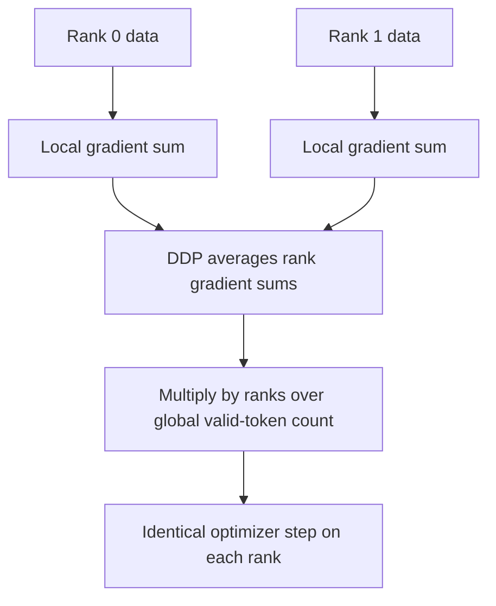
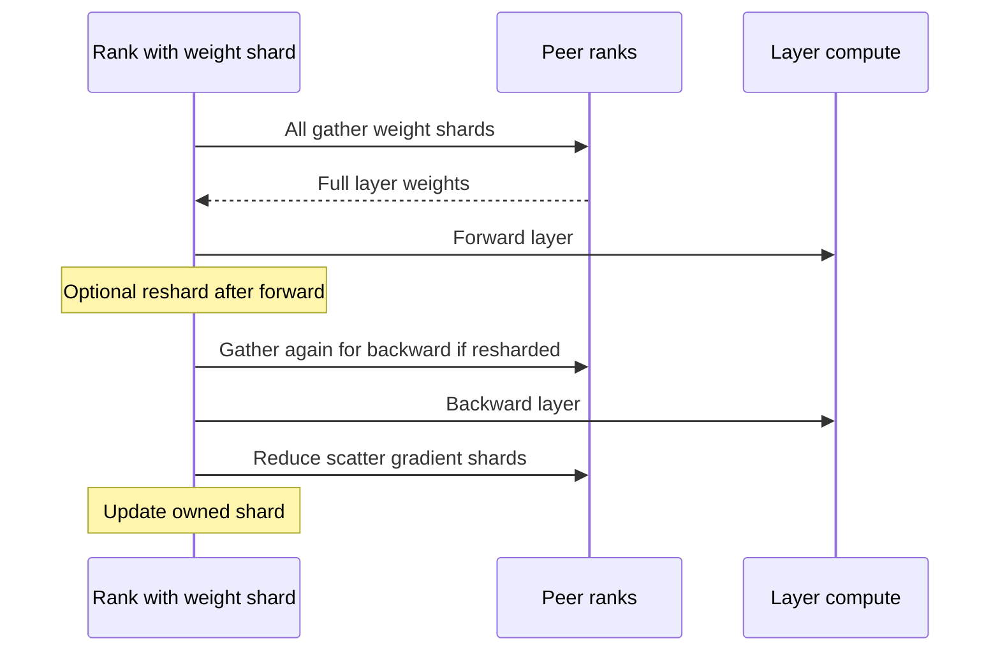
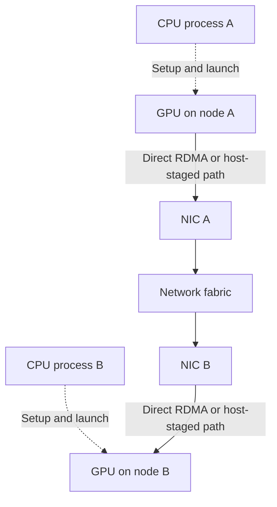

A large model needs more than one accelerator for two different reasons: **capacity** and **speed**. I keep those separate. Data parallelism makes more workers process different examples. Sharding makes each worker store less training state. Tensor and pipeline parallelism split the model's computation itself. Each has a distinct communication pattern and a different failure mode. A plan that fits weights in memory can still fail on activations, and a plan with perfect memory accounting can still idle on the network.

I will use *rank* for one worker process, *step* for one optimizer update, and *microbatch* for one forward/backward chunk. The numbers below describe a toy configuration, not a GPU benchmark. The linked CPU script checks the arithmetic without pretending to simulate network latency.

## Start with the gradient being averaged

For a dataset of $N$ supervised tokens, suppose the intended objective is a mean token loss,

$$
L(\theta)=\frac{1}{N}\sum_{i=1}^{N}\ell_i(\theta),\qquad \nabla L=\frac{1}{N}\sum_i\nabla\ell_i.
$$

In data parallel training, ranks begin with the same parameters and process separate pieces of the batch. PyTorch `DistributedDataParallel` (DDP) synchronizes gradients with collectives; every rank then applies the same optimizer update. DDP expects compatible parameter ordering and matching collective participation. It averages rank gradients. 

That average equals the intended global mean only when ranks contribute the same number of equally weighted tokens. If rank $r$ has $n_r$ valid targets and computes its local *mean* $g_r$, then the global gradient is

$$
g=\frac{\sum_r n_r g_r}{\sum_r n_r},
$$

not $\frac{1}{R}\sum_r g_r$ unless all $n_r$ are equal. Padding tokens ignored by the loss do not count. Sample weighting, packed examples, and variable completion lengths make this distinction practical, not academic. One safe pattern is to backpropagate each rank's **sum** of valid-token losses, let DDP average the resulting gradients, and multiply the synchronized gradient by $R/\sum_r n_r$ before stepping. An equivalent pattern is to scale each local mean by $R n_r/\sum_r n_r$ before backward. In both cases all ranks need the same global valid-token count. Do not quietly average per-example means if the objective is per-token mean.

For example, rank A has two token gradients, $1$ and $4$, and rank B has one, $9$. Averaging the rank means gives $(2.5+9)/2=5.75$; the token mean is $(1+4+9)/3=4.667$. The difference persists even though both ranks synchronized correctly. If a rank runs out of batches early, it cannot simply skip a collective while peers continue; DDP's `join` facility addresses uneven *iteration* counts, with its own gradient-division choice. 



## Accumulation changes the timing, not the objective

Gradient accumulation processes several microbatches before one optimizer step. If there are $K$ equal-sized microbatches per rank, the familiar recipe is to divide each microbatch loss by $K$, call backward $K$ times, then step once. With unequal valid-token counts, the exact recipe is instead to sum their losses and normalize by the *total* valid tokens across all ranks and microbatches. A different denominator means a different objective.

DDP's `no_sync()` can suppress gradient synchronization on the first $K-1$ microbatches. The last backward synchronizes the accumulated gradient. The forward pass must also occur inside `no_sync()` for those early microbatches; wrapping only backward does not achieve the documented behavior. Never place the optimizer step before the final synchronization. 

```python
# Schematic for equal-sized microbatches and an existing DDP model.
optimizer.zero_grad(set_to_none=True)
for i, batch in enumerate(microbatches):
    context = model.no_sync() if i + 1 < len(microbatches) else nullcontext()
    with context:
        loss = model(batch).loss / len(microbatches)
        loss.backward()
optimizer.step()
```

Here `nullcontext` is from `contextlib`. This is illustrative training-loop structure; mixed precision, clipping, skipped steps, and valid-token weighting need explicit handling. Accumulation increases the effective batch without making activations from all microbatches live at once, but gradients remain resident between backwards. It does not reduce model-state memory. Reducing synchronization frequency can help small microbatches, yet it may change optimization if the global batch or scheduler step count changes.

## Count memory before choosing a parallelism strategy

For $P$ parameters, a simple mixed-precision Adam accounting model uses 2 bytes per low-precision weight, 2 per low-precision gradient, 4 per FP32 master weight, and 8 for two FP32 moment buffers: **16 bytes per parameter**. This is an *assumption*, not a universal property of Adam or PyTorch. Some stacks hold FP32 gradients, avoid a distinct master copy, use fused or quantized optimizers, or keep temporary casts. With FP32 gradients the same accounting becomes 18 bytes per parameter. Mixed precision mainly specifies compute/storage dtypes at particular points; it does not imply every tensor is two bytes. Loss-scaling may matter with FP16 and differs for BF16.

Then add activations, temporary workspaces, attention buffers, communication buckets, allocator fragmentation, embeddings and heads, and any unsharded parameter windows. Activation memory changes with sequence length, microbatch size, architecture, checkpoint policy, and kernel. In a naive attention implementation the score tensor can scale as sequence length squared; fused attention changes what is materialized. A model-state estimate alone is therefore a **lower bound**, not a device-size recommendation.

For a toy 7-billion-parameter model with eight data-parallel ranks, the 16-byte assumption yields 112 GB of logical model state on *every* DDP rank, or 104.31 GiB. In this deliberately idealized example, the sharding stages produce:

| Strategy | Replicated or sharded state | Model-state bytes per rank | GiB per rank |
| --- | --- | ---: | ---: |
| DDP / ZeRO-0 | all replicated | $16P$ | 104.31 |
| ZeRO-1 | optimizer + master sharded | $(4+12/8)P$ | 35.86 |
| ZeRO-2 | above + gradients sharded | $(2+2/8+12/8)P$ | 24.45 |
| ZeRO-3 | above + weights sharded | $16P/8$ | 13.04 |

The last column omits activations and peak gathering buffers. The exact split between low-precision gradients and master weights is implementation dependent; the stage progression is the useful idea. ZeRO-1 partitions optimizer state, ZeRO-2 also partitions gradients, and ZeRO-3 also partitions parameters. 

Sharding trades persistent storage for more communication and transient storage. With ZeRO-3, a layer's full weights must appear where its math runs. A rank gathers those weights, computes, and can discard the unsharded copy. Stage 2 reduces/scatters gradients to owners. Stage 1 owners update their parameters, after which replicas must receive updated values. The exact collective schedule depends on the engine.

## FSDP2 makes the gather boundary explicit

PyTorch's `fully_shard` API, usually called FSDP2, groups parameters by the modules on which it is applied. Before a group's forward, it all-gathers that group's parameter shards. After backward it reduce-scatters its gradient shards. It can reshard after forward, then gather again before backward, or keep the full weights longer for a different memory/communication tradeoff. Applying `fully_shard` to individual transformer layers before the root creates layer-sized groups that can be prefetched and released. Applying it only to the root creates a large gather boundary and weak overlap. The precise public API and scheduling details are version-sensitive; this description follows PyTorch documentation checked in November 2026. 



DDP uses an all-reduce of gradients, so every rank ends with a full averaged gradient. FSDP2 uses reduce-scatter, so each rank ends with the gradient shard it owns. An idealized ring all-reduce of a payload $S$ bytes moves about $2(R-1)S/R$ bytes per rank; a reduce-scatter moves about $(R-1)S/R$. An all-gather has that same ring volume. For $P=7$ billion, $R=8$, and a 2-byte gradient payload, one full-gradient ring all-reduce is about **22.82 GiB per rank**. One weight all-gather plus one gradient reduce-scatter of equal-sized payloads totals the same idealized volume. In an actual FSDP2 step, a second parameter gather for backward, grouping, topology, casts, and overlap can change both bytes and observed time. Bytes transferred do not predict latency without bandwidth, hop count, contention, and compute overlap.

A deadlock is possible if ranks issue collectives in different order or one rank silently omits a layer's collective. Before tuning overlap, ensure the same program path and group order on every participating rank. Then profile the hardware: fast links within a node and slower links across nodes motivate different mesh dimensions. Hiding a transfer behind compute helps only when the transfer can start early enough and there is enough bandwidth; an oversized root gather or a saturated interconnect cannot be wished away.

## How NCCL actually moves those gradients

DDP and FSDP decide **which tensors** must be synchronized. NVIDIA's Collective Communications Library (NCCL) provides GPU communication primitives that can execute those collectives. They are different layers of the stack: an NCCL `AllReduce` computes a reduction such as a sum; it does not know that an LLM's loss was averaged over tokens. DDP's reducer and the training loop determine the normalization. In the unequal-token example above, NCCL can move the correct *sums*, but the program must still use the global valid-token denominator. The account here follows NVIDIA's NCCL user guide and engineering notes checked on 10 November 2026; algorithm choices and transport details are version- and topology-dependent. 

### Before a collective: who belongs to it?

An NCCL **communicator** names a fixed group of ranks and maps each rank to a CUDA device. The ranks exchange a unique ID during initialization so every participant joins the same communicator; a launcher or process group supplies the surrounding coordination. Initialization discovers the GPU and network topology, establishes connections, and chooses communication paths. That bootstrap/control exchange is not the large gradient payload itself. Once ready, each rank's host process issues the same collective on that communicator for its GPU, with compatible element count, datatype, reduction, and ordering. NCCL's collective documentation requires matching count and datatype. Its group-call documentation says issuing order must match even when operations span communicators. A rank that skips a layer, calls `AllGather` where its peer calls `AllReduce`, or uses a different tensor length can hang, error, or corrupt data. A timeout is a symptom, not proof that the network is slow. 

For a simple mental trace, imagine four GPUs, one rank each. Each rank has a one-GiB gradient vector. Split each vector into four equal 256-MiB chunks, $c_0$ through $c_3$, and connect ranks in the logical ring $0\to1\to2\to3\to0$. A ring all-reduce has two phases. In **reduce-scatter**, each rank sends one chunk to its next neighbor and receives another from its previous neighbor, adding the received partial sum to its local chunk. After three such steps, each rank owns one fully reduced chunk. In **all-gather**, those four owned chunks circulate for three more steps, until every rank has the complete reduced vector. Each rank has sent three chunks in each phase. For rank 0, the ownership trace is:

| Step | Rank 0 sends to rank 1 | Rank 0 receives from rank 3 | After receive |
| --- | --- | --- | --- |
| RS1 | local $c_0$ | rank 3's $c_3$ | partial $c_3$ |
| RS2 | partial $c_3$ | partial $c_2$ | larger partial $c_2$ |
| RS3 | partial $c_2$ | partial $c_1$ from three ranks | adds local $c_1$ and owns reduced $c_1$ |
| AG1 | reduced $c_1$ | reduced $c_0$ | owns $c_1,c_0$ |
| AG2 | reduced $c_0$ | reduced $c_3$ | owns $c_1,c_0,c_3$ |
| AG3 | reduced $c_3$ | reduced $c_2$ | owns all four |

The reduction sum is the same at every rank after the gather. DDP can then produce its average gradient by scaling appropriately; if the desired objective is a global token mean, the global valid-token count still controls the final scale. The attached CPU script prints all 24 directed chunk messages and checks the result against a direct elementwise sum. Its ten-element input is padded to twelve values so four equal chunks can circulate; zeros are trimmed after the check. It also repeats the test with unpadded chunk lengths $[3,3,2,2]$, where per-rank byte counts need not match the equal-chunk formula below. NCCL itself may choose different partitioning, pipelining, or algorithms. The simulator checks **arithmetic and ownership only**, not CUDA execution or network performance.

```python
# Core of one simulated reduce-scatter round; the full script also all-gathers.
# All ranks send from the same pre-round snapshot, so message timing is explicit.
sent = [(rank - step) % ranks for rank in range(ranks)]
for rank in range(ranks):
    source = (rank - 1) % ranks
    idx = sent[source]
    pieces[rank][idx] = [a + b for a, b in zip(before[rank][idx], before[source][idx])]
```

If the payload per rank is $S$ bytes and chunks are equal, the ring sends $(R-1)S/R$ per rank in reduce-scatter and the same again in all-gather: $2(R-1)S/R$ **bytes sent per rank**. Receiving adds the same amount again; do not double the send number and still call it “bytes sent.” For four ranks and $S=1$ GiB, each rank sends $1.5$ GiB, and the four directed ring links carry $6$ GiB in aggregate. If ranks 0–1 share node A and 2–3 share node B, the logical ring has two edges crossing nodes. Under this *single-ring toy layout*, those two cross-node edges carry $3$ GiB of the directed aggregate, with traffic in opposite directions. This is neither a predicted NIC counter nor a timing estimate: real transfers have protocol overhead, multiple channels, topology-dependent routes, and concurrent use of links. The earlier 7-billion-parameter example uses this same ring formula for an idealized 2-byte gradient payload.

Trees and hierarchical collectives are other possibilities. A tree can reduce the number of sequential hops for small messages; a ring can pipeline large chunks and use link bandwidth well. A hierarchical plan may reduce inside each node first, communicate between nodes, then distribute locally. NCCL chooses among algorithm families and protocols using message size and discovered topology; **ring is an explanation, not a universal NCCL default**. Its *channels* are logical parallel pipelines that split work and can use several paths. A channel is not necessarily one physical cable or one NIC. More channels or more apparent overlap do not automatically improve throughput once links, NICs, or GPU resources are saturated. 

### From a GPU to another node

Inside one server, ranks may have NVLink/NVSwitch connections, PCIe peer-to-peer routes, or paths that require staging through host-accessible memory, depending on hardware and access rules. Across servers, NCCL's network layer may use an InfiniBand/RoCE transport, a TCP socket transport, or an external network plugin. A fast on-node GPU path does not imply the same bandwidth to another node. Topology-aware ring or tree construction tries to avoid repeatedly crossing a slow boundary, but placement and contention still matter. The [GPU memory and kernels post](/blog/gpu-kernels-memory-tiling/) develops the underlying device paths; here the important point is that a collective's logical neighbor need not be physically adjacent. 



GPUDirect RDMA can let a capable NIC read or write GPU buffers without copying the payload through CPU memory. Whether NCCL uses it depends on GPU–NIC topology, driver and kernel capabilities, transport, and configuration; a fallback may stage data through host memory. “Direct” describes a possible data path, not the absence of CPU work: host processes still create communicators, enqueue work, handle setup and control, and may run network proxy activity. NVIDIA's PXN description, for example, explicitly describes a CPU proxy managing a NIC. A job should be diagnosed from its actual transport and topology, not from the presence of the word *GPUDirect* in a device specification. NVIDIA's environment documentation exposes network-module selection and GPU–NIC distance controls precisely because there is no one path for every machine. 

### Enqueued is not completed

NCCL collectives are associated with CUDA streams. For an ordinary successful call on a blocking communicator, the call returns after the operation has been **enqueued**, while device execution continues asynchronously. If a compute kernel on one stream produces a gradient and a collective on another stream consumes it, an event or equivalent stream dependency must make the data ready before communication reads it. Likewise, the optimizer must wait until the reduction has completed before consuming the reduced gradient. The CPU return from a collective call alone does not establish either dependency. Grouped calls may defer enqueuing until `ncclGroupEnd`. With a **nonblocking communicator**, `ncclGroupEnd` can return `ncclInProgress` before kernels are enqueued; the host must wait for the communicator to reach `ncclSuccess` before synchronizing the stream. Enqueued still does not mean completed. 

Overlap helps when communication can run while independent compute proceeds. It has limits. Two streams may contend for GPU execution resources; multiple collectives may share the same links or NIC; a late gradient cannot be reduced before backward computes it. A large all-gather that blocks the next layer's forward is exposed latency, not hidden work. Across nodes, inconsistent collective order, mismatched counts or dtypes, one failed rank, or one rank entering a different code path can make peers wait indefinitely. I would first verify participation and ordering, then inspect topology and measured transfer time before changing protocol knobs. `nccl-tests` reports operation time, algorithm bandwidth $S/t$, and a *bus bandwidth* normalized by a collective-specific factor. Its bus-bandwidth number helps compare a collective with link capacity; it is **not a literal count of bytes observed on a particular NIC**. 

## Tensor and pipeline parallelism split the math

Tensor parallelism (TP) divides a layer's matrices across devices. In a column-sharded linear layer, workers compute different output features; in a row-sharded layer, they compute partial sums that must be reduced. Attention heads and feed-forward dimensions are common split axes. TP saves per-rank parameter and optimizer storage, but adds communication **inside every layer** and is most attractive when its group has fast links. Megatron-LM is a primary example of intra-layer parallelism. 

Pipeline parallelism (PP) assigns *different layers* to different stages. Stage 0 sends activations to stage 1 in forward; stage 1 sends activation gradients back in backward. A single microbatch leaves stages idle at the beginning and end. With $p$ stages and $m$ equal-duration microbatches, an idealized all-forward/all-backward schedule has a bubble fraction roughly $(p-1)/(m+p-1)$ under its simplifying assumptions. A one-forward-one-backward (1F1B) schedule changes activation residency and scheduling while retaining warm-up and drain bubbles. More microbatches shrink the relative bubble, but increase scheduling and communication overhead. These schedules and their memory tradeoffs are described in Megatron-LM's scaling paper. 

```text
Toy pipeline, two stages, four microbatches; F=forward, B=backward.
Time slot       1   2   3   4   5   6   7   8   9  10
Stage 0        F1  F2  F3  F4  ..  ..  B1  B2  B3  B4
Stage 1        ..  F1  F2  F3  F4  B1  B2  B3  B4  ..
```

The diagram is conceptual, not a measured or optimal 1F1B trace. Real schedules must respect dependencies between forward and backward on each microbatch; staggered 1F1B interleaves them differently. In a combined layout, total workers can be thought of as $d\times t\times p$ for data, tensor, and pipeline degrees. A specific hardware mapping decides which communication stays inside a fast node and which crosses nodes. More axes do not automatically mean more throughput; each adds synchronization and a new way to waste capacity.

## Recompute and restart are part of the design

Activation checkpointing retains selected boundaries and recomputes intermediate activations during backward. This exchanges extra arithmetic for lower peak activation storage. Stochastic operations such as dropout need consistent random-number behavior between the original forward and recomputation. PyTorch's checkpoint utility preserves relevant RNG state by default, with a performance cost and documented limits around moved devices. It is separate from **training-state checkpoints** saved to disk. 

A restartable training checkpoint must describe a *consistent completed optimizer step*. Save model shards, optimizer and scheduler state, step number, random states, and enough sampler/data-position state to resume the intended data stream. Publish a checkpoint as usable only after all required shards and metadata have completed; a partially written directory is not a restart point. On restart, all ranks must agree which step to load and re-establish the same collective ordering. PyTorch Distributed Checkpoint supports sharded save/load and resharding across compatible topologies, but its documentation warns that serialized state compatibility across PyTorch versions is not guaranteed. 

This is different from the **KV cache** used in inference. A KV cache stores past attention keys and values for a request to avoid recomputing its prefix during decode. It is neither an optimizer state nor an activation tape for backpropagation. Training may use attention kernels with their own temporary buffers, but it usually does not keep an inference-style per-request cache across optimizer steps.

## Run the arithmetic on a CPU

The attached [toy.py](toy.py) uses only Python's standard library. Run `python3 toy.py` from this post's folder. Its gradient example intentionally gives two ranks different numbers of samples. It also prints the idealized state table and ring payload volumes above. All numbers are computed, not measured GPU throughput.

```text
$ python3 toy.py
global=4.666667 rank_mean=5.750000 weighted=4.666667
stage0 state=104.31 GiB/rank
stage1 state=35.86 GiB/rank
stage2 state=24.45 GiB/rank
stage3 state=13.04 GiB/rank
one full-gradient ring allreduce=22.82 GiB/rank
one allgather+reduce-scatter=22.82 GiB/rank
ring simulator: 4 ranks x 10 values, padded to 12; sum=[60, 64, 68, 72, 76, 80, 84, 88, 92, 96]
RS1: 0->1:c0 1->2:c1 2->3:c2 3->0:c3
RS2: 0->1:c3 1->2:c0 2->3:c1 3->0:c2
RS3: 0->1:c2 1->2:c3 2->3:c0 3->0:c1
AG1: 0->1:c1 1->2:c2 2->3:c3 3->0:c0
AG2: 0->1:c0 1->2:c1 2->3:c2 3->0:c3
AG3: 0->1:c3 1->2:c0 2->3:c1 3->0:c2
un-padded uneven chunks [3, 3, 2, 2]: same sum, unequal per-rank byte volume
```

The script models a single scalar gradient and byte volumes. It deliberately does not model PyTorch, collective algorithms, GPU allocator peaks, or overlap. Its value is to expose a wrong denominator or a missing memory term before using expensive hardware.

## Interview questions I would rehearse

1. **Why can DDP give the wrong token-weighted gradient even when all ranks synchronize?** It averages rank means; unequal valid-token counts require weighting by counts.
2. **What does gradient accumulation save?** It avoids keeping all microbatch activations live together and can reduce synchronization frequency. It does not remove persistent weights, optimizer state, or gradients.
3. **Where must `no_sync()` wrap?** Around both forward and backward for early accumulated microbatches; the last backward must synchronize.
4. **What exactly does ZeRO-1 partition?** Optimizer state, including the master copy in the accounting used here. Stage 2 adds gradients; stage 3 adds parameters.
5. **Why is ZeRO-3's $16P/R$ estimate optimistic?** It omits full-weight gather windows, activation tensors, workspaces, and fragmentation.
6. **Why does FSDP2 reduce-scatter gradients?** Each rank only needs the shard it owns for its optimizer update.
7. **What determines FSDP2 communication boundaries?** The modules passed to `fully_shard`, which define parameter groups.
8. **When can TP be slower despite saving memory?** Frequent in-layer collectives cross slow or contended links or leave kernels too small.
9. **What causes a pipeline bubble?** Some stages wait while the pipeline fills and drains, especially with too few microbatches.
10. **What belongs in a restart checkpoint?** A consistent step's model, optimizer, scheduler, RNG and data progress, plus all shard metadata.
11. **How is activation checkpointing different from disk checkpointing?** It recomputes forward intermediates during backward; disk checkpoints restore training after interruption.
12. **Is the training activation state a KV cache?** No. The inference KV cache persists request history for decoding, while backpropagation needs a different set of saved or recomputed intermediates.


