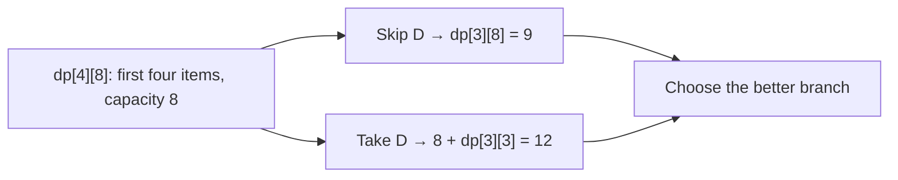

When I am stuck on a dynamic programming problem, the recurrence is rarely the first thing missing. Usually I have not said what one subproblem knows. A state that forgets how much capacity remains cannot decide whether the next item fits; a state that remembers the entire history has gained nothing over brute force. The useful state keeps exactly the information that can affect future choices.

I think of DP as solving a graph of subproblems. Each state is a vertex, and its transition points to smaller states whose answers it needs. I can evaluate that graph through recursion with memoisation or in a valid bottom-up order. The hard work is choosing the vertices and proving the edges. MIT's 6.006 notes put subproblem definition, relation, topological order, base cases, original answer, and time analysis in just that sequence. 

## Start by asking what the future needs

Consider 0/1 knapsack: item $i$ has positive integer weight $w_i$ and value $v_i$; I can take it once or skip it. The bag has capacity $C$. A tempting state is “best value after the first $i$ items.” That is insufficient. Two partial selections can have the same value but leave different capacities, so they admit different future items. I must retain the remaining resource.

Define $dp[i][c]$ as the maximum value achievable using **only the first $i$ items** with total weight **at most $c$**. The words “at most” matter: an empty selection is valid for every $c$, even if no item has exactly that weight. The state $(i,c)$ tells the future both which items remain and how much capacity is available.

For item $i$ (one-indexed), any feasible optimum either skips it or takes it. Skipping gives $dp[i-1][c]$. Taking it is legal only if $w_i\le c$ and gives $v_i+dp[i-1][c-w_i]$. Thus

$$
dp[i][c]=\begin{cases}
\max\{dp[i-1][c],\;v_i+dp[i-1][c-w_i]\}, & w_i\le c,\\
dp[i-1][c], & w_i>c.
\end{cases}
$$

The base row is $dp[0][c]=0$ for all $0\le c\le C$. The requested answer is $dp[n][C]$. Every prerequisite has smaller $i$, so filling rows from zero to $n$ evaluates prerequisites before their dependents. My arrows point from a state to its prerequisites, so this is reverse topological order for the arrows as drawn. Reversing the arrows gives the usual prerequisite-to-dependent topological order. This precise state and recurrence also appear in MIT's knapsack recitation. 



The arrows expose the state graph: the answer at $(4,8)$ depends on two vertices in the preceding row. Shared predecessors deeper in the graph are why memoisation can avoid repeated work.

## A worked knapsack and a proof

Let capacity be eight and items be A $(w=2,v=3)$, B $(3,4)$, C $(4,5)$, and D $(5,8)$. The following columns show selected capacities; the actual table includes every integer capacity from zero to eight.

| First items available | $c=0$ | $c=2$ | $c=3$ | $c=5$ | $c=7$ | $c=8$ |
|---|---:|---:|---:|---:|---:|---:|
| none | 0 | 0 | 0 | 0 | 0 | 0 |
| A | 0 | 3 | 3 | 3 | 3 | 3 |
| A, B | 0 | 3 | 4 | 7 | 7 | 7 |
| A, B, C | 0 | 3 | 4 | 7 | 9 | 9 |
| A, B, C, D | 0 | 3 | 4 | 8 | 11 | **12** |

At $(4,8)$, skipping D gives $dp[3][8]=9$, while taking D gives $8+dp[3][3]=8+4=12$. To reconstruct the selection, compare each cell with the one immediately above it. Since $12\ne9$, take D and move to $(3,3)$. C cannot fit, so move to $(2,3)$. There, $dp[2][3]=4$ exceeds $dp[1][3]=3$, so take B. The chosen weight is $5+3=8$ and value is $8+4=12$.

The proof is a short induction on $i$. The base row is correct because no items yield value zero. Suppose every value in row $i-1$ is optimal. Any valid selection from the first $i$ items either excludes item $i$, in which case its best possible value is $dp[i-1][c]$, or includes it, in which case the remaining items have capacity $c-w_i$ and optimal value $dp[i-1][c-w_i]$. The recurrence takes the better of all possible cases, so row $i$ is optimal. At the final row it solves the original question. This is **optimal substructure**: an optimal choice contains an optimal solution to the remaining subproblem.

Optimal substructure alone does not tell me whether memoisation saves time. I also look for **overlapping subproblems**: different decision paths reaching the same $(i,c)$. Brute recursion can recompute that vertex repeatedly. Memoisation stores it once; bottom-up tabulation visits it once. There are $(n+1)(C+1)$ states and constant work per state, giving $O(nC)$ time and space for the full table. A value/weight greedy choice fails here: by density, D $(8/5)$ then A $(3/2)$ fit for value 11, but B plus D give 12. Greedy commits to a local ranking; DP compares both branches under the remaining capacity.

The running time is **pseudo-polynomial**. $C$ is an integer value, while its binary input uses only $O(\log C)$ bits; $O(nC)$ can be huge even for a short input. If weights are real numbers, enormous, or include negatives, this integer-capacity table is not directly suitable. I would look for a different state, bounded value dimension, approximation, or another algorithm rather than silently discretise.

## The state graph decides the evaluation order

Fibonacci is a quick warmup: $F(n)=F(n-1)+F(n-2)$ overlaps heavily under naive recursion. Its states are just integers from zero to $n$, and the dependency edges point downward. A loop from two to $n$ or a memoised recursion computes each state once. The lesson is not the Fibonacci formula; it is that a state name identifies a reusable answer.

For knapsack, the state graph has an edge from $(i,c)$ to $(i-1,c)$ and possibly $(i-1,c-w_i)$. Since $i$ strictly decreases, it is acyclic. Top-down recursion follows only states reached from $(n,C)$ and caches them; it can be concise, but recursion depth can reach $n$ and exhaust the call stack. Bottom-up tabulation evaluates every capacity in every row and makes the dependency order explicit. Neither direction is inherently more correct. For an irregular sparse state graph, memoisation may skip many unreachable states; for a dense rectangular table, loops often have simpler memory behavior.

This graph view also links DP to [shortest paths](/blog/shortest-paths-bfs-dijkstra-bellman-ford/). A shortest path in a DAG can be found by relaxing edges in topological order. Many DP recurrences are similar DAG calculations with `min`, `max`, or another aggregation. I do **not** call an arbitrary cyclic recurrence a DP DAG: cycles need a different argument or algorithm. The state graph's acyclicity is a claim to prove, not a label to attach.

## Compressing space without changing the question

The full knapsack recurrence reads only row $i-1$. If I need just the best value, one array of length $C+1$ can hold the latest row. Process each item once and visit capacities **downward**, $C,C-1,\ldots,w_i$. At capacity $c$, the value at $c-w_i$ is still from the previous item stage because that smaller index has not been updated yet. Therefore the update still represents 0/1 choice.

If I visit capacities **upward**, the current item may already have updated $dp[c-w_i]$. That allows the item again and changes the recurrence to unbounded knapsack. With only item A of weight two and value three at capacity eight, a forward loop constructs four copies for value 12; the correct 0/1 answer is three. A change of loop direction has changed the problem.

One-array compression retains the optimum value but discards the old rows used by the simple reconstruction test. Walking `dp[c]` backward after the final item can mistakenly assign a value to an item stage that no longer exists. To recover chosen items, keep the full table, store separate decision information, or use a carefully designed reconstruction method. I use the full table below because it makes both the proof and the returned item list easy to inspect.

## Another state: edit distance

DP is not synonymous with capacity tables. For strings $a$ and $b$, define $D[i][j]$ as the fewest single-character insertions, deletions, and substitutions needed to turn the **first $i$ characters** of $a$ into the first $j$ of $b$. The state needs two prefix lengths; one length alone would forget which part of the other string must still match. If one prefix is empty, $D[i][0]=i$ and $D[0][j]=j$.

For nonempty prefixes, consider the last operation: delete $a_i$, insert $b_j$, or align the two last characters and substitute only if they differ. This yields

$$
D[i][j]=\min\left\{D[i-1][j]+1,\;D[i][j-1]+1,\;D[i-1][j-1]+[a_i\ne b_j]\right\}.\tag{1}
$$

Every dependency decreases $i+j$, so increasing prefix lengths is valid. With `kitten` and `sitting`, one optimal sequence substitutes `k`→`s`, substitutes `e`→`i`, and inserts `g`: distance three. There are $(|a|+1)(|b|+1)$ states with constant work each, hence $O(|a||b|)$ time. This is a minimisation DP where the proof again splits on the final decision. MIT's edit-distance notes use this prefix/suffix state idea. 

## Executable C++17 and boundary checks

The complete program is also [dp_examples.cpp](dp_examples.cpp). It computes the full 0/1 table and reconstructs item indices, checks the compressed value against a brute-force enumeration at every capacity from zero through eight, and tests empty strings and empty item sets. The code assumes nonnegative capacity, positive integer item weights, and values whose sums fit `long long`; it is a small teaching example, not an arbitrary-precision solver.

```cpp {title="dp_examples.cpp"}
#include <algorithm>
#include <cassert>
#include <iostream>
#include <string>
#include <utility>
#include <vector>
using namespace std;

struct Item { int weight; long long value; string name; };

pair<long long, vector<int>> knapsack_full(const vector<Item>& items, int cap) {
    int n = static_cast<int>(items.size());
    vector<vector<long long>> dp(n + 1, vector<long long>(cap + 1, 0));
    for (int i = 1; i <= n; ++i) {
        const auto& item = items[i - 1];
        assert(item.weight > 0);
        for (int c = 0; c <= cap; ++c) {
            dp[i][c] = dp[i - 1][c];
            if (c >= item.weight)
                dp[i][c] = max(dp[i][c], item.value + dp[i - 1][c - item.weight]);
        }
    }
    vector<int> chosen;
    for (int i = n, c = cap; i > 0; --i) {
        if (dp[i][c] != dp[i - 1][c]) {
            chosen.push_back(i - 1);
            c -= items[i - 1].weight;
        }
    }
    reverse(chosen.begin(), chosen.end());
    return {dp[n][cap], chosen};
}

long long knapsack_compressed(const vector<Item>& items, int cap) {
    vector<long long> dp(cap + 1, 0);
    for (const auto& item : items) {
        assert(item.weight > 0);
        for (int c = cap; c >= item.weight; --c)
            dp[c] = max(dp[c], item.value + dp[c - item.weight]);
    }
    return dp[cap];
}

long long brute_knapsack(const vector<Item>& items, int cap) {
    assert(items.size() <= 20);
    long long best = 0;
    for (unsigned mask = 0; mask < (1u << items.size()); ++mask) {
        long long weight = 0;
        long long value = 0;
        for (size_t i = 0; i < items.size(); ++i)
            if (mask & (1u << i)) {
                weight += items[i].weight;
                value += items[i].value;
            }
        if (weight <= cap) best = max(best, value);
    }
    return best;
}

int edit_distance(const string& a, const string& b) {
    int n = static_cast<int>(a.size()), m = static_cast<int>(b.size());
    vector<vector<int>> dp(n + 1, vector<int>(m + 1));
    for (int i = 0; i <= n; ++i) dp[i][0] = i;
    for (int j = 0; j <= m; ++j) dp[0][j] = j;
    for (int i = 1; i <= n; ++i)
        for (int j = 1; j <= m; ++j)
            dp[i][j] = min({dp[i - 1][j] + 1, dp[i][j - 1] + 1,
                            dp[i - 1][j - 1] + (a[i - 1] != b[j - 1])});
    return dp[n][m];
}

int main() {
    vector<Item> items = {{2, 3, "A"}, {3, 4, "B"}, {4, 5, "C"}, {5, 8, "D"}};
    for (int c = 0; c <= 8; ++c) {
        assert(knapsack_full(items, c).first == brute_knapsack(items, c));
        assert(knapsack_compressed(items, c) == brute_knapsack(items, c));
    }
    assert(knapsack_full({}, 8).first == 0);
    assert(edit_distance("", "abc") == 3);
    assert(edit_distance("abc", "abc") == 0);

    auto [best, chosen] = knapsack_full(items, 8);
    cout << "capacity=8 optimum=" << best << " items=";
    for (size_t k = 0; k < chosen.size(); ++k)
        cout << (k ? "," : "") << items[chosen[k]].name;
    cout << "\ncompressed=" << knapsack_compressed(items, 8) << '\n';
    cout << "density greedy=11 (D,A)\n";

    vector<long long> forward(9, 0);
    for (int c = 2; c <= 8; ++c) forward[c] = max(forward[c], 3 + forward[c - 2]);
    cout << "forward-one-item=" << forward[8]
         << " 0/1-one-item=" << knapsack_compressed({items[0]}, 8) << '\n';
    cout << "edit kitten -> sitting=" << edit_distance("kitten", "sitting") << '\n';
}
```

```text {title="Output"}
capacity=8 optimum=12 items=B,D
compressed=12
density greedy=11 (D,A)
forward-one-item=12 0/1-one-item=3
edit kitten -> sitting=3
```

One important alternate specification is **exact fill**. For “at most $c$,” every base capacity can hold the empty selection, so the base row is zero. For “exactly $c$,” only $dp[0][0]=0$ is reachable; $dp[0][c>0]$ must be an unreachable marker such as negative infinity. Before computing `value + dp[...]`, test that the predecessor is reachable. Otherwise a sentinel can masquerade as a valid number or overflow when added to a negative value. With negative item values, the at-most version can still return the empty set; exact fill may be forced to take negative-value items. The base condition is part of the problem definition, not a coding afterthought.

## Mistakes I check before submitting

I write the state in a sentence before code. If the sentence says “best using the first $i$ items and at most $c$ capacity,” every transition should preserve that meaning. I check whether an item can be used once, indefinitely, or a limited number of times; that determines the row dependency and often the compressed-loop direction. I check whether zero capacity is a valid solution and whether unreachable states need a marker. I also verify that a candidate transition stays within bounds and that its arithmetic cannot overflow.

Finally, I count **states times work per state**. A two-index table is not automatically $O(n^2)$: a transition that scans all previous indices makes it $O(n^3)$ unless another optimisation applies. I test tiny instances with brute force when possible. That catches wrong base cases, iteration direction, and reconstruction bugs more reliably than a large random example.

## Interview questions I would rehearse

**1. How do I choose a DP state?** Keep the smallest information that changes future choices. In knapsack, item index alone is insufficient; remaining capacity matters. Spell out the state in words before writing a recurrence.

**2. What is optimal substructure?** An optimal solution can be decomposed into a choice plus an optimal solution to the remaining state. The knapsack proof partitions all optima into take and skip cases.

**3. What are overlapping subproblems?** Different recursion branches ask the same state for an answer. Memoisation or tabulation computes that state once. Optimal substructure and overlap are related but distinct ideas.

**4. Why is ordinary knapsack DP acyclic?** Every transition from $(i,c)$ goes to a state with item index $i-1$. This strict decrease proves acyclicity regardless of whether capacity stays the same or decreases. Evaluate prerequisites first, in increasing item index.

**5. Memoisation or tabulation?** Both implement the same recurrence when its dependencies are acyclic. Memoisation can avoid unreachable states but uses recursion stack; tabulation makes order explicit and often uses compact contiguous storage.

**6. Why does 1D 0/1 knapsack iterate backward?** It must read the previous item stage. Descending capacities leave smaller indices untouched until they are read. Ascending capacities can reuse the current item and solve an unbounded variant.

**7. Can I reconstruct chosen items from the final compressed array?** Not by the simple `dp[i][c]` versus `dp[i-1][c]` test; those rows are gone. Save decisions or keep enough history for reconstruction.

**8. Why is $O(nC)$ pseudo-polynomial?** Capacity $C$ is encoded with $O(\log C)$ bits, but the algorithm iterates through every integer capacity. Its time is polynomial in the numeric value, not necessarily in input length.

**9. What changes for exact-fill knapsack?** Unreachable positive capacities start at negative infinity. Guard additions from unreachable states. The at-most version starts all base capacities at zero because the empty set fits.

**10. Why does a greedy density rule fail?** A local density ranking ignores which combinations fit later. In the worked example it gives D+A for value 11, while B+D fits exactly for 12.

**11. What is the edit-distance state?** $D[i][j]$ concerns prefixes of lengths $i$ and $j$. Its transition considers deletion, insertion, and matching/substitution of the last characters.

**12. How do I estimate complexity?** Count distinct reachable states, then multiply by the nonrecursive work per transition. Include reconstruction storage and recursion depth if they matter.

The pattern I want to recognize is not a memorised table shape. It is a sufficient state, a complete set of decisions, and an evaluation order justified by dependencies. Once those are explicit, code and proof usually become the same argument in two forms.


