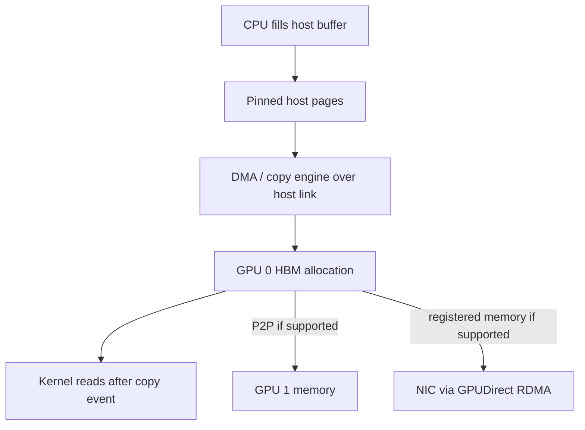
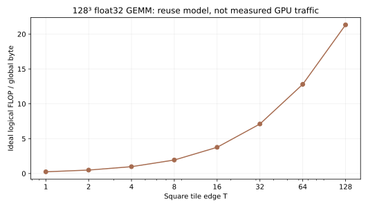

When I look at a GPU kernel, I first ask which thread owns each output and which bytes it must read. The arithmetic is often the easy part. Performance depends on whether nearby threads request useful nearby addresses, whether a loaded value is reused before it leaves fast storage, and whether enough independent work remains to hide latency. Correctness depends on the same mapping: a fast tile that reads one out-of-bounds element is still wrong.

Matrix multiplication is a good worked example because a naive kernel and a tiled kernel compute the same result for $A\in\mathbb R^{M\times K}$ and $B\in\mathbb R^{K\times N}$, yet can request very different amounts of global data. The conventional useful-work count is approximately $2MNK$ FLOPs; masked edge tiles may execute extra arithmetic on zeros. I will derive an intentionally simple byte model, test its addressing with an attached CPU simulator, and explain what the model leaves out. The CUDA example here is illustrative and was **not executed on a GPU** in this environment; the attached CPU test checks its tile and boundary logic.

## Anatomy of the device doing the work

It helps to picture a GPU as many streaming multiprocessors (SMs) connected to a device-wide L2 cache and external device memory. A CUDA kernel launch creates a grid of thread blocks. The device schedules whole blocks onto SMs; an SM may have several blocks resident if their threads, registers, and shared-memory allocations fit its limits. Within each block, threads are grouped into warps. A warp scheduler issues work for a warp, while each thread still owns its registers, index values, and logical control flow. This is the **single-instruction, multiple-thread** (SIMT) model, not a promise that all lanes remain synchronized after every instruction. Modern CUDA architectures permit finer divergence and reconvergence, so code should use documented synchronization primitives. 

An SM contains execution pipelines as well as storage. Ordinary CUDA-core arithmetic handles many scalar and vector-like instructions across threads; Tensor Cores perform supported matrix multiply-accumulate shapes and dtypes. A Tensor Core does not replace the CUDA cores, the load/store path, or the need to move operands into suitable storage. It is also not one independent “core” per CUDA thread. The H100 whitepaper draws warp schedulers, register files, FP pipelines, Tensor Cores, and a combined L1/shared-memory block inside an SM. That is a **Hopper H100 example**, not a universal floor plan or a specification for every GPU. 

<figure class="ml-diagram">
<svg viewBox="0 0 860 330" role="img" aria-label="GPU memory hierarchy with register and shared memory inside SMs, L2 shared across SMs, and HBM outside the SMs">
  <defs><marker id="ml-arrow" viewBox="0 0 10 10" refX="9" refY="5" markerWidth="7" markerHeight="7" orient="auto-start-reverse"><path d="M0,0 L10,5 L0,10 z"/></marker></defs>
  <rect class="group" x="20" y="15" width="820" height="290" rx="14"/>
  <text class="label" x="430" y="40">GPU device / package: schematic, sizes and paths vary</text>
  <rect class="box violet" x="50" y="60" width="350" height="90" rx="8"/>
  <text class="name" x="225" y="94">SM 0: warps + schedulers</text>
  <text class="note violet" x="225" y="122">registers, shared memory / L1</text>
  <rect class="box blue" x="460" y="60" width="350" height="90" rx="8"/>
  <text class="name" x="635" y="94">SM 1: warps + schedulers</text>
  <text class="note blue" x="635" y="122">registers, shared memory / L1</text>
  <rect class="box green" x="255" y="185" width="350" height="48" rx="8"/>
  <text class="name" x="430" y="216">Device-wide L2 cache</text>
  <rect class="box sand" x="255" y="255" width="350" height="48" rx="8"/>
  <text class="name" x="430" y="286">HBM / device DRAM</text>
  <path class="arrow" d="M225,154 V170 H350 V181"/>
  <path class="arrow" d="M635,154 V170 H510 V181"/>
  <line class="arrow" x1="430" y1="237" x2="430" y2="250"/>
</svg>
<figcaption>One schematic path to operands. Caches and the memory fabric can route requests differently; the diagram does not give latency or bandwidth ratios.</figcaption>
</figure>

Registers are private to threads and are drawn from an SM's finite register file. Shared memory is explicitly managed storage shared by a block. L1 is a cache; on H100, L1 and shared memory use a configurable combined capacity, but the split and detailed organization vary by architecture. L2 is accessible across SMs. HBM is outside the SMs and holds the large device allocation. Neither the diagram nor a phrase like “on-chip memory” should hide the distinction between a register, a shared-memory tile, L2, and HBM. Increasing a tile's registers per thread or shared memory per block can reduce the number of resident blocks, even when it reduces HBM requests. 

### Address spaces are not physical locations

CUDA names memory by access and allocation rules. **Global** memory is the device-wide address space for large arrays; a `cudaMalloc` allocation is a familiar device-memory example. **Shared** memory belongs to a block. **Registers** are per thread. **Constant** memory is a read-only, cached address space useful for suitable access patterns, especially when lanes read the same value. **Local** memory sounds close to a thread but means *thread-private address space*, not a small on-chip scratchpad: compiler spills and some arrays live there, backed by device memory and subject to caching. A source-level local variable may stay in a register or spill, so source syntax alone does not reveal its physical path. 

Host memory adds another axis. CUDA's unified virtual address space gives host and device allocations distinct address ranges in one process, so a pointer value can help identify where an allocation belongs. It does **not** mean every pointer is physically in HBM, every allocation migrates, or every GPU can directly dereference every other GPU's memory. Managed memory, mapped host memory, and a `cudaMalloc` device allocation have different placement and access rules. When debugging a surprising transfer, I would check the allocation API, pointer attributes, active device, and peer-access capability rather than infer physical location from a tensor's shape or a single pointer. 

### From a host buffer to a kernel result

For an explicit host-to-device copy, the CPU first owns and fills a host buffer. The runtime queues a transfer toward a device allocation; on a PCIe-attached system, a copy engine and DMA move data across the host/GPU link. A pageable host buffer may require staging through pinned pages before DMA, so a copy from it can carry extra work. Pinned, or page-locked, memory gives the transfer a stable physical backing; pinning itself consumes a limited host resource. After the copy completes, a dependent kernel can safely read the device buffer. A result that the CPU needs follows the reverse path. This describes a common discrete-GPU path, not every system: an integrated GPU or NVLink-C2C CPU/GPU system can have different physical links and coherence behavior. 



The arrows also imply **ownership and dependencies**. The host must not overwrite an in-flight source buffer; a kernel must wait for its input copy; the CPU must wait before reading an output copy. Operations enqueued in one CUDA stream are ordered. With separate streams, record an event after the producer operation and make the consumer stream wait on it, or use a documented dependency mechanism. A `cudaMemcpyAsync` call does not by itself mean the transfer is complete when the call returns. Its *host-return* behavior depends on memory type and circumstances: a pageable host buffer may require staging or cause synchronization, despite the `Async` name. Some devices can overlap copy and computation with suitable copy engines, pinned memory, independent work, and stream scheduling. Shared bandwidth, a missing copy engine, or a dependency can remove that overlap. 

Managed memory (`cudaMallocManaged`) chooses a different contract: CPU and GPU code can access the allocation, while the system may migrate or map pages as they are used. A first GPU touch can trigger movement; `cudaMemPrefetchAsync` can request migration before the kernel at a chosen point in a stream. Prefetch is a placement hint and ordered operation, not a free copy. **Mapped pinned host memory** stays in host memory and lets a GPU access it across the interconnect; repeated kernel reads then pay that path instead of becoming local HBM reads. Explicit `cudaMalloc` plus copies makes movement visible in code. Which one is best depends on access frequency, sharing, topology, and synchronization, not the appeal of a single address-space name. 

### Leaving one GPU

If GPU 0 must supply data to GPU 1, a peer copy or remote memory access may use NVLink, an NVSwitch fabric, or PCIe, depending on the topology. A direct path is conditional: CUDA exposes `cudaDeviceCanAccessPeer`, and peer access must be enabled for the relevant direct-access use. Some pairs have no supported peer route and software may stage a transfer through host memory; I would check the actual library and system before assuming a particular fallback. Even with a peer pointer, remote access is not equivalent to reading GPU 1's own HBM: the link, switches, memory controllers, contention, and access pattern matter. 

A NIC can also exchange data with a **registered GPU-memory buffer** through GPUDirect RDMA when the device, driver, topology, and IOMMU configuration support it. This can avoid a GPU-to-host copy in the data path; in a host-initiated transfer, the CPU still participates in setup and control. It does not turn an arbitrary network read into a local HBM load or promise zero latency. NVIDIA's GPUDirect guide describes PCIe peer-device constraints, and NCCL's troubleshooting guide emphasizes checking GPU-to-GPU and GPU-to-NIC connectivity rather than assuming every pair works.  The [distributed-training post](/blog/distributed-llm-training/) follows the *collectives* built over these routes, including all-reduce and reduce-scatter; here I am tracking where a buffer's bytes can physically travel.

### One transfer bound with explicit units

Suppose **one GiB** ($2^{30}=1{,}073{,}741{,}824$ bytes) must cross a host-to-device link whose **effective one-way application payload rate is assumed to be 25 GB/s** ($25\times10^9$ bytes/s). Ignoring setup and contention, even a perfect copy takes at least $1{,}073{,}741{,}824/(25\times10^9)=0.04295$ s, or **42.95 ms**. This is a declared example rate, not a PCIe specification or a measurement of this machine. It is also not a sum of two advertised opposite-direction rates. A kernel that takes 5 ms after the copy cannot make a dependent single-buffer request complete in 5 ms.

The attached [transfer_model.py](transfer_model.py) checks these units with only Python's standard library. It also splits that GiB into two equal chunks and assumes 30 ms of computation per chunk. Serial copy-then-compute takes 102.95 ms; an ideal two-stage schedule with one copy path and one compute path finishes in 81.47 ms **if** copy of chunk 2 overlaps compute of chunk 1. The bound does not include launch costs, synchronization, or bandwidth interference, and the overlap is conditional. Running `python3 -B transfer_model.py` prints both values and asserts the arithmetic. A real throughput test would measure the exact allocation and transfer path on the target topology.

## From a tensor index to a memory address

For a contiguous row-major matrix $A$ of float32 values, element $(i,j)$ lives at element offset $iK+j$ from the base pointer. In bytes the offset is $4(iK+j)$. A view can have different strides: the general two-dimensional offset is $i\,s_0+j\,s_1$, in elements, and a transpose swaps the stride pattern without necessarily copying data. Shape tells me which indices are legal; strides tell me where they are stored. A kernel that assumes `row * K + col` for a noncontiguous view reads the wrong values even if every index is in range.

For GEMM, the element $C_{ij}=\sum_{h=0}^{K-1}A_{ih}B_{hj}$. A one-thread-per-output mapping gives each thread fixed $(i,j)$ and loops over $h$. In a CUDA grid, `blockIdx` selects a block, `threadIdx` selects a thread within it, and the block dimensions combine them into global row and column indices. Threads are grouped into 32-thread warps on current NVIDIA CUDA hardware, and blocks are scheduled on streaming multiprocessors (SMs). Warps are a scheduling unit; a block is the unit that shares block-local shared memory and can synchronize at a block barrier. The exact number of resident blocks depends on the device and resource use. 

This hierarchy matters when I inspect addresses. If adjacent lane IDs vary the column index, adjacent stores of `C[row * N + col]` are adjacent. But inside the naive dot-product loop, all those lanes may load the same `A[row * K + h]` while their `B[h * N + col]` addresses are adjacent. Which loads become transactions, cache hits, or broadcasts depends on the target architecture and cache state. NVIDIA's best-practices guide illustrates coalescing for compute capability 6.0 or later using aligned 32-byte segments; it does not promise that every warp access costs one transaction. 

## The storage hierarchy is the algorithm

Global device memory holds large arrays and is accessible across the device, but moving data from it is expensive relative to reusing data on chip. Registers hold per-thread values such as a dot-product accumulator. Shared memory is allocated per block and lets cooperating threads exchange a tile. Caches can satisfy some global loads, and the compiler can spill register values to local memory backed by device memory. I therefore treat “register,” “shared,” and “global” as placement and traffic questions, not just syntax keywords. 

Consider a naive $T\times T$ patch of $C$. There are $T^2$ output threads. Across one depth step, each of the $T$ values from the relevant row segment of $A$ is needed by $T$ output columns; each value from the column segment of $B$ is needed by $T$ output rows. If every output thread issues its own two loads for each $h$, the logical request count for an entire $M\times N$ result is $2MNK$ input elements, plus $MN$ output stores. Cache reuse may reduce actual DRAM transfers, so logical requests are not hardware bytes.

Tiling asks the block to load a $T\times T$ patch of $A$ and a $T\times T$ patch of $B$ once for a depth chunk of length $T$, then reuse both patches to update $T^2$ accumulators. The inner arithmetic is still $T^3$ multiply-add pairs, or $2T^3$ FLOPs under the conventional two-FLOP count. The two input tiles are $2T^2$ elements. Ignoring the final output store, the arithmetic per input byte for float32 is $2T^3/(8T^2)=T/4$ FLOP/byte. That proportionality explains the appeal of larger tiles; it is not a guarantee that the larger tile fits resources or runs faster.

<figure class="ml-diagram">
<svg viewBox="0 0 860 250" role="img" aria-label="One output tile accumulates products of an A tile and a B tile through successive depth slices">
  <defs><marker id="ml-arrow" viewBox="0 0 10 10" refX="9" refY="5" markerWidth="7" markerHeight="7" orient="auto-start-reverse"><path d="M0,0 L10,5 L0,10 z"/></marker></defs>
  <rect class="box blue" x="35" y="45" width="210" height="95" rx="8"/>
  <text class="name" x="140" y="83">A tile</text>
  <text class="note blue" x="140" y="111">T rows × T depth</text>
  <rect class="box violet" x="325" y="45" width="210" height="95" rx="8"/>
  <text class="name" x="430" y="83">B tile</text>
  <text class="note violet" x="430" y="111">T depth × T cols</text>
  <rect class="box green" x="615" y="45" width="210" height="95" rx="8"/>
  <text class="name" x="720" y="83">C accumulator</text>
  <text class="note green" x="720" y="111">T rows × T cols</text>
  <line class="arrow" x1="249" y1="94" x2="319" y2="94"/>
  <line class="arrow" x1="539" y1="94" x2="609" y2="94"/>
  <text class="label" x="430" y="192">Repeat over depth chunks; store C once after accumulation.</text>
</svg>
<figcaption>Conceptual tile. Blocks covering different output tiles repeat some input loads; caches may serve them.</figcaption>
</figure>

For a divisible $M=N=K=L$ case with square tiles of edge $T$, the idealized input-load count is $2L^3/T$ elements and the output-store count is $L^2$ elements. In float32 the byte formula is $4(2L^3/T+L^2)$. It assumes each input element is loaded only once **within an output tile** and counts repeated use by different output tiles. It does not include cache-line transaction granularity, shared-memory traffic, register spills, launch overhead, or any tensor-core constraints. For irregular shapes, masked edge tiles change the counts; the simulator computes valid load counts directly.

## A small CUDA tile, including the edges

Here is a deliberately plain float32 CUDA kernel for contiguous row-major inputs. One $16\times16$ block owns one patch of $C$. Each thread loads one element of each shared-memory tile, then contributes to one output accumulator. The masked loads supply zeros for rows, columns, or depth positions beyond the matrices. Both barriers are reached by **every thread in the block**, including threads whose output coordinate is outside $C$; returning early before the barrier would make the program invalid. The second barrier prevents the next depth iteration from overwriting shared values still in use.

```cpp {title="Illustrative CUDA kernel (not GPU-tested here)"}
__global__ void matmul16(const float* A, const float* B, float* C,
                         int M, int N, int K) {
    constexpr int T = 16;
    __shared__ float at[T][T], bt[T][T];
    int r = blockIdx.y * T + threadIdx.y;
    int c = blockIdx.x * T + threadIdx.x;
    float acc = 0.0f;
    for (int base = 0; base < K; base += T) {
        int ah = base + threadIdx.x;
        int bh = base + threadIdx.y;
        at[threadIdx.y][threadIdx.x] =
            (r < M && ah < K) ? A[r * K + ah] : 0.0f;
        bt[threadIdx.y][threadIdx.x] =
            (bh < K && c < N) ? B[bh * N + c] : 0.0f;
        __syncthreads();
        for (int h = 0; h < T; ++h)
            acc += at[threadIdx.y][h] * bt[h][threadIdx.x];
        __syncthreads();
    }
    if (r < M && c < N) C[r * N + c] = acc;
}
// Launch with dim3 threads(16, 16);
// dim3 blocks((N + 15) / 16, (M + 15) / 16);
```

The code shows ownership, masking, and synchronization, not an optimized GEMM. It lacks stride arguments, mixed-precision tensor-core instructions, pipelining, and production error checking. A production implementation should use a tuned library unless customization is justified. Triton's official matmul tutorial expresses a related blocked algorithm with pointer strides, `tl.load` masks, and a float32 accumulator for lower-precision inputs. 

There are two kinds of edge work here. A partial output tile has threads that must skip the final store. A partial depth tile has nonexistent $A$ and $B$ elements that must act as zero. If a kernel only masks the final store, it can still read outside an input. If it masks input loads but forgets to initialize the masked shared slots, those threads may consume stale shared-memory contents. The CPU example below uses zero-filled arrays to make both cases visible.

## A runnable CPU model of addresses and bytes

The attached [tile_model.py](tile_model.py) simulates square output tiles on the CPU in float64 and compares its result with NumPy matrix multiplication for dimensions that do and do not divide the tile size. It asserts that the counted valid input loads agree with a closed-form count. Run `python3 tile_model.py` with NumPy and Matplotlib. The generated plot models the logical bytes for a hypothetical $128^3$ **float32** GEMM, tile edges 1 through 128, and one store per output. It is not a GPU benchmark or a measured cache-traffic trace.



For a general $M,N,K$, the model counts $KM\lceil N/T\rceil$ valid $A$ loads and $KN\lceil M/T\rceil$ valid $B$ loads. That is correct for a block that loads each needed input once per output tile, including boundary masks. The final $MN$ output stores give

$$
I_{\text{logical}}=\frac{2MNK}{4\left(KM\lceil N/T\rceil+KN\lceil M/T\rceil+MN\right)}\quad\text{FLOP/byte}.
$$

The script checks $5\times7$ times $7\times6$, $8\times8$ times $8\times8$, and $9\times3$ times $3\times11$ with several tile sizes. These tests catch addressing and masking errors in the teaching model. They cannot certify the CUDA kernel on a GPU; that requires compiling and running it across shapes, strides, and devices, ideally with a memory checker and numerical comparison.

## Coalescing, occupancy, and the limits of a large tile

Within an output block, the CUDA example lets neighboring `threadIdx.x` values load neighboring `A` columns and `B` columns, where valid. That pattern usually helps coalescing for row-major data. A transpose or unusual stride can turn consecutive lanes into widely separated addresses. Shared-memory access has its own layout and bank-conflict questions. A practical optimization begins with a profiler's requested-versus-actual memory traffic, not a guess from source alone. NVIDIA's guide distinguishes requested bandwidth from actual bandwidth for precisely this reason. 

A larger tile reuses more values but consumes more shared memory and often more registers or per-thread accumulator state. Those resources limit how many blocks can reside at once on an SM. **Occupancy** is the fraction of supported active warps that are resident, not the fraction of arithmetic units doing useful work. Low occupancy can leave too few warps to cover stalls; maximum occupancy does not automatically mean maximum performance. NVIDIA's guide explicitly treats register allocation, shared-memory allocation, and block size as constraints and cautions against equating higher occupancy with faster execution. 

There is also parallelism at the grid level. If a giant tile leaves only a few output blocks, many SMs may have no work. If the tile is tiny, redundant loads and scheduling overhead can dominate. The best tile shape can differ for a skinny matrix, a square matrix, and a batched workload. Square $T$ is useful for my derivation, but tuned GEMM kernels often use different sizes for output rows, output columns, and reduction depth. The same principle applies: count reused elements, resource footprint, and available blocks together.

## Reductions and fusion use the same reasoning

Many GPU operations are reductions rather than GEMMs. A row-wise sum or softmax needs values from several threads to contribute to one result. A common plan is to load a chunk, keep partial results in registers, combine within a warp or shared memory, and write one final value. The numerically stable softmax subtracts a row maximum before exponentiation; my [softmax post](/blog/softmax-numerical-stability/) derives that and online softmax in detail. Synchronization scope matters here: warp-level communication needs the participating lanes and masks to be correct, while a block-level exchange needs a barrier all participating threads reach. Assuming that independently scheduled lanes stay in an undocumented lockstep can cause subtle errors. 

Fusion is another way to reduce memory traffic. If a pipeline computes $Y=f(X)$ and then $Z=g(Y)$, separate kernels may write $Y$ to global memory and read it back. A fused kernel may keep an intermediate tile in registers or shared memory and avoid that round trip. Fusion can also increase registers, prolong live values, or reduce the number of blocks, so I would measure the whole pipeline. FlashAttention is a larger example: it tiles exact attention to reduce reads and writes between high-bandwidth device memory and on-chip storage. That paper is about an IO-aware algorithm, not a claim that any fused attention kernel is automatically fast.  The [transformer post](/blog/transformers-intuitively/) explains where attention fits in the model.

## Roofline and precision: useful bounds, incomplete predictions

The Roofline model places operational intensity, FLOPs per byte transferred from a chosen memory level, against attainable bandwidth and compute throughput. A simple bound is $P\le\min(P_{\text{peak}}, B_{\text{peak}}I)$, but the relevant peaks and byte count must match the device, datatype, and measurement scope. It can show that a kernel with little reuse cannot reach a high compute rate even with perfect instruction scheduling. It cannot by itself predict launch overhead, bank conflicts, cache effects, warp divergence, instruction mix, or a poor grid shape. 

Precision complicates the picture. FP16 or BF16 inputs halve input element width compared with FP32, and some matrix instructions accumulate in FP32. That can raise effective arithmetic intensity and change the available compute path, but rounding, overflow range, accumulation order, and acceptable output error must be checked against the application. Reductions and attention normalization are especially sensitive. I would specify input, accumulation, and output dtypes independently, then compare numerical error to a reference with suitable tolerance. A bitwise match to a CPU sum is often the wrong criterion when parallel reductions reassociate operations.

## Timing the kernel that actually ran

GPU work is asynchronous relative to host code. A host timer wrapped around a launch can mostly measure enqueue time if it stops before the GPU finishes. To time device work, warm up compilation and caches as appropriate, record CUDA events in the same stream around the work, synchronize on the stop event, and then read elapsed time. To report end-to-end request latency, include host preprocessing, transfers, launch overhead, synchronization, and any postprocessing in a separate wall-clock measurement. NVIDIA documents event timing and synchronization in its best-practices guide. 

Host-to-device transfer can dwarf a small kernel. Pinned host memory can improve transfer bandwidth and is required for the asynchronous host transfer pattern described in NVIDIA's guide, but pinning is itself a resource and allocation cost. Streams can overlap transfer and compute when the hardware, dependencies, and buffer lifetime allow it. I would report whether input data was already resident on the GPU, whether transfer was included, which stream was timed, and whether the measurement was single-request latency or throughput under multiple in-flight requests. A benchmark that silently excludes a required transfer answers a narrower question. 

Finally, report distributions and shapes, not a single best launch. Small matrices can be launch-bound; large matrices can hit a bandwidth or compute limit; irregular shapes stress masks; concurrency changes cache and scheduling conditions. A profiler can tell whether the model's assumed reuse materialized. The CPU plot here gives one hypothesis to test on hardware: as the tile grows, logical global requests fall. It cannot tell us where the actual optimum lies.

## Interview questions

1. **How does a thread find a matrix element?** It combines block and thread indices for the logical coordinate, then applies the tensor's strides to compute an address.
2. **Why do adjacent output columns help coalescing?** For contiguous row-major storage, they map neighboring lanes to neighboring addresses, subject to alignment and the hardware's transaction rules.
3. **What does tiling save in GEMM?** Repeated global requests for the same $A$ and $B$ elements within an output tile.
4. **Why are two block barriers needed in the shown kernel?** One makes loaded tiles visible before use; the other prevents overwriting a tile before every thread has finished reading it.
5. **What does the CPU byte plot measure?** An idealized count of valid logical input loads and output stores for its tile scheme, not observed DRAM bytes or latency.
6. **Why might a larger tile slow a kernel?** It can consume too much shared memory or register space, reduce resident blocks, or leave too few grid blocks for the SMs.
7. **What does fusion trade?** It can avoid writing intermediates to global memory, while increasing register pressure or reducing scheduling flexibility.
8. **How should an asynchronous CUDA kernel be timed?** Warm up, use events in the intended stream, synchronize before reading elapsed time, and separately measure end-to-end latency if relevant.
9. **Does one CUDA virtual address mean every byte is in GPU memory?** No. Managed, mapped host, peer, and device allocations can share an address-space model while occupying different physical memories.
10. **What must happen before a kernel reads an asynchronously copied input?** The copy must complete before the read; same-stream ordering or an explicit cross-stream event dependency can establish that order.
11. **When can copies overlap with computation?** The work must be independent, scheduled with suitable streams and buffers, and supported by available copy engines; contention can erase the expected gain.
12. **Does GPUDirect RDMA eliminate the CPU or make a NIC buffer local to the GPU?** No. On a host-initiated path, it can move data directly between a peer device and registered GPU memory on supported systems while the CPU still handles setup and control.


