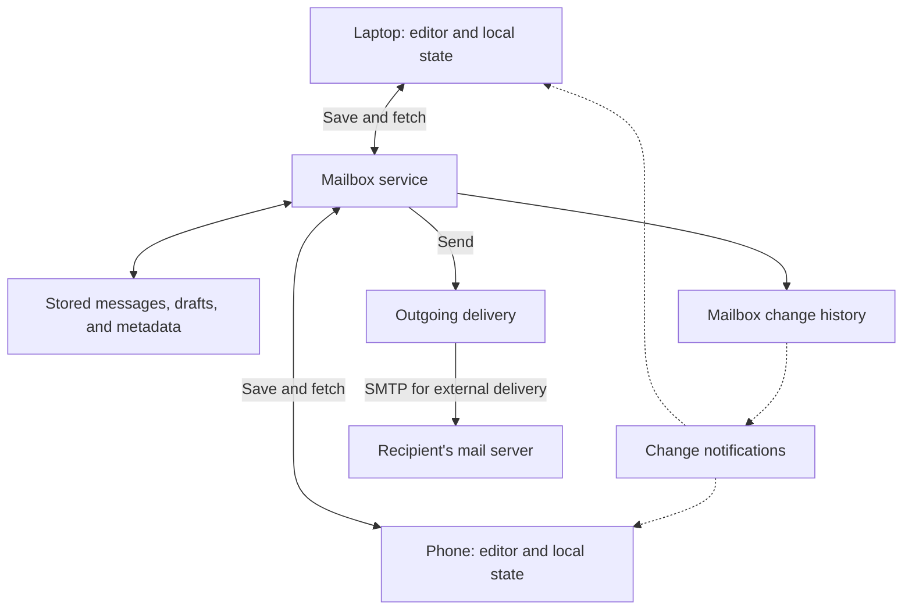
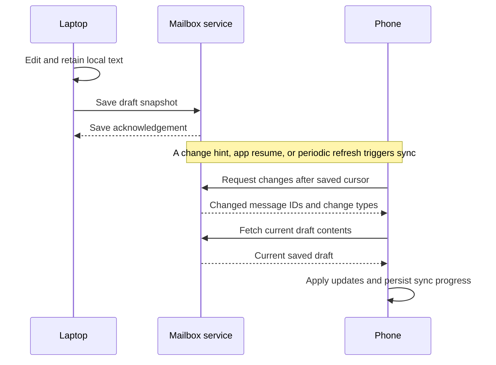

Imagine starting an email on your laptop, closing it halfway through, and continuing on your phone. The visible feature is a draft. The systems problem is keeping several copies of unfinished work consistent while devices come and go.

Gmail saves drafts automatically. But autosave alone cannot explain the handoff. An edit has to reach the server, the other device has to discover it, and neither device should silently overwrite newer work.

I find this a useful way to study distributed systems: start with the sentence in the compose window and follow it across the network.

**Scope:** Google's public documentation describes Gmail's API behavior. It does not establish the internal protocol used by Gmail's own web and mobile apps, their autosave timing, or their exact conflict policy. I'll use those documented behaviors as anchors and explicitly label the design choices I would make when building a similar system.

## A mailbox sits between your devices

At the application boundary, Gmail exposes messages, conversation threads, labels, and drafts. Labels organize messages; a message can belong to several views without requiring a separate content copy for each view.

For this discussion, I picture the system like this. These are logical responsibilities, not a map of Google's production services:



The laptop and phone each read and update the same account's mailbox. They do not need a direct connection to each other.

Email delivery is another part of the system. Between mail providers, SMTP transfers messages, with DNS mail-exchanger records helping locate the destination server. Temporary delivery failures can require queuing and retries.

A draft stays within the sender's mailbox until sending. Typing an address into the **To** field does not deliver the unfinished message to that recipient. The draft handoff is a mailbox synchronization problem.

## A draft has an identity separate from its contents

One particularly useful detail is documented in the Gmail API: a draft is a container with a stable ID. Its message content is replaced when updated, and the replacement has a new message ID. Draft messages carry the `DRAFT` label.

Using invented IDs, two saves might look like this:

```text
First save:    draft d7 → message m41 → "Let's meet"
Second save:   draft d7 → message m58 → "Let's meet on Friday"
```

The application can keep referring to `d7` even though the contained message changes. This API model does not imply that every old version remains available as revision history.

Creating or updating a draft through the public API supplies a MIME email encoded as base64url. MIME represents the email's headers and content, including multipart bodies and attachments. The API describes replacing a message snapshot; it does not expose a stream of individual keystrokes.

This suggests a useful design separation: the editor manages the work in progress, while the mailbox stores a saved representation of it. Those two representations can temporarily differ.

## Autosave has three different finish lines

For a system I build, I would distinguish these states:

| State | What it establishes |
| --- | --- |
| Visible in the editor | The current process has the text in memory. |
| Saved locally | The device has persisted a recoverable copy, subject to its storage guarantees. |
| Saved on the server | The server has acknowledged this particular version. |
| Observed on another device | That device has fetched and applied the server's version. |

The last three are separate finish lines. A successful server save does not establish that a sleeping phone has already fetched it.

### Keep typing independent of network latency

In an illustrative implementation, I would update the editor immediately, persist local changes, and schedule a network save after a short typing pause. This scheduling technique is called *debouncing*: nearby edits are combined into one save.

A debounce needs a maximum wait too. Otherwise, someone who types continuously could keep postponing the save. For example, a design might save after 500 milliseconds of inactivity or after five seconds of continuous changes. These are example parameters, not measured Gmail timings.

If a save is already running, I would retain the newest pending snapshot and send it after the current save finishes. This reduces redundant traffic and prevents overlapping saves from this editor under normal operation.

### A save acknowledgement belongs to one version

Suppose the editor assigns a local sequence number to each change:

```text
Local edit 20: "Let's meet"             → save begins
Local edit 21: "Let's meet on Friday"   → user keeps typing
Save of edit 20 succeeds                → edit 21 is still unsaved
```

The response for edit 20 must not mark edit 21 as saved. I would track the acknowledged local sequence separately from the current one and show a saved state only when they match.

That sequence number is local bookkeeping. It does not protect the server from a stale write arriving from another device. Even a request that times out may still complete at the server. We need a separate concurrency rule for that.

## How another device catches up

Google documents two synchronization paths for API clients: a full sync builds the required local view, and a partial sync retrieves subsequent changes using `history.list` and a saved `startHistoryId`. The history describes mailbox changes such as message additions and label updates.

I think of a history ID as a bookmark: *I have processed changes through this point.* It avoids downloading the whole mailbox whenever one draft changes.

Here is a conceptual handoff using that model. The notification mechanism is deliberately abstract; this is not a trace of Gmail's native apps.



Three identifiers answer different questions:

| Identifier | Question it answers |
| --- | --- |
| Draft ID | Which unfinished email is this? |
| Message ID | Which stored message is currently inside it? |
| Mailbox history ID | How far has this client synchronized the mailbox? |

History IDs increase but have gaps. A client must use IDs returned by Gmail, not calculate the next one. Results can be paginated; the API documents storing the returned history ID when the final page is reached.

In my client, I would apply all pages successfully before advancing the durable cursor. Applying updates again after a crash should be harmless. Advancing the cursor before applying them could permanently skip work.

There is a draft-specific wrinkle: history is about messages and labels, while editing needs the stable draft ID. An API client can reconcile its draft mapping with `drafts.list`, whose entries include a draft ID and the contained message's ID and thread ID. Message details require another fetch.

### A notification tells you to look

The Gmail API's documented push mechanism delivers mailbox notifications to an application's backend through Cloud Pub/Sub. The decoded payload contains an email address and a history ID, rather than the edited draft body. The backend then retrieves changes. Google separately recommends the polling-based sync approach for user-owned devices.

For an illustrative app with a backend, that backend could wake its connected clients, which would then fetch updates. Polling on app resume provides another trigger.

This distinction matters because Gmail documents that notifications can be delayed or dropped. Watches also expire and need renewal at least every seven days; Google recommends daily renewal.

I would therefore make notifications a latency optimization. Periodic reconciliation would still recover changes when a notification never arrives.

### Sometimes the bookmark expires

Mailbox history is retained for a limited period. When a client's starting history ID falls outside the available range, Gmail returns `404`, and the client must perform a full sync. The documented retention is typically at least a week, but it can be shorter.

For an offline-capable client, rebuilding the server cache must preserve unsent local edits separately. Otherwise, the recovery procedure itself could destroy the work it was supposed to recover.

## Two devices editing is the hard case

So far, the laptop writes and the phone catches up. Now let both devices edit the same draft.

```text
Both devices begin with: "Let's meet on Friday."

Laptop changes it to:    "Let's meet on Friday at 3."
Phone changes it to:     "Let's meet on Saturday."
```

If the server blindly accepts whole-document replacements, whichever write arrives last can erase the other edit. The most recently received request might even come from a device reconnecting with hours-old state.

Google's public draft update reference describes content replacement, but it does not document an `expectedRevision` parameter or a text-merging policy. I would not infer that Gmail uses last-write-wins, operational transformation, or a CRDT from that interface.

For a service where I control the backend, I would begin with **optimistic concurrency**: accept an edit only if it is based on the current saved revision.

The following is a hypothetical API, not a Gmail request:

```text
Initial server state: draft d7, revision 12

Laptop: save(d7, expectedRevision=12, body="Friday at 3")
Server: accept; advance to revision 13

Phone:  save(d7, expectedRevision=12, body="Saturday")
Server: reject stale edit; return current revision 13
```

The revision check and write must happen atomically at the server. Fetching the current draft and then issuing an unconditional update leaves a race between those two requests. A Gmail API client cannot manufacture this guarantee merely by adding a local revision field.

After a conflict, I would retain both versions. A three-way merge compares the common base with each edit and can combine independent changes. Here, both devices changed the meeting time, so a choice is needed. Recipients and attachments also require explicit conflict rules; merging the body alone is insufficient.

I would use server-issued revisions for concurrency decisions. Device timestamps can disagree, and arrival order tells us little about which text the user intended to keep.

The practical guarantee I want is modest but valuable: **stale work must not silently erase newer work**. Keeping devices convergent and preserving the user's intent are separate requirements.

## Offline editing adds a queue of intent

Gmail's documented offline mode for the web requires enabling offline mail in a regular Chrome window. It supports reading, searching, and replying without connectivity. Sending offline places the message in an Outbox, which sends automatically when connectivity returns.

No synchronization protocol can make an edit visible on another device before the originating device communicates it. If the laptop has the only copy of a new sentence and is offline, the phone cannot fetch that sentence from the server.

In my implementation, each pending edit would retain:

- The draft's identity and the server revision it was based on.
- The latest local content and an operation ID for retry handling.
- Its intent: save, send, or discard.

A sequence of unsent saves can often collapse into the newest snapshot. A pending send needs different treatment: it commits a particular set of recipients and content.

On reconnection, I would fetch current server state and reconcile pending operations using atomic revision checks. A changed draft might need conflict resolution. A draft already sent or discarded must not be recreated automatically just because an old device still has an edit queued.

## Sending changes the rules

In the Gmail API, sending removes the draft and creates a new message carrying the `SENT` label. For a system designer, that is a lifecycle transition with consequences for every stale editor.

Consider this race:

```text
1. Laptop starts saving an older draft snapshot.
2. Phone sends the draft.
3. Laptop's delayed save reaches the server.
```

For my service, I would serialize saves, sends, and discards against the same draft record. Sending would atomically verify the expected revision, freeze the selected content, and close that draft to further edits. A later save would be rejected.

A terminal record, sometimes called a *tombstone*, can help reject delayed operations after send or discard. If that record is eventually removed, updating an unknown draft must still fail; an update must not implicitly create a new draft.

There is also a failure between changing the mailbox and starting delivery. Imagine marking a draft sent, crashing, and never scheduling its email.

For a backend I control, I would commit the lifecycle change and a durable delivery task together. A worker could then pick up the task after a restart. This is the **transactional outbox** pattern: the database records both the state change and the work it requires.

Retries need an operation identity too. If the send succeeds but its response disappears, retrying the same operation ID should retrieve the original result. The deduplication record and send transition need to be committed together. This describes a proposed service contract, not a documented Gmail API idempotency feature.

Even then, accepting a send within our service is different from the recipient receiving exactly one copy. SMTP itself has timeout scenarios that can cause duplicates; an application-level operation ID does not establish an end-to-end delivery guarantee.

## Scaling the design without slowing down typing

The preceding correctness rules apply with two devices and one account. To scale an illustrative service, I would keep the synchronous path small: authorize the account, validate the draft operation, commit the saved state and its change record, then acknowledge it.

Search indexing and notification delivery could happen asynchronously. Recording the change durably with the save lets workers recover after a crash without relying on a successful one-off notification.

Partitioning mailbox metadata by account would be a reasonable starting point: draft edits and synchronization history are usually scoped to that account. It would still need a strategy for unusually busy accounts and large attachments. This is a design choice, not a claim about Gmail's storage layout.

I would also separate attachment bytes from frequently changing text in the internal representation. Uploading an attachment once and referring to the completed blob avoids sending it again for every punctuation edit. The send transition must verify that required uploads are complete. This optimization concerns our internal design; it does not change the Gmail API's documented message-replacement interface.

The main efficiency gains come from combining nearby edits, fetching changes incrementally, and keeping large binary data out of repeated text saves. None requires making the editor wait for the phone.

## What I would test first

The interesting tests exercise interruptions and ordering:

| Scenario | Required behavior in the proposed design |
| --- | --- |
| An old save response arrives after more typing | Newer local text remains marked unsaved. |
| A notification is lost | A later refresh discovers the change. |
| A sync worker crashes before saving its cursor | Reapplying the same changes is safe. |
| Two devices edit from the same revision | The stale write preserves a recoverable conflict. |
| An offline device returns after another device sent | Its old edit cannot resurrect the draft. |
| A send response is lost | Retrying the same operation does not enqueue another send internally. |

The compose window makes these transitions look continuous. Underneath, an edit moves from local memory to local storage, to an acknowledged server version, and finally to another device's view. I would judge the system by how well it preserves that work when one of those steps is delayed, repeated, or interrupted.


