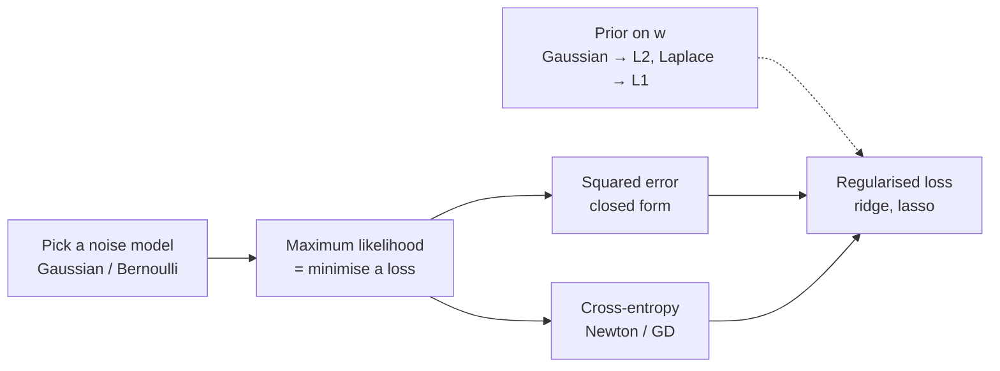

Almost every ML interview I've sat through starts here, and for a good reason: linear and
logistic regression are the whole of supervised learning in miniature. There's a model, a
probability story that turns into a loss, an optimisation problem, and a regulariser that
turns out to be a prior. A neural network is the same recipe with a more flexible model in
the middle. If you can derive these two cleanly, most of the follow-up questions answer
themselves.

The catch is that "I know linear regression" usually means "I remember
$(X^\top X)^{-1}X^\top y$". Interviewers know that, so they probe sideways: *why* squared
error? What if the noise isn't Gaussian? Why can't you use MSE for classification? What happens
if I duplicate a feature? If the classes are separable? If I throw away 95% of the negatives?
This post tries to make each of those a two-line answer by building the intuition first.

How to read it: same format as my [optimisers post](/blog/optimizers-and-generalization/).
The main text is intuition and pictures, with five interactive demos. Derivations are folded
into **Maths** cards. Every code block is NumPy from scratch, checked against scikit-learn, and
every printed output is from an actual run. Two banks of interview questions are at the end:
the common ones and the hard ones.

## The whole post in one picture

The two models are siblings. Put them side by side and almost every row rhymes:

| | Linear regression | Logistic regression |
|---|---|---|
| Target | a real number | a label, 0 or 1 |
| Model | $\hat y = w^\top x$ | $p = \sigma(w^\top x)$, with $\sigma(z) = 1/(1+e^{-z})$ |
| What we assume about the noise | $y \sim \mathcal N(w^\top x,\ \sigma^2)$ | $y \sim \text{Bernoulli}(p)$ |
| Negative log-likelihood (the loss) | $\tfrac12 (y - \hat y)^2$ | $-y\log p - (1-y)\log(1-p)$ |
| Gradient | $X^\top(Xw - y)$ | $X^\top(p - y)$ |
| Hessian | $X^\top X$ | $X^\top S X$, $S = \text{diag}(p_i(1-p_i))$ |
| Convex? | yes | yes |
| Solution | closed form | iterative (gradient descent, or Newton = IRLS) |
| L2 penalty means | Gaussian prior on $w$ | Gaussian prior on $w$ |



<details>
<summary><b>Notation used in the maths cards</b></summary>

| Symbol | Meaning |
|---|---|
| $n$, $d$ | number of examples, number of parameters (including the intercept when it's absorbed) |
| $X$ | the $n\times d$ design matrix; row $i$ is $x_i^\top$; usually the first column is all ones |
| $y$ | the $n$ targets; real numbers for linear regression, 0/1 for logistic |
| $w$ | the weights; $\hat w$ is the fitted value |
| $\hat y = Xw$, $r = y - \hat y$ | predictions and residuals |
| $\sigma(z)$ | the sigmoid $1/(1+e^{-z})$; $\sigma^2$ (squared, no argument) is the noise variance |
| $p_i = \sigma(x_i^\top w)$ | predicted probability for example $i$ |
| $S$ | diagonal matrix with entries $p_i(1-p_i)$ |
| $H = X(X^\top X)^{-1}X^\top$ | the hat matrix, $\hat y = Hy$; $h_{ii}$ is the leverage of point $i$ |
| $X = UDV^\top$ | thin SVD, singular values $d_1\ge d_2\ge\dots$ |
| $\lambda$ | regularisation strength |

</details>

## Linear regression: the model

The model is

$$
y_i = w^\top x_i + b + \varepsilon_i ,
$$

a weighted sum of the features, plus an intercept $b$, plus noise $\varepsilon_i$ that the
features can't explain. Two things about this are easy to get wrong.

**"Linear" means linear in the parameters, not in the inputs.** $y = w_1 x + w_2 x^2 + w_3\log x$
is a linear regression: build the columns $x$, $x^2$, $\log x$ and it's the same machinery.
Polynomial features, interactions, one-hot categories, splines: all linear regression. What
isn't linear is something like $y = w_1 e^{w_2 x}$, where a parameter sits inside a nonlinearity.

**The intercept is just another feature.** Append a column of ones to $X$ and $b$ becomes
one more weight. I'll do that silently from here on, so $\hat y = Xw$.

The method is old. Legendre published least squares in 1805 to fit comet orbits;
Gauss published it in 1809 with the probabilistic justification and claimed he'd been using it
since 1795.[^priority] The name "regression" came later and is a historical
accident: Galton noticed that children of very tall parents are, on average, less tall than
their parents, and called it "regression towards mediocrity". The fitted
slope was less than one; the word stuck to the method.

[^priority]: The priority dispute between them is one of the famous ones in the history of
mathematics. Gauss's version, with the normal distribution, is the one that made the method
stick.

## Four derivations of least squares

Least squares picks the $w$ that minimises the sum of squared residuals,
$\sum_i (y_i - w^\top x_i)^2 = \lVert y - Xw\rVert^2$. The same answer falls out of four
completely different questions, and interviews like to probe each one:

| Question | Answer | What it buys you |
|---|---|---|
| Calculus: where is the gradient zero? | the normal equations $X^\top X w = X^\top y$ | the closed form |
| Geometry: what's the closest reachable point to $y$? | the orthogonal projection onto the column space of $X$ | residuals ⟂ features, $R^2$ |
| Probability: what's the most likely $w$ under Gaussian noise? | the same $w$ | what to change when noise isn't Gaussian |
| Statistics: which linear unbiased estimator has the smallest variance? | the same $w$ (Gauss–Markov) | why OLS is good without Gaussianity |

### Calculus: set the gradient to zero

Write the loss as $L(w) = \tfrac12\lVert y - Xw\rVert^2$. Its gradient is

$$
\nabla L(w) = -X^\top (y - Xw) = X^\top(Xw - y),
$$

"features times residuals". Set it to zero and you get the **normal equations** and, when
$X^\top X$ is invertible, the closed form:

$$
X^\top X\, \hat w = X^\top y
\qquad\Longrightarrow\qquad
\hat w = (X^\top X)^{-1} X^\top y .
$$

The loss is a bowl (convex), so this stationary point is the global minimum. It's the unique
one exactly when no feature is a linear combination of the others.

<details>
<summary><b>Maths: the matrix-calculus derivation, and the 1-D version</b></summary>

**Expand the loss.**

$$
\lVert y - Xw\rVert^2 = y^\top y - 2\,w^\top X^\top y + w^\top X^\top X\, w .
$$

**Two identities** do all the work: $\nabla_w (a^\top w) = a$ and, for symmetric $A$,
$\nabla_w (w^\top A w) = 2Aw$. So

$$
\nabla_w \lVert y - Xw\rVert^2 = -2X^\top y + 2X^\top X w = 0
\quad\Longleftrightarrow\quad X^\top X w = X^\top y .
$$

**Convexity.** The Hessian is $2X^\top X$, and for any vector $v$,
$v^\top X^\top X v = \lVert Xv\rVert^2 \ge 0$: positive semi-definite, so the loss is convex
and any stationary point is a global minimum. It's *strictly* convex (one unique minimum) iff
$Xv \neq 0$ for every $v\ne 0$, i.e. $X$ has full column rank. That needs $n \ge d$ and no
exactly redundant features.

**The 1-D case** $y \approx a + bx$, which interviewers often ask for by hand. Setting
$\partial/\partial a = 0$ gives $\sum_i (y_i - a - bx_i) = 0$, so $a = \bar y - b\bar x$.
Substituting into $\partial/\partial b = 0$:

$$
b = \frac{\sum_i (x_i-\bar x)(y_i-\bar y)}{\sum_i (x_i-\bar x)^2} = \frac{\text{Cov}(x,y)}{\text{Var}(x)} = r_{xy}\,\frac{s_y}{s_x}.
$$

The slope is the correlation, rescaled into $y$-units per $x$-unit.

**What the normal equations say, in words.** $X^\top r = 0$: the residuals are uncorrelated
with (orthogonal to) every feature column. If anything in $X$ could still predict the
residuals, the fit wasn't finished. With an intercept column, one of those equations is
$\sum_i r_i = 0$, so the residuals average to zero and the fitted plane passes through the
point of means $(\bar x, \bar y)$.

</details>

Here are four ways to compute it, plus checks of those properties:

```python {title="ols.py"}
import numpy as np

rng = np.random.default_rng(0)
n, d = 1000, 3
X = rng.standard_normal((n, d))
w_true, b_true = np.array([2.0, -1.0, 0.5]), 4.0
y = X @ w_true + b_true + 0.3 * rng.standard_normal(n)

Xb = np.c_[np.ones(n), X]                           # bias trick: a column of ones

w_inv   = np.linalg.inv(Xb.T @ Xb) @ Xb.T @ y        # textbook formula (don't)
w_solve = np.linalg.solve(Xb.T @ Xb, Xb.T @ y)       # normal equations via Cholesky/LU
w_lstsq = np.linalg.lstsq(Xb, y, rcond=None)[0]      # SVD: what you should use
Q, R = np.linalg.qr(Xb)
w_qr    = np.linalg.solve(R, Q.T @ y)                # QR: R w = Q^T y

for name, w in [("inv", w_inv), ("solve", w_solve), ("lstsq", w_lstsq), ("qr", w_qr)]:
    print(f"{name:6s}", np.round(w, 4))

# Properties of the least-squares fit (with an intercept)
r = y - Xb @ w_lstsq
print("sum of residuals      :", f"{r.sum():.1e}")
print("X^T r (orthogonality) :", np.abs(Xb.T @ r).max().round(10))
print("fit passes the means  :", np.isclose(y.mean(), w_lstsq[0] + X.mean(0) @ w_lstsq[1:]))
print("sigma^2 MLE (RSS/n)   :", round(r @ r / n, 4), " unbiased RSS/(n-p):", round(r @ r / (n - d - 1), 4))
```

```text {title="Output"}
inv    [ 4.0107  1.9848 -0.9831  0.5106]
solve  [ 4.0107  1.9848 -0.9831  0.5106]
lstsq  [ 4.0107  1.9848 -0.9831  0.5106]
qr     [ 4.0107  1.9848 -0.9831  0.5106]
sum of residuals      : -2.8e-13
X^T r (orthogonality) : 0.0
fit passes the means  : True
sigma^2 MLE (RSS/n)   : 0.0909  unbiased RSS/(n-p): 0.0913
```

On well-behaved data all four agree. They stop agreeing when the problem is ill-conditioned;
that's the [next section](#computing-the-solution-in-practice).

### Geometry: least squares is a projection

This is the picture that made least squares click for me. Stop thinking of the data as $n$
points in a $d$-dimensional plot. Instead, think of the whole target vector $y$ as **one
point in $n$-dimensional space**, one axis per example. Each feature column of $X$ is also a
vector in that space.

Every prediction the model can make, $Xw$, is a weighted combination of the columns, so all
of them lie on a flat $d$-dimensional sheet through the origin: the **column space** of $X$.
Usually $y$ isn't on the sheet (noise pushed it off). The best fit is the point on the sheet
closest to $y$, and the closest point on a flat sheet is the foot of the perpendicular:

<figure class="ml-diagram">
<svg viewBox="0 0 860 300" role="img" aria-label="The target vector y sits above a plane representing the column space of X. Its orthogonal projection onto the plane is y-hat. The residual r runs straight from y-hat up to y and is perpendicular to the plane.">
  <defs><marker id="ml-arrow" viewBox="0 0 10 10" refX="9" refY="5" markerWidth="7" markerHeight="7" orient="auto-start-reverse"><path d="M0,0 L10,5 L0,10 z"/></marker></defs>
  <path class="box blue" d="M60,250 L420,250 L560,150 L200,150 Z"/>
  <text class="note blue" x="240" y="276">column space of X: every prediction Xw the model can make</text>
  <line class="arrow" x1="190" y1="225" x2="326" y2="237"/>
  <text class="note" x="338" y="242">x₁</text>
  <line class="arrow" x1="190" y1="225" x2="282" y2="171"/>
  <text class="note" x="290" y="166">x₂</text>
  <line class="arrow" x1="190" y1="225" x2="416" y2="46"/>
  <text class="name left" x="430" y="44">y</text>
  <line class="arrow" x1="190" y1="225" x2="414" y2="196"/>
  <text class="note left" x="430" y="214">ŷ = Xŵ = Hy</text>
  <line class="arrow dashed" x1="420" y1="192" x2="420" y2="50"/>
  <text class="note left" x="430" y="122">r = y − ŷ</text>
  <path class="arrow plain" d="M420,180 H432 V194"/>
  <text class="name left" x="600" y="70">Least squares = closest point</text>
  <text class="note left" x="600" y="98">r is perpendicular to the sheet,</text>
  <text class="note left" x="600" y="120">so it's orthogonal to every column:</text>
  <text class="note left" x="600" y="142">Xᵀr = 0, the normal equations.</text>
  <text class="note left" x="600" y="178">H = X(XᵀX)⁻¹Xᵀ projects onto the</text>
  <text class="note left" x="600" y="200">sheet; projecting twice changes</text>
  <text class="note left" x="600" y="222">nothing: H² = H.</text>
</svg>
<figcaption>The target vector y lives in n-dimensional space (one axis per example). Least squares drops a perpendicular onto the sheet of reachable predictions.</figcaption>
</figure>

"The residual is perpendicular to the sheet" is the same statement as $X^\top r = 0$. So the
normal equations aren't an algebraic accident; they're Pythagoras. The matrix that maps $y$
to $\hat y$ is the **hat matrix** $H = X(X^\top X)^{-1}X^\top$ ("it puts the hat on $y$"),
and its diagonal entries $h_{ii}$, the **leverages**, come back for outliers and for
leave-one-out cross-validation.

<details>
<summary><b>Maths: the hat matrix, leverage, and Pythagoras</b></summary>

**$H$ is a projection.** It's symmetric, and idempotent:

$$
H^2 = X(X^\top X)^{-1}\underbrace{X^\top X(X^\top X)^{-1}}_{I}X^\top = H .
$$

Its eigenvalues are therefore 0 or 1, and $I - H$ is the projection onto the residual
directions: $r = (I-H)y$.

**Its trace counts parameters.** By the cyclic property,
$\text{tr}(H) = \text{tr}\big((X^\top X)^{-1}X^\top X\big) = \text{tr}(I_d) = d$. This is why
$\text{tr}(H)$ is used as the "effective number of parameters" for ridge and other linear
smoothers, where it's no longer an integer.

**Leverage.** $\hat y_i = \sum_j h_{ij} y_j$, so $h_{ii} = \partial \hat y_i / \partial y_i$:
how much point $i$ pulls the fit towards itself. $0\le h_{ii}\le 1$, and they sum to $d$, so
the average is $d/n$. In 1-D with an intercept,
$h_{ii} = \frac1n + \frac{(x_i-\bar x)^2}{\sum_j (x_j - \bar x)^2}$: points far from the
centre of $x$ have high leverage.

**Pythagoras gives $R^2$.** $\hat y = Hy$ and $r = (I-H)y$ are orthogonal, so
$\lVert y\rVert^2 = \lVert\hat y\rVert^2 + \lVert r\rVert^2$. With an intercept, the vector
of ones is in the column space too, so the same holds after subtracting the mean:

$$
\underbrace{\textstyle\sum_i (y_i-\bar y)^2}_{\text{TSS}} = \underbrace{\textstyle\sum_i (\hat y_i-\bar y)^2}_{\text{ESS}} + \underbrace{\textstyle\sum_i r_i^2}_{\text{RSS}},
\qquad R^2 = 1 - \frac{\text{RSS}}{\text{TSS}} = \frac{\text{ESS}}{\text{TSS}} .
$$

Without an intercept, $\mathbf 1$ isn't in the column space, the decomposition fails, and
$R^2$ computed this way can go negative.

**With QR.** If $X = QR$ with orthonormal $Q$, then $H = QQ^\top$: projecting onto an
orthonormal basis is just "take the dot product with each basis vector". This is why QR is
the stable way to compute least squares.

</details>

### Probability: Gaussian noise makes least squares the maximum-likelihood answer

This is the derivation interviewers ask for most. Assume the noise is Gaussian and independent
across examples, $\varepsilon_i \sim \mathcal N(0, \sigma^2)$, so each target is a Gaussian
centred on the prediction: $y_i \sim \mathcal N(w^\top x_i, \sigma^2)$. The likelihood of the
whole dataset is a product of bell curves, and its log is

$$
\log p(y \mid X, w, \sigma^2) = -\frac{n}{2}\log(2\pi\sigma^2) - \frac{1}{2\sigma^2}\sum_{i=1}^n (y_i - w^\top x_i)^2 .
$$

The first term doesn't involve $w$, and $\sigma^2$ only scales the second. So maximising the
likelihood over $w$ is *exactly* minimising the sum of squared errors. Squared error isn't an
arbitrary choice; it's what you get when you believe the noise is Gaussian.

That reframing is the useful part, because it tells you what to do when the noise *isn't*
Gaussian: change the noise model and read off the new loss.

| If the noise is... | the maximum-likelihood loss is | and the prediction estimates the |
|---|---|---|
| Gaussian | squared error | conditional mean |
| Laplace (spiky, heavier tails) | absolute error | conditional median |
| Gaussian, with a different variance $\sigma_i^2$ per point | squared error weighted by $1/\sigma_i^2$ (weighted least squares) | conditional mean |
| Student-t (heavy tails) | $\log(1 + r^2/(\nu s^2))$: grows slowly, robust | a robust centre |
| asymmetric Laplace | pinball (quantile) loss | conditional $\tau$-quantile |
| Poisson (counts) | Poisson deviance with a log link | mean count |

<details>
<summary><b>Maths: the full Gaussian MLE, including σ², and why its σ² is biased</b></summary>

**The likelihood.**

$$
\mathcal L(w,\sigma^2) = \prod_{i=1}^n \frac{1}{\sqrt{2\pi\sigma^2}}\exp\!\Big(-\frac{(y_i - w^\top x_i)^2}{2\sigma^2}\Big),
\qquad
\log\mathcal L = -\frac n2\log(2\pi\sigma^2) - \frac{\lVert y - Xw\rVert^2}{2\sigma^2}.
$$

**Over $w$**: $\sigma^2$ is a positive constant in front of $\lVert y-Xw\rVert^2$, so the
maximiser is the least-squares $\hat w$, whatever $\sigma$ is.

**Over $\sigma^2$**: with $\text{RSS} = \lVert y - X\hat w\rVert^2$,

$$
\frac{\partial \log\mathcal L}{\partial\sigma^2} = -\frac{n}{2\sigma^2} + \frac{\text{RSS}}{2\sigma^4} = 0
\quad\Longrightarrow\quad
\hat\sigma^2_{\text{MLE}} = \frac{\text{RSS}}{n}.
$$

**It's biased low.** The residual is $r = (I-H)y = (I-H)\varepsilon$ (because $(I-H)X = 0$),
so

$$
\mathbb E[\text{RSS}] = \mathbb E[\varepsilon^\top (I-H)\varepsilon] = \sigma^2\,\text{tr}(I-H) = \sigma^2 (n - d).
$$

The unbiased estimate divides by $n - d$. The fit used $d$ degrees of freedom to chase the
noise, so the residuals are systematically smaller than the true errors. With $d = 1$ (just an
intercept) this is the familiar $n-1$ in the sample variance. The code above shows it: 0.0909
vs 0.0913.

**Why squared error estimates the mean and absolute error the median.** For a random $Y$ and a
constant guess $c$:

$$
\mathbb E[(Y-c)^2] = \text{Var}(Y) + (\mathbb E[Y]-c)^2 \;\;\Rightarrow\;\; c^* = \mathbb E[Y],
\qquad
\frac{d}{dc}\mathbb E\lvert Y-c\rvert = P(Y<c) - P(Y>c) = 0 \;\;\Rightarrow\;\; c^* = \text{median}.
$$

Apply that at every $x$ and you get "MSE regresses the conditional mean, MAE the conditional
median".

</details>

Notice what the Gaussian assumption was *not* needed for: the estimate itself. That's the
fourth derivation.

### Statistics: the best linear unbiased estimator

Drop the Gaussian. Assume only that the noise has mean zero given the features,
$\mathbb E[\varepsilon \mid X] = 0$, and that it's uncorrelated with constant variance,
$\text{Var}(\varepsilon\mid X) = \sigma^2 I$. Then:

- OLS is **unbiased**: $\mathbb E[\hat w] = w$.
- Its covariance is $\text{Var}(\hat w) = \sigma^2 (X^\top X)^{-1}$.
- **Gauss–Markov theorem**: among all estimators that are linear in $y$ and unbiased, OLS has
  the smallest variance. It's the *BLUE*.

The covariance formula is worth staring at, because it's the whole story of multicollinearity
and experimental design in one expression. $(X^\top X)^{-1}$ is large in directions where the
features barely vary or are nearly redundant, and those are exactly the coefficients that
wobble between samples. In 1-D, $\text{Var}(\hat b) = \sigma^2 / \sum_i (x_i - \bar x)^2$:
spread your $x$ values out and the slope gets pinned down.

Two caveats interviewers love. First, "best" is only among *linear unbiased* estimators.
Ridge is linear but biased, and it can beat OLS on total error. Gauss–Markov is not an argument
against regularisation. Second, with heavy-tailed noise, nonlinear estimators (Huber, the
median) can be far better. If the noise *is* Gaussian, OLS is best among *all* unbiased
estimators, and $\hat w \sim \mathcal N(w, \sigma^2(X^\top X)^{-1})$ exactly, which is where the
$t$-tests and confidence intervals in regression output come from.

<details>
<summary><b>Maths: unbiasedness, the covariance, and a proof of Gauss–Markov</b></summary>

**Unbiased.** Substitute $y = Xw + \varepsilon$:

$$
\hat w = (X^\top X)^{-1}X^\top(Xw + \varepsilon) = w + (X^\top X)^{-1}X^\top\varepsilon
\;\;\Rightarrow\;\; \mathbb E[\hat w\mid X] = w .
$$

**Covariance.** $\text{Var}(\hat w\mid X) = (X^\top X)^{-1}X^\top(\sigma^2 I)X(X^\top X)^{-1} = \sigma^2(X^\top X)^{-1}$.
Standard errors are $\text{se}(\hat w_j) = \hat\sigma\sqrt{[(X^\top X)^{-1}]_{jj}}$, with
$\hat\sigma^2 = \text{RSS}/(n-d)$.

**Gauss–Markov.** Take any other linear estimator $\tilde w = Cy$ and write
$C = (X^\top X)^{-1}X^\top + D$. Then $\mathbb E[\tilde w] = (I + DX)w$, so being unbiased for
every $w$ forces $DX = 0$. Its variance is

$$
\sigma^2 CC^\top = \sigma^2\Big[(X^\top X)^{-1} + (X^\top X)^{-1}\underbrace{X^\top D^\top}_{(DX)^\top = 0} + \underbrace{DX}_{0}(X^\top X)^{-1} + DD^\top\Big]
= \text{Var}(\hat w) + \sigma^2 DD^\top .
$$

$DD^\top$ is positive semi-definite, so every linear unbiased estimator has at least OLS's
variance in every direction. ∎

**What each assumption bought.** $\mathbb E[\varepsilon\mid X] = 0$ gave unbiasedness.
$\text{Var}(\varepsilon\mid X) = \sigma^2 I$ gave the simple covariance and optimality.
Gaussianity gave exact finite-sample distributions. Without it the central limit theorem still
makes $\hat w$ approximately Gaussian for large $n$.

</details>

## Computing the solution in practice

The formula $(X^\top X)^{-1}X^\top y$ is for whiteboards. What you actually run:

| Method | Cost | When |
|---|---|---|
| Normal equations + Cholesky | $O(nd^2 + d^3)$ | fastest; fine when well-conditioned |
| QR decomposition | $O(nd^2)$ | stable default (R's `lm` uses it) |
| SVD (`np.linalg.lstsq`) | $O(nd^2)$, larger constant | most robust; handles rank-deficient $X$ |
| (stochastic) gradient descent | $O(nd)$ per pass | huge $n$ or $d$, streaming data, or when you want early stopping |

### Don't invert XᵀX

Forming $X^\top X$ squares the condition number $\kappa$ (the ratio of largest to smallest
singular value). In double precision you have about 16 significant digits and you lose roughly
$\log_{10}\kappa$ of them. Polynomial features are the classic trap:

```python {title="illcond.py"}
import numpy as np

# Polynomial features on [0, 1]: the columns x^0 .. x^9 are nearly collinear
x = np.linspace(0, 1, 50)
X = np.vander(x, 10, increasing=True)
w_true = np.ones(10)
y = X @ w_true                                       # noise-free, so the exact answer is all ones

print(f"cond(X)     = {np.linalg.cond(X):.1e}")
print(f"cond(X^T X) = {np.linalg.cond(X.T @ X):.1e}  (squared)")

for name, w in [
    ("inv(X^T X)", np.linalg.inv(X.T @ X) @ X.T @ y),
    ("solve",      np.linalg.solve(X.T @ X, X.T @ y)),
    ("lstsq",      np.linalg.lstsq(X, y, rcond=None)[0]),
]:
    print(f"{name:11s} max error in w = {np.abs(w - w_true).max():.1e}")
```

```text {title="Output"}
cond(X)     = 3.6e+06
cond(X^T X) = 1.3e+13  (squared)
inv(X^T X)  max error in w = 2.5e-03
solve       max error in w = 4.7e-04
lstsq       max error in w = 2.9e-10
```

Same data, no noise, and the textbook formula is wrong in the third decimal place while the
SVD solution is right to ten. The fixes, in order: use `lstsq`/QR, standardise features, use
orthogonal polynomial bases, or add a little ridge.

If you use gradient descent instead, the same condition number sets the speed: the Hessian is
$X^\top X/n$, the step size must stay below $2/\lambda_{\max}$, and the number of steps scales
with $\kappa$. Standardising features is what makes the bowl round. The
[optimisers post](/blog/optimizers-and-generalization/#how-big-a-step-the-learning-rate-limit)
has the demo.

### More features than examples: the minimum-norm solution

When $d > n$ (or features are exactly redundant), $X^\top X$ is singular, and there are
infinitely many $w$ that fit the training data perfectly: add anything from the null space of
$X$ and the predictions don't change. Which one do you get?

- The **pseudo-inverse** $X^+ y$ (what `lstsq` returns) picks the one with the smallest
  $\lVert w\rVert$.
- **Gradient descent started from zero** picks the *same* one, without being told to.

```python {title="minnorm.py"}
import numpy as np

rng = np.random.default_rng(1)
n, d = 20, 100                                       # more features than examples
X = rng.standard_normal((n, d))
y = rng.standard_normal(n)

w_pinv = np.linalg.pinv(X) @ y                       # minimum-norm interpolating solution

w = np.zeros(d)                                      # plain gradient descent, started at zero
eta = 1 / np.linalg.norm(X, 2) ** 2
for _ in range(5000):
    w -= eta * X.T @ (X @ w - y)

print("train residual (GD)      :", f"{np.linalg.norm(X @ w - y):.1e}")
print("||w_GD - w_pinv||        :", f"{np.linalg.norm(w - w_pinv):.1e}")

w_other = w_pinv + (np.eye(d) - np.linalg.pinv(X) @ X) @ rng.standard_normal(d)
print("another exact fit, resid :", f"{np.linalg.norm(X @ w_other - y):.1e}")
print("norms: pinv", round(np.linalg.norm(w_pinv), 3), " other", round(np.linalg.norm(w_other), 3))
```

```text {title="Output"}
train residual (GD)      : 4.2e-17
||w_GD - w_pinv||        : 1.2e-15
another exact fit, resid : 4.7e-14
norms: pinv 0.618  other 8.949
```

<details>
<summary><b>Maths: why gradient descent from zero finds the minimum-norm solution</b></summary>

Every gradient step adds $-\eta X^\top(Xw - y)$, which is a combination of the rows of $X$.
Starting from $w_0 = 0$, the iterate therefore always lies in the **row space** of $X$.

Any interpolating solution can be split as $w = w_{\text{row}} + w_{\text{null}}$ with
$Xw_{\text{null}} = 0$. All interpolating solutions share the same $w_{\text{row}}$ (there's
only one solution inside the row space), and
$\lVert w\rVert^2 = \lVert w_{\text{row}}\rVert^2 + \lVert w_{\text{null}}\rVert^2$. So the
minimum-norm solution is the one with $w_{\text{null}} = 0$: exactly where GD from zero ends up.

This is the simplest case of *implicit regularisation*: when many solutions fit, the optimiser
chooses one, and the choice behaves like a penalty you never wrote down. It's also the
starting point for "benign overfitting" and double descent in over-parameterised models.

</details>

## When the assumptions break

"What are the assumptions of linear regression?" is the most common question in this whole
post. The useful answer says, for each one, *what breaks when it fails*. The surprise for most
people is that most violations don't hurt the predictions; they hurt the error bars.

| Assumption | If it fails | How you'd notice | Fix |
|---|---|---|---|
| **Linearity**: $\mathbb E[y\mid x]$ is linear in the features | biased predictions | curved pattern in residuals vs fitted | add features or transforms, or a nonlinear model |
| **Exogeneity**: $\mathbb E[\varepsilon\mid X] = 0$ (no omitted confounder, no error in $x$) | coefficients biased, even with infinite data | usually you can't from the data; needs domain knowledge | include the confounder, instruments, experiments |
| **Independent errors** | standard errors too small (overconfident) | autocorrelated residuals; grouped data | clustered or time-series-robust standard errors, mixed models |
| **Constant variance** (homoscedasticity) | OLS still unbiased but not best; standard errors wrong | funnel-shaped residual plot | weighted least squares, robust (Huber–White) standard errors, model $\log y$ |
| **Gaussian errors** | only exact small-sample $t$/$F$ tests break | Q-Q plot of residuals | nothing for large $n$; robust loss if tails are heavy; bootstrap |
| **No perfect multicollinearity** | $X^\top X$ singular; near-collinearity inflates variances | VIF, condition number | drop or combine features, ridge, PCA |

Two of these deserve formulas, because they're the "tough" follow-ups.

### Omitted variables and noisy features

**Omitted-variable bias.** Suppose the truth is $y = \beta x + \gamma z + \varepsilon$ but you
regress $y$ on $x$ alone. The slope you get converges to

$$
\hat\beta_{\text{short}} \;\to\; \beta + \gamma\,\frac{\text{Cov}(x, z)}{\text{Var}(x)} .
$$

The coefficient on $x$ soaks up the effect of whatever was left out, in proportion to how
correlated it is with $x$. This is why a coefficient is not a causal effect unless every
confounder is in the model.

**Errors in variables (attenuation).** If you observe $\tilde x = x + u$ instead of the true $x$
(measurement noise in the *feature*), the slope shrinks towards zero:

$$
\hat\beta \;\to\; \beta\cdot\frac{\text{Var}(x)}{\text{Var}(x) + \text{Var}(u)} .
$$

Noise in $y$ only adds variance; noise in $x$ adds *bias*. This is also why "regress $y$ on $x$"
and "regress $x$ on $y$" give different lines (more below).

```python {title="fwl.py (first half)"}
import numpy as np

rng = np.random.default_rng(0)
n = 5000
z = rng.standard_normal(n)                           # a confounder
x = 0.8 * z + 0.6 * rng.standard_normal(n)           # x is correlated with z
y = 1.0 * x + 2.0 * z + rng.standard_normal(n)       # true effect of x is 1.0

ones = np.ones(n)
fit = lambda A, t: np.linalg.lstsq(A, t, rcond=None)[0]

full = fit(np.c_[ones, x, z], y)
short = fit(np.c_[ones, x], y)
print("y ~ x + z : coefficient on x =", round(full[1], 3))
print("y ~ x     : coefficient on x =", round(short[1], 3), "<- omitted-variable bias")
print("formula: beta + gamma * cov(x,z)/var(x) =", round(1.0 + 2.0 * np.cov(x, z)[0, 1] / x.var(ddof=1), 3))
```

```text {title="Output"}
y ~ x + z : coefficient on x = 1.021
y ~ x     : coefficient on x = 2.577 <- omitted-variable bias
formula: beta + gamma * cov(x,z)/var(x) = 2.589
```

<details>
<summary><b>Maths: deriving both biases</b></summary>

**Omitted variable.** The short regression's slope is $\text{Cov}(x,y)/\text{Var}(x)$.
Substitute the truth:

$$
\frac{\text{Cov}(x, \beta x + \gamma z + \varepsilon)}{\text{Var}(x)}
= \beta + \gamma\frac{\text{Cov}(x,z)}{\text{Var}(x)} + \underbrace{\frac{\text{Cov}(x,\varepsilon)}{\text{Var}(x)}}_{0}.
$$

The bias vanishes only if the omitted variable doesn't matter ($\gamma = 0$) or is
uncorrelated with $x$. That second case is why randomised experiments work: randomising $x$
makes it uncorrelated with everything.

**Attenuation.** With $\tilde x = x + u$, $u$ independent of everything:
$\text{Cov}(\tilde x, y) = \beta\,\text{Var}(x)$ and $\text{Var}(\tilde x) = \text{Var}(x) + \text{Var}(u)$,
so the slope is $\beta\,\text{Var}(x)/(\text{Var}(x)+\text{Var}(u))$. The ratio is the
*reliability* of the measurement.

</details>

## Reading a fitted model

### R² and what it isn't

$R^2 = 1 - \text{RSS}/\text{TSS}$ is the fraction of the variance in $y$ that the model
explains. Facts that come up:

- On training data, with an intercept, $0 \le R^2 \le 1$ and $R^2 = \text{corr}(y,\hat y)^2$.
- It **can be negative** on test data (the model is worse than predicting the mean) or when
  there's no intercept.
- **Adding a feature never lowers training $R^2$**: the old solution is still available by
  setting the new weight to zero. That's why adjusted $R^2 = 1 - (1-R^2)\frac{n-1}{n-p-1}$
  ($p$ features) exists, and why you should judge on held-out data anyway.
- A high $R^2$ doesn't mean the model is right (a curved relation can have high $R^2$ with a
  line), and a low $R^2$ doesn't mean the coefficients are useless (noisy outcomes, real
  effects).

### What a coefficient means: Frisch–Waugh–Lovell

"$w_j$ is the change in the prediction per unit of $x_j$, *holding the other features fixed*."
The **Frisch–Waugh–Lovell theorem** says exactly what
"holding fixed" does mechanically:

1. Regress $y$ on all the *other* features; keep the residuals $\tilde y$.
2. Regress $x_j$ on all the other features; keep the residuals $\tilde x_j$.
3. Regress $\tilde y$ on $\tilde x_j$. The slope is *exactly* the multiple-regression
   coefficient $w_j$.

So $w_j$ only uses the part of $x_j$ that the other features can't predict. If $x_j$ is almost
a copy of other features, $\tilde x_j$ is tiny, and the coefficient is estimated from very
little signal: that's multicollinearity, seen from the inside.

```python {title="fwl.py (second half)"}
# Frisch-Waugh-Lovell: residualise both y and x on the other regressors, then regress
Z = np.c_[ones, z]
ry = y - Z @ fit(Z, y)
rx = x - Z @ fit(Z, x)
print("FWL: slope of resid(y) on resid(x) =", round((rx @ ry) / (rx @ rx), 3))

# Variance inflation factor of x: 1 / (1 - R^2 of x regressed on the others)
r2 = 1 - rx.var() / x.var()
print("VIF(x) =", round(1 / (1 - r2), 2))
```

```text {title="Output"}
FWL: slope of resid(y) on resid(x) = 1.021
VIF(x) = 2.8
```

### Multicollinearity

When features are strongly correlated, the model can't tell their effects apart. The
predictions are fine, but the individual coefficients have huge variance and can flip sign
between resamples. The standard diagnostic is the **variance inflation factor**

$$
\text{VIF}_j = \frac{1}{1 - R_j^2},
$$

where $R_j^2$ is the $R^2$ of regressing $x_j$ on the other features. It's exactly the factor
by which $\text{Var}(\hat w_j)$ is inflated compared with uncorrelated features (it falls out
of FWL: $\text{Var}(\hat w_j) = \sigma^2/\lVert\tilde x_j\rVert^2$). Rules of thumb flag
VIF above 5 or 10. In the example above, $x$ has $R^2 = 0.64$ against $z$, so VIF = 2.8.

Multicollinearity is a problem for *interpretation*, not for *prediction* on similar data. If
all you need is predictions, ridge regression handles it gracefully.

## Outliers, leverage and robust losses

Squared error punishes a residual of 10 a hundred times more than a residual of 1. One wild
point can therefore drag the whole line. Try it: add an outlier in $y$ and watch the OLS line
(orange) tilt while the absolute-error line (blue) barely moves. Then add a point far out in
$x$, which has high *leverage*, and watch it drag both.



What the demo shows:

- **Outliers in $y$**: absolute error (LAD) is robust because its gradient is $\text{sign}(r)$:
  a huge residual pulls no harder than a small one. It estimates the conditional median.
- **High-leverage points** (outliers in $x$) are a different problem. Being far from the
  others in $x$ gives a point a long lever arm, and *both* OLS and LAD can be dragged. Robust
  losses protect against bad $y$ values, not bad $x$ values. For those you need diagnostics
  (leverage, Cook's distance) or methods like RANSAC.
- **Huber loss** is quadratic for $|r|\le\delta$ and linear beyond. Its
  gradient is the residual *clipped* to $[-\delta, \delta]$: it behaves like OLS for normal
  points and like LAD for outliers. It's fitted by iteratively reweighted least squares (each
  point gets weight $\min(1, \delta/|r|)$), which is the same trick that fits logistic
  regression below.

## Logistic regression: from a line to a probability

Now the target is a label, 0 or 1, and what we want is a probability $P(y = 1\mid x)$.

### Why not fit a line to 0/1 labels?

The first thing everyone tries is ordinary least squares on the 0/1 labels (it even has a name:
the *linear probability model*). Three things go wrong:

1. **Predictions escape $[0, 1]$.** A line goes on forever; probabilities don't.
2. **Easy points move the boundary.** Squared error charges a point for being *too* right: a
   positive where the line says 1.6 costs as much as one where it says 0.4. Points far from the
   boundary that are already correctly classified tilt the line and drag its 0.5 crossing with
   them.
3. **The noise model is wrong.** With 0/1 targets the "noise" can only take two values, and its
   variance $p(1-p)$ changes with $x$. Nothing about it is Gaussian.

Press the button in the demo. Adding easy positives far to the right makes the line misclassify
a positive near the boundary; logistic regression doesn't move.



### Model the log-odds

We need a function from "a weighted sum that can be anything" to "a number in $(0,1)$". The
cleanest route goes through odds. If $p$ is a probability, the **odds** $p/(1-p)$ live in
$(0,\infty)$, and the **log-odds** (or *logit*) live on the whole real line. That's something
a linear model can predict without any constraint:

$$
\log\frac{p}{1-p} = w^\top x
\qquad\Longleftrightarrow\qquad
p = \sigma(w^\top x) = \frac{1}{1 + e^{-w^\top x}} .
$$

The sigmoid is just the inverse of the logit. Logistic regression is a *linear regression of
the log-odds*, which is why it's called regression even though it classifies.[^berkson]

[^berkson]: Joseph Berkson coined the word "logit" in 1944. Cox's 1958 paper is the usual
reference for logistic regression as a regression model for binary outcomes.

What this means for reading the model:

- **Odds ratios.** Increasing $x_j$ by one adds $w_j$ to the log-odds, so it *multiplies the
  odds* by $e^{w_j}$. $w_j = 0.7$ means "about twice the odds", whatever the other features are.
- **The effect on the probability is not constant.**
  $\partial p/\partial x_j = w_j\,p(1-p)$, which is largest at $p = 0.5$, where it equals
  $w_j/4$. The "divide by 4" rule gives the maximum change in probability per unit of $x_j$.
- **The decision boundary is a hyperplane.** $p = 0.5$ exactly where $w^\top x = 0$.
  Thresholding at any other $t$ gives the parallel hyperplane $w^\top x = \text{logit}(t)$.
  Logistic regression is a linear classifier.
- **$\lVert w\rVert$ sets the confidence, not the boundary.** Doubling $w$ leaves the boundary
  where it is and makes every probability more extreme. Remember this for
  [perfect separation](#perfect-separation-when-the-weights-run-to-infinity).

Handy sigmoid facts: $\sigma(-z) = 1 - \sigma(z)$; $\sigma'(z) = \sigma(z)(1-\sigma(z)) \le \tfrac14$;
$\sigma(z) = \tfrac12\big(1 + \tanh(z/2)\big)$; and a two-class softmax over logits
$(z_1, z_0)$ is $\sigma(z_1 - z_0)$.

<details>
<summary><b>Maths: three roads to the sigmoid (Bayes, latent variables, exponential families)</b></summary>

"Why the sigmoid?" has better answers than "it squashes to (0, 1)". Here are three, each of
which is a known interview question.

**1. Bayes' rule with Gaussian classes (the LDA connection).** For any class-conditional
densities,

$$
P(y=1\mid x) = \frac{p(x\mid 1)\pi_1}{p(x\mid 1)\pi_1 + p(x\mid 0)\pi_0} = \sigma(a),
\qquad a = \log\frac{p(x\mid 1)\,\pi_1}{p(x\mid 0)\,\pi_0} .
$$

So the posterior is *always* a sigmoid of the log-likelihood ratio. If the classes are
Gaussians with a shared covariance, $x\mid k \sim \mathcal N(\mu_k,\Sigma)$, the quadratic terms
$x^\top\Sigma^{-1}x$ cancel and $a$ is linear:

$$
a = \underbrace{(\mu_1-\mu_0)^\top\Sigma^{-1}}_{w^\top}x \;\underbrace{-\tfrac12\mu_1^\top\Sigma^{-1}\mu_1 + \tfrac12\mu_0^\top\Sigma^{-1}\mu_0 + \log\tfrac{\pi_1}{\pi_0}}_{b} .
$$

The same happens for naive Bayes with binary features, and for any exponential-family classes
with shared dispersion. Logistic regression keeps the *form* of the answer ($a$ linear in $x$)
but drops the assumption about how $x$ is distributed. That's the generative/discriminative
pair: LDA or naive Bayes model $p(x\mid y)$, logistic regression models $p(y\mid x)$ directly.
Ng and Jordan showed the generative model reaches its (higher) asymptotic error with far fewer
examples, roughly $O(\log d)$ vs $O(d)$, while the discriminative model wins with enough data
when the generative assumptions are wrong.

**2. A latent variable with logistic noise.** Imagine a hidden score $y^* = w^\top x + \varepsilon$
and you only observe $y = \mathbb 1[y^* > 0]$. Then for symmetric noise with CDF $F$,
$P(y=1\mid x) = P(\varepsilon > -w^\top x) = F(w^\top x)$. Logistic noise gives the sigmoid;
Gaussian noise gives the **probit** model $\Phi(w^\top x)$. The two curves are nearly
identical after rescaling; logit coefficients come out roughly 1.6 to 1.8 times probit ones.

**3. The canonical link of the Bernoulli.** Write the Bernoulli pmf in exponential-family form:

$$
p^y(1-p)^{1-y} = \exp\Big(y\,\log\frac{p}{1-p} + \log(1-p)\Big).
$$

The *natural parameter* is $\eta = \log\frac{p}{1-p}$, the logit. A generalised linear model
(GLM) sets the natural parameter equal to $w^\top x$ . Gaussian gives the
identity link (linear regression), Bernoulli the logit link (logistic regression), Poisson the
log link (Poisson regression). With the canonical link the gradient is always
$X^\top(\mu - y)$ and the Hessian doesn't depend on $y$, which is why linear and logistic
regression have the same-looking gradient.

</details>

## The loss: cross-entropy is the Bernoulli likelihood

Same recipe as before: assume a noise model and take the negative log-likelihood. Each label is
a coin flip with probability $p_i = \sigma(w^\top x_i)$, so

$$
P(y_i \mid x_i) = p_i^{\,y_i}(1-p_i)^{1-y_i},
\qquad
L(w) = -\sum_{i=1}^n \Big[y_i \log p_i + (1-y_i)\log(1-p_i)\Big].
$$

That's **binary cross-entropy**, also called log loss. It's not a design choice any more than
squared error was: it's what "the labels are coin flips" means as a loss.

### The gradient looks exactly like linear regression's

$$
\nabla L(w) = \sum_i (p_i - y_i)\,x_i = X^\top(p - y).
$$

*Prediction minus target, times the input.* Linear regression's gradient was $X^\top(\hat y - y)$.
The only difference is that the prediction went through a sigmoid. This is the canonical-link
property from the card above, and the reason the from-scratch code for the two models differs
by one line.

<details>
<summary><b>Maths: the gradient and Hessian, step by step</b></summary>

Work with one example and its logit $z = w^\top x$. Two facts: $\sigma'(z) = \sigma(z)(1-\sigma(z))$,
so $\frac{d}{dz}\log\sigma(z) = 1 - \sigma(z)$ and $\frac{d}{dz}\log(1-\sigma(z)) = -\sigma(z)$.
Then

$$
\ell(z) = -y\log\sigma(z) - (1-y)\log(1-\sigma(z))
\;\;\Rightarrow\;\;
\frac{d\ell}{dz} = -y(1-\sigma) + (1-y)\sigma = \sigma(z) - y .
$$

The $\sigma(1-\sigma)$ factors cancelled. That cancellation is the whole reason cross-entropy
trains well; we'll see that squared error doesn't get it. By the chain rule
$\nabla_w\ell = (\sigma(z) - y)\,x$; summing gives $X^\top(p-y)$.

**A simpler form of the loss.** Using $\log\sigma(z) = z - \log(1+e^z)$ and
$\log(1-\sigma(z)) = -\log(1+e^z)$:

$$
\ell(z) = \log(1 + e^z) - yz .
$$

That's what you should compute in code (`np.logaddexp(0, z) - y * z`): never take the log of a
sigmoid that may have rounded to 0 or 1. PyTorch's `BCEWithLogitsLoss` does this for you; see
the [softmax stability post](/blog/softmax-numerical-stability/) for the general trick.

**Hessian.** Differentiate $\sigma(z) - y$ once more: $\frac{d^2\ell}{dz^2} = \sigma(z)(1-\sigma(z)) > 0$.
Summed over examples,

$$
\nabla^2 L(w) = \sum_i p_i(1-p_i)\,x_ix_i^\top = X^\top S X .
$$

For any $v$, $v^\top X^\top SXv = \sum_i p_i(1-p_i)(x_i^\top v)^2 \ge 0$: positive semi-definite,
so **the loss is convex** in $w$. Any local minimum is global, and gradient descent can't get
stuck. It's like a weighted version of linear regression's $X^\top X$, where points with
$p\approx 0.5$ (near the boundary) carry the most curvature.

</details>

**At the optimum, the model matches the data's averages.** Setting the gradient to zero gives
$\sum_i (p_i - y_i)x_i = 0$. With an intercept column, one of those equations is
$\sum_i p_i = \sum_i y_i$: the average predicted probability equals the observed positive rate,
on the training set, exactly. Logistic regression is "calibrated in the large" by construction.

### The margin view: how logistic loss compares to the others

Relabel the classes as $s = \pm 1$. Then the loss is a function of one number, the **margin**
$m = s\cdot w^\top x$ (positive means the right side of the boundary):

$$
\ell = \log\big(1 + e^{-m}\big).
$$

This puts it on the same axis as every other classification loss:

<figure class="ml-diagram">
<svg viewBox="0 0 860 290" role="img" aria-label="Four classification losses plotted against the margin m. The 0-1 loss is a step at zero. Hinge loss is a straight line reaching zero at m equals one. Logistic loss is a smooth curve that is close to the hinge for negative margins and never reaches zero. Squared loss is a parabola with its minimum at m equals one, rising again for larger margins.">
  <defs><marker id="ml-arrow" viewBox="0 0 10 10" refX="9" refY="5" markerWidth="7" markerHeight="7" orient="auto-start-reverse"><path d="M0,0 L10,5 L0,10 z"/></marker></defs>
  <line class="arrow" x1="74" y1="250" x2="574" y2="250"/>
  <line class="arrow" x1="272" y1="256" x2="272" y2="22"/>
  <text class="note" x="80" y="272">−2</text><text class="note" x="176" y="272">−1</text><text class="note" x="272" y="272">0</text>
  <text class="note" x="368" y="272">1</text><text class="note" x="464" y="272">2</text><text class="note" x="560" y="272">3</text>
  <line class="arrow plain" x1="266" y1="195" x2="278" y2="195"/><line class="arrow plain" x1="266" y1="140" x2="278" y2="140"/><line class="arrow plain" x1="266" y1="85" x2="278" y2="85"/>
  <text class="note" x="290" y="186">1</text><text class="note" x="290" y="145">2</text><text class="note" x="290" y="90">3</text>
  <text class="label left" x="580" y="254">m</text>
  <text class="label left" x="282" y="24">loss</text>
  <path class="arrow plain" d="M80,195 H272 V250 H560"/>
  <path class="arrow plain dashed" d="M80,85 L368,250 L560,250"/>
  <path class="arrow plain" d="M80,81 L96,93 L112,104 L128,115 L144,126 L160,136 L176,146 L192,155 L208,164 L224,173 L240,181 L256,188 L272,195 L288,201 L304,207 L320,212 L336,217 L352,221 L368,225 L384,228 L400,231 L416,234 L432,236 L448,238 L464,240 L480,241 L496,243 L512,244 L528,245 L544,245 L560,246"/>
  <path class="arrow plain dashed" d="M177,32 L190,60 L202,87 L215,111 L228,133 L241,153 L254,172 L266,188 L279,203 L292,215 L305,226 L317,235 L330,241 L343,246 L356,249 L368,250 L381,249 L394,246 L407,241 L420,234 L432,225 L445,215 L458,202 L471,187 L483,171 L496,152 L509,131 L522,109 L534,85 L547,58 L560,30"/>
  <text class="note left" x="96" y="230">0–1 loss (the step)</text>
  <text class="name left" x="610" y="36">m = label (±1) × logit</text>
  <text class="note left" x="610" y="58">m &gt; 0: right side of the boundary</text>
  <text class="note left" x="610" y="92">solid curve: logistic</text>
  <text class="note left" x="610" y="114">dashed line: hinge (SVM)</text>
  <text class="note left" x="610" y="136">dashed curve: squared (1 − m)²</text>
  <text class="note left" x="610" y="172">logistic ≈ hinge when wrong,</text>
  <text class="note left" x="610" y="194">but never reaches 0: it keeps</text>
  <text class="note left" x="610" y="216">pushing margins up, gently.</text>
  <text class="note left" x="610" y="238">Squared rises again for m &gt; 1.</text>
</svg>
<figcaption>Classification losses as functions of the margin. Logistic loss is scaled by 1/ln 2 so it passes through 1 at m = 0, making it an upper bound on the 0–1 loss, like the hinge.</figcaption>
</figure>

The 0–1 loss is what we care about but it has no useful gradient, so everyone minimises a
convex upper bound of it. Logistic and hinge both grow linearly when you're badly wrong and
flatten when you're right. That's why logistic regression and a linear SVM usually give very
similar boundaries. The squared loss is the odd one out, which is the next section.

## Why not MSE for classification?

There are two different things people mean by "MSE for classification", and they fail for
different reasons:

1. **Squared error on raw 0/1 labels, no sigmoid** (the linear probability model). Covered
   [above](#why-not-fit-a-line-to-01-labels): unbounded predictions, and easy points dragging
   the boundary because squared error punishes $m > 1$.
2. **A sigmoid output with squared error on the probability**, $(\sigma(z) - y)^2$. This one is
   subtler, and it's what the question is usually about.

For the second, here are the four arguments, from the principled one to the concrete ones.

**The likelihood is wrong.** Squared error is the negative log-likelihood of Gaussian noise. A
0/1 label isn't a Gaussian around anything. Cross-entropy is the exact likelihood of the coin
flip model.

**The gradient vanishes exactly when the model is most wrong.** By the chain rule,

$$
\frac{\partial}{\partial z}(\sigma(z) - y)^2 = 2(\sigma(z) - y)\,\underbrace{\sigma(z)(1-\sigma(z))}_{\to\,0\text{ when saturated}},
\qquad
\frac{\partial}{\partial z}\text{CE} = \sigma(z) - y .
$$

If a positive example has logit $-8$ (the model is 99.97% sure it's negative), cross-entropy's
gradient is nearly the maximum possible, $-1$. Squared error's is about 1,500 times smaller.
It's a teacher who whispers when you're most wrong:

```python {title="mse_vs_ce.py"}
import numpy as np

def sigmoid(z):
    return 1 / (1 + np.exp(-z))

# One example with label y = 1; the model's logit is z.
print(" logit z    p      dCE/dz    dMSE/dz")
for z in [-8, -4, -2, 0, 2, 4]:
    p = sigmoid(z)
    g_ce = p - 1                                     # d/dz of -log p
    g_mse = 2 * (p - 1) * p * (1 - p)                # d/dz of (p - 1)^2
    print(f"{z:6d}  {p:.4f}  {g_ce:8.4f}  {g_mse:9.6f}")

# Non-convexity: 1-D logistic model p = sigmoid(w x), data x = [1, -1, 2], y = [1, 1, 0]
x, y = np.array([1.0, -1.0, 2.0]), np.array([1.0, 1.0, 0.0])
ws = np.linspace(-10, 10, 4001)
mse = np.array([np.mean((sigmoid(w * x) - y) ** 2) for w in ws])
ce = np.array([np.mean(np.logaddexp(0, w * x) - y * w * x) for w in ws])
d2 = lambda f: np.diff(f, 2) / (ws[1] - ws[0]) ** 2
print("min second derivative, MSE:", round(d2(mse).min(), 4), " CE:", round(d2(ce).min(), 4))
```

```text {title="Output"}
 logit z    p      dCE/dz    dMSE/dz
    -8  0.0003   -0.9997  -0.000670
    -4  0.0180   -0.9820  -0.034690
    -2  0.1192   -0.8808  -0.184956
     0  0.5000   -0.5000  -0.250000
     2  0.8808   -0.1192  -0.025031
     4  0.9820   -0.0180  -0.000635
min second derivative, MSE: -0.1359  CE: 0.0
```

**The loss stops being convex.** Cross-entropy composed with a sigmoid is convex in $w$.
Squared error composed with a sigmoid isn't: it has flat plateaus where gradient descent
crawls. The negative second derivative in the output above is the proof by example. The demo
starts both losses from the same bad weight, $w_0 = -6$, and runs plain gradient descent:



**The penalty is bounded.** The worst squared error a probability can incur is 1. The worst
cross-entropy is infinite: predicting $p = 0.0001$ for a true positive costs
$-\ln 0.0001 \approx 9.2$, and it keeps growing. Confident mistakes are what you most want to
fix, and cross-entropy makes them expensive.

<details>
<summary><b>Maths: proof that MSE on a sigmoid is non-convex and cross-entropy is convex</b></summary>

Take one positive example ($y = 1$) as a function of its logit $z$; since $z = w^\top x$ is
linear in $w$, convexity in $z$ is the same as convexity along any line in $w$.

**Cross-entropy**: $\ell(z) = \log(1 + e^{-z})$, $\ell''(z) = \sigma(z)(1-\sigma(z)) > 0$. Convex
everywhere.

**Squared error**: $f(z) = (1 - \sigma(z))^2$. With $\sigma' = \sigma(1-\sigma)$:

$$
f'(z) = -2(1-\sigma)\sigma' = -2\sigma(1-\sigma)^2,
\qquad
f''(z) = -2\sigma'(1-\sigma)\big[(1-\sigma) - 2\sigma\big] = -2\sigma(1-\sigma)^2(1 - 3\sigma).
$$

$f'' < 0$ whenever $\sigma(z) < 1/3$, i.e. $z < -\ln 2$. So the loss is *concave* on the whole
region where the model is wrong about this example. A sum of such terms is generally
non-convex in $w$, with plateaus and, in more dimensions, possible local minima.

</details>

### The nuanced answer: when squared error is fine

A good interview answer doesn't stop at "MSE is wrong", because it isn't always:

- **Squared error on probabilities is a proper scoring rule.** It's the *Brier score*.
  If $Y\sim\text{Bernoulli}(q)$, then $\mathbb E[(p - Y)^2] = q(1-p)^2 + (1-q)p^2$ is minimised
  at $p = q$. So a model trained with it is pushed towards the true probabilities, just like
  with cross-entropy. The objection is about optimisation and the strength of the penalty, not
  about the target being wrong. The Brier score is a perfectly good *evaluation* metric (see
  the [metrics post](/blog/ml-nlp-metrics/) on calibration).
- **Boundedness is also robustness.** A mislabelled example can't dominate a squared-error loss
  the way it can dominate cross-entropy. With noisy labels that's an advantage.
- **In deep networks it's an empirical question.** Hui and Belkin trained many architectures
  with square loss instead of cross-entropy and found it competitive or better on a range of
  tasks.

So the honest summary: for logistic regression, cross-entropy wins on every count (exact
likelihood, convex, strong gradients). For neural networks, cross-entropy is the robust default
and squared loss is a legitimate alternative.

## Fitting logistic regression

### Why there's no closed form

Set the gradient to zero:

$$
\sum_{i=1}^n \big(\sigma(w^\top x_i) - y_i\big)\,x_i = 0 .
$$

That's $d$ equations in $d$ unknowns, with $w$ trapped inside a sum of sigmoids. Unlike the
linear case, they don't rearrange into "matrix times $w$ equals vector", and there's no
algebraic solution in general. (There is one special case: with a single binary feature plus
an intercept, the fitted probabilities equal the observed rates in the two groups, so the
intercept is the log-odds in group 0 and the slope is the log odds ratio from the 2×2 table.)

The loss is convex and smooth, though, so iterative methods converge to the unique optimum when
it exists. Gradient descent works (the curvature is at most $\lambda_{\max}(X^\top X)/4$ for
the summed loss, which gives a safe step size), but there's a much faster classic.

### Newton's method is iteratively reweighted least squares

Newton's method divides the gradient by the curvature: $w \leftarrow w - (X^\top SX)^{-1}X^\top(p - y)$.
With a bit of algebra each Newton step turns out to be a **weighted linear regression**:

$$
w_{\text{new}} = (X^\top S X)^{-1}X^\top S\, z,
\qquad
z = Xw + S^{-1}(y - p) .
$$

Regress a "working response" $z$ on $X$ with weights $p_i(1-p_i)$, recompute $p$, repeat. That's
**IRLS** (iteratively reweighted least squares), and it's how `glm` in R fits logistic
regression. Points near the boundary ($p\approx 0.5$) get the most weight; points the model is
already sure about get almost none. It converges quadratically: the number of correct digits
roughly doubles each step.

<details>
<summary><b>Maths: from Newton to IRLS in two lines</b></summary>

The Newton step for minimising $L$ is $w_{\text{new}} = w - H^{-1}g$ with $g = X^\top(p-y)$
and $H = X^\top SX$. Factor out $(X^\top SX)^{-1}$:

$$
w_{\text{new}} = (X^\top SX)^{-1}\big[X^\top SXw + X^\top(y - p)\big] = (X^\top SX)^{-1}X^\top S\big[Xw + S^{-1}(y-p)\big].
$$

The bracket is $z$, and $(X^\top SX)^{-1}X^\top Sz$ is the weighted least-squares solution with
weights $S$. Because the canonical link makes the Hessian independent of $y$, Newton's method
and Fisher scoring are the same algorithm here.

**Standard errors for free.** At the optimum, $(X^\top \hat SX)^{-1}$ is the inverse Fisher
information, the approximate covariance of $\hat w$. Its diagonal gives the Wald standard
errors that `statsmodels` prints.

**Caveats.** Newton from $w=0$ almost always works for logistic regression but isn't guaranteed
to; production solvers add a line search. Each step costs $O(nd^2 + d^3)$, so for large $d$
people use L-BFGS (scikit-learn's default solver), Newton-CG, or coordinate descent.

</details>

```python {title="logreg.py"}
import numpy as np
from sklearn.linear_model import LogisticRegression

def sigmoid(z):
    return 0.5 * (1 + np.tanh(0.5 * z))              # = 1/(1+e^-z), but never overflows

def nll(w, X, y):
    z = X @ w
    return np.mean(np.logaddexp(0, z) - y * z)       # log(1+e^z) - y z, computed stably

def logreg_gd(X, y, eta=1.0, steps=500):
    w = np.zeros(X.shape[1])
    for _ in range(steps):
        w -= eta * X.T @ (sigmoid(X @ w) - y) / len(y)
    return w

def logreg_newton(X, y, steps=10, verbose=False):    # = IRLS
    w = np.zeros(X.shape[1])
    for t in range(steps):
        p = sigmoid(X @ w)
        g = X.T @ (p - y)                            # gradient
        H = X.T @ (X * (p * (1 - p))[:, None])       # Hessian X^T S X
        w -= np.linalg.solve(H, g)
        if verbose:
            print(f"  newton step {t + 1}: loss {nll(w, X, y):.10f}  |grad| {np.linalg.norm(g):.1e}")
    return w

rng = np.random.default_rng(0)
n = 2000
X = np.c_[np.ones(n), rng.standard_normal((n, 3))]   # first column = intercept
w_true = np.array([-0.5, 2.0, -1.0, 0.5])
y = (rng.uniform(size=n) < sigmoid(X @ w_true)).astype(float)

w_newton = logreg_newton(X, y, steps=7, verbose=True)
w_gd = logreg_gd(X, y, steps=500)
sk = LogisticRegression(C=np.inf).fit(X[:, 1:], y)   # C = inf: no penalty (default is L2, C=1)
w_sk = np.r_[sk.intercept_, sk.coef_.ravel()]

print("newton :", np.round(w_newton, 4))
print("GD 500 :", np.round(w_gd, 4))
print("sklearn:", np.round(w_sk, 4))
p = sigmoid(X @ w_newton)
print("mean p =", round(p.mean(), 6), " mean y =", y.mean())
```

```text {title="Output"}
  newton step 1: loss 0.4602463784  |grad| 6.6e+02
  newton step 2: loss 0.4303102440  |grad| 1.6e+02
  newton step 3: loss 0.4273739751  |grad| 3.8e+01
  newton step 4: loss 0.4273294289  |grad| 4.3e+00
  newton step 5: loss 0.4273294161  |grad| 7.2e-02
  newton step 6: loss 0.4273294161  |grad| 2.1e-05
  newton step 7: loss 0.4273294161  |grad| 1.8e-12
newton : [-0.4379  1.888  -1.0032  0.473 ]
GD 500 : [-0.4379  1.888  -1.0032  0.473 ]
sklearn: [-0.4379  1.8881 -1.0033  0.473 ]
mean p = 0.423  mean y = 0.423
```

Seven Newton steps take the gradient from 660 to $10^{-12}$; gradient descent needs 500 steps
for four decimals. And the last line is the "calibrated in the large" property: the mean
predicted probability equals the positive rate.

Note the `C=np.inf`. **scikit-learn's `LogisticRegression` is L2-regularised by default**, with
`C=1.0`, where `C` is the *inverse* of the penalty strength. A surprising number of "my
coefficients don't match statsmodels" questions come from that one default.

## Perfect separation: when the weights run to infinity

Here's a failure that has no analogue in linear regression. Suppose some hyperplane separates
the classes perfectly. Take that direction and scale $w$ up: every margin grows, every
$\log(1 + e^{-m_i})$ shrinks, so the loss goes *down*. Scale it more: down again. The loss
approaches zero but never reaches it, so **there is no finite minimiser**: the maximum-likelihood
estimate doesn't exist. Gradient descent keeps growing
$\lVert w\rVert$ forever, and the predicted probabilities harden into 0s and 1s.



In practice you see it as huge coefficients with even huger standard errors, a convergence
warning, and predicted probabilities of exactly 0 or 1. It's more common than it sounds:
**quasi-separation** happens whenever a single feature perfectly predicts the label in part of
the data, for example a rare one-hot category whose few examples are all positive.

Fixes, in the order I'd reach for them: an L2 penalty (which is why scikit-learn regularises by
default), merging rare categories, Firth's penalised likelihood (a standard
fix in biostatistics), a Bayesian prior, or early stopping.

The direction is the interesting part. On separable data, gradient descent's $w/\lVert w\rVert$
converges to the **hard-margin SVM** direction: as $\lVert w\rVert$
grows, the loss is dominated by the examples with the smallest margins, so minimising it means
maximising the smallest margin. But it gets there at a rate of $1/\log t$, which is painfully
slow:

```python {title="separable.py"}
import numpy as np

def sigmoid(z):
    return 0.5 * (1 + np.tanh(0.5 * z))

rng = np.random.default_rng(0)
X = np.r_[rng.standard_normal((50, 2)) + [2, 2], rng.standard_normal((50, 2)) - [2, 2]]
y = np.r_[np.ones(50), np.zeros(50)]                 # these two clouds happen to be separable
s = 2 * y - 1                                        # labels as +1 / -1 for the margin

def margin(w):                                       # smallest signed distance to the boundary
    return (s * (X @ w)).min() / np.linalg.norm(w)

for lam in [0.0, 0.01]:
    w = np.zeros(2)
    print(f"lambda = {lam}")
    for t in range(1, 1_000_001):
        w -= X.T @ (sigmoid(X @ w) - y) / len(y) + lam * w
        if t in (10, 1000, 100_000, 1_000_000):
            print(f"  step {t:>9,}: ||w|| = {np.linalg.norm(w):5.2f}, margin = {margin(w):.3f}")
print("max-margin (hard SVM) margin = 0.890")
```

```text {title="Output"}
lambda = 0.0
  step        10: ||w|| =  1.84, margin = 0.888
  step     1,000: ||w|| =  4.38, margin = 0.882
  step   100,000: ||w|| =  8.40, margin = 0.878
  step 1,000,000: ||w|| = 10.73, margin = 0.878
lambda = 0.01
  step        10: ||w|| =  1.73, margin = 0.888
  step     1,000: ||w|| =  2.04, margin = 0.885
  step   100,000: ||w|| =  2.04, margin = 0.885
  step 1,000,000: ||w|| =  2.04, margin = 0.885
max-margin (hard SVM) margin = 0.890
```

Without a penalty, $\lVert w\rVert$ gains about the same amount every factor of 10 in steps
(logarithmic growth) and never stops. After a million steps the direction still isn't at the
max-margin one; in this run it even drifted away early on before slowly turning back. With
$\lambda = 0.01$ the weights settle at a finite size within a thousand steps.

<details>
<summary><b>Maths: why separable data has no minimiser, and why the norm grows like log t</b></summary>

With labels $s_i = \pm 1$, $L(w) = \sum_i \log(1 + e^{-s_i w^\top x_i})$. If $u$ separates the
data, $s_iu^\top x_i > 0$ for all $i$, and every term of $L(cu)$ decreases to 0 as $c\to\infty$.
But $L(w) > 0$ for every finite $w$. So $\inf L = 0$ isn't attained: no MLE.

For large $\lVert w\rVert$, $\log(1 + e^{-m}) \approx e^{-m}$, so
$L \approx \sum_i e^{-m_i}$, dominated by the smallest margins: it's a soft version of
$-\min_i m_i$. Minimising it with $\lVert w\rVert$ growing therefore favours the direction that
maximises the minimum normalised margin, which is the hard-margin SVM.

Why $\log t$: the gradient is about $\sum_i e^{-m_i}s_ix_i$. If margins grow like $c\,\log t$,
the gradient shrinks like $t^{-c}$, and summing steps of that size over time reproduces
$\log t$ growth only when $c = 1$. The loss falls like $1/t$.

Something similar holds for regularisation: as $\lambda\to 0$, the direction of the
L2-regularised solution also converges to the max-margin direction. Logistic regression and
SVMs are closer relatives than their loss functions suggest.

</details>

## More than two classes: softmax regression

With $K$ classes, give each class its own weight vector $w_k$ and push the $K$ scores through a
softmax:

$$
P(y = k\mid x) = \frac{e^{w_k^\top x}}{\sum_{j=1}^K e^{w_j^\top x}},
\qquad
L = -\sum_i \log P(y_i\mid x_i),
\qquad
\nabla_W L = X^\top(P - Y) .
$$

$P$ is the $n\times K$ matrix of predicted probabilities and $Y$ the one-hot labels: the gradient
is *still* prediction minus target, times input. The loss is convex. The details interviewers
probe:

- **It's over-parameterised.** Adding the same vector to every $w_k$ changes nothing, because
  it cancels in the softmax. You can fix one class's weights to zero (the "reference class");
  with $K=2$ that gives back logistic regression with $w = w_1 - w_0$. An L2 penalty also picks a
  unique solution: the one where each feature's weights sum to zero across classes (and gradient
  descent from zero lands on the same one).
- **Multinomial vs one-vs-rest.** One-vs-rest fits $K$ independent binary models; their
  probabilities don't sum to one and need renormalising. The multinomial (softmax) model fits
  them jointly and is the default in scikit-learn now.
- Compute it with the max subtracted from the logits, or the exponentials overflow.

```python {title="softmax_regression.py"}
import numpy as np
from sklearn.linear_model import LogisticRegression

def softmax(Z):
    Z = Z - Z.max(axis=1, keepdims=True)             # subtract the row max: no overflow
    E = np.exp(Z)
    return E / E.sum(axis=1, keepdims=True)

def softmax_regression(X, y, K, eta=0.5, steps=3000, lam=0.0):
    n, d = X.shape
    W = np.zeros((d, K))
    Y = np.eye(K)[y]                                 # one-hot targets, (n, K)
    for _ in range(steps):
        P = softmax(X @ W)                           # (n, K) predicted probabilities
        W -= eta * (X.T @ (P - Y) / n + lam * W)     # same "prediction minus target" shape
    return W

rng = np.random.default_rng(0)
n, K = 3000, 3
X = np.c_[np.ones(n), rng.standard_normal((n, 2))]
W_true = np.array([[0.0, 0.5, -0.5], [0.0, 2.0, -1.0], [0.0, -1.0, 2.0]])
P = softmax(X @ W_true)
y = np.array([rng.choice(K, p=p) for p in P])

W = softmax_regression(X, y, K, lam=1e-3)
sk = LogisticRegression(C=1 / (1e-3 * n)).fit(X[:, 1:], y)     # C = 1/(lam * n) matches lam = 1e-3
print("accuracy, ours   :", np.mean(softmax(X @ W).argmax(1) == y).round(4))
print("accuracy, sklearn:", round(sk.score(X[:, 1:], y), 4))
print("each feature's weights summed over classes:", np.round(W.sum(1), 4))
```

```text {title="Output"}
accuracy, ours   : 0.7433
accuracy, sklearn: 0.7433
each feature's weights summed over classes: [ 0. -0.  0.]
```

## Regularisation: what L1 and L2 do to the weights

The [optimisers post](/blog/optimizers-and-generalization/#l1-and-sparsity-why-some-weights-become-exactly-zero)
covers the general picture: L2 is a Gaussian prior and a rubber band pulling weights to zero,
L1 is a Laplace prior whose diamond-shaped constraint has corners on the axes, and proximal
steps make L1's exact zeros explicit. Here I'll focus on what's specific to regression: closed
forms, and exactly what each penalty does to each coefficient.

The one-sentence version, which is the answer to "how do L1 and L2 affect the weights?":

> **L2 shrinks every weight by the same *factor*. L1 subtracts the same *amount* and clamps at
> zero. Best-subset (L0) keeps a weight untouched or kills it.**

That's literally true when the features are uncorrelated, and it's the right intuition
otherwise:

<figure class="ml-diagram">
<svg viewBox="0 0 860 330" role="img" aria-label="Three panels plotting the regularised coefficient against the unregularised one. Ridge is a straight line through the origin with half the slope. Lasso is zero between minus one and one and then a line of slope one shifted towards zero. Best subset is zero between minus one and one and the identity outside, with a jump at the threshold.">
  <defs><marker id="ml-arrow" viewBox="0 0 10 10" refX="9" refY="5" markerWidth="7" markerHeight="7" orient="auto-start-reverse"><path d="M0,0 L10,5 L0,10 z"/></marker></defs>
  <text class="name" x="155" y="28">Ridge (L2)</text>
  <text class="note" x="155" y="50">ŵ / (1 + λ): same factor</text>
  <line class="group" x1="35" y1="190" x2="275" y2="190"/><line class="group" x1="155" y1="70" x2="155" y2="310"/>
  <line class="arrow plain dashed" x1="35" y1="310" x2="275" y2="70"/>
  <line class="arrow plain" x1="35" y1="250" x2="275" y2="130"/>
  <text class="name" x="435" y="28">Lasso (L1)</text>
  <text class="note" x="435" y="50">sign(ŵ)·max(|ŵ| − λ, 0): same amount</text>
  <line class="group" x1="315" y1="190" x2="555" y2="190"/><line class="group" x1="435" y1="70" x2="435" y2="310"/>
  <line class="arrow plain dashed" x1="315" y1="310" x2="555" y2="70"/>
  <path class="arrow plain" d="M315,270 L395,190 L475,190 L555,110"/>
  <text class="name" x="715" y="28">Best subset (L0)</text>
  <text class="note" x="715" y="50">keep it or kill it</text>
  <line class="group" x1="595" y1="190" x2="835" y2="190"/><line class="group" x1="715" y1="70" x2="715" y2="310"/>
  <line class="arrow plain dashed" x1="595" y1="310" x2="835" y2="70"/>
  <path class="arrow plain" d="M595,310 L675,230 M675,190 L755,190 M755,150 L835,70"/>
</svg>
<figcaption>Orthonormal features. x-axis: the unregularised (OLS) coefficient; y-axis: what the penalised fit returns; dashed: no penalty. The penalties are set so each threshold sits at 1 (λ = 1 for ridge and lasso). Only ridge never reaches zero; only L0 leaves large coefficients unbiased.</figcaption>
</figure>

<details>
<summary><b>Maths: the three closed forms for orthonormal features</b></summary>

If $X^\top X = I$, then $\lVert y - Xw\rVert^2 = \lVert y - X\hat w\rVert^2 + \lVert w - \hat w\rVert^2$
with $\hat w = X^\top y$ the OLS solution. The penalised problem splits into one 1-D problem per
coordinate, $\min_w \tfrac12(w - a)^2 + \text{penalty}(w)$ with $a = \hat w_j$:

- **Ridge**, penalty $\tfrac\lambda2 w^2$: derivative $w - a + \lambda w = 0$, so $w = a/(1+\lambda)$.
- **Lasso**, penalty $\lambda|w|$: for $w>0$, $w = a - \lambda$ (valid if $a > \lambda$);
  symmetric for $w<0$; and $w = 0$ is optimal when $|a|\le\lambda$ (the subgradient of $|w|$ at
  0 is $[-1,1]$, which can absorb the pull). Together: $w = \text{sign}(a)\max(|a|-\lambda, 0)$,
  **soft thresholding**.
- **L0**, penalty $\lambda\cdot\mathbb 1[w\ne0]$: either $w=0$ (cost $\tfrac12a^2$) or $w=a$
  (cost $\lambda$). Keep it iff $|a| > \sqrt{2\lambda}$: **hard thresholding**.

Two consequences. Lasso biases even the big, obviously important coefficients by $\lambda$,
which is why people refit OLS on the selected features ("relaxed lasso") or use non-convex
penalties. And L0 is the "right" selection penalty but is combinatorial in general (you'd have
to try every subset); lasso is its closest convex relative.

</details>

### Ridge: shrink by a factor

$$
\hat w_{\text{ridge}} = \arg\min_w \lVert y - Xw\rVert^2 + \lambda\lVert w\rVert^2 = (X^\top X + \lambda I)^{-1}X^\top y .
$$

Hoerl and Kennard introduced it in 1970 for a numerical reason: adding
$\lambda I$ makes every eigenvalue of $X^\top X$ at least $\lambda$, so the matrix is always
invertible and well-conditioned, even with duplicated features or $d > n$. The statistical
story is better, though, and comes from the SVD $X = UDV^\top$:

$$
\hat w_{\text{ridge}} = \sum_j \underbrace{\frac{d_j^2}{d_j^2 + \lambda}}_{\text{shrink factor}}\;\frac{u_j^\top y}{d_j}\, v_j .
$$

The OLS solution is the same sum without the shrink factor. So ridge rotates into the
principal directions of the data, shrinks each one by $d_j^2/(d_j^2+\lambda)$, and rotates
back. Directions where the data varies a lot (large $d_j$) are barely touched. Directions where
it hardly varies (small $d_j$, typically created by correlated features) are shrunk hard, and
those are exactly the directions where OLS has huge variance.

A few facts that follow:

- **Effective degrees of freedom**: $\text{df}(\lambda) = \text{tr}(H_\lambda) = \sum_j d_j^2/(d_j^2+\lambda)$,
  sliding from $d$ at $\lambda=0$ to 0 as $\lambda\to\infty$. (The LOOCV code below prints 5.92
  for 6 parameters.)
- **Ridge always beats OLS for some $\lambda > 0$** in expected squared error. It adds bias, but
  near $\lambda = 0$ the variance falls faster than the squared bias rises. Gauss–Markov isn't
  violated: ridge isn't unbiased.
- **It's a Gaussian prior.** With noise variance $\sigma^2$ and prior $w\sim\mathcal N(0,\tau^2I)$,
  the posterior mode (and mean) is ridge with $\lambda = \sigma^2/\tau^2$. The full posterior
  is $\mathcal N(\mu, \Sigma)$ with $\Sigma = (X^\top X/\sigma^2 + I/\tau^2)^{-1}$, which gives
  error bars on predictions for free.
- **It's least squares on fake data.** Append $\sqrt\lambda\, I$ as $d$ extra rows of $X$, with
  targets 0. Each fake row says "this weight should be zero" with strength $\sqrt\lambda$. Any
  least-squares solver becomes a ridge solver.

<details>
<summary><b>Maths: ridge's bias and variance, and why some λ > 0 always helps</b></summary>

Work in the eigenbasis of $X^\top X$ (eigenvalues $\mu_j = d_j^2$), where everything
decouples. Let $\theta_j$ be the true coefficient in direction $j$. Then the ridge estimate in
that direction is $\frac{\mu_j}{\mu_j+\lambda}$ times the OLS estimate, which is unbiased with
variance $\sigma^2/\mu_j$. So

$$
\text{MSE}_j(\lambda) = \underbrace{\Big(\frac{\lambda}{\mu_j+\lambda}\Big)^2\theta_j^2}_{\text{bias}^2} + \underbrace{\frac{\sigma^2\mu_j}{(\mu_j+\lambda)^2}}_{\text{variance}} .
$$

Differentiate:

$$
\frac{d\,\text{MSE}_j}{d\lambda} = \frac{2\mu_j(\lambda\theta_j^2 - \sigma^2)}{(\mu_j+\lambda)^3} .
$$

At $\lambda = 0$ this is $-2\sigma^2/\mu_j^2 < 0$ in *every* direction, so a small enough
positive $\lambda$ strictly lowers the total expected error. The best $\lambda$ for direction
$j$ is $\sigma^2/\theta_j^2$: noise variance over signal size, which is exactly the Bayesian
$\lambda = \sigma^2/\tau^2$ with $\tau^2 = \theta_j^2$.

**The variance matrix.** In general
$\text{Var}(\hat w_\lambda) = \sigma^2 (X^\top X+\lambda I)^{-1}X^\top X(X^\top X+\lambda I)^{-1}$,
which is smaller than OLS's $\sigma^2(X^\top X)^{-1}$ in every direction.

</details>

### Lasso: subtract an amount, clamp at zero

$$
\hat w_{\text{lasso}} = \arg\min_w \frac{1}{2n}\lVert y - Xw\rVert^2 + \lambda\lVert w\rVert_1
$$

(the scaling scikit-learn uses). There's no closed form in general,
but the orthonormal result above gives the algorithm: **coordinate descent**. Fix every weight
but one, and the problem in that one weight is a 1-D lasso, solved exactly by soft thresholding
its correlation with the current partial residual. Cycle through the weights until nothing
changes. That's what glmnet and scikit-learn do.

The same optimality condition gives a neat trick: $w = 0$ is the solution iff every feature's
correlation with $y$ is at most $\lambda$, so

$$
\lambda_{\max} = \frac{1}{n}\lVert X^\top y\rVert_\infty
$$

is the smallest penalty that zeroes every weight. Solvers start there and walk $\lambda$ down,
warm-starting each fit from the last. The path of solutions is piecewise linear in $\lambda$,
which is what the LARS algorithm exploits.

```python {title="lasso_cd.py"}
import numpy as np
from sklearn.linear_model import Lasso

def soft_threshold(u, t):
    return np.sign(u) * np.maximum(np.abs(u) - t, 0.0)

def lasso_cd(X, y, lam, sweeps=200):
    """Minimise (1/2n)||y - Xw||^2 + lam ||w||_1 by cyclic coordinate descent."""
    n, d = X.shape
    w = np.zeros(d)
    col_sq = (X ** 2).sum(0) / n
    r = y.copy()                                     # residual y - Xw, kept up to date
    for _ in range(sweeps):
        for j in range(d):
            r += X[:, j] * w[j]                      # remove feature j's contribution
            rho = X[:, j] @ r / n                    # its correlation with what's left
            w[j] = soft_threshold(rho, lam) / col_sq[j]
            r -= X[:, j] * w[j]
    return w

rng = np.random.default_rng(0)
n, d = 200, 30
X = rng.standard_normal((n, d))
w_true = np.zeros(d); w_true[:4] = [3, -2, 1.5, 1]
y = X @ w_true + rng.standard_normal(n)

lam_max = np.abs(X.T @ y).max() / n                  # smallest lambda that zeroes every weight
print(f"lambda_max = {lam_max:.3f}")
for lam in [1.01 * lam_max, 0.5, 0.1, 0.01]:
    w = lasso_cd(X, y, lam)
    sk = Lasso(alpha=lam, fit_intercept=False, tol=1e-10, max_iter=10**5).fit(X, y).coef_
    print(f"lambda {lam:6.3f}: {np.sum(w != 0):2d} non-zero, max |ours - sklearn| = {np.abs(w - sk).max():.1e}")
```

```text {title="Output"}
lambda_max = 3.152
lambda  3.183:  0 non-zero, max |ours - sklearn| = 0.0e+00
lambda  0.500:  4 non-zero, max |ours - sklearn| = 1.2e-12
lambda  0.100:  6 non-zero, max |ours - sklearn| = 7.3e-12
lambda  0.010: 24 non-zero, max |ours - sklearn| = 8.3e-11
```

At $\lambda = 0.5$ the lasso finds exactly the four real features out of 30. As $\lambda$
shrinks, noise features creep in.

### Correlated and duplicated features

This is my favourite hard question, because it separates the penalties cleanly: *"Duplicate a
feature. What do OLS, ridge and lasso do?"*

```python {title="duplicate.py"}
import numpy as np
from sklearn.linear_model import Lasso, Ridge, ElasticNet

rng = np.random.default_rng(0)
n = 500
x = rng.standard_normal(n)
y = 3 * x + 0.5 * rng.standard_normal(n)
X = np.c_[x, x]                                      # the same feature, twice

w_ols = np.linalg.lstsq(X, y, rcond=None)[0]         # X^T X is singular; lstsq returns min-norm
print("OLS (min-norm):", np.round(w_ols, 3))
print("ridge         :", np.round(Ridge(alpha=1.0, fit_intercept=False).fit(X, y).coef_, 3))
print("lasso         :", np.round(Lasso(alpha=0.1, fit_intercept=False).fit(X, y).coef_, 3))
print("elastic net   :", np.round(ElasticNet(alpha=0.1, l1_ratio=0.5, fit_intercept=False).fit(X, y).coef_, 3))

# Any split a + b = 3 fits equally well; the penalty decides which one you get
for a, b in [(3, 0), (1.5, 1.5), (2, 1)]:
    print(f"split ({a}, {b}): L1 = {abs(a) + abs(b)}, L2^2 = {a * a + b * b}")
```

```text {title="Output"}
OLS (min-norm): [1.502 1.502]
ridge         : [1.5 1.5]
lasso         : [2.906 0.   ]
elastic net   : [1.444 1.441]
split (3, 0): L1 = 3, L2^2 = 9
split (1.5, 1.5): L1 = 3.0, L2^2 = 4.5
split (2, 1): L1 = 3, L2^2 = 5
```

The predictions only depend on the *sum* $a + b$ of the two weights. So:

- **OLS** has infinitely many solutions ($X^\top X$ is singular). `lstsq` returns the
  minimum-norm one, which splits evenly.
- **Ridge** splits evenly too: among all splits with the same sum, $a^2 + b^2$ is smallest at
  $a = b$. In general ridge *spreads* weight across correlated features.
- **Lasso** doesn't care: every same-sign split has the same $|a| + |b|$. The solution is **not
  unique**, and the solver returns whichever one it reaches (coordinate descent gives everything
  to the first column). With merely *correlated* features the lasso tends to pick one of the
  group, somewhat arbitrarily, and can flip between them across resamples.
- **Elastic net** ($\alpha\lVert w\rVert_1 + \frac{1-\alpha}{2}\lVert w\rVert_2^2$) keeps the
  lasso's sparsity but the L2 part makes it strictly convex, so correlated features enter and
  leave together: the "grouping effect".

One more lasso fact in the same family: when $d > n$, the lasso selects at most $n$ features
(for data in general position). With 10,000 genes and 100 patients, it can't pick more than 100.

### Watching the paths

The demo fits all three penalties along a grid of $\lambda$ on six features: $x_1$ and $x_2$
correlated (you control how much), $x_3$ and $x_4$ independent, $x_5$ and $x_6$ pure noise.



Things to try: in lasso mode, find the $\lambda$ where only the real features survive, and
notice they're all shrunk below their true values (the $\lambda$-sized bias). In ridge mode,
watch the test MSE: it improves on OLS (the far left) for a while, then gets worse as bias
takes over.

### Practical rules

- **Standardise features before penalising.** The penalty isn't scale-invariant: measure a
  feature in millimetres instead of metres and its coefficient becomes 1000× smaller, so L2
  penalises it a million times less. Without standardising, $\lambda$ means something different
  for every feature.
- **Don't penalise the intercept.** Shifting every $y$ by a constant should shift the
  predictions by that constant; penalising $b$ breaks that. With centred $X$ and $y$, the
  intercept drops out: $b = \bar y - \bar x^\top w$.
- **Choose $\lambda$ by cross-validation**, often with the "one standard error" rule (the
  largest $\lambda$ whose CV error is within one standard error of the best) for a simpler model.
- **Know your library's scaling.** In scikit-learn, `Ridge` minimises
  $\lVert y-Xw\rVert^2 + \alpha\lVert w\rVert^2$ (a sum), `Lasso` minimises
  $\frac{1}{2n}\lVert y-Xw\rVert^2 + \alpha\lVert w\rVert_1$ (a mean), and `LogisticRegression`
  minimises $C\sum_i\ell_i + \tfrac12\lVert w\rVert^2$, so `C` is an *inverse* strength and the
  L1/L2 mix is set by `l1_ratio`. The same number means different things in each.
- **For L1 logistic regression**, pick a solver that supports it (`liblinear` or `saga`).

## Tricks worth knowing

These are the identities that turn up in "tough" interview questions and in fast
implementations.

### Leave-one-out cross-validation from a single fit

For least squares and ridge, you don't need to refit $n$ times. The leave-one-out residual of
point $i$ is its ordinary residual inflated by its leverage:

$$
y_i - \hat y_{(-i)} = \frac{y_i - \hat y_i}{1 - h_{ii}} .
$$

High-leverage points pull the fit towards themselves, so their in-sample residual understates
how wrong the model would be without them; dividing by $1 - h_{ii}$ undoes exactly that.
(Generalised cross-validation replaces each $h_{ii}$ with the average $\text{tr}(H)/n$.)

```python {title="loocv.py"}
import numpy as np

rng = np.random.default_rng(0)
n, d = 200, 5
X = np.c_[np.ones(n), rng.standard_normal((n, d))]  # column 0 is the intercept
y = X @ rng.standard_normal(d + 1) + rng.standard_normal(n)

lam = 3.0
P = lam * np.eye(d + 1); P[0, 0] = 0                 # don't penalise the intercept

def ridge(X, y):
    return np.linalg.solve(X.T @ X + P, X.T @ y)

# Brute force: refit n times, each time predicting the held-out point
errs = [y[i] - X[i] @ ridge(np.delete(X, i, 0), np.delete(y, i)) for i in range(n)]
brute = np.mean(np.square(errs))

# Shortcut: one fit, then divide each residual by (1 - leverage)
H = X @ np.linalg.solve(X.T @ X + P, X.T)            # the hat (smoother) matrix
resid = y - H @ y
shortcut = np.mean(np.square(resid / (1 - np.diag(H))))

print(f"LOOCV brute force (200 fits): {brute:.6f}")
print(f"LOOCV shortcut    (1 fit)   : {shortcut:.6f}")
print(f"trace(H) = effective dof    : {np.trace(H):.3f}  (out of 6 parameters)")
```

```text {title="Output"}
LOOCV brute force (200 fits): 1.005843
LOOCV shortcut    (1 fit)   : 1.005843
trace(H) = effective dof    : 5.919  (out of 6 parameters)
```

<details>
<summary><b>Maths: the leave-one-out identity via Sherman–Morrison</b></summary>

Let $A = X^\top X + P$ ($P$ is the penalty matrix, zero for OLS) and $h = x_i^\top A^{-1}x_i$.
Dropping row $i$ gives $A_{(-i)} = A - x_ix_i^\top$ and right-hand side $X^\top y - x_iy_i$. The
**Sherman–Morrison formula** inverts a rank-one update:

$$
(A - xx^\top)^{-1} = A^{-1} + \frac{A^{-1}xx^\top A^{-1}}{1 - x^\top A^{-1}x}
\quad\Rightarrow\quad
x_i^\top A_{(-i)}^{-1} = \frac{x_i^\top A^{-1}}{1-h}.
$$

So the held-out prediction is

$$
\hat y_{(-i)} = \frac{x_i^\top A^{-1}(X^\top y - x_iy_i)}{1-h} = \frac{\hat y_i - h\,y_i}{1-h},
\qquad
y_i - \hat y_{(-i)} = \frac{y_i(1-h) - \hat y_i + h y_i}{1-h} = \frac{y_i - \hat y_i}{1-h}. \quad\blacksquare
$$

</details>

### Updating a fit one row at a time

The same Sherman–Morrison formula gives **recursive least squares**: keep $P = (X^\top X)^{-1}$,
and when a new row $(x, y)$ arrives,

$$
k = \frac{Px}{1 + x^\top P x},\qquad w \leftarrow w + k\,(y - x^\top w),\qquad P \leftarrow P - k\,x^\top P .
$$

Each update costs $O(d^2)$ instead of a full $O(nd^2)$ refit. Note the shape: new weight = old
weight + gain × prediction error. That's a Kalman filter for a constant state, and it's how
linear models get updated online. (The Woodbury identity generalises this to rank-$k$ updates.)

### Primal or dual: invert the smaller matrix

The **push-through identity**, $(X^\top X + \lambda I_d)^{-1}X^\top = X^\top(XX^\top + \lambda I_n)^{-1}$,
says ridge can be solved with either a $d\times d$ or an $n\times n$ system. Multiply both sides
out and you'll see $X^\top(XX^\top + \lambda I) = (X^\top X + \lambda I)X^\top$, which proves it.

- When $d \gg n$ (text, genomics), solve the $n\times n$ one.
- The dual form only uses inner products $x_i^\top x_j$. Replace them with a kernel
  $k(x_i, x_j)$ and you have **kernel ridge regression**: a nonlinear model fitted with linear
  algebra.

```python {title="ridge_tricks.py"}
import numpy as np

rng = np.random.default_rng(0)
n, d, lam = 50, 2000, 5.0                            # far more features than rows
X = rng.standard_normal((n, d))
y = rng.standard_normal(n)

# 1. Primal: solve a d x d system
w_primal = np.linalg.solve(X.T @ X + lam * np.eye(d), X.T @ y)

# 2. Dual / kernel form (push-through identity): solve an n x n system instead
w_dual = X.T @ np.linalg.solve(X @ X.T + lam * np.eye(n), y)

# 3. Ridge is least squares on augmented data: append sqrt(lam) * I rows with target 0
X_aug = np.r_[X, np.sqrt(lam) * np.eye(d)]
y_aug = np.r_[y, np.zeros(d)]
w_aug = np.linalg.lstsq(X_aug, y_aug, rcond=None)[0]

print("primal vs dual    :", f"{np.abs(w_primal - w_dual).max():.1e}")
print("primal vs augment :", f"{np.abs(w_primal - w_aug).max():.1e}")
```

```text {title="Output"}
primal vs dual    : 1.7e-15
primal vs augment : 1.7e-15
```

### Correcting for downsampled negatives

With rare positives (fraud, clicks), people often keep every positive and a fraction $r$ of the
negatives. That inflates the predicted probabilities, but in a very specific way: **only the
intercept changes**. Subsampling negatives divides the odds by $r$ for every $x$, so the
fitted logit is the true logit minus $\log r$. Add $\log r$ back to the intercept and the
probabilities are correct again:

$$
\text{logit}\,P(y=1\mid x) = \text{logit}\,P_{\text{sampled}}(y=1\mid x) + \log r .
$$

```python {title="downsample.py"}
import numpy as np
from sklearn.linear_model import LogisticRegression

rng = np.random.default_rng(0)
n = 400_000
X = rng.standard_normal((n, 2))
logit = -5 + X @ np.array([1.0, -0.5])               # rare positives (~1%)
y = (rng.uniform(size=n) < 1 / (1 + np.exp(-logit))).astype(int)

r = 0.05                                             # keep 5% of the negatives, all positives
keep = (y == 1) | (rng.uniform(size=n) < r)
m = LogisticRegression(C=np.inf).fit(X[keep], y[keep])

print(f"positive rate: full {y.mean():.4f}, downsampled {y[keep].mean():.4f}")
print("slopes      :", np.round(m.coef_.ravel(), 3), "(true [1, -0.5])")
print("intercept   :", round(m.intercept_[0], 3), "-> corrected:", round(m.intercept_[0] + np.log(r), 3), "(true -5)")
```

```text {title="Output"}
positive rate: full 0.0120, downsampled 0.1943
slopes      : [ 0.997 -0.505] (true [1, -0.5])
intercept   : -2.019 -> corrected: -5.015 (true -5)
```

The slopes come out unbiased; only the intercept needed fixing. The same reasoning applies to
`class_weight`: reweighting classes mostly shifts the intercept, so it changes the probabilities
and the 0.5 threshold, not the ranking (and not the AUC, approximately).

<details>
<summary><b>Maths: why subsampling only shifts the intercept</b></summary>

Keep every positive and each negative with probability $r$. By Bayes, among the kept examples

$$
P_s(y=1\mid x) = \frac{p(x)}{p(x) + r\,(1 - p(x))}
\quad\Rightarrow\quad
\frac{P_s}{1-P_s} = \frac{1}{r}\cdot\frac{p}{1-p}
\quad\Rightarrow\quad
\text{logit}\,P_s = \text{logit}\,p - \log r .
$$

If the true logit is $w^\top x + b$, the subsampled one is $w^\top x + (b - \log r)$: still
exactly a logistic model, with the same $w$. The correctly specified model fitted on the subsample
therefore estimates the same slopes and an intercept off by $-\log r$.

</details>

### A fixed-curvature bound for logistic regression

Since $p(1-p)\le\tfrac14$, the logistic Hessian is never larger than $\tfrac14 X^\top X$. That
gives two useful things:

- A **safe gradient-descent step size** for the mean loss: $\eta = 4/\lambda_{\max}(X^\top X/n)$
  always decreases the loss.
- A **Newton-like method with one matrix inverse**: replace the changing Hessian $X^\top SX$
  with the fixed bound $\tfrac14X^\top X$, so $w \leftarrow w - 4(X^\top X)^{-1}X^\top(p - y)$.
  Invert (factorise) once, and every step is guaranteed to lower the loss: it minimises a
  quadratic that sits above the true loss and touches it at the current $w$ (a
  majorise-minimise step).

### Quick conversions

- **Regress $y$ on $x$ and $x$ on $y$**: the slopes are $r\,s_y/s_x$ and $r\,s_x/s_y$, so their
  product is $r^2$, not 1. The two lines coincide only if $|r| = 1$. Each one minimises
  vertical errors in its own direction (regression to the mean, both ways).
- **Odds ratio**: $e^{w_j}$ per unit of $x_j$. **Divide by 4**: maximum change in probability per
  unit of $x_j$.
- **Log-transformed target**: with $\log y$ as the target, $100\,w_j$ is roughly the percentage
  change in $y$ per unit of $x_j$ (for small $w_j$). And $\exp(\widehat{\log y})$ estimates the
  conditional *median* of $y$, not its mean.
- **Calibrating any classifier**: Platt scaling is just a 1-D logistic regression on the model's
  scores.

## Interview questions

The questions I've seen most often, many also collected in Chip Huyen's interview
book, and the standard textbooks for depth.
Answers are short and link back to the detail.

### The common ones

<details>
<summary><b>Derive the closed-form solution of linear regression.</b></summary>

Loss $\lVert y - Xw\rVert^2 = y^\top y - 2w^\top X^\top y + w^\top X^\top Xw$. Gradient
$-2X^\top y + 2X^\top Xw = 0$ gives the normal equations $X^\top Xw = X^\top y$, so
$\hat w = (X^\top X)^{-1}X^\top y$ when $X$ has full column rank. The Hessian $2X^\top X$ is
positive semi-definite, so it's the global minimum. In practice solve with QR or SVD, never an
explicit inverse. See [the calculus derivation](#calculus-set-the-gradient-to-zero).
</details>

<details>
<summary><b>Why squared error? Derive it from Gaussian noise.</b></summary>

If $y_i = w^\top x_i + \varepsilon_i$ with i.i.d. $\varepsilon_i\sim\mathcal N(0,\sigma^2)$, the
log-likelihood is $-\frac n2\log(2\pi\sigma^2) - \frac{1}{2\sigma^2}\sum_i(y_i - w^\top x_i)^2$.
Maximising over $w$ is minimising the sum of squares. Bonus points: the MLE of $\sigma^2$ is
RSS/$n$ (biased; unbiased is RSS/$(n-d)$), squared error targets the conditional mean, and
Laplace noise would give absolute error (the median) instead.
</details>

<details>
<summary><b>What are the assumptions of linear regression? Which ones matter for prediction?</b></summary>

Linearity in parameters, exogeneity ($\mathbb E[\varepsilon\mid X]=0$), independent errors,
constant variance, Gaussian errors, no perfect multicollinearity. For prediction on similar data
mainly linearity matters. For interpreting coefficients, exogeneity is the critical one
(omitted confounders bias coefficients). Independence and constant variance affect standard
errors; Gaussianity only affects exact small-sample tests. See
[the assumptions table](#when-the-assumptions-break).
</details>

<details>
<summary><b>MSE vs MAE: which is robust to outliers, and what does each estimate?</b></summary>

MSE estimates the conditional mean and punishes large residuals quadratically, so outliers in
$y$ dominate it. MAE estimates the conditional median; its gradient is $\text{sign}(r)$, so an
outlier pulls no harder than any other point. Neither protects against high-leverage points
(outliers in $x$). Huber is the compromise: squared near zero, linear in the tails.
</details>

<details>
<summary><b>What is R²? Can it be negative? Does adding a feature always increase it?</b></summary>

$R^2 = 1 - \text{RSS}/\text{TSS}$, the fraction of variance explained. On training data with an
intercept it's in $[0,1]$ and equals $\text{corr}(y,\hat y)^2$. It's negative on test data when
the model does worse than predicting the mean, or without an intercept. Training $R^2$ never
decreases when you add a feature (the old fit is still available), which is why adjusted $R^2$
and held-out evaluation exist.
</details>

<details>
<summary><b>What is multicollinearity? How do you detect it and does it matter?</b></summary>

Features that are (nearly) linear combinations of each other. It inflates the variance of the
affected coefficients (they become unstable and can flip sign) without biasing them and without
hurting predictions on similar data. Detect with VIF $= 1/(1-R_j^2)$ (flag above 5 or 10) or the
condition number of $X$. Fix by dropping or combining features, ridge, or PCA, if you need
interpretable coefficients. See [multicollinearity](#multicollinearity).
</details>

<details>
<summary><b>Why is logistic regression called regression? Is it a linear model?</b></summary>

It's a linear regression of the log-odds: $\log\frac{p}{1-p} = w^\top x$. It's a generalised
linear model with the logit link. It's a linear classifier: the decision boundary
$w^\top x = \text{logit}(t)$ is a hyperplane for any threshold $t$. The probabilities are a
nonlinear (sigmoid) function of $x$.
</details>

<details>
<summary><b>How do you interpret a logistic regression coefficient?</b></summary>

A one-unit increase in $x_j$ adds $w_j$ to the log-odds, i.e. multiplies the odds by $e^{w_j}$,
holding the other features fixed. The change in probability isn't constant: it's
$w_jp(1-p)$, at most $w_j/4$ (at $p=0.5$). Comparing magnitudes across features requires them
to be on the same scale.
</details>

<details>
<summary><b>Derive the gradient of the logistic loss.</b></summary>

For one example with $z = w^\top x$: $\ell = -y\log\sigma(z) - (1-y)\log(1-\sigma(z))$. Using
$\sigma' = \sigma(1-\sigma)$: $d\ell/dz = -y(1-\sigma) + (1-y)\sigma = \sigma(z) - y$. So
$\nabla_w = (p - y)x$, and over the dataset $X^\top(p-y)$: the same form as linear regression.
The Hessian is $X^\top SX$ with $S = \text{diag}(p(1-p))$, PSD, so the loss is convex. See
[the card](#the-gradient-looks-exactly-like-linear-regressions).
</details>

<details>
<summary><b>Why can't we use MSE as the loss for logistic regression?</b></summary>

Four reasons. It's the Gaussian likelihood, but labels are Bernoulli. Its gradient
$2(p-y)p(1-p)$ vanishes when the model is confidently wrong (1,500× weaker than cross-entropy at
logit −8). Composed with a sigmoid it's non-convex in $w$ (concave wherever $\sigma < 1/3$ for a
positive), so gradient descent can stall on plateaus. And its penalty is bounded by 1, while
cross-entropy makes confident mistakes arbitrarily expensive. Nuance: the Brier score is still
a proper scoring rule, and in deep nets square loss can be competitive. See
[why not MSE](#why-not-mse-for-classification).
</details>

<details>
<summary><b>Why is there no closed form for logistic regression? How is it solved?</b></summary>

The stationarity condition $\sum_i(\sigma(w^\top x_i) - y_i)x_i = 0$ is a system of nonlinear
equations with $w$ inside sigmoids; it doesn't rearrange into a linear system. Because the loss
is convex and smooth, iterative methods find the unique optimum: gradient descent, Newton's method
(which is IRLS, a sequence of weighted least-squares fits, converging quadratically), L-BFGS,
or coordinate descent.
</details>

<details>
<summary><b>L1 vs L2 regularisation: how does each affect the weights?</b></summary>

L2 shrinks all weights proportionally (by $1/(1+\lambda)$ for orthonormal features), keeps them
non-zero, spreads weight across correlated features, has a closed form, and corresponds to a
Gaussian prior. L1 subtracts a constant and clamps at zero (soft thresholding), so it produces
exact zeros (feature selection), picks one of a group of correlated features, has no closed form,
and corresponds to a Laplace prior. See [regularisation](#regularisation-what-l1-and-l2-do-to-the-weights).
</details>

<details>
<summary><b>Why do you standardise features before regularising? Should you penalise the intercept?</b></summary>

The penalty depends on coefficient sizes, which depend on units: a feature in millimetres gets a
1000× smaller coefficient and a 10⁶× smaller L2 penalty. Standardising puts every feature on equal
footing. Don't penalise the intercept: it would make predictions depend on the origin of $y$.
Without regularisation, scaling doesn't change OLS predictions at all, only GD's speed.
</details>

<details>
<summary><b>How do you handle a categorical feature? What is the dummy-variable trap?</b></summary>

One-hot encode it. With an intercept, the $K$ one-hot columns sum to the intercept column, so
$X^\top X$ is singular (perfect multicollinearity). Drop one category (it becomes the baseline,
and the other coefficients are differences from it), or keep all $K$ and regularise.
</details>

<details>
<summary><b>Logistic regression outputs a probability. Should you always threshold at 0.5?</b></summary>

No. 0.5 minimises the error rate only if both mistakes cost the same and the class balance at
deployment matches training. With costs $c_{FP}$, $c_{FN}$, the cost-minimising threshold on a
calibrated probability is $c_{FP}/(c_{FP}+c_{FN})$. Otherwise choose it on validation data for
the metric you care about (see the [metrics post](/blog/ml-nlp-metrics/)).
</details>

<details>
<summary><b>Linear vs logistic regression: list the differences.</b></summary>

Target (real vs binary), link (identity vs logit), noise model (Gaussian vs Bernoulli), loss
(squared vs cross-entropy), solution (closed form vs iterative), output (unbounded value vs
probability), evaluation (RMSE, $R^2$ vs log loss, AUC, calibration). Same: linear in the
parameters, convex, gradient $X^\top(\text{prediction} - y)$, same regularisers.
</details>

### The tougher ones

<details>
<summary><b>You duplicate one feature. What happens to OLS, ridge and lasso?</b></summary>

$X^\top X$ becomes singular, so OLS has infinitely many solutions (any split $a + b$ of the
original coefficient); `lstsq` returns the minimum-norm one, an even split. Ridge splits evenly
(minimises $a^2+b^2$ for fixed $a+b$). Lasso's objective is the same for every same-sign split,
so its solution isn't unique and the solver picks one, often putting everything on one copy.
Elastic net splits evenly. Predictions are unchanged in every case. See
[duplicated features](#correlated-and-duplicated-features).
</details>

<details>
<summary><b>You duplicate every row of the dataset. What changes?</b></summary>

The OLS coefficients don't change ($X^\top X$ and $X^\top y$ both double). The reported standard
errors shrink by about $\sqrt2$, which is wrong: there's no new information, but the formula
assumes independent rows. For ridge with a *summed* loss, doubling the data is equivalent to
halving $\lambda$; with a *mean* loss (scikit-learn's `Lasso`), nothing changes.
</details>

<details>
<summary><b>The training data is linearly separable. What happens to logistic regression?</b></summary>

The MLE doesn't exist: scaling a separating $w$ always lowers the loss, so $\lVert w\rVert\to\infty$
(logarithmically under GD), probabilities become 0/1, and standard errors explode. The direction
converges, very slowly, to the hard-margin SVM. Fix with L2 (scikit-learn's default), Firth's
correction, a prior, or early stopping. Quasi-separation from rare one-hot categories is the
common real-world version. See [perfect separation](#perfect-separation-when-the-weights-run-to-infinity).
</details>

<details>
<summary><b>You kept all positives and 5% of negatives. How do you fix the probabilities?</b></summary>

Subsampling negatives multiplies the odds by $1/r$ for every $x$, so the model is still exactly
logistic with the same slopes and an intercept shifted by $-\log r$. Add $\log r$ (here
$\log 0.05 \approx -3.0$) to the intercept. Ranking metrics like AUC are unaffected anyway. Or
weight each kept negative by $1/r$ during training. See
[the code](#correcting-for-downsampled-negatives).
</details>

<details>
<summary><b>Is OLS unbiased if the noise isn't Gaussian? If it's heteroscedastic?</b></summary>

Yes to both. Unbiasedness needs only $\mathbb E[\varepsilon\mid X] = 0$. Gaussianity buys exact
finite-sample distributions; constant variance buys Gauss–Markov optimality and the simple
standard-error formula. With heteroscedasticity, OLS is unbiased but not the most efficient, and
its default standard errors are wrong: use robust (Huber–White) standard errors or weighted least
squares.
</details>

<details>
<summary><b>State and prove the Gauss–Markov theorem.</b></summary>

Under $\mathbb E[\varepsilon\mid X]=0$ and $\text{Var}(\varepsilon\mid X)=\sigma^2I$, OLS has the
smallest variance among linear unbiased estimators. Proof: write any linear estimator as
$((X^\top X)^{-1}X^\top + D)y$; unbiasedness forces $DX=0$; its variance is then
$\sigma^2(X^\top X)^{-1} + \sigma^2DD^\top$, and $DD^\top\succeq0$. Note that ridge isn't covered (it's biased) and can
have lower total error. See [the card](#statistics-the-best-linear-unbiased-estimator).
</details>

<details>
<summary><b>Your feature is measured with noise. What happens to its coefficient?</b></summary>

It's biased towards zero (attenuation): the slope converges to $\beta\,\text{Var}(x)/(\text{Var}(x)+\text{Var}(u))$.
Noise in $y$ only adds variance; noise in $x$ adds bias. Fixes: better measurement, repeated
measurements to estimate the reliability and correct for it, instrumental variables, or
errors-in-variables models.
</details>

<details>
<summary><b>An important variable is missing from the model. What happens?</b></summary>

Omitted-variable bias: the included coefficient converges to $\beta + \gamma\,\text{Cov}(x,z)/\text{Var}(x)$.
It absorbs the omitted variable's effect in proportion to their correlation. Predictions can still
be fine on the same distribution; causal interpretation is not. Randomised experiments break the
correlation, which is why they don't need every confounder measured.
</details>

<details>
<summary><b>Regress y on x, then x on y. Are the slopes reciprocals?</b></summary>

No. $b_{y|x} = r\,s_y/s_x$ and $b_{x|y} = r\,s_x/s_y$, so $b_{y|x}\cdot b_{x|y} = r^2 \le 1$. The
first minimises vertical errors, the second horizontal ones; they agree only when $|r| = 1$. To
treat $x$ and $y$ symmetrically, use total least squares (the first principal component).
</details>

<details>
<summary><b>You have more features than examples (d > n). What happens? What does GD return?</b></summary>

$X^\top X$ is singular; infinitely many weight vectors fit the training data exactly (zero
training error, usually). The pseudo-inverse picks the minimum-norm one, and gradient descent
from zero converges to the same one, because its iterates stay in the row space of $X$. Ridge
gives a unique, stable solution; the lasso selects at most $n$ features. See
[minimum-norm solutions](#more-features-than-examples-the-minimum-norm-solution).
</details>

<details>
<summary><b>Compute leave-one-out cross-validation for linear regression without refitting n times.</b></summary>

The LOO residual is $e_i/(1-h_{ii})$, where $e_i$ is the ordinary residual and $h_{ii}$ the leverage
(diagonal of the hat matrix). It follows from the Sherman–Morrison formula and holds for ridge
too (with the ridge hat matrix). One fit gives all $n$ LOO errors. See
[the trick](#leave-one-out-cross-validation-from-a-single-fit).
</details>

<details>
<summary><b>Prove the logistic loss is convex. Is squared error on a sigmoid convex?</b></summary>

Per example, $d^2\ell/dz^2 = \sigma(1-\sigma) > 0$ and $z$ is linear in $w$, so the Hessian
$X^\top SX$ is PSD. For squared error with $y=1$, $f''(z) = -2\sigma(1-\sigma)^2(1-3\sigma)$,
negative when $\sigma<1/3$: concave over the whole region where the model is wrong. So no.
</details>

<details>
<summary><b>Show that Newton's method for logistic regression is iteratively reweighted least squares.</b></summary>

$w_{\text{new}} = w - (X^\top SX)^{-1}X^\top(p-y) = (X^\top SX)^{-1}X^\top S\,[Xw + S^{-1}(y-p)]$:
a weighted least-squares fit of the working response $z = Xw + S^{-1}(y-p)$ with weights
$p_i(1-p_i)$. Points near the boundary get the most weight. Converges quadratically. See
[the card](#newtons-method-is-iteratively-reweighted-least-squares).
</details>

<details>
<summary><b>What does Σᵢ pᵢ = Σᵢ yᵢ at the logistic optimum mean?</b></summary>

It's the intercept's component of the zero-gradient condition $X^\top(p-y)=0$: the average
predicted probability equals the observed positive rate on the training data ("calibration in the
large"). More generally, for every feature, the model's expected sum $\sum_i p_ix_{ij}$ matches
the observed $\sum_i y_ix_{ij}$: logistic regression is a moment-matching (maximum-entropy)
model. It doesn't guarantee calibration within every slice.
</details>

<details>
<summary><b>How does logistic regression relate to LDA and naive Bayes?</b></summary>

If the classes are Gaussians with shared covariance (LDA) or naive Bayes with exponential-family
features, the posterior is exactly $\sigma(w^\top x + b)$. Logistic regression assumes only that
form and fits it discriminatively. The generative models need fewer examples to reach their
asymptote but have higher asymptotic error when their assumptions are wrong
. See [the card on three roads to the sigmoid](#model-the-log-odds).
</details>

<details>
<summary><b>Why the sigmoid and not some other squashing function?</b></summary>

It's the inverse of the canonical link of the Bernoulli distribution (log-odds is its natural
parameter), which gives the clean gradient $X^\top(p-y)$, a convex loss and Newton = Fisher
scoring. It's also the exact posterior for Gaussian classes with shared covariance, and the
maximum-entropy model under feature-moment constraints. Probit ($\Phi$) is a legitimate
alternative from a latent-Gaussian model; the fits are nearly identical after rescaling.
</details>

<details>
<summary><b>Does feature scaling change logistic regression's predictions?</b></summary>

Unregularised: no. Rescaling a feature by $c$ rescales its coefficient by $1/c$ and predictions
are identical (only optimisation speed changes). Regularised: yes, because the penalty depends on
coefficient size. That's also why scikit-learn's default (L2, $C=1$) gives different answers on
standardised and raw features.
</details>

<details>
<summary><b>How do you get confidence intervals for coefficients?</b></summary>

Linear: $\hat w \pm t\cdot\hat\sigma\sqrt{[(X^\top X)^{-1}]_{jj}}$ with $\hat\sigma^2 = \text{RSS}/(n-d)$,
exact under Gaussian noise. Logistic: Wald intervals from the inverse Fisher information
$(X^\top\hat SX)^{-1}$, approximate; profile likelihood or the bootstrap are better in small
samples or near separation. With penalties, the usual formulas no longer apply.
</details>

<details>
<summary><b>Why can ridge beat OLS if OLS is the best linear unbiased estimator?</b></summary>

Because ridge is biased, so Gauss–Markov doesn't apply. Expected squared error is bias² + variance;
at $\lambda=0$ the derivative of ridge's error with respect to $\lambda$ is
$-2\sigma^2/\mu_j^2 < 0$ in every eigendirection, so some $\lambda > 0$ always helps (Hoerl–Kennard).
The gain is largest when $X^\top X$ has small eigenvalues: correlated features, few samples,
noisy targets. See [the ridge card](#ridge-shrink-by-a-factor).
</details>

<details>
<summary><b>Why does lasso give exact zeros but ridge doesn't? Answer with the subgradient.</b></summary>

At $w_j=0$, the subgradient of $\lambda|w_j|$ is $[-\lambda,\lambda]$: if the data gradient on $w_j$
is smaller than $\lambda$ in magnitude, zero satisfies the optimality condition, so zero is a stable
solution. Ridge's gradient $\lambda w_j$ vanishes at zero, so any non-zero data gradient moves the
weight off zero. Soft thresholding is the explicit form. (The geometric version: the L1 ball has
corners on the axes.)
</details>

<details>
<summary><b>Your logistic regression gives probabilities of exactly 0 and 1 and huge coefficients. Diagnose.</b></summary>

(Quasi-)separation: some feature or combination perfectly predicts the label for part of the data.
Look for rare categories with all-positive or all-negative labels, leakage features (something
computed from the label), or very few examples per feature. Fix the leak if it's leakage;
otherwise add L2, merge rare categories, or use Firth's correction.
</details>

<details>
<summary><b>Logistic regression vs a linear SVM: what's actually different?</b></summary>

Same model class (a hyperplane), different loss: logistic $\log(1+e^{-m})$ vs hinge $\max(0, 1-m)$.
Hinge is exactly zero for margins above 1, so only support vectors matter; logistic gives every
point a small gradient forever and produces probabilities. Their boundaries are usually close; on
separable data with vanishing regularisation, logistic's direction converges to the SVM's.
</details>

## Cheat sheet

| Concept | One-line answer |
|---|---|
| OLS closed form | $\hat w = (X^\top X)^{-1}X^\top y$; compute with QR/SVD |
| Geometry | $\hat y = Hy$ is the projection of $y$ onto the column space; $X^\top r = 0$ |
| Why squared error | maximum likelihood under Gaussian noise; estimates the conditional mean |
| Noise variance | MLE RSS/$n$ is biased; RSS/$(n-d)$ is unbiased |
| Gauss–Markov | OLS is BLUE under zero-mean, uncorrelated, constant-variance noise |
| $\text{Var}(\hat w)$ | $\sigma^2(X^\top X)^{-1}$; VIF $= 1/(1-R_j^2)$ |
| Biases | omitted variable: $+\gamma\,\text{Cov}(x,z)/\text{Var}(x)$; noisy $x$: shrink by the reliability |
| Logistic model | log-odds linear; $p = \sigma(w^\top x)$; odds ratio $e^{w_j}$; divide by 4 |
| Cross-entropy | Bernoulli NLL, $\log(1+e^z) - yz$; gradient $X^\top(p-y)$; Hessian $X^\top SX$ |
| Not MSE | wrong likelihood, vanishing gradient, non-convex, bounded penalty |
| Fitting | no closed form; Newton = IRLS, quadratic convergence |
| Separable data | no MLE, $\lVert w\rVert\to\infty$ like $\log t$, direction → max-margin |
| Ridge | shrink by $d_j^2/(d_j^2+\lambda)$; Gaussian prior; always invertible; spreads correlated weight |
| Lasso | soft threshold; Laplace prior; exact zeros; $\lambda_{\max} = \lVert X^\top y\rVert_\infty/n$ |
| Elastic net | sparse and keeps correlated groups together |
| LOOCV | $e_i/(1-h_{ii})$ from one fit |
| Downsampling | add $\log r$ to the intercept |

The three ideas that tie it together:

1. **A loss is a noise model.** Squared error is Gaussian, cross-entropy is Bernoulli, absolute
   error is Laplace. Pick the loss by asking what the noise looks like.
2. **A penalty is a prior.** L2 is Gaussian and shrinks by a factor; L1 is Laplace and
   subtracts an amount.
3. **The gradient is always prediction minus target, times input.** That's the canonical-link
   structure that makes these models, and the last layer of every classifier network, train
   so well.


