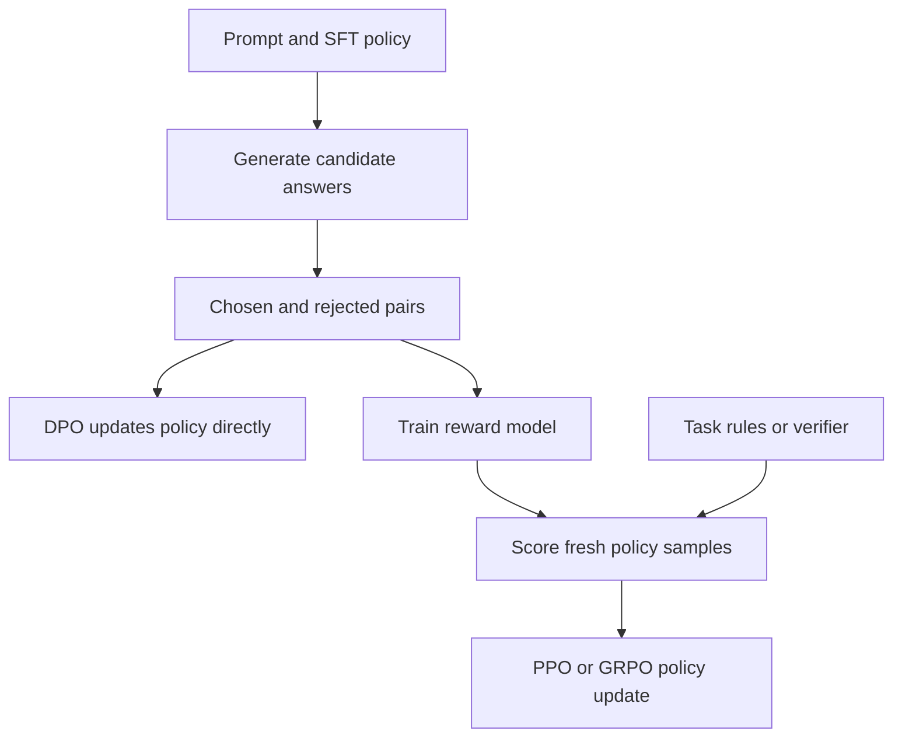

Pretraining teaches a model to predict text. Post-training changes which continuations it tends to produce for the prompts people actually give it. The training signal can be a demonstrated answer, a preference between two answers, or a score on newly sampled answers. Those are different kinds of evidence. I find it easier to reason about SFT, DPO, PPO, and GRPO by tracing **what data each consumes, what quantity it optimizes, and what can go wrong** than by treating them as a ladder of increasingly sophisticated acronyms.

The equations below use a prompt $x$, a completion $y=(y_1,\ldots,y_T)$, and a policy $\pi_\theta(y\mid x)$, which is just the language model's conditional probability of producing that completion. Because language generation is sequential, $\log\pi_\theta(y\mid x)=\sum_t\log\pi_\theta(y_t\mid x,y_{<t})$. A *reference policy* is a fixed copy used to measure drift; an *old policy* is the snapshot that actually sampled an online training batch. Their roles are different, even when they began with identical weights.

## First, teach the format with SFT

Supervised fine-tuning (SFT) gives the model a prompt and a target answer. The model sees the whole target during training, shifted one position: to predict target token $t$, it conditions on earlier *ground-truth* target tokens. This is **teacher forcing**. The objective is negative log likelihood of selected target tokens:

$$
L_{\mathrm{SFT}}=-\frac{\sum_{i,t}m_{it}\log\pi_\theta(y_{it}\mid x_i,y_{i,<t})}{\sum_{i,t}m_{it}},
$$

where $m_{it}=1$ for a scored token and zero otherwise. For instruction tuning, I usually want the prompt tokens excluded from the loss and the assistant completion included. In a multi-turn conversation I may score assistant turns and mask user/system turns. Padding must always be excluded. The exact mask depends on dataset format, chat template, and whether the target includes an end-of-turn token. Hugging Face TRL distinguishes completion-only and assistant-only loss modes; its behavior and defaults can vary by dataset and release, so inspect the resulting labels or mask rather than assuming an option name guarantees the intended objective. 

Here is a small conceptual batch. The log probabilities are already for the next token at each position, after shifting logits and labels:

| Position | Role | Log probability | Score? |
| --- | --- | ---: | ---: |
| 1 | prompt | $-10.0$ | 0 |
| 2 | completion | $-0.2$ | 1 |
| 3 | completion / stop | $-0.4$ | 1 |
| 4 | padding | $-100.0$ | 0 |

The correct completion-only loss is $0.3$, the mean of $0.2$ and $0.4$. Including the prompt or pad would produce a very different number. An off-by-one mask can accidentally train the model to predict the last prompt token or omit the stop token, so I check token IDs and labels on a real batch. SFT trains imitation of the supplied answer. It does not directly teach the model that an alternative answer is worse, and at inference the model conditions on its **own** previous tokens rather than ground truth.

## LoRA changes which weights move

A full fine-tune updates the base weight matrix $W\in\mathbb R^{d_{\mathrm{out}}\times d_{\mathrm{in}}}$. Low-rank adaptation (LoRA) freezes $W$ and learns an update $\Delta W=(\alpha/r)BA$, with $A\in\mathbb R^{r\times d_{\mathrm{in}}}$ and $B\in\mathbb R^{d_{\mathrm{out}}\times r}$. The trainable parameter count for this matrix is $r(d_{\mathrm{in}}+d_{\mathrm{out}})$ instead of $d_{\mathrm{in}}d_{\mathrm{out}}$. For a $4096\times4096$ matrix and rank $r=16$, that is 131,072 trainable adapter parameters versus 16,777,216 base parameters, or 0.78125% for this matrix. Biases, other adapted matrices, and optimizer choices add their own costs. A low rank can also limit the available update directions. 

LoRA is a **parameterization**, not a training objective: it can be used with SFT, DPO, or an online policy objective. QLoRA adds a quantized, frozen base model and backpropagates into LoRA adapters; its original method uses 4-bit NormalFloat and related memory techniques. It does not mean that adapter gradients or all computation are four-bit, and it is not itself a preference-learning method. 

## Preferences: score a pair, or learn a scorer

Suppose annotators compare two responses to the same prompt and mark $y^+$ as chosen and $y^-$ as rejected. In the classical reward-model route, train a scalar scorer $r_\phi(x,y)$ to make the chosen response more likely under a Bradley–Terry comparison:

$$
L_{\mathrm{RM}}=-\log\sigma\!\left(r_\phi(x,y^+)-r_\phi(x,y^-)\right),\qquad \sigma(z)=\frac{1}{1+e^{-z}}.
$$

Only the **difference** of scores matters for this pair. The scorer can then evaluate newly generated completions, giving an online learner a reward signal. The InstructGPT training recipe used demonstrations, ranked outputs, a reward model, and policy optimization with PPO; that is a concrete historical pipeline, not a universal requirement for every post-training project. 

Preference data has limits. A pairwise label says which of two sampled answers was preferred under that annotation protocol; it does not say either answer is absolutely correct. Labels can mix style, length, factuality, safety, and task success. A reward model can learn shortcuts in those labels, especially if the policy later searches for high-scoring responses unlike its training pairs. A held-out preference set and task-specific external checks are therefore part of the method, not an afterthought.



The online branch needs a reward source, which can be a learned model or a task-specific checker. After updating the policy, it generates another batch. GRPO does not inherently require a learned reward model.

## DPO turns the pair into a classification loss

Direct Preference Optimization (DPO) can be derived from a KL-regularized reward objective. For a fixed prompt, imagine choosing a policy $\pi$ to maximize expected reward while paying for divergence from a reference policy $\pi_{\mathrm{ref}}$:

$$
\max_\pi\; \mathbb E_{y\sim\pi}[r(x,y)]-\beta D_{\mathrm{KL}}\!\left(\pi(\cdot\mid x)\Vert\pi_{\mathrm{ref}}(\cdot\mid x)\right),\qquad \beta>0.
$$

At the optimum, $\pi^*(y\mid x)=\pi_{\mathrm{ref}}(y\mid x)\exp(r(x,y)/\beta)/Z(x)$. Rearranging gives $r(x,y)=\beta\log[\pi^*(y\mid x)/\pi_{\mathrm{ref}}(y\mid x)]+\beta\log Z(x)$. In a chosen-versus-rejected comparison for the **same** prompt, the unknown $\log Z(x)$ cancels. Replacing $\pi^*$ with the policy being trained yields the standard DPO loss:

$$
L_{\mathrm{DPO}}=-\log\sigma\!\left(\beta\left[\log\frac{\pi_\theta(y^+\mid x)}{\pi_{\mathrm{ref}}(y^+\mid x)}-\log\frac{\pi_\theta(y^-\mid x)}{\pi_{\mathrm{ref}}(y^-\mid x)}\right]\right).
$$

Equivalently, define $\Delta_\theta=\log\pi_\theta(y^+\mid x)-\log\pi_\theta(y^-\mid x)$ and the same $\Delta_{\mathrm{ref}}$ for the reference; then the argument is $\beta(\Delta_\theta-\Delta_{\mathrm{ref}})$. **Larger policy preference for the chosen answer relative to the reference lowers loss.** Positive $\beta$ in this loss scales that margin; in the underlying regularized optimization it controls the KL tradeoff. Conventions differ across variants, so an implementation's hyperparameter deserves its own documentation check. DPO avoids fitting a separate reward model or collecting new on-policy samples *during this offline loss*, but remains dependent on the quality and coverage of its fixed preference pairs. 

A sequence log probability must score only the response tokens, with a consistent tokenizer, chat template, truncation rule, and treatment of end tokens for chosen, rejected, policy, and reference. Length changes sums of log probabilities. A per-token mean is **not** algebraically the same DPO objective as the sequence sum. The reference should remain fixed during standard DPO unless one intentionally chooses a documented variant. If it silently drifts with the trainable policy, the subtraction loses its intended meaning.

As a numerical check, let the policy log probabilities of chosen and rejected completions be $-2$ and $-1$, identical to the reference. The DPO margin is zero and loss is $\log 2\approx0.6931$. Change only the policy to $-1$ and $-2$; with $\beta=0.5$ the margin becomes $1$, and loss falls to about $0.3133$. This is toy arithmetic on log probabilities, not a model-quality result.

## Before PPO and GRPO: the small RL vocabulary

An **action** is a generated token (or, in a simplified view, a whole completion). A **trajectory** is the resulting completion. A **reward** is a score assigned after or during generation. A **policy** is the probability distribution over next actions. An **advantage** asks whether the sampled action did better than a baseline; positive advantage should increase its probability, negative advantage should decrease it. A **value function** estimates expected future reward and can provide that baseline. When we sample from the current policy and update using those samples, this is online or on-policy style training, subject to how far and how long the samples are reused.

These words matter because the score itself is not differentiable through sampled text in the usual policy-gradient setup. Instead, the update uses log probabilities of sampled actions multiplied by advantage estimates. The learner needs to know which policy generated the sample to correct for later changes. That behavior policy is $\pi_{\mathrm{old}}$. A separate, usually frozen $\pi_{\mathrm{ref}}$ may enter a KL penalty that discourages drifting too far from a known baseline. Confusing old and reference policies produces the wrong probability ratio or the wrong regularizer.

## PPO clips updates on sampled actions

Proximal Policy Optimization (PPO) uses a probability ratio $\rho_t(\theta)=\pi_\theta(a_t\mid s_t)/\pi_{\mathrm{old}}(a_t\mid s_t)$. Its clipped surrogate, which we **maximize**, is

$$
J_{\mathrm{clip}}=\mathbb E_t\left[\min\!\left(\rho_t A_t,\;\operatorname{clip}(\rho_t,1-\epsilon,1+\epsilon)A_t\right)\right].
$$

For $A_t=+1$, $\epsilon=0.2$, and $\rho_t=1.5$, the surrogate is $1.2$: the objective stops rewarding probability increases above the upper clip on that sample. For $A_t=-1$ and $\rho_t=0.5$, it is $-0.8$: the objective stops rewarding probability decreases below the lower clip. But for $A_t=-1$ and $\rho_t=1.5$, it is $-1.5$; clipping does **not** erase a harmful move in the wrong direction. The `min` and the sign of $A$ are both essential. PPO's original paper introduces this surrogate for repeated optimization of samples; language-model RL adds choices about rewards, value estimates, KL penalties, and token masking. 

A typical RLHF PPO system samples responses, scores them with a reward model, may subtract a reference-policy KL penalty, estimates advantages with a value model, and takes bounded policy updates against the old sampler. This is operationally heavier than offline DPO because generation, scoring, value estimation, and policy updates must agree on tokenization and completion boundaries. PPO's clip limits one part of the surrogate; it is not a formal guarantee that the new policy remains close to the reference.

## GRPO uses a group as its baseline

Group Relative Policy Optimization (GRPO), introduced in DeepSeekMath, samples several completions for the **same prompt**. If their rewards are $r_1,\ldots,r_G$, a common group advantage is $(r_i-\bar r)/(s_r+\delta)$, with $\bar r$ the group mean and $s_r$ a group standard deviation. Better-than-group completions get positive advantage; worse ones get negative advantage. This removes the need for a learned value-model baseline in that formulation, though it still needs a reward source, multiple samples, and policy/reference bookkeeping. The policy update is PPO-like, often with clipping and a reference KL term. 

If all $G$ rewards equal one, the group has zero variance. Dividing by $s_r$ is undefined; an implementation must use an explicit convention, such as zero advantages or a positive denominator guard. Zero advantages also mean that this group supplies no relative learning signal. If *every* answer receives the same reward, drawing more samples does not create a preference. The attached toy script uses zero advantages for an all-equal group, solely as an explicit arithmetic convention.

Reward design is decisive. A binary exact-match checker can give useful, inspectable signal for a verifiable task, but a malformed answer, a lucky guess, and a correctly reasoned answer may receive the same outcome depending on the checker. Multiple reward components need scales and anti-exploit checks. The policy can learn to satisfy a parser, produce a longer response that happens to include an answer, or exploit errors in a grader. A group baseline is not a cure for reward hacking.

There is also no single timeless “GRPO loss.” The original formulation, later recipes, and TRL's `loss_type` variants differ in how token losses are normalized, how group variance is handled, and how length affects gradients. The TRL documentation checked in November 2026 lists options including `grpo`, `dapo`, and `dr_grpo`, with discussion of response-length bias. Compare the chosen implementation's equation with the experiment's intended objective and pin its version. A claim that GRPO always beats PPO or DPO would ignore task, reward quality, sample budget, and those implementation choices. 

## The evaluation and data boundary

I would establish the evaluation split **before** collecting labels or tuning rewards. Near-duplicate prompts, benchmark answers embedded in training demonstrations, and reward models trained on evaluation items leak the answer into the process. A model can improve a reward score while becoming less useful to people, so I would inspect human or task-based quality separately from the optimized reward. Report both response quality and failure modes by category, not just a single average.

Termination and padding need special care across all four objectives. EOS or an end-of-turn token determines what counts as a completed response; if it is omitted or truncated, the loss may reward never stopping. Padding is never an action and should not receive token loss or advantage. Generation temperature, top-$p$, and maximum length decide which completions enter PPO/GRPO training; evaluation with a different sampler measures a different behavior distribution. Offline DPO has its own sampling mismatch: fixed chosen/rejected pairs may no longer resemble what the updated policy emits. These are reasons to keep a small, inspectable evaluation batch alongside aggregate metrics.

| Method | Main data | Main update | Main vulnerability |
| --- | --- | --- | --- |
| SFT | prompt and demonstrated completion | increase target-token likelihood | imitate demonstrations, including their defects |
| DPO | prompt and preferred/rejected pair | increase reference-relative preference margin | fixed pairs may poorly cover new policy outputs |
| PPO-style RLHF | sampled response and learned reward | clipped policy update using advantage | reward exploitation and value/reward calibration |
| GRPO-style RL | groups of sampled responses and rewards | relative group advantage with policy update | uninformative equal-reward groups and length/reward bias |

## Reproduce the toy losses and plot

Run `python3 -B toy.py` from this post's folder. The attached [toy.py](toy.py) checks mask correctness, DPO preference direction, PPO clipping with both positive and negative advantages, and the zero-variance GRPO case. It prints the following deterministic values and regenerates the [losses.svg](losses.svg) plot using NumPy and Matplotlib:

```text
SFT masked loss=0.300
DPO before=0.693147 after=0.313262
PPO A=+1 r=1.5: 1.200
PPO A=-1 r=0.5: -0.800
GRPO equal rewards: [0.0, 0.0, 0.0]
```



The script deliberately contains no model or dataset. It isolates signs, masks, and clipping, which are exactly where an apparently plausible training loop can encode the wrong objective.

## Interview questions I would rehearse

1. **What does teacher forcing mean?** Each target token is predicted given earlier ground-truth tokens; generation later conditions on sampled tokens.
2. **Why mask prompt and padding tokens in completion-only SFT?** The intended objective scores assistant target tokens, and padding is not data.
3. **Does LoRA define a loss?** No. It restricts the trainable update to low-rank matrices and can be paired with different objectives.
4. **How does QLoRA differ from LoRA?** It stores the frozen base in a quantized form while training adapters through it, with additional memory techniques in the original method.
5. **Why can DPO avoid an explicit reward model?** Under a KL-regularized optimum, reward differences can be expressed as policy-versus-reference log-ratio differences; the prompt normalizer cancels in a pair.
6. **Which way should the DPO sign point?** Increasing the chosen answer's policy margin relative to the reference must lower the loss.
7. **What is the old policy in PPO?** The behavior policy that sampled the current training data, used in the importance ratio.
8. **What is the reference policy for?** It measures or penalizes drift from a baseline; it is conceptually separate from the old sampler.
9. **Does PPO clipping block all large changes?** No. The clipped surrogate limits improvement in selected directions on sampled actions; it is not a hard policy constraint.
10. **What does a GRPO group provide?** A within-prompt reward baseline and relative advantages, often replacing a learned critic for that formulation.
11. **What happens if every reward in a group is equal?** Relative signal vanishes, and raw standard-deviation normalization is undefined without a guard.
12. **Why might a better reward score be misleading?** The policy may exploit the grader, length, formatting, or leaked evaluation data rather than improve useful behavior.


