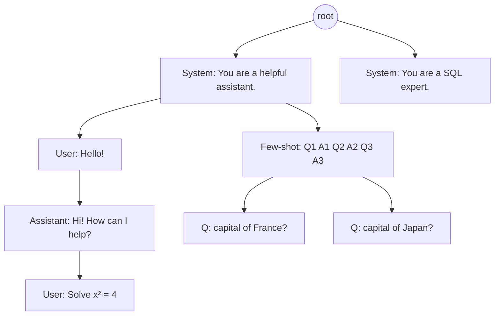

In the [transformers post](/blog/transformers-intuitively/) the model was a function: tokens
in, logits out. Serving it to thousands of people at once is a different problem, and
surprisingly little of it is about the model. It's about **memory** (where the KV cache lives
and how much of it you can keep) and **scheduling** (which request runs, when, and on which
GPU).

The story goes in four steps, and each one exists because of a limit in the one before:

1. **Prefill vs decode.** A request has two phases with opposite bottlenecks: reading the
   prompt is compute-bound, writing the answer is memory-bound. Everything else follows from
   this.
2. **vLLM.** A plain `generate()` loop wastes most of the GPU's memory on padding and
   reservations, and leaves slots idle while the longest answer finishes. PagedAttention and
   continuous batching fix both, for up to 24x the throughput.
3. **SGLang.** Many requests share long prefixes (system prompts, few-shot examples, chat
   history, agent traces). A radix tree of cached KV, plus a scheduler that runs requests in
   prefix order, turns that sharing into skipped work.
4. **The cluster.** With many replicas, each has its own cache, and a cache-blind load balancer
   scatters related requests. Routing on prefixes, and splitting prefill and decode onto
   different GPUs, is what NVIDIA Dynamo, llm-d and Baseten do at scale
   .

Along the way I'll do the arithmetic that serving teams do on a whiteboard (how many tokens fit,
how long a step takes, when moving KV beats recomputing it) and check each idea with a small
Python simulation you can run.

## The two phases of a request

### Prefill reads, decode writes

When a prompt arrives, the model runs over **all prompt tokens at once**. That's one big
forward pass with $n$ tokens in it; it builds the KV cache for every prompt position and
produces the first output token. This is **prefill**.

Then the model generates one token at a time. Each step feeds in *only the newest token*,
attends to the cached keys and values of everything before it, appends one new K/V pair, and
produces the next token. This is **decode**, and it repeats once per output token.

<figure class="ml-diagram">
<svg viewBox="0 0 860 210" role="img" aria-label="Timeline of one request: a long prefill block that processes all prompt tokens in parallel, then a sequence of short decode steps, one per output token. TTFT spans the prefill; TPOT is the length of one decode step.">
  <defs><marker id="ml-arrow" viewBox="0 0 10 10" refX="9" refY="5" markerWidth="7" markerHeight="7" orient="auto-start-reverse"><path d="M0,0 L10,5 L0,10 z"/></marker></defs>
  <text class="label" x="175" y="30">compute-bound: matrix × matrix</text>
  <text class="label" x="560" y="30">memory-bound: matrix × vector, once per token</text>
  <rect class="box violet" x="45" y="50" width="260" height="80" rx="8"/>
  <text class="name" x="175" y="84">Prefill</text>
  <text class="note violet" x="175" y="108">all n prompt tokens in one pass</text>
  <rect class="box green" x="330" y="50" width="48" height="80" rx="8"/>
  <text class="name" x="354" y="96">1</text>
  <rect class="box green" x="388" y="50" width="48" height="80" rx="8"/>
  <text class="name" x="412" y="96">2</text>
  <rect class="box green" x="446" y="50" width="48" height="80" rx="8"/>
  <text class="name" x="470" y="96">3</text>
  <rect class="box green" x="504" y="50" width="48" height="80" rx="8"/>
  <text class="name" x="528" y="96">4</text>
  <rect class="box green" x="562" y="50" width="48" height="80" rx="8"/>
  <text class="name" x="586" y="96">5</text>
  <rect class="box green" x="620" y="50" width="48" height="80" rx="8"/>
  <text class="name" x="644" y="96">…</text>
  <rect class="box green" x="678" y="50" width="48" height="80" rx="8"/>
  <text class="name" x="702" y="96">m</text>
  <text class="note green" x="790" y="96">done</text>
  <line class="arrow both" x1="49" y1="155" x2="374" y2="155"/>
  <text class="label" x="211" y="182">TTFT (time to first token)</text>
  <line class="arrow both" x1="390" y1="155" x2="434" y2="155"/>
  <text class="label" x="412" y="182">TPOT</text>
  <line class="arrow plain" x1="49" y1="200" x2="726" y2="200"/>
  <text class="label" x="600" y="182">end-to-end ≈ TTFT + (m − 1) · TPOT</text>
</svg>
<figcaption>One request. Prefill builds the KV cache for the whole prompt and emits the first token; each decode step reads that cache, adds one entry, and emits one more token.</figcaption>
</figure>

An analogy that holds up surprisingly well: prefill is *reading* the question, and you can
read a whole page at a glance. Decode is *writing* the answer, and you can only write one word
at a time, because each word depends on the one before.

### The metrics everyone quotes

- **TTFT** (time to first token): queueing + prefill. What a chat user feels as "it's
  thinking". Dominated by prompt length and by how busy the prefill GPU is.
- **TPOT** (time per output token) and **ITL** (inter-token latency): the gap between
  streamed tokens. What a user feels as "typing speed". $1/\text{TPOT}$ is tokens per second
  *per user*.
- **Throughput**: total tokens per second across all users. What the bill depends on.
- **Goodput**: requests per second that *meet their latency targets* (for example TTFT under
  2 s *and* TPOT under 50 ms). DistServe argued this is the number that actually matters,
  because raw throughput is easy to raise by letting latency explode.

The tension in every section below is between the last two and the first two: batching more
requests together raises throughput, but each user waits longer for each token. Latency
numbers are almost always quoted as percentiles (P50, P90, P99); the
[measurement section](#measuring-it-latency-metrics-percentiles-and-goodput) after the
roofline defines each metric exactly, what the percentiles mean, and how they're commonly
misread.

### Why one is compute-bound and the other memory-bound

A GPU has two speeds: how many FLOPs per second it can do, and how many bytes per second it
can read from HBM. For an H100 SXM in BF16 those are about 989 TFLOP/s (dense; the datasheet's
1,979 assumes sparsity) and 3.35 TB/s. Their ratio is the **ridge point**:

$$
\text{ridge} = \frac{989 \times 10^{12}\ \text{FLOP/s}}{3.35 \times 10^{12}\ \text{B/s}} \approx 295\ \text{FLOPs per byte}.
$$

If a kernel does fewer than ~295 FLOPs for every byte it reads, the compute units sit idle
waiting for memory: it's **memory-bound**. More than that and memory waits for compute: it's
**compute-bound**. The number of FLOPs per byte a kernel does is its **arithmetic intensity**.

Almost all of a transformer's FLOPs are in its linear layers. Push $n$ tokens through a weight
matrix $W \in \mathbb{R}^{d \times d'}$ stored in BF16 (2 bytes per number):

$$
\text{FLOPs} = 2\,n\,d\,d', \qquad
\text{bytes} \approx \underbrace{2\,d\,d'}_{\text{weights}} + \underbrace{2\,n\,(d + d')}_{\text{activations}}, \qquad
\text{intensity} \approx \frac{2nd d'}{2dd'} = n \quad (n \ll d).
$$

**The arithmetic intensity of a linear layer is roughly the number of tokens in the
batch.** The weights are read once and reused for every token, so more tokens means more work
per byte.

- **Prefill** of a 2,000-token prompt has $n = 2000 \gg 295$. Compute-bound. The GPU is doing
  what it was built for.
- **Decode** of one request has $n = 1$. Intensity ≈ 1, so the GPU uses about $1/295$ of its
  compute and spends the step streaming all the weights from HBM to produce *one* token.
  Batching $b$ requests makes $n = b$, which is why batching helps decode so much: the same
  weight read now serves $b$ users.

Attention in decode is worse, and batching doesn't help it at all. For one sequence of
length $L$, the new query (with $H$ heads of size $d_h$) is dotted against $L$ keys and mixes
$L$ values: about $4 H d_h L$ FLOPs. It has to read that sequence's K and V, which are
$2 \cdot H_{kv} \cdot d_h \cdot L$ numbers at 2 bytes each:

$$
\text{intensity}_{\text{decode attn}} = \frac{4 H d_h L}{4 H_{kv} d_h L} = \frac{H}{H_{kv}}.
$$

That's the GQA group size: 1 for a model with full multi-head attention like Llama 2 7B, 4 for
Llama 3 8B. Every sequence has its *own* KV cache, so putting more sequences in the batch adds
bytes as fast as it adds FLOPs. This is the real reason
[GQA](/blog/transformers-intuitively/) exists: fewer KV heads means fewer
bytes to stream per decode step and more sequences fitting in memory.

### Worked numbers: Llama 3 8B on one H100

Here is the whole back-of-envelope model as code. It's the same method Baseten's inference
guide uses: decode time is bytes moved over bandwidth, prefill
time is FLOPs over compute, and you take whichever bound is larger. Parameter counts come from
each model's `config.json`.

```python {title="serving_math.py"}
# Back-of-envelope serving maths: weights, KV cache, roofline, prefill and decode times.
from dataclasses import dataclass

@dataclass
class Model:
    name: str
    layers: int
    d_model: int
    n_heads: int
    n_kv_heads: int
    head_dim: int
    d_ff: int
    vocab: int
    tied: bool = False
    dtype_bytes: int = 2                       # BF16 / FP16

    @property
    def params(self) -> int:
        q_o = 2 * self.d_model * self.n_heads * self.head_dim
        k_v = 2 * self.d_model * self.n_kv_heads * self.head_dim
        mlp = 3 * self.d_model * self.d_ff         # gate, up, down (SwiGLU)
        emb = self.vocab * self.d_model * (1 if self.tied else 2)
        return self.layers * (q_o + k_v + mlp) + emb

    @property
    def kv_bytes_per_token(self) -> int:
        # K and V, every layer, every KV head
        return 2 * self.layers * self.n_kv_heads * self.head_dim * self.dtype_bytes

@dataclass
class GPU:
    name: str
    flops: float        # dense BF16 FLOP/s
    bw: float           # HBM bytes/s
    mem: float          # bytes

LLAMA2_7B  = Model("Llama-2-7B",  32, 4096, 32, 32, 128, 11008, 32000)
LLAMA3_8B  = Model("Llama-3-8B",  32, 4096, 32,  8, 128, 14336, 128256)
QWEN3_32B  = Model("Qwen3-32B",   64, 5120, 64,  8, 128, 25600, 151936)
LLAMA3_70B = Model("Llama-3-70B", 80, 8192, 64,  8, 128, 28672, 128256)

H100 = GPU("H100 SXM", 989e12, 3.35e12, 80e9)
A100 = GPU("A100 80GB", 312e12, 2.039e12, 80e9)

def prefill_seconds(m: Model, g: GPU, n: int, n_gpus: int = 1, mfu: float = 1.0) -> float:
    linear = 2 * m.params * n                                  # 2 FLOPs per weight per token
    attn = 2 * m.layers * m.n_heads * m.head_dim * n * n       # QK^T and AV, causal half
    return (linear + attn) / (g.flops * n_gpus * mfu)

def decode_step_seconds(m: Model, g: GPU, batch: int, ctx: int, n_gpus: int = 1) -> tuple[float, str]:
    bytes_moved = m.params * m.dtype_bytes + batch * ctx * m.kv_bytes_per_token
    t_mem = bytes_moved / (g.bw * n_gpus)
    t_compute = 2 * m.params * batch / (g.flops * n_gpus)
    return max(t_mem, t_compute), ("memory" if t_mem >= t_compute else "compute")

def kv_capacity_tokens(m: Model, g: GPU, n_gpus: int = 1, util: float = 0.9) -> int:
    free = g.mem * n_gpus * util - m.params * m.dtype_bytes
    return int(free // m.kv_bytes_per_token)

if __name__ == "__main__":
    print(f"{'model':12} {'params':>7} {'KV/token':>9} {'KV@4k':>8}")
    for m in (LLAMA2_7B, LLAMA3_8B, QWEN3_32B, LLAMA3_70B):
        print(f"{m.name:12} {m.params/1e9:6.2f}B {m.kv_bytes_per_token/1024:6.0f}KiB "
              f"{m.kv_bytes_per_token*4096/2**30:6.2f}GiB")

    print(f"\nridge point H100 = {H100.flops/H100.bw:.0f} FLOPs/byte, A100 = {A100.flops/A100.bw:.0f}")

    m, g = LLAMA3_8B, H100
    print(f"\n{m.name} on one {g.name}")
    print(f"  prefill 2,000 tokens (ideal)  : {prefill_seconds(m, g, 2000)*1e3:6.1f} ms")
    print(f"  prefill 2,000 tokens (50% MFU): {prefill_seconds(m, g, 2000, mfu=0.5)*1e3:6.1f} ms")
    print(f"  KV capacity at 90% memory     : {kv_capacity_tokens(m, g):,} tokens")
    for b, ctx in [(1, 2000), (64, 2000), (200, 2000)]:
        t, bound = decode_step_seconds(m, g, b, ctx)
        print(f"  decode batch={b:3d} ctx={ctx}: {t*1e3:5.2f} ms/step, "
              f"{1/t:5.0f} tok/s per user, {b/t:7.0f} tok/s total ({bound}-bound)")

    m = LLAMA3_70B
    print(f"\n{m.name} on 8x {g.name} (tensor parallel, ignoring communication)")
    print(f"  prefill 4,096 tokens (50% MFU): {prefill_seconds(m, g, 4096, 8, 0.5)*1e3:6.1f} ms")
    kv = m.kv_bytes_per_token * 4096
    print(f"  KV for a 4,096-token prompt   : {kv/1e9:.2f} GB")
    for name, bw in [("NVLink 900 GB/s", 900e9), ("400 Gb/s NIC", 50e9)]:
        print(f"  transfer over {name:15}: {kv/bw*1e3:6.1f} ms")
```

```text {title="Output"}
model         params  KV/token    KV@4k
Llama-2-7B     6.74B    512KiB   2.00GiB
Llama-3-8B     8.03B    128KiB   0.50GiB
Qwen3-32B     32.76B    256KiB   1.00GiB
Llama-3-70B   70.55B    320KiB   1.25GiB

ridge point H100 = 295 FLOPs/byte, A100 = 153

Llama-3-8B on one H100 SXM
  prefill 2,000 tokens (ideal)  :   33.5 ms
  prefill 2,000 tokens (50% MFU):   67.1 ms
  KV capacity at 90% memory     : 426,788 tokens
  decode batch=  1 ctx=2000:  4.87 ms/step,   205 tok/s per user,     205 tok/s total (memory-bound)
  decode batch= 64 ctx=2000:  9.80 ms/step,   102 tok/s per user,    6529 tok/s total (memory-bound)
  decode batch=200 ctx=2000: 20.44 ms/step,    49 tok/s per user,    9783 tok/s total (memory-bound)

Llama-3-70B on 8x H100 SXM (tensor parallel, ignoring communication)
  prefill 4,096 tokens (50% MFU):  151.7 ms
  KV for a 4,096-token prompt   : 1.34 GB
  transfer over NVLink 900 GB/s:    1.5 ms
  transfer over 400 Gb/s NIC   :   26.8 ms
```

What to take from those numbers:

- **One user gets ~205 tokens/s, and that's a hard ceiling.** A single decode step must read
  all 16 GB of weights, and $16 / 3350\ \text{GB/s} \approx 4.9$ ms. No kernel trick beats
  that; only fewer bytes (quantization), more bandwidth (H200, B200), or more GPUs splitting
  the weights (tensor parallelism) do.
- **Batching is nearly free at first.** Going from 1 to 64 users only doubles the step time,
  so total throughput goes up 32x. The weight read is shared; only the KV reads grow.
- **At large batch, the KV cache is the bottleneck, twice over.** At 200 users × 2,000 tokens
  the step reads 52 GB of KV against 16 GB of weights, so it's still memory-bound, now on the
  *cache*. And 200 × 2,000 = 400k tokens is nearly the 427k that fit in memory at all. KV
  memory sets the maximum batch, and the batch size sets throughput. That's why the next
  three sections are all about KV memory.
- **The KV cache size per token is set by the architecture.** Llama 2 7B (32 KV heads) needs
  512 KiB per token; Llama 3 8B (8 KV heads, GQA) needs 128 KiB. The same GPU holds 4x as
  many tokens for the newer model.

The same arithmetic in Baseten's guide, for Llama 2 7B on cheaper GPUs, gives 23 ms per token
on an A10 (14 GB ÷ 600 GB/s), 39 ms to prefill 350 tokens, and 3.49 s for a 150-token answer.
They also note real systems come in up to about 2x slower than these bounds
.[^mfu] Plug in your own numbers below.

[^mfu]: The gap comes from kernels that don't hit peak bandwidth or FLOPs, from communication in tensor parallelism, and from scheduling overhead on the CPU. Teams usually fold this into a single efficiency factor (MFU for compute, MBU for bandwidth) of 50–80%.



## Measuring it: latency metrics, percentiles and goodput

Every result in the rest of this post is a sentence like "P90 TTFT dropped from 31 s to
0.54 s" or "P95 latency fell 48%". To read those (or produce your own) you need three things:
exactly what each metric measures, what a percentile is, and how the numbers get distorted.

### Every metric, precisely

For one streamed request, record the arrival time $t_{\text{arr}}$ and the timestamp of each
output token $t_1, t_2, \dots, t_n$:

$$
\text{TTFT} = t_1 - t_{\text{arr}}, \qquad
\text{E2E} = t_n - t_{\text{arr}}, \qquad
\text{ITL}_k = t_{k+1} - t_k, \qquad
\text{TPOT} = \frac{\text{E2E} - \text{TTFT}}{n - 1}.
$$

| Metric | What it is | What the user feels | Watch out for |
| --- | --- | --- | --- |
| TTFT | arrival → first token: queueing, prefill, first token | "is it thinking?" | includes queueing, so it explodes under load first |
| ITL | each gap between two consecutive tokens | stutter and freezes while text streams | one value *per token*, not per request |
| TPOT | a request's mean gap, first token excluded | average typing speed | averaging over a request hides freezes |
| E2E latency | arrival → last token | total wait for a non-streamed answer | scales with output length; compare at fixed lengths |
| Tokens/s per user | $n / \text{E2E}$, or about $1/\text{TPOT}$ for long outputs | reading speed | |
| Output tokens/s (system) | all output tokens ÷ wall-clock time | nothing directly; it's the cost side | rises with batch size while per-user speed falls |
| Requests/s | completed requests ÷ time | | only comparable at fixed input/output lengths |
| SLO attainment | fraction of requests meeting every latency target | | the target has to be stated |
| Goodput | the highest request rate that keeps SLO attainment above a goal (say 90%) | | DistServe's definition |
| Prefix-cache hit rate | cached prompt tokens ÷ prompt tokens | lower TTFT | per token, not per request |

Tools disagree on the details. NVIDIA's AIPerf defines ITL as
$(\text{E2E} - \text{TTFT}) / (n - 1)$, which is what I called TPOT above, and its docs say
outright that "tool implementations vary, so compare results only when definitions align"
. vLLM's benchmark reports both: TPOT per request and ITL per token
gap, with percentiles of each. Before comparing two benchmarks, check
which one they mean.

### What P50, P90, P95 and P99 mean

Sort all the measurements. The **$q$-th percentile** is the value that $q\%$ of them fall
below. Formally, with $F$ the cumulative distribution of latencies,
$P_q = \min\{x : F(x) \ge q/100\}$.

- **P50** (the median): half the requests were faster, half slower. The typical experience.
- **P90**: 1 request in 10 was slower than this.
- **P95**: 1 in 20 was slower.
- **P99**: 1 in 100 was slower. "P99 TTFT is 2 s" means 99% of users saw their first token
  within 2 s, and 1% waited longer, possibly much longer.
- **Max**: the single worst request. Mostly noise; a single unlucky event sets it.

The high percentiles are the **tail** of the distribution. Latency distributions are skewed:
there's a floor (you can't beat the hardware), and a long tail to the right (queueing, a long
prompt next to you, a garbage-collection pause, a cache miss). So the **mean** is a poor
summary. It gets pulled up by the tail and still doesn't tell you how bad the tail is. That's
why serious benchmarks quote P50 for "typical" and P90/P95/P99 for "bad day".

Here are all the metrics computed from token timestamps, for 2,000 synthetic streamed requests.
Each request has a skewed TTFT, ~20 ms between tokens, and 2% of token gaps hit a 0.5 s stall
(the kind of thing an unchunked long prefill next to you causes).

```python {title="request_metrics.py"}
import numpy as np

def request_metrics(arrival, token_times):
    """Per-request latency metrics from the arrival time and each streamed token's timestamp."""
    t = np.asarray(token_times)
    ttft = t[0] - arrival                         # queueing + prefill + first token
    e2e = t[-1] - arrival                         # until the last token
    tpot = (e2e - ttft) / (len(t) - 1)            # mean gap per request, first token excluded
    itl = np.diff(t)                              # every individual gap between tokens
    return ttft, tpot, itl, e2e

def summarize(name, x, scale=1e3, unit="ms"):
    p50, p90, p99 = np.percentile(x, [50, 90, 99])
    print(f"{name:4} mean {x.mean()*scale:6.0f}  p50 {p50*scale:6.0f}  p90 {p90*scale:6.0f}  "
          f"p99 {p99*scale:6.0f}  max {x.max()*scale:6.0f}  {unit}")

if __name__ == "__main__":
    rng = np.random.default_rng(0)
    ttft, tpot, e2e, itl, froze = [], [], [], [], []
    for i in range(2_000):
        arrival = i * 0.1
        first = arrival + rng.lognormal(np.log(0.3), 0.5)        # skewed: a few slow prefills
        n_out = rng.integers(50, 500)
        gaps = 0.02 + rng.exponential(0.003, n_out - 1)           # ~20 ms per token...
        gaps[rng.random(n_out - 1) < 0.02] += 0.5                 # ...2% of gaps stall 0.5 s
        times = first + np.concatenate([[0.0], np.cumsum(gaps)])
        a, b, c, d = request_metrics(arrival, times)
        ttft.append(a); tpot.append(b); itl.append(c); e2e.append(d)
        froze.append(c.max() > 0.4)
    ttft, tpot, e2e, itl = np.array(ttft), np.array(tpot), np.array(e2e), np.concatenate(itl)

    summarize("TTFT", ttft)
    summarize("TPOT", tpot)
    summarize("ITL", itl)
    summarize("E2E", e2e, scale=1, unit="s")

    ok = (ttft <= 0.5) & (tpot <= 0.040)                        # SLO: TTFT 500 ms, TPOT 40 ms
    print(f"\nSLO attainment (TTFT <= 500 ms and TPOT <= 40 ms): {ok.mean():.1%}")
    print(f"requests with at least one freeze > 400 ms     : {np.mean(froze):.1%}")
```

```text {title="Output"}
TTFT mean    334  p50    296  p90    552  p99    905  max   1597  ms
TPOT mean     33  p50     32  p90     39  p99     48  max     65  ms
ITL  mean     33  p50     22  p90     28  p99    522  max    549  ms
E2E  mean      9  p50      9  p90     15  p99     18  max     22  s

SLO attainment (TTFT <= 500 ms and TPOT <= 40 ms): 79.0%
requests with at least one freeze > 400 ms     : 95.9%
```

Three things to read off this:

- **The mean sits above the median** for TTFT (334 vs 296 ms): the slow tail drags it up.
  P99 is 3x the median, and the max is 5x. A dashboard showing only the average would hide all
  of that.
- **TPOT looks great and ITL tells the truth.** P99 TPOT is 48 ms, so every request's
  *average* typing speed is fine. But P99 ITL is 522 ms, and 96% of requests froze at least
  once for half a second. Averaging over a request smooths the freezes away, and users notice
  freezes. That's why Sarathi-Serve's headline latency plots use P99 time-between-tokens
  .
- **SLO attainment combines metrics.** Each SLO alone looks easy to meet, but only 79% of
  requests meet both at once.

### Why the tail matters more than it looks

"Only 1% of requests" sounds harmless until a user (or a program) makes many requests. If each
call independently has a 1% chance of landing beyond P99, then a task that makes $k$ calls
hits at least one slow one with probability

$$
P(\text{at least one slow}) = 1 - 0.99^{k}.
$$

That's 10% for 10 calls, 39% for 50, and 63% for 100. Dean and Barroso's "The Tail at Scale"
made this point for web search: if a request fans out to 100 servers and each is slow 1% of
the time, 63% of user requests are slow. An agent that makes 50
sequential model calls per task is the same situation. Its users live in the P99 of each call,
which is why agent-heavy services track P99 rather than P50. (The paper's remedies, like
**hedged requests** that send a backup copy to a second replica after a short delay, apply to
LLM routers too.)

### Four ways to get percentiles wrong

**1. Averaging percentiles.** A percentile of a combined set isn't the average of the
percentiles of its parts. If 7 replicas are healthy and 1 is overloaded, the mean of the 8
per-replica P99s badly understates the fleet's P99. Prometheus's docs say it directly: you
cannot aggregate precomputed quantiles, for example "to calculate the total 90th percentile
latency for a service backed by multiple replicated workers". Export histograms (bucket
counts), which *can* be summed, and compute the percentile from the merged histogram
. The same goes for averaging P99s over time windows.

**2. Too few samples.** P99 is decided by the slowest 1% of samples. With 100 requests that's
one request, so the estimate swings wildly between runs. You want thousands of requests per
measurement point.

```python {title="percentile_pitfalls.py"}
import numpy as np

rng = np.random.default_rng(1)

# 1. Percentiles don't average. Seven healthy replicas, one overloaded.
replicas = [rng.lognormal(np.log(0.3), 0.3, 5_000) for _ in range(7)]
replicas.append(rng.lognormal(np.log(2.0), 0.5, 5_000))
mean_of_p99s = np.mean([np.percentile(r, 99) for r in replicas])
true_p99 = np.percentile(np.concatenate(replicas), 99)
print(f"mean of per-replica p99s: {mean_of_p99s:.2f} s   true fleet p99: {true_p99:.2f} s")

# 2. A p99 needs many samples. Spread of the p99 estimate over 1,000 repeated benchmarks.
for n in (100, 1_000, 10_000):
    est = [np.percentile(rng.lognormal(np.log(0.3), 0.5, n), 99) for _ in range(1_000)]
    lo, hi = np.percentile(est, [5, 95])
    print(f"n={n:6,}: p99 estimate ranges {lo:.2f}-{hi:.2f} s (90% of runs)")

# 3. Tails compound: a task that makes k calls is slow if ANY call is beyond p99.
for k in (1, 10, 50, 100):
    print(f"{k:3d} calls: P(at least one slower than p99) = {1 - 0.99**k:.0%}")
```

```text {title="Output"}
mean of per-replica p99s: 1.33 s   true fleet p99: 4.05 s
n=   100: p99 estimate ranges 0.69-1.12 s (90% of runs)
n= 1,000: p99 estimate ranges 0.87-1.05 s (90% of runs)
n=10,000: p99 estimate ranges 0.93-0.99 s (90% of runs)
  1 calls: P(at least one slower than p99) = 1%
 10 calls: P(at least one slower than p99) = 10%
 50 calls: P(at least one slower than p99) = 39%
100 calls: P(at least one slower than p99) = 63%
```

The averaged number says 1.3 s; the real fleet P99 is 4 s, because one replica owns nearly the
whole tail. And at 100 samples, two honest runs of the same system can report P99s of 0.7 s
and 1.1 s.

**3. Coordinated omission.** Most simple benchmark clients are **closed-loop**: send a
request, wait for the reply, send the next. When the server stalls, the client stalls with
it, and stops sending exactly when latency is worst. So the stall shows up as *one* slow
sample instead of the many slow requests real users would have queued up. Gil Tene calls this
**coordinated omission**: the load generator "coordinat[es] with the server to avoid
measurement during high latency periods". The fix is an **open-loop** client that sends on a
fixed schedule regardless of replies, which is what his wrk2 does, and
what `vllm bench serve --request-rate` does with Poisson arrivals.
Here is one FIFO server (50 ms per request) that freezes for 5 s at $t = 10$ s, measured both
ways at the same ~10 requests per second:

```python {title="load_generators.py"}
import numpy as np

SERVICE, STALL = 0.05, (10.0, 15.0)        # 50 ms per request; server freezes for 5 s at t=10

class Server:
    """One FIFO worker. Requests queue behind each other; nothing completes during the stall."""
    def __init__(self):
        self.free_at = 0.0

    def submit(self, arrival):
        start = max(arrival, self.free_at)
        if STALL[0] <= start < STALL[1]:
            start = STALL[1]
        done = start + SERVICE
        if start < STALL[0] < done:
            done += STALL[1] - STALL[0]
        self.free_at = done
        return done - arrival                 # latency as the user would feel it

def report(name, lat):
    p50, p90, p99 = np.percentile(lat, [50, 90, 99])
    print(f"{name:11} n={len(lat):4d}  p50 {p50*1e3:5.0f} ms  p90 {p90*1e3:5.0f} ms  "
          f"p99 {p99*1e3:5.0f} ms  max {max(lat):4.1f} s")
```



```python {title="Closed-loop client (coordinated omission)"}
def closed_loop(duration=60.0, think=0.05):
    """Typical benchmark client: send, WAIT for the reply, pause, send the next one."""
    server, t, lat = Server(), 0.0, []
    while t < duration:
        l = server.submit(t)
        lat.append(l)
        t += l + think                        # the client is stuck while the server is stuck
    return lat
```

```python {title="Open-loop client (fixed arrival rate)"}
def open_loop(duration=60.0, rate=10.0):
    """Real users (and wrk2, vllm bench --request-rate): arrivals don't wait for replies."""
    server, lat = Server(), []
    for t in np.arange(0.0, duration, 1 / rate):
        lat.append(server.submit(t))
    return lat
```



```python {title="load_generators.py (run)"}
if __name__ == "__main__":
    report("closed-loop", closed_loop())      # both offer ~10 requests/s to the same server
    report("open-loop", open_loop())
```

```text {title="Output"}
closed-loop n= 551  p50    50 ms  p90    50 ms  p99    50 ms  max  5.0 s
open-loop   n= 600  p50    50 ms  p90  2055 ms  p99  4751 ms  max  5.1 s
```

Same server, same freeze. The closed-loop client reports a P99 of 50 ms, a perfect system,
because it sent one request into the freeze and then waited politely. The open-loop client
reports P99 4.75 s, because the ~50 users who arrived during the freeze all waited, and so did
the ones queued behind them while the backlog drained. Fixed-**concurrency** LLM benchmarks
("32 concurrent users") are closed-loop, so they understate tail latency in the same way.
They're still useful for finding peak throughput, but quote tails from a fixed request rate.

**4. Leaving requests out.** Requests that time out or fail usually don't appear in latency
percentiles at all, so an overloaded server that drops its slowest requests can look *faster*.
Report the error and timeout rate next to the percentiles, or count only requests that finish
within a deadline, as llm-d's "successful throughput" does (requests completing within a fixed
300-second window). Warm-up requests and cold caches distort things the
same way; tools like NVIDIA's GenAI-Perf drop the warm-up and cool-down periods for this
reason.

### Latency vs load: the hockey stick

Throughput and latency are linked by queueing. The simplest model is one server with random
(Poisson) arrivals at rate $\lambda$ and random service at rate $\mu$, the M/M/1 queue. Its
utilization is $\rho = \lambda / \mu$, and its response time (waiting + service) is
exponentially distributed with rate $\mu - \lambda$, so every percentile has a closed form:

$$
P_q = \frac{-\ln(1 - q)}{\mu - \lambda} = \frac{-\ln(1 - q)}{\mu\,(1 - \rho)}.
$$

Two consequences:

- **Every percentile scales as $1/(1-\rho)$.** Going from 50% to 90% utilization multiplies
  P50 *and* P99 by 5; going from 90% to 95% doubles them again. Latency is flat for a long time
  and then shoots up: the hockey stick.
- **The tail is a fixed multiple of the median** ($\ln 100 / \ln 2 \approx 6.6\times$ for
  P99/P50 here), so in absolute terms the tail grows much faster. Going from 50% to 95%
  utilization adds about 0.6 s to the median but about 4 s to P99.

```python {title="queueing.py"}
import numpy as np

def simulate_fifo(rate, service_rate, n=1_000_000, seed=0):
    """Poisson arrivals, exponential service, one FIFO server (M/M/1), via Lindley's recursion."""
    rng = np.random.default_rng(seed)
    gaps = rng.exponential(1 / rate, n)
    service = rng.exponential(1 / service_rate, n)
    wait = np.zeros(n)
    for i in range(1, n):
        wait[i] = max(0.0, wait[i - 1] + service[i - 1] - gaps[i])
    return wait + service                                  # response time = queueing + service

if __name__ == "__main__":
    mu = 20.0                                              # capacity: 20 requests/s (50 ms each)
    print("util   p50 sim/theory     p99 sim/theory")
    for rho in (0.5, 0.8, 0.9, 0.95):
        r = simulate_fifo(rho * mu, mu)
        theory = lambda q: -np.log(1 - q) / (mu - rho * mu)   # M/M/1 response-time quantile
        p50, p99 = np.percentile(r, [50, 99])
        print(f"{rho:4.0%}   {p50*1e3:5.0f} / {theory(.5)*1e3:4.0f} ms   "
              f"{p99*1e3:6.0f} / {theory(.99)*1e3:5.0f} ms")
```

```text {title="Output"}
util   p50 sim/theory     p99 sim/theory
 50%      70 /   69 ms      458 /   461 ms
 80%     174 /  173 ms     1174 /  1151 ms
 90%     347 /  347 ms     2373 /  2303 ms
 95%     707 /  693 ms     4438 /  4605 ms
```

`wait[i] = max(0, wait[i-1] + service[i-1] - gaps[i])` is **Lindley's recursion**: you wait for
whatever the previous person waited, plus their service time, minus how long after them you
arrived, and never less than zero. The simulation matches the formula; near saturation it
takes a million samples to converge, which is itself a warning about measuring tails at high
load.

An LLM server isn't an M/M/1 queue. It serves many requests at once, and its speed per
request depends on the batch (the calculator above). But the shape is the same, and it's why:

- benchmarks should **sweep the load** (request rate or concurrency) and report percentile
  curves, not one point. Baseten lists the percentile, batch size and network among the first
  things to check before comparing two benchmarks;
- you leave headroom: running at 95% utilization instead of 80% buys a little throughput and
  roughly quadruples every percentile;
- every routing result in this post shows up most in the tail. A router that saves 20% of
  prefill work moves a near-saturated replica down the steep part of the hockey stick, and the
  P99 improvement is much bigger than the P50 improvement.

One more identity that's handy on a whiteboard: **Little's law**, $L = \lambda W$. The average
number of requests in the system equals the arrival rate times the average time each one
spends there. At 10 requests/s with a 9 s average E2E, about 90 streams are in flight at any
moment, so that's the decode batch the server must hold in KV memory.

### SLOs and goodput

A **service-level objective** (SLO) turns this into a target: for example, "P90 TTFT under
1 s and P90 TPOT under 50 ms". Chat cares most about TTFT and smooth ITL; summarization or
code generation cares more about E2E and tokens/s per user; batch jobs care only about
throughput per dollar. DistServe makes the point that these targets differ by application,
and defines **goodput** as the maximum request rate that can be served while meeting the SLO
attainment goal (say 90%), per GPU. In the synthetic example above,
attainment was 79%. On a real server you'd lower the request rate (moving down the hockey
stick) until 90% of requests meet both targets; that request rate is the goodput.

Goodput per GPU is the number that maps to cost. Raw throughput can always be raised by
batching harder, but only goodput tells you how many users you can serve *well* on one GPU.
vLLM's benchmark computes it directly from SLOs passed as `--goodput ttft:<ms> tpot:<ms>`
.

### Reading someone else's benchmark

Before trusting (or comparing) any number in this post or elsewhere, check:

1. **Which definition?** TPOT vs ITL, per request or per token gap, TTFT measured at the
   client (with network and tokenization) or inside the server.
2. **Which percentile, over how many requests?** "Latency" without a percentile usually means
   the mean or the median.
3. **What load?** A fixed request rate (open-loop) or fixed concurrency (closed-loop), and at
   how many points. A single number at low load says nothing about the tail.
4. **What traffic?** Input and output length distributions, the prefix-cache hit rate, and
   whether outputs were forced to a fixed length (`ignore_eos`).
5. **What was left out?** Errors, timeouts, warm-up and cool-down.
6. **What hardware and precision?** GPU type and count, parallelism layout, FP8 vs BF16.

With those in hand, the industry numbers below become much easier to read. For example, llm-d
reports P90 TTFT across rising QPS on a fixed workload; Baseten reports average TTFT and TPOT
under a stress test, plus P95 and P99 from shadowed production traffic.

## What a naive server does

Before vLLM, the obvious way to serve a model was to call a library's `generate()` on a batch
of prompts: Hugging Face Transformers, a Python loop, done. It works, but it hits two
problems at once.

### Problem 1: static batching

`generate()` takes a fixed batch, left-pads the prompts to the same length, and decodes until
**every** sequence in the batch has finished. Output lengths are wildly uneven: most answers
are short, a few are essays. So most slots finish early and sit idle, generating padding,
until the longest one is done. New requests wait outside until the whole batch drains.

### Problem 2: a contiguous, over-reserved KV cache

Each sequence's KV cache is a contiguous tensor. Since you don't know how long the answer will
be, systems pre-allocated room for the maximum length (or grew the tensor with `torch.cat`,
copying the whole cache on every step). The vLLM paper measured three kinds of waste in
existing systems:

- **reserved** slots for tokens not yet generated;
- **internal fragmentation**: slots reserved up to the max length that the answer never
  reaches;
- **external fragmentation**: gaps between the differently-sized chunks of different
  requests.

Only **20.4%–38.2%** of KV cache memory held actual token states. Since KV memory sets the
batch size, and the batch size sets throughput, that waste directly caps throughput.

Here is the batching half of the problem in a toy simulator: 2,000 requests with long-tailed
output lengths, run on a fixed number of slots, counting decode steps.



```python {title="Static batching (generate)"}
def static_batching(out_lens: list[int], slots: int) -> int:
    """HF-style generate(): take `slots` requests, decode until the LONGEST finishes."""
    steps = 0
    for i in range(0, len(out_lens), slots):
        steps += max(out_lens[i:i + slots])
    return steps
```

```python {title="Continuous batching (Orca, vLLM)"}
def continuous_batching(out_lens: list[int], slots: int) -> int:
    """Orca/vLLM-style: after every step, finished requests leave and queued ones join."""
    queue, running, steps = list(out_lens), [], 0
    while queue or running:
        while queue and len(running) < slots:
            running.append(queue.pop(0))
        steps += 1
        running = [r - 1 for r in running if r > 1]
    return steps
```



```python {title="batching_sim.py (driver)"}
import random

def make_requests(n: int, seed: int = 0) -> list[int]:
    rng = random.Random(seed)
    # output lengths are long-tailed: most answers are short, a few are essays
    return [min(1024, int(rng.paretovariate(1.2) * 20)) for _ in range(n)]

if __name__ == "__main__":
    lens = make_requests(2000)
    useful = sum(lens)
    for slots in (8, 32, 128):
        s, c = static_batching(lens, slots), continuous_batching(lens, slots)
        print(f"slots={slots:3d}  static: {s:6d} steps ({useful/(s*slots):4.0%} slots busy)   "
              f"continuous: {c:5d} steps ({useful/(c*slots):4.0%} busy)   speed-up {s/c:4.1f}x")
```

```text {title="Output"}
slots=  8  static:  71042 steps ( 27% slots busy)   continuous: 19544 steps ( 97% busy)   speed-up  3.6x
slots= 32  static:  38622 steps ( 12% slots busy)   continuous:  5500 steps ( 86% busy)   speed-up  7.0x
slots=128  static:  15595 steps (  8% slots busy)   continuous:  1983 steps ( 60% busy)   speed-up  7.9x
```

With static batching, the bigger the batch, the more likely it contains one long answer that
holds everyone else hostage: at 128 slots only 8% of slot-steps do useful work. Continuous
batching keeps the slots full (the 60% at 128 slots is just the tail, where the last few long
answers finish with nobody left in the queue).

To be fair to Hugging Face: `generate()` was built as a research API, not a server, and
Transformers now ships its own continuous batching with a paged cache
. The "vLLM vs HF" numbers below are against the 2023
`generate()` loop, which is still what a lot of quick serving code looks like.

## vLLM: PagedAttention and continuous batching

### Continuous batching: schedule every iteration, not every batch

The fix for the batching problem came first, from Orca: **iteration-level scheduling**
. Instead of scheduling a batch of requests and running it to completion,
the server makes a scheduling decision **at every forward pass**. Finished sequences leave
right away; waiting ones join right away, with their prefill running in the same step as
everyone else's decode. Anyscale measured up to 23x throughput from continuous batching
(using vLLM) over static batching, with lower median latency.

That only works if a request can join without moving anyone else's KV cache around, and
without knowing in advance how long it will run. That's the memory problem.

### PagedAttention: virtual memory for the KV cache

vLLM's idea is the one operating systems settled on decades ago for RAM: stop giving each
process one contiguous slab, and give it **pages** instead.

- GPU memory for KV is split up front into a pool of fixed-size **blocks**, each holding the
  K and V of 16 tokens (vLLM's default block size).
- Each sequence has a **block table**, a list mapping its logical blocks (tokens 0–15,
  16–31, …) to physical block ids anywhere in the pool.
- Blocks are allocated **on demand**: a new one only when the last one fills up. Nothing is
  reserved for tokens that haven't been generated.

<figure class="ml-diagram">
<svg viewBox="0 0 860 300" role="img" aria-label="PagedAttention: two requests' logical KV blocks map through per-request block tables to non-contiguous physical blocks in a shared GPU pool; unused blocks are free">
  <defs><marker id="ml-arrow" viewBox="0 0 10 10" refX="9" refY="5" markerWidth="7" markerHeight="7" orient="auto-start-reverse"><path d="M0,0 L10,5 L0,10 z"/></marker></defs>
  <rect class="group" x="20" y="10" width="250" height="280" rx="14"/>
  <text class="label" x="145" y="38">Logical blocks (per request)</text>
  <text class="note violet left" x="45" y="72">Request A: 42 tokens</text>
  <rect class="box violet" x="45" y="82" width="62" height="44" rx="6"/>
  <text class="name" x="76" y="109">A0</text>
  <rect class="box violet" x="114" y="82" width="62" height="44" rx="6"/>
  <text class="name" x="145" y="109">A1</text>
  <rect class="box violet" x="183" y="82" width="62" height="44" rx="6"/>
  <text class="name" x="214" y="109">A2</text>
  <text class="note violet" x="214" y="144">10/16 full</text>
  <text class="note green left" x="45" y="190">Request B: 20 tokens</text>
  <rect class="box green" x="45" y="200" width="62" height="44" rx="6"/>
  <text class="name" x="76" y="227">B0</text>
  <rect class="box green" x="114" y="200" width="62" height="44" rx="6"/>
  <text class="name" x="145" y="227">B1</text>
  <text class="note green" x="145" y="262">4/16 full</text>
  <rect class="box sand" x="305" y="80" width="200" height="60" rx="8"/>
  <text class="name" x="405" y="106">A → [7, 1, 3]</text>
  <text class="note sand" x="405" y="128">block table</text>
  <rect class="box sand" x="305" y="196" width="200" height="60" rx="8"/>
  <text class="name" x="405" y="222">B → [5, 2]</text>
  <text class="note sand" x="405" y="244">block table</text>
  <line class="arrow" x1="249" y1="104" x2="301" y2="108"/>
  <line class="arrow" x1="180" y1="222" x2="301" y2="224"/>
  <rect class="group" x="540" y="10" width="300" height="280" rx="14"/>
  <text class="label" x="690" y="38">Physical blocks (one shared GPU pool)</text>
  <rect class="box" x="560" y="55" width="125" height="48" rx="6"/>
  <text class="note left" x="575" y="84">0 · free</text>
  <rect class="box violet" x="695" y="55" width="125" height="48" rx="6"/>
  <text class="note violet left" x="710" y="84">1 · A1</text>
  <rect class="box green" x="560" y="113" width="125" height="48" rx="6"/>
  <text class="note green left" x="575" y="142">2 · B1</text>
  <rect class="box violet" x="695" y="113" width="125" height="48" rx="6"/>
  <text class="note violet left" x="710" y="142">3 · A2</text>
  <rect class="box" x="560" y="171" width="125" height="48" rx="6"/>
  <text class="note left" x="575" y="200">4 · free</text>
  <rect class="box green" x="695" y="171" width="125" height="48" rx="6"/>
  <text class="note green left" x="710" y="200">5 · B0</text>
  <rect class="box" x="560" y="229" width="125" height="48" rx="6"/>
  <text class="note left" x="575" y="258">6 · free</text>
  <rect class="box violet" x="695" y="229" width="125" height="48" rx="6"/>
  <text class="note violet left" x="710" y="258">7 · A0</text>
  <line class="arrow" x1="509" y1="110" x2="556" y2="128"/>
  <line class="arrow" x1="509" y1="226" x2="556" y2="200"/>
</svg>
<figcaption>PagedAttention. A sequence's KV lives in fixed-size blocks scattered anywhere in one pool; its block table records where. The only waste is the unfilled tail of each sequence's last block.</figcaption>
</figure>

**Why this kills the waste.** Reservations disappear (blocks are allocated as tokens arrive).
External fragmentation disappears (all blocks are the same size, so any free block fits any
request). Internal fragmentation shrinks to the tail of the last block: at most $B - 1 = 15$
token slots per sequence, about $B/2$ on average. For a 1,000-token sequence that's under 1%,
against the 20–80% lost to padding and reservations before. The vLLM team reported waste
under 4%, against 60%–80% in existing systems.

**What changes in the kernel.** Attention now gathers K and V through the block table instead
of reading one contiguous tensor. The paper writes the attention for query token $i$ blockwise,
with $K_j$, $V_j$ the keys and values in block $j$:

$$
A_{ij} = \frac{\exp\!\left(q_i^\top K_j / \sqrt{d}\right)}{\sum_{t=1}^{\lceil i/B \rceil} \exp\!\left(q_i^\top K_t \mathbf{1} / \sqrt{d}\right)}, \qquad
o_i = \sum_{j=1}^{\lceil i/B \rceil} V_j A_{ij}^\top.
$$

It's ordinary attention, just summed block by block. The block size is a trade-off: bigger
blocks mean fewer, larger memory reads (faster kernels) but more wasted tail. The paper found
16 to be the sweet spot.

Here is a decode-attention step both ways in PyTorch, batched, with GQA. The paged version
stores every sequence's tokens in one shared pool and attends by gathering through the block
table; the check confirms it produces the same output as padded contiguous attention.



```python {title="Contiguous KV (HF-style)"}
import torch
import torch.nn.functional as F

class ContiguousKVCache:
    """One growing [B, H_kv, T, d] tensor per layer; every sequence padded to the longest."""
    def __init__(self):
        self.k = self.v = None

    def append(self, k_new, v_new):                  # k_new: [B, H_kv, 1, d]
        if self.k is None:
            self.k, self.v = k_new, v_new
        else:                                         # torch.cat allocates a NEW tensor of
            self.k = torch.cat([self.k, k_new], dim=2)  # size T+1 and copies all T old rows
            self.v = torch.cat([self.v, v_new], dim=2)
        return self.k, self.v

def contiguous_decode_attention(q, k, v, lengths):
    # q: [B, H, 1, d]   k, v: [B, H_kv, T_max, d]   lengths: [B] real tokens per row
    group = q.shape[1] // k.shape[1]
    k = k.repeat_interleave(group, dim=1)             # GQA: share each KV head across a group
    v = v.repeat_interleave(group, dim=1)
    T = k.shape[2]
    valid = torch.arange(T)[None, :] < lengths[:, None]           # [B, T_max] padding mask
    return F.scaled_dot_product_attention(q, k, v, attn_mask=valid[:, None, None, :])
```

```python {title="Paged KV (vLLM-style)"}
class PagedKVCache:
    """A pool of fixed-size blocks; each sequence owns a list of block ids (its block table)."""
    def __init__(self, num_blocks, block_size, n_kv_heads, head_dim):
        self.bs = block_size
        self.k = torch.zeros(num_blocks, block_size, n_kv_heads, head_dim)   # the whole pool,
        self.v = torch.zeros(num_blocks, block_size, n_kv_heads, head_dim)   # allocated once
        self.free = list(range(num_blocks))
        self.ref = [0] * num_blocks                 # how many sequences point at each block
        self.tables: dict[int, list[int]] = {}      # seq id -> physical block ids
        self.lens: dict[int, int] = {}

    def _alloc(self):
        b = self.free.pop()
        self.ref[b] = 1
        return b

    def append(self, seq, k_tok, v_tok):            # k_tok: [H_kv, d], one new token
        table = self.tables.setdefault(seq, [])
        n = self.lens.get(seq, 0)
        if n % self.bs == 0:                        # last block full: grab a new one on demand
            table.append(self._alloc())
        elif self.ref[table[-1]] > 1:               # last block shared: copy-on-write
            old, new = table[-1], self._alloc()
            self.k[new], self.v[new] = self.k[old], self.v[old]
            self.ref[old] -= 1
            table[-1] = new
        blk, off = table[-1], n % self.bs
        self.k[blk, off], self.v[blk, off] = k_tok, v_tok
        self.lens[seq] = n + 1

    def fork(self, parent, child):                  # parallel sampling / beam search
        self.tables[child] = list(self.tables[parent])
        self.lens[child] = self.lens[parent]
        for b in self.tables[child]:
            self.ref[b] += 1                        # share blocks, copy nothing

    def release(self, seq):
        for b in self.tables.pop(seq):
            self.ref[b] -= 1
            if self.ref[b] == 0:
                self.free.append(b)
        del self.lens[seq]

    def batch_view(self, seqs):
        max_blocks = max(len(self.tables[s]) for s in seqs)
        table = torch.zeros(len(seqs), max_blocks, dtype=torch.long)
        for i, s in enumerate(seqs):
            table[i, :len(self.tables[s])] = torch.tensor(self.tables[s])
        return table, torch.tensor([self.lens[s] for s in seqs])

def paged_decode_attention(q, cache: PagedKVCache, block_table, lengths):
    # q: [B, H, d]   block_table: [B, max_blocks]   lengths: [B]
    B, H, d = q.shape
    k = cache.k[block_table]                        # gather: [B, max_blocks, bs, H_kv, d]
    v = cache.v[block_table]
    k = k.flatten(1, 2).transpose(1, 2)             # [B, H_kv, max_blocks*bs, d]
    v = v.flatten(1, 2).transpose(1, 2)
    group = H // k.shape[1]
    k, v = k.repeat_interleave(group, 1), v.repeat_interleave(group, 1)    # [B, H, T, d]
    valid = torch.arange(k.shape[2])[None, :] < lengths[:, None]           # [B, T]
    out = F.scaled_dot_product_attention(q[:, :, None], k, v,
                                         attn_mask=valid[:, None, None, :])
    return out[:, :, 0]                             # [B, H, d]
```



The PyTorch pieces doing the work:

- `cache.k[block_table]` is **advanced indexing**: a `[B, max_blocks]` tensor of block ids
  pulls out a `[B, max_blocks, block_size, H_kv, d]` tensor, i.e. each sequence's blocks in
  logical order. Padding entries in the table (0 here) gather junk that the mask hides. A real
  PagedAttention kernel does this gather inside the kernel, block by block, without
  materializing the copy.
- `flatten(1, 2)` merges (blocks, tokens-per-block) into one token axis;
  `transpose(1, 2)` moves heads before tokens, the layout `scaled_dot_product_attention`
  expects.
- `repeat_interleave(group, 1)` expands $H_{kv}$ KV heads to $H$ query heads for GQA.
- The boolean `attn_mask` is `True` where attention is allowed, broadcast from `[B, 1, 1, T]`
  over heads and the single query position.

```python {title="paged_attention.py (check)"}
if __name__ == "__main__":
    torch.manual_seed(0)
    H, H_kv, d, bs = 8, 2, 16, 4
    lengths = [5, 11, 2]                            # three sequences of different lengths
    kv = {s: (torch.randn(n, H_kv, d), torch.randn(n, H_kv, d)) for s, n in enumerate(lengths)}

    paged = PagedKVCache(num_blocks=32, block_size=bs, n_kv_heads=H_kv, head_dim=d)
    for s, (ks, vs) in kv.items():
        for t in range(len(ks)):
            paged.append(s, ks[t], vs[t])

    T = max(lengths)                                # contiguous: pad every row to T
    k_pad = torch.zeros(len(lengths), H_kv, T, d)
    v_pad = torch.zeros(len(lengths), H_kv, T, d)
    for s, (ks, vs) in kv.items():
        k_pad[s, :, :len(ks)], v_pad[s, :, :len(vs)] = ks.transpose(0, 1), vs.transpose(0, 1)

    q = torch.randn(len(lengths), H, d)
    ref = contiguous_decode_attention(q[:, :, None], k_pad, v_pad, torch.tensor(lengths))[:, :, 0]
    table, lens = paged.batch_view([0, 1, 2])
    out = paged_decode_attention(q, paged, table, lens)
    print("block table:\n", table)
    print("paged == contiguous:", torch.allclose(out, ref, atol=1e-6))

    used = sum(lengths)
    print(f"slots used {used}, paged reserves {sum(len(t) for t in paged.tables.values()) * bs},"
          f" padded contiguous reserves {len(lengths) * T}")

    paged.fork(1, 99)                               # sample 2 continuations of sequence 1
    shared = paged.tables[99][-1]
    paged.append(99, torch.randn(H_kv, d), torch.randn(H_kv, d))
    print("fork shares", len(paged.tables[1]), "blocks; after one new token the child's last block",
          "was copied:", paged.tables[99][-1] != shared, "| others still shared:",
          paged.tables[99][:-1] == paged.tables[1][:-1])
```

```text {title="Output"}
block table:
 tensor([[31, 30,  0],
        [29, 28, 27],
        [26,  0,  0]])
paged == contiguous: True
slots used 18, paged reserves 24, padded contiguous reserves 33
fork shares 3 blocks; after one new token the child's last block was copied: True | others still shared: True
```

Even in this tiny example the paged cache reserves 24 slots for 18 tokens while the padded one
reserves 33, and that's with padding only to the longest sequence *in the batch*. A server
that reserves up to the model's maximum length (say 4,096) for every request would reserve
over 12,000.

### Sharing: parallel sampling, beam search, copy-on-write

Block tables make sharing free. If you ask for 4 samples of one prompt, all four sequences
can point at the **same physical blocks** for the prompt. Each block keeps a **reference
count**. When a sequence needs to write into a block that others also point at (only ever its
last, partly filled block), it first copies that block: **copy-on-write**, exactly like
`fork()` in an OS. That's the `fork` / `ref` logic in the code above, and the last line of the
output shows it: the child copied only its last block and still shares the rest.

The vLLM team measured up to 55% less memory and up to 2.2x more throughput from sharing in
parallel sampling and beam search.

### When memory runs out: preemption

With on-demand allocation the pool can run dry mid-generation. vLLM then **preempts** the most
recently arrived requests (first-come-first-served, so the oldest keep going), and frees *all*
of a sequence's blocks at once: since attention needs every block of a sequence, keeping only
some is useless. To bring a preempted request back it either **swaps** its blocks to CPU
memory and back, or **recomputes** them by re-running prefill over prompt + generated tokens.
Recomputation is often cheaper than you'd expect, because that prefill is one big parallel
pass.

### How much faster, and compared with what

The headline numbers from the vLLM launch (LLaMA-7B on an A10G and LLaMA-13B on an A100-40GB,
ShareGPT-style requests):

| Comparison | One output per request | Three parallel outputs |
| --- | --- | --- |
| vs Hugging Face Transformers | 14x–24x | 8.5x–15x |
| vs Text Generation Inference (TGI) | 2.2x–2.5x | 3.3x–3.5x |

The paper reports 2–4x over FasterTransformer and Orca at the same latency
. In production at LMSYS (Chatbot Arena), vLLM let them serve
with 50% fewer GPUs.

The 24x against Hugging Face isn't one trick. It's continuous batching (no idle slots) times
the bigger batches that paging allows (2–5x less KV waste), and the two multiply. TGI already
had continuous batching, which is why the gap there is 2–3x: that part is mostly memory.

### Automatic prefix caching: keep blocks after the request ends

Once KV lives in blocks with reference counts, a natural next step is to **not free** a
request's blocks when it finishes. If a later request starts with the same tokens (same system
prompt, same chat history), it can point at those blocks and skip their prefill. vLLM calls
this **automatic prefix caching (APC)**:

- Every **full** block gets a hash: $h_j = \text{hash}(h_{j-1}, \text{tokens in block } j,
  \text{extras})$, where extras cover things like LoRA adapter ids and image hashes. Chaining
  in the parent hash means a block's hash identifies the *entire prefix* up to it, not just its
  16 tokens. Two blocks with the same text at different positions get different hashes.
- A hash table maps hash → physical block. A new request hashes its prompt block by block and
  walks the chain until the first miss: everything before that is a cache hit.
- Blocks whose reference count drops to 0 aren't wiped; they go on a free queue in LRU order
  and are only evicted when someone needs a fresh block. A request's blocks go on in reverse
  order, so the tail of a sequence (least likely to be shared) is evicted first.
- An optional per-request `cache_salt` mixes into the first block's hash so tenants can't
  probe each other's cached prompts.

How much it saves: in llm-d's test, sending a ~10,000-token prompt to Qwen3-32B a second time
dropped TTFT from 4.3 s to 0.6 s. In vLLM V1, prefix caching is on by
default, after its data structures were made constant-time so a low hit rate costs almost
nothing.

### Chunked prefill: don't let one long prompt freeze everyone

Continuous batching mixes a new request's prefill into the same forward pass as everyone
else's decode. A 30,000-token prompt makes that pass very long, and **every** user in the
batch waits for it: their next token arrives late. Sarathi-Serve called these **generation
stalls** and fixed them with **chunked prefill**: split long prefills into chunks that fit a
per-iteration **token budget**, and run one chunk per step alongside the decodes
.

<figure class="ml-diagram">
<svg viewBox="0 0 860 230" role="img" aria-label="Without chunking, an 8,192-token prefill makes one iteration very long and stalls all decodes; with chunked prefill it is split into four 2,048-token chunks that each ride along with decodes, so decode steps keep coming">
  <defs><marker id="ml-arrow" viewBox="0 0 10 10" refX="9" refY="5" markerWidth="7" markerHeight="7" orient="auto-start-reverse"><path d="M0,0 L10,5 L0,10 z"/></marker></defs>
  <text class="label left" x="45" y="30">Whole prefill in one iteration</text>
  <rect class="box green" x="45" y="42" width="38" height="56" rx="6"/>
  <rect class="box green" x="88" y="42" width="38" height="56" rx="6"/>
  <rect class="box green" x="131" y="42" width="38" height="56" rx="6"/>
  <rect class="box rose" x="174" y="42" width="380" height="56" rx="6"/>
  <text class="name" x="364" y="66">8,192-token prefill + decodes</text>
  <text class="note rose" x="364" y="87">every running user waits: an inter-token spike</text>
  <rect class="box green" x="559" y="42" width="38" height="56" rx="6"/>
  <rect class="box green" x="602" y="42" width="38" height="56" rx="6"/>
  <rect class="box green" x="645" y="42" width="38" height="56" rx="6"/>
  <rect class="box green" x="688" y="42" width="38" height="56" rx="6"/>
  <rect class="box green" x="731" y="42" width="38" height="56" rx="6"/>
  <text class="label left" x="45" y="140">Chunked prefill, 2,048-token budget per iteration</text>
  <rect class="box green" x="45" y="152" width="38" height="56" rx="6"/>
  <rect class="box green" x="88" y="152" width="38" height="56" rx="6"/>
  <rect class="box green" x="131" y="152" width="38" height="56" rx="6"/>
  <rect class="box sand" x="174" y="152" width="105" height="56" rx="6"/>
  <text class="name" x="226" y="176">chunk 1</text>
  <text class="note sand" x="226" y="197">+ decodes</text>
  <rect class="box sand" x="284" y="152" width="105" height="56" rx="6"/>
  <text class="name" x="336" y="176">chunk 2</text>
  <text class="note sand" x="336" y="197">+ decodes</text>
  <rect class="box sand" x="394" y="152" width="105" height="56" rx="6"/>
  <text class="name" x="446" y="176">chunk 3</text>
  <text class="note sand" x="446" y="197">+ decodes</text>
  <rect class="box sand" x="504" y="152" width="105" height="56" rx="6"/>
  <text class="name" x="556" y="176">chunk 4</text>
  <text class="note sand" x="556" y="197">+ decodes</text>
  <rect class="box green" x="614" y="152" width="38" height="56" rx="6"/>
  <rect class="box green" x="657" y="152" width="38" height="56" rx="6"/>
  <rect class="box green" x="700" y="152" width="38" height="56" rx="6"/>
  <rect class="box green" x="743" y="152" width="38" height="56" rx="6"/>
  <text class="note green" x="815" y="74">decode</text>
  <text class="note green" x="815" y="184">decode</text>
</svg>
<figcaption>Each box is one forward pass. Chunking makes the new request's TTFT slightly longer, but the people already mid-answer never stall.</figcaption>
</figure>

Why it costs almost nothing: decode steps are memory-bound and leave most of the GPU's compute
idle (the roofline section). A prefill chunk of a few thousand tokens uses that idle compute
while the weights are being streamed anyway. Pick the budget near the point where the
iteration turns compute-bound, and the decodes "piggyback" on the chunk for free. Sarathi-Serve
reports 2.6x more serving capacity for Mistral-7B on one A100 and up to 3.7x for Yi-34B on two
A100s versus vLLM at the time, under tail-latency targets.

vLLM V1 builds its scheduler around this: each step is just a dict
`{request_id: num_tokens}` under a fixed token budget, and "prefill", "decode", "chunked
prefill" and "prefix-cache hit" are all just different numbers of tokens to compute for a
request. (The llm-d experiments below use a budget of
`max-num-batched-tokens=8192`.)

## SGLang: RadixAttention and cache-aware scheduling

### Programs, not prompts

SGLang started from the observation that real LLM workloads are rarely one-off prompts. They
are **programs** that call the model many times with overlapping text:

- few-shot prompts: the same examples, a different question each time;
- multi-turn chat: each turn's prompt is the whole previous conversation plus one message;
- tree-of-thought, self-consistency, LLM-as-judge: many branches from one shared prompt;
- agents: a long system prompt and tool definitions, then a growing history of actions and
  observations. llm-d cites production agent traces with input:output ratios above 100:1
  .

At the time, serving engines threw away a request's KV cache when it finished. SGLang's
**RadixAttention** keeps it, in a structure built for finding the longest shared prefix.

### The radix tree

A **radix tree** is a trie where each edge holds a whole run of tokens instead of one. Each
edge stands for the KV cache of its tokens (in SGLang, a list of indices into the paged KV
pool). A path from the root spells out a prefix; every request that ever ran is a path.



- **Match**: a new request walks down the tree token by token; the deepest point it reaches
  is its cache hit. Only the rest needs prefill.
- **Insert**: after it runs, its tokens are added. If it diverges in the middle of an edge,
  that edge **splits** in two. Splitting is what makes a radix tree cheap: shared text is
  stored once, and the tree stays small.
- **Evict**: when memory is needed, evict the **least recently used leaf**. Evicting leaves
  first means a shared ancestor (the system prompt) survives until every conversation that
  uses it is gone, and only then becomes a leaf itself.
- **Reference counts**: nodes used by currently running requests are locked and can't be
  evicted.
- **One pool**: cached tokens and running requests share the same memory. When the batch
  needs room, cached tokens make way; when it's idle, the cache fills up.

The tree itself lives on the CPU and its overhead is small; if nothing is ever shared,
RadixAttention costs almost nothing.

Here are both prefix caches in plain Python with the same interface, `match(tokens)` and
`insert(tokens)`, without the GPU parts: what each stores is the bookkeeping, not the KV
itself.



```python {title="Hash-chained blocks (vLLM APC)"}
from collections import OrderedDict
from itertools import count

class HashBlockCache:
    """Full blocks keyed by hash(parent_hash, block_tokens). Lookup walks the chain."""
    def __init__(self, block_size: int, capacity_blocks: int):
        self.bs, self.cap = block_size, capacity_blocks
        self.blocks: OrderedDict[int, None] = OrderedDict()   # block hash -> KV (LRU order)

    def _hashes(self, tokens):
        h, out = None, []
        for i in range(0, len(tokens) - self.bs + 1, self.bs):  # only FULL blocks are cached
            h = hash((h, tuple(tokens[i:i + self.bs])))         # depends on the whole prefix
            out.append(h)
        return out

    def match(self, tokens) -> int:
        n = 0
        for h in self._hashes(tokens):
            if h not in self.blocks:
                break                                   # first miss ends the shared prefix
            n += self.bs
        return n

    def insert(self, tokens):
        hs = self._hashes(tokens)
        for h in reversed(hs):                          # touch tail first so the head ends up
            self.blocks[h] = None                       # most-recent: tails get evicted first
            self.blocks.move_to_end(h)
        while len(self.blocks) > self.cap:
            self.blocks.popitem(last=False)             # evict least recently used block

    def size(self) -> int:
        return len(self.blocks) * self.bs
```

```python {title="Radix tree (SGLang)"}
CLOCK = count()                         # logical time for LRU

class Node:
    def __init__(self, key=(), parent=None):
        self.key = key                  # the run of tokens on the edge into this node
        self.children = {}              # first token of child edge -> child node
        self.parent = parent
        self.last_access = next(CLOCK)

class RadixCache:
    """Token-level prefix tree; each node's edge stands for KV of those tokens."""
    def __init__(self, capacity_tokens: int):
        self.root, self.cap, self.n_tokens = Node(), capacity_tokens, 0

    def _walk(self, tokens):
        """Yield (node, matched_len_on_edge) along the longest matching path."""
        node, i = self.root, 0
        while i < len(tokens) and tokens[i] in node.children:
            child = node.children[tokens[i]]
            k = 0
            while k < len(child.key) and i + k < len(tokens) and child.key[k] == tokens[i + k]:
                k += 1
            yield child, k
            if k < len(child.key):
                return
            node, i = child, i + k

    def match(self, tokens) -> int:
        n, now = 0, next(CLOCK)
        for node, k in self._walk(tokens):
            node.last_access = now
            n += k
        return n

    def insert(self, tokens):
        node, i = self.root, 0
        while i < len(tokens):
            child = node.children.get(tokens[i])
            if child is None:                                   # new branch for the suffix
                leaf = Node(tuple(tokens[i:]), node)
                node.children[tokens[i]] = leaf
                self.n_tokens += len(leaf.key)
                break
            k = 0
            while k < len(child.key) and i + k < len(tokens) and child.key[k] == tokens[i + k]:
                k += 1
            if k < len(child.key):                              # diverges mid-edge: split it
                mid = Node(child.key[:k], node)
                node.children[tokens[i]] = mid
                child.key, child.parent = child.key[k:], mid
                mid.children[child.key[0]] = child
                child = mid
            child.last_access = next(CLOCK)
            node, i = child, i + k
        self._evict()

    def _leaves(self):
        stack, out = [self.root], []
        while stack:
            n = stack.pop()
            if n is not self.root and not n.children:
                out.append(n)
            stack.extend(n.children.values())
        return out

    def _evict(self):
        while self.n_tokens > self.cap:
            leaf = min(self._leaves(), key=lambda n: n.last_access)   # LRU *leaf* only, so
            del leaf.parent.children[leaf.key[0]]                     # shared ancestors live
            self.n_tokens -= len(leaf.key)                            # until they are leaves

    def size(self) -> int:
        return self.n_tokens
```



```python {title="prefix_cache.py (demo)"}
if __name__ == "__main__":
    system = list(range(1000, 1032))                        # 32-token system prompt
    a = system + [1, 2, 3, 4, 5, 6, 7, 8, 9]                # two chats sharing it
    b = system + [1, 2, 3, 4, 50, 60, 70]
    for cache in (HashBlockCache(block_size=16, capacity_blocks=100), RadixCache(10_000)):
        cache.insert(a)
        print(f"{type(cache).__name__:15} reusable tokens for b: {cache.match(b)} of {len(b)}")
```

```text {title="Output"}
HashBlockCache  reusable tokens for b: 32 of 39
RadixCache      reusable tokens for b: 36 of 39
```

Both find the shared system prompt. The radix tree also finds the 4 extra shared tokens,
because it matches token by token; the hash cache only shares whole 16-token blocks. In
practice that difference is small (at most one block per request). The bigger difference is
what the structure makes easy: a tree knows which requests share which prefixes, so it can
drive scheduling and eviction, which is where SGLang goes next.

### Cache-aware scheduling: longest prefix first

The radix tree tells you what *can* be reused; the scheduler decides whether it *will* be.
If the waiting queue holds requests from 20 different few-shot tasks, interleaved, and the
cache only holds a few tasks' prefixes at a time, first-come-first-served keeps switching
between tasks and evicting each prefix just before it's needed again. That's cache thrashing.

SGLang sorts the waiting queue by **longest matched prefix** and runs those first
. The paper proves this is optimal in the offline case:

> **Theorem 3.1.** For a batch of requests, we can achieve an optimal cache hit rate by
> visiting the radix tree of the requests in the depth-first search order, with a cache size
> ≥ the maximum request length. The longest-shared-prefix-first order is equivalent to a
> depth-first search order.

The intuition: a depth-first walk finishes everything under one subtree (one shared prefix)
before moving on, so each prefix is computed once, used by all its requests, and only then
evicted. Running whichever request shares the most with what's cached is exactly what a DFS
would do next. Here is the effect on a toy queue: 20 tasks with a 400-token prefix each,
10 questions per task, shuffled, and a cache that holds 2,000 tokens.

```python {title="cache_aware_scheduler.py"}
import random
from prefix_cache import RadixCache

def workload(n_groups=20, per_group=10, prefix_len=400, suffix_len=50, seed=0):
    rng = random.Random(seed)
    reqs = []
    for g in range(n_groups):
        prefix = [g * 10_000 + t for t in range(prefix_len)]          # e.g. a few-shot prompt
        for r in range(per_group):
            reqs.append(prefix + [rng.randrange(10**6) for _ in range(suffix_len)])
    rng.shuffle(reqs)                                                  # arrivals interleave
    return reqs

def run(reqs, policy, capacity_tokens=2_000):
    cache, waiting = RadixCache(capacity_tokens), list(reqs)
    hit = total = 0
    while waiting:
        if policy == "fcfs":
            i = 0
        else:                                   # longest-prefix-match first (SGLang's default)
            i = max(range(len(waiting)), key=lambda j: cache.match(waiting[j]))
        req = waiting.pop(i)
        hit += cache.match(req)
        total += len(req)
        cache.insert(req)                       # its KV stays cached after it finishes
    return hit / total

if __name__ == "__main__":
    reqs = workload()
    for policy in ("fcfs", "lpm"):
        print(f"{policy:5} cache hit rate: {run(reqs, policy):.1%}")
    print(f"best possible   : {(400 * 9 * 20) / sum(map(len, reqs)):.1%}  (every request after the first in its group hits 400 tokens)")
```

```text {title="Output"}
fcfs  cache hit rate: 16.0%
lpm   cache hit rate: 80.0%
best possible   : 80.0%  (every request after the first in its group hits 400 tokens)
```

Same requests, same cache size, 5x the reuse, and it hits the optimum. On real benchmarks
SGLang's scheduling reached 96% of the optimal hit rate on average, with hit rates of 50%–99%
across workloads, and up to 6.4x the throughput of other systems
(the launch blog said up to 5x). The catch, which the paper states
plainly: greedy longest-prefix-first can **starve** requests that share nothing with the
cache, so a production scheduler needs some fairness on top.

### Hiding the CPU

All of this (matching prefixes, sorting the queue, allocating blocks) runs on the CPU between
GPU steps. SGLang v0.4 notes that an unoptimized engine can spend as much as half its time on
CPU overhead, and removed it by **running the scheduler one batch ahead**: while the GPU
executes batch $t$, the CPU prepares batch $t+1$. vLLM V1 made a
similar push, moving tokenization, detokenization and streaming into a separate process from
the engine loop, for up to 1.7x the throughput of V0. Once the GPU kernels
are fast, Python overhead is a large part of what's left.

## Scaling out: routing on prefixes

### Why round-robin destroys the cache

One replica can only take so much traffic, so you run $N$ of them behind a load balancer.
Now each replica has its **own** KV cache, and a standard load balancer (round-robin, or
least-connections) knows nothing about it.

Think about one conversation. Turn 2's prompt is turn 1's prompt plus two messages, so it
would hit turn 1's cache, *if* it lands on the same replica. With round-robin over $N$
replicas, it does so with probability about $1/N$. With 8 replicas, 7 of 8 turns re-prefill
the whole conversation.

There's a quieter cost too. If every replica eventually sees every popular prefix, every
replica caches every popular prefix: the cluster holds $N$ copies of the same thing, and its
**effective cache size is one replica's**, not $N$ replicas'. Route each prefix to one place
and the replicas partition the prefixes between them; the effective cache becomes $N$ times
larger. That's the real prize of prefix-aware routing: not just a hit on the next turn, but a
cluster-wide cache.

### Approximate vs precise views of the cache

To route on prefixes, the router needs to know (or guess) which replica holds what.

- **Approximate (infer from routing history).** The router keeps its own radix tree per
  worker of *what it sent there*, and assumes those prefixes are still cached. No
  communication with workers needed. This is SGLang v0.4's cache-aware load balancer (a Rust
  `sglang-router`): on a workload with many long prefix groups it raised throughput from
  82,665 to 158,596 tokens/s and the hit rate from 20% to 75%. It
  goes wrong when a worker evicts something the router still thinks is there.
- **Precise (listen to the workers).** Each worker publishes **KV events**, "block with hash
  $h$ stored" or "removed", and a central indexer keeps a live map from block hashes to the
  workers (and memory tier: GPU or CPU) holding them. NVIDIA Dynamo's router and llm-d's
  precise scheduler both do this.

llm-d compared them head to head on 8 vLLM pods (16 H100s) with a B2B workload: 150 customers,
each with a 6,000-token context, 5 users per customer sending 1,200-token queries, at 3 to 60
QPS. The workload is sized on purpose. Each pod holds 307,328 tokens of
KV, so the cluster holds $8 \times 307{,}328 \approx 2.46$M tokens, and the working set is:

$$
150 \times (6{,}000 + 5 \times 1{,}200) = 1.8\text{M tokens} \approx 73\% \text{ of the cluster}, \quad \approx 5.9\times \text{ one pod}.
$$

No single pod can hold it, so placement matters. (As a sanity check, Qwen3-32B's 256 KiB per
token puts 307,328 tokens at about 75 GiB, about what's left of two 80 GB GPUs after 65 GB of
BF16 weights and some headroom.) The results:

| Scheduler | P90 TTFT | Output throughput |
| --- | --- | --- |
| precise (KV events) | 0.542 s | 8,730 tokens/s |
| approximate (routing history) | over 31 s | about 7,000 tokens/s (precise is 25% higher) |
| cache-blind (random, or load only) | over 90 s | under half of precise |

That's 57x lower P90 TTFT than the approximate scheduler, and over 170x lower than random, on
the same hardware.

### Balancing affinity against load

Pure affinity has an obvious failure: if one prefix is hot (a viral app, one huge customer),
"always send it where it's cached" sends **all** of that traffic to one replica. It melts
while the others idle. llm-d calls this **hot spotting** and lists it as the main failure of
affinity-heavy routers. Every production router balances the two
signals; they differ in how.

**Dynamo: one cost in units of KV blocks.** The router estimates, for each worker, how much
work it would have if this request went there, and picks the cheapest
:

$$
\begin{aligned}
\text{prefill} &= \max\!\big(0,\ \text{active prefill blocks} + \text{prompt blocks} - \text{overlap blocks}\big) \\
\text{cost} &= \text{prefill\_load\_scale} \cdot \text{prefill} + \text{active decode blocks} + \text{incoming decode blocks}
\end{aligned}
$$

The cache hit enters as a *credit* that removes prefill work, and queued work on a busy
worker adds it back, so the two are compared in the same unit. A block cached in CPU memory
earns less credit than one in GPU memory, and a block on disk less still (defaults 0.75 and
0.25 of a GPU hit), because it has to be copied back first. An
optional temperature turns the argmin into a softmax sample to spread load.

**llm-d: sticky until saturated.** Their newer default is deliberately simpler than the old
four-signal weighted blend (prefix match, queue depth, KV utilization, LRU), which was "hard
to predict and harder to tune". Keep the request on the replica with
the best prefix match, **unless** that replica's backlog of uncached prefill tokens leads the
coldest replica's by more than a threshold $\tau$. Past that, ignore affinity and pick by load
alone, where load is the work this request would add:

$$
\text{score}(e) = \text{uncached tokens in flight}(e) + \text{prompt tokens} \times \big(1 - \text{hit rate}(e)\big).
$$

The load signal matches the bottleneck: uncached prefill tokens for prefill-heavy traffic,
active requests for decode-heavy traffic. And $\tau$ is calibrated in **chunks**. With the
8,192-token per-step budget they ran vLLM with, their $\tau = 286{,}720$ tokens is exactly 35
chunks of backlog a warm replica may build up before it's cheaper to go cold. They report 2–3x the
throughput of Kubernetes round-robin on prefill-bound workloads, holding TTFT across the
operating range.

Here are five policies in a small simulator: 8 replicas, a 60,000-token cache each, prefill
at 40,000 uncached tokens/s, 150 customers with 6,000-token prefixes and 1,200-token queries,
at 60 QPS. It runs two traffic shapes: popularity spread over many tenants, and one tenant
taking most of the traffic.



```python {title="Round-robin"}
def round_robin(reps, prompt, now, state):
    state["i"] = state.get("i", -1) + 1
    return state["i"] % len(reps)
```

```python {title="Least loaded"}
def least_loaded(reps, prompt, now, state):
    return min(range(len(reps)), key=lambda r: reps[r].backlog(now))
```

```python {title="Prefix affinity"}
def prefix_affinity(reps, prompt, now, state):
    # stickiest replica wins; load only breaks ties
    return max(range(len(reps)), key=lambda r: (reps[r].cache.match(prompt), -reps[r].backlog(now)))
```

```python {title="KV cost (Dynamo-style)"}
def kv_cost(reps, prompt, now, state):
    # Dynamo-style: queued prefill work + this request's uncached work; lowest cost wins
    return min(range(len(reps)),
               key=lambda r: reps[r].backlog(now) + len(prompt) - reps[r].cache.match(prompt))
```

```python {title="Sticky until saturated (llm-d-style)"}
def sticky_until_saturated(reps, prompt, now, state, tau=8_192 * 4):
    # llm-d-style: keep affinity unless the warm replica is tau tokens behind the coldest
    best = prefix_affinity(reps, prompt, now, state)
    coldest = min(r.backlog(now) for r in reps)
    if reps[best].backlog(now) - coldest <= tau:
        return best
    return min(range(len(reps)), key=lambda r: reps[r].backlog(now)
               + len(prompt) * (1 - reps[r].cache.match(prompt) / len(prompt)))
```



```python {title="router_sim.py (simulator)"}
import random
from prefix_cache import RadixCache

class Replica:
    def __init__(self, cache_tokens, prefill_rate):
        self.cache = RadixCache(cache_tokens)
        self.rate = prefill_rate            # uncached prompt tokens it can prefill per second
        self.free_at = 0.0                  # when its prefill queue drains

    def backlog(self, now):                 # uncached prompt tokens still queued
        return max(0.0, self.free_at - now) * self.rate

def simulate(policy, skew, n_reps=8, n_customers=150, prefix_len=6_000, query_len=1_200,
             qps=60, n_requests=2_500, cache_tokens=60_000, prefill_rate=40_000, seed=0):
    rng = random.Random(seed)
    reps = [Replica(cache_tokens, prefill_rate) for _ in range(n_reps)]
    weights = [1 / (c + 1) ** skew for c in range(n_customers)]         # Zipf popularity
    prefixes = [[c * 10**6 + t for t in range(prefix_len)] for c in range(n_customers)]
    now, state, ttfts, hit, total = 0.0, {}, [], 0, 0
    for _ in range(n_requests):
        now += rng.expovariate(qps)
        c = rng.choices(range(n_customers), weights)[0]
        prompt = prefixes[c] + [rng.randrange(10**9) for _ in range(query_len)]
        r = reps[policy(reps, prompt, now, state)]
        cached = r.cache.match(prompt)
        start = max(now, r.free_at)
        r.free_at = start + (len(prompt) - cached) / r.rate
        r.cache.insert(prompt)
        ttfts.append(r.free_at - now)
        hit, total = hit + cached, total + len(prompt)
    ttfts.sort()
    return hit / total, sum(ttfts) / len(ttfts), ttfts[int(0.9 * len(ttfts))]

if __name__ == "__main__":
    for label, skew in [("many tenants (Zipf 0.8)", 0.8), ("one hot tenant (Zipf 2.5)", 2.5)]:
        print(label)
        for p in (round_robin, least_loaded, prefix_affinity, kv_cost, sticky_until_saturated):
            h, mean, p90 = simulate(p, skew)
            print(f"  {p.__name__:23} hit rate {h:4.0%}   mean TTFT {mean:5.2f}s   p90 TTFT {p90:5.2f}s")
```

```text {title="Output"}
many tenants (Zipf 0.8)
  round_robin             hit rate  14%   mean TTFT  3.13s   p90 TTFT  5.78s
  least_loaded            hit rate  14%   mean TTFT  3.14s   p90 TTFT  5.52s
  prefix_affinity         hit rate  52%   mean TTFT  0.13s   p90 TTFT  0.19s
  kv_cost                 hit rate  46%   mean TTFT  0.13s   p90 TTFT  0.20s
  sticky_until_saturated  hit rate  52%   mean TTFT  0.13s   p90 TTFT  0.19s
one hot tenant (Zipf 2.5)
  round_robin             hit rate  77%   mean TTFT  0.05s   p90 TTFT  0.12s
  least_loaded            hit rate  77%   mean TTFT  0.04s   p90 TTFT  0.03s
  prefix_affinity         hit rate  82%   mean TTFT  5.41s   p90 TTFT 12.49s
  kv_cost                 hit rate  81%   mean TTFT  0.04s   p90 TTFT  0.03s
  sticky_until_saturated  hit rate  82%   mean TTFT  0.06s   p90 TTFT  0.10s
```

Two very different failures in one table:

- **Many tenants:** cache-blind routing gets a 14% hit rate, re-prefills almost everything,
  and the cluster runs past capacity: queues grow and P90 TTFT reaches nearly 6 s. Any
  prefix-aware policy partitions the tenants across replicas, more than triples the hit rate,
  and stays under 0.2 s. It's the same story as llm-d's benchmark, in miniature.
- **One hot tenant:** now the hot prefix gets cached everywhere even by round-robin (77%
  hits), and pure affinity is the policy that **breaks**: it piles the hot tenant onto one
  replica and P90 TTFT reaches 12.5 s. Both load-aware policies keep the hit rate *and* the
  latency. The Dynamo-style cost spills the hot prefix onto other replicas as soon as their
  queue is shorter than the prefill it saves; sticky-until-saturated spills once the warm
  replica is $\tau$ tokens behind.

### What the industry numbers say

| Who | Setup | Result from prefix/KV-aware routing |
| --- | --- | --- |
| Baseten + Dynamo | Qwen3 Coder 480B, ~50k input / ~1k output tokens, 4 replicas | 89% hit rate; TTFT −50%, TPOT −34%; +61% requests/s, +62% output tokens/s. Shadowing real OpenRouter traffic: P95 −48%, P99 −49% |
| llm-d | 8 pods, 16 H100s, 150 tenants with 6k-token contexts | P90 TTFT 0.54 s vs over 31 s (approximate) vs over 90 s (cache-blind); 2x throughput |
| SGLang v0.4 | data-parallel workers, long shared-prefix groups | hit rate 20% → 75%; throughput 1.9x |
| Dynamo | 2 HGX-H100 nodes, 8 R1-Distill-Llama-70B workers, 100k real R1 requests (avg 4k in / 800 out) | KV-aware routing cuts TTFT by avoiding recomputation (shown as a chart) |

The TPOT improvement in Baseten's numbers is worth a second look: routing is about *prefill*,
so why does decode get faster? Because prefill and decode share each replica's GPU. Every
prefill you skip is a long forward pass that no longer stalls the decodes running beside it.
That interference is the motivation for the last step.

Research systems push the same idea further: Preble, for instance, schedules prompts across GPUs
by their shared prefixes and the load each prefix brings.

## Disaggregating prefill and decode

### Why split them

The roofline section showed prefill and decode want opposite things from the hardware:

| | Prefill | Decode |
| --- | --- | --- |
| Bottleneck | compute (FLOPs) | memory bandwidth and KV capacity |
| Ideal batch | a few thousand tokens fills the GPU | as many sequences as KV memory allows |
| Ideal parallelism | less tensor parallelism; each GPU busy computing | more GPUs to hold weights + KV; wide expert parallelism for MoE |
| What it hurts when co-located | stalls every decode in the batch | — |

Chunked prefill softens the interference, but on one GPU you still have to pick a single
parallelism layout and batch shape for two jobs. **Disaggregation** runs them on separate
pools: prefill workers compute the KV cache, ship it to a decode worker, and the decode
worker generates the answer. Splitwise (Microsoft) and DistServe argued for this in 2023–24
: DistServe serves up to 7.4x more requests, or meets 12.6x
tighter latency targets, than co-located systems. Mooncake, which serves Kimi at Moonshot AI,
built its whole architecture around the KV cache, pooling the cluster's otherwise idle CPU
memory and SSDs into a disaggregated KV store.

<figure class="ml-diagram">
<svg viewBox="0 0 860 330" role="img" aria-label="Disaggregated serving: a KV-aware router sends requests to a prefill pool, which transfers KV blocks to a decode pool over RDMA; cache-hot decode workers may prefill locally; both pools spill KV to CPU memory, SSD and remote storage tiers, and publish KV events back to the router">
  <defs><marker id="ml-arrow" viewBox="0 0 10 10" refX="9" refY="5" markerWidth="7" markerHeight="7" orient="auto-start-reverse"><path d="M0,0 L10,5 L0,10 z"/></marker></defs>
  <text class="label" x="430" y="20">cache-hot decode worker: prefill locally (conditional disaggregation)</text>
  <path class="arrow dashed" d="M155,112 V32 H705 V46"/>
  <rect class="box violet" x="45" y="115" width="220" height="90" rx="8"/>
  <text class="name" x="155" y="149">KV-aware router</text>
  <text class="note violet" x="155" y="173">prefix index + load per worker</text>
  <rect class="box blue" x="320" y="50" width="220" height="80" rx="8"/>
  <text class="name" x="430" y="84">Prefill workers</text>
  <text class="note blue" x="430" y="108">compute-bound</text>
  <rect class="box green" x="595" y="50" width="220" height="80" rx="8"/>
  <text class="name" x="705" y="84">Decode workers</text>
  <text class="note green" x="705" y="108">memory-bound, big batches</text>
  <line class="arrow" x1="268" y1="140" x2="316" y2="110"/>
  <line class="arrow" x1="543" y1="90" x2="591" y2="90"/>
  <text class="label" x="567" y="150">KV blocks</text>
  <text class="label" x="567" y="168">(RDMA, NIXL)</text>
  <rect class="box sand" x="320" y="225" width="495" height="80" rx="8"/>
  <text class="name" x="567" y="259">Offload tiers: CPU DRAM → local SSD → remote storage</text>
  <text class="note sand" x="567" y="283">evicted blocks spill down; hits are pulled back up instead of recomputed</text>
  <line class="arrow both dashed" x1="430" y1="134" x2="430" y2="221"/>
  <line class="arrow both dashed" x1="705" y1="134" x2="705" y2="221"/>
  <path class="arrow dashed" d="M316,290 H155 V209"/>
  <text class="label left" x="165" y="318">KV events: block stored / removed</text>
</svg>
<figcaption>The shape of Dynamo-style and llm-d-style serving: route on prefixes and load, prefill on one pool, decode on another, and treat KV as data that moves between GPUs and down to cheaper storage.</figcaption>
</figure>

### The price: moving the KV cache

Disaggregation only pays if shipping the KV is cheaper than what it saves. From the script at
the top: a 4,096-token prompt on Llama 3 70B produces 1.34 GB of KV. Prefill takes ~150 ms
on 8 H100s at 50% MFU. Moving 1.34 GB takes 1.5 ms over NVLink inside a node, or about 27 ms
over a 400 Gb/s network link. Transfer is a small fraction of prefill, and it scales with
prompt length (linear), while prefill scales a bit worse (linear plus the quadratic attention
term). So disaggregation gets *more* attractive for long prompts. NVIDIA's transfer library
**NIXL** exists for exactly this: moving KV blocks between GPUs, CPU memory and storage over
whatever fabric is there.

The same logic decides whether a replica should **pull** a cached prefix from a peer instead
of recomputing it. Write the two costs as functions of the prefix length $L$:

$$
t_{\text{recompute}}(L) \approx aL + bL^2, \qquad
t_{\text{pull}}(L) \approx t_0 + \frac{L \cdot \text{KV bytes per token}}{\text{bandwidth}},
$$

where $t_0$ is a fixed setup cost. Pulling wins above some crossover length. llm-d measured
it on gpt-oss-120b with H200s, pulling CPU to CPU over RDMA:

| Prefix tokens | Recompute | Pull from peer | Saving |
| --- | --- | --- | --- |
| 2,048 | 78 ms | 35 ms | −56% |
| 8,192 | 250 ms | 57 ms | −77% |
| 16,384 | 510 ms | 86 ms | −83% |
| 32,768 | 1,173 ms | 165 ms | −86% |
| 49,152 | 1,988 ms | 235 ms | −88% |

Recompute grows faster than linearly; the pull grows linearly. On a much bigger model (a 753B
MoE at about 93 KB of KV per token) the crossover moved to about 8.7K tokens, because the pull
had a 1.2–1.3 s floor. Their advice is the right one: measure the crossover on *your* fabric
and only pull above it.

### Conditional disaggregation

If the decode worker already has most of a prompt cached (turn 12 of an agent loop), sending
the request to a prefill worker means recomputing, or shipping, KV that's already sitting on
the decode GPU. Dynamo's **conditional disaggregation** skips the prefill pool in that case:
the decode worker prefills the small uncached remainder itself.
The default policy checks the **effective ISL** (input sequence length after subtracting the
decode worker's cached overlap) and does local prefill when the effective ISL is under 2,048
tokens **and** under 70% of the raw prompt length. It's an experimental feature, but it shows
where serving is heading: the router decides per request where each phase should run, based
on where the KV already is.

### What the industry reports

- **Dynamo**: more than 2x throughput for Llama 70B on Hopper with
  disaggregation (vLLM, FP8, 3K input / 50 output tokens; aggregated TP8×DP2 vs prefill
  TP2×DP4 + decode TP8). And up to 30x more requests served for DeepSeek-R1 on GB200 NVL72
  (TensorRT-LLM, FP4, 32K input / 8K output) versus an aggregated baseline. NVIDIA labels
  that one as a projection, and it combines disaggregation with Blackwell's large NVLink
  domain, so I'd read it as "what the best case looks like" rather than a typical gain.
- **Baseten**: disaggregated serving "up to 6x higher TPS per
  GPU is realistic". Their efficient-frontier post frames all of these (batch size,
  parallelism, quantization, speculative decoding, disaggregation) as moves along a
  latency-vs-cost curve, not free wins.
- **llm-d**: on GLM-5.2 (FP8, 32 H200s, disaggregated), peer-to-peer KV
  sharing with precise routing raised successful throughput by 9.6% on average over three
  repeats. In a separate GLM test that isolated the transfer, mean TTFT dropped from 7.85 s
  to 2.56 s.

### KV offloading: the cache doesn't have to fit on the GPU

HBM is the scarcest memory in the building. Instead of evicting cold KV blocks, Dynamo's KV
cache manager, Mooncake's store and llm-d's offloading **spill** them to CPU DRAM, then local
SSD, then networked storage, and pull them back on a hit
. Whether that's worth it is the same
crossover again: a DRAM-to-GPU copy at tens of GB/s beats recomputing a long prefix, but not a
short one. That's why Dynamo gives a CPU-tier hit less routing credit than a GPU hit, and a
disk hit less still.

## Back-of-envelope cheat sheet

The formulas from this post, in one place, with the H100 SXM numbers ($F = 989$ TFLOP/s BF16,
$\text{BW} = 3.35$ TB/s, 80 GB):

| Quantity | Formula | Llama 3 8B example |
| --- | --- | --- |
| Weight bytes | $2P$ (BF16) | 16.1 GB |
| KV bytes per token | $2 \cdot L_{\text{layers}} \cdot H_{kv} \cdot d_h \cdot 2$ | 128 KiB |
| Tokens that fit | $(0.9 \cdot \text{mem} - 2P) / \text{KV per token}$ | ~427k |
| Ridge point | $F / \text{BW}$ | 295 FLOPs/byte |
| Prefill time | $(2Pn + 2 L_{\text{layers}} H d_h n^2) / (F \cdot \text{MFU})$ | 2k tokens: 34 ms ideal, ~67 ms real |
| Decode step | $\max\big((2P + \sum_i \text{ctx}_i \cdot \text{KV}) / \text{BW},\ 2Pb / F\big)$ | batch 64 @ 2k: 9.8 ms |
| Per-user speed | $1 / \text{TPOT}$ | 205 tok/s at batch 1 |
| KV transfer | $n \cdot \text{KV per token} / \text{link bandwidth}$ | 70B, 4k tokens: 1.5 ms NVLink, 27 ms at 400 Gb/s |

And the money one. Providers price cached input tokens far below uncached ones; llm-d quotes
Anthropic's \$3.00 vs \$0.30 per million tokens for Claude Sonnet, a 10x gap
. At a hit rate $h$, the blended input price is

$$
p(h) = (1 - h) \cdot p_{\text{uncached}} + h \cdot p_{\text{cached}}.
$$

At Baseten's 89% hit rate that's $0.11 \times 3.00 + 0.89 \times 0.30 \approx 0.60$, so
\$0.60 per million input tokens, 5x cheaper than with no cache. On the provider's side the same
arithmetic holds for GPU-seconds: prefill work scales with $1 - h$. For agent workloads with
100:1 input-to-output ratios, prefill *is* the bill, which is why the hit rate is the number
production teams watch most.

## FAQ and interview questions

<details>
<summary><b>What does "P99 latency is 2 s" mean, and why not just report the average?</b></summary>

99% of requests finished within 2 s and 1% took longer. Latency distributions are skewed, with
a floor and a long right tail, so the mean is pulled up by the tail without telling you how bad
it is. Report the median (P50) for the typical case and P90/P95/P99 for the tail, and always
say how many requests the percentile came from.
</details>

<details>
<summary><b>TPOT vs ITL: what's the difference, and which one should I alert on?</b></summary>

TPOT is one number per request: its average gap between tokens, first token excluded. ITL is
one number per gap. A request that streams at 20 ms per token but freezes once for half a
second has a fine TPOT and a terrible worst ITL. Users feel freezes, so tail ITL (P99) is the
better alarm for streaming quality; TPOT is the better input for capacity maths. Check which
one a tool means: NVIDIA's AIPerf calls the per-request average "ITL".
</details>

<details>
<summary><b>Can you average P99 across replicas or across time windows?</b></summary>

No. A percentile of the combined data isn't the mean of the parts' percentiles; one bad
replica can own the whole fleet's tail. Record histograms (bucket counts), which add up across
replicas and windows, and compute the percentile from the merged histogram. That's why
Prometheus recommends histograms over precomputed quantiles for anything you aggregate.
</details>

<details>
<summary><b>What is coordinated omission?</b></summary>

A closed-loop load generator waits for each reply before sending the next request, so when
the server stalls, the generator stops sending. A stall that would have delayed hundreds of
real users is recorded as one slow sample, and tail latency looks far better than reality.
Use open-loop load (a fixed or Poisson arrival rate) to measure tails.
</details>

<details>
<summary><b>Throughput vs goodput?</b></summary>

Throughput counts all tokens or requests served per second, however slowly. Goodput counts
only requests that meet their latency SLOs; DistServe defines it as the highest request rate
at which SLO attainment stays above a goal like 90%, per GPU. You can raise throughput by
batching until latency is terrible; goodput goes down when you do that, which is why it's the
better cost metric.
</details>

<details>
<summary><b>Why does latency explode near full utilization?</b></summary>

Queueing. In the simplest queue (M/M/1), every response-time percentile is proportional to
$1/(1-\rho)$, where $\rho$ is utilization: 5x worse at 90% than at 50%, and twice as bad again
at 95%. Real LLM servers batch, but the shape is the same, so you run with headroom and sweep
load when benchmarking.
</details>

<details>
<summary><b>Why is prefill compute-bound and decode memory-bound?</b></summary>

A linear layer's arithmetic intensity is about the number of tokens processed together,
because the weights are read once and reused for each token. Prefill pushes hundreds or
thousands of tokens through at once, above the GPU's ridge point (~295 FLOPs/byte on an H100),
so it's limited by FLOPs. Decode pushes one token per sequence, so a single sequence has
intensity ~1 and the step is limited by how fast the weights (and KV cache) stream from HBM.
</details>

<details>
<summary><b>Why does batching help decode but not decode attention?</b></summary>

In the linear layers, all sequences in the batch share the same weights, so one weight read
serves $b$ tokens. In attention, each sequence reads its *own* KV cache, so adding a sequence
adds as many bytes as FLOPs. Decode attention's intensity is $H / H_{kv}$ no matter the batch
size, which is why GQA and MQA (fewer KV heads) matter so much for serving.
</details>

<details>
<summary><b>What limits the batch size in decode?</b></summary>

Usually KV cache memory, not compute: every running sequence needs its whole context's K and V
resident on the GPU. Weights take a fixed chunk, and whatever is left divided by
(KV bytes per token × context length) is the maximum number of concurrent sequences. That's
why PagedAttention (less waste), GQA (fewer KV heads), KV quantization (fewer bytes per entry)
and tensor parallelism (more total memory) all raise throughput.
</details>

<details>
<summary><b>What exactly does PagedAttention change?</b></summary>

Memory layout and the attention kernel. The KV cache is stored in fixed-size blocks
(16 tokens by default) allocated on demand from one pool, and each sequence has a block table
mapping its logical blocks to physical ones. The attention kernel reads K and V through the
block table. That removes reservations and external fragmentation, limits internal
fragmentation to the last block, and lets sequences share blocks (with reference counts and
copy-on-write). The maths of attention is unchanged.
</details>

<details>
<summary><b>Continuous batching vs dynamic batching vs static batching?</b></summary>

Static: a fixed batch runs until every sequence finishes. Dynamic: wait for a batch to fill
(or a timeout), then run it to completion. Good for fixed-cost models like embedders or image
classifiers. Continuous (iteration-level): rebuild the batch at every forward pass, so
sequences join and leave at token granularity. LLMs need continuous batching because output
lengths vary so much; Baseten's guidance is continuous for LLMs, dynamic for most other
models.
</details>

<details>
<summary><b>Why is vLLM up to 24x faster than Hugging Face generate()?</b></summary>

Two multiplying effects against the 2023 `generate()` loop: continuous batching (no idle slots
waiting for the longest answer) and PagedAttention (2–5x less KV waste, so much larger
batches fit). Against TGI, which already had continuous batching, the gap was 2–3x, mostly
memory. Modern Transformers also has continuous batching and paged attention, so the gap today
is much smaller than the 2023 headline.
</details>

<details>
<summary><b>What is chunked prefill and what does it trade?</b></summary>

Splitting a long prompt's prefill into chunks under a per-step token budget, and running each
chunk alongside the running decodes. It prevents a long prefill from stalling every user's
next token (better inter-token latency, especially at the tail), at the cost of a slightly
longer TTFT for the long request and re-reading its earlier chunks' KV. The budget should sit
near the point where a step becomes compute-bound.
</details>

<details>
<summary><b>How does SGLang's radix tree differ from vLLM's prefix caching?</b></summary>

vLLM's APC keys each full block by a hash chained from its parent, and matches by walking
block hashes until the first miss; eviction is LRU over free blocks. SGLang keeps an explicit
radix tree with token runs on the edges, matches token by token, evicts least-recently-used
leaves (so shared ancestors survive), and uses the tree to *schedule* requests in prefix order.
The reuse they find is nearly the same (within one block per request); the radix tree makes
longest-prefix queries and prefix-aware scheduling natural.
</details>

<details>
<summary><b>Why does longest-prefix-first scheduling help, and what's the risk?</b></summary>

It processes all requests under one prefix before moving on, like a depth-first walk of the
radix tree, so each prefix is computed once and evicted only when nobody needs it. SGLang
proves DFS order is optimal offline when the cache holds at least one request. The risk is
starvation: requests that share nothing with the cache keep getting pushed back, so real
schedulers add aging or fairness limits.
</details>

<details>
<summary><b>Why not just route each conversation to a fixed replica (session affinity)?</b></summary>

It captures multi-turn reuse but misses sharing *across* sessions (the same system prompt or
documents for many users), and it hot-spots: one heavy user or tenant overloads its replica
while others idle. Prefix-aware routers score every replica on its actual cached overlap *and*
its load, so they get cross-session reuse and can spill a hot prefix to other replicas when
the warm one is saturated.
</details>

<details>
<summary><b>Approximate vs precise prefix-aware routing?</b></summary>

Approximate routers infer each worker's cache from their own routing history (SGLang's router,
llm-d's earlier default). They're cheap and need no worker cooperation, but they drift when
workers evict blocks. Precise routers consume KV events (block stored or removed) from workers
and keep a live global index (Dynamo, llm-d's precise scheduler). In llm-d's benchmark,
precise routing cut P90 TTFT from over 31 s to 0.54 s.
</details>

<details>
<summary><b>How do you pick the affinity-vs-load trade-off?</b></summary>

Put both in the same unit. Dynamo expresses everything in KV blocks: queued prefill blocks +
this request's uncached blocks + decode blocks, and takes the minimum. llm-d keeps affinity
until the warm replica's uncached-token backlog leads the coldest by $\tau$, calibrated in
prefill chunks. Either way the question is "would the cold replica serve this request sooner,
even after redoing the prefix?" Calibrate on your own traffic.
</details>

<details>
<summary><b>When is prefill/decode disaggregation worth it?</b></summary>

When prompts are long, latency targets are tight, or the model is big enough that prefill and
decode want different parallelism (large MoE models with wide expert parallelism for decode).
It costs a KV transfer per request and two pools to size and autoscale. For short prompts or
low traffic, co-located serving with chunked prefill is simpler and often as good.
Conditional disaggregation is the middle ground: disaggregate only when the decode worker
doesn't already hold most of the prompt.
</details>

<details>
<summary><b>How big is the KV cache, and how do you estimate it quickly?</b></summary>

$2 \times \text{layers} \times \text{KV heads} \times \text{head dim} \times \text{bytes per
element}$ per token. Llama 3 70B in BF16: $2 \times 80 \times 8 \times 128 \times 2 = 327{,}680$
bytes ≈ 320 KiB per token, so a 4k-token prompt is 1.34 GB and a 128k-token context is
about 43 GB, more than half an H100 for one sequence.
</details>

<details>
<summary><b>Recompute or transfer a cached prefix?</b></summary>

Transfer when $t_0 + L \cdot \text{KV bytes} / \text{bandwidth} < t_{\text{prefill}}(L)$.
Prefill time grows at least linearly (plus a quadratic attention term) while transfer grows
linearly after a fixed setup cost, so there's a crossover length above which pulling wins. llm-d
measured it below 2K tokens for gpt-oss-120b on H200s with RDMA, and around 8.7K tokens on a
753B MoE where transfers had a 1.2-second floor. Measure it on your fabric.
</details>

<details>
<summary><b>Why can routing for prefix hits also improve TPOT?</b></summary>

On a co-located replica, every prefill shares forward passes with the running decodes. Fewer
uncached prefill tokens means shorter iterations and fewer stalls for everyone mid-answer.
Baseten saw TPOT drop 34% alongside a 50% TTFT drop from KV-aware routing.
</details>

<details>
<summary><b>What does TTFT actually consist of?</b></summary>

Network and tokenization, plus queueing (waiting for a slot or for memory), plus prefill of
the *uncached* part of the prompt, plus, with disaggregation, the KV transfer to the decode
worker. Under load, queueing usually dominates, which is why load-aware routing matters as
much as cache hits.
</details>

<details>
<summary><b>Why is a single user's decode speed capped regardless of GPU compute?</b></summary>

Each decode step must stream all the model's weights through the memory system at least once.
At batch 1 the step time is roughly weight bytes ÷ memory bandwidth: 16 GB ÷ 3.35 TB/s ≈ 4.9 ms
for Llama 3 8B on an H100, about 205 tokens/s. Going faster per user takes fewer bytes
(quantization), more bandwidth, splitting weights over more GPUs, or producing more than one
token per weight read (speculative decoding).
</details>

## Further reading

- The vLLM paper, for the memory analysis and the swapping vs
  recomputation trade-off, and its design doc on prefix caching.
- Hugging Face's "Continuous batching from first principles": a clear
  build-up from KV caching to ragged batching.
- The SGLang paper for RadixAttention and the scheduling proof.
- Baseten's inference guide for the roofline arithmetic, and its
  efficient-frontier post for how the techniques trade off.
- llm-d's three posts: unusually honest
  benchmark write-ups, with workloads designed to stress the thing being measured.
- Dynamo's router docs for a production cost function you can read.
- FlashAttention for the prefill-side kernel story this post skipped.


