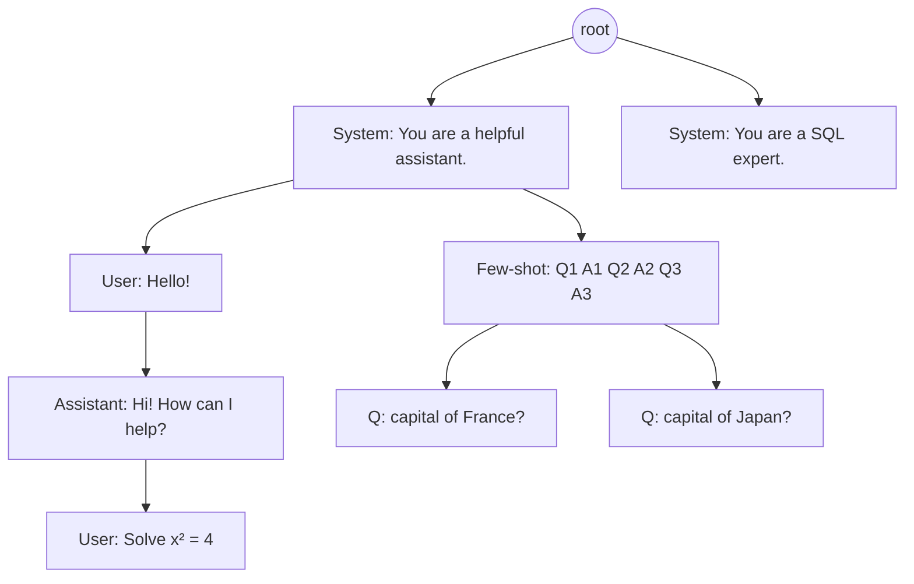
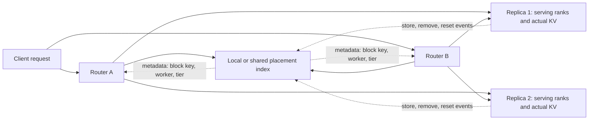
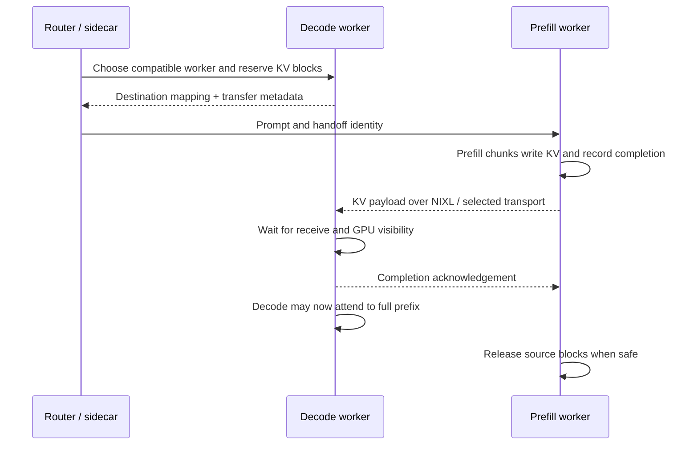
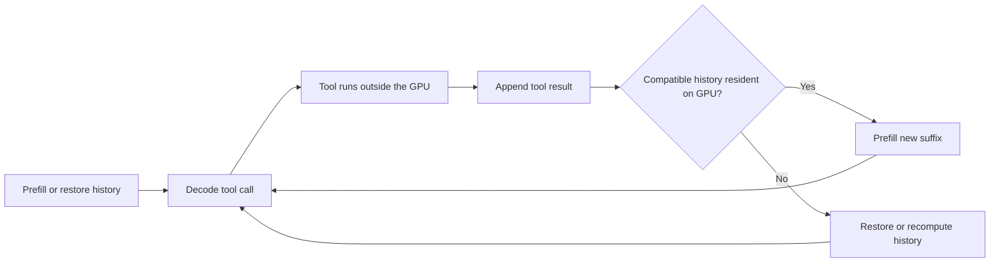

In the [transformers post](/blog/transformers-intuitively/) the model was a function: tokens
in, logits out. Serving it to thousands of people at once is a different problem, and
surprisingly little of it is about the model. It's about **memory** (where the KV cache lives
and how much of it you can keep) and **scheduling** (which request runs, when, and on which
GPU).

I will build the serving system in layers:

1. **Execution and measurement:** prefill, decode, memory arithmetic, TTFT, token gaps, tails, and goodput.
2. **The engine:** continuous batching, PagedAttention, SGLang's radix tree, and the ownership rules that make prefix reuse safe.
3. **The cluster:** choosing replicas from delayed cache metadata, moving KV between prefill and decode workers, and recovering from failures.
4. **The workload:** short requests, long cold or warm contexts, RAG, reasoning, and agents whose histories must survive tool calls.

Each layer includes worked maths, code, and diagrams. The implementation notes were checked on November 10, 2026. Older papers and launch benchmarks are dated examples; current documentation describes version-specific behavior. The attached simulations are teaching models, not measurements of GPU performance.

For a focused read, jump to [cache lifetimes](#kv-cache-lifecycle-identity-residency-and-ownership), [distributed routing](#scaling-out-routing-on-prefixes), [cross-node handoffs](#disaggregating-prefill-and-decode), or [workload tradeoffs](#workloads-short-prompts-long-context-rag-and-agents).

## The two phases of a request

### Prefill reads, decode writes

In the simplest uncached case, the model processes the prompt positions in parallel, builds their KV state, and produces the first sampled output token. This is **prefill**. Serving engines can split it into scheduled chunks or reuse an already computed prefix.

Then the model generates one token at a time. Each step feeds in *only the newest token*,
attends to the cached keys and values of everything before it, appends one new K/V pair, and
produces the next token. This is **decode**. Without speculative execution, generating $m$ output tokens takes $m-1$ such steps after prefill produces the first sample.

<figure class="ml-diagram">
<svg viewBox="0 0 860 210" role="img" aria-label="Simplified request timeline: prefill emits the first output token, then decode emits tokens 2 through m. TTFT ends at prefill completion in this unqueued example.">
  <defs><marker id="ml-arrow" viewBox="0 0 10 10" refX="9" refY="5" markerWidth="7" markerHeight="7" orient="auto-start-reverse"><path d="M0,0 L10,5 L0,10 z"/></marker></defs>
  <text class="label" x="175" y="30">prefill: many token positions</text>
  <text class="label" x="560" y="30">decode: one new position per sequence per step</text>
  <rect class="box violet" x="45" y="50" width="260" height="80" rx="8"/>
  <text class="name" x="175" y="84">Prefill</text>
  <text class="note violet" x="175" y="108">process prompt, emit token 1</text>
  <rect class="box green" x="330" y="50" width="48" height="80" rx="8"/>
  <text class="name" x="354" y="96">2</text>
  <rect class="box green" x="388" y="50" width="48" height="80" rx="8"/>
  <text class="name" x="412" y="96">3</text>
  <rect class="box green" x="446" y="50" width="48" height="80" rx="8"/>
  <text class="name" x="470" y="96">4</text>
  <rect class="box green" x="504" y="50" width="48" height="80" rx="8"/>
  <text class="name" x="528" y="96">5</text>
  <rect class="box green" x="562" y="50" width="48" height="80" rx="8"/>
  <text class="name" x="586" y="96">6</text>
  <rect class="box green" x="620" y="50" width="48" height="80" rx="8"/>
  <text class="name" x="644" y="96">…</text>
  <rect class="box green" x="678" y="50" width="48" height="80" rx="8"/>
  <text class="name" x="702" y="96">m</text>
  <text class="note green" x="790" y="96">done</text>
  <line class="arrow both" x1="49" y1="155" x2="301" y2="155"/>
  <text class="label" x="175" y="182">TTFT (time to first token)</text>
  <line class="arrow both" x1="390" y1="155" x2="434" y2="155"/>
  <text class="label" x="412" y="182">TPOT</text>
  <line class="arrow plain" x1="49" y1="200" x2="726" y2="200"/>
  <text class="label" x="600" y="182">end-to-end ≈ TTFT + (m − 1) · TPOT</text>
</svg>
<figcaption>One request. Prefill builds the KV cache for the whole prompt and emits the first token; each decode step reads that cache, adds one entry, and emits one more token.</figcaption>
</figure>

An analogy that holds up surprisingly well: prefill is *reading* the question, and you can
read a whole page at a glance. Decode is *writing* the answer, and you can only write one word
at a time, because each word depends on the one before.

### The metrics everyone quotes

- **TTFT** (time to first token): queueing + prefill. What a chat user feels as "it's
  thinking". Dominated by prompt length and by how busy the prefill GPU is.
- **TPOT** (time per output token) and **ITL** (inter-token latency): the gap between
  streamed tokens. What a user feels as "typing speed". $1/\text{TPOT}$ is tokens per second
  *per user*.
- **Throughput**: total tokens per second across all users. What the bill depends on.
- **Goodput**: requests per second that *meet their latency targets* (for example TTFT under
  2 s *and* TPOT under 50 ms). DistServe argued this is the number that actually matters,
  because raw throughput is easy to raise by letting latency explode.

The tension in every section below is between the last two and the first two: batching more
requests together raises throughput, but each user waits longer for each token. Latency
numbers are almost always quoted as percentiles (P50, P90, P99); the
[measurement section](#measuring-it-latency-metrics-percentiles-and-goodput) after the
roofline defines each metric exactly, what the percentiles mean, and how they're commonly
misread.

### Why prefill often favors compute and decode favors bandwidth

A GPU has two speeds: how many FLOPs per second it can do, and how many bytes per second it
can read from HBM. For an H100 SXM in BF16 those are about 989 TFLOP/s (dense; the datasheet's
1,979 assumes sparsity) and 3.35 TB/s. Their ratio is the **ridge point**:

$$
\text{ridge} = \frac{989 \times 10^{12}\ \text{FLOP/s}}{3.35 \times 10^{12}\ \text{B/s}} \approx 295\ \text{FLOPs per byte}.
$$

If a kernel does fewer than ~295 FLOPs for every byte it reads, the compute units sit idle
waiting for memory: it's **memory-bound**. More than that and memory waits for compute: it's
**compute-bound**. The number of FLOPs per byte a kernel does is its **arithmetic intensity**.

Almost all of a transformer's FLOPs are in its linear layers. Push $n$ tokens through a weight
matrix $W \in \mathbb{R}^{d \times d'}$ stored in BF16 (2 bytes per number):

$$
\text{FLOPs} = 2\,n\,d\,d', \qquad
\text{bytes} \approx \underbrace{2\,d\,d'}_{\text{weights}} + \underbrace{2\,n\,(d + d')}_{\text{activations}}, \qquad
\text{intensity} \approx \frac{2nd d'}{2dd'} = n \quad (n \ll d).
$$

**The arithmetic intensity of a linear layer is roughly the number of tokens in the
batch.** The weights are read once and reused for every token, so more tokens means more work
per byte.

- **Prefill** of a 2,000-token prompt has $n = 2000 \gg 295$. Compute-bound. The GPU is doing
  what it was built for.
- **Decode** of one request has $n = 1$. Intensity ≈ 1, so the GPU uses about $1/295$ of its
  compute and spends the step streaming all the weights from HBM to produce *one* token.
  Batching $b$ requests makes $n = b$, which is why batching helps decode so much: the same
  weight read now serves $b$ users.

For distinct full-attention contexts, batching does not provide the same KV reuse as it provides weight reuse. It can still improve kernel occupancy and implementation efficiency. For one sequence of
length $L$, the new query (with $H$ heads of size $d_h$) is dotted against $L$ keys and mixes
$L$ values: about $4 H d_h L$ FLOPs. It has to read that sequence's K and V, which are
$2 \cdot H_{kv} \cdot d_h \cdot L$ numbers at 2 bytes each:

$$
\text{intensity}_{\text{decode attn}} = \frac{4 H d_h L}{4 H_{kv} d_h L} = \frac{H}{H_{kv}}.
$$

That's the GQA group size: 1 for a model with full multi-head attention like Llama 2 7B, 4 for
Llama 3 8B. Every sequence has its *own* KV cache, so putting more sequences in the batch adds
bytes as fast as it adds FLOPs. This is the real reason
[GQA](/blog/transformers-intuitively/) exists: fewer KV heads means fewer
bytes to stream per decode step and more sequences fitting in memory.

### Worked numbers: Llama 3 8B on one H100

Here is the whole back-of-envelope model as code. It's the same method Baseten's inference
guide uses: decode time is bytes moved over bandwidth, prefill
time is FLOPs over compute, and you take whichever bound is larger. Parameter counts come from
each model's `config.json`.

```python {title="serving_math.py"}
# Back-of-envelope serving maths: weights, KV cache, roofline, prefill and decode times.
from dataclasses import dataclass

@dataclass
class Model:
    name: str
    layers: int
    d_model: int
    n_heads: int
    n_kv_heads: int
    head_dim: int
    d_ff: int
    vocab: int
    tied: bool = False
    dtype_bytes: int = 2                       # BF16 / FP16

    @property
    def params(self) -> int:
        q_o = 2 * self.d_model * self.n_heads * self.head_dim
        k_v = 2 * self.d_model * self.n_kv_heads * self.head_dim
        mlp = 3 * self.d_model * self.d_ff         # gate, up, down (SwiGLU)
        emb = self.vocab * self.d_model * (1 if self.tied else 2)
        return self.layers * (q_o + k_v + mlp) + emb

    @property
    def kv_bytes_per_token(self) -> int:
        # K and V, every layer, every KV head
        return 2 * self.layers * self.n_kv_heads * self.head_dim * self.dtype_bytes

@dataclass
class GPU:
    name: str
    flops: float        # dense BF16 FLOP/s
    bw: float           # HBM bytes/s
    mem: float          # bytes

LLAMA2_7B  = Model("Llama-2-7B",  32, 4096, 32, 32, 128, 11008, 32000)
LLAMA3_8B  = Model("Llama-3-8B",  32, 4096, 32,  8, 128, 14336, 128256)
QWEN3_32B  = Model("Qwen3-32B",   64, 5120, 64,  8, 128, 25600, 151936)
LLAMA3_70B = Model("Llama-3-70B", 80, 8192, 64,  8, 128, 28672, 128256)

H100 = GPU("H100 SXM", 989e12, 3.35e12, 80e9)
A100 = GPU("A100 80GB", 312e12, 2.039e12, 80e9)

def prefill_seconds(m: Model, g: GPU, n: int, n_gpus: int = 1, mfu: float = 1.0) -> float:
    linear = 2 * m.params * n                                  # 2 FLOPs per weight per token
    attn = 2 * m.layers * m.n_heads * m.head_dim * n * n       # QK^T and AV, causal half
    return (linear + attn) / (g.flops * n_gpus * mfu)

def decode_step_seconds(m: Model, g: GPU, batch: int, ctx: int, n_gpus: int = 1) -> tuple[float, str]:
    bytes_moved = m.params * m.dtype_bytes + batch * ctx * m.kv_bytes_per_token
    t_mem = bytes_moved / (g.bw * n_gpus)
    t_compute = 2 * m.params * batch / (g.flops * n_gpus)
    return max(t_mem, t_compute), ("memory" if t_mem >= t_compute else "compute")

def kv_capacity_tokens(m: Model, g: GPU, n_gpus: int = 1, util: float = 0.9) -> int:
    free = g.mem * n_gpus * util - m.params * m.dtype_bytes
    return int(free // m.kv_bytes_per_token)

if __name__ == "__main__":
    print(f"{'model':12} {'params':>7} {'KV/token':>9} {'KV@4k':>8}")
    for m in (LLAMA2_7B, LLAMA3_8B, QWEN3_32B, LLAMA3_70B):
        print(f"{m.name:12} {m.params/1e9:6.2f}B {m.kv_bytes_per_token/1024:6.0f}KiB "
              f"{m.kv_bytes_per_token*4096/2**30:6.2f}GiB")

    print(f"\nridge point H100 = {H100.flops/H100.bw:.0f} FLOPs/byte, A100 = {A100.flops/A100.bw:.0f}")

    m, g = LLAMA3_8B, H100
    print(f"\n{m.name} on one {g.name}")
    print(f"  prefill 2,000 tokens (ideal)  : {prefill_seconds(m, g, 2000)*1e3:6.1f} ms")
    print(f"  prefill 2,000 tokens (50% MFU): {prefill_seconds(m, g, 2000, mfu=0.5)*1e3:6.1f} ms")
    print(f"  KV capacity at 90% memory     : {kv_capacity_tokens(m, g):,} tokens")
    for b, ctx in [(1, 2000), (64, 2000), (200, 2000)]:
        t, bound = decode_step_seconds(m, g, b, ctx)
        print(f"  decode batch={b:3d} ctx={ctx}: {t*1e3:5.2f} ms/step, "
              f"{1/t:5.0f} tok/s per user, {b/t:7.0f} tok/s total ({bound}-bound)")

    m = LLAMA3_70B
    print(f"\n{m.name} on 8x {g.name} (tensor parallel, ignoring communication)")
    print(f"  prefill 4,096 tokens (50% MFU): {prefill_seconds(m, g, 4096, 8, 0.5)*1e3:6.1f} ms")
    kv = m.kv_bytes_per_token * 4096
    print(f"  KV for a 4,096-token prompt   : {kv/1e9:.2f} GB")
    for name, bw in [("NVLink 900 GB/s", 900e9), ("400 Gb/s NIC", 50e9)]:
        print(f"  transfer over {name:15}: {kv/bw*1e3:6.1f} ms")
```

```text {title="Output"}
model         params  KV/token    KV@4k
Llama-2-7B     6.74B    512KiB   2.00GiB
Llama-3-8B     8.03B    128KiB   0.50GiB
Qwen3-32B     32.76B    256KiB   1.00GiB
Llama-3-70B   70.55B    320KiB   1.25GiB

ridge point H100 = 295 FLOPs/byte, A100 = 153

Llama-3-8B on one H100 SXM
  prefill 2,000 tokens (ideal)  :   33.5 ms
  prefill 2,000 tokens (50% MFU):   67.1 ms
  KV capacity at 90% memory     : 426,788 tokens
  decode batch=  1 ctx=2000:  4.87 ms/step,   205 tok/s per user,     205 tok/s total (memory-bound)
  decode batch= 64 ctx=2000:  9.80 ms/step,   102 tok/s per user,    6529 tok/s total (memory-bound)
  decode batch=200 ctx=2000: 20.44 ms/step,    49 tok/s per user,    9783 tok/s total (memory-bound)

Llama-3-70B on 8x H100 SXM (tensor parallel, ignoring communication)
  prefill 4,096 tokens (50% MFU):  151.7 ms
  KV for a 4,096-token prompt   : 1.34 GB
  transfer over NVLink 900 GB/s:    1.5 ms
  transfer over 400 Gb/s NIC   :   26.8 ms
```

What to take from those numbers:

- **One user gets ~205 tokens/s, and that's a hard ceiling.** A single decode step must read
  all 16 GB of weights, and $16 / 3350\ \text{GB/s} \approx 4.9$ ms. No kernel trick beats
  that; only fewer bytes (quantization), more bandwidth (H200, B200), or more GPUs splitting
  the weights (tensor parallelism) do.
- **Batching is nearly free at first.** Going from 1 to 64 users only doubles the step time,
  so total throughput goes up 32x. The weight read is shared; only the KV reads grow.
- **At large batch, the KV cache is the bottleneck, twice over.** At 200 users × 2,000 tokens
  the step reads 52 GB of KV against 16 GB of weights, so it's still memory-bound, now on the
  *cache*. And 200 × 2,000 = 400k tokens is nearly the 427k that fit in memory at all. KV
  memory sets the maximum batch, and the batch size sets throughput. That's why the next
  three sections are all about KV memory.
- **The KV cache size per token is set by the architecture.** Llama 2 7B (32 KV heads) needs
  512 KiB per token; Llama 3 8B (8 KV heads, GQA) needs 128 KiB. The same GPU holds 4x as
  many tokens for the newer model.

The same arithmetic in Baseten's guide, for Llama 2 7B on cheaper GPUs, gives 23 ms per token
on an A10 (14 GB ÷ 600 GB/s), 39 ms to prefill 350 tokens, and 3.49 s for a 150-token answer.
They also note real systems come in up to about 2x slower than these bounds
.[^mfu] Plug in your own numbers below.

[^mfu]: The gap comes from kernels that don't hit peak bandwidth or FLOPs, from communication in tensor parallelism, and from scheduling overhead on the CPU. Teams usually fold this into a single efficiency factor (MFU for compute, MBU for bandwidth) of 50–80%.



## Measuring it: latency metrics, percentiles and goodput

Every result in the rest of this post is a sentence like "P90 TTFT dropped from 31 s to
0.54 s" or "P95 latency fell 48%". To read those (or produce your own) you need three things:
exactly what each metric measures, what a percentile is, and how the numbers get distorted.

### Every metric, precisely

For one streamed request, record the arrival time $t_{\text{arr}}$ and the timestamp of each
output token $t_1, t_2, \dots, t_n$:

$$
\text{TTFT} = t_1 - t_{\text{arr}}, \qquad
\text{E2E} = t_n - t_{\text{arr}}, \qquad
\text{ITL}_k = t_{k+1} - t_k, \qquad
\text{TPOT} = \frac{\text{E2E} - \text{TTFT}}{n - 1}.
$$

| Metric | What it is | What the user feels | Watch out for |
| --- | --- | --- | --- |
| TTFT | arrival → first token: queueing, prefill, first token | "is it thinking?" | includes queueing, so it explodes under load first |
| ITL | each gap between two consecutive tokens | stutter and freezes while text streams | one value *per token*, not per request |
| TPOT | a request's mean gap, first token excluded | average typing speed | averaging over a request hides freezes |
| E2E latency | arrival → last token | total wait for a non-streamed answer | scales with output length; compare at fixed lengths |
| Tokens/s per user | $n / \text{E2E}$, or about $1/\text{TPOT}$ for long outputs | reading speed | |
| Output tokens/s (system) | all output tokens ÷ wall-clock time | nothing directly; it's the cost side | rises with batch size while per-user speed falls |
| Requests/s | completed requests ÷ time | | only comparable at fixed input/output lengths |
| SLO attainment | fraction of requests meeting every latency target | | the target has to be stated |
| Goodput | the highest request rate that keeps SLO attainment above a goal (say 90%) | | DistServe's definition |
| Prefix-cache hit rate | cached prompt tokens ÷ prompt tokens | lower TTFT | per token, not per request |

Tools disagree on the details. NVIDIA's AIPerf defines ITL as
$(\text{E2E} - \text{TTFT}) / (n - 1)$, which is what I called TPOT above, and its docs say
outright that "tool implementations vary, so compare results only when definitions align"
. vLLM's benchmark reports both: TPOT per request and ITL per token
gap, with percentiles of each. Before comparing two benchmarks, check
which one they mean.

### What P50, P90, P95 and P99 mean

Sort all the measurements. The **$q$-th percentile** is the value that $q\%$ of them fall
below. Formally, with $F$ the cumulative distribution of latencies,
$P_q = \min\{x : F(x) \ge q/100\}$.

- **P50** (the median): half the requests were faster, half slower. The typical experience.
- **P90**: 1 request in 10 was slower than this.
- **P95**: 1 in 20 was slower.
- **P99**: 1 in 100 was slower. "P99 TTFT is 2 s" means 99% of users saw their first token
  within 2 s, and 1% waited longer, possibly much longer.
- **Max**: the single worst request. Mostly noise; a single unlucky event sets it.

The high percentiles are the **tail** of the distribution. Latency distributions are skewed:
there's a floor (you can't beat the hardware), and a long tail to the right (queueing, a long
prompt next to you, a garbage-collection pause, a cache miss). So the **mean** is a poor
summary. It gets pulled up by the tail and still doesn't tell you how bad the tail is. That's
why serious benchmarks quote P50 for "typical" and P90/P95/P99 for "bad day".

Here are all the metrics computed from token timestamps, for 2,000 synthetic streamed requests.
Each request has a skewed TTFT, ~20 ms between tokens, and 2% of token gaps hit a 0.5 s stall
(the kind of thing an unchunked long prefill next to you causes).

```python {title="request_metrics.py"}
import numpy as np

def request_metrics(arrival, token_times):
    """Per-request latency metrics from the arrival time and each streamed token's timestamp."""
    t = np.asarray(token_times)
    ttft = t[0] - arrival                         # queueing + prefill + first token
    e2e = t[-1] - arrival                         # until the last token
    tpot = (e2e - ttft) / (len(t) - 1)            # mean gap per request, first token excluded
    itl = np.diff(t)                              # every individual gap between tokens
    return ttft, tpot, itl, e2e

def summarize(name, x, scale=1e3, unit="ms"):
    p50, p90, p99 = np.percentile(x, [50, 90, 99])
    print(f"{name:4} mean {x.mean()*scale:6.0f}  p50 {p50*scale:6.0f}  p90 {p90*scale:6.0f}  "
          f"p99 {p99*scale:6.0f}  max {x.max()*scale:6.0f}  {unit}")

if __name__ == "__main__":
    rng = np.random.default_rng(0)
    ttft, tpot, e2e, itl, froze = [], [], [], [], []
    for i in range(2_000):
        arrival = i * 0.1
        first = arrival + rng.lognormal(np.log(0.3), 0.5)        # skewed: a few slow prefills
        n_out = rng.integers(50, 500)
        gaps = 0.02 + rng.exponential(0.003, n_out - 1)           # ~20 ms per token...
        gaps[rng.random(n_out - 1) < 0.02] += 0.5                 # ...2% of gaps stall 0.5 s
        times = first + np.concatenate([[0.0], np.cumsum(gaps)])
        a, b, c, d = request_metrics(arrival, times)
        ttft.append(a); tpot.append(b); itl.append(c); e2e.append(d)
        froze.append(c.max() > 0.4)
    ttft, tpot, e2e, itl = np.array(ttft), np.array(tpot), np.array(e2e), np.concatenate(itl)

    summarize("TTFT", ttft)
    summarize("TPOT", tpot)
    summarize("ITL", itl)
    summarize("E2E", e2e, scale=1, unit="s")

    ok = (ttft <= 0.5) & (tpot <= 0.040)                        # SLO: TTFT 500 ms, TPOT 40 ms
    print(f"\nSLO attainment (TTFT <= 500 ms and TPOT <= 40 ms): {ok.mean():.1%}")
    print(f"requests with at least one freeze > 400 ms     : {np.mean(froze):.1%}")
```

```text {title="Output"}
TTFT mean    334  p50    296  p90    552  p99    905  max   1597  ms
TPOT mean     33  p50     32  p90     39  p99     48  max     65  ms
ITL  mean     33  p50     22  p90     28  p99    522  max    549  ms
E2E  mean      9  p50      9  p90     15  p99     18  max     22  s

SLO attainment (TTFT <= 500 ms and TPOT <= 40 ms): 79.0%
requests with at least one freeze > 400 ms     : 95.9%
```

Three things to read off this:

- **The mean sits above the median** for TTFT (334 vs 296 ms): the slow tail drags it up.
  P99 is 3x the median, and the max is 5x. A dashboard showing only the average would hide all
  of that.
- **TPOT looks great and ITL tells the truth.** P99 TPOT is 48 ms, so every request's
  *average* typing speed is fine. But P99 ITL is 522 ms, and 96% of requests froze at least
  once for half a second. Averaging over a request smooths the freezes away, and users notice
  freezes. That's why Sarathi-Serve's headline latency plots use P99 time-between-tokens
  .
- **SLO attainment combines metrics.** Each SLO alone looks easy to meet, but only 79% of
  requests meet both at once.

### Why the tail matters more than it looks

"Only 1% of requests" sounds harmless until a user (or a program) makes many requests. If each
call independently has a 1% chance of landing beyond P99, then a task that makes $k$ calls
hits at least one slow one with probability

$$
P(\text{at least one slow}) = 1 - 0.99^{k}.
$$

That's 10% for 10 calls, 39% for 50, and 63% for 100. Dean and Barroso's "The Tail at Scale"
made this point for web search: if a request fans out to 100 servers and each is slow 1% of
the time, 63% of user requests are slow. An agent that makes 50
sequential model calls per task is the same situation. Its users live in the P99 of each call,
which is why agent-heavy services track P99 rather than P50. (The paper's remedies, like
**hedged requests** that send a backup copy to a second replica after a short delay, apply to
LLM routers too.)

### Four ways to get percentiles wrong

**1. Averaging percentiles.** A percentile of a combined set isn't the average of the
percentiles of its parts. If 7 replicas are healthy and 1 is overloaded, the mean of the 8
per-replica P99s badly understates the fleet's P99. Prometheus's docs say it directly: you
cannot aggregate precomputed quantiles, for example "to calculate the total 90th percentile
latency for a service backed by multiple replicated workers". Export histograms (bucket
counts), which *can* be summed, and compute the percentile from the merged histogram
. The same goes for averaging P99s over time windows.

**2. Too few samples.** P99 is decided by the slowest 1% of samples. With 100 requests that's
one request, so the estimate swings wildly between runs. You want thousands of requests per
measurement point.

```python {title="percentile_pitfalls.py"}
import numpy as np

rng = np.random.default_rng(1)

# 1. Percentiles don't average. Seven healthy replicas, one overloaded.
replicas = [rng.lognormal(np.log(0.3), 0.3, 5_000) for _ in range(7)]
replicas.append(rng.lognormal(np.log(2.0), 0.5, 5_000))
mean_of_p99s = np.mean([np.percentile(r, 99) for r in replicas])
true_p99 = np.percentile(np.concatenate(replicas), 99)
print(f"mean of per-replica p99s: {mean_of_p99s:.2f} s   true fleet p99: {true_p99:.2f} s")

# 2. A p99 needs many samples. Spread of the p99 estimate over 1,000 repeated benchmarks.
for n in (100, 1_000, 10_000):
    est = [np.percentile(rng.lognormal(np.log(0.3), 0.5, n), 99) for _ in range(1_000)]
    lo, hi = np.percentile(est, [5, 95])
    print(f"n={n:6,}: p99 estimate ranges {lo:.2f}-{hi:.2f} s (90% of runs)")

# 3. Tails compound: a task that makes k calls is slow if ANY call is beyond p99.
for k in (1, 10, 50, 100):
    print(f"{k:3d} calls: P(at least one slower than p99) = {1 - 0.99**k:.0%}")
```

```text {title="Output"}
mean of per-replica p99s: 1.33 s   true fleet p99: 4.05 s
n=   100: p99 estimate ranges 0.69-1.12 s (90% of runs)
n= 1,000: p99 estimate ranges 0.87-1.05 s (90% of runs)
n=10,000: p99 estimate ranges 0.93-0.99 s (90% of runs)
  1 calls: P(at least one slower than p99) = 1%
 10 calls: P(at least one slower than p99) = 10%
 50 calls: P(at least one slower than p99) = 39%
100 calls: P(at least one slower than p99) = 63%
```

The averaged number says 1.3 s; the real fleet P99 is 4 s, because one replica owns nearly the
whole tail. And at 100 samples, two honest runs of the same system can report P99s of 0.7 s
and 1.1 s.

**3. Coordinated omission.** Most simple benchmark clients are **closed-loop**: send a
request, wait for the reply, send the next. When the server stalls, the client stalls with
it, and stops sending exactly when latency is worst. So the stall shows up as *one* slow
sample instead of the many slow requests real users would have queued up. Gil Tene calls this
**coordinated omission**: the load generator "coordinat[es] with the server to avoid
measurement during high latency periods". The fix is an **open-loop** client that sends on a
fixed schedule regardless of replies, which is what his wrk2 does, and
what `vllm bench serve --request-rate` does with Poisson arrivals.
Here is one FIFO server (50 ms per request) that freezes for 5 s at $t = 10$ s, measured both
ways at the same ~10 requests per second:

```python {title="load_generators.py"}
import numpy as np

SERVICE, STALL = 0.05, (10.0, 15.0)        # 50 ms per request; server freezes for 5 s at t=10

class Server:
    """One FIFO worker. Requests queue behind each other; nothing completes during the stall."""
    def __init__(self):
        self.free_at = 0.0

    def submit(self, arrival):
        start = max(arrival, self.free_at)
        if STALL[0] <= start < STALL[1]:
            start = STALL[1]
        done = start + SERVICE
        if start < STALL[0] < done:
            done += STALL[1] - STALL[0]
        self.free_at = done
        return done - arrival                 # latency as the user would feel it

def report(name, lat):
    p50, p90, p99 = np.percentile(lat, [50, 90, 99])
    print(f"{name:11} n={len(lat):4d}  p50 {p50*1e3:5.0f} ms  p90 {p90*1e3:5.0f} ms  "
          f"p99 {p99*1e3:5.0f} ms  max {max(lat):4.1f} s")
```



```python {title="Closed-loop client (coordinated omission)"}
def closed_loop(duration=60.0, think=0.05):
    """Typical benchmark client: send, WAIT for the reply, pause, send the next one."""
    server, t, lat = Server(), 0.0, []
    while t < duration:
        l = server.submit(t)
        lat.append(l)
        t += l + think                        # the client is stuck while the server is stuck
    return lat
```

```python {title="Open-loop client (fixed arrival rate)"}
def open_loop(duration=60.0, rate=10.0):
    """Real users (and wrk2, vllm bench --request-rate): arrivals don't wait for replies."""
    server, lat = Server(), []
    for t in np.arange(0.0, duration, 1 / rate):
        lat.append(server.submit(t))
    return lat
```



```python {title="load_generators.py (run)"}
if __name__ == "__main__":
    report("closed-loop", closed_loop())      # both offer ~10 requests/s to the same server
    report("open-loop", open_loop())
```

```text {title="Output"}
closed-loop n= 551  p50    50 ms  p90    50 ms  p99    50 ms  max  5.0 s
open-loop   n= 600  p50    50 ms  p90  2055 ms  p99  4751 ms  max  5.1 s
```

Same server, same freeze. The closed-loop client reports a P99 of 50 ms, a perfect system,
because it sent one request into the freeze and then waited politely. The open-loop client
reports P99 4.75 s, because the ~50 users who arrived during the freeze all waited, and so did
the ones queued behind them while the backlog drained. Fixed-**concurrency** LLM benchmarks
("32 concurrent users") are closed-loop, so they understate tail latency in the same way.
They're still useful for finding peak throughput, but quote tails from a fixed request rate.

**4. Leaving requests out.** Requests that time out or fail usually don't appear in latency
percentiles at all, so an overloaded server that drops its slowest requests can look *faster*.
Report the error and timeout rate next to the percentiles, or count only requests that finish
within a deadline, as llm-d's "successful throughput" does (requests completing within a fixed
300-second window). Warm-up requests and cold caches distort things the
same way; tools like NVIDIA's GenAI-Perf drop the warm-up and cool-down periods for this
reason.

### Latency vs load: the hockey stick

Throughput and latency are linked by queueing. The simplest model is one server with random
(Poisson) arrivals at rate $\lambda$ and random service at rate $\mu$, the M/M/1 queue. Its
utilization is $\rho = \lambda / \mu$, and its response time (waiting + service) is
exponentially distributed with rate $\mu - \lambda$, so every percentile has a closed form:

$$
P_q = \frac{-\ln(1 - q)}{\mu - \lambda} = \frac{-\ln(1 - q)}{\mu\,(1 - \rho)}.
$$

Two consequences:

- **Every percentile scales as $1/(1-\rho)$.** Going from 50% to 90% utilization multiplies
  P50 *and* P99 by 5; going from 90% to 95% doubles them again. Latency is flat for a long time
  and then shoots up: the hockey stick.
- **The tail is a fixed multiple of the median** ($\ln 100 / \ln 2 \approx 6.6\times$ for
  P99/P50 here), so in absolute terms the tail grows much faster. Going from 50% to 95%
  utilization adds about 0.6 s to the median but about 4 s to P99.

```python {title="queueing.py"}
import numpy as np

def simulate_fifo(rate, service_rate, n=1_000_000, seed=0):
    """Poisson arrivals, exponential service, one FIFO server (M/M/1), via Lindley's recursion."""
    rng = np.random.default_rng(seed)
    gaps = rng.exponential(1 / rate, n)
    service = rng.exponential(1 / service_rate, n)
    wait = np.zeros(n)
    for i in range(1, n):
        wait[i] = max(0.0, wait[i - 1] + service[i - 1] - gaps[i])
    return wait + service                                  # response time = queueing + service

if __name__ == "__main__":
    mu = 20.0                                              # capacity: 20 requests/s (50 ms each)
    print("util   p50 sim/theory     p99 sim/theory")
    for rho in (0.5, 0.8, 0.9, 0.95):
        r = simulate_fifo(rho * mu, mu)
        theory = lambda q: -np.log(1 - q) / (mu - rho * mu)   # M/M/1 response-time quantile
        p50, p99 = np.percentile(r, [50, 99])
        print(f"{rho:4.0%}   {p50*1e3:5.0f} / {theory(.5)*1e3:4.0f} ms   "
              f"{p99*1e3:6.0f} / {theory(.99)*1e3:5.0f} ms")
```

```text {title="Output"}
util   p50 sim/theory     p99 sim/theory
 50%      70 /   69 ms      458 /   461 ms
 80%     174 /  173 ms     1174 /  1151 ms
 90%     347 /  347 ms     2373 /  2303 ms
 95%     707 /  693 ms     4438 /  4605 ms
```

`wait[i] = max(0, wait[i-1] + service[i-1] - gaps[i])` is **Lindley's recursion**: you wait for
whatever the previous person waited, plus their service time, minus how long after them you
arrived, and never less than zero. The simulation matches the formula; near saturation it
takes a million samples to converge, which is itself a warning about measuring tails at high
load.

An LLM server isn't an M/M/1 queue. It serves many requests at once, and its speed per
request depends on the batch (the calculator above). But the shape is the same, and it's why:

- benchmarks should **sweep the load** (request rate or concurrency) and report percentile
  curves, not one point. Baseten lists the percentile, batch size and network among the first
  things to check before comparing two benchmarks;
- you leave headroom: running at 95% utilization instead of 80% buys a little throughput and
  roughly quadruples every percentile;
- every routing result in this post shows up most in the tail. A router that saves 20% of
  prefill work moves a near-saturated replica down the steep part of the hockey stick, and the
  P99 improvement is much bigger than the P50 improvement.

One more identity that's handy on a whiteboard: **Little's law**, $L = \lambda W$. The average
number of requests in the system equals the arrival rate times the average time each one
spends there. At 10 requests/s with a 9 s average E2E, about 90 streams are in flight at any
moment, so that's the decode batch the server must hold in KV memory.

### SLOs and goodput

A **service-level objective** (SLO) turns this into a target: for example, "P90 TTFT under
1 s and P90 TPOT under 50 ms". Chat cares most about TTFT and smooth ITL; summarization or
code generation cares more about E2E and tokens/s per user; batch jobs care only about
throughput per dollar. DistServe makes the point that these targets differ by application,
and defines **goodput** as the maximum request rate that can be served while meeting the SLO
attainment goal (say 90%), per GPU. In the synthetic example above,
attainment was 79%. On a real server you'd lower the request rate (moving down the hockey
stick) until 90% of requests meet both targets; that request rate is the goodput.

Goodput per GPU is the number that maps to cost. Raw throughput can always be raised by
batching harder, but only goodput tells you how many users you can serve *well* on one GPU.
vLLM's benchmark computes it directly from SLOs passed as `--goodput ttft:<ms> tpot:<ms>`
.

### Reading someone else's benchmark

Before trusting (or comparing) any number in this post or elsewhere, check:

1. **Which definition?** TPOT vs ITL, per request or per token gap, TTFT measured at the
   client (with network and tokenization) or inside the server.
2. **Which percentile, over how many requests?** "Latency" without a percentile usually means
   the mean or the median.
3. **What load?** A fixed request rate (open-loop) or fixed concurrency (closed-loop), and at
   how many points. A single number at low load says nothing about the tail.
4. **What traffic?** Input and output length distributions, the prefix-cache hit rate, and
   whether outputs were forced to a fixed length (`ignore_eos`).
5. **What was left out?** Errors, timeouts, warm-up and cool-down.
6. **What hardware and precision?** GPU type and count, parallelism layout, FP8 vs BF16.

With those in hand, the industry numbers below become much easier to read. For example, llm-d
reports P90 TTFT across rising QPS on a fixed workload; Baseten reports average TTFT and TPOT
under a stress test, plus P95 and P99 from shadowed production traffic.

## What a naive server does

Before vLLM, the obvious way to serve a model was to call a library's `generate()` on a batch
of prompts: Hugging Face Transformers, a Python loop, done. It works, but it hits two
problems at once.

### Problem 1: static batching

`generate()` takes a fixed batch, left-pads the prompts to the same length, and decodes until
**every** sequence in the batch has finished. Output lengths are wildly uneven: most answers
are short, a few are essays. So most slots finish early and sit idle, generating padding,
until the longest one is done. New requests wait outside until the whole batch drains.

### Problem 2: a contiguous, over-reserved KV cache

Each sequence's KV cache is a contiguous tensor. Since you don't know how long the answer will
be, systems pre-allocated room for the maximum length (or grew the tensor with `torch.cat`,
copying the whole cache on every step). The vLLM paper measured three kinds of waste in
existing systems:

- **reserved** slots for tokens not yet generated;
- **internal fragmentation**: slots reserved up to the max length that the answer never
  reaches;
- **external fragmentation**: gaps between the differently-sized chunks of different
  requests.

Only **20.4%–38.2%** of KV cache memory held actual token states. Since KV memory sets the
batch size, and the batch size sets throughput, that waste directly caps throughput.

Here is the batching half of the problem in a toy simulator: 2,000 requests with long-tailed
output lengths, run on a fixed number of slots, counting decode steps.



```python {title="Static batching (generate)"}
def static_batching(out_lens: list[int], slots: int) -> int:
    """HF-style generate(): take `slots` requests, decode until the LONGEST finishes."""
    steps = 0
    for i in range(0, len(out_lens), slots):
        steps += max(out_lens[i:i + slots])
    return steps
```

```python {title="Continuous batching (Orca, vLLM)"}
def continuous_batching(out_lens: list[int], slots: int) -> int:
    """Orca/vLLM-style: after every step, finished requests leave and queued ones join."""
    queue, running, steps = list(out_lens), [], 0
    while queue or running:
        while queue and len(running) < slots:
            running.append(queue.pop(0))
        steps += 1
        running = [r - 1 for r in running if r > 1]
    return steps
```



```python {title="batching_sim.py (driver)"}
import random

def make_requests(n: int, seed: int = 0) -> list[int]:
    rng = random.Random(seed)
    # output lengths are long-tailed: most answers are short, a few are essays
    return [min(1024, int(rng.paretovariate(1.2) * 20)) for _ in range(n)]

if __name__ == "__main__":
    lens = make_requests(2000)
    useful = sum(lens)
    for slots in (8, 32, 128):
        s, c = static_batching(lens, slots), continuous_batching(lens, slots)
        print(f"slots={slots:3d}  static: {s:6d} steps ({useful/(s*slots):4.0%} slots busy)   "
              f"continuous: {c:5d} steps ({useful/(c*slots):4.0%} busy)   speed-up {s/c:4.1f}x")
```

```text {title="Output"}
slots=  8  static:  71042 steps ( 27% slots busy)   continuous: 19544 steps ( 97% busy)   speed-up  3.6x
slots= 32  static:  38622 steps ( 12% slots busy)   continuous:  5500 steps ( 86% busy)   speed-up  7.0x
slots=128  static:  15595 steps (  8% slots busy)   continuous:  1983 steps ( 60% busy)   speed-up  7.9x
```

With static batching, the bigger the batch, the more likely it contains one long answer that
holds everyone else hostage: at 128 slots only 8% of slot-steps do useful work. Continuous
batching keeps the slots full (the 60% at 128 slots is just the tail, where the last few long
answers finish with nobody left in the queue).

To be fair to Hugging Face: `generate()` was built as a research API, not a server, and
Transformers now ships its own continuous batching with a paged cache
. The "vLLM vs HF" numbers below are against the 2023
`generate()` loop, which is still what a lot of quick serving code looks like.

## vLLM: PagedAttention and continuous batching

### Continuous batching: schedule every iteration, not every batch

The fix for the batching problem came first, from Orca: **iteration-level scheduling**
. Instead of scheduling a batch of requests and running it to completion,
the server makes a scheduling decision **at every forward pass**. Finished sequences leave
right away; waiting ones join right away, with their prefill running in the same step as
everyone else's decode. Anyscale measured up to 23x throughput from continuous batching
(using vLLM) over static batching, with lower median latency.

That only works if a request can join without moving anyone else's KV cache around, and
without knowing in advance how long it will run. That's the memory problem.

### PagedAttention: virtual memory for the KV cache

vLLM's idea is the one operating systems settled on decades ago for RAM: stop giving each
process one contiguous slab, and give it **pages** instead.

- GPU memory for KV is split up front into a pool of fixed-size **blocks**, each holding the
  K and V of a configurable number of tokens; use 16 for this illustration.
- Each sequence has a **block table**, a list mapping its logical blocks (tokens 0–15,
  16–31, …) to physical block ids anywhere in the pool.
- The illustrative allocator grows **on demand** as a sequence needs more slots. An engine
  can separately reserve headroom or enforce admission limits for future output.

<figure class="ml-diagram">
<svg viewBox="0 0 860 300" role="img" aria-label="PagedAttention: two requests' logical KV blocks map through per-request block tables to non-contiguous physical blocks in a shared GPU pool; unused blocks are free">
  <defs><marker id="ml-arrow" viewBox="0 0 10 10" refX="9" refY="5" markerWidth="7" markerHeight="7" orient="auto-start-reverse"><path d="M0,0 L10,5 L0,10 z"/></marker></defs>
  <rect class="group" x="20" y="10" width="250" height="280" rx="14"/>
  <text class="label" x="145" y="38">Logical blocks (per request)</text>
  <text class="note violet left" x="45" y="72">Request A: 42 tokens</text>
  <rect class="box violet" x="45" y="82" width="62" height="44" rx="6"/>
  <text class="name" x="76" y="109">A0</text>
  <rect class="box violet" x="114" y="82" width="62" height="44" rx="6"/>
  <text class="name" x="145" y="109">A1</text>
  <rect class="box violet" x="183" y="82" width="62" height="44" rx="6"/>
  <text class="name" x="214" y="109">A2</text>
  <text class="note violet" x="214" y="144">10/16 full</text>
  <text class="note green left" x="45" y="190">Request B: 20 tokens</text>
  <rect class="box green" x="45" y="200" width="62" height="44" rx="6"/>
  <text class="name" x="76" y="227">B0</text>
  <rect class="box green" x="114" y="200" width="62" height="44" rx="6"/>
  <text class="name" x="145" y="227">B1</text>
  <text class="note green" x="145" y="262">4/16 full</text>
  <rect class="box sand" x="305" y="80" width="200" height="60" rx="8"/>
  <text class="name" x="405" y="106">A → [7, 1, 3]</text>
  <text class="note sand" x="405" y="128">block table</text>
  <rect class="box sand" x="305" y="196" width="200" height="60" rx="8"/>
  <text class="name" x="405" y="222">B → [5, 2]</text>
  <text class="note sand" x="405" y="244">block table</text>
  <line class="arrow" x1="249" y1="104" x2="301" y2="108"/>
  <line class="arrow" x1="180" y1="222" x2="301" y2="224"/>
  <rect class="group" x="540" y="10" width="300" height="280" rx="14"/>
  <text class="label" x="690" y="38">Physical blocks (one shared GPU pool)</text>
  <rect class="box" x="560" y="55" width="125" height="48" rx="6"/>
  <text class="note left" x="575" y="84">0 · free</text>
  <rect class="box violet" x="695" y="55" width="125" height="48" rx="6"/>
  <text class="note violet left" x="710" y="84">1 · A1</text>
  <rect class="box green" x="560" y="113" width="125" height="48" rx="6"/>
  <text class="note green left" x="575" y="142">2 · B1</text>
  <rect class="box violet" x="695" y="113" width="125" height="48" rx="6"/>
  <text class="note violet left" x="710" y="142">3 · A2</text>
  <rect class="box" x="560" y="171" width="125" height="48" rx="6"/>
  <text class="note left" x="575" y="200">4 · free</text>
  <rect class="box green" x="695" y="171" width="125" height="48" rx="6"/>
  <text class="note green left" x="710" y="200">5 · B0</text>
  <rect class="box" x="560" y="229" width="125" height="48" rx="6"/>
  <text class="note left" x="575" y="258">6 · free</text>
  <rect class="box violet" x="695" y="229" width="125" height="48" rx="6"/>
  <text class="note violet left" x="710" y="258">7 · A0</text>
  <line class="arrow" x1="509" y1="110" x2="556" y2="128"/>
  <line class="arrow" x1="509" y1="226" x2="556" y2="200"/>
</svg>
<figcaption>PagedAttention. A sequence's KV lives in fixed-size blocks scattered anywhere in one pool; its block table records where. The only waste is the unfilled tail of each sequence's last block.</figcaption>
</figure>

**Why this kills the waste.** Reservations disappear (blocks are allocated as tokens arrive).
External fragmentation disappears (all blocks are the same size, so any free block fits any
request). Internal fragmentation shrinks to the tail of the last block: at most $B - 1 = 15$
token slots per sequence, about $B/2$ on average. For a 1,000-token sequence that's under 1%,
against the 20–80% lost to padding and reservations before. The vLLM team reported waste
under 4%, against 60%–80% in existing systems.

**What changes in the kernel.** Attention now gathers K and V through the block table instead
of reading one contiguous tensor. The paper writes the attention for query token $i$ blockwise,
with $K_j$, $V_j$ the keys and values in block $j$:

$$
A_{ij} = \frac{\exp\!\left(q_i^\top K_j / \sqrt{d}\right)}{\sum_{t=1}^{\lceil i/B \rceil} \exp\!\left(q_i^\top K_t \mathbf{1} / \sqrt{d}\right)}, \qquad
o_i = \sum_{j=1}^{\lceil i/B \rceil} V_j A_{ij}^\top.
$$

It's ordinary attention, just summed block by block. The block size is a trade-off: bigger
blocks mean fewer, larger memory reads (faster kernels) but more wasted tail. The paper found
16 to be the sweet spot.

Here is a decode-attention step both ways in PyTorch, batched, with GQA. The paged version
stores every sequence's tokens in one shared pool and attends by gathering through the block
table; the check confirms it produces the same output as padded contiguous attention.



```python {title="Contiguous KV (HF-style)"}
import torch
import torch.nn.functional as F

class ContiguousKVCache:
    """One growing [B, H_kv, T, d] tensor per layer; every sequence padded to the longest."""
    def __init__(self):
        self.k = self.v = None

    def append(self, k_new, v_new):                  # k_new: [B, H_kv, 1, d]
        if self.k is None:
            self.k, self.v = k_new, v_new
        else:                                         # torch.cat allocates a NEW tensor of
            self.k = torch.cat([self.k, k_new], dim=2)  # size T+1 and copies all T old rows
            self.v = torch.cat([self.v, v_new], dim=2)
        return self.k, self.v

def contiguous_decode_attention(q, k, v, lengths):
    # q: [B, H, 1, d]   k, v: [B, H_kv, T_max, d]   lengths: [B] real tokens per row
    group = q.shape[1] // k.shape[1]
    k = k.repeat_interleave(group, dim=1)             # GQA: share each KV head across a group
    v = v.repeat_interleave(group, dim=1)
    T = k.shape[2]
    valid = torch.arange(T)[None, :] < lengths[:, None]           # [B, T_max] padding mask
    return F.scaled_dot_product_attention(q, k, v, attn_mask=valid[:, None, None, :])
```

```python {title="Paged KV (vLLM-style)"}
class PagedKVCache:
    """A pool of fixed-size blocks; each sequence owns a list of block ids (its block table)."""
    def __init__(self, num_blocks, block_size, n_kv_heads, head_dim):
        self.bs = block_size
        self.k = torch.zeros(num_blocks, block_size, n_kv_heads, head_dim)   # the whole pool,
        self.v = torch.zeros(num_blocks, block_size, n_kv_heads, head_dim)   # allocated once
        self.free = list(range(num_blocks))
        self.ref = [0] * num_blocks                 # how many sequences point at each block
        self.tables: dict[int, list[int]] = {}      # seq id -> physical block ids
        self.lens: dict[int, int] = {}

    def _alloc(self):
        b = self.free.pop()
        self.ref[b] = 1
        return b

    def append(self, seq, k_tok, v_tok):            # k_tok: [H_kv, d], one new token
        table = self.tables.setdefault(seq, [])
        n = self.lens.get(seq, 0)
        if n % self.bs == 0:                        # last block full: grab a new one on demand
            table.append(self._alloc())
        elif self.ref[table[-1]] > 1:               # last block shared: copy-on-write
            old, new = table[-1], self._alloc()
            self.k[new], self.v[new] = self.k[old], self.v[old]
            self.ref[old] -= 1
            table[-1] = new
        blk, off = table[-1], n % self.bs
        self.k[blk, off], self.v[blk, off] = k_tok, v_tok
        self.lens[seq] = n + 1

    def fork(self, parent, child):                  # parallel sampling / beam search
        self.tables[child] = list(self.tables[parent])
        self.lens[child] = self.lens[parent]
        for b in self.tables[child]:
            self.ref[b] += 1                        # share blocks, copy nothing

    def release(self, seq):
        for b in self.tables.pop(seq):
            self.ref[b] -= 1
            if self.ref[b] == 0:
                self.free.append(b)
        del self.lens[seq]

    def batch_view(self, seqs):
        max_blocks = max(len(self.tables[s]) for s in seqs)
        table = torch.zeros(len(seqs), max_blocks, dtype=torch.long)
        for i, s in enumerate(seqs):
            table[i, :len(self.tables[s])] = torch.tensor(self.tables[s])
        return table, torch.tensor([self.lens[s] for s in seqs])

def paged_decode_attention(q, cache: PagedKVCache, block_table, lengths):
    # q: [B, H, d]   block_table: [B, max_blocks]   lengths: [B]
    B, H, d = q.shape
    k = cache.k[block_table]                        # gather: [B, max_blocks, bs, H_kv, d]
    v = cache.v[block_table]
    k = k.flatten(1, 2).transpose(1, 2)             # [B, H_kv, max_blocks*bs, d]
    v = v.flatten(1, 2).transpose(1, 2)
    group = H // k.shape[1]
    k, v = k.repeat_interleave(group, 1), v.repeat_interleave(group, 1)    # [B, H, T, d]
    valid = torch.arange(k.shape[2])[None, :] < lengths[:, None]           # [B, T]
    out = F.scaled_dot_product_attention(q[:, :, None], k, v,
                                         attn_mask=valid[:, None, None, :])
    return out[:, :, 0]                             # [B, H, d]
```



The PyTorch pieces doing the work:

- `cache.k[block_table]` is **advanced indexing**: a `[B, max_blocks]` tensor of block ids
  pulls out a `[B, max_blocks, block_size, H_kv, d]` tensor, i.e. each sequence's blocks in
  logical order. Padding entries in the table (0 here) gather junk that the mask hides. A real
  PagedAttention kernel does this gather inside the kernel, block by block, without
  materializing the copy.
- `flatten(1, 2)` merges (blocks, tokens-per-block) into one token axis;
  `transpose(1, 2)` moves heads before tokens, the layout `scaled_dot_product_attention`
  expects.
- `repeat_interleave(group, 1)` expands $H_{kv}$ KV heads to $H$ query heads for GQA.
- The boolean `attn_mask` is `True` where attention is allowed, broadcast from `[B, 1, 1, T]`
  over heads and the single query position.

```python {title="paged_attention.py (check)"}
if __name__ == "__main__":
    torch.manual_seed(0)
    H, H_kv, d, bs = 8, 2, 16, 4
    lengths = [5, 11, 2]                            # three sequences of different lengths
    kv = {s: (torch.randn(n, H_kv, d), torch.randn(n, H_kv, d)) for s, n in enumerate(lengths)}

    paged = PagedKVCache(num_blocks=32, block_size=bs, n_kv_heads=H_kv, head_dim=d)
    for s, (ks, vs) in kv.items():
        for t in range(len(ks)):
            paged.append(s, ks[t], vs[t])

    T = max(lengths)                                # contiguous: pad every row to T
    k_pad = torch.zeros(len(lengths), H_kv, T, d)
    v_pad = torch.zeros(len(lengths), H_kv, T, d)
    for s, (ks, vs) in kv.items():
        k_pad[s, :, :len(ks)], v_pad[s, :, :len(vs)] = ks.transpose(0, 1), vs.transpose(0, 1)

    q = torch.randn(len(lengths), H, d)
    ref = contiguous_decode_attention(q[:, :, None], k_pad, v_pad, torch.tensor(lengths))[:, :, 0]
    table, lens = paged.batch_view([0, 1, 2])
    out = paged_decode_attention(q, paged, table, lens)
    print("block table:\n", table)
    print("paged == contiguous:", torch.allclose(out, ref, atol=1e-6))

    used = sum(lengths)
    print(f"slots used {used}, paged reserves {sum(len(t) for t in paged.tables.values()) * bs},"
          f" padded contiguous reserves {len(lengths) * T}")

    paged.fork(1, 99)                               # sample 2 continuations of sequence 1
    shared = paged.tables[99][-1]
    paged.append(99, torch.randn(H_kv, d), torch.randn(H_kv, d))
    print("fork shares", len(paged.tables[1]), "blocks; after one new token the child's last block",
          "was copied:", paged.tables[99][-1] != shared, "| others still shared:",
          paged.tables[99][:-1] == paged.tables[1][:-1])
```

```text {title="Output"}
block table:
 tensor([[31, 30,  0],
        [29, 28, 27],
        [26,  0,  0]])
paged == contiguous: True
slots used 18, paged reserves 24, padded contiguous reserves 33
fork shares 3 blocks; after one new token the child's last block was copied: True | others still shared: True
```

Even in this tiny example the paged cache reserves 24 slots for 18 tokens while the padded one
reserves 33, and that's with padding only to the longest sequence *in the batch*. A server
that reserves up to the model's maximum length (say 4,096) for every request would reserve
over 12,000.

### Sharing: parallel sampling, beam search, copy-on-write

Block tables let sequences share immutable physical pages without duplicating the entire prefix. If you ask for 4 samples of one prompt, all four sequences
can point at the **same physical blocks** for the prompt. Each block keeps a **reference
count**. When a sequence needs to write into a block that others also point at (only ever its
last, partly filled block), it first copies that block: **copy-on-write**, exactly like
`fork()` in an OS. That's the `fork` / `ref` logic in the code above, and the last line of the
output shows it: the child copied only its last block and still shares the rest.

The vLLM team measured up to 55% less memory and up to 2.2x more throughput from sharing in
parallel sampling and beam search.

### When memory runs out: preemption

On-demand allocation can still exhaust the pool mid-generation. A scheduler may defer admission or preempt an active request, then resume it using retained state, restoration, or recomputation according to the engine's policy. Freeing a request's references does not imply erasing every reusable prefix block. vLLM's checked V1 tuning guide describes recomputation as its default preemption mode. 

Eviction and preemption are different: the former reclaims an unpinned cached copy, while the latter interrupts active work. The [lifecycle example](#kv-cache-lifecycle-identity-residency-and-ownership) shows why blocks with live readers cannot simply be overwritten.

### How much faster, and compared with what

The headline numbers from the vLLM launch (LLaMA-7B on an A10G and LLaMA-13B on an A100-40GB,
ShareGPT-style requests):

| Comparison | One output per request | Three parallel outputs |
| --- | --- | --- |
| vs Hugging Face Transformers | 14x–24x | 8.5x–15x |
| vs Text Generation Inference (TGI) | 2.2x–2.5x | 3.3x–3.5x |

The paper reports 2–4x over FasterTransformer and Orca at the same latency
. In production at LMSYS (Chatbot Arena), vLLM let them serve
with 50% fewer GPUs.

The 24x against Hugging Face isn't one trick. It's continuous batching (no idle slots) times
the bigger batches that paging allows (2–5x less KV waste), and the two multiply. TGI already
had continuous batching, which is why the gap there is 2–3x: that part is mostly memory.

### Automatic prefix caching: keep blocks after the request ends

Completed KV blocks can remain cached after a request releases them. A later request with the same compatible token prefix can reuse those blocks and skip repeated prefill. vLLM calls this automatic prefix caching (APC). Its V1 design keys blocks by their preceding prefix, token IDs, and relevant execution identity. 

Matching a key does not guarantee GPU residency, safe ownership, or space for the next generated token. The [cache lifecycle section](#kv-cache-lifecycle-identity-residency-and-ownership) works through those cases with a runnable model and contrasts completed-block eligibility with a logical radix match.

### Chunked prefill: don't let one long prompt freeze everyone

Continuous batching mixes a new request's prefill into the same forward pass as everyone
else's decode. A 30,000-token prompt makes that pass very long, and **every** user in the
batch waits for it: their next token arrives late. Sarathi-Serve called these **generation
stalls** and fixed them with **chunked prefill**: split long prefills into chunks that fit a
per-iteration **token budget**, and run one chunk per step alongside the decodes
.

<figure class="ml-diagram">
<svg viewBox="0 0 860 230" role="img" aria-label="Without chunking, an 8,192-token prefill makes one iteration very long and stalls all decodes; with chunked prefill it is split into four 2,048-token chunks that each ride along with decodes, so decode steps keep coming">
  <defs><marker id="ml-arrow" viewBox="0 0 10 10" refX="9" refY="5" markerWidth="7" markerHeight="7" orient="auto-start-reverse"><path d="M0,0 L10,5 L0,10 z"/></marker></defs>
  <text class="label left" x="45" y="30">Whole prefill in one iteration</text>
  <rect class="box green" x="45" y="42" width="38" height="56" rx="6"/>
  <rect class="box green" x="88" y="42" width="38" height="56" rx="6"/>
  <rect class="box green" x="131" y="42" width="38" height="56" rx="6"/>
  <rect class="box rose" x="174" y="42" width="380" height="56" rx="6"/>
  <text class="name" x="364" y="66">8,192-token prefill + decodes</text>
  <text class="note rose" x="364" y="87">every running user waits: an inter-token spike</text>
  <rect class="box green" x="559" y="42" width="38" height="56" rx="6"/>
  <rect class="box green" x="602" y="42" width="38" height="56" rx="6"/>
  <rect class="box green" x="645" y="42" width="38" height="56" rx="6"/>
  <rect class="box green" x="688" y="42" width="38" height="56" rx="6"/>
  <rect class="box green" x="731" y="42" width="38" height="56" rx="6"/>
  <text class="label left" x="45" y="140">Chunked prefill, 2,048-token budget per iteration</text>
  <rect class="box green" x="45" y="152" width="38" height="56" rx="6"/>
  <rect class="box green" x="88" y="152" width="38" height="56" rx="6"/>
  <rect class="box green" x="131" y="152" width="38" height="56" rx="6"/>
  <rect class="box sand" x="174" y="152" width="105" height="56" rx="6"/>
  <text class="name" x="226" y="176">chunk 1</text>
  <text class="note sand" x="226" y="197">+ decodes</text>
  <rect class="box sand" x="284" y="152" width="105" height="56" rx="6"/>
  <text class="name" x="336" y="176">chunk 2</text>
  <text class="note sand" x="336" y="197">+ decodes</text>
  <rect class="box sand" x="394" y="152" width="105" height="56" rx="6"/>
  <text class="name" x="446" y="176">chunk 3</text>
  <text class="note sand" x="446" y="197">+ decodes</text>
  <rect class="box sand" x="504" y="152" width="105" height="56" rx="6"/>
  <text class="name" x="556" y="176">chunk 4</text>
  <text class="note sand" x="556" y="197">+ decodes</text>
  <rect class="box green" x="614" y="152" width="38" height="56" rx="6"/>
  <rect class="box green" x="657" y="152" width="38" height="56" rx="6"/>
  <rect class="box green" x="700" y="152" width="38" height="56" rx="6"/>
  <rect class="box green" x="743" y="152" width="38" height="56" rx="6"/>
  <text class="note green" x="815" y="74">decode</text>
  <text class="note green" x="815" y="184">decode</text>
</svg>
<figcaption>Each box is one forward pass. Chunking bounds one prefill contribution per iteration; the budget trades prefill completion time against interference with running decodes.</figcaption>
</figure>

A suitable prefill chunk can use compute capacity left idle by bandwidth-limited decode. This is not free overlap: the chosen token budget, attention work, and hardware determine the resulting iteration time. Measure both TTFT and token gaps while tuning it. Sarathi-Serve
reports 2.6x more serving capacity for Mistral-7B on one A100 and up to 3.7x for Yi-34B on two
A100s versus vLLM at the time, under tail-latency targets.

vLLM V1 builds its scheduler around this: each step is just a dict
`{request_id: num_tokens}` under a fixed token budget, and "prefill", "decode", "chunked
prefill" and "prefix-cache hit" are all just different numbers of tokens to compute for a
request. (The llm-d experiments below use a budget of
`max-num-batched-tokens=8192`.)

## SGLang: RadixAttention and cache-aware scheduling

### Programs, not prompts

SGLang started from the observation that real LLM workloads are rarely one-off prompts. They
are **programs** that call the model many times with overlapping text:

- few-shot prompts: the same examples, a different question each time;
- multi-turn chat: each turn's prompt is the whole previous conversation plus one message;
- tree-of-thought, self-consistency, LLM-as-judge: many branches from one shared prompt;
- agents: a long system prompt and tool definitions, then a growing history of actions and
  observations. llm-d cites production agent traces with input:output ratios above 100:1
  .

At the time, serving engines threw away a request's KV cache when it finished. SGLang's
**RadixAttention** keeps it, in a structure built for finding the longest shared prefix.

### The radix tree

A **radix tree** is a trie where each edge holds a whole run of tokens instead of one. Each
edge stands for the KV cache of its tokens (in SGLang, a list of indices into the paged KV
pool). A path from the root spells out a prefix; every request that ever ran is a path.



- **Match**: a new request walks down the tree token by token; the deepest point it reaches
  is its cache hit. Only the rest needs prefill.
- **Insert**: after it runs, its tokens are added. If it diverges in the middle of an edge,
  that edge **splits** in two. Splitting is what makes a radix tree cheap: shared text is
  stored once, and the tree stays small.
- **Evict**: when memory is needed, evict the **least recently used leaf**. Evicting leaves
  first means a shared ancestor (the system prompt) survives until every conversation that
  uses it is gone, and only then becomes a leaf itself.
- **Reference counts**: nodes used by currently running requests are locked and can't be
  evicted.
- **One pool**: cached tokens and running requests share the same memory. When the batch
  needs room, cached tokens make way; when it's idle, the cache fills up.

The tree itself lives on the CPU and its overhead is small; if nothing is ever shared,
RadixAttention costs almost nothing.

Here are both prefix caches in plain Python with the same interface, `match(tokens)` and
`insert(tokens)`, without the GPU parts: what each stores is the bookkeeping, not the KV
itself.



```python {title="Hash-chained blocks (vLLM APC)"}
from collections import OrderedDict
from itertools import count

class HashBlockCache:
    """Full blocks keyed by hash(parent_hash, block_tokens). Lookup walks the chain."""
    def __init__(self, block_size: int, capacity_blocks: int):
        self.bs, self.cap = block_size, capacity_blocks
        self.blocks: OrderedDict[int, None] = OrderedDict()   # block hash -> KV (LRU order)

    def _hashes(self, tokens):
        h, out = None, []
        for i in range(0, len(tokens) - self.bs + 1, self.bs):  # only FULL blocks are cached
            h = hash((h, tuple(tokens[i:i + self.bs])))         # depends on the whole prefix
            out.append(h)
        return out

    def match(self, tokens) -> int:
        n = 0
        for h in self._hashes(tokens):
            if h not in self.blocks:
                break                                   # first miss ends the shared prefix
            n += self.bs
        return n

    def insert(self, tokens):
        hs = self._hashes(tokens)
        for h in reversed(hs):                          # touch tail first so the head ends up
            self.blocks[h] = None                       # most-recent: tails get evicted first
            self.blocks.move_to_end(h)
        while len(self.blocks) > self.cap:
            self.blocks.popitem(last=False)             # evict least recently used block

    def size(self) -> int:
        return len(self.blocks) * self.bs
```

```python {title="Radix tree (SGLang)"}
CLOCK = count()                         # logical time for LRU

class Node:
    def __init__(self, key=(), parent=None):
        self.key = key                  # the run of tokens on the edge into this node
        self.children = {}              # first token of child edge -> child node
        self.parent = parent
        self.last_access = next(CLOCK)

class RadixCache:
    """Token-level prefix tree; each node's edge stands for KV of those tokens."""
    def __init__(self, capacity_tokens: int):
        self.root, self.cap, self.n_tokens = Node(), capacity_tokens, 0

    def _walk(self, tokens):
        """Yield (node, matched_len_on_edge) along the longest matching path."""
        node, i = self.root, 0
        while i < len(tokens) and tokens[i] in node.children:
            child = node.children[tokens[i]]
            k = 0
            while k < len(child.key) and i + k < len(tokens) and child.key[k] == tokens[i + k]:
                k += 1
            yield child, k
            if k < len(child.key):
                return
            node, i = child, i + k

    def match(self, tokens) -> int:
        n, now = 0, next(CLOCK)
        for node, k in self._walk(tokens):
            node.last_access = now
            n += k
        return n

    def insert(self, tokens):
        node, i = self.root, 0
        while i < len(tokens):
            child = node.children.get(tokens[i])
            if child is None:                                   # new branch for the suffix
                leaf = Node(tuple(tokens[i:]), node)
                node.children[tokens[i]] = leaf
                self.n_tokens += len(leaf.key)
                break
            k = 0
            while k < len(child.key) and i + k < len(tokens) and child.key[k] == tokens[i + k]:
                k += 1
            if k < len(child.key):                              # diverges mid-edge: split it
                mid = Node(child.key[:k], node)
                node.children[tokens[i]] = mid
                child.key, child.parent = child.key[k:], mid
                mid.children[child.key[0]] = child
                child = mid
            child.last_access = next(CLOCK)
            node, i = child, i + k
        self._evict()

    def _leaves(self):
        stack, out = [self.root], []
        while stack:
            n = stack.pop()
            if n is not self.root and not n.children:
                out.append(n)
            stack.extend(n.children.values())
        return out

    def _evict(self):
        while self.n_tokens > self.cap:
            leaf = min(self._leaves(), key=lambda n: n.last_access)   # LRU *leaf* only, so
            del leaf.parent.children[leaf.key[0]]                     # shared ancestors live
            self.n_tokens -= len(leaf.key)                            # until they are leaves

    def size(self) -> int:
        return self.n_tokens
```



```python {title="prefix_cache.py (demo)"}
if __name__ == "__main__":
    system = list(range(1000, 1032))                        # 32-token system prompt
    a = system + [1, 2, 3, 4, 5, 6, 7, 8, 9]                # two chats sharing it
    b = system + [1, 2, 3, 4, 50, 60, 70]
    for cache in (HashBlockCache(block_size=16, capacity_blocks=100), RadixCache(10_000)):
        cache.insert(a)
        print(f"{type(cache).__name__:15} reusable tokens for b: {cache.match(b)} of {len(b)}")
```

```text {title="Output"}
HashBlockCache  reusable tokens for b: 32 of 39
RadixCache      reusable tokens for b: 36 of 39
```

Both find the shared system prompt. The radix tree also finds the 4 extra shared tokens,
because it matches token by token; the hash cache only shares whole 16-token blocks. In
practice that difference is small (at most one block per request). The bigger difference is
what the structure makes easy: a tree knows which requests share which prefixes, so it can
drive scheduling and eviction, which is where SGLang goes next.

### Cache-aware scheduling: longest prefix first

The radix tree tells you what *can* be reused; the scheduler decides whether it *will* be.
If the waiting queue holds requests from 20 different few-shot tasks, interleaved, and the
cache only holds a few tasks' prefixes at a time, first-come-first-served keeps switching
between tasks and evicting each prefix just before it's needed again. That's cache thrashing.

The original SGLang paper studies **longest-prefix-first** scheduling. Its offline result connects a depth-first traversal with optimal reuse when the cache is large enough for the longest request. These assumptions matter; they do not prove optimal online latency or fairness. 

The intuition: a depth-first walk finishes everything under one subtree (one shared prefix)
before moving on, so each prefix is computed once, used by all its requests, and only then
evicted. Running whichever request shares the most with what's cached is exactly what a DFS
would do next. Here is the effect on a toy queue: 20 tasks with a 400-token prefix each,
10 questions per task, shuffled, and a cache that holds 2,000 tokens.

```python {title="cache_aware_scheduler.py"}
import random
from prefix_cache import RadixCache

def workload(n_groups=20, per_group=10, prefix_len=400, suffix_len=50, seed=0):
    rng = random.Random(seed)
    reqs = []
    for g in range(n_groups):
        prefix = [g * 10_000 + t for t in range(prefix_len)]          # e.g. a few-shot prompt
        for r in range(per_group):
            reqs.append(prefix + [rng.randrange(10**6) for _ in range(suffix_len)])
    rng.shuffle(reqs)                                                  # arrivals interleave
    return reqs

def run(reqs, policy, capacity_tokens=2_000):
    cache, waiting = RadixCache(capacity_tokens), list(reqs)
    hit = total = 0
    while waiting:
        if policy == "fcfs":
            i = 0
        else:                                   # longest-prefix-match first in this toy
            i = max(range(len(waiting)), key=lambda j: cache.match(waiting[j]))
        req = waiting.pop(i)
        hit += cache.match(req)
        total += len(req)
        cache.insert(req)                       # its KV stays cached after it finishes
    return hit / total

if __name__ == "__main__":
    reqs = workload()
    for policy in ("fcfs", "lpm"):
        print(f"{policy:5} cache hit rate: {run(reqs, policy):.1%}")
    print(f"best possible   : {(400 * 9 * 20) / sum(map(len, reqs)):.1%}  (every request after the first in its group hits 400 tokens)")
```

```text {title="Output"}
fcfs  cache hit rate: 16.0%
lpm   cache hit rate: 80.0%
best possible   : 80.0%  (every request after the first in its group hits 400 tokens)
```

Same requests, same cache size, 5x the reuse, and it hits the optimum. On real benchmarks
SGLang's scheduling reached 96% of the optimal hit rate on average, with hit rates of 50%–99%
across workloads, and up to 6.4x the throughput of other systems
(the launch blog said up to 5x). The catch, which the paper states
plainly: greedy longest-prefix-first can **starve** requests that share nothing with the
cache, so a production scheduler needs some fairness on top.

Scheduling is another separate choice. The original SGLang paper studies cache-aware ordering around shared radix paths. The current source exposes longest-prefix-match (`lpm`), depth-first weighting, and other cache-aware policies alongside `fcfs`; it falls back from `lpm` to `fcfs` when the waiting queue exceeds its inspected 128-request match limit. That is a source snapshot, not a promise about every deployment's default. Preferring warm requests can preserve reuse, but cold-request waiting time and scheduler overhead still need measurement. 

### Hiding the CPU

All of this (matching prefixes, sorting the queue, allocating blocks) runs on the CPU between
GPU steps. SGLang v0.4 notes that an unoptimized engine can spend as much as half its time on
CPU overhead, and removed it by **running the scheduler one batch ahead**: while the GPU
executes batch $t$, the CPU prepares batch $t+1$. vLLM V1 made a
similar push, moving tokenization, detokenization and streaming into a separate process from
the engine loop, for up to 1.7x the throughput of V0. Once the GPU kernels
are fast, Python overhead is a large part of what's left.

## KV cache lifecycle: identity, residency, and ownership

A prefix cache is useful only when the server can answer three different questions: **Is this the same computation? Is its KV state still resident somewhere? Can I protect and use that state while this request runs?** A token match answers only the first part. A hash or radix index finds the candidate; an allocator and its reference counts decide whether the physical state survives; a scheduler decides whether using it now is worthwhile.

The next example uses four-token blocks and a two-block pool to make boundary and ownership failures visible. These are teaching values, not engine defaults.

### What makes KV reusable?

For an ordinary causal transformer, the KV at token position $i$ is produced from that token *in its preceding context*. Two sequences that share the word “answer” at position $i$ need not have the same K and V there. Reuse requires the same effective prefix up to $i$, not just the same final word. The practical comparison starts with **token IDs** after the chat template and tokenizer have run. Identical visible text can tokenize differently when templates, special tokens, or tokenizer versions differ.

Token IDs are necessary but not always sufficient. The same prefix under different model weights, LoRA adapters, position/rope configuration, or multimodal payloads can yield different KV. A safe cache namespace therefore includes every execution input that affects KV. vLLM's V1 design hashes the parent block, its token IDs, and extras such as LoRA IDs, image hashes, and an optional tenant salt. An image placeholder token alone does not identify the image. 

I will write a conceptual block key as

$$
h_{j+1}=H\!\left(h_j,\; (t_{jB},\ldots,t_{(j+1)B-1}),\; e_j\right),\quad j=0,1,\ldots,
$$

Here $h_0$ starts from the model and tenant cache scope, $B$ is the block's token capacity, and $e_j$ represents any additional per-block execution identity. Chaining $h_j$ makes the same four IDs after two different histories two different keys. The equation is a model of *identity*; the implementation also needs a collision-resistant representation and correct serialization. vLLM documents SHA-256 options and notes that serialization affects reproducibility across versions and languages. Hash equality must never substitute for checking the necessary model and tenant scope. 

### Six matching tokens, four reusable ones

Consider two token-ID sequences, with $B=4$:

| Request | Token IDs | Interpretation |
|---|---|---|
| A | `[10,11,12,13 \| 20,21,22]` | One completed block; three-token mutable tail. |
| B | `[10,11,12,13 \| 20,21,99,30]` | First six IDs match A; divergence is token 7. |
| C | `[10,11,12,13 \| 20,21,99,30 \| 40]` | Eight IDs match completed B blocks, then one new token. |

After A, its first four token states can be indexed as a completed block. Its tail has only three of four slots and is still mutable. In the vLLM V1 **full-block-only** prefix-caching path described by its design document, B finds the first block and then stops. The block-pool API likewise describes a completed full block as eligible for prefix caching; this example does not cover its specialized partial-entry paths.  The longest *token-level* common prefix of A and B is six, but the reusable completed-block prefix is four. B computes tokens `20,21,99,30` and, when its block fills, that different second block can be indexed. If the six-token logical match were usable at single-token granularity, only `99,30` would require new KV work; a four-token physical page boundary can reduce the usable hit.

For this simplified full-block case, if a common prefix of length $L$ is present and the block capacity is $B$, the maximum indexed hit is

$$
L_{\mathrm{usable}}=B\left\lfloor\frac{L}{B}\right\rfloor.
$$

This is an **upper bound conditional on residency and identity**. Eviction, a changed cache scope, allocation pressure, or a different model-specific cache policy can reduce it. It is not a universal equation for every SGLang mode, hybrid attention model, or later vLLM configuration.

<figure class="ml-diagram">
<svg viewBox="0 0 860 335" role="img" aria-label="A and B share six logical tokens, but only a completed four-token block is reusable in the illustrated block cache">
  <defs><marker id="ml-arrow" viewBox="0 0 10 10" refX="9" refY="5" markerWidth="7" markerHeight="7" orient="auto-start-reverse"><path d="M0,0 L10,5 L0,10 z"/></marker></defs>
  <text class="label" x="430" y="28">Logical compressed prefix tree after A and B</text>
  <rect class="box violet" x="20" y="65" width="100" height="62" rx="8"/><text class="name" x="70" y="103">root</text>
  <rect class="box green" x="180" y="65" width="300" height="62" rx="8"/><text class="name" x="330" y="103">10 11 12 13 20 21</text>
  <rect class="box rose" x="590" y="42" width="215" height="62" rx="8"/><text class="name" x="697" y="80">22 (A)</text>
  <rect class="box blue" x="590" y="128" width="215" height="62" rx="8"/><text class="name" x="697" y="166">99 30 (B)</text>
  <line class="arrow" x1="125" y1="96" x2="175" y2="96"/>
  <path class="arrow" d="M484,96 H530 V73 H585"/>
  <path class="arrow" d="M484,96 H530 V159 H585"/>
  <text class="label" x="430" y="228">Illustrative four-token block allocation after A</text>
  <rect class="box green" x="95" y="250" width="295" height="64" rx="8"/><text class="name" x="242" y="285">10 11 12 13</text><text class="note green" x="242" y="306">full, indexed, shareable</text>
  <rect class="box rose" x="470" y="250" width="295" height="64" rx="8"/><text class="name" x="617" y="285">20 21 22 ·</text><text class="note rose" x="617" y="306">partial mutable tail</text>
</svg>
<figcaption>The radix split is a logical token boundary. It does not prove that the physical allocator can share a fraction of a page.</figcaption>
</figure>

A compressed radix tree stores a run of tokens on one edge rather than one node per token. When B arrives, the logical edge for A can split after the six shared tokens into a shared parent and two children. That is a useful *index* operation, not necessarily a GPU copy or a promise that all six token states are independently addressable. The original SGLang RadixAttention paper motivates the tree for reuse across structured multi-call programs. Its current tree source tracks logical matches separately from device and host matches. I would ask for both the **matched logical length** and the **device-resident usable length** when comparing it with a block-hash cache. 

### A cache entry has a lifecycle, not just a key

I separate four operations. **Allocate** takes a free physical page for new KV. **Seal** makes a completed page's identity immutable and indexable. **Pin** increases its live-use count when a request reuses it, preventing eviction. **Release** decreases that count when the request no longer needs it; a zero-count completed page can remain in a cache until capacity pressure evicts it. A partial mutable tail is different: it can be filled by its owner, but sharing it while another request mutates it would be unsafe. A completed shared prefix must be treated as immutable; diverging requests append new pages or use copy-on-write where the actual engine supports it.

vLLM V1's block metadata has a physical ID, a reference count, and a hash for cached content.  Its block pool keeps an eviction-ordered free queue. A cache hit “touches” a block, increments its count, and removes it from that queue; a zero-count cached block can still retain its KV until its slot is reused. Reallocation removes the old hash mapping. The inspected block-pool source also allows duplicate completed blocks rather than changing already allocated IDs, so simultaneous computation need not deduplicate immediately. 

SGLang's Unified Radix Cache separates a **logical tree core** from per-component physical data. Its full-attention, sliding-window, and Mamba/SSM components have separate locks and eviction behavior; a node can retain metadata after one component's physical data is evicted. The source also separates tree decisions from allocation, freeing, and copy-on-write hooks. The original paper's radix-tree narrative explains the index but not every current storage mode. This source snapshot was inspected on 2026-11-10. 

The small [executable model](cache_lifecycle.py) uses integer token IDs and a two-block pool. It implements full-block chained keys, mutable tails, pin counts, and eviction only of zero-pin completed blocks. This excerpt shows why matching and appending are separate:

```python {title="Core of the teaching model"}
# A completed block is keyed by its parent context and exact token IDs.
key = (request.parent, tuple(chunk))
if len(chunk) == BLOCK_SIZE and key in cache.index:
    block = cache.blocks[cache.index[key]]
    block.pins += 1                 # Protect before allocating new pages.
    request.parent = key
    request.hit_tokens += BLOCK_SIZE

# New tokens go into a private tail. Its key appears only when it fills.
block.tokens.append(next_token)
if len(block.tokens) == BLOCK_SIZE:
    block.key = (request.parent, tuple(block.tokens))
    cache.index[block.key] = block.block_id
```

Run `python3 cache_lifecycle.py` from the post folder to see the checked trace:

```text {title="Output"}
A: computed 7 tokens; 4 indexed, 3 in a mutable tail
While A is active: allocation refused; both blocks are pinned
B: 6-token common prefix, 4-token block hit, 4 tokens recomputed
C: 8-token hit, but no free block for the next token
Same tokens, different cache scope: 0-token hit
After release: one unpinned cached block is evicted and reused
Same second-block tokens after different parents: distinct keys
```

The failed allocation is deliberate. A holds both physical blocks, so a second request cannot overwrite either even if a new request has no cache hit. After A releases them, its full first block remains indexed while its unfinished tail is discarded. B reuses four tokens and fills a new second block. C then matches eight tokens but cannot append token 9 while those two blocks are pinned: a cache hit can still require **additional capacity**. After C releases, an unrelated request can evict one zero-pin cached block to reclaim its slot. Real schedulers can defer, preempt, or otherwise manage pressure; this program simply refuses an allocation while every block is pinned. It models no GPU kernels, concurrent duplicate fills, or engine-specific queue policy.

### What a prefix hit saves

A reusable prefix avoids rebuilding its old activations. The uncached suffix still needs forward computation, and new full-attention queries still read retained keys and values. Cache hits save repeated prefill; they do not make a long context free during decode. A lower-tier hit also needs restoration before its state can be used.

The full-attention/GQA memory estimate above excludes page slack, metadata, quantization scales, and replication. MLA, sliding-window retention, and hybrid recurrent layers need different per-layer accounting. vLLM's hybrid manager and SGLang's component cache expose these distinctions. 

### Residency, release, and eviction

A **local index hit** is not necessarily a GPU-resident hit. In SGLang HiCache, the documented tiers are instance-private GPU memory (L1), instance-private host memory (L2), and an optional L3 backend whose scope depends on its configuration. A node may identify data in L2 or L3, but the KV must be moved to the GPU before ordinary attention uses it. HiCache's design describes local matching, prefetch, write policies, and lower-tier storage; it does not make every L3 backend globally shared by default. A failed or too-slow restore can make recomputation preferable. 

**Eviction** removes a reusable physical copy when capacity is needed; safe eviction waits until no active request requires that copy. **Preemption** concerns an active request that cannot continue under current capacity and may have to resume through recomputation or another engine-specific mechanism. vLLM's current V1 tuning documentation describes recompute as its default preemption mode rather than swap. Neither operation is identical to merely releasing a completed request's reference count. 

The next section follows placement across replicas. A distributed index can point toward reusable state; a separate transfer path may move a physical copy. Neither operation is implied by a local cache hit.


## Scaling out: routing on prefixes

A router can know that a worker *probably* has a reusable prompt prefix. It cannot turn that belief into a cache hit by sending a request there. The worker may have evicted the blocks, restarted, or filled its memory with something else between the router's lookup and execution. That small distinction shapes the entire distributed control plane.

Replicas do not automatically share a physical cache. Cache-blind placement can duplicate common prefixes and miss session-local reuse; deliberate placement trades those costs against worker load.

### What is the routing unit?

Suppose a model runs on eight GPUs. That does not necessarily give me eight independent cache destinations. With **tensor parallelism** (TP), ranks split tensors of one model execution. With **pipeline parallelism** (PP), ranks own different layers of that execution. The request needs the cooperating ranks; the useful cache state is distributed according to that topology. With **data parallelism** (DP), separate model copies can serve different requests and may hold different cached prefixes. A DP copy or a whole TP/PP worker group can therefore be a routable cache unit, depending on the engine's deployment and advertised endpoint. NVIDIA's deployment guide distinguishes these parallelism modes and the fact that DP adds independent copies rather than making one model fit. 

I call that routable unit a **replica** below. I do not send a request to an arbitrary GPU because its rank happens to appear in an event stream. I first filter for a healthy, compatible serving endpoint: the same model and adapter, a matching cache format and topology, the correct prefill or decode pool, and enough capacity. If prefill and decode are disaggregated, routing to a prefill worker and transferring KV to a decode worker are separate decisions. A cache hit on one pool does not magically place the bytes on the other. [The disaggregation section](#disaggregating-prefill-and-decode) follows that data movement.



The arrows back to the index carry **placement metadata**, not key/value tensors. A placement record might say “block key $b$ was last reported at replica 1, GPU tier.” It is cheaper to replicate that record than to copy a long prompt's KV across machines. The actual KV is held and validated by the serving ranks. llm-d's index, for example, maps block keys to pods using `BlockStored`, `BlockRemoved`, and `AllBlocksCleared` events. SGLang's experimental indexer similarly describes itself as metadata that lets a router query *likely* hits without moving KV data. 

### Exact prefix identity and contiguous matches

The [cache identity rules](#what-makes-kv-reusable) still apply across replicas: effective token IDs, prior context, model weights, adapters, multimodal content, and the correct tenant scope must agree. A router needs an agreed identity protocol or an engine-provided translation, not just matching visible text.

For a five-block request, a worker holding blocks 0, 1, and 3 has a two-block reusable prefix; block 3 cannot bridge the missing block 2. llm-d's scorer uses the longest consecutive prefix and incorporates multimodal and LoRA identity. 

Dynamo notes that engine hashes may use salts and digests the router cannot reproduce; predicted-on-route state therefore remains separate from the event-fed index. The worker remains the authority on compatibility and usable state. A tenant namespace helps scope reuse, but is not by itself a proof of memory isolation. 

### How does the router learn where blocks are?

There are two different kinds of knowledge.

An **event-driven index** follows actual cache changes reported by workers: store, remove, and reset. It can distinguish a GPU-resident block from a block in a slower tier when the event protocol provides that information. NVIDIA Dynamo's event-driven route uses worker cache events together with active-load information; llm-d's precise producer reads its KV event index; SGLang's experimental KV indexer offers event-based prefix queries. 

An **approximate history index** predicts placement from requests the router assigned. It can work without cache events, but an assignment does not prove the worker stored the prefix: the request may have been cancelled, failed, or caused evictions. SGLang's gateway `cache_aware` policy on the examined `main` branch keeps an approximate radix tree from request history using raw text characters, and switches toward shortest-queue routing when its imbalance thresholds fire. This is one policy, not a description of every SGLang routing mode; the repository also contains the separate experimental event-driven indexer. 

Dynamo exposes both modes: it can consume worker KV events, or use a TTL-based prediction when events are disabled. Its tuning guide also describes a separate short-lived prediction on assignment while events remain enabled. That side prediction addresses a real timing gap: a sibling request may arrive after the first request was routed but before the engine publishes a stored-block event. The prediction is useful for affinity; it is not evidence of residency. 

| Signal | What it can establish | What can still go wrong |
|---|---|---|
| Request assignment | A worker was asked to process this prefix | It may not have completed or retained the KV |
| Store event | A worker reported a block at some earlier instant | It may be evicted before lookup or dispatch |
| Remove/reset event | Known placement should be revoked | The event may arrive late or be missed |
| Worker admission and lookup | The worker can validate current compatibility and residency | A miss costs recomputation or an explicit restore |

“Precise” in a project document describes the index's chosen evidence and matching logic. It does not mean that an asynchronous event stream gives a linearizable view of every worker's changing cache at the instant a router makes a decision. Even a shared database for index entries cannot eliminate the interval between a worker's local cache mutation and the corresponding publication. llm-d describes its event view as **near-realtime**; its documentation also discusses independently subscribed EPP replicas and a shared Redis/Valkey option. Those are different replication arrangements, not a guarantee that all routers observe the same current physical KV simultaneously. 

### A cost model: locality is only one term

I find it useful to put all estimates in the same unit—say milliseconds on a specific workload—before making a choice. For compatible worker $w$, let $L$ be the prompt length, $H_w$ its estimated reusable contiguous prefix length, and $c_w$ the estimated cost to prefill one remaining token in this regime. A teaching score is

$$
\widehat C_w = Q_w + (L-H_w)c_w + R_w + N_w,
$$

where $Q_w$ is expected queue delay, $R_w$ is the cost of restoring a prefix from a slower local tier **if that route requires it**, and $N_w$ is network transfer cost **if the route requires it**. These are workload-dependent estimates, not an additive hardware law: batching, context length, and resource contention can change $c_w$. If $H_w$ credits a prefix that needs restoration, the score must include that restoration cost; each copy belongs in $R_w$ or $N_w$ once. If a worker's blocks are only on CPU, a cheap metadata match can become an expensive restore. With disaggregated serving, the transfer to a decode worker belongs in the chosen end-to-end path, not in a free “hit.”

Take five equal blocks and assume recomputing one costs 4 ms. Replica A advertises the first three, while B has none. If A's queue is 18 ms and B's is 2 ms, the estimated totals are $18+2(4)=26$ ms for A and $2+5(4)=22$ ms for B. **B wins despite zero locality.** If A's queue falls to 5 ms, A's total becomes 13 ms. Add an 11 ms restore cost to that route and it becomes 24 ms; B wins again. These are deliberately invented numbers for reasoning, not measured GPU timings.



In a real system I would measure estimated versus actual queue delay, prefix hit length, restore time, transfer time, time to first token, and tail latency by workload class. A long shared [agentic workload](#workloads-short-prompts-long-context-rag-and-agents) may value affinity differently from a short independent prompt. Baseten reports improvement from Dynamo's KV-aware routing on its own deployment and traffic; that is useful case-study evidence, not a universal multiplier for every pool, engine, or load shape. 

### Delayed events, resets, and a possible recovery protocol

Consider a router that recorded A's first three blocks. A evicts them, but its removal event has not arrived. The router still estimates 13 ms and chooses A; A finds no usable prefix and recomputes all five blocks, costing $5+5(4)=25$ ms in the toy example. This is a **false positive for performance**, but a correct response if the worker checks its own cache and treats the metadata as a hint. The opposite delay—a stored block with no event yet—is a false negative: the router may miss an opportunity. That is why placement metadata should affect scheduling, never determine what the worker may read as valid KV.

How would I keep an event-fed index from silently drifting forever? The following is a **proposed protocol for this post**, not a statement that Dynamo, llm-d, or SGLang implements all of it:

1. Each worker incarnation has an epoch. On restart or whole-cache reset, its old epoch's placements are invalid. A delayed old store cannot resurrect them.
2. Events within an epoch have monotonically increasing sequence numbers. If the index sees a gap, it marks that worker's view **unknown** instead of continuing to count its old entries as hits.
3. The worker can send a snapshot of current placements, then resume ordered incremental events. A snapshot from the same epoch must be at least as recent as the highest event sequence already observed; an older delayed snapshot cannot rewind the view. Until a valid snapshot is installed, route by health and load with zero trusted locality credit.
4. Membership removes dead workers from eligibility immediately; a TTL can bound how long *unconfirmed* predictions survive, but TTL alone cannot prove that a worker is alive or that a block still exists.

The attached [routing_demo.py](routing_demo.py) illustrates epoch fencing, gap invalidation, and snapshot recovery in a small model. It also shows an old-epoch event being ignored. SGLang's experimental indexer README is unusually candid about a different current contract: its in-memory build says it has no sequence gate, incarnation fencing, replay recovery, worker liveness TTL, or restart recovery, and that a publisher gap is only logged. That is exactly why I keep my proposed recovery steps separate from product claims. 

There is one more race: if many routers see the same hot prefix on A, they can all choose A and create a queue spike. A **reservation** records an assignment that is likely to create or consume a prefix, so sibling requests can prefer the same destination before a store event arrives. It needs a short expiry, cancellation/failure cleanup, and an admission or queue guard. I would keep reservations separate from advertised resident blocks: “assigned to A” is not “stored on A.” Dynamo's predicted-on-route side index illustrates the same distinction and uses a separate TTL; its documentation says the prediction can be wrong after cancellation or failure. 

The hard part is not just a good cache score. It is deciding when to stop following it. A worker with a valuable common prefix can still be the wrong destination if its queue grows faster than the saved prefill. Reader-facing latency and fleet throughput may also disagree: packing requests around one cache can leave other workers idle. Queue-aware selection, per-worker admission limits, and a fallback for unknown metadata make the system more stable than affinity alone.

### Multiple routers, scaling, and safe degradation

Two frontend routers can observe different event subsets or observe the same events at different times. A shared index can reduce that divergence, but it adds a network dependency and still does not turn worker cache events into an atomic transaction with dispatch. An independently subscribed index can avoid that dependency but requires each replica to handle late or missed events. In both cases, **the worker's cache lookup is authoritative**. If the index is unavailable, the router can choose among healthy compatible workers by load and accept a possible cache miss. If the worker disappears after selection, retry policy must respect whether any response tokens were already emitted; a blind retry can duplicate externally visible output.

Autoscaling changes the tradeoff. A new replica is cold, so pure locality selection may never warm it while old replicas accumulate queues. Routing a fraction of requests to it can buy future capacity at an immediate prefill cost. When a replica is removed, its index entries and reservations must become ineligible; KV does not migrate merely because the metadata entry was deleted. An actual KV transfer, if supported, has its own cost and compatibility requirements. The pool health view, cache view, and outstanding assignments need to agree enough to avoid routing to a dead endpoint, even though they do not need to pretend the cache is globally synchronous.

The current public systems emphasize different signals. The table records the specific documentation and source versions I read on **November 10, 2026**; development docs and `main` branches can change.

| System and examined source | Cache signal described | Operational nuance |
|---|---|
| NVIDIA Dynamo `dev` docs | Worker KV events, active load; optional TTL prediction or predicted-on-route side index | Engine and router hash identities can differ; prediction is separated from event truth  |
| llm-d v0.10 docs | Model-server `KVEvents` indexed as block-to-pod placements, scored by contiguous prefix and tier | Near-realtime view; EPPs can subscribe independently or use shared index storage  |
| SGLang gateway `main` policy | Approximate radix tree from request history and load thresholds | Separate experimental SGLang KV indexer can instead supply event-based matches; its README states current recovery limits  |
| Baseten March 2026 report | Use of Dynamo KV-aware routing in its own inference stack | A vendor production case study, with results conditioned on its traffic and setup  |

### A runnable control-plane model

The toy uses a five-block prefix, one hot and one cold worker, and invented per-block costs. The full [routing_demo.py](routing_demo.py) uses SHA-256 only to give its chunks distinct reproducible keys; it is not an implementation of any engine's block hash. The core routing calculation is deliberately short:

```python
def prefix_len(keys, held):
    matched = 0
    for key in keys:
        if key not in held:
            break
        matched += 1
    return matched

def estimated_cost(queue_ms, total_blocks, advertised_hits, block_ms=4):
    return queue_ms + (total_blocks - advertised_hits) * block_ms
```

Run `python3 routing_demo.py` from this post's folder. Its checked output is:

```text
Busy hot replica: ('B', 0, 0, 22, 22)
Quiet hot replica: ('A', 3, 3, 13, 13)
Stale advertisement; worker misses safely: ('A', 3, 0, 13, 25)
Gap handling: sequence gap: view invalidated
Delayed same-epoch snapshot: ignored
Old event after reset: ignored
Reserved for A; advertised prefix blocks: 0
```

Each tuple is `(chosen worker, advertised prefix blocks, actual prefix blocks, estimated ms, actual simulated ms)`. The code checks the results with assertions. It models a router and workers, not GPU runtime scheduling, cache eviction internals, network latency, or performance on a real model.

### What the industry numbers say

| Who | Setup | Result from prefix/KV-aware routing |
| --- | --- | --- |
| Baseten + Dynamo | Qwen3 Coder 480B, ~50k input / ~1k output tokens, 4 replicas | 89% hit rate; TTFT −50%, TPOT −34%; +61% requests/s, +62% output tokens/s. Shadowing real OpenRouter traffic: P95 −48%, P99 −49% |
| llm-d | 8 pods, 16 H100s, 150 tenants with 6k-token contexts | P90 TTFT 0.54 s vs over 31 s (approximate) vs over 90 s (cache-blind); 2x throughput |
| SGLang v0.4 | data-parallel workers, long shared-prefix groups | hit rate 20% → 75%; throughput 1.9x |
| Dynamo | 2 HGX-H100 nodes, 8 R1-Distill-Llama-70B workers, 100k real R1 requests (avg 4k in / 800 out) | KV-aware routing cuts TTFT by avoiding recomputation (shown as a chart) |

The TPOT improvement in Baseten's numbers is worth a second look: routing is about *prefill*,
so why does decode get faster? Because prefill and decode share each replica's GPU. Every
prefill you skip is a long forward pass that no longer stalls the decodes running beside it.
That interference is the motivation for the last step.

Research systems push the same idea further: Preble, for instance, schedules prompts across GPUs
by their shared prefixes and the load each prefix brings.

## Disaggregating prefill and decode

The hard part of separating prefill from decode is not naming two GPU pools. It is making the second pool see the *right* attention state, in its own layout, at exactly the moment it may use it. A router can forward a request in milliseconds while its KV cache is still being written or is crossing a network. If the decode worker reads an unfinished block, the generation is wrong. If it waits too long, the split loses its latency benefit.

### Why split them

The roofline model suggests different operating points for prefill and decode. The exact bottleneck still depends on batch size, context, model, kernels, and hardware:

| | Prefill | Decode |
| --- | --- | --- |
| Common pressure | compute for large prefills | weight/KV bandwidth and live KV capacity |
| Batch tuning | enough positions to use compute efficiently | enough sequences to reuse weights within latency limits |
| Parallelism tuning | balance compute, communication, and context length | balance state capacity, communication, and token latency |
| Co-located interference | a large prefill can lengthen a decode iteration | live decode state limits room for new work |

Chunked prefill softens the interference, but on one GPU you still have to pick a single
parallelism layout and batch shape for two jobs. **Disaggregation** runs them on separate
pools: prefill workers compute the KV cache, ship it to a decode worker, and the decode
worker generates the answer. Splitwise (Microsoft) and DistServe argued for this in 2023–24
. Their experiments motivate independently sizing the phases; the gain depends on the compared layout, workload, and SLO. Mooncake's published design for Kimi centers scheduling on KV and pools CPU memory and SSD capacity into a distributed store. 

<figure class="ml-diagram">
<svg viewBox="0 0 860 330" role="img" aria-label="Disaggregated serving: a KV-aware router sends requests to a prefill pool, which transfers KV blocks to a decode pool over RDMA; cache-hot decode workers may prefill locally; both pools spill KV to CPU memory, SSD and remote storage tiers, and publish KV events back to the router">
  <defs><marker id="ml-arrow" viewBox="0 0 10 10" refX="9" refY="5" markerWidth="7" markerHeight="7" orient="auto-start-reverse"><path d="M0,0 L10,5 L0,10 z"/></marker></defs>
  <text class="label" x="430" y="20">cache-hot decode worker: prefill locally (conditional disaggregation)</text>
  <path class="arrow dashed" d="M155,112 V32 H705 V46"/>
  <rect class="box violet" x="45" y="115" width="220" height="90" rx="8"/>
  <text class="name" x="155" y="149">KV-aware router</text>
  <text class="note violet" x="155" y="173">prefix index + load per worker</text>
  <rect class="box blue" x="320" y="50" width="220" height="80" rx="8"/>
  <text class="name" x="430" y="84">Prefill workers</text>
  <text class="note blue" x="430" y="108">compute-bound</text>
  <rect class="box green" x="595" y="50" width="220" height="80" rx="8"/>
  <text class="name" x="705" y="84">Decode workers</text>
  <text class="note green" x="705" y="108">memory-bound, big batches</text>
  <line class="arrow" x1="268" y1="140" x2="316" y2="110"/>
  <line class="arrow" x1="543" y1="90" x2="591" y2="90"/>
  <text class="label" x="567" y="150">KV blocks</text>
  <text class="label" x="567" y="168">(RDMA, NIXL)</text>
  <rect class="box sand" x="320" y="225" width="495" height="80" rx="8"/>
  <text class="name" x="567" y="259">Offload tiers: CPU DRAM → local SSD → remote storage</text>
  <text class="note sand" x="567" y="283">evicted blocks spill down; hits are pulled back up instead of recomputed</text>
  <line class="arrow both dashed" x1="430" y1="134" x2="430" y2="221"/>
  <line class="arrow both dashed" x1="705" y1="134" x2="705" y2="221"/>
  <path class="arrow dashed" d="M316,290 H155 V209"/>
  <text class="label left" x="165" y="318">KV events: block stored / removed</text>
</svg>
<figcaption>The shape of Dynamo-style and llm-d-style serving: route on prefixes and load, prefill on one pool, decode on another, and treat KV as data that moves between GPUs and down to cheaper storage.</figcaption>
</figure>

### What must arrive at decode?

For an autoregressive transformer, each relevant attention layer needs keys and values for the prompt tokens that have already been processed. Prefill computes that state, often in chunks constrained by a scheduler token budget. Decode needs both the token sequence and the corresponding KV state to continue correctly; moving only the prompt text makes the decode worker recompute prefill. Moving only a pointer is useful *only if* that pointer names bytes the receiver can actually access.

I think of the handoff as a small state machine: **reserved → producing → transferring → ready → decoding → released**. “Ready” means the required source writes finished, all required payload arrived in destination memory, and the decode GPU has a valid dependency on that completion. It does **not** mean the cache was committed to durable storage. This KV is transient serving state, not a database record. A separate offload tier may retain a copy for reuse, but that is a different policy.



This is an **illustrative correctness protocol**, not a claim that every connector sends exactly these messages or in this order. For example, Dynamo's current architecture describes a router passing backend-specific `disaggregated_params` from prefill to decode; its vLLM path uses `kv_transfer_params`, while its SGLang path uses bootstrap information and can submit the decode request concurrently with prefill. llm-d documents a sequential vLLM sidecar flow and a concurrent SGLang bootstrap flow. “Decode begins immediately” in such documentation can mean the decode-side request and transfer orchestration begin immediately. The first attention step that needs the entire prompt KV must still wait until those dependencies are satisfied. 

### Reservation, payload, and completion are separate

A destination first needs capacity. For a paged cache, admission should account for the prompt blocks it will receive **and** headroom for tokens it may generate. It may reserve blocks immediately or use an engine-specific admission mechanism; either way a router's choice is provisional until the decoder can hold the context. A fast prefill followed by “no room on D” is wasted work. Model weights, activations, communication buffers, and other active sequences also compete for decode HBM. Dynamo's user guide explicitly treats KV capacity and matching model, dtype, block size, and layout as deployment checks. 

The control plane exchanges identities and descriptors: request or generation ID, block IDs, token ranges, layout and rank mapping, and memory-registration information. NIXL registers memory sections and exchanges remote-access metadata before an asynchronous transfer is posted. The router or sidecar should carry *metadata*, not the full KV tensor through an HTTP body. The data path can then use a direct GPU-to-GPU transfer when the selected transport and hardware allow it. NIXL is a transfer library; RDMA is one possible network mechanism underneath it. A fallback transport can make the same protocol much slower. 

A prefill chunk writes its KV on a GPU stream. Before a transport reads those bytes, the producer needs an ordering dependency such as a stream event or equivalent framework barrier. After a non-blocking transfer, a returned handle or notification is not permission to read the destination until the transfer has completed and the consumer's GPU work is ordered after it. NIXL's backend interface explicitly describes non-blocking posts, status checks, optional notifications, no ordering guarantee across separate transfer requests, and caller responsibility for overlapping memory regions. That is why a per-block “sent” flag is weaker than “safe for decode.” 

Can transfer overlap prefill? It depends on the connector. A design that publishes completed chunks can pipeline their transfer with later chunks, but it must track every block's readiness and keep source memory alive until the copy finishes. The documented default vLLM NIXL pull path starts the D-side read **after** P finishes prefill; vLLM's push design also describes transfer after the producer finishes the request. Non-blocking transfer can still overlap useful work for *other* requests on the prefill GPU. I would not assume same-request chunk streaming from the word “async” alone. 

### Bytes, layouts, and topology

For a conventional grouped-query-attention model with $L_a$ attention layers, $H_{kv}$ KV heads, head dimension $d_h$, and $s$ bytes per stored value, the ideal logical KV size per token is

$$
b_{\mathrm{KV}}=L_a\,(2H_{kv}d_hs),\qquad
B_{\mathrm{prompt}}=N_{\mathrm{prompt}}b_{\mathrm{KV}}.
$$

The factor two is for key and value. It is a logical minimum before block rounding, metadata, replication, quantization scales, padding, or transport staging. If the page holds $P$ tokens and I reserve $G$ future decode tokens, a simple reservation estimate is

$$
B_{\mathrm{reserve}}=
\left\lceil\frac{N_{\mathrm{prompt}}+G}{P}\right\rceil P\,b_{\mathrm{KV}}.
$$

For the script's **illustrative** 40-layer GQA model, $H_{kv}=8$, $d_h=128$, and two bytes per value give $163{,}840$ bytes, or 160 KiB, per token. A 4,096-token prompt is 0.625 GiB of logical KV. With 512 future tokens reserved and 16-token pages, 288 pages occupy 0.703125 GiB. A *16 GiB KV-only pool* could hold at most 22 such reserved contexts if there were no prefix sharing or other cache allocations. That is a block-capacity bound, not a statement about any actual GPU's usable memory.

A real layout may make **wire bytes** differ from logical bytes. Tensor parallelism can shard KV heads, replicate them when a shard would be too small, or require a transpose when P and D have different rank counts and layouts. Pipeline parallelism assigns different layers to stages; a receiving stage needs the KV for *its* layers, not a raw memory image from an unrelated rank. Multiple links and D ranks can move parts in parallel, but they can also contend for the same NIC, PCIe path, rail, or switch. Model identity also matters: weights, adapter, tokenizer and token positions, attention variant, KV dtype, block shape, and layout must agree. An addressable block containing incompatible KV is a cache miss, not a successful handoff. Dynamo documents layout conversion for differing tensor parallelism, while llm-d's topology study shows why GPU–NIC and rail placement belong in the route decision. Some connector/layout combinations are unsupported rather than merely slow; vLLM's compatibility document, for example, rejects a pull connector with both pipeline parallelism and a hybrid KV layout.  

The conventional formula must not be reused blindly for multi-head latent attention (MLA). In a latent-cache implementation, a layer may store one compressed vector of width $d_c$ and a separate rotary key width $d_R$ per token, giving approximately $(d_c+d_R)s$ bytes for that layer, rather than $2H_{kv}d_hs$. For a hybrid stack, sum the appropriate per-layer terms. DeepSeek-V2 introduced this MLA cache structure. The *actual* transfer also depends on whether the engine stores the compressed or expanded representation, dtype and scale metadata, padding, rank replication, sliding-window or sparse attention, and any non-attention state. My calculator assumes full-context attention for its active layers and has separate GQA and MLA layer counts to expose one limitation; changing its layer mix does not automatically recalibrate its illustrative prefill-time coefficients. 

### A break-even test with queueing and shared bandwidth

A payload-only estimate is $T_x\approx t_0+B_{\mathrm{wire}}/\beta_{\mathrm{eff}}$, where $t_0$ includes setup and $\beta_{\mathrm{eff}}$ is *effective* bandwidth available to this transfer. It is not the port's advertised line rate. If $m$ equal transfers fairly share one bottleneck budget $\beta$, a deliberately simple approximation is $\beta_{\mathrm{eff}}\approx\beta/m$. Other traffic, direction, topology, and transfer sizes alter that rate. The same workload also has a bandwidth stability condition: at request rate $r$, $rB_{\mathrm{wire}}$ must remain below the fabric budget, with headroom, or transfer queues will grow.

For a comparison I use **time from arrival until the next decode step can run**, not call it TTFT. Depending on an engine's streaming contract, the first output token may be produced on P before the handoff or withheld until D takes over. In the simplest serial accounting model,

$$
T_{\mathrm{co}}=Q_{\mathrm{co}}+P_{\mathrm{co}},\qquad
T_{\mathrm{split}}=Q_P+P_P+Q_D+\max(0,T_x-O).
$$

$Q$ terms are queue/admission delays, $P$ terms are prefill times under the two layouts, and $O$ is *verified* overlap of transfer with prefill on this request. With default vLLM pull behavior, I set $O=0$. The split wins only when $T_{\mathrm{split}}<T_{\mathrm{co}}$. This serial queue model is intentionally transparent; if D queueing overlaps transfer, the real critical path needs a measured timeline rather than simply adding them. It also says nothing by itself about fleet throughput or GPU cost: dedicating GPUs to P can reduce the number of D workers and the cluster's total decode KV capacity. 

The [runnable transfer and capacity calculator](handoff_calculator.py) makes each assumption an input and draws the figure below. Its core is deliberately plain:

```python
from math import ceil

layers, kv_heads, head_dim, bytes_per_value = 40, 8, 128, 2
prompt_tokens, future_tokens, block_tokens = 4096, 512, 16
setup_ms, active_flows, effective_fabric_gibps = 3, 1, 25
kv_per_token = layers * 2 * kv_heads * head_dim * bytes_per_value
wire_gib = prompt_tokens * kv_per_token / 2**30
reserved_blocks = ceil((prompt_tokens + future_tokens) / block_tokens)
transfer_ms = setup_ms + 1000 * wire_gib * active_flows / effective_fabric_gibps
print(f"{wire_gib:.3f} GiB, {reserved_blocks} blocks, {transfer_ms:.1f} ms")
# 0.625 GiB, 288 blocks, 28.0 ms
```

The defaults assume a 25 GiB/s **shared effective** fabric budget, 3 ms setup, $Q_{\mathrm{co}}=20$ ms, $Q_P=35$ ms, $Q_D=10$ ms, and artificial prefill functions printed in the script. At 4,096 tokens, one transfer costs 28 ms and the split reaches next-decode-ready in 187.144 ms versus 200.617 ms co-located, a 13.473 ms toy saving. Four simultaneous equal flows sharing the *same* 25 GiB/s budget raise the transfer term to 103 ms and make the split 61.527 ms slower. At 128 tokens, even one flow makes the split 26.856 ms slower. No GPU was benchmarked to produce these curves; all values follow from the declared inputs.



The figure also shows why “long prompt” is not enough to make disaggregation win. Longer prompts raise prefill work *and* handoff bytes, consume more D capacity, and often correlate with more queued work. If a decode worker already holds a long shared prefix, the *uncached suffix* is the relevant prefill and transfer work; forcing a remote prefill can be worse than local continuation. I would compare distributions of prompt lengths, cache overlap, output lengths, simultaneous transfers, and p95/p99 queue times, then sweep P:D ratios at fixed GPU budget. The right policy may route some requests locally.

### Failures, cleanup, and the adjacent storage problem

A request can be cancelled while P computes, while bytes are in flight, or after D has reserved memory. A robust connector needs a request identity plus a transfer generation, an explicit owner for each source and destination block, and a rule for when each may be freed. A source block cannot be overwritten while a DMA read is in flight; a destination block cannot be reused while a late completion may still write into it. On timeout, retire the old generation, wait for or abort outstanding transfers according to the transport's semantics, and release reservations only when reuse is safe. Retrying can pull still-valid blocks or recompute prefill; it must not let an old completion satisfy a new request. These are **design requirements I infer from asynchronous memory transfer**, not a promise that a named engine implements this exact state machine. NIXL's backend guide explicitly leaves cross-request ordering and overlapping-memory safety to its caller. 

The distinction between P/D transfer and **cache tiering** is useful. P/D moves the current request's KV to the worker that will generate its answer. Tiering preserves reusable blocks when HBM is scarce: HBM is immediately usable, host DRAM needs a copy back, local SSD is slower, and a remote store adds network and possibly storage contention. SGLang HiCache describes HBM/DRAM/external-storage levels; LMCache describes transport and storage modes; Mooncake's paper pools DRAM, SSD, and network resources around a KV-centric scheduler; Dynamo KVBM presents a memory layer across these tiers. A tier hit may save recomputation on a *later* request, but it can add a fetch to this request's critical path. None of these products implies every P/D handoff writes a durable cache copy.  

### What reported deployments establish

I read company measurements as evidence about a **specified setup**, not as a portable multiplier:

| Report and date | What was reported | What the result establishes |
|---|---|---|
| NVIDIA Dynamo, March 2025 | More than 2× Llama 70B throughput on Hopper in its compared serving configurations. | A reported end-to-end configuration gain; it includes layout and runtime choices, not an isolated KV-copy speedup.  |
| Baseten GLM-5.2, June 2026 | About 2× higher TPS for observed workload shapes on Blackwell in its aggregated-versus-disaggregated comparison with Dynamo tools. | A company A/B for that model and traffic; its public account does not supply enough transfer/queue detail to predict my cluster's crossover.  |
| llm-d on GKE, October 2026 | With gpt-oss-120b on 16 H200s, 5K-input/250-output requests at 45 QPS, a forced TCP fallback timed out 436 of 5,400 requests; verified RDMA eliminated those timeouts. Matching GPU/NIC allocation and topology-aware pairing reduced mean TTFT from 2.15 s through 1.157 s to 0.33 s in their ladder. | Transport and placement were critical *within an already disaggregated setup*. The study explicitly does not compare P/D with aggregated serving.  |

Those are different denominators: throughput, TPS, timeouts, and TTFT. A transfer microbenchmark alone cannot settle the serving question, just as a serving speedup cannot identify which part came from the network. I would record transfer bytes and completion latency, P and D queue delays, source-buffer retention, D admission failures, per-rank KV occupancy, transport fallback, and request-level TTFT/ITL together.

### Pull from a peer or recompute locally

The same logic decides whether a replica should **pull** a cached prefix from a peer instead
of recomputing it. Write the two costs as functions of the prefix length $L$:

$$
t_{\text{recompute}}(L) \approx aL + bL^2, \qquad
t_{\text{pull}}(L) \approx t_0 + \frac{L \cdot \text{KV bytes per token}}{\text{bandwidth}},
$$

where $t_0$ is a fixed setup cost. Pulling wins above some crossover length. llm-d measured
it on gpt-oss-120b with H200s, pulling CPU to CPU over RDMA:

| Prefix tokens | Recompute | Pull from peer | Saving |
| --- | --- | --- | --- |
| 2,048 | 78 ms | 35 ms | −56% |
| 8,192 | 250 ms | 57 ms | −77% |
| 16,384 | 510 ms | 86 ms | −83% |
| 32,768 | 1,173 ms | 165 ms | −86% |
| 49,152 | 1,988 ms | 235 ms | −88% |

Recompute grows faster than linearly; the pull grows linearly. On a much bigger model (a 753B
MoE at about 93 KB of KV per token) the crossover moved to about 8.7K tokens, because the pull
had a 1.2–1.3 s floor. Their advice is the right one: measure the crossover on *your* fabric
and only pull above it.

### Conditional disaggregation

If the decode worker already holds most of an agent's history, it may be cheaper to prefill the new suffix locally. Dynamo documents conditional disaggregation for this case: route using the effective uncached input length and the worker's existing overlap, with thresholds that depend on the installed version and configuration. A local continuation still needs admission and must account for interference with running decodes. 


## Workloads: short prompts, long context, RAG, and agents

I would not choose an LLM serving architecture from average prompt length alone. A cold 32K-token document, a cached 32K-token conversation, and a 32K-token agent history returning after a tool call have the same input length. They ask the system to do different work.

The first needs substantial prefill. The second needs access to existing state and computation for its new suffix. The third also needs that state to survive an idle interval, possibly while hundreds of other agents compete for memory.

### Describe the request with more than two lengths

I start with six variables:

| Symbol | Meaning | Why it changes the decision |
|---|---|---|
| $P$ | Total prompt tokens | Context size and potential attention work |
| $H$ | Usable cached prefix tokens at the selected worker | How much prefill can actually be skipped |
| $U=P-H$ | Uncached input tokens | New prefill work |
| $O$ | Generated output tokens | Decode duration and context growth |
| $G$ | Gap before the next related call | How long reusable state must survive |
| $W$ | Concurrent programs whose state competes for capacity | Cache pressure, including programs waiting on tools |

I also record where the hit lives: GPU memory, host memory, or a remote store. A remote match is useful only after its transfer and installation costs are considered. A router's advertised hit is a prediction until the engine confirms it can use the corresponding blocks.

Even $U$ alone is insufficient. For ordinary full causal attention, the new suffix contains this many query–key pairs per attention head:

$$
A_{\text{suffix}}=UH+\frac{U(U+1)}{2}.
$$

Each new query attends to the retained prefix and its preceding suffix. A cached prefix removes the need to recreate its old activations; new tokens still attend to its keys and values. With $U=128$, moving from $H=0$ to $H=32{,}768$ adds 4,194,304 such pairs per head. That is an operation-count observation, not a GPU latency estimate. Projection work, layer count, kernel tiling, bandwidth, batching, and model architecture also matter.

Sliding-window attention, compressed latent caches, and hybrid attention/state-space models need their own accounting. I would not plug their context length into a full-attention formula and call the answer a memory forecast.

### Short requests: fixed costs can matter most

Consider an illustrative classification service with 128 input tokens and 8 output tokens. The useful computation may be small enough that tokenization, dispatch, batch waiting, and transport consume a noticeable fraction of the latency budget.

Prefix caching can still help if every request begins with a large shared instruction template. But for mostly distinct tiny inputs, adding a remote cache lookup or a cross-node prefill/decode handoff can cost more than the work it saves.

I would first measure the distribution of time spent before GPU execution, then test modest batching and a colocated serving path. If arrivals are sparse, waiting to fill a large batch trades away latency without guaranteeing a throughput benefit. If arrivals are dense, batching may amortize model-weight reads very effectively.

The distinction is between a measured bottleneck and a feature checklist. Installing a more elaborate cache hierarchy does not remove an overloaded tokenizer or a gateway that waits too long to dispatch work.

For a user-facing short-answer service, successful requests per second within the latency target is usually more informative than a high aggregate output-token rate.

### Long context has a cold path and a warm path

A first encounter with a long document requires creating its KV state. A later question may reuse most of it, provided the serialized token prefix and computation identity match.

The cold path needs prefill capacity and admission control. The warm path needs accessible state and a short queue. Putting both behind the same heavily loaded FIFO queue can erase much of the warm path's benefit.

Chunked prefill can limit how much a large request occupies one scheduling iteration. It does not make the entire request cheap, and chunk-size choices affect both prefill completion and decode interference. Separate queues or pools are another option, with their own utilization and fairness tradeoffs.

Together AI's March 2026 CPD design is a concrete example. It adds a cold-context pre-prefill tier, a prefill tier that prioritizes reusable context, and decode workers. Its hierarchy spans GPU memory, host DRAM, and a distributed cache. The reported evaluation uses B200 GPUs, four-GPU prefill stages, a synthetic coding-agent workload, and a cap of 24 inflight requests. I use it as evidence for separating cold and warm paths, not as a portable speedup prediction. 

Isolation also needs a policy for the cold queue. Otherwise the system can appear excellent for established sessions while new users wait indefinitely. I would measure queue age by workload class and reserve enough service for cache misses.

#### A warm prompt still occupies memory during decode

Using the earlier 32-layer GQA example, 32,768 tokens at 128 KiB per token occupy 4 GiB of logical KV before output growth and allocation overhead. Sixty-four distinct contexts represent 256 GiB. Shared prefixes reduce physical storage, so count shared blocks once; sharding and replication determine per-GPU occupancy. A hit saves computation, while the retained state still consumes capacity.

### RAG: preserve useful prefixes without changing meaning

Retrieval-augmented generation often has reusable instructions followed by changing evidence. I would inspect the actual model input after chat templating and tool serialization. Similar-looking application objects can produce different token prefixes.

Fireworks' prompt-caching documentation explicitly describes exact prefix matching, recommends placing stable content before variable content, and includes tool definitions in the prompt. Its documented replica-local cache also illustrates why session affinity can improve reuse. These are provider-specific capabilities, not guarantees about every service. 

Here is a small illustration of prefix identity, using integer token IDs rather than a real tokenizer:

```python
def common_prefix(a, b):
    return next((i for i, (x, y) in enumerate(zip(a, b)) if x != y),
                min(len(a), len(b)))

instructions = [10, 11, 12, 13]
document_a, document_b = [20, 21], [30, 31]
question_1, question_2 = [40], [41]

first = instructions + document_a + document_b + question_1
next_question = instructions + document_a + document_b + question_2
reordered_docs = instructions + document_b + document_a + question_2

assert common_prefix(first, next_question) == 8
assert common_prefix(first, reordered_docs) == 4
```

The stable instructions survive both cases. Reordering the documents breaks reuse after them. A repeated document later in a different preceding context does not automatically have reusable full-attention KV, because its representations depend on that context.

This is not a recommendation to sort every retrieval result alphabetically. Ranking, separators, roles, and evidence placement can affect answer quality. I would stabilize serialization where semantics permit it, then rerun retrieval and answer-quality evaluations. Cache optimization that weakens the evidence supplied to the model is a poor trade.

Similarly, inserting a timestamp near the start of every prompt can invalidate a large downstream prefix. Move or omit it only if the application's meaning and freshness requirements allow that change.

### Long reasoning outputs shift the budget toward decode

Suppose two requests share the same prompt and cached prefix, but one produces 64 tokens and the other 8,192. Their prefill savings may be similar. Their completion times, active memory lifetimes, and opportunities to interfere with other requests are not.

In a simple autoregressive implementation, prefill produces the first sampled token. Producing the remaining $O-1$ samples requires further decode steps. For full attention, the number of key positions consulted across those steps is proportional to:

$$
\sum_{j=1}^{O-1}(P+j)
=(O-1)P+\frac{O(O-1)}{2}.
$$

This excludes heads and layers and says nothing about achieved bandwidth. It does show why shortening prefill does not eliminate the cost of a long generation. Speculative decoding changes how positions are evaluated and accepted; it needs a separate measured cost model.

I would monitor time between tokens, decode batch occupancy, growth of live KV, and completion latency. For a reasoning model, distinguish internally generated reasoning tokens from tokens shown to the user. Fast first-token emission can coexist with a long wait for the useful answer.

Separate decode capacity can help protect streaming latency under prefill load, but the [handoff cost](#disaggregating-prefill-and-decode) still needs to fit the workload. A short prompt followed by a long answer makes a different transfer tradeoff from a huge prompt followed by one label.

### Agents turn the cache into a working-set problem

An agent alternates between generating tokens and executing tools. Its GPU request may finish while its program remains alive.



If compatible state exists in a lower tier, the missing GPU copy can be restored. If no compatible copy exists, the history must be recomputed. During the tool interval, retaining history consumes capacity but performs no inference for that program. Evicting it frees capacity but risks an expensive return. Pinning every paused session forever is also untenable: tools can stall, users can disappear, and new requests still need memory.

As an original decision model, let $p$ be the probability that a program returns during a retention interval $g$, and let $C_{\text{miss}}$ be the incremental cost of losing its state. If the next-best option is restoration from a lower tier, use that cost rather than assuming full recomputation. Let $m$ be the retained bytes and $\lambda$ a changing opportunity cost per byte-second.

$$
\text{retain when}\qquad pC_{\text{miss}}>\lambda m g.
$$

The terms must use comparable units, such as a common resource-cost score. This is a reasoning tool, not an implemented policy I am attributing to vLLM or SGLang. Its useful implication is that the right retention decision changes with memory pressure and expected return time.

Together's ThunderAgent engineering post describes scheduling whole agent programs and selectively pausing some programs when their combined KV demand creates pressure. It demonstrates why controlling the number of active workflows can matter even when individual requests already use an optimized engine. 

The associated June 2026 paper evaluates multiple agent workflows and also manages tool environments. Its reported setups include FP8 GLM-4.6 and Qwen-3 deployments on eight-H100 nodes, plus Qwen3-8B on an RTX 5090. It measures agent steps per minute. Those conditions differ from the later blog's synthetic-data deployment, so I would not combine their benchmark numbers into one comparison. 

### A reproducible experiment: interleaving can destroy reuse

I wrote [workload_cache.py](workload_cache.py) to isolate one effect. It counts uncached input tokens for the same 60 calls under different program schedules.

There are 12 independent sessions, each with five turns. Every session starts with 8,192 input tokens. Each call generates 256 tokens; a 512-token tool result arrives before the next call. The model uses whole-session LRU eviction, and counts retained state between calls against a fixed token budget.

For ordinary autoregressive execution in this model, the final sampled output token has not yet been fed through the model. A cached call therefore leaves KV for $P+255$ positions. Its next turn adds 513 uncached input tokens: the final sampled token plus 512 tool-result tokens. Actual engines may impose block alignment and additional boundary recomputation; this toy omits those details.

With perfect reuse, the lower bound is:

$$
U_{\min}=12\left(8192+4\cdot513\right)=122{,}928.
$$

With no reuse, all prompt positions are processed on every turn:

$$
U_{\text{cold}}=12\sum_{t=0}^{4}(8192+768t)=583{,}680.
$$

The interleaving window controls how many programs belong to a cohort. Window two executes one turn for each of two programs, then their next turns, until both finish; only then does the next cohort start. Window twelve interleaves all programs. Calls themselves execute sequentially in the model.

The core accounting is small:

```python
# An exact same-session prefix is either retained or absent in this toy.
hit = retained.pop(session, 0)
resident -= hit
uncached += prompt - hit

# Completed programs need no retained state for this finite trace.
entry = prompt + output_tokens - 1
if not final_turn and entry <= capacity:
    while retained and resident + entry > capacity:
        _, old = retained.popitem(last=False)  # least recently used session
        resident -= old
    retained[session] = entry
    resident += entry
```

Run the complete script, including invariants and optional figure generation:

```bash
python3 workload_cache.py
python3 workload_cache.py --plot  # requires matplotlib
```

At a retained budget of 65,536 tokens, selected results are:

| Programs interleaved | Uncached input tokens | Extra tokens above perfect reuse |
|---|---:|---:|
| 2 | 122,928 | 0 |
| 6 | 122,928 | 0 |
| 8 | 365,590 | 242,662 |
| 12 | 519,174 | 396,246 |



Window twelve performs about 4.22 times the minimum uncached-input work at this budget. It still gets some hits as final-turn sessions finish and leave space, so its result is below the completely cold bound.

There are deliberate limits. Whole-session eviction is coarser than paged or radix-based eviction. The budget excludes active execution memory. There are no actual tool durations, kernels, network transfers, cross-session shared prefixes, or client arrival times. Smaller windows defer some programs, but the script does not price that waiting time. It therefore cannot tell us which window maximizes throughput or satisfies an end-to-end deadline.

It does make one claim precisely: scheduling changes the retained working set, which changes the amount of repeated prefill. A real experiment must then measure the utilization and fairness costs of controlling that working set.

### Branching, distributed sessions, and offline workloads

When one agent forks several candidates from a common history, immutable prefix blocks can be shared. Each branch still needs private state after divergence. A physical-memory estimate should count shared blocks once and growing suffixes separately; multiplying the entire history by the branch count overestimates physical memory demand by ignoring shared blocks.

A router must balance that locality against queueing and memory pressure. Keeping a session on one replica can avoid transfers. If that replica is overloaded, moving the session may reduce completion time even after restoration or recomputation. The [routing section](#scaling-out-routing-on-prefixes) works through that comparison and why a stale directory must never authorize reading invalid KV.

For offline synthetic data or RL rollouts, the useful unit may be a completed trajectory, a successful task, or a validated sample. Maximizing tokens per second can reward long, unsuccessful reasoning. I would record output quality and task completion alongside cost, and count retries and abandoned trajectories.

Weight updates create another boundary: old activations are generally incompatible with changed weights. An RL pipeline needs explicit model-version identity and cache invalidation or isolation. A session ID alone is not a sufficient correctness key.

### Benchmark the mixture that will actually arrive

I would compare policies on a matrix, keeping model, precision, parallelism, hardware, and quality criteria fixed:

| Workload | Important variation | Primary measurements |
|---|---|---|
| Short independent calls | Arrival rate, small output lengths | Queue delay, end-to-end latency, goodput |
| Long cold documents | Length tail, burst size | TTFT, prefill utilization, admission delay |
| Warm long contexts | Hit location and retained fraction | Actual reusable tokens, restore bytes, TTFT |
| RAG | Retrieval overlap and serialization | Answer quality, prefix reuse, end-to-end latency |
| Long reasoning | Output-length distribution | Useful-answer latency, token gaps, live KV |
| Tool-using agents | Return gaps, context growth, branch count | Task latency, repeated prefill, completions per second |

Measure cold-start and warmed operation separately. Replay burst timing and session identity, rather than independently drawing prompt lengths and erasing reuse. For online admission policies, measure from original arrival so waiting outside the engine is not hidden. For agents, let later requests depend on actual tool and model completion when evaluating the whole workflow.

Use the earlier [goodput definition](#slos-and-goodput) with joint request-level targets, and measure individual token gaps as well as TPOT averages. One-token completions need a documented convention because TPOT after the first token has no denominator.

The checked vLLM benchmark CLI supports TTFT, TPOT, and end-to-end request thresholds for goodput, percentile reporting, and timestamp-based trace timing. Check your installed version before using those options. A faithful agent harness needs additional program and tool instrumentation beyond a request benchmark. 

For cache statistics, record both token-weighted reuse and request hit rate, with clear denominators. Then record recomputed tokens, HBM occupancy, bytes restored by tier, transfer contention, evictions before a session returns, and queue time by workload class. A high hit rate that makes new sessions miss their deadlines is not a successful serving policy.

## Back-of-envelope cheat sheet

The formulas from this post, in one place, with the H100 SXM numbers ($F = 989$ TFLOP/s BF16,
$\text{BW} = 3.35$ TB/s, 80 GB):

| Quantity | Formula | Llama 3 8B example |
| --- | --- | --- |
| Weight bytes | $2P$ (BF16) | 16.1 GB |
| KV bytes per token | $2 \cdot L_{\text{layers}} \cdot H_{kv} \cdot d_h \cdot 2$ | 128 KiB |
| Tokens that fit | $(0.9 \cdot \text{mem} - 2P) / \text{KV per token}$ | ~427k |
| Ridge point | $F / \text{BW}$ | 295 FLOPs/byte |
| Prefill time | $(2Pn + 2 L_{\text{layers}} H d_h n^2) / (F \cdot \text{MFU})$ | 2k tokens: 34 ms ideal, ~67 ms at assumed 50% MFU |
| Decode step | $\max\big((2P + \sum_i \text{ctx}_i \cdot \text{KV}) / \text{BW},\ 2Pb / F\big)$ | batch 64 @ 2k: 9.8 ms |
| Per-user speed | $1 / \text{TPOT}$ | 205 tok/s at batch 1 |
| KV transfer | $n \cdot \text{KV per token} / \text{link bandwidth}$ | 70B, 4k tokens: 1.5 ms NVLink, 27 ms at 400 Gb/s |

For a token-weighted cache-hit fraction $h$ and an illustrative service that charges only these two input-token rates, the blended price is

$$
p(h)=(1-h)p_{\mathrm{uncached}}+hp_{\mathrm{cached}}.
$$

Actual billing can include cache writes, retention, or other rules. This accounting equation is not a GPU-cost model: retained KV consumes memory, suffix attention still reads the prefix, and restoration or queueing can dominate a hit. Evaluate hit rate together with goodput and task completion.

## FAQ and interview questions

<details>
<summary><b>What does "P99 latency is 2 s" mean, and why not just report the average?</b></summary>

99% of requests finished within 2 s and 1% took longer. Latency distributions are skewed, with
a floor and a long right tail, so the mean is pulled up by the tail without telling you how bad
it is. Report the median (P50) for the typical case and P90/P95/P99 for the tail, and always
say how many requests the percentile came from.
</details>

<details>
<summary><b>TPOT vs ITL: what's the difference, and which one should I alert on?</b></summary>

TPOT is one number per request: its average gap between tokens, first token excluded. ITL is
one number per gap. A request that streams at 20 ms per token but freezes once for half a
second has a fine TPOT and a terrible worst ITL. Users feel freezes, so tail ITL (P99) is the
better alarm for streaming quality; TPOT is the better input for capacity maths. Check which
one a tool means: NVIDIA's AIPerf calls the per-request average "ITL".
</details>

<details>
<summary><b>Can you average P99 across replicas or across time windows?</b></summary>

No. A percentile of the combined data isn't the mean of the parts' percentiles; one bad
replica can own the whole fleet's tail. Record histograms (bucket counts), which add up across
replicas and windows, and compute the percentile from the merged histogram. That's why
Prometheus recommends histograms over precomputed quantiles for anything you aggregate.
</details>

<details>
<summary><b>What is coordinated omission?</b></summary>

A closed-loop load generator waits for each reply before sending the next request, so when
the server stalls, the generator stops sending. A stall that would have delayed hundreds of
real users is recorded as one slow sample, and tail latency looks far better than reality.
Use open-loop load (a fixed or Poisson arrival rate) to measure tails.
</details>

<details>
<summary><b>Throughput vs goodput?</b></summary>

Throughput counts all tokens or requests served per second, however slowly. Goodput counts
only requests that meet their latency SLOs; DistServe defines it as the highest request rate
at which SLO attainment stays above a goal like 90%, per GPU. You can raise throughput by
batching until latency is terrible; goodput goes down when you do that, which is why it's the
better cost metric.
</details>

<details>
<summary><b>Why does latency explode near full utilization?</b></summary>

Queueing. In the simplest queue (M/M/1), every response-time percentile is proportional to
$1/(1-\rho)$, where $\rho$ is utilization: 5x worse at 90% than at 50%, and twice as bad again
at 95%. Real LLM servers batch, but the shape is the same, so you run with headroom and sweep
load when benchmarking.
</details>

<details>
<summary><b>Why is prefill compute-bound and decode memory-bound?</b></summary>

A linear layer's arithmetic intensity is about the number of tokens processed together,
because the weights are read once and reused for each token. Prefill pushes hundreds or
thousands of tokens through at once, above the GPU's ridge point (~295 FLOPs/byte on an H100),
so it's limited by FLOPs. Decode pushes one token per sequence, so a single sequence has
intensity ~1 and the step is limited by how fast the weights (and KV cache) stream from HBM.
</details>

<details>
<summary><b>Why does batching help decode but not decode attention?</b></summary>

In the linear layers, all sequences in the batch share the same weights, so one weight read
serves $b$ tokens. In attention, each sequence reads its *own* KV cache, so adding a sequence
adds as many bytes as FLOPs. Decode attention's intensity is $H / H_{kv}$ no matter the batch
size, which is why GQA and MQA (fewer KV heads) matter so much for serving.
</details>

<details>
<summary><b>What limits the batch size in decode?</b></summary>

Usually KV cache memory, not compute: every running sequence needs its whole context's K and V
resident on the GPU. Weights take a fixed chunk, and whatever is left divided by
(KV bytes per token × context length) is the maximum number of concurrent sequences. That's
why PagedAttention (less waste), GQA (fewer KV heads), KV quantization (fewer bytes per entry)
and tensor parallelism (more total memory) all raise throughput.
</details>

<details>
<summary><b>What exactly does PagedAttention change?</b></summary>

Memory layout and the attention kernel. The KV cache is stored in fixed-size blocks
(a configurable number of tokens) allocated on demand from one pool, and each sequence has a block table
mapping its logical blocks to physical ones. The attention kernel reads K and V through the
block table. That removes reservations and external fragmentation, limits internal
fragmentation to the last block, and lets sequences share blocks (with reference counts and
copy-on-write). The maths of attention is unchanged.
</details>

<details>
<summary><b>Continuous batching vs dynamic batching vs static batching?</b></summary>

Static: a fixed batch runs until every sequence finishes. Dynamic: wait for a batch to fill
(or a timeout), then run it to completion. Good for fixed-cost models like embedders or image
classifiers. Continuous (iteration-level): rebuild the batch at every forward pass, so
sequences join and leave at token granularity. LLMs need continuous batching because output
lengths vary so much; Baseten's guidance is continuous for LLMs, dynamic for most other
models.
</details>

<details>
<summary><b>Why is vLLM up to 24x faster than Hugging Face generate()?</b></summary>

That is a 2023 comparison against the tested generation baseline, not a current engine ranking. Continuous batching reduced idle slots and paging allowed larger useful batches. Modern Transformers also documents continuous batching and paged attention, so compare current versions on the same model, hardware, workload, and latency target.
</details>

<details>
<summary><b>What is chunked prefill and what does it trade?</b></summary>

Splitting a long prompt's prefill into chunks under a per-step token budget, and running each
chunk alongside the running decodes. It prevents a long prefill from stalling every user's
next token (better inter-token latency, especially at the tail), at the cost of a slightly
longer TTFT for the long request and re-reading its earlier chunks' KV. The budget should sit
near the point where a step becomes compute-bound.
</details>

<details>
<summary><b>How does SGLang's radix tree differ from vLLM's prefix caching?</b></summary>

In the illustrated vLLM full-block path, chained hashes identify completed blocks. A compressed radix tree makes shared token paths and longest-prefix queries explicit. Logical matches are not automatically usable GPU matches: page boundaries, residency, and model-specific cache components still matter. Current SGLang adds separate physical components and locks for different attention and state types; its 2024 paper describes the original design.
</details>

<details>
<summary><b>Why does longest-prefix-first scheduling help, and what's the risk?</b></summary>

Grouping work around shared paths reduces eviction before reuse. The original SGLang paper gives an offline optimality result under its stated cache-size assumptions. Online arrivals, finite scheduling budgets, and fairness change the problem; cold requests can wait too long. Current SGLang exposes multiple policies rather than one universal scheduling rule.
</details>

<details>
<summary><b>Why not just route each conversation to a fixed replica (session affinity)?</b></summary>

It captures multi-turn reuse but misses sharing *across* sessions (the same system prompt or
documents for many users), and it hot-spots: one heavy user or tenant overloads its replica
while others idle. Prefix-aware routers score every replica on its actual cached overlap *and*
its load, so they get cross-session reuse and can spill a hot prefix to other replicas when
the warm one is saturated.
</details>

<details>
<summary><b>Approximate vs precise prefix-aware routing?</b></summary>

History-based routing predicts what a worker retained from assigned requests. Event-based routing follows reported store, remove, and reset events, so it has better evidence of actual cache changes. Both can be stale at dispatch time. A shared index does not make worker cache updates and request admission one atomic operation; the worker validates its own state.
</details>

<details>
<summary><b>How do you pick the affinity-vs-load trade-off?</b></summary>

Compare the saved prefill with queue, restore, and transfer costs in consistent units. A worker with the longest prefix can still lose to a cold idle replica. Production heuristics approximate this comparison using blocks, uncached-token backlogs, and tier credits; calibrate the estimates against measured completion times.
</details>

<details>
<summary><b>When is prefill/decode disaggregation worth it?</b></summary>

When the reduction in queueing, interference, or compute cost exceeds handoff and capacity-partitioning costs at the same fleet budget. Prompt length alone is insufficient: retained overlap, simultaneous transfers, effective bandwidth, decoder capacity, and output length matter. Conditional disaggregation can keep a small suffix local when decode already holds its prefix.
</details>

<details>
<summary><b>How big is the KV cache, and how do you estimate it quickly?</b></summary>

$2 \times \text{layers} \times \text{KV heads} \times \text{head dim} \times \text{bytes per
element}$ per token. Llama 3 70B in BF16: $2 \times 80 \times 8 \times 128 \times 2 = 327{,}680$
bytes ≈ 320 KiB per token, so a 4k-token prompt is 1.34 GB and a 128k-token context is
about 43 GB, more than half an H100 for one sequence.
</details>

<details>
<summary><b>Recompute or transfer a cached prefix?</b></summary>

Compare setup plus transfer, installation, and queueing with the recomputation avoided. Use effective shared bandwidth and the actual engine layout. A crossover measured on one model and fabric is not a universal threshold, and a cached copy that is incompatible with the request cannot be used regardless of transfer speed.
</details>

<details>
<summary><b>Why can routing for prefix hits also improve TPOT?</b></summary>

On a co-located replica, every prefill shares forward passes with the running decodes. Fewer
uncached prefill tokens means shorter iterations and fewer stalls for everyone mid-answer.
Baseten saw TPOT drop 34% alongside a 50% TTFT drop from KV-aware routing.
</details>

<details>
<summary><b>What does TTFT actually consist of?</b></summary>

Network, tokenization, admission and queueing, uncached prefill, and any restore or handoff on the path to the first emitted token. Some P/D implementations emit a first token from prefill before decode takes over; others wait. Measure the actual streaming timeline instead of always equating handoff completion with TTFT.
</details>

<details>
<summary><b>Why is a single user's decode speed capped regardless of GPU compute?</b></summary>

Each decode step must stream all the model's weights through the memory system at least once.
At batch 1 the step time is roughly weight bytes ÷ memory bandwidth: 16 GB ÷ 3.35 TB/s ≈ 4.9 ms
for Llama 3 8B on an H100, about 205 tokens/s. Going faster per user takes fewer bytes
(quantization), more bandwidth, splitting weights over more GPUs, or producing more than one
token per weight read (speculative decoding).
</details>

<details>
<summary><b>What is the difference between a block hash and a physical block ID?</b></summary>

The hash names a context-dependent computed prefix; the ID names a slot in a local memory pool. An eviction can reuse the ID for a different hash.
</details>

<details>
<summary><b>Why pin a cache hit before allocating more memory?</b></summary>

Without a live-use count, allocation pressure could evict a block the new request is about to read. The request must own a protected reference until it is finished with that state.
</details>

<details>
<summary><b>Can a 100% prefix hit still fail admission?</b></summary>

Yes. Generating the next token can need a new KV slot or page. In the two-block model, C matches eight tokens but cannot allocate space for token 9 while both hit blocks are pinned.
</details>

<details>
<summary><b>Why is a TP rank not automatically a separate routing target?</b></summary>

TP ranks cooperate on one model execution and own shards of its state. Route to the serving endpoint or group whose full topology can process the request; independent DP copies are the natural separate cache destinations.
</details>

<details>
<summary><b>Would a shared strongly consistent index make routing linearizable with cache state?</b></summary>

No. A transaction on metadata does not atomically include the worker's later eviction or the request's eventual admission. It can make index replicas agree on an index snapshot, while physical residency still changes asynchronously.
</details>

<details>
<summary><b>How would you recover from missed removal events?</b></summary>

I would fence old worker incarnations with epochs, detect sequence gaps, mark the view unknown, and rebuild it from a worker snapshot or replay stream. That is a proposed design; do not assume an arbitrary implementation has these mechanisms.
</details>

<details>
<summary><b>What makes a transferred block safe to consume?</b></summary>

Producer writes complete, transfer completes, destination writes become visible to the consumer GPU, and the block belongs to the expected request generation. A submitted descriptor or “transfer started” event is insufficient.
</details>

<details>
<summary><b>What happens after cancellation or timeout?</b></summary>

The system must stop new work, retire the attempt, handle any in-flight transfer safely, and free source/destination blocks only after late writes cannot corrupt reuse. Retry may recompute if remote KV is no longer valid; exact policy is connector-specific.
</details>

<details>
<summary><b>Why can higher agent concurrency increase repeated prefill?</b></summary>

More simultaneously retained histories can exceed cache capacity, so sessions lose state while waiting for tools. The workload trace isolates that repeated work. A real admission policy must also measure the waiting time and utilization it sacrifices.
</details>

<details>
<summary><b>Should a paused agent's KV always be pinned?</b></summary>

No. Retention consumes capacity while the program is idle. Compare return likelihood, state size, restoration or recomputation cost, and current memory pressure; protect active readers without promising indefinite retention to every paused program.
</details>

<details>
<summary><b>Why is a single request benchmark inadequate for agents?</b></summary>

It omits dependencies, tool execution, history growth, and task completion. Keep per-request latency metrics, but also measure successful trajectories, program completion time, quality, retries, and total cost.
</details>

## Further reading

- The vLLM paper, for the memory analysis and the swapping vs
  recomputation trade-off, and its design doc on prefix caching.
- Hugging Face's "Continuous batching from first principles": a clear
  build-up from KV caching to ragged batching.
- The SGLang paper for RadixAttention and the scheduling proof.
- Baseten's inference guide for the roofline arithmetic, and its
  efficient-frontier post for how the techniques trade off.
- llm-d's three posts: unusually honest
  benchmark write-ups, with workloads designed to stress the thing being measured.
- Dynamo's router docs for a production cost function you can read.
- FlashAttention for the prefill-side kernel story this post skipped.


