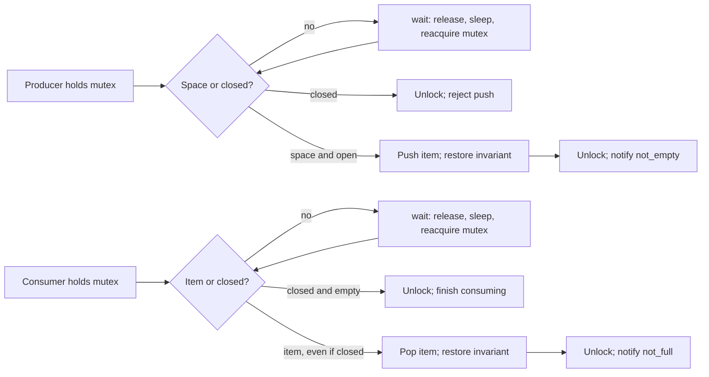

A lock protects an invariant, not just a line of code. If a bounded queue says its size never exceeds eight, the check and insertion must act as one coordinated operation. If a consumer has nothing to take, it must wait without monopolizing the lock that a producer needs. Those two requirements lead to different primitives: a mutex protects the queue's state; a condition variable lets a thread sleep until that state might have changed.

This is how I would approach a concurrency interview question. First name the shared state and its invariant. Then identify who changes it, who waits for it, and which lock makes those operations coherent. The choice of "mutex versus semaphore" becomes easier once the underlying resource or condition is explicit. The [Python concurrency post](/blog/python-concurrency/) discusses the language-level picture; here I will use C++17 and its memory model.

## A race is not always a data race

Imagine two threads executing `counter += 1` on a plain C++ `int`. Each operation involves a read, arithmetic, and a write; the increments can overlap. More seriously, conflicting unsynchronized accesses to a non-atomic object are a **data race**, and the C++ standard gives the entire execution undefined behavior. It is not safe to reason that the only possible result is "one increment got lost." That is one intuitive interleaving, but the compiler is allowed to assume a well-formed program has no such data race. 

A **race condition** is broader: the result depends on timing in a way the program did not intend. It can exist even when there is no C++ data race. For example, two threads can each atomically check that a slot is available and then atomically increment a reservation count. Every individual access is race-free, yet both may pass the check and overbook the one slot. Atomics made accesses indivisible and visible according to their ordering rules; they did not make a multi-step transaction atomic. I would fix this with one lock around the check-and-reserve invariant, or a carefully designed compare-and-exchange loop that updates one atomic state.

**Atomicity** asks whether an operation can be observed halfway through. **Visibility and ordering** ask whether another thread is guaranteed to see a write and in what relationship to other writes. Locking a mutex supplies both for the protected region: an unlock synchronizes with a later successful lock on that mutex, so a reader holding it sees a coherent published state. A plain `volatile` variable is not a synchronization substitute in C++. For a single independent counter, `std::atomic` may be enough; for a queue whose size, contents, and closed flag must agree, a mutex gives a much simpler proof. 

## Mutexes: ownership of a critical section

A mutex has an owner. A thread acquires it before touching shared state and releases it when the invariant is restored. I keep the critical section short enough to avoid holding the lock across unrelated I/O or expensive work, but long enough that every related check and mutation stays together. Acquiring two different locks for the same object is no protection unless *all* accesses follow one consistent protocol.

In C++, RAII makes that protocol robust to early returns and exceptions: `std::lock_guard` or `std::scoped_lock` releases the mutex at scope exit. `std::unique_lock` also owns a mutex but can unlock and relock, which is why a C++ condition variable's `wait` takes it. An owning mutex must be unlocked by its owner; a thread should not transfer a `std::mutex` unlock obligation to a different thread. 

What if the mutex is busy? A simple spin lock repeatedly tests until it can acquire. That can be sensible for a very short critical section when the holder will run promptly, but wastes CPU if the wait is long or the holder has been preempted. A sleeping lock can block the waiter and let other work run, at the cost of scheduling and wakeup overhead. Some implementations adapt by briefly spinning before sleeping; the exact policy depends on the platform and contention pattern. I would not promise that `std::mutex` always spins or always enters the kernel.

On Linux, a **futex** is one building block for that uncontended-fast, contended-sleeping pattern. The shared word is first handled with atomic user-space operations. If the thread needs to sleep, a futex wait asks the kernel to block only if the word still has the expected value: an atomic *compare-and-block* step closes the gap between checking and sleeping. This is a conceptual explanation of a library implementation tool, not a reason to assemble a raw futex mutex in application code. 

## Semaphore: count permits, not owners

A counting semaphore holds a nonnegative number of permits. Waiting acquires one, blocking if none are available; posting releases one and may wake a waiter. A pool with three identical connections is a natural example: initialize the count to three, acquire before using one, and release afterward. POSIX names these operations `sem_wait` and `sem_post`. A binary semaphore has a maximum useful count of one, but it is not automatically a mutex: semaphores do not encode the same ownership rule. A thread may post a semaphore as a signal for another thread, whereas releasing a mutex belongs to its owner. 

A semaphore can count queue items or free slots, but it does not by itself protect the queue container and its close state. That design often needs an additional mutex and careful shutdown accounting. For the bounded queue below, I prefer one mutex plus two condition variables because the predicates—"space exists or closed" and "item exists or closed"—are visible in the code.

## Condition variables wait for predicates

A condition variable does **not** store notifications like permits. `notify_one` means "some waiter may be able to make progress"; if nobody is waiting, the notification can disappear. The durable fact is the predicate stored in protected shared state. A consumer waits for `!queue.empty() || closed`; a producer waits for `queue.size() < capacity || closed`. The wait operation atomically releases the mutex and blocks, then reacquires it before returning. That atomic release-and-wait is what prevents the classic lost-notification window when both predicate checking and modification use the same mutex. 



The loop around a wait is necessary even if a notification is genuine. C++ permits **spurious wakeups**; another awakened consumer can also take the last item before this one reacquires the lock. `cv.wait(lock, predicate)` performs the loop for us. Conversely, a naive "check flag; unlock; start waiting" sequence can miss a notification between the check and the wait. Protecting the predicate with the same mutex and using the condition-variable wait operation closes that gap. 

I change state while holding the mutex, then unlock and notify. Notifying while still locked is also allowed, but the awakened thread cannot finish its wait until it reacquires the mutex, so notifying after unlock can avoid an immediate handoff into contention. The correctness argument rests on the protected predicate and atomic wait transition, not on a magical order between `unlock` and `notify`. In particular, closing the queue must wake **both** producers waiting for space and consumers waiting for items.


### A schedule that exposes the mistake

A concrete bad schedule helps more than memorizing "always use a while loop." Suppose the consumer checks `queue.empty()`, sees true, and releases the lock *before* it actually registers a wait. The producer now pushes one item and calls `notify_one`. Nobody is waiting yet, so that notification has no lasting effect. The consumer finally waits even though an item is present. Unless another push or unrelated wakeup occurs, it can remain asleep. The correct `wait(lock, predicate)` closes this gap by releasing the lock and entering the wait as one condition-variable operation; a producer cannot slip a state change into the unprotected interval. If the item was already present before the wait call, the predicate is true and the consumer never sleeps.

There is a second schedule: two consumers wait, one producer pushes a single item and notifies. One consumer wakes, takes it, and releases the lock. The other may wake spuriously or due to a later notification; by the time it reacquires the lock, the queue can be empty again. This is why a wakeup is evidence to **recheck**, not permission to pop. The queue's state under the mutex is the authority.

For this design, `notify_one` is enough after one ordinary push or pop because only one new item or slot was created. A bulk insertion, a change of capacity, or closure can make several waiters eligible at once and may call for `notify_all`. Waking everyone for each single item is correct with predicate loops but can cause needless contention. Waking too few threads after a state transition that enables several of them can leave work stranded until another transition occurs.

## A bounded queue with a clean shutdown

The invariant is $0\le\text{size}\le\text{capacity}$, and the mutex protects the queue plus `closed`. A producer waits until space exists **or** closure is announced; after closure it rejects a new push. A consumer waits until data exists **or** closure is announced; after closure it drains existing data, then returns `false`. Closure is an enduring state, not a one-time notification. Each wait uses the predicate overload, which is equivalent to rechecking in a loop.

The complete [C++17 source](bounded_queue.cpp) creates three producers and four consumers. Each producer submits 1,000 distinct integers. Consumers accumulate local sums and counts in separate vector elements, and the main thread reads those elements only after joining them. No output depends on which consumer receives which item. The 3,000 numbers are $0$ through $2{,}999$, so their deterministic sum is $2{,}999\cdot3{,}000/2=4{,}498{,}500$.


```cpp {title="bounded_queue.cpp"}
#include <cassert>
#include <condition_variable>
#include <cstddef>
#include <deque>
#include <iostream>
#include <mutex>
#include <numeric>
#include <stdexcept>
#include <thread>
#include <vector>

class BoundedQueue {
public:
    explicit BoundedQueue(std::size_t capacity) : capacity_(capacity) {
        if (capacity_ == 0) throw std::invalid_argument("capacity must be positive");
    }

    bool push(int value) {
        std::unique_lock<std::mutex> lock(mutex_);
        not_full_.wait(lock, [&] { return closed_ || queue_.size() < capacity_; });
        if (closed_) return false;
        queue_.push_back(value);
        assert(queue_.size() <= capacity_);
        lock.unlock();
        not_empty_.notify_one();
        return true;
    }

    bool pop(int& value) {
        std::unique_lock<std::mutex> lock(mutex_);
        not_empty_.wait(lock, [&] { return closed_ || !queue_.empty(); });
        if (queue_.empty()) return false;  // Closed and drained.
        value = queue_.front();
        queue_.pop_front();
        lock.unlock();
        not_full_.notify_one();
        return true;
    }

    void close() {
        {
            std::scoped_lock<std::mutex> lock(mutex_);
            closed_ = true;
        }
        not_empty_.notify_all();
        not_full_.notify_all();
    }

private:
    const std::size_t capacity_;
    std::deque<int> queue_;
    std::mutex mutex_;
    std::condition_variable not_empty_;
    std::condition_variable not_full_;
    bool closed_ = false;  // Protected by mutex_.
};

int main() {
    constexpr int producers = 3;
    constexpr int consumers = 4;
    constexpr int per_producer = 1000;
    BoundedQueue queue(8);
    std::vector<std::thread> producer_threads;
    std::vector<std::thread> consumer_threads;
    std::vector<long long> partial_sum(consumers, 0);
    std::vector<int> partial_count(consumers, 0);

    for (int p = 0; p < producers; ++p) {
        producer_threads.emplace_back([&, p] {
            for (int i = 0; i < per_producer; ++i) {
                const bool accepted = queue.push(p * per_producer + i);
                assert(accepted);
                (void)accepted;
            }
        });
    }
    for (int c = 0; c < consumers; ++c) {
        consumer_threads.emplace_back([&, c] {
            int value;
            while (queue.pop(value)) {
                partial_sum[c] += value;
                ++partial_count[c];
            }
        });
    }

    for (auto& thread : producer_threads) thread.join();
    queue.close();
    for (auto& thread : consumer_threads) thread.join();
    const long long sum = std::accumulate(partial_sum.begin(), partial_sum.end(), 0LL);
    const int count = std::accumulate(partial_count.begin(), partial_count.end(), 0);
    constexpr long long expected = 2999LL * 3000 / 2;
    if (count != producers * per_producer || sum != expected) {
        std::cerr << "queue invariant failed\n";
        return 1;
    }
    std::cout << "consumed=" << count << ", sum=" << sum << '\n';
}
```


```bash
g++ -std=c++17 -O2 -Wall -Wextra -Wpedantic -pthread bounded_queue.cpp -o bounded_queue
./bounded_queue
```

```text {title="Output"}
consumed=3000, sum=4498500
```

Why is this safe? Every access to the queue and `closed_` happens under `mutex_`. A successful `push` checks space and inserts while still holding that mutex, so two producers cannot both claim the last slot. A successful `pop` removes exactly one item. The predicate waits release the mutex while sleeping and return with it held. Notifications happen after the state change, so a woken thread can recheck the durable fact. The main thread joins all producers *before* closing, so no producer in this particular run can be rejected; it then closes, allowing consumers to drain and exit. An application with early cancellation must decide how rejected pushes and queued items are handled.

Notice the notification choices. Pushing one item calls `not_empty_.notify_one()`; popping one item calls `not_full_.notify_one()`. Closure changes both wait predicates and calls `notify_all()` on both condition variables, because every blocked thread must get a chance to observe it. Neither notification grants ownership of the mutex or reserves an item. Woken threads compete to reacquire the mutex and test the predicate again.

`close()` announces shutdown and wakes waiters; it does not wait for them to finish. The queue must stay alive until all calls to `push`, `pop`, and `close`, including their notifications, have returned. The example joins the consumers after closing and before destroying the queue. Destroying a queue while another thread still uses it would be a separate lifetime bug.

## Deadlock, livelock, and starvation

Deadlock is a cycle of waiting with no possible progress. Suppose thread A holds lock 1 and waits for lock 2 while thread B holds lock 2 and waits for lock 1. The classic four necessary conditions are mutual exclusion, hold-and-wait, no preemption of resources, and circular wait. Break one of them and that deadlock pattern cannot form. A consistent global lock order breaks circular wait: always acquire lock 1 before lock 2. When a function genuinely needs multiple C++ mutexes together, `std::scoped_lock` can use the standard deadlock-avoiding multi-lock operation, but all callers still need a coherent ownership design. Never wait on a condition variable while holding some *other* lock needed by the producer of the predicate. 

Livelock looks different: threads keep taking steps but repeatedly yield or retry in a way that prevents useful work. Two polite threads can each release a lock on seeing contention and then retry in perfect synchrony forever. Randomized backoff can help, but a clear lock order is often a simpler answer. **Starvation** means one thread waits indefinitely while others continue to progress; a lock can be deadlock-free and still unfair. Neither `notify_one` nor an ordinary mutex promises that the oldest waiter wins. If fairness matters, it needs to be part of the chosen primitive and tested under the expected load.

Priority inversion appears when a high-priority thread waits for a lock held by a low-priority thread, while medium-priority work prevents the holder from running and releasing it. **Priority inheritance** can temporarily raise the holder's effective priority, but it is a property of a particular lock and scheduler arrangement, not a blanket guarantee for `std::mutex`. Linux documents priority inheritance for its RT-mutexes and also documents limits, such as sections where preemption is disabled. A long critical section remains a problem even with inheritance. 

A reader-writer lock permits several readers simultaneously or one writer exclusively. It can help when reads are long, writes are rare, and contention is real. It can also cost more bookkeeping than a plain mutex, and heavy reads may delay writers depending on the implementation's fairness policy. For a tiny protected counter or queue, I would start with a mutex, measure contention, and change the primitive only if that measurement points to a useful improvement.

## Interview questions and follow-ups

**1. What is the difference between a data race and a race condition?** A C++ data race is conflicting potentially concurrent access to the same non-atomic memory without a happens-before relation; it is undefined behavior. A race condition is a wider logic error caused by timing. An atomic check followed by an atomic reservation can be race-free yet still overbook a resource.

**2. Does making a variable `volatile` make a counter thread-safe?** No. `volatile` does not make a read-modify-write atomic or establish the synchronization needed between threads. I would use an atomic counter if the counter is independent, or a mutex if it participates in a larger invariant.

**3. Why use RAII for a mutex?** A scoped owner releases the mutex on every normal scope exit, including an exception path. It also makes ownership visible in the code. `std::unique_lock` is useful when a condition-variable wait must temporarily release and reacquire the mutex.

**4. Is a binary semaphore just a mutex?** Both can limit concurrent access to one, but a mutex represents thread ownership. A semaphore represents permits and can be posted by a different thread. Substituting one for the other can lose ownership checks and priority-inheritance behavior.

**5. What state does a condition variable remember?** None about past notifications. The protected predicate—such as "queue is nonempty or closed"—remembers what matters. If a producer inserts before a consumer waits, the consumer sees the predicate true and does not block, even if the notification was missed.

**6. Why must a wait use a loop?** It may wake spuriously, or another thread may consume the resource first. The correct question after reacquiring the mutex is whether the predicate is true *now*. The predicate overload of `wait` performs that loop.

**7. Why does `wait` need the mutex?** It must release the mutex and enter the wait atomically with respect to changes protected by that mutex. Otherwise a producer can change state and notify in the gap between a consumer's check and its sleep, leaving the consumer stuck on an already-true condition.

**8. Should I notify before or after unlocking?** Both can be correct when the predicate is changed under the mutex and the waiter rechecks it. Notifying after unlocking can avoid waking a thread that immediately blocks on the held mutex. The choice does not remove the need for the predicate.

**9. Why does closing the queue wake producers and consumers?** Closure makes the producer's "space or closed" predicate and the consumer's "item or closed" predicate true. Producers must stop waiting so they can reject pushes; consumers must wake, drain remaining items, and then exit.

**10. How do I prevent a two-lock deadlock?** Define a global acquisition order and follow it on every path, or use a standard multi-lock wrapper when acquiring the pair together. I would also inspect callbacks and waits inside critical sections, because they can acquire hidden locks.

**11. Is a spin lock faster than a mutex?** Only under particular short-wait conditions. A spinner consumes CPU and can be disastrous if the holder is not running; sleeping has wakeup overhead. Adaptive strategies exist, but the choice needs the actual contention and scheduling environment.

**12. When should I choose a reader-writer lock?** When measured read-side contention justifies allowing parallel readers and writer latency is acceptable. For short critical sections, its extra coordination may lose to a simple mutex. I would also check whether the implementation can starve writers.



