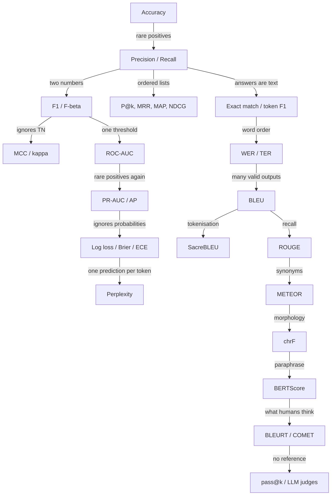

A metric is a promise: *if this number goes up, the thing I care about got better.* Every
metric in this post breaks that promise somewhere, and the next metric was usually invented
by someone who got burned by the break. Accuracy breaks on imbalanced data, so we split
errors into precision and recall. Those are two numbers, so we fuse them into F1. F1 ignores
true negatives, so we get MCC. All of these depend on one threshold, so we get ROC curves,
which flatter rare-event detectors, so we get PR curves. And so on, all the way to BLEU,
BERTScore and asking GPT-4 to grade the homework.

So instead of a glossary, this post is a chain. For each metric: the intuition, the formula,
Python you can run (from scratch, checked against the standard library implementation), and
the place where it breaks, which is where the next section starts.



The code needs `numpy`, `scikit-learn`, `scipy`, `sacrebleu`, `rouge-score`, `nltk`,
`seqeval`, `jiwer`, and for the model-based metrics `torch`, `transformers` and `bert-score`.

## Part 1: Classification, or "is this email spam?"

The running example for this part: 100 emails, 10 of which are spam. Our filter flags 12
emails; 8 of them really are spam.

### Accuracy

**Intuition.** The fraction of predictions that are right. It's what everybody computes
first, and on a balanced problem it's a fine first look.

$$
\text{Accuracy} = \frac{1}{N}\sum_{i=1}^{N} \mathbb{1}[\hat y_i = y_i]
$$

```python {title="classification.py"}
import numpy as np

# 100 emails, 10 of them spam (1 = spam, 0 = ham)
y_true = np.array([1] * 10 + [0] * 90)

always_ham = np.zeros_like(y_true)                          # never flags anything
y_pred = np.array([1] * 8 + [0] * 2 + [1] * 4 + [0] * 86)   # a real-ish filter

def accuracy(y_true, y_pred):
    return np.mean(y_true == y_pred)

print(f"always-ham accuracy: {accuracy(y_true, always_ham):.2f}")
print(f"filter accuracy:     {accuracy(y_true, y_pred):.2f}")
```

```text {title="Output"}
always-ham accuracy: 0.90
filter accuracy:     0.94
```

**Where it breaks.** A "filter" that does nothing scores 90%. Ours, which actually catches
spam, is only four points better than doing nothing. Accuracy is dominated by the majority
class: on a fraud dataset with 0.1% fraud, predicting "not fraud" every time scores 99.9%.
The number hides *which kind* of mistake the model makes, and on imbalanced data that's the
only thing that matters. So the first fix is to stop counting errors as one pile.

### The confusion matrix

Split every prediction by what was predicted and what was true:

|                  | predicted spam | predicted ham |
|------------------|----------------|---------------|
| **actually spam** | TP = 8         | FN = 2        |
| **actually ham**  | FP = 4         | TN = 86       |

True positives (TP) are spam we caught, false negatives (FN) are spam we missed, false
positives (FP) are real emails we wrongly binned, and true negatives (TN) are real emails we
correctly left alone. Accuracy is just $(TP + TN)/N$. Every metric in this part is some
ratio of these four counts.

```python {title="classification.py (continued)"}
def confusion(y_true, y_pred):
    tp = np.sum((y_pred == 1) & (y_true == 1))
    fp = np.sum((y_pred == 1) & (y_true == 0))
    fn = np.sum((y_pred == 0) & (y_true == 1))
    tn = np.sum((y_pred == 0) & (y_true == 0))
    return tp, fp, fn, tn

print(confusion(y_true, y_pred))

from sklearn.metrics import confusion_matrix
print(confusion_matrix(y_true, y_pred))   # rows = true, cols = predicted: [[TN, FP], [FN, TP]]
```

```text {title="Output"}
(np.int64(8), np.int64(4), np.int64(2), np.int64(86))
[[86  4]
 [ 2  8]]
```

Note scikit-learn's layout: class 0 comes first, so TN sits top-left and TP bottom-right.
That's the opposite of most textbook diagrams and trips people up constantly.

### Precision, recall and specificity

Two questions, two very different costs:

- **Precision**: when the filter says spam, how often is it right? Low precision means real
  emails vanish into the spam folder.
- **Recall** (also called sensitivity or true positive rate): of all the spam, how much did
  we catch? Low recall means spam reaches the inbox.

$$
\text{Precision} = \frac{TP}{TP + FP}
\qquad
\text{Recall} = \frac{TP}{TP + FN}
\qquad
\text{Specificity} = \frac{TN}{TN + FP}
$$

Specificity is recall for the negative class: of all real emails, how many did we leave
alone? Medicine pairs sensitivity with specificity; ML and information retrieval pair
precision with recall.

```python {title="classification.py (continued)"}
def precision(y_true, y_pred):
    tp, fp, fn, tn = confusion(y_true, y_pred)
    return tp / (tp + fp) if tp + fp else 0.0

def recall(y_true, y_pred):
    tp, fp, fn, tn = confusion(y_true, y_pred)
    return tp / (tp + fn) if tp + fn else 0.0

def specificity(y_true, y_pred):
    tp, fp, fn, tn = confusion(y_true, y_pred)
    return tn / (tn + fp) if tn + fp else 0.0

flag_one = np.zeros_like(y_true); flag_one[0] = 1   # flag only the single surest spam
flag_all = np.ones_like(y_true)                      # flag everything

for name, p in [("filter", y_pred), ("flag-one", flag_one), ("flag-all", flag_all)]:
    print(f"{name:9s} P={precision(y_true, p):.2f}  R={recall(y_true, p):.2f}  "
          f"spec={specificity(y_true, p):.2f}")

from sklearn.metrics import precision_score, recall_score
print(precision_score(y_true, y_pred), recall_score(y_true, y_pred))
```

```text {title="Output"}
filter    P=0.67  R=0.80  spec=0.96
flag-one  P=1.00  R=0.10  spec=1.00
flag-all  P=0.10  R=1.00  spec=0.00
0.6666666666666666 0.8
```

**Where it breaks.** Each one alone is trivially gamed. Flag only the single most obvious
spam and precision is perfect. Flag everything and recall is perfect. You always have to
report both, which makes comparing models awkward: is (0.67, 0.80) better than (0.75, 0.70)?
We want one number that can't be gamed by pushing either side to an extreme.

### F1 and F-beta

The obvious combination, the arithmetic mean, fails immediately: flag-all scores
$(0.10 + 1.00)/2 = 0.55$, rewarding a useless model. The **harmonic mean** fixes this
because it's dominated by the smaller of the two numbers. You can't buy a good score by
maxing one side.

$$
F_1 = \frac{2}{\frac{1}{P} + \frac{1}{R}} = \frac{2PR}{P + R} = \frac{2\,TP}{2\,TP + FP + FN}
$$

Often the two errors don't cost the same. $F_\beta$ treats recall as $\beta$ times as
important as precision:

$$
F_\beta = \frac{(1 + \beta^2)\, P R}{\beta^2 P + R}
$$

$F_2$ suits cancer screening, where a miss is much worse than a false alarm. $F_{0.5}$ suits
spam, where binning a real email is worse than letting one spam through.

```python {title="classification.py (continued)"}
def f_beta(y_true, y_pred, beta=1.0):
    p, r = precision(y_true, y_pred), recall(y_true, y_pred)
    if p + r == 0:
        return 0.0
    return (1 + beta**2) * p * r / (beta**2 * p + r)

for name, p in [("filter", y_pred), ("flag-one", flag_one), ("flag-all", flag_all)]:
    P, R = precision(y_true, p), recall(y_true, p)
    print(f"{name:9s} arithmetic={(P + R) / 2:.2f}  F1={f_beta(y_true, p):.2f}  "
          f"F2={f_beta(y_true, p, 2):.2f}  F0.5={f_beta(y_true, p, 0.5):.2f}")

from sklearn.metrics import f1_score, fbeta_score
print(f1_score(y_true, y_pred), fbeta_score(y_true, y_pred, beta=2))
```

```text {title="Output"}
filter    arithmetic=0.73  F1=0.73  F2=0.77  F0.5=0.69
flag-one  arithmetic=0.55  F1=0.18  F2=0.12  F0.5=0.36
flag-all  arithmetic=0.55  F1=0.18  F2=0.36  F0.5=0.12
0.7272727272727273 0.7692307692307693
```

Both degenerate models drop to 0.18. And $F_2$ prefers flag-all to flag-one while $F_{0.5}$
prefers the reverse, exactly as the costs say it should.

**Where it breaks.** Look at the last form of the formula: TN doesn't appear anywhere. F1
only cares about the positive class, which has two awkward consequences. First, the score
depends on which class you *call* positive: the same predictions get a different F1 if you
relabel ham as the positive class. Second, when the positive class is the majority, a lazy
model that says "positive" to everything gets a great F1. We need something that treats both
classes symmetrically.

### MCC, Cohen's kappa and balanced accuracy

**Matthews correlation coefficient (MCC)** is the Pearson correlation between the predicted
and true labels, treated as 0/1 variables. It uses all four cells, ranges from −1 (always
wrong) through 0 (no better than chance) to +1 (perfect), and is only high when the model does
well on both classes.

$$
\text{MCC} = \frac{TP \cdot TN - FP \cdot FN}{\sqrt{(TP + FP)(TP + FN)(TN + FP)(TN + FN)}}
$$

**Cohen's kappa** asks how much better the predictions agree with the truth than two raters
guessing at their own base rates would. With $p_o$ the observed agreement
(accuracy) and $p_e$ the agreement expected by chance:

$$
\kappa = \frac{p_o - p_e}{1 - p_e}, \qquad p_e = \sum_{c} P(y = c)\, P(\hat y = c)
$$

In NLP, kappa shows up mostly as **inter-annotator agreement**: before trusting a labelled
dataset, check how often two human annotators agree beyond chance. If humans only reach
$\kappa = 0.6$, a model at 0.6 is about as good as the labels allow.

**Balanced accuracy** is the mean of the recall on each class (here, recall and specificity),
so a model can't win by ignoring the minority:

$$
\text{Balanced accuracy} = \frac{1}{2}\left(\frac{TP}{TP + FN} + \frac{TN}{TN + FP}\right)
$$

```python {title="mcc.py"}
import numpy as np
from sklearn.metrics import f1_score, matthews_corrcoef, cohen_kappa_score, balanced_accuracy_score

def confusion(y_true, y_pred):
    tp = np.sum((y_pred == 1) & (y_true == 1))
    fp = np.sum((y_pred == 1) & (y_true == 0))
    fn = np.sum((y_pred == 0) & (y_true == 1))
    tn = np.sum((y_pred == 0) & (y_true == 0))
    return tp, fp, fn, tn

def mcc(y_true, y_pred):
    tp, fp, fn, tn = confusion(y_true, y_pred)
    denom = np.sqrt(float((tp + fp) * (tp + fn) * (tn + fp) * (tn + fn)))
    return (tp * tn - fp * fn) / denom if denom else 0.0

def cohen_kappa(y_true, y_pred):
    p_o = np.mean(y_true == y_pred)                       # observed agreement
    p_e = sum(np.mean(y_true == c) * np.mean(y_pred == c)  # agreement expected by chance
              for c in np.union1d(y_true, y_pred))
    return (p_o - p_e) / (1 - p_e)

def balanced_accuracy(y_true, y_pred):
    tp, fp, fn, tn = confusion(y_true, y_pred)
    return 0.5 * (tp / (tp + fn) + tn / (tn + fp))

# The spam filter from before
y_true = np.array([1] * 10 + [0] * 90)
y_pred = np.array([1] * 8 + [0] * 2 + [1] * 4 + [0] * 86)

# Same predictions, but now "ham" is called the positive class
flip = lambda y: 1 - y
print(f"F1  spam-positive={f1_score(y_true, y_pred):.3f}  ham-positive={f1_score(flip(y_true), flip(y_pred)):.3f}")
print(f"MCC spam-positive={mcc(y_true, y_pred):.3f}  ham-positive={mcc(flip(y_true), flip(y_pred)):.3f}")

# A dataset where positives are the majority, and a model that says "positive" to everything
y_true_maj = np.array([1] * 95 + [0] * 5)
lazy = np.ones_like(y_true_maj)
print(f"lazy: F1={f1_score(y_true_maj, lazy):.3f}  MCC={mcc(y_true_maj, lazy):.3f}  "
      f"kappa={cohen_kappa(y_true_maj, lazy):.3f}  bal_acc={balanced_accuracy(y_true_maj, lazy):.3f}")

print(f"filter: MCC={mcc(y_true, y_pred):.3f}  kappa={cohen_kappa(y_true, y_pred):.3f}  "
      f"bal_acc={balanced_accuracy(y_true, y_pred):.3f}")
print(matthews_corrcoef(y_true, y_pred), cohen_kappa_score(y_true, y_pred),
      balanced_accuracy_score(y_true, y_pred))
```

```text {title="Output"}
F1  spam-positive=0.727  ham-positive=0.966
MCC spam-positive=0.698  ham-positive=0.698
lazy: F1=0.974  MCC=0.000  kappa=0.000  bal_acc=0.500
filter: MCC=0.698  kappa=0.694  bal_acc=0.878
0.6975184488828855 0.6938775510204083 0.8777777777777778
```

Same predictions, F1 of 0.727 or 0.966 depending on a naming choice; MCC doesn't care. The
lazy model gets F1 = 0.974 and MCC = 0, which is the honest answer: it has learned nothing.

**Where it breaks.** Everything so far assumes two classes. Real NLP tasks have many
(sentiment, intent, topic), and turning per-class scores into one number hides a choice.

### More than two classes: macro, micro and weighted averages

With $K$ classes, compute precision, recall and F1 for each class *one-vs-rest* (class $k$
is "positive", everything else "negative"), then average. There are three ways to average:

$$
\text{macro-}F_1 = \frac{1}{K}\sum_{k} F_{1,k}
\qquad
\text{weighted-}F_1 = \sum_{k} \frac{n_k}{N} F_{1,k}
$$

$$
\text{micro: } P = \frac{\sum_k TP_k}{\sum_k (TP_k + FP_k)}, \quad
R = \frac{\sum_k TP_k}{\sum_k (TP_k + FN_k)}, \quad F_1 = \frac{2PR}{P + R}
$$

Macro treats every class as equally important. Weighted weights each class by its frequency
$n_k$. Micro pools all decisions before dividing. For single-label classification, micro-F1
is *exactly* accuracy: every wrong prediction is one FP (for the predicted class) and one FN
(for the true class), so pooled precision and recall are both $\sum_k TP_k / N$.

Example: 100 product reviews, 70 positive, 20 neutral, 10 negative.

```python {title="multiclass.py"}
import numpy as np
from sklearn.metrics import precision_recall_fscore_support, accuracy_score

labels = ["pos", "neu", "neg"]
# Rows = true class, columns = predicted class
C = np.array([[65,  4, 1],    # 70 positive reviews
              [ 8, 10, 2],    # 20 neutral
              [ 3,  2, 5]])   # 10 negative

tp = np.diag(C)
fp = C.sum(axis=0) - tp       # predicted as class k, but weren't
fn = C.sum(axis=1) - tp       # were class k, but predicted otherwise
support = C.sum(axis=1)

p_k = tp / (tp + fp)
r_k = tp / (tp + fn)
f1_k = 2 * p_k * r_k / (p_k + r_k)
for name, p, r, f in zip(labels, p_k, r_k, f1_k):
    print(f"{name}: P={p:.2f} R={r:.2f} F1={f:.2f}")

macro_f1 = f1_k.mean()                                   # every class counts equally
weighted_f1 = (f1_k * support).sum() / support.sum()     # classes weighted by frequency
micro_p = tp.sum() / (tp.sum() + fp.sum())               # pool all decisions, then compute
micro_r = tp.sum() / (tp.sum() + fn.sum())
micro_f1 = 2 * micro_p * micro_r / (micro_p + micro_r)
acc = tp.sum() / C.sum()
print(f"macro={macro_f1:.3f}  weighted={weighted_f1:.3f}  micro={micro_f1:.3f}  accuracy={acc:.3f}")

# Same thing with sklearn, from label arrays
y_true = np.repeat(np.repeat(np.arange(3), 3), C.ravel())
y_pred = np.repeat(np.tile(np.arange(3), 3), C.ravel())
for avg in ["macro", "weighted", "micro"]:
    print(avg, round(precision_recall_fscore_support(y_true, y_pred, average=avg)[2], 3))
print("accuracy", round(accuracy_score(y_true, y_pred), 3))
```

```text {title="Output"}
pos: P=0.86 R=0.93 F1=0.89
neu: P=0.62 R=0.50 F1=0.56
neg: P=0.62 R=0.50 F1=0.56
macro=0.667  weighted=0.790  micro=0.800  accuracy=0.800
macro 0.667
weighted 0.79
micro 0.8
accuracy 0.8
```

The model is good on positives and mediocre on the rest. Micro (0.80) mostly reflects the
positives; macro (0.67) exposes the weak minority classes. If the rare classes matter (and
they usually do; the negative reviews are the ones you want to find), report macro and the
per-class table.

**Where it breaks.** Every metric so far grades *hard decisions*. But a classifier outputs a
score, and someone picked a threshold (usually 0.5) to turn it into yes/no. Move the
threshold and every number above changes. We'd like to judge the scores themselves, across
all thresholds at once.

### The ROC curve and AUC

Sweep the threshold from high to low. At each setting, plot the **true positive rate**
(recall) against the **false positive rate** (the fraction of negatives wrongly flagged).
That curve is the ROC curve; the area under it is ROC-AUC.

$$
\text{TPR}(t) = \frac{TP(t)}{TP(t) + FN(t)}, \qquad \text{FPR}(t) = \frac{FP(t)}{FP(t) + TN(t)}, \qquad
\text{AUC} = \int_0^1 \text{TPR}\; d(\text{FPR})
$$

The area has a lovely interpretation: **AUC is the probability that a randomly chosen
positive scores higher than a randomly chosen negative** (ties count half). So 0.5 is random
guessing and 1.0 is a perfect ranking. This is the Mann–Whitney U statistic in disguise, and
the code below computes it both ways.

```python {title="roc_pr.py"}
import numpy as np
from sklearn.metrics import roc_auc_score, average_precision_score

def roc_curve(y_true, scores):
    order = np.argsort(-scores)                 # sweep the threshold from high to low
    y = y_true[order]
    tpr = np.concatenate([[0], np.cumsum(y) / y.sum()])
    fpr = np.concatenate([[0], np.cumsum(1 - y) / (1 - y).sum()])
    return fpr, tpr

def auc_trapezoid(fpr, tpr):
    return np.sum(np.diff(fpr) * (tpr[1:] + tpr[:-1]) / 2)

def auc_pairwise(y_true, scores):
    # P(random positive scores higher than random negative); ties count half
    pos, neg = scores[y_true == 1], scores[y_true == 0]
    diff = pos[:, None] - neg[None, :]
    return np.mean((diff > 0) + 0.5 * (diff == 0))

def average_precision(y_true, scores):
    order = np.argsort(-scores)
    y = y_true[order]
    hits = np.cumsum(y)
    precision_at_k = hits / np.arange(1, len(y) + 1)
    return np.sum(precision_at_k * y) / y.sum()  # mean precision at each relevant position

y_true = np.array([1, 1, 0, 1, 0, 0, 1, 0, 0, 0])
scores = np.array([.95, .90, .85, .80, .70, .60, .55, .40, .30, .10])
fpr, tpr = roc_curve(y_true, scores)
print(f"AUC trapezoid={auc_trapezoid(fpr, tpr):.3f}  pairwise={auc_pairwise(y_true, scores):.3f}  "
      f"sklearn={roc_auc_score(y_true, scores):.3f}")
print(f"AP ours={average_precision(y_true, scores):.3f}  sklearn={average_precision_score(y_true, scores):.3f}")
```

```text {title="Output"}
AUC trapezoid=0.833  pairwise=0.833  sklearn=0.833
AP ours=0.830  sklearn=0.830
```

(`roc_curve` here assumes no tied scores; scikit-learn's version groups ties.)

**Where it breaks.** Look at the FPR denominator: *all* the negatives. When negatives vastly
outnumber positives, hundreds of false alarms barely move FPR, so the ROC curve looks superb
while the model is useless in practice. Below: 50 fraud cases among 50,000 legitimate
transactions, and a model with ROC-AUC 0.989.

```python {title="roc_pr.py (continued)"}
rng = np.random.default_rng(0)
n_pos, n_neg = 50, 50_000                       # 0.1% positives, like fraud
y = np.concatenate([np.ones(n_pos), np.zeros(n_neg)]).astype(int)
s = np.concatenate([rng.normal(3.0, 1, n_pos), rng.normal(0, 1, n_neg)])

print(f"ROC-AUC = {roc_auc_score(y, s):.3f}")
print(f"PR-AUC (average precision) = {average_precision_score(y, s):.3f}")

thr = np.sort(s[y == 1])[::-1][int(0.8 * n_pos) - 1]   # threshold that catches 80% of positives
flagged = s >= thr
tp, fp = np.sum(flagged & (y == 1)), np.sum(flagged & (y == 0))
print(f"at recall 0.80: TP={tp}, FP={fp}, FPR={fp / n_neg:.4f}, precision={tp / (tp + fp):.3f}")
```

```text {title="Output"}
ROC-AUC = 0.989
PR-AUC (average precision) = 0.392
at recall 0.80: TP=40, FP=494, FPR=0.0099, precision=0.075
```

To catch 80% of fraud, the model raises 494 false alarms: an FPR of just 1%, which looks
great on a ROC plot. But only 7.5% of the flagged transactions are fraud, so an analyst
reviewing alerts wades through 12 false alarms for every real case.

### The precision–recall curve and average precision

The fix is to plot **precision** against recall instead. Precision's denominator is "things
we flagged", not "all negatives", so TN never enters and the flood of false alarms shows up
immediately. The area under it is summarised as **average precision
(AP)**: the precision at each threshold, weighted by how much recall increased there.
Equivalently, it's the mean of the precision measured at the rank of each positive.

$$
\text{AP} = \sum_{n} (R_n - R_{n-1})\, P_n
= \frac{1}{|\text{positives}|} \sum_{k\,:\,y_{(k)} = 1} \text{Precision@}k
$$

The output above shows the gap: ROC-AUC 0.989, AP 0.392. Note the baselines differ too.
A random model gets ROC-AUC 0.5 no matter what, but its AP equals the positive rate, here
0.001. So AP 0.392 is far better than random, just nowhere near the "nearly perfect" the ROC
curve suggests.[^ap-interp]

[^ap-interp]: Use `average_precision_score`, not `auc(recall, precision)`. The trapezoidal
rule interpolates linearly between PR points, which is optimistic because precision doesn't
change linearly with recall.

**Where it breaks.** ROC-AUC and AP only use the *ranking* of the scores. Squash every score
through any increasing function and they don't change: a model that outputs 0.51 for every
spam and 0.49 for every ham has the same AUC as one that outputs 0.99 and 0.01. That's fine
if you only ever threshold, but often the probability itself gets used: to compute expected
cost, to decide when to defer to a human, or to say how confident an LLM is. Then we need to
know whether "80%" means 80%.

### Probabilities: log loss, Brier score and calibration

**Log loss** (binary cross-entropy, the loss most classifiers are trained on) charges
$-\log p$ for the probability assigned to what actually happened:

$$
\text{LogLoss} = -\frac{1}{N}\sum_{i} \Big[ y_i \log p_i + (1 - y_i)\log(1 - p_i) \Big]
$$

It is a *proper scoring rule*: in expectation, you minimise it by reporting your true belief,
so a model can't game it by hedging or exaggerating. It punishes confident mistakes without
limit: saying 0.001 for something that happens costs $-\log 0.001 \approx 6.9$ nats.

**Brier score** is the mean squared error between probability and outcome, also proper, but
bounded in $[0, 1]$ so a single confident blunder can't dominate it:

$$
\text{Brier} = \frac{1}{N}\sum_{i} (p_i - y_i)^2
$$

**Expected calibration error (ECE)** asks the question directly: when the model says 80%, is
it right 80% of the time? Group predictions into confidence bins $B_b$ and compare each bin's
average confidence to its actual hit rate:

$$
\text{ECE} = \sum_{b=1}^{M} \frac{|B_b|}{N}\, \Big| \text{acc}(B_b) - \text{conf}(B_b) \Big|
$$

Modern deep networks tend to be overconfident, which is what made calibration a mainstream
topic. Below are three models: one calibrated, one with the same ranking
pushed toward 0 and 1, and one that always predicts the base rate.

```python {title="calibration.py"}
import numpy as np
from sklearn.metrics import roc_auc_score, log_loss, brier_score_loss

def log_loss_np(y, p, eps=1e-15):
    p = np.clip(p, eps, 1 - eps)
    return -np.mean(y * np.log(p) + (1 - y) * np.log(1 - p))

def brier(y, p):
    return np.mean((p - y) ** 2)

def ece(y, p, n_bins=10):
    bins = np.minimum((p * n_bins).astype(int), n_bins - 1)   # equal-width confidence bins
    total = 0.0
    for b in range(n_bins):
        mask = bins == b
        if mask.any():
            gap = abs(p[mask].mean() - y[mask].mean())         # avg confidence vs actual rate
            total += mask.mean() * gap
    return total

rng = np.random.default_rng(0)
q = rng.uniform(0.02, 0.98, 20_000)          # the true probability of each example
y = (rng.uniform(size=q.size) < q).astype(int)

logit = np.log(q / (1 - q))
models = {
    "calibrated":    q,
    "overconfident": 1 / (1 + np.exp(-3 * logit)),    # same ranking, pushed toward 0 and 1
    "base rate":     np.full_like(q, y.mean()),       # always predicts the average
}
for name, p in models.items():
    auc = roc_auc_score(y, p)
    print(f"{name:13s} AUC={auc:.3f}  logloss={log_loss_np(y, p):.3f}  "
          f"Brier={brier(y, p):.3f}  ECE={ece(y, p):.3f}")

print(log_loss(y, models["calibrated"]), brier_score_loss(y, models["calibrated"]))
```

```text {title="Output"}
calibrated    AUC=0.824  logloss=0.514  Brier=0.171  ECE=0.008
overconfident AUC=0.824  logloss=0.716  Brier=0.195  ECE=0.142
base rate     AUC=0.500  logloss=0.693  Brier=0.250  ECE=0.000
0.5141753394259414 0.1713929367056444
```

The overconfident model has the same AUC as the calibrated one; only the probability metrics
catch it. And look at the base-rate model: perfectly calibrated (ECE 0), completely useless
(AUC 0.5).

**Where it breaks.** Calibration and discrimination are different properties, and ECE only
measures the first. ECE also depends on the number and placement of bins. So report a proper
score (log loss or Brier), which rewards both at once, alongside a ranking metric, and use ECE
or a reliability diagram to diagnose *why* the probabilities are off.

### A short detour: when the target is a number

The Brier score is just mean squared error on probabilities, which is a good moment to cover
regression, where the target is a real number (a rating, a price, a similarity score).

$$
\text{MAE} = \frac{1}{N}\sum_i |y_i - \hat y_i|
\qquad
\text{RMSE} = \sqrt{\frac{1}{N}\sum_i (y_i - \hat y_i)^2}
\qquad
R^2 = 1 - \frac{\sum_i (y_i - \hat y_i)^2}{\sum_i (y_i - \bar y)^2}
$$

MAE treats every unit of error the same; squaring makes RMSE punish large misses much more.
(Minimising MAE gives the median, minimising MSE gives the mean.) $R^2$ compares the model to
the dumbest baseline, always predicting the mean: 1 is perfect, 0 is no better than the mean,
and it goes negative when the model is worse than that.

```python {title="regression.py"}
import numpy as np
from sklearn.metrics import mean_absolute_error, mean_squared_error, r2_score

y_true = np.array([3.0, 5.0, 2.5, 7.0, 4.5, 6.0])
y_good = np.array([2.8, 5.3, 2.9, 6.6, 4.4, 6.2])              # small errors everywhere
y_spiky = np.array([3.0, 5.0, 2.5, 7.0, 4.5, 8.4])              # perfect except one big miss

def mae(y, yhat):  return np.mean(np.abs(y - yhat))
def mse(y, yhat):  return np.mean((y - yhat) ** 2)
def rmse(y, yhat): return np.sqrt(mse(y, yhat))
def r2(y, yhat):   return 1 - np.sum((y - yhat) ** 2) / np.sum((y - y.mean()) ** 2)

for name, yhat in [("good", y_good), ("spiky", y_spiky)]:
    print(f"{name:5s} MAE={mae(y_true, yhat):.3f}  RMSE={rmse(y_true, yhat):.3f}  R2={r2(y_true, yhat):.3f}")

print(mean_absolute_error(y_true, y_good), np.sqrt(mean_squared_error(y_true, y_good)), r2_score(y_true, y_good))
```

```text {title="Output"}
good  MAE=0.267  RMSE=0.289  R2=0.966
spiky MAE=0.400  RMSE=0.980  R2=0.612
0.26666666666666666 0.2886751345948129 0.9662921348314607
```

One big miss raises MAE by half but more than triples RMSE. Which one you want depends on
whether one big miss is worse than many small ones. Correlation metrics (Pearson, Spearman)
also live here; they come back at the end of the post, where we use them to grade metrics
themselves.

## Part 2: Ranking, or "did search find it?"

A search engine or the retriever in a RAG pipeline doesn't make yes/no decisions; it returns
an *ordered list*, and users (or the LLM's context window) only see the top few. Treating
the output as a set throws away the most important thing about it: what came first.

The running example: three queries, each with the top-5 documents the retriever returned and
the set of documents that are actually relevant.

### Precision@k, recall@k and hit rate

Cut the list at $k$ and reuse precision and recall:

$$
\text{P@}k = \frac{|\text{relevant} \cap \text{top-}k|}{k}
\qquad
\text{R@}k = \frac{|\text{relevant} \cap \text{top-}k|}{|\text{relevant}|}
\qquad
\text{Hit@}k = \mathbb{1}\big[\,|\text{relevant} \cap \text{top-}k| > 0\,\big]
$$

For RAG, recall@k is usually the one that matters: if the passage with the answer isn't in
the top $k$, the generator never sees it.

**Where it breaks.** Inside the top $k$, order doesn't count. A relevant document at rank 1
and one at rank 3 score the same, but a user (and an LLM reading a long context) pays much
more attention to rank 1.

### Mean reciprocal rank

Score each query by how far down the user has to go to find the first relevant result:

$$
\text{RR} = \frac{1}{\text{rank of first relevant item}},
\qquad
\text{MRR} = \frac{1}{|Q|}\sum_{q \in Q} \text{RR}_q
$$

First place is worth 1, second 0.5, third 0.33. It's the natural metric when there's one
right answer: question answering, "I'm feeling lucky", finding a specific document.

**Where it breaks.** Only the first relevant item counts. For a query with three relevant
documents, MRR doesn't care whether the other two are at ranks 2 and 3 or nowhere at all.

### Mean average precision

Use average precision from the PR curve, now applied to each query's ranked list: take the
precision at every rank where a relevant document appears, and average over all relevant
documents. Relevant documents that never show up contribute zero, so recall is baked in.

$$
\text{AP}_q = \frac{1}{|\text{relevant}_q|}\sum_{k=1}^{n} \text{P@}k \cdot \text{rel}_k,
\qquad
\text{MAP} = \frac{1}{|Q|}\sum_{q} \text{AP}_q
$$

where $\text{rel}_k$ is 1 if the item at rank $k$ is relevant and 0 otherwise.

```python {title="ranking.py"}
import numpy as np
from sklearn.metrics import ndcg_score

# For each query: the ranked list the retriever returned, and the relevant doc ids
runs = {
    "q1": (["d3", "d1", "d7", "d2", "d9"], {"d1", "d2"}),
    "q2": (["d4", "d8", "d5", "d6", "d0"], {"d5"}),
    "q3": (["d2", "d6", "d1", "d3", "d8"], {"d2", "d3", "d4"}),
}

def precision_at_k(ranked, relevant, k):
    return sum(d in relevant for d in ranked[:k]) / k

def recall_at_k(ranked, relevant, k):
    return sum(d in relevant for d in ranked[:k]) / len(relevant)

def hit_at_k(ranked, relevant, k):
    return float(any(d in relevant for d in ranked[:k]))

def reciprocal_rank(ranked, relevant):
    for i, d in enumerate(ranked, start=1):
        if d in relevant:
            return 1 / i
    return 0.0

def average_precision(ranked, relevant):
    hits, total = 0, 0.0
    for i, d in enumerate(ranked, start=1):
        if d in relevant:
            hits += 1
            total += hits / i            # precision at each position where a relevant doc sits
    return total / len(relevant)         # relevant docs never retrieved contribute 0

k = 3
for q, (ranked, rel) in runs.items():
    print(f"{q}: P@3={precision_at_k(ranked, rel, k):.2f}  R@3={recall_at_k(ranked, rel, k):.2f}  "
          f"Hit@3={hit_at_k(ranked, rel, k):.0f}  RR={reciprocal_rank(ranked, rel):.2f}  "
          f"AP={average_precision(ranked, rel):.2f}")

print(f"MRR = {np.mean([reciprocal_rank(r, s) for r, s in runs.values()]):.3f}")
print(f"MAP = {np.mean([average_precision(r, s) for r, s in runs.values()]):.3f}")
```

```text {title="Output"}
q1: P@3=0.33  R@3=0.50  Hit@3=1  RR=0.50  AP=0.50
q2: P@3=0.33  R@3=1.00  Hit@3=1  RR=0.33  AP=0.33
q3: P@3=0.33  R@3=0.33  Hit@3=1  RR=1.00  AP=0.50
MRR = 0.611
MAP = 0.444
```

All three queries have identical P@3 and Hit@3, yet they behave very differently. q3 nails
rank 1 (RR = 1) but never retrieves d4, so its AP is only 0.5.

**Where it breaks.** Relevance is binary. A page that answers the question perfectly and one
that merely mentions the topic count the same.

### NDCG

**Normalised discounted cumulative gain** handles graded relevance (say 0 to 3) and a
smooth position discount. Each item contributes a gain that grows with
its relevance and shrinks logarithmically with its rank; dividing by the best possible
ordering (the "ideal" DCG) puts the score in $[0, 1]$:

$$
\text{DCG@}k = \sum_{i=1}^{k} \frac{2^{g_i} - 1}{\log_2(i + 1)},
\qquad
\text{NDCG@}k = \frac{\text{DCG@}k}{\text{IDCG@}k}
$$

```python {title="ranking.py (continued)"}
def dcg(gains):
    gains = np.asarray(gains, dtype=float)
    discounts = np.log2(np.arange(2, len(gains) + 2))   # position 1 -> log2(2) = 1
    return np.sum((2 ** gains - 1) / discounts)

def ndcg_at_k(gains_in_ranked_order, all_gains, k):
    ideal = sorted(all_gains, reverse=True)[:k]
    return dcg(gains_in_ranked_order[:k]) / dcg(ideal)

# Graded relevance: 3 = perfect answer, 2 = useful, 1 = marginal, 0 = useless
ranked_gains = [2, 3, 0, 1, 0]       # what the retriever returned, in order
print(f"NDCG@5 = {ndcg_at_k(ranked_gains, ranked_gains, 5):.3f}")
print(f"NDCG@5 (best doc first) = {ndcg_at_k([3, 2, 0, 1, 0], ranked_gains, 5):.3f}")

# sklearn's ndcg_score uses linear gains (rel, not 2^rel - 1) and takes scores, not a ranking
scores = np.array([[5, 4, 3, 2, 1]])
print(f"sklearn (linear gains) = {ndcg_score([ranked_gains], scores, k=5):.3f}")
```

```text {title="Output"}
NDCG@5 = 0.835
NDCG@5 (best doc first) = 0.993
sklearn (linear gains) = 0.908
```

Swapping the top two documents moves NDCG from 0.835 to 0.993. Note the last line: there are
two conventions for the gain ($2^{g} - 1$ or just $g$), and they give different numbers for
the same ranking. Check which one a paper or library uses before comparing.

**Where it breaks.** Graded judgments are expensive to collect. More fundamentally, ranking
metrics still only ask "is this item relevant?". Once the model *writes* text instead of
picking it, we need different tools.

## Part 3: Language models, or "how surprised is the model?"

### Perplexity

A language model is a classifier that runs once per token: given the prefix, predict a
probability distribution over the vocabulary for the next token. So the obvious metric is log
loss, averaged over every token of some held-out text. Exponentiate it and you get
**perplexity**:

$$
\text{PPL} = \exp\!\left(-\frac{1}{T}\sum_{t=1}^{T} \log p_\theta(x_t \mid x_{<t})\right)
$$

The intuition: perplexity is the **effective number of choices** the model is torn between at
each step. A model that is uniformly unsure among 4 tokens at every step has perplexity 4. A
model that knows nothing and spreads probability evenly over GPT-2's 50,257 tokens has
perplexity 50,257.

```python {title="perplexity.py"}
import numpy as np

# Probability the model gave to each actual next token in a 5-token sentence
p_next = np.array([0.20, 0.50, 0.05, 0.90, 0.30])

nll = -np.log(p_next)              # per-token cross-entropy, in nats
ppl = np.exp(nll.mean())
print(f"mean NLL = {nll.mean():.3f} nats, perplexity = {ppl:.2f}")
print(f"uniform over 50,257 tokens: perplexity = {np.exp(-np.log(1 / 50257)):.0f}")
```

```text {title="Output"}
mean NLL = 1.322 nats, perplexity = 3.75
uniform over 50,257 tokens: perplexity = 50257
```

With a real model, Hugging Face computes the mean NLL for you when you pass `labels`:

```python {title="perplexity_gpt2.py"}
import math
import torch
from transformers import AutoModelForCausalLM, AutoTokenizer

tok = AutoTokenizer.from_pretrained("gpt2")
model = AutoModelForCausalLM.from_pretrained("gpt2").eval()

def perplexity_and_bpb(text):
    ids = tok(text, return_tensors="pt").input_ids            # (1, T)
    with torch.no_grad():
        # labels=ids makes HF shift by one and average the NLL over the T-1 predicted tokens
        mean_nll = model(ids, labels=ids).loss.item()          # nats per token
    n_predicted = ids.shape[1] - 1
    total_nll = mean_nll * n_predicted
    first_token_bytes = len(tok.decode(ids[0, :1]).encode("utf-8"))
    n_bytes = len(text.encode("utf-8")) - first_token_bytes   # bytes we actually predicted
    return math.exp(mean_nll), total_nll / (n_bytes * math.log(2))

for text in [
    "The capital of France is Paris, and the capital of Germany is Berlin.",
    "Paris the Germany capital of is France, Berlin and capital the is of.",
]:
    ppl, bpb = perplexity_and_bpb(text)
    print(f"ppl={ppl:8.1f}  bits/byte={bpb:.2f}  | {text}")
```

```text {title="Output"}
ppl=    10.1  bits/byte=0.71  | The capital of France is Paris, and the capital of Germany is Berlin.
ppl=   826.9  bits/byte=2.12  | Paris the Germany capital of is France, Berlin and capital the is of.
```

Same words, scrambled: perplexity jumps from 10 to 827.

**Where it breaks.** Three ways:

1. **It depends on the tokenizer.** Perplexity is per *token*, and models with different
   vocabularies cut the same text into different numbers of tokens. A tokenizer with longer
   tokens makes fewer, harder predictions, so per-token perplexities across model families
   aren't comparable. The fix is to normalise by something tokenizer-independent, such as
   **bits per byte**: total NLL converted to bits, divided by the number of UTF-8 bytes
   (the second number above).

   $$
   \text{BPB} = \frac{-\sum_t \log p_\theta(x_t \mid x_{<t})}{\ln 2 \cdot \text{number of bytes}}
   $$

2. **It needs probabilities**, so it can't evaluate closed APIs that only return text, or
   compare against a system that isn't a language model.
3. **It measures how well the model predicts *someone else's* text, not how good its own
   text is.** A model with low perplexity can still generate repetitive or false text once
   you decode from it. To grade outputs, we have to compare them to what a good output looks
   like.

## Part 4: Matching text against a reference

### Exact match and token F1

The simplest case is a short answer, as in extractive question answering. SQuAD popularised
two metrics. **Exact match (EM)**: after normalising both strings
(lowercase, strip punctuation and the articles "a", "an", "the", collapse spaces), is the
prediction identical to a gold answer? **Token F1**: treat prediction and gold as bags of
tokens and compute precision and recall over the overlap. With several gold answers from
different annotators, take the best score.

$$
P = \frac{|\text{pred} \cap \text{gold}|}{|\text{pred}|}, \quad
R = \frac{|\text{pred} \cap \text{gold}|}{|\text{gold}|}, \quad
F_1 = \frac{2PR}{P + R}
$$

where $\cap$ is multiset intersection (a token counts as many times as it appears in both).

```python {title="em_f1.py"}
import re
import string
from collections import Counter

def normalize(s):
    """SQuAD normalisation: lowercase, drop punctuation and articles, squash spaces."""
    s = s.lower()
    s = "".join(ch for ch in s if ch not in set(string.punctuation))
    s = re.sub(r"\b(a|an|the)\b", " ", s)
    return " ".join(s.split())

def exact_match(pred, gold):
    return float(normalize(pred) == normalize(gold))

def token_f1(pred, gold):
    p, g = normalize(pred).split(), normalize(gold).split()
    common = Counter(p) & Counter(g)            # multiset intersection
    overlap = sum(common.values())
    if overlap == 0:
        return 0.0
    precision, recall = overlap / len(p), overlap / len(g)
    return 2 * precision * recall / (precision + recall)

def score(pred, golds):                          # several annotators: take the best match
    return max(exact_match(pred, g) for g in golds), max(token_f1(pred, g) for g in golds)

golds = ["Paris", "Paris, France"]
for pred in ["paris.", "The city of Paris", "in Paris, France", "Lyon", "France Paris"]:
    em, f1 = score(pred, golds)
    print(f"{pred!r:22} EM={em:.0f}  F1={f1:.2f}")
```

```text {title="Output"}
'paris.'               EM=1  F1=1.00
'The city of Paris'    EM=0  F1=0.50
'in Paris, France'     EM=0  F1=0.80
'Lyon'                 EM=0  F1=0.00
'France Paris'         EM=0  F1=1.00
```

EM is too harsh ("The city of Paris" gets zero); token F1 gives partial credit.

**Where it breaks.** Token F1 is a bag of words, so word order is invisible: "France Paris"
scores a perfect 1.0. That's tolerable for two-word answers, but useless for sentences, where
"dog bites man" and "man bites dog" are different stories.

### Entity-level F1 for spans

The same "what counts as a match?" question decides how named-entity recognition is scored.
Token-level accuracy rewards getting most of an entity right; the standard
(CoNLL / `seqeval`) convention scores whole **entity spans** instead. A span counts only if its
type and both boundaries are exactly right, so a half-right entity counts as one false
positive *and* one false negative. Precision and recall are computed over sets of spans:

$$
P = \frac{|\text{gold spans} \cap \text{predicted spans}|}{|\text{predicted spans}|}, \qquad
R = \frac{|\text{gold spans} \cap \text{predicted spans}|}{|\text{gold spans}|}
$$

```python {title="entity_f1.py"}
def spans(tags):
    """Turn BIO tags into a set of (type, start, end) entity spans."""
    out, start, typ = set(), None, None
    for i, tag in enumerate(tags + ["O"]):                   # sentinel closes the last span
        if tag.startswith("B-") or tag == "O" or (tag.startswith("I-") and tag[2:] != typ):
            if typ is not None:
                out.add((typ, start, i))
            start, typ = (i, tag[2:]) if tag != "O" else (None, None)
    return out

def entity_prf(gold_seqs, pred_seqs):
    tp = fp = fn = 0
    for g, p in zip(gold_seqs, pred_seqs):
        G, P = spans(g), spans(p)
        tp += len(G & P); fp += len(P - G); fn += len(G - P)
    prec, rec = tp / (tp + fp), tp / (tp + fn)
    return prec, rec, 2 * prec * rec / (prec + rec)

#        Barack   Obama    visited  New      York     City
gold = [["B-PER", "I-PER", "O",     "B-LOC", "I-LOC", "I-LOC"]]
pred = [["B-PER", "I-PER", "O",     "B-LOC", "I-LOC", "O"    ]]

token_acc = sum(g == p for g, p in zip(gold[0], pred[0])) / len(gold[0])
print(f"token accuracy = {token_acc:.2f}")
print("entity P/R/F1 = %.2f / %.2f / %.2f" % entity_prf(gold, pred))

from seqeval.metrics import f1_score
print("seqeval F1 =", f1_score(gold, pred))
```

```text {title="Output"}
token accuracy = 0.83
entity P/R/F1 = 0.50 / 0.50 / 0.50
seqeval F1 = 0.5
```

Predicting "New York" instead of "New York City" is 83% right token by token, but as an
entity it's simply wrong.

### Edit distance: WER, CER and TER

To make order count for whole sentences, measure how many edits turn the hypothesis into the
reference. **Word error rate (WER)**, the standard speech recognition metric, is the
Levenshtein distance over words (substitutions $S$, deletions $D$, insertions $I$) divided
by the reference length $N$. **Character error rate (CER)** is the same over characters,
standard for languages without spaces between words.

$$
\text{WER} = \frac{S + D + I}{N}
$$

The distance comes from a dynamic program over prefixes, where $d_{i,j}$ is the cost of
turning the first $i$ reference tokens into the first $j$ hypothesis tokens:

$$
d_{i,j} = \min\big(d_{i-1,j} + 1,\;\; d_{i,j-1} + 1,\;\; d_{i-1,j-1} + \mathbb{1}[r_i \ne h_j]\big)
$$

```python {title="wer.py"}
import numpy as np

def edit_distance(ref, hyp):
    """Levenshtein distance between two token lists (substitution, insertion, deletion)."""
    d = np.zeros((len(ref) + 1, len(hyp) + 1), dtype=int)
    d[:, 0] = np.arange(len(ref) + 1)          # delete everything
    d[0, :] = np.arange(len(hyp) + 1)          # insert everything
    for i in range(1, len(ref) + 1):
        for j in range(1, len(hyp) + 1):
            sub = d[i - 1, j - 1] + (ref[i - 1] != hyp[j - 1])
            d[i, j] = min(sub, d[i - 1, j] + 1, d[i, j - 1] + 1)
    return d[-1, -1]

def wer(ref, hyp):
    return edit_distance(ref.split(), hyp.split()) / len(ref.split())

def cer(ref, hyp):
    return edit_distance(list(ref), list(hyp)) / len(ref)

ref = "the cat sat on the mat"
for hyp in ["the cat sat on mat", "the cat sad on the mat", "on the mat the cat sat",
            "uh the the cat um sat on on the mat yeah"]:
    print(f"WER={wer(ref, hyp):.2f}  CER={cer(ref, hyp):.2f}  | {hyp}")

import jiwer
print("jiwer:", jiwer.wer(ref, "the cat sad on the mat"), jiwer.cer(ref, "the cat sad on the mat"))

from sacrebleu.metrics import TER
ter = TER()
print("TER for the reordering:", round(ter.sentence_score("on the mat the cat sat", [ref]).score / 100, 2))
```

```text {title="Output"}
WER=0.17  CER=0.18  | the cat sat on mat
WER=0.17  CER=0.05  | the cat sad on the mat
WER=1.00  CER=0.59  | on the mat the cat sat
WER=0.83  CER=0.82  | uh the the cat um sat on on the mat yeah
jiwer: 0.16666666666666666 0.045454545454545456
TER for the reordering: 0.17
```

A few things to notice. A one-letter typo ("sad") costs a whole word in WER but very little in
CER. WER isn't capped at 1, because insertions can exceed the reference length. And moving a
phrase ("on the mat the cat sat") costs a WER of 1.0, as bad as getting every word wrong.
**Translation edit rate (TER)** fixes that last one by allowing a block *shift* of any phrase
as a single edit, so the reordering costs just 0.17.

**Where it breaks.** Edit distance assumes there's one right wording, and anything else is
an error. That's true for speech transcription. It's false for translation or summarisation,
where many quite different outputs are all correct. We need something that gives credit for
correct *pieces* wherever they appear, against several references if we have them.

## Part 5: Generation, or "is this text good?"

### BLEU

BLEU was built for machine translation in 2002 and still dominates it.
The idea: a good translation shares many short phrases (n-grams, $n = 1$ to 4) with human
reference translations. It has three ingredients, each patching a hole in the naive version.

**1. Clipped n-gram precision.** Count how many of the hypothesis's n-grams appear in a
reference. Naively, the output "the the the the the the the" against "the cat is on the mat"
has unigram precision 7/7. So each n-gram's count is **clipped** to the most times it appears
in any single reference ("the" appears at most twice), giving 2/7:

$$
p_n = \frac{\sum_{g \in \text{n-grams(hyp)}} \min\big(\text{count}_\text{hyp}(g),\; \max_{r}\text{count}_r(g)\big)}
{\sum_{g \in \text{n-grams(hyp)}} \text{count}_\text{hyp}(g)}
$$

**2. Geometric mean over $n$.** Unigrams measure word choice (adequacy); 3- and 4-grams
measure fluency and word order. They're combined with a geometric mean, so a zero in any
order zeroes the whole score.

**3. Brevity penalty.** Precision alone rewards short outputs: "the cat" has perfect
precision. With $c$ the total hypothesis length and $r$ the total reference length (for
each sentence, the reference length closest to the hypothesis length), short outputs are
penalised:

$$
\text{BP} = \begin{cases} 1 & c > r \\ e^{\,1 - r/c} & c \le r \end{cases}
\qquad
\text{BLEU} = \text{BP} \cdot \exp\!\left(\sum_{n=1}^{4} \tfrac{1}{4} \log p_n\right)
$$

Crucially, BLEU is a **corpus-level** metric: n-gram matches and lengths are summed over the
whole test set before dividing. It is *not* the average of per-sentence BLEUs. On a single
sentence, some $p_n$ is often zero (no matching 4-gram), so sentence-level BLEU needs
**smoothing**, which is one more knob to report.

```python {title="bleu.py"}
import math
from collections import Counter

def ngrams(tokens, n):
    return Counter(tuple(tokens[i:i + n]) for i in range(len(tokens) - n + 1))

def corpus_bleu(hyps, refs_list, max_n=4):
    """hyps: list of token lists. refs_list: list of lists of reference token lists."""
    matches, totals = [0] * max_n, [0] * max_n
    hyp_len = ref_len = 0
    for hyp, refs in zip(hyps, refs_list):
        hyp_len += len(hyp)
        # closest reference length (ties -> shorter), used for the brevity penalty
        ref_len += min((abs(len(r) - len(hyp)), len(r)) for r in refs)[1]
        for n in range(1, max_n + 1):
            h = ngrams(hyp, n)
            max_ref = Counter()
            for r in refs:
                max_ref |= ngrams(r, n)          # per n-gram, the max count in any reference
            matches[n - 1] += sum(min(c, max_ref[g]) for g, c in h.items())   # clipping
            totals[n - 1] += sum(h.values())
    if min(matches) == 0:
        return 0.0
    log_p = sum(math.log(m / t) for m, t in zip(matches, totals)) / max_n   # geometric mean
    bp = 1.0 if hyp_len > ref_len else math.exp(1 - ref_len / hyp_len)
    return 100 * bp * math.exp(log_p)

# Clipping: the classic degenerate output
ref = "the cat is on the mat".split()
hyp = "the the the the the the the".split()
unclipped = sum(t in ref for t in hyp) / len(hyp)
clipped = min(hyp.count("the"), ref.count("the")) / len(hyp)
print(f"unigram precision: unclipped={unclipped:.2f}  clipped={clipped:.2f}")

# Brevity penalty: a very short, very precise output
print(f"BLEU-2 of 'the cat': {corpus_bleu([['the', 'cat']], [[ref]], max_n=2):.1f}")

# A small corpus, two references for the first sentence
hyps = ["the cat sat on the mat today",
        "there is a dog in the garden",
        "he read the book because he was interested in world history"]
refs = [["the cat sat on the mat", "a cat was sitting on the mat"],
        ["a dog is in the garden"],
        ["he was interested in world history because he read the book"]]
tok_hyps = [h.split() for h in hyps]
tok_refs = [[r.split() for r in rs] for rs in refs]
print(f"ours:      {corpus_bleu(tok_hyps, tok_refs):.2f}")

import sacrebleu
# sacrebleu wants one stream per reference "slot"; None marks a missing reference
ref_streams = [[rs[0] for rs in refs], [rs[1] if len(rs) > 1 else None for rs in refs]]
print(f"sacrebleu: {sacrebleu.corpus_bleu(hyps, ref_streams, tokenize='none').score:.2f}")
```

```text {title="Output"}
unigram precision: unclipped=1.00  clipped=0.29
BLEU-2 of 'the cat': 13.5
ours:      65.14
sacrebleu: 65.14
```

"the cat" has perfect precision but scores 13.5 because of the brevity penalty. The third
sentence is a nice illustration of BLEU's blind spot: "he read the book because he was
interested" and "he was interested because he read the book" swap cause and effect, yet
share almost every n-gram.

**Where it breaks.** BLEU has well-documented problems: it only measures precision (the
brevity penalty is a crude stand-in for recall), it requires exact surface matches so
synonyms and inflections get nothing, and its sentence-level scores correlate poorly with
human judgments. But the first practical problem is more basic: the
number depends on how you tokenise.

### SacreBLEU

SacreBLEU isn't a new metric; it's a reference implementation of BLEU that makes the number
reproducible. Matt Post showed that BLEU is really a *family* of metrics parameterised by
tokenisation, lowercasing, smoothing and reference handling, and that commonly used
configurations differed by up to 1.8 BLEU, more than many papers' claimed
improvements. Some papers tokenised the references themselves,
some didn't; some split "isn't" into three tokens, some kept it whole.

SacreBLEU takes **detokenised** text (exactly what the system outputs), applies one standard
tokeniser internally (`13a`, which mimics the WMT `mteval-v13a` script), and prints a
**signature** describing every setting.

```python {title="sacrebleu_demo.py"}
import sacrebleu

hyps = ["the cat's on the mat, isn't it?", "It costs $5.99 - cheap!"]
refs = [["The cat is on the mat, isn't it?", "It costs $5.99, which is cheap!"]]

# Same outputs, same references, four "BLEU" numbers
for tokenize in ["none", "13a", "intl", "char"]:
    print(f"{tokenize:5s} {sacrebleu.corpus_bleu(hyps, refs, tokenize=tokenize).score:5.1f}")
print(f"13a + lowercase {sacrebleu.corpus_bleu(hyps, refs, lowercase=True).score:5.1f}")

bleu = sacrebleu.BLEU()
print(bleu.corpus_score(hyps, refs))
print(bleu.get_signature())
```

```text {title="Output"}
none   38.2
13a    53.2
intl   59.2
char   72.3
13a + lowercase  54.2
BLEU = 53.18 81.2/71.4/58.3/50.0 (BP = 0.829 ratio = 0.842 hyp_len = 16 ref_len = 19)
nrefs:1|case:mixed|eff:no|tok:13a|smooth:exp|version:2.6.0
```

The same two outputs score anywhere from 38 to 72. The signature records the number of
references, casing, tokeniser, smoothing and version, so anyone can reproduce the number.
The rules are simple: report SacreBLEU with its signature, never compare BLEU numbers across
papers without one, and pick the tokeniser for the language (`zh` for Chinese, `ja-mecab` for
Japanese, `flores200` for many-language benchmarks).

**Where it breaks.** Reproducible, but still BLEU: a precision metric. For summarisation,
that's backwards. A summary that says three true things and skips the main point has high
precision. What we want to know is whether it *covered* the reference.

### ROUGE

ROUGE was built for summarisation and flips BLEU's emphasis to **recall**: how much of the
reference shows up in the hypothesis? Modern implementations report
precision, recall and F1 for each variant.

**ROUGE-N** is n-gram overlap divided by the reference's n-gram count:

$$
\text{ROUGE-N}_\text{recall} = \frac{\sum_{g \in \text{n-grams(ref)}} \min\big(\text{count}_\text{hyp}(g), \text{count}_\text{ref}(g)\big)}{\sum_{g \in \text{n-grams(ref)}} \text{count}_\text{ref}(g)}
$$

**ROUGE-L** replaces fixed n-grams with the **longest common subsequence** (LCS): the
longest sequence of words appearing in both texts *in the same order*, with gaps allowed. It
rewards in-order matches without choosing $n$:

$$
R_\text{lcs} = \frac{\text{LCS}(\text{hyp}, \text{ref})}{|\text{ref}|}, \quad
P_\text{lcs} = \frac{\text{LCS}(\text{hyp}, \text{ref})}{|\text{hyp}|}, \quad
F_\text{lcs} = \frac{2 P_\text{lcs} R_\text{lcs}}{P_\text{lcs} + R_\text{lcs}}
$$

```python {title="rouge.py"}
import re
from collections import Counter

def tokenize(text):
    return re.findall(r"[a-z0-9]+", text.lower())

def prf(overlap, n_hyp, n_ref):
    p = overlap / n_hyp if n_hyp else 0.0
    r = overlap / n_ref if n_ref else 0.0
    return p, r, (2 * p * r / (p + r) if p + r else 0.0)

def rouge_n(hyp, ref, n):
    h, r = tokenize(hyp), tokenize(ref)
    hc = Counter(tuple(h[i:i + n]) for i in range(len(h) - n + 1))
    rc = Counter(tuple(r[i:i + n]) for i in range(len(r) - n + 1))
    return prf(sum((hc & rc).values()), sum(hc.values()), sum(rc.values()))

def lcs_len(a, b):
    dp = [[0] * (len(b) + 1) for _ in range(len(a) + 1)]
    for i in range(1, len(a) + 1):
        for j in range(1, len(b) + 1):
            dp[i][j] = dp[i-1][j-1] + 1 if a[i-1] == b[j-1] else max(dp[i-1][j], dp[i][j-1])
    return dp[-1][-1]

def rouge_l(hyp, ref):
    h, r = tokenize(hyp), tokenize(ref)
    return prf(lcs_len(h, r), len(h), len(r))

ref = "police killed the gunman after a long standoff"
hyp = "the gunman was killed by police after a standoff"
for name, (p, r, f) in [("ROUGE-1", rouge_n(hyp, ref, 1)), ("ROUGE-2", rouge_n(hyp, ref, 2)),
                        ("ROUGE-L", rouge_l(hyp, ref))]:
    print(f"{name}: P={p:.3f} R={r:.3f} F={f:.3f}")

from rouge_score import rouge_scorer
scorer = rouge_scorer.RougeScorer(["rouge1", "rouge2", "rougeL"], use_stemmer=False)
for k, v in scorer.score(ref, hyp).items():          # note: (target, prediction) order
    print(f"{k}: P={v.precision:.3f} R={v.recall:.3f} F={v.fmeasure:.3f}")
```

```text {title="Output"}
ROUGE-1: P=0.778 R=0.875 F=0.824
ROUGE-2: P=0.250 R=0.286 F=0.267
ROUGE-L: P=0.556 R=0.625 F=0.588
rouge1: P=0.778 R=0.875 F=0.824
rouge2: P=0.250 R=0.286 F=0.267
rougeL: P=0.556 R=0.625 F=0.588
```

The passive rewrite keeps nearly every word (ROUGE-1 recall 0.875) but breaks most bigrams
(ROUGE-2 0.27). ROUGE-L sits in between because "the gunman ... after a ... standoff"
survives as an in-order subsequence of five words.

One practical trap: summaries have several sentences, and `rouge_score` offers two flavours
of ROUGE-L. `rougeL` treats the whole summary as one sequence, so the same sentences in a
different order lose a lot. `rougeLsum` splits on **newlines** and matches each reference
sentence against the whole hypothesis (a "union LCS"), so sentence order doesn't matter.
If you forget to put newlines between sentences, `rougeLsum` silently equals `rougeL`, and
your numbers won't match published ones.[^rouge-variants]

[^rouge-variants]: The original package also defines ROUGE-W (LCS weighted toward
consecutive matches) and ROUGE-S/SU (skip-bigrams), but ROUGE-1, ROUGE-2 and ROUGE-L(sum)
are what papers report today.

```python {title="rouge.py (continued)"}
ref_sum = "The storm hit the coast on Monday.\nThousands lost power across the region."
hyp_sum = "Thousands lost power across the region.\nThe storm hit the coast on Monday."
scorer = rouge_scorer.RougeScorer(["rougeL", "rougeLsum"])
for k, v in scorer.score(ref_sum, hyp_sum).items():
    print(f"{k}: F={v.fmeasure:.3f}")
```

```text {title="Output"}
rougeL: F=0.538
rougeLsum: F=1.000
```

**Where it breaks.** ROUGE still requires the *exact same words*. "killed" and "shot dead",
"car" and "automobile", "cat" and "cats" are all misses (unless you enable a stemmer). A
summary written in different but correct words gets punished.

### METEOR

METEOR attacks the exact-match problem head on. It first **aligns**
hypothesis words to reference words in stages: exact matches, then words with the same stem
("cats" and "cat"), then WordNet synonyms ("carpet" and "rug"). From the $m$ aligned words it
computes precision and recall, combined into a harmonic mean that weights recall nine times
as much as precision:

$$
P = \frac{m}{|\text{hyp}|}, \quad R = \frac{m}{|\text{ref}|}, \quad
F_\text{mean} = \frac{10\,PR}{R + 9P}
$$

Unigram matches alone ignore order, so METEOR adds a **fragmentation penalty**. Group the
alignment into *chunks*: runs of matched words that are adjacent in both texts. A perfect
word order is one chunk; a scrambled one is many:

$$
\text{Penalty} = 0.5\left(\frac{\text{chunks}}{m}\right)^{3},
\qquad
\text{METEOR} = F_\text{mean}\,(1 - \text{Penalty})
$$

```python {title="meteor.py"}
def meteor_exact(hyp, ref, alpha=0.9, beta=3.0, gamma=0.5):
    """METEOR with only the exact-match stage (no stems, no synonyms)."""
    h, r = hyp.lower().split(), ref.lower().split()
    used, alignment = set(), []                 # alignment: list of (hyp_idx, ref_idx)
    for i, w in enumerate(h):
        for j, v in enumerate(r):
            if j not in used and w == v:
                used.add(j); alignment.append((i, j)); break
    m = len(alignment)
    if m == 0:
        return 0.0
    P, R = m / len(h), m / len(r)
    f_mean = P * R / (alpha * P + (1 - alpha) * R)          # = 10PR / (R + 9P)
    # chunks: runs of matches that are adjacent in both hypothesis and reference
    chunks = 1 + sum(1 for (i1, j1), (i2, j2) in zip(alignment, alignment[1:])
                     if not (i2 == i1 + 1 and j2 == j1 + 1))
    penalty = gamma * (chunks / m) ** beta
    return f_mean * (1 - penalty)

from nltk.translate.meteor_score import meteor_score   # needs nltk.download("wordnet")

ref = "the cat sat on the rug"
for hyp in ["the cat sat on the rug", "on the rug the cat sat",
            "the cats sat on the carpet", "the rug sat on the cat"]:
    full = meteor_score([ref.split()], hyp.split())       # exact + Porter stems + WordNet synonyms
    print(f"exact-only={meteor_exact(hyp, ref):.3f}  nltk={full:.3f}  | {hyp}")
```

```text {title="Output"}
exact-only=0.998  nltk=0.998  | the cat sat on the rug
exact-only=0.711  nltk=0.711  | on the rug the cat sat
exact-only=0.625  nltk=0.998  | the cats sat on the carpet
exact-only=0.852  nltk=0.852  | the rug sat on the cat
```

The stem and synonym stages lift "the cats sat on the carpet" from 0.625 to 0.998. (A
perfect match scores 0.998, not 1, because even one chunk incurs a tiny penalty.) But "the
rug sat on the cat" still scores 0.852: the chunk penalty notices the shuffle, not that the
meaning is now absurd.

**Where it breaks.** METEOR depends on language resources (a stemmer and WordNet) that
exist in good quality for English and a handful of other languages. And it's still
word-level: in morphologically rich languages like German, Finnish or Turkish, one lemma has
dozens of surface forms, and anything that requires whole-word matches (or a tokeniser at
all) struggles.

### chrF and chrF++

chrF drops words entirely and compares **character n-grams** (up to $n = 6$, ignoring
spaces). "Katzen" and "Katze" share most of their character n-grams, so
inflected forms get partial credit for free, with no tokeniser, stemmer or dictionary. It
averages character n-gram precision and recall over the orders, then combines them with
$F_\beta$, using $\beta = 2$ so recall counts twice as much:

$$
\text{chrP} = \frac{1}{N}\sum_{n=1}^{N} P_n, \quad
\text{chrR} = \frac{1}{N}\sum_{n=1}^{N} R_n, \quad
\text{chrF}_\beta = \frac{(1 + \beta^2)\,\text{chrP}\cdot\text{chrR}}{\beta^2\,\text{chrP} + \text{chrR}}
$$

**chrF++** adds word unigrams and bigrams to the average, which slightly improves correlation
with human judgments.

```python {title="chrf.py"}
from collections import Counter

def char_ngrams(text, n):
    text = "".join(text.split())                 # chrF ignores whitespace by default
    return Counter(text[i:i + n] for i in range(len(text) - n + 1))

def word_ngrams(text, n):
    w = text.split()
    return Counter(tuple(w[i:i + n]) for i in range(len(w) - n + 1))

def chrf(hyp, ref, char_order=6, word_order=0, beta=2.0):
    precisions, recalls = [], []
    grams = [(char_ngrams, n) for n in range(1, char_order + 1)] + \
            [(word_ngrams, n) for n in range(1, word_order + 1)]
    for fn, n in grams:
        h, r = fn(hyp, n), fn(ref, n)
        if not h or not r:
            continue
        match = sum((h & r).values())
        precisions.append(match / sum(h.values()))
        recalls.append(match / sum(r.values()))
    P, R = sum(precisions) / len(precisions), sum(recalls) / len(recalls)
    if P + R == 0:
        return 0.0
    return 100 * (1 + beta**2) * P * R / (beta**2 * P + R)

import sacrebleu
from sacrebleu.metrics import CHRF

ref = "Die Katzen spielten im Garten"           # "The cats played in the garden"
for hyp in ["Die Katze spielte im Garten", "Der Hund schlief im Haus"]:
    ours, ourspp = chrf(hyp, ref), chrf(hyp, ref, word_order=2)
    lib = sacrebleu.sentence_chrf(hyp, [ref]).score
    libpp = CHRF(word_order=2).sentence_score(hyp, [ref]).score
    bleu = sacrebleu.sentence_bleu(hyp, [ref]).score
    print(f"chrF={ours:.1f} (sacrebleu {lib:.1f})  chrF++={ourspp:.1f} (sacrebleu {libpp:.1f})  "
          f"BLEU={bleu:.1f}  | {hyp}")
```

```text {title="Output"}
chrF=68.7 (sacrebleu 68.7)  chrF++=62.2 (sacrebleu 62.2)  BLEU=23.6  | Die Katze spielte im Garten
chrF=9.1 (sacrebleu 9.1)  chrF++=9.3 (sacrebleu 9.3)  BLEU=10.7  | Der Hund schlief im Haus
```

"The cat played in the garden" against "the cats played in the garden": BLEU gives 23.6
because "Katze" and "spielte" are whole-word misses, while chrF gives 68.7. (The unrelated
sentence's BLEU of 10.7 is almost entirely smoothing: only "im" matches, and every empty
n-gram order is replaced by a small pseudo-count.) In a large study of MT metrics against
human judgments, chrF beat BLEU, and the authors recommended against using BLEU on its
own.

**Where it breaks.** Characters are still surface form. "It is freezing today" and "The
weather is cold today" mean nearly the same thing and share few character n-grams. To give
credit for paraphrase, we need a representation of *meaning*.

### BERTScore

BERTScore swaps string matching for similarity in a contextual embedding
space. Run the reference $x$ and candidate $\hat x$ through a
pretrained model like RoBERTa, take each token's vector from one layer, and normalise them to
unit length. Then match each token to its most similar token on the other side (greedy
matching by cosine similarity) and average:

$$
R_\text{BERT} = \frac{1}{|x|}\sum_{x_i \in x} \max_{\hat x_j \in \hat x} \mathbf{x}_i^\top \hat{\mathbf{x}}_j,
\qquad
P_\text{BERT} = \frac{1}{|\hat x|}\sum_{\hat x_j \in \hat x} \max_{x_i \in x} \mathbf{x}_i^\top \hat{\mathbf{x}}_j,
\qquad
F_\text{BERT} = \frac{2 P_\text{BERT} R_\text{BERT}}{P_\text{BERT} + R_\text{BERT}}
$$

It's the same precision/recall/F1 skeleton as token F1, with "same token" replaced by
"most similar meaning in context". Two options matter in practice:

- **idf weighting** multiplies each token's contribution by its inverse document frequency,
  so matching "Berlin" counts more than matching "the".
- **Baseline rescaling.** Contextual embeddings are anisotropic (they all point in roughly the
  same direction), so raw scores bunch up between about 0.8 and 1.0 even for unrelated
  sentences. Rescaling with $b$, the average score between random sentence pairs, spreads
  them out: $\hat s = (s - b)/(1 - b)$. For `roberta-large` layer 17, $b \approx 0.83$.

```python {title="bertscore.py"}
import torch
import torch.nn.functional as F
from transformers import AutoModel, AutoTokenizer

name, layer = "roberta-large", 17               # bert_score's default model and layer for English
tok = AutoTokenizer.from_pretrained(name)
model = AutoModel.from_pretrained(name).eval()

def embed(sentence):
    ids = tok(sentence, return_tensors="pt").input_ids
    with torch.no_grad():
        h = model(ids, output_hidden_states=True).hidden_states[layer][0]   # (T, d)
    return F.normalize(h, dim=-1)                # unit vectors, so dot product = cosine

def bertscore(cand, ref):
    c, r = embed(cand), embed(ref)
    sim = c @ r.T                                # (T_cand, T_ref) cosine similarities
    # <s> and </s> may be matched against, but are not averaged over (bert_score does the same)
    precision = sim.max(dim=1).values[1:-1].mean()   # each candidate token -> best reference token
    recall = sim.max(dim=0).values[1:-1].mean()      # each reference token -> best candidate token
    f1 = 2 * precision * recall / (precision + recall)
    return precision.item(), recall.item(), f1.item()

ref = "The weather is cold today."
for cand in ["It is freezing today.", "The weather is warm today.", "Stock markets fell sharply."]:
    p, r, f = bertscore(cand, ref)
    print(f"ours: P={p:.3f} R={r:.3f} F1={f:.3f}  | {cand}")

from bert_score import score
cands = ["It is freezing today.", "The weather is warm today.", "Stock markets fell sharply."]
P, R, F1 = score(cands, [ref] * 3, model_type=name, num_layers=layer)
print("bert_score raw F1:     ", [round(x, 3) for x in F1.tolist()])
P, R, F1 = score(cands, [ref] * 3, lang="en", rescale_with_baseline=True)
print("bert_score rescaled F1:", [round(x, 3) for x in F1.tolist()])
```

```text {title="Output"}
ours: P=0.974 R=0.956 F1=0.965  | It is freezing today.
ours: P=0.982 R=0.982 F1=0.982  | The weather is warm today.
ours: P=0.881 R=0.875 F1=0.878  | Stock markets fell sharply.
bert_score raw F1:      [0.965, 0.982, 0.878]
bert_score rescaled F1: [0.79, 0.895, 0.277]
```

The paraphrase ("freezing") scores well, and the unrelated sentence is clearly separated
after rescaling. But "The weather is **warm** today", which says the opposite of the
reference, scores *higher* than the paraphrase. Antonyms appear in the same contexts, so their
contextual embeddings are close, and the other five tokens match perfectly.

Here are all the generation metrics so far on the same six hypotheses, against the reference
"the cat sat on the rug":

```python {title="compare.py"}
import sacrebleu
from rouge_score import rouge_scorer
from nltk.translate.meteor_score import meteor_score
from bert_score import score as bert_score

ref = "the cat sat on the rug"
hyps = [
    "the cat sat on the rug",            # identical
    "the cats sat on the carpet",        # inflection + synonym
    "a cat was sitting on the carpet",   # paraphrase
    "the rug sat on the cat",            # same words, meaning destroyed
    "the cat did not sit on the rug",    # negation
    "a dog slept in the kitchen",        # unrelated
]

rouge = rouge_scorer.RougeScorer(["rougeL"])
_, _, bs = bert_score(hyps, [ref] * len(hyps), lang="en", rescale_with_baseline=True)

print(f"{'hypothesis':34s} {'BLEU':>5s} {'chrF':>5s} {'R-L':>5s} {'MET':>5s} {'BERT':>5s}")
for hyp, b in zip(hyps, bs.tolist()):
    bleu = sacrebleu.sentence_bleu(hyp, [ref]).score / 100
    chrf = sacrebleu.sentence_chrf(hyp, [ref]).score / 100
    rl = rouge.score(ref, hyp)["rougeL"].fmeasure
    met = meteor_score([ref.split()], hyp.split())
    print(f"{hyp:34s} {bleu:5.2f} {chrf:5.2f} {rl:5.2f} {met:5.2f} {b:5.2f}")
```

```text {title="Output"}
hypothesis                          BLEU  chrF   R-L   MET  BERT
the cat sat on the rug              1.00  1.00  1.00  1.00  1.00
the cats sat on the carpet          0.32  0.64  0.67  1.00  0.93
a cat was sitting on the carpet     0.15  0.33  0.46  0.61  0.80
the rug sat on the cat              0.43  0.77  0.67  0.85  0.79
the cat did not sit on the rug      0.26  0.64  0.71  0.78  0.81
a dog slept in the kitchen          0.08  0.19  0.17  0.08  0.71
```

Read down each column and the story of this part shows up. BLEU punishes the synonym
version harder than the nonsense version. METEOR rescues synonyms. BERTScore is the only one
that rates the paraphrase above "the rug sat on the cat", and only barely (0.80 vs 0.79).
But *no* metric gives the
nonsense sentence or the negation a low score, and BERTScore's rescaled 0.71 for an
unrelated sentence is a reminder that these numbers are only meaningful relative to each
other, never as absolute "percent good".

**Where it breaks.** BERTScore is blind to negation, antonyms and swapped numbers or names,
which are exactly the errors that matter most for factuality. Its numbers depend on the model
and layer (the library prints a hash like `roberta-large_L17_no-idf_version=...`; report it).
And it measures *similarity to a reference*, which is not the same as what we actually want:
how good a human would judge the output to be.

### Learned metrics: BLEURT and COMET

So skip the proxy: **train a model to predict human quality judgments directly**.

**BLEURT** fine-tunes BERT on (reference, candidate) pairs to regress human ratings. Before
that, it pre-trains on millions of synthetically perturbed Wikipedia sentences, supervised by
signals such as BLEU, ROUGE, BERTScore, back-translation likelihood and entailment, so it has
seen many kinds of errors before it sees human labels.

**COMET**, for translation, also looks at the **source** sentence, which lets it judge
whether meaning was preserved even when the reference is phrased differently.
A multilingual encoder (XLM-R) embeds the source $s$, hypothesis $h$ and reference $r$; their
pooled vectors are combined into one feature vector and passed to a feed-forward regressor
trained on human scores:

$$
\hat y = \text{FFN}\big([\,h;\; r;\; h \odot s;\; h \odot r;\; |h - s|;\; |h - r|\,]\big)
$$

The products and absolute differences let the regressor compare the hypothesis with both the
source and the reference. Reference-free variants (COMET-QE, CometKiwi) drop $r$ and judge
quality from the source alone. In the WMT22 metrics shared task, neural metrics like COMET
correlated with expert human judgments far better than BLEU, hence the paper's title,
"Stop Using BLEU".

```python {title="comet_demo.py"}
from comet import download_model, load_from_checkpoint   # pip install unbabel-comet

model = load_from_checkpoint(download_model("Unbabel/wmt22-comet-da"))
data = [
    {"src": "Die Katze saß auf dem Teppich.", "mt": "The cat sat on the rug.",
     "ref": "The cat was sitting on the carpet."},
    {"src": "Die Katze saß auf dem Teppich.", "mt": "The rug sat on the cat.",
     "ref": "The cat was sitting on the carpet."},
]
out = model.predict(data, batch_size=8, gpus=0)
print(out.scores)          # one score per segment
print(out.system_score)    # the corpus-level average
```

```text {title="Output"}
[0.8520171642303467, 0.6753641366958618]
0.7636906504631042
```

This is the first metric in the post to clearly punish "the rug sat on the cat" (0.68 vs
0.85 for the correct translation). It can see the source sentence, so it knows who sat on
what.

**Where it breaks.** Learned metrics are black boxes: you can't say *why* a translation
scored 0.83, and the absolute values have no fixed meaning (they shift between model
versions). They inherit the biases of their training data, so they're most trustworthy on the
languages and domains they were trained on. If you optimise a model directly against a
learned metric, it can learn the metric's blind spots instead of better translation. And
they still need either a reference or a source to compare against, which breaks down for
open-ended tasks like chat, stories or code, where there's no single right answer.

### Beyond references

When there's no reference to compare against, you have three options: execute the output,
measure properties of the outputs themselves, or ask another model.

#### pass@k: run the code

For code, the cleanest metric is whether it works. Generate $n \ge k$ samples per problem,
run the unit tests, and count the $c$ that pass. **pass@k** is the probability that at least
one of $k$ samples passes. The unbiased estimator from the Codex paper counts how many size-$k$
subsets of the $n$ samples contain no passing sample:

$$
\text{pass@}k = \mathop{\mathbb{E}}_{\text{problems}}\left[\,1 - \frac{\binom{n - c}{k}}{\binom{n}{k}}\,\right]
$$

```python {title="pass_at_k.py"}
import numpy as np

def pass_at_k(n, c, k):
    """Unbiased pass@k from n samples of which c passed: 1 - C(n-c, k) / C(n, k)."""
    if n - c < k:
        return 1.0                                   # every size-k subset contains a pass
    return 1.0 - np.prod(1.0 - k / np.arange(n - c + 1, n + 1))

n, c = 200, 13          # 200 samples for one problem, 13 passed the unit tests
for k in [1, 10, 100]:
    print(f"pass@{k:<3d} = {pass_at_k(n, c, k):.3f}")

# Sanity check by simulation: draw k samples without replacement, did any pass?
rng = np.random.default_rng(0)
outcomes = np.array([1] * c + [0] * (n - c))
sim = np.mean([outcomes[rng.choice(n, 10, replace=False)].any() for _ in range(100_000)])
print(f"simulated pass@10 = {sim:.3f}")

# The tempting shortcut 1 - (1 - c/n)^k samples *with* replacement and is biased
print(f"naive pass@10   = {1 - (1 - c / n) ** 10:.3f}")
```

```text {title="Output"}
pass@1   = 0.065
pass@10  = 0.498
pass@100 = 1.000
simulated pass@10 = 0.501
naive pass@10   = 0.489
```

The product form avoids computing huge binomial coefficients. Note pass@1 is just $c/n$, and
that pass@k with large $k$ measures "can the model *ever* solve it", which is a different
question from "will it solve it the one time a user asks". Tests can also be incomplete, so
"passes" doesn't always mean "correct".

#### Diversity: distinct-n and self-BLEU

Every reference-based metric so far quietly rewards **safe, generic** outputs: "I don't know"
overlaps a little with almost any reference and is rarely badly wrong. Dialogue models trained
this way collapse into blandness, so we also measure diversity. **Distinct-n** is the fraction
of n-grams across all outputs that are unique. **Self-BLEU** scores
each output with BLEU against all the *other* outputs as references; lower means more
diverse.

$$
\text{distinct-}n = \frac{|\text{unique n-grams}|}{|\text{all n-grams}|},
\qquad
\text{Self-BLEU} = \frac{1}{M}\sum_{i=1}^{M} \text{BLEU}\big(o_i,\ \{o_j\}_{j \ne i}\big)
$$

```python {title="diversity.py"}
import sacrebleu

def distinct_n(texts, n):
    grams = [tuple(t.split()[i:i + n]) for t in texts for i in range(len(t.split()) - n + 1)]
    return len(set(grams)) / len(grams)

def self_bleu(texts):
    """Average BLEU of each output against all the others as references. Lower = more diverse."""
    scores = []
    for i, hyp in enumerate(texts):
        others = texts[:i] + texts[i + 1:]
        scores.append(sacrebleu.sentence_bleu(hyp, others).score)
    return sum(scores) / len(scores)

boring = ["i do not know", "i do not know what you mean", "i do not know that", "i do not know"]
lively = ["no idea, honestly", "could you rephrase that?", "that one stumps me", "ask me tomorrow"]
for name, outs in [("boring", boring), ("lively", lively)]:
    print(f"{name}: distinct-1={distinct_n(outs, 1):.2f}  distinct-2={distinct_n(outs, 2):.2f}  "
          f"self-BLEU={self_bleu(outs):.1f}")
```

```text {title="Output"}
boring: distinct-1=0.40  distinct-2=0.44  self-BLEU=77.0
lively: distinct-1=0.93  distinct-2=1.00  self-BLEU=12.3
```

Diversity is only half the picture, of course: random words are perfectly diverse. These
metrics are always reported next to a quality metric, never alone.

#### LLM-as-a-judge

The most general option is to ask a strong LLM to grade outputs, either on a scale or by
comparing two answers. G-Eval prompts the judge with evaluation criteria and chain-of-thought
steps, then, instead of taking the single score it writes, weights each possible score by the
probability the judge assigns to it, which gives finer-grained, less tied
scores:

$$
\text{score} = \sum_{s=1}^{S} p(s)\cdot s
$$

Pairwise comparison ("which answer is better, A or B?") is usually more reliable than
absolute scores. LLM judges have measurable biases: they prefer the answer shown first
(*position bias*), longer answers (*verbosity bias*), and their own model family's answers
(*self-enhancement bias*). The standard defence against position bias
is to ask twice with the order swapped and only count consistent verdicts:

```python {title="llm_judge.py"}
import re

JUDGE_PROMPT = """You are comparing two answers to the same question.
Question: {question}

[Answer A]
{a}

[Answer B]
{b}

Which answer is more helpful and correct? Think briefly, then end with exactly
"Verdict: A", "Verdict: B" or "Verdict: tie"."""

def parse_verdict(text):
    m = re.search(r"Verdict:\s*(A|B|tie)", text)
    return m.group(1) if m else "tie"

def judge_pair(call_llm, question, ans_1, ans_2):
    """Ask twice with the answers swapped, so position bias cancels out."""
    first = parse_verdict(call_llm(JUDGE_PROMPT.format(question=question, a=ans_1, b=ans_2)))
    second = parse_verdict(call_llm(JUDGE_PROMPT.format(question=question, a=ans_2, b=ans_1)))
    second = {"A": "B", "B": "A", "tie": "tie"}[second]       # map back to original labels
    if first == second:
        return {"A": "ans_1", "B": "ans_2", "tie": "tie"}[first]
    return "tie"                                               # the judge flipped: no signal

# A judge that always prefers whatever is shown first, the worst case of position bias
always_first = lambda prompt: "Answer A looks better.\nVerdict: A"
print(judge_pair(always_first, "What is 2 + 2?", "4", "5"))
```

```text {title="Output"}
tie
```

`call_llm` is any function that sends a prompt to a model and returns its text. The stub
judge prefers position A no matter what, and the swap exposes it: its verdicts contradict
each other, so the comparison counts as a tie instead of a fake win.

**Where it breaks.** The judge is a model too, with its own blind spots, and its scores
drift when the judge model or prompt changes. Before trusting it, you have to check how well
it agrees with humans, which is the same question we should have been asking of every metric
in this post.

## Epilogue: who judges the judges?

A metric is only as good as its agreement with what people actually want. The standard check
is to collect human ratings for a set of outputs, score the same outputs with the metric, and
measure the **correlation** between the two. Three correlations are common, and they answer
different questions:

- **Pearson's $r$**: is the relationship *linear*?
- **Spearman's $\rho$**: Pearson computed on ranks. Is it *monotonic*?
- **Kendall's $\tau$**: over all pairs of outputs, how often do the metric and the humans
  agree on which one is better? With $C$ concordant and $D$ discordant pairs out of $n$ items:

$$
r = \frac{\sum_i (x_i - \bar x)(y_i - \bar y)}{\sqrt{\sum_i (x_i - \bar x)^2}\,\sqrt{\sum_i (y_i - \bar y)^2}},
\qquad
\rho = r\big(\text{rank}(x), \text{rank}(y)\big),
\qquad
\tau = \frac{C - D}{n(n-1)/2}
$$

Kendall's $\tau$ is the closest to how metrics are used in practice (deciding whether
output A beats output B), which is why the MT metrics shared tasks report Kendall-style
$\tau$ for individual sentences, and pairwise accuracy or Pearson for whole systems. (STS-B,
the semantic similarity task in GLUE, is scored with Pearson and Spearman for the same
reason: the model predicts a number that should track human similarity ratings.)

```python {title="correlation.py"}
import numpy as np
from scipy.stats import pearsonr, spearmanr, kendalltau

# Human ratings (1-5) and two metrics' scores for the same eight outputs
human    = np.array([1.0, 1.5, 2.0, 2.5, 3.0, 3.5, 4.0, 5.0])
metric_a = np.array([0.10, 0.12, 0.15, 0.20, 0.30, 0.45, 0.70, 0.99])  # monotone, but curved
metric_b = np.array([0.20, 0.35, 0.30, 0.50, 0.45, 0.60, 0.55, 0.70])  # roughly linear, noisy order

def pearson(x, y):
    x, y = x - x.mean(), y - y.mean()
    return (x @ y) / np.sqrt((x @ x) * (y @ y))

def ranks(x):
    return np.argsort(np.argsort(x)).astype(float)       # fine without ties

def spearman(x, y):
    return pearson(ranks(x), ranks(y))

def kendall(x, y):
    n, s = len(x), 0
    for i in range(n):
        for j in range(i + 1, n):
            s += np.sign(x[i] - x[j]) * np.sign(y[i] - y[j])   # +1 concordant, -1 discordant
    return s / (n * (n - 1) / 2)

for name, m in [("metric A", metric_a), ("metric B", metric_b)]:
    print(f"{name}: Pearson={pearson(human, m):.3f}  Spearman={spearman(human, m):.3f}  "
          f"Kendall={kendall(human, m):.3f}")

print(pearsonr(human, metric_a)[0], spearmanr(human, metric_a)[0], kendalltau(human, metric_a)[0])
```

```text {title="Output"}
metric A: Pearson=0.950  Spearman=1.000  Kendall=1.000
metric B: Pearson=0.943  Spearman=0.929  Kendall=0.786
0.9496323556227289 1.0 0.9999999999999998
```

By Pearson, the two metrics look almost equally good. But metric A orders every pair of
outputs exactly as the humans did, while metric B gets about one pair in nine
backwards. Pearson penalises A only because its curve isn't a straight line. Pearson is also
sensitive to outliers: at the system level, a single very bad system can make a weak metric
look strongly correlated.

So the chain ends where it started. Every metric is a cheap approximation of a judgment
somebody actually cares about, and the only way to know how good the approximation is, is to
check it against that judgment.

## Cheat sheet

| Task | Report first | Also report |
|------|--------------|-------------|
| Balanced binary classification | Accuracy, F1 | ROC-AUC |
| Imbalanced binary classification | PR-AUC (AP), F1 or F-beta at your threshold | MCC, confusion matrix |
| Multi-class | Macro-F1 | Per-class P/R/F1 |
| Probabilities used downstream | Log loss or Brier | ECE, reliability diagram |
| Retrieval / RAG | Recall@k | MRR, NDCG@k |
| Language model pretraining | Perplexity (same tokenizer) | Bits per byte (across tokenizers) |
| Extractive QA | Exact match, token F1 | |
| NER | Entity-level F1 | Per-type F1 |
| Speech recognition | WER | CER |
| Machine translation | COMET | chrF, SacreBLEU with signature |
| Summarisation | ROUGE-1/2/Lsum | BERTScore, human or LLM faithfulness checks |
| Code generation | pass@k | |
| Open-ended chat | Pairwise LLM judge, order-swapped | Human spot checks, distinct-n |

A few rules that apply everywhere: compare numbers only when they were computed with the same
implementation and settings; report the variance (bootstrap confidence intervals or several
seeds), since a 0.3-point BLEU gain is often noise; and look at actual outputs, because every
metric in this post can be fooled by an example a human would reject in a second.

## Interview questions

<details>
<summary>Why is F1 a harmonic mean rather than an arithmetic mean?</summary>

The harmonic mean is dominated by the smaller value, so a model can't get a good score by
maximising one of precision or recall at the expense of the other. Flagging everything gives
P = 0.1, R = 1.0: arithmetic mean 0.55, harmonic mean 0.18.
</details>

<details>
<summary>Your fraud model has ROC-AUC 0.99. Is it good?</summary>

Not necessarily. With very rare positives, FPR's denominator (all negatives) is huge, so many
false alarms still look like a tiny FPR. Check the PR curve or average precision, and the
precision at the recall you need. In the example above, ROC-AUC 0.989 came with 7.5% precision
at 80% recall.
</details>

<details>
<summary>In single-label multi-class classification, what is micro-F1 equal to?</summary>

Accuracy. Each wrong prediction is one false positive (for the predicted class) and one false
negative (for the true class), so pooled precision and pooled recall both equal correct
predictions divided by N.
</details>

<details>
<summary>Why can't you compare perplexities between Llama and GPT-2?</summary>

Perplexity is per token and they use different tokenizers, so the same text is a different
number of prediction steps of different difficulty. Normalise by a tokenizer-independent unit,
such as bits per byte (or per character, or per word).
</details>

<details>
<summary>Why does BLEU need a brevity penalty but ROUGE-recall doesn't need a length penalty?</summary>

BLEU is precision-based, and precision rewards short outputs (emit only words you're sure
of). Recall rewards long outputs instead, which is why ROUGE is usually reported as F1 or
with a length limit on summaries.
</details>

<details>
<summary>What does SacreBLEU change about BLEU?</summary>

Nothing about the formula. It standardises the preprocessing (it takes detokenised text and
applies a fixed tokeniser) and prints a signature of all the settings, so scores are
reproducible and comparable across papers.
</details>

<details>
<summary>Give an error that BLEU, ROUGE, chrF and BERTScore will all miss.</summary>

Negation or swapped roles: "the cat did not sit on the rug" or "the rug sat on the cat"
against "the cat sat on the rug". All four give these sentences scores similar to a valid
paraphrase, because almost every word or embedding still matches.
</details>

<details>
<summary>Why is the pass@k estimator 1 − C(n−c, k)/C(n, k) rather than 1 − (1 − c/n)^k?</summary>

pass@k is about drawing k *distinct* samples. The second formula assumes sampling with
replacement from an estimated pass rate, which is biased; the first counts exactly the
fraction of size-k subsets of the n generated samples that contain at least one pass.
</details>


