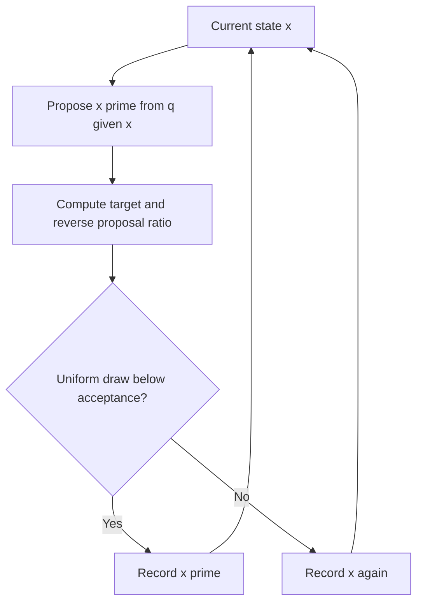

An integral can be easier to estimate than to solve. If I can generate values from a distribution, I can average a function of those values and approximate its expectation. That is the Monte Carlo idea. The difficult part is knowing what an average means when samples have unequal weights, are correlated, or never visit an important region. A convincing number with a small reported standard error can still be wrong if the sampling scheme misses part of the target.

I will use one exact answer, $E[X^2]=1$ for $X\sim N(0,1)$, to make the arithmetic testable. Then I will switch to a deliberately awkward two-mode target for Markov chain Monte Carlo (MCMC). The attached CPU script prints seeded results and makes a trace plot. Those results illustrate mechanisms; they are not evidence that a sampler or diagnostic is safe on arbitrary posterior distributions.

## What ordinary Monte Carlo actually estimates

Suppose $X_1,\ldots,X_N$ are independent draws from a normalized density $p$, and I want $\mu=E_p[f(X)]=\int f(x)p(x)\,dx$. The estimator is

$$
\widehat\mu_N=\frac1N\sum_{i=1}^N f(X_i).
$$

If $E_p|f(X)|<\infty$, the law of large numbers gives convergence of this average to $\mu$ as $N$ grows. If the variance $\sigma_f^2=\operatorname{Var}_p[f(X)]$ is finite, the independent-sample central limit theorem gives an approximate standard error $\sigma_f/\sqrt N$. Replacing $\sigma_f$ with the sample standard deviation gives the familiar Monte Carlo standard error (MCSE). The $N^{-1/2}$ rate is slow: roughly four times as many independent draws halve the standard error. It also says nothing about the error of a particular run being exactly one standard error. Owen's Monte Carlo text develops these basics and the variance-reduction methods below. 

For the normal example, $f(X)=X^2$, $E[X^2]=1$, and $\operatorname{Var}(X^2)=E[X^4]-E[X^2]^2=3-1=2$. With $30{,}000$ independent draws, the *theoretical* MCSE is $\sqrt{2/30000}\approx0.008165$. My seeded run gives $1.00332$ with estimated MCSE $0.00819$. The estimate being close is reassuring for this known example, but I would not call the estimate “accurate to five decimals.”

There are two different uncertainties to keep separate. In Bayesian inference, a posterior distribution describes uncertainty about a quantity given data and a model. MCSE describes numerical uncertainty in an estimate of a posterior summary caused by finite simulation. If I estimate a posterior mean, more computation can reduce its MCSE; it does not shrink the posterior's actual spread or fix a misspecified model. The conceptual distinction is useful alongside [priors, posteriors, and predictive distributions](/blog/bayesian-priors-posteriors-predictive/) and the [law of large numbers and central limit theorem](/blog/expectation-variance-lln-clt/).

## Importance sampling: change where the draws come from

Sometimes sampling from the target $p$ is difficult, or the function matters mostly in a region that $p$ visits rarely. If I can sample from a proposal $q$, multiply and divide the integral by $q$:

$$
\mu=\int f(x)\frac{p(x)}{q(x)}q(x)\,dx=E_q[w(X)f(X)],\qquad w(x)=\frac{p(x)}{q(x)}.
$$

The ordinary importance-sampling (IS) estimate is $N^{-1}\sum_i w(X_i)f(X_i)$ for independent $X_i\sim q$. When $p$ is normalized and $q$ covers every region with nonzero $p$, this estimator is unbiased provided the expectation exists. Its variance is $\operatorname{Var}_q[wf]/N$, **not** $\operatorname{Var}_p[f]/N$. A proposal is good for an integrand only if it gives useful coverage of the regions that contribute to that integral. Merely looking similar to $p$ is not enough. 

The support condition is nonnegotiable. If $q(x)=0$ on a region where $p(x)>0$ and $f(x)p(x)$ contributes to the integral, those contributions can never be sampled. The $p/q$ correction cannot repair missing support. A proposal with a very thin tail can technically have full support yet yield huge or infinite $\operatorname{Var}_q[wf]$ because rare draws carry enormous weights. The central-limit approximation then may be poor or inapplicable. For ordinary IS of a *particular* $f$, the minimal mathematical coverage condition can be stated on where $f(x)p(x)\ne0$; covering all of $p$ is the safer general-purpose rule when estimating many functions.

A useful special case is a target known only up to a constant: $p(x)=\widetilde p(x)/Z$, where $Z$ is unknown. Set $u_i=\widetilde p(X_i)/q(X_i)$ and use the **self-normalized** estimate

$$
\widehat\mu_{\mathrm{SNIS}}=\frac{\sum_i u_i f(X_i)}{\sum_i u_i}.
$$

The unknown $Z$ cancels. Even if $p$ is known, one can normalize its weights the same way. This ratio estimator is generally biased at finite $N$, unlike ordinary IS with known normalized $p$, although it is consistent under the appropriate integrability and support conditions. The two estimators can have quite different variance. I would label the one I report rather than calling both “importance sampling.”

Multiplying a tiny density ratio across dimensions can underflow, while another weight can overflow. Work with log weights $a_i=\log\widetilde p(X_i)-\log q(X_i)$, subtract $m=\max_i a_i$, then normalize $e^{a_i-m}$. The common factor $e^m$ cancels in SNIS. For ordinary IS with known normalized densities, the scale matters, so subtracting the maximum requires putting the factor back when computing the unnormalized mean. In the script, that ordinary mean is evaluated directly because this one-dimensional example is numerically tame; the self-normalized weights use the stable log-weight calculation.

```python
# Stable normalized weights; a is an array of log unnormalized weights.
pivot = max(a)
shifted = [exp(v - pivot) for v in a]
total = sum(shifted)
weights = [v / total for v in shifted]
self_normalized_mean = sum(w * f(x) for w, x in zip(weights, draws))
```

The snippet emphasizes the formula. Real code should also explicitly handle non-finite weights. The common descriptive statistic $1/\sum_i\widetilde w_i^2$, where normalized weights sum to one, is often called a **weight ESS**. It measures concentration of the observed weights. It is not the number of independent observations for every $f$, is not the same as MCMC ESS, and cannot detect a region the proposal never visited. A large weight ESS can coexist with poor estimation of a rare-event indicator. My seeded $q=N(0,2^2)$ sample gives weight ESS about $19{,}795$ out of $30{,}000$ and estimates $E_p[X^2]$ as $0.99668$ by ordinary IS and $0.99866$ by SNIS. Those two single-run errors do not rank the methods in general.

## Reduce variance before buying more samples

Importance sampling is one way to put effort where it matters. Stratification divides the domain into regions and samples each, preventing an unlucky run from missing an entire stratum. For a uniform integral on $[0,1]$ split into $K$ equal intervals, one draw $U_j$ from each interval gives $K^{-1}\sum_j f(U_j)$. It remains unbiased; variance depends on how much $f$ varies *within* intervals. Antithetic sampling pairs related draws, such as $U$ and $1-U$ for a uniform target, hoping their function values are negatively correlated. For $f(u)=u$, each pair averages to exactly $1/2$; for a different $f$, the covariance might be zero or positive, so the variance benefit must be checked. Owen discusses how these ideas can combine with control variates. 

A control variate uses a correlated function $h$ whose expectation $\eta$ is known. Estimate $E[f]$ with the average of $f(X)-c(h(X)-\eta)$. This is still unbiased for a **fixed** $c$, and

$$
\operatorname{Var}[f-c(h-\eta)]=\operatorname{Var}(f)+c^2\operatorname{Var}(h)-2c\operatorname{Cov}(f,h).
$$

Differentiating the quadratic gives $c^*=\operatorname{Cov}(f,h)/\operatorname{Var}(h)$ when $\operatorname{Var}(h)>0$. For $X\sim N(0,1)$, take $f=X^4$, $h=X^2$, and $E[h]=1$. Normal moments give $\operatorname{Cov}(X^4,X^2)=E[X^6]-E[X^4]E[X^2]=15-3=12$ and $\operatorname{Var}(X^2)=2$, so $c^*=6$. The raw integrand variance is $E[X^8]-E[X^4]^2=105-9=96$; the controlled integrand variance is $96-12^2/2=24$. For a fixed sample count, this cuts the theoretical MCSE in half. In the seeded sample, the direct estimate of $E[X^4]=3$ is $3.01752$ and the controlled estimate is $2.99758$. The single run illustrates the formula; the variance calculation, not the observed closeness, supports the efficiency claim. Estimating $c$ from the same sample introduces additional finite-sample details, so this demonstration uses the known population value.

## MCMC: make dependent draws with the right long-run target

For a posterior known only up to a constant, direct independent sampling may be hard. A Markov chain uses its current state to propose the next one. Metropolis–Hastings (MH) chooses a proposal $x'\sim q(\cdot\mid x)$ and accepts it with probability

$$
\alpha(x,x')=\min\!\left(1,\frac{\widetilde p(x')q(x\mid x')}{\widetilde p(x)q(x'\mid x)}\right).
$$

The unknown normalizing constant of $p$ cancels. The proposal density appears in **both directions**. If I use a symmetric random walk, such as $x'=x+\epsilon$ with $\epsilon\sim N(0,s^2)$, then $q(x'\mid x)=q(x\mid x')$ and that ratio cancels too. For an asymmetric proposal, dropping it changes the stationary target. Hastings' paper generalizes the original Metropolis construction and is the primary source for this acceptance rule. 

Why does the formula work? For distinct states, the transition probability is $T(x,x')=q(x'\mid x)\alpha(x,x')$. Multiplying by $p(x)$ yields

$$
p(x)T(x,x')=\min\!\left(p(x)q(x'\mid x),\;p(x')q(x\mid x')\right)=p(x')T(x',x).
$$

This **detailed balance** equality makes $p$ stationary under the transition. Rejections complete the transition kernel's diagonal: when a proposal is rejected, record the **current state again**. Discarding rejected iterations silently changes the estimator, because states where the chain spends a long time would be undercounted. The attached script also checks detailed balance on a three-state grid with an asymmetric proposal, where both sides can be computed exactly.



Stationarity is a property of the transition, not a guarantee that a finite chain has reached its target. To obtain convergence from arbitrary starts, conditions such as irreducibility and aperiodicity are needed, along with the relevant regularity conditions on general state spaces. A symmetric random walk on a connected continuous support can be irreducible in principle but mix too slowly to be useful. Warmup discards early draws and may adapt a sampler; its completion is not proof that all important regions have been explored.

## Mixing, correlation, and what ESS cannot tell me

The target in my trace example is an equal mixture of $N(-4,1)$ and $N(4,1)$. Its mean is exactly zero and its probability of $X>0$ is exactly $1/2$. Both chains start at $-4$. A narrow random-walk proposal with width $0.3$ accepts about 90% of proposals in the seeded run, yet its $12{,}000$ retained states never cross to the right mode: the estimated mean is $-4.061$. A wider width $4$ accepts about 34% and visits both modes in this run, giving mean $-0.081$ and right-mode fraction $0.495$. High acceptance is not the goal; exploring the target is. Neither single run proves the wider proposal always mixes well.



For a stationary scalar series $g(X_t)$ with a suitable Markov-chain central limit theorem, its mean has asymptotic variance $\sigma_g^2\tau_g/N$, where

$$
\tau_g=1+2\sum_{k=1}^{\infty}\rho_g(k),\qquad N_{\mathrm{eff},g}=\frac{N}{\tau_g}.
$$

Here $\rho_g(k)$ is lag-$k$ autocorrelation of the **estimand $g$**. This is why MCMC ESS is function-specific: the chain mean, a tail probability, and an indicator of the right mode can have different effective sample sizes. A negative-autocorrelation design can even give ESS above $N$ under an appropriate definition. The finite sample autocorrelation sum is hard to estimate reliably; naive truncation can produce unstable or deceptive ESS, especially for nonstationary or multimodal chains. My script uses batch means for a teaching MCSE of the chain mean, not a production ESS diagnostic. For the stuck narrow chain it prints batch-means MCSE $0.057$ around mean $-4.061$—a small local error bar around a badly biased estimate. This is exactly the case an MCSE computed from one mode cannot diagnose. Stan's posterior analysis chapter discusses MCSE and ESS in the context of MCMC output. 

Multiple chains from dispersed starting points are more informative than one trace. If some stay near $-4$ and others near $4$, a between-chain comparison can reveal the disagreement. Modern Stan diagnostics use rank-normalized split $\widehat R$ and related folded checks, plus bulk and tail ESS, as developed by Vehtari and coauthors. I would use a maintained implementation, inspect traces and relevant transformed quantities, and check model-specific warnings; I would not implement the old variance-ratio formula and call it modern $\widehat R$. Even $\widehat R$ near one is not proof of convergence when all chains miss the same region. Diagnostics are evidence about explored behavior, not a certificate that every mode exists in the output. 

Hamiltonian Monte Carlo (HMC) uses gradients of a differentiable log density to propose longer, informed moves. The No-U-Turn Sampler (NUTS) adapts trajectory length rather than requiring a fixed number of integration steps. They can improve exploration of continuous, correlated posteriors, but their draws still form a Markov chain and can fail on difficult geometry or separated modes. Stan documents adaptation, divergences, and tree-depth limits; those warnings deserve attention alongside ESS and $\widehat R$. Gradients are useful information, not a guarantee of independent samples. 

## Reproduce the numbers without a GPU

The attached [toy.py](toy.py) uses Python's standard library for estimators and MH, and Matplotlib to write the standalone [traces.svg](traces.svg). Run it from this post's directory with `python3 -B toy.py`. It seeds its random generators, checks the known $N(0,1)$ moment with a loose assertion, checks a controlled fourth moment, and verifies exact finite-grid detailed balance. It does **not** assert that a random chain must cross a mode; such a test would be brittle and would mistake one seeded trace for a theorem.

```text
finite-grid detailed balance: pass
direct E[X^2]=1.00332 iid MCSE=0.00819
IS E[X^2]=0.99668 SNIS=0.99866 weight ESS=19795/30000
E[X^4] direct=3.01752 control=2.99758 exact=3
RW width=0.3 acceptance=0.903 mean=-4.061 batch MCSE=0.057 right fraction=0.000
RW width=4.0 acceptance=0.343 mean=-0.081 batch MCSE=0.175 right fraction=0.495
```

All results are toy CPU arithmetic from a fixed seed. Change the seed, target spacing, or proposal widths and the observed numbers will change. The exact identities—the moments, support requirement, and detailed-balance equality—are the parts intended to transfer to new problems.

## Interview questions I would rehearse

1. **When is the usual $\sigma/\sqrt N$ MCSE justified?** For independent draws and a finite-variance integrand, with a CLT approximation; correlated MCMC needs its own asymptotic variance.
2. **Is posterior spread the same as MCSE?** No. Posterior spread is model-and-data uncertainty; MCSE is finite-simulation error in a computed summary.
3. **Why does importance sampling need support coverage?** A proposal that cannot generate a contributing region cannot estimate its contribution by reweighting.
4. **When is ordinary IS unbiased, and how does SNIS differ?** With normalized target density and integrable weights, ordinary IS is unbiased; the normalized ratio is generally finite-sample biased but consistent under conditions.
5. **What does weight ESS measure?** Concentration of observed normalized weights, not universal accuracy or coverage for every function.
6. **How does a control variate reduce variance?** It subtracts a correlated, mean-zero term whose known expectation leaves the target mean intact.
7. **Why does MH include a reverse proposal density?** It corrects asymmetric proposals so forward and reverse stationary flows match.
8. **What happens on rejection?** Record the current state again. Removing repeats changes occupancy.
9. **Does detailed balance prove a finite run is representative?** No. It establishes stationarity of a transition kernel; practical exploration can still be slow.
10. **Can high acceptance mean poor mixing?** Yes. Tiny random-walk steps can accept almost everything while rarely crossing modes.
11. **Why is MCMC ESS tied to an estimand?** Autocorrelation depends on the function of the chain being averaged.
12. **What can warmup and $\widehat R$ establish?** They help detect some problems; neither proves that all modes were found or that the model is correct.


