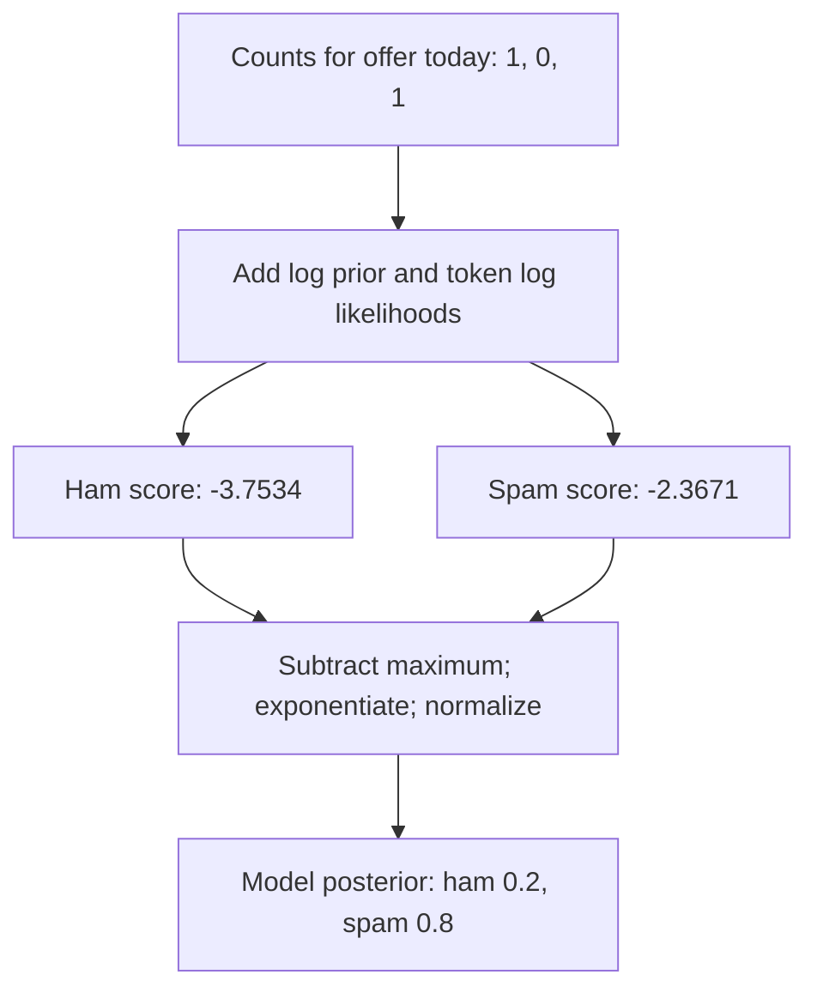

Naive Bayes is a good interview topic because a tiny classifier exposes several ideas people blend together: Bayes' rule, likelihood, maximum likelihood estimation, a prior over parameters, and prediction after observing data. The algorithm is simple; the difficult part is saying exactly which probability each formula describes.

I will build a text classifier with three words and two classes, calculate one prediction by hand, then use it to separate MLE, MAP, and additive smoothing. The example is intentionally small enough that every denominator can be checked without trusting a library.

## Three probabilities with similar-looking names

Suppose $y$ is a class and $x$ is an observed document. Bayes' rule is

$$
P(y\mid x)=\frac{P(x\mid y)P(y)}{P(x)}.\tag{1}
$$

$P(y)$ is the **class prior** before seeing this document. $P(x\mid y)$ is the **likelihood of the document under a class**; as a function of $y$ it tells us which class explains the document better. $P(y\mid x)$ is the **class posterior**. For choosing between classes, $P(x)$ is the same denominator in every class, so we compare $P(y)P(x\mid y)$ and normalise only when we need probabilities.

There is a second use of “likelihood” in parameter estimation. Given training data $D$ and model parameters $\theta$, $L(\theta;D)=P(D\mid\theta)$ treats the observations as fixed and the parameter as variable. **MLE** chooses $\hat\theta_{\rm MLE}=\arg\max_\theta P(D\mid\theta)$. **MAP** puts a parameter prior $P(\theta)$ on top and chooses $\hat\theta_{\rm MAP}=\arg\max_\theta P(D\mid\theta)P(\theta)$. A class prior $P(y)$ and a parameter prior $P(\theta)$ are different objects. Calling both “the prior” without naming their role is where many explanations go wrong.

Naive Bayes models the joint distribution $P(x,y)=P(y)P(x\mid y)$ and then derives a classifier. That makes it **generative** in the modelling sense. [Logistic regression](/blog/linear-and-logistic-regression/) fits $P(y\mid x)$ directly and is discriminative. Neither label alone tells us which will win on a dataset; the comparison depends on the model assumptions and sample size. Ng and Jordan analysed this contrast for naive Bayes and logistic regression. 

## What is actually naive?

For ordinary feature variables $x_1,\ldots,x_d$, the assumption is conditional independence **given the class**:

$$
P(x_1,\ldots,x_d\mid y)=\prod_{j=1}^dP(x_j\mid y).\tag{2}
$$

It does **not** assert that features are marginally independent. Two words can be correlated overall simply because both occur more often in one class. Even inside a class, words may be dependent; “New” and “York” are an obvious pair. The model deliberately ignores such dependence to make estimation cheap. 

For multinomial text naive Bayes, the more precise story is that **token draws** are conditionally independent and identically distributed given the class and a fixed document length. The resulting *counts* follow a multinomial distribution and are constrained to sum to that length, so the count features themselves are not independent. For counts $x_j$ and class token probabilities $\theta_{yj}$,

$$
P(x\mid y,n)=\frac{n!}{\prod_jx_j!}\prod_j\theta_{yj}^{x_j},\qquad n=\sum_jx_j.\tag{3}
$$

The combinatorial factor is identical for all candidate classes for the same document. We can therefore classify with $\log P(y)+\sum_jx_j\log\theta_{yj}$. This is the central computational trick: multiply token likelihoods in theory, add log likelihoods in practice. Here I treat length as fixed or independent of the class. With varying lengths that depend on the class, the joint model also needs a factor $P(n\mid y)$; omitting it deliberately ignores length as separate evidence. The scores and log-odds below use the class-independent length assumption.

## A two-class count example

Use vocabulary `offer`, `meeting`, `today`. Suppose the training documents give these aggregate token counts, with two documents in each class:

| Class | offer | meeting | today | Total tokens |
|---|---:|---:|---:|---:|
| spam | 3 | 0 | 2 | 5 |
| ham | 0 | 3 | 2 | 5 |

The empirical class priors are $P(\text{spam})=P(\text{ham})=1/2$. With plain MLE, $\hat\theta_{yj}=N_{yj}/N_y$. That gives $P(\text{meeting}\mid\text{spam})=0$. Consequently any test document containing `meeting` receives zero likelihood under spam, even if it contains several strong spam words. A finite sample cannot justify declaring a word impossible.

Add one to each word count and three to each class total, since there are three vocabulary words:

| Class | $\theta_{\rm offer}$ | $\theta_{\rm meeting}$ | $\theta_{\rm today}$ |
|---|---:|---:|---:|
| spam | $4/8$ | $1/8$ | $3/8$ |
| ham | $1/8$ | $4/8$ | $3/8$ |

For `offer today`, $x=(1,0,1)$. Ignoring the shared multinomial coefficient, the spam score is $\log(1/2)+\log(4/8)+\log(3/8)=\log(3/32)\approx-2.3671$. The ham score is $\log(1/2)+\log(1/8)+\log(3/8)=\log(3/128)\approx-3.7534$. Their unnormalised probability ratio is four, so the model's class posterior is $4/(4+1)=0.8$.

That $0.8$ is a probability *inside the fitted model*, not proof that eight of ten future documents with this score are spam. The independence and sampling assumptions may be wrong. In particular, seeing `offer` twice multiplies its likelihood ratio by four twice, producing model posterior $16/17\approx0.9412$ for `offer offer today`. Repetition may be informative, but the model can become too certain when repeated or correlated evidence is treated as fresh independent evidence. This is a calibration problem, not an automatic prediction failure: the ranking or class label may still be useful.



The shared document-likelihood denominator disappears when comparing scores and reappears through normalization. This diagram follows the plug-in classifier used in the worked example.

## Smoothing, posterior mean, and MAP

For vocabulary size $V$, additive smoothing with $\alpha>0$ estimates

$$
\widetilde\theta_{yj}=\frac{N_{yj}+\alpha}{N_y+V\alpha}.\tag{4}
$$

There is a Bayesian interpretation, but I want to name it accurately. Give each class's token-probability vector a symmetric Dirichlet prior $\theta_y\sim\operatorname{Dirichlet}(\alpha,\ldots,\alpha)$. After observing counts $N_{yj}$, the posterior is $\operatorname{Dirichlet}(N_{y1}+\alpha,\ldots,N_{yV}+\alpha)$. Equation (4) is the **posterior mean** of one coordinate. It is also the **posterior predictive probability for the next single token**. It is generally **not** the MAP estimate of $\theta_y$. 

When every posterior component $N_{yj}+\alpha>1$, the interior Dirichlet mode, hence the MAP parameter estimate, is

$$
\hat\theta^{\rm MAP}_{yj}=\frac{N_{yj}+\alpha-1}{N_y+V(\alpha-1)}.\tag{5}
$$

For $\alpha=1$, the prior density is uniform and the interior MAP equals MLE, while add-one smoothing still changes the estimate. If some posterior components are at or below one, the mode may lie on a boundary or fail to have the simple interior formula; blindly using (5) can give nonsense. One can choose a Dirichlet with parameters $\alpha+1$ so its *interior MAP formula* resembles add-$\alpha$ smoothing, but that is a different prior. Calling Laplace smoothing “MAP with a uniform prior” is incorrect.

There is one more distinction. Equation (4) gives a predictive probability for a **single next token**. Multiplying these posterior means across every token of a held-out document is the usual plug-in multinomial naive Bayes score. Fully integrating the uncertain $\theta_y$ over a complete document gives a Dirichlet-multinomial predictive distribution; subsequent token probabilities update after earlier tokens in that document. The plug-in score and the fully integrated document predictive need not agree. They answer different questions.

## A coin makes the estimates unmistakable

Take five tosses with four heads and one tail. The Bernoulli MLE is $4/5=0.8$. Put a $\operatorname{Beta}(2,2)$ prior on the unknown head probability $p$. The posterior is $\operatorname{Beta}(6,3)$, because the four heads and one tail add to the prior's shape parameters. The posterior mode is $(6-1)/(6+3-2)=5/7\approx0.7143$; the posterior mean and next-toss predictive probability are $6/(6+3)=2/3\approx0.6667$.

| Question | Estimate | Value |
|---|---:|---:|
| Which $p$ maximises the observed-toss likelihood? | MLE $=s/n$ | $0.8$ |
| Which $p$ has highest posterior density? | MAP $=(a+s-1)/(a+b+n-2)$ | $0.7143$ |
| How likely is the next toss to be heads after averaging over $p$? | Predictive $=(a+s)/(a+b+n)$ | $0.6667$ |

These differ because “best-fitting parameter,” “posterior mode,” and “average future outcome” are not the same operation. The MAP formula assumes an interior mode: posterior Beta shapes must both exceed one. At a boundary, such as no observed successes under a uniform $\operatorname{Beta}(1,1)$ prior, the mode is at zero. With a shape below one the density can even diverge at an endpoint. In those cases, inspect the posterior shape rather than extrapolating an interior formula.

## Which naive Bayes distribution?

The factorisation is a template; the observation model decides what each factor means. 

| Variant | Inputs | Class-conditional model | Detail that changes the score |
|---|---|---|---|
| Multinomial | nonnegative token counts | token probabilities sum to one | Counts multiply log word probabilities; absent words add zero. |
| Bernoulli | binary feature presence | one Bernoulli per feature | Both present **and absent** words contribute: $x_j\log p_{yj}+(1-x_j)\log(1-p_{yj})$. |
| Gaussian | continuous features | one normal density per feature and class | Class-specific means and variances; product corresponds to diagonal class covariance. |

Bernoulli naive Bayes can use absence as evidence: a document without `meeting` may be more spam-like if meeting is usually present in ham. Multinomial naive Bayes does not add an absence term; it models token draws and document counts. Binarising counts therefore changes the statistical model, not just the implementation. Gaussian naive Bayes estimates a mean and variance for each feature within each class; zero variance needs numerical handling, and extreme values can dominate a Gaussian density. I would choose the variant from the measurement process before tuning smoothing.

## Log scores and a checked NumPy implementation

Multiplying many small probabilities underflows. Compute $s_y=\log P(y)+\sum_jx_j\log\theta_{yj}$, subtract the largest score $m$, then normalise $\exp(s_y-m)$ by their sum. This is the log-sum-exp idea used elsewhere in [softmax numerical stability](/blog/softmax-numerical-stability/). Subtracting $m$ changes neither class odds nor the final normalised probabilities.

The following code fits the exact count table above. It also calculates the coin estimates. It assumes the vocabulary and class labels were fixed before validation; in a real pipeline, learn the vocabulary from the training fold only and transform the validation fold with that vocabulary. A word unseen in training has no learned class-conditional count; decide an unknown-word policy inside the pipeline. Using validation documents to choose a vocabulary leaks information even if their labels are hidden.

```python {title="naive_bayes_counts.py"}
import numpy as np

# Rows are training documents; columns are offer, meeting, today.
X = np.array([[2, 0, 1], [1, 0, 1], [0, 2, 1], [0, 1, 1]])
y = np.array([1, 1, 0, 0])  # 1 = spam, 0 = ham
classes, doc_counts = np.unique(y, return_counts=True)
alpha = 1.0
word_counts = np.stack([X[y == c].sum(axis=0) for c in classes])
theta = (word_counts + alpha) / (word_counts.sum(axis=1, keepdims=True)
                                 + alpha * X.shape[1])
log_prior = np.log(doc_counts / doc_counts.sum())

def predict_counts(counts):
    scores = log_prior + counts @ np.log(theta).T
    shifted = np.exp(scores - scores.max(axis=-1, keepdims=True))
    return scores, shifted / shifted.sum(axis=-1, keepdims=True)

query = np.array([[1, 0, 1], [2, 0, 1]])
scores, probs = predict_counts(query)
print("class order:", classes)
print("word counts:", word_counts.tolist())
print("theta:", theta.tolist())
print("log scores:", np.round(scores, 6))
print("class probabilities:", np.round(probs, 6))

heads, tails = 4, 1
a, b = 2, 2
post_a, post_b = a + heads, b + tails
print("coin MLE, MAP, predictive:",
      round(heads / (heads + tails), 6),
      round((post_a - 1) / (post_a + post_b - 2), 6),
      round(post_a / (post_a + post_b), 6))
```

```text {title="Output"}
class order: [0 1]
word counts: [[0, 3, 2], [3, 0, 2]]
theta: [[0.125, 0.5, 0.375], [0.5, 0.125, 0.375]]
log scores: [[-3.753418 -2.367124]
 [-5.83286  -3.060271]]
class probabilities: [[0.2      0.8     ]
 [0.058824 0.941176]]
coin MLE, MAP, predictive: 0.8 0.714286 0.666667
```

The code uses a fixed positive $\alpha$, so every `theta` entry is positive and its logarithm exists. This example discovers classes with `np.unique(y)`, so a class absent from training is omitted from its output altogether. A production implementation with a fixed expected class set must handle that case explicitly: an unsmoothed empirical prior would be zero, yielding a negative-infinite log prior. The example is for comparing **class scores**, not for estimating the exact probability of a whole document: the shared multinomial coefficient is omitted.

## Decision boundaries, imbalance, and calibration

For two classes under multinomial naive Bayes, subtract their log scores:

$$
\log\frac{P(y=1\mid x)}{P(y=0\mid x)}=\log\frac{P(y=1)}{P(y=0)}+\sum_jx_j\log\frac{\theta_{1j}}{\theta_{0j}}.\tag{6}
$$

That is a linear function of count vector $x$. [Logistic regression](/blog/linear-and-logistic-regression/) also has linear log-odds, but learns its weights by optimising the conditional label likelihood rather than estimating class-specific token frequencies. Bernoulli naive Bayes also yields linear log-odds in binary $x$; its absent-feature terms are absorbed into the intercept. Identical boundary *form* does not imply identical fitted weights or probability quality.

Class imbalance enters through $P(y)$: if spam is rare, the prior odds push against a spam prediction unless the word likelihood ratio is strong. If training data were deliberately balanced but deployment is imbalanced, empirical training priors are wrong for deployment. Under a genuine **prior shift** assumption, $P(x\mid y)$ stays stable while $P(y)$ changes, so replace the class prior odds and keep the likelihood terms. If the class-conditional language itself changes, that correction is insufficient. Also, an overconfident model posterior cannot be made trustworthy by prior adjustment alone; evaluate calibration on representative held-out data. For threshold choice under imbalance, accuracy alone can conceal poor minority-class performance; see [ML and NLP metrics](/blog/ml-nlp-metrics/).

I would fit preprocessing, vocabulary, counts, smoothing choice, and any calibration step using only the relevant training folds. A held-out test set should answer the final performance question once. The detailed split discipline is in [cross-validation and data leakage](/blog/cross-validation-and-data-leakage/).

## Interview questions I would rehearse

**1. What is the naive assumption?** Features are independent *conditional on the class*. It does not assert marginal independence. For multinomial text, the direct iid story is about token draws conditional on class and length.

**2. What is the difference between $P(x\mid y)$ and $P(y\mid x)$?** The first scores how a class generates an observation; the second is the class posterior after using the class prior and normalising across classes.

**3. What is the difference between MLE and MAP?** MLE maximises data likelihood. MAP maximises data likelihood times a prior density over the model parameter. A class prior is separate from that parameter prior.

**4. Why smooth word counts?** An unseen word in a class would otherwise have estimated probability zero and wipe out that class's whole document likelihood. Additive smoothing assigns positive mass while preserving normalisation.

**5. Is add-one smoothing the MAP estimate under a uniform Dirichlet prior?** No. With $\alpha=1$ the Dirichlet prior is uniform, and the posterior mode is the MLE where the interior formula applies. Add-one is the posterior mean and next-token predictive under that prior.

**6. Why use log scores?** Products of many probabilities underflow. Logarithms turn them into sums; subtracting the largest log score before exponentiation gives stable normalisation.

**7. Do absent words matter?** In Bernoulli naive Bayes they contribute $\log(1-p_{yj})$. In multinomial naive Bayes a zero count contributes nothing directly.

**8. Is naive Bayes linear?** Its binary-class log-odds are linear in the selected count or indicator features. The fitted weights come from a generative likelihood model, unlike logistic regression's conditional fit.

**9. Does correlated evidence always make naive Bayes classify badly?** No. It can double-count information and produce overconfident probabilities, while still making useful class decisions. Check ranking, classification, and calibration separately.

**10. How would you handle a changed class balance at deployment?** If only the class prior changes and $P(x\mid y)$ is stable, adjust prior odds. Verify that assumption and recheck calibration on representative data.

**11. What if a validation document has a new word?** The training vocabulary has no parameter for it. Apply a prechosen unknown-word policy; never rebuild the vocabulary using validation data.

**12. Are a posterior predictive and a plug-in prediction identical?** For one next categorical token, the Dirichlet posterior mean is its predictive probability. For an entire future document, integrating parameter uncertainty yields a Dirichlet-multinomial predictive, which can differ from multiplying fixed posterior means.

The distinction I keep returning to is the target of the probability: class after seeing a document, parameter after seeing training data, or next observation after averaging over parameters. Once I name that target, the formulas stop looking interchangeable.


