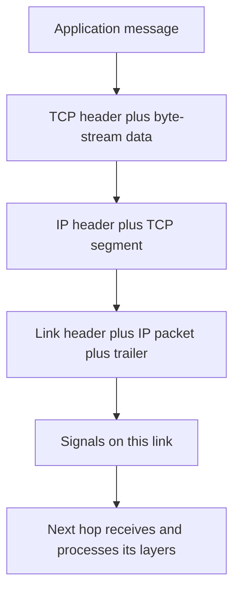
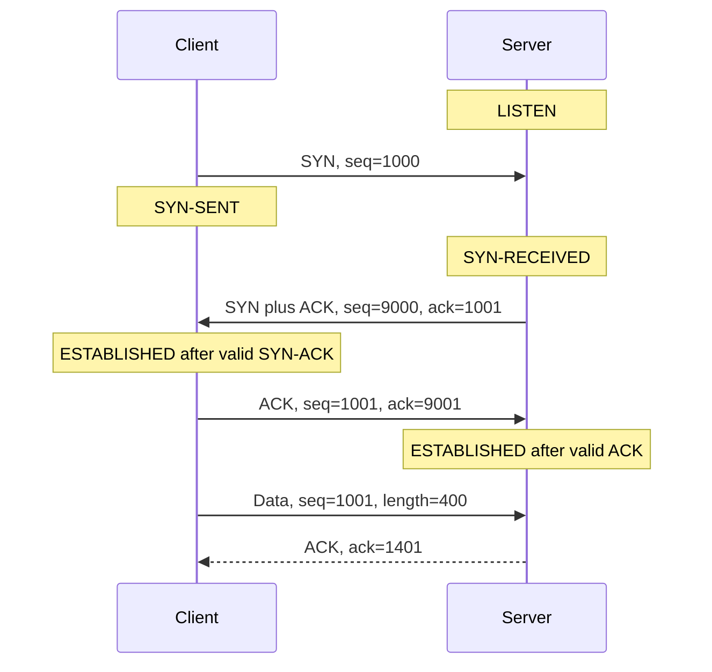

When a request is slow, “the network” is too broad an explanation. The client might still be resolving a name. A connection might be waiting for its handshake. The sender might be repairing lost bytes, respecting a small receive window, or backing off because the path is congested. Those are different mechanisms, with different evidence and fixes.

I want one model that connects the layers to the packets and then to performance. We will follow an ordinary TCP connection, work through its sequence numbers, and build up to Reno, CUBIC, and BBR. If Reno is familiar from a networking course, **Tahoe** may be the other historical variant you remember; **CUBIC** is the important cubic-window design, and **BBR** takes a path-model approach. They belong to congestion control, not to alternative three-way handshakes.

The attached [network lab](network_lab.py) runs a local TCP exchange and reproduces the arithmetic and plots. Its congestion curves are teaching formulas, not measurements or a complete TCP implementation. Standards and implementation notes were checked on November 10, 2026.

## The layers name different responsibilities

The Internet stack is often taught with four layers; the OSI reference model separates seven. These are ways to organize responsibilities, not seven mandatory headers on every packet. RFC 1122 is a useful historical reference for the Internet host architecture. 

| Internet layer | Rough OSI correspondence | Responsibility | Examples |
|---|---|---|---|
| Application | Application, presentation, session | Define the exchange and interpret its data | HTTP, DNS; TLS adds security above an ordinary TCP transport |
| Transport | Transport | Identify endpoints and provide a transport service | TCP byte streams, UDP datagrams |
| Internet | Network | Address and forward packets between networks | IPv4, IPv6 |
| Link | Data link and physical | Carry data over one local link | Ethernet, Wi-Fi and their physical signaling |

A hostname is not an IP address, and an IP address is not a process. Name resolution supplies candidate addresses; the transport's port numbers help identify application endpoints. On a local Ethernet hop, a frame uses link-layer addresses. Across a router, the next-hop link framing changes. The destination IP usually stays the same on an ordinary routed path, although NAT and tunnels complicate that picture.



Encapsulation is easy to understand with a small hypothetical message. If I send 1,000 application bytes in one IPv4 TCP segment with no options, the 20-byte IP and 20-byte TCP headers make a 1,040-byte IP packet. Link overhead comes afterward. Real TLS records, TCP options, segmentation, offload, and link framing change these counts; application writes do not choose packet boundaries.

An MTU limits a packet carried by a particular link. A TCP MSS describes a segment's data size, excluding TCP/IP headers. That is why “1,500-byte Ethernet MTU” is not the same statement as “1,500 application bytes fit in every TCP packet.” A tunnel can reduce the usable inner-packet budget further.

## TCP and UDP offer different contracts

| Property | TCP | UDP |
|---|---|---|
| Application interface | Ordered byte stream | Individual datagrams |
| Built-in connection setup | Ordinary setup exchanges SYN, SYN-ACK, ACK | No transport handshake |
| Delivery machinery | Sequence tracking, acknowledgments, retransmission | No built-in retransmission or ordering |
| Message boundaries | Application must define them | Datagram boundary is preserved by the service |
| Rate control | Flow and congestion-control machinery | Application or higher protocol must supply appropriate control |

UDP has a small header carrying ports, length, and a checksum field. Its contract does not guarantee delivery or duplicate suppression. It is useful when an application wants datagram semantics or supplies another transport above it. It is not automatically “faster TCP”: a lossy datagram is useful only if the application can tolerate or repair its loss. 

A UDP application also cannot infer that unlimited sending is acceptable. The usage guidelines address congestion control, message sizing, fragmentation, and reliability choices. A large datagram fragmented along the path may become unusable if a required fragment is lost. Real-time traffic often prefers losing stale content to waiting for it, while still controlling its sending rate. 

I would choose by required semantics. A file-transfer protocol needs correct complete content; a live voice application may value deadlines more than retransmitting an old sample. Either transport can sit inside a larger protocol that changes the application's guarantees.

## A TCP handshake, with actual sequence numbers

Consider the ordinary no-data handshake. The client chooses initial sequence number 1000; the server chooses 9000. These are illustrative values, not a recommendation for choosing real initial sequence numbers.



A SYN consumes one sequence number; a pure ACK consumes none. Thus the client's first data starts at 1001. The ACK value names the next expected sequence position. Each direction has its own sequence space. The three-way exchange synchronizes those spaces and helps reject obsolete connection initiations; a SYN-ACK alone does not establish that the initiator received the responder's SYN. 

The final ACK can accompany client data. With no loss and symmetric propagation, the client receives the SYN-ACK after approximately one RTT. This says nothing about DNS time, server processing, or encryption. A lost final ACK also does not imply that every layer immediately agrees on the connection state; retransmission and state-machine rules handle the missing exchange.

TCP establishment itself neither authenticates the server nor encrypts the bytes. TLS 1.3 adds a separate cryptographic handshake when run over TCP. Resumption and early-data modes have their own conditions, including replay considerations for early data. Counting “one handshake” without naming TCP, TLS, or application authentication hides work. 

## Ordered bytes require acknowledgments and recovery

Imagine the receiver expects byte 1001, but the segment starting at 1401 arrives first. A cumulative ACK remains 1001: later bytes do not close the gap. Once bytes 1001–1400 arrive, the buffered contiguous data allows the ACK to advance to 1801. Retransmitting bytes already received does not deliver a second copy to the application.

The lab produces this original trace:

| Arrival | Cumulative ACK afterward | Meaning |
|---|---:|---|
| `seq=1401, length=400` | 1001 | Earlier bytes are missing |
| `seq=1001, length=400` | 1801 | Gap closes and buffered bytes become contiguous |
| Duplicate `seq=1001, length=400` | 1801 | No new contiguous bytes |
| `seq=1801, length=100` | 1901 | Another 100 bytes arrive |

Selective acknowledgment, or SACK, lets the receiver report ranges beyond a gap, so the sender has more information than one cumulative frontier. It does not turn TCP into an unordered application service. 

Loss detection and congestion response are related but distinct. A sender decides which bytes likely need repair, then its control algorithm adjusts how aggressively it sends. Modern recovery includes extensions beyond the textbook duplicate-ACK story; the TCP roadmap is helpful for seeing that TCP is a collection of specifications rather than one fixed algorithm. 

### The retransmission timer adapts to uncertainty

If ACK-based evidence is insufficient, a retransmission timer provides another recovery path. The RFC 6298 estimator maintains a smoothed RTT and variation estimate. With sample $R$, update the variation using the **old** smoothed value, then update the smoothed value:

$$
V\leftarrow\tfrac34V+\tfrac14|S-R|,\qquad
S\leftarrow\tfrac78S+\tfrac18R,
$$

$$
\operatorname{RTO}=S+\max(G,4V).
$$

$G$ is clock granularity. The specification also describes initialization, a recommended minimum timeout, backoff, and ambiguity when timing retransmitted data. These equations alone are not a complete timer implementation. A fixed timeout chosen from average RTT misses the importance of variation. 

## Flow control protects the receiver; congestion control protects the path

The advertised receive window, $rwnd$, describes receiving capacity. The congestion window, $cwnd$, limits outstanding work according to the sender's congestion-control state. In a simplified byte-accounting model:

$$
\text{new send allowance}\approx
\max\!\left(0,\min(cwnd,rwnd)-\text{bytes in flight}\right).
$$

This is an upper bound on new outstanding data, not an instruction to emit it all in one burst: pacing, application availability, and protocol state also matter. A receiver can constrain an otherwise fast network, and a congested network can constrain a receiver with plenty of memory.

Window scaling extends the representable receive window beyond the original header field. It is negotiated during setup and concerns receive-window interpretation, not a universal multiplier on the congestion window. 

### Bandwidth-delay product makes the window concrete

For bottleneck capacity $B$ bytes/s and round-trip time $R$ seconds, the bandwidth-delay product is approximately $BR$ bytes. To sustain a full pipe without other limits, enough data must remain outstanding while acknowledgments travel back.

For a hypothetical 250 Mb/s path with 40 ms RTT:

$$
\operatorname{BDP}=\frac{250\times10^6}{8}\cdot0.04
=1{,}250{,}000\ \text{bytes}.
$$

A 64 KiB limiting window gives this idealized ceiling:

$$
\frac{65{,}536\cdot8}{0.04}\approx13.1\ \text{Mb/s}.
$$

The link's 250 Mb/s label therefore does not guarantee a single flow can use that rate. This calculation ignores headers, loss, application stalls, and RTT changes under queueing. It is a diagnostic bound, not a throughput benchmark.

## Reno: grow, detect congestion, back off

The textbook Reno model combines slow start, congestion avoidance, fast retransmit, and fast recovery. During slow start, ACK-driven growth can roughly double the window each RTT under ideal ACK behavior. After a threshold, additive growth is roughly one MSS per RTT. Delayed ACKs and implementation details alter the exact trajectory. 

Writing the window as $W$ segments, the usual congestion-avoidance approximation increments it by $1/W$ for each ACK of a segment. If a round acknowledges $W$ segments:

$$
\Delta W\approx W\cdot\frac1W=1.
$$

Classic fast retransmit uses three duplicate ACKs as evidence to retransmit a missing segment. The fast-recovery threshold is based on roughly half the outstanding flight, with a minimum; the temporary recovery window is not simply “set cwnd to half immediately.” After a retransmission timeout, the recovery is more conservative and restarts slow start from a one-segment loss window. These are different loss paths. 

The lab deliberately simplifies the first path. It begins at a teaching window of one segment, grows to a threshold, then adds one per ideal round. A prescribed loss at 24 segments produces a post-recovery window of 12. It omits ACK timing, retransmissions, recovery inflation, receiver limits, and competing flows. One is **not** asserted to be a modern default initial window.

Tahoe is the historical comparison that returns to slow start after fast retransmit; Reno's fast recovery avoids that collapse for its intended case. NewReno refines recovery when a flight has multiple losses, using partial acknowledgments to continue repairing data rather than treating every partial ACK as completion. SACK-based recovery provides additional information about which ranges arrived. 

## CUBIC: growth organized around a previous maximum

CUBIC's congestion-avoidance target uses elapsed time since a congestion event. With window units in segments:

$$
W_{\text{cubic}}(t)=C(t-K)^3+W_{\max},\qquad
K=\sqrt[3]{\frac{W_{\max}(1-\beta)}{C}}.
$$

The RFC uses a decrease factor of 0.7 and discusses $C=0.4$. The curve approaches the previous maximum gently and probes beyond it more aggressively. The full controller also includes Reno-friendly behavior and other state, so a cubic polynomial alone is not an implementation. 

For the plot's chosen $W_{\max}=1000$, $\beta=0.7$, and $C=0.4$, the target begins at 700 segments and returns to 1000 at $K\approx9.086$ seconds. These numbers follow from the equation; they do not predict a transfer's completion time. Applications, receiver windows, recovery, and new congestion events can prevent the target from becoming the actual flight size.



## BBR: estimate the path, then pace and probe

BBR builds a model using delivery-rate and propagation-delay estimates, with pacing and inflight limits. A useful first approximation is an operating flight size related to bandwidth times minimum RTT. It probes because the path and competing traffic can change; it cannot directly observe a permanently correct bandwidth value.

The checked specification is **draft-ietf-ccwg-bbr-07, November 2, 2026**, an active Internet-Draft. It includes loss-related bounds and recovery behavior, so “BBR ignores packet loss” is misleading. Version and implementation matter, as do queue sizes, ACK behavior, and coexistence with other flows. 

I would not rank Reno, CUBIC, and BBR from one sawtooth sketch. A useful comparison fixes the path, buffers, RTT distribution, traffic mix, receiver behavior, and algorithm version, then measures throughput, queueing delay, loss, and fairness. The network lab intentionally performs no such benchmark.

On Linux, these read-only commands can help identify configuration and inspect a connection:

```bash
sysctl net.ipv4.tcp_congestion_control
sysctl net.ipv4.tcp_available_congestion_control
ss -ti
```

The configured default and available algorithms depend on the host. A socket can also select a different supported algorithm, so inspect the actual connection instead of inferring its behavior solely from a distro name.

## TCP writes need application framing

TCP does not preserve calls to `send()` as messages. A read can return only part of a message, or bytes from several messages. I need a framing rule such as a fixed size, delimiter with escaping, or length prefix.

The lab uses a four-byte unsigned network-order length followed by that many payload bytes:

```python
def recv_exact(sock, count):
    out = bytearray()
    while len(out) < count:
        chunk = sock.recv(count - len(out))
        if not chunk:
            raise EOFError("truncated frame")
        out.extend(chunk)
    return bytes(out)

def recv_frame(sock):
    import struct
    length, = struct.unpack("!I", recv_exact(sock, 4))
    if length > 4096:
        raise ValueError("message too large for this protocol")
    return recv_exact(sock, length)
```

The size limit is part of this toy protocol. The complete script adds socket timeouts and deliberately small reads, tests an empty message and a UTF-8 payload, and exercises truncated-input handling. Deliberately small application reads do not simulate packet loss or control how TCP segments the data.

```bash
python3 -B network_lab.py
python3 -B network_lab.py --plot  # optional NumPy/Matplotlib figure
```

```text
cumulative ACK trace: [1001, 1801, 1801, 1901]
CUBIC target: t=0 -> 700 segments; t=K=9.086s -> 1000
250 Mb/s, 40 ms: BDP=1,250,000 bytes
64 KiB window / 40 ms: ideal window ceiling=13.107 Mb/s
loopback TCP: 3 length-prefixed messages echoed correctly
```

An ACK confirms transport progress, not that a server committed a database write. If a connection fails after a request was sent, the client may not know whether the operation happened. Application request IDs, deduplication, and retry semantics remain necessary; transport reliability does not provide exactly-once business operations. This matters in systems such as the [draft synchronization example](/blog/how-gmail-drafts-sync/).

## Closing a connection and understanding QUIC

TCP is full duplex. A FIN ends one direction of the byte stream, so a peer can finish sending while still receiving. An ordinary graceful close involves acknowledging each direction's FIN, but the messages need not always appear as four separate packets. FIN consumes sequence space. 

TIME-WAIT protects connection reuse from delayed old segments and allows the endpoint to handle retransmitted termination traffic. The endpoint taking the active-close path normally reaches it; simultaneous closing adds cases. It is protocol state with a purpose, not automatically a socket leak. The historical TIME-WAIT analysis explains why deleting it casually can break assumptions. 

QUIC shows why “uses UDP” does not mean “unreliable application delivery.” It supplies a secure transport with reliable streams, loss recovery, and flow-control machinery over UDP. Loss on one stream need not impose TCP's single ordered-byte-stream blocking on unrelated streams, although a stream still preserves its own ordering and the connection shares congestion constraints. HTTP/3 uses QUIC; it is not HTTP sent as arbitrary fire-and-forget datagrams. 

## Interview questions and follow-ups

**1. Why use layers?** They separate responsibilities and let implementations change behind interfaces. An HTTP parser should not need to implement Ethernet signaling, but performance analysis must still account for work across layers.

**2. Why three messages in the ordinary TCP handshake?** Both initial sequence spaces must be synchronized, including evidence that the initiator received the responder's SYN. The exchange also helps distinguish fresh establishment from obsolete initiations.

**3. Does ACK 1801 mean packet 1801 arrived?** No. It is a sequence-space frontier: bytes before that position have been acknowledged cumulatively. TCP numbers bytes, with control flags such as SYN and FIN also consuming positions.

**4. Does UDP have no overhead?** It still has transport, network, and link overhead. Any required reliability, pacing, security, or congestion control must also come from somewhere in the stack.

**5. Can a TCP read return half of a write?** Yes. It is a byte-stream API. Frame messages and loop until the required bytes arrive or the connection ends.

**6. What separates flow control from congestion control?** The receive window protects receiving capacity; the congestion window and pacing respond to the path. Either can limit a transfer.

**7. Why can a 250 Mb/s link deliver only about 13 Mb/s to this toy flow?** A 64 KiB limiting window over 40 ms RTT caps outstanding data far below the path's bandwidth-delay product, even before overhead or loss.

**8. Does Reno always halve the window on loss?** No. Fast recovery and timeout recovery differ, and the threshold uses flight size. The familiar half-window sawtooth omits temporary recovery mechanics.

**9. Is CUBIC just Reno with a larger increase?** Its central target is a cubic function of elapsed time around a remembered maximum, with additional compatibility and recovery behavior. A single constant increment does not describe it.

**10. Is BBR loss-free or universally best?** Neither claim follows from its design. Its path estimates, probing, loss handling, implementation, and interaction with other traffic all matter.

**11. Does TCP reliability make retries safe?** It does not identify whether an application operation committed before a failure. Retry safety belongs to the application protocol and its idempotency or deduplication rules.

**12. Does QUIC eliminate head-of-line blocking everywhere?** It removes the requirement to deliver all streams through one TCP byte-order frontier. Ordering within a stream, shared congestion capacity, and application dependencies remain.


