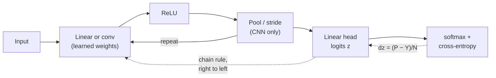
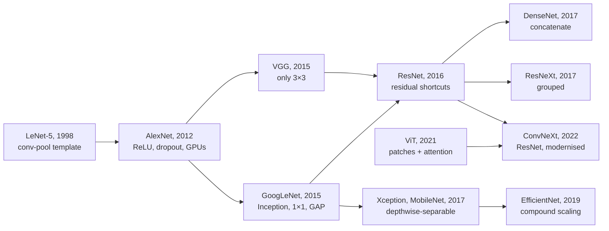

A two-layer network with a softmax on top is the "hello world" of deep learning, and the
convolutional network is the first architecture where every design choice carries an idea.
Between them they contain almost everything that's still true about training neural networks
today: a loss that's a likelihood, a gradient computed by the chain rule run backwards, an
initialisation that keeps signals alive, and an architecture whose assumptions match the data.

They're also where interviews go to check whether you understand backprop or just call
`.backward()`. "Write the backward pass of a two-layer net." "What's the gradient of a
convolution with respect to its input?" "Why do CNNs use 64 filters and then 128?" "Why does
ResNet work?" I wanted every one of those to have a two-line answer that I could also derive
on a whiteboard, so this post builds both networks twice: once in NumPy with the backward pass
written by hand, and once in PyTorch with only the forward pass, letting autograd do the rest.
Then it checks that the two agree.

*TODO: optional personal line for the owner, e.g. where this material has come up for you.*

How to read it. **Part 1** is the two-layer network: why hidden layers exist, the
softmax and cross-entropy, the full backward pass with a shape at every step, initialisation,
and gradient checking. **Part 2** is CNNs: why convolutions, how they work, what the filters
learn, every common type of convolution, the architectures that introduced each idea, and the
backward pass of a convolution derived the same way. Interview questions and a cheat sheet are
at the end. Longer derivations are folded into **Maths** cards.

All code blocks run top to bottom in **one Python session** (NumPy and PyTorch on a CPU; the
whole post runs in well under a minute), so later blocks use functions defined in earlier ones.
Every printed output is from an actual run.

## The whole post in one picture

The two networks are the same recipe with a different first layer:

| | Two-layer network | Convolutional network |
|---|---|---|
| Input | a vector $x\in\mathbb R^D$ | an image $x\in\mathbb R^{C\times H\times W}$ |
| Linear map | $xW + b$: every input talks to every unit | $w \star x + b$: a small filter slid over every position |
| What it assumes | nothing about the input's structure | locality, the same pattern can appear anywhere |
| Parameters | $D\cdot H$ per layer, grows with the input | $K^2 C_\text{in} C_\text{out}$, independent of image size |
| Nonlinearity | ReLU | ReLU |
| Downsampling | none | pooling or strided convolution |
| Head | linear layer → logits | flatten or global-average-pool → linear → logits |
| Loss | softmax + cross-entropy | softmax + cross-entropy |
| Gradient at the logits | $(P - Y)/N$ | $(P - Y)/N$ |
| Weight gradient | $X^\top dZ$ | input correlated with $dY$ (im2col: $X_\text{col}^\top dY$) |
| Input gradient | $dZ\,W^\top$ | $dY$ convolved with the 180°-rotated kernel |



The forward pass computes the loss and caches what the backward pass will need. The backward
pass starts from $\partial L/\partial z = (P - Y)/N$ and pushes it right to left, one layer at a
time, each layer turning "gradient of my output" into "gradient of my input" and "gradient of my
weights".

<details>
<summary><b>Notation used in the maths</b></summary>

| Symbol | Meaning |
|---|---|
| $N$ | batch size (examples per step) |
| $D$, $H$, $C$ | input dimension, hidden width, number of classes (Part 1) |
| $X$ | the $N\times D$ input batch, one example per row |
| $W_1, b_1, W_2, b_2$ | weights and biases; $W_1$ is $D\times H$, $W_2$ is $H\times C$ |
| $a, h, z$ | pre-activations, hidden activations, logits (matrices, one row per example) |
| $P$ | softmax probabilities, $N\times C$; $Y$ the one-hot labels, $N\times C$ |
| $dX$ | shorthand for $\partial L/\partial X$; it always has the same shape as $X$ |
| $\odot$, $\mathbb 1[\cdot]$ | element-wise product; indicator (1 if true, else 0) |
| $C_\text{in}, C_\text{out}$ or $F$ | input channels; output channels = number of filters (Part 2) |
| $H, W$ (Part 2) | image height and width; $K$ kernel size, $S$ stride, $P$ padding, $D$ dilation |
| $x[n,c,i,j]$ | pixel $(i,j)$ of channel $c$ of example $n$; $\tilde x$ is the zero-padded input |
| $w[f,c,p,q]$ | tap $(p,q)$ of filter $f$ on input channel $c$ |

In Part 2, $H$ means height and $P$ padding; the context always makes it clear.

</details>

## Why a linear classifier isn't enough

A linear classifier gives each class a score $s_c = w_c^\top x + b_c$ and predicts the
largest. The boundary between two classes $c$ and $c'$ is where their scores tie,
$(w_c - w_{c'})^\top x + (b_c - b_{c'}) = 0$, which is a hyperplane. So the region assigned to
each class is an intersection of half-spaces: a convex polytope. However much data you have and
however long you train, a linear model can't carve the input space any other way. This is
[softmax regression](/blog/linear-and-logistic-regression/#more-than-two-classes-softmax-regression),
and it's exactly the last layer of the network we're about to build.

### The perceptron, and the book that stalled it

Rosenblatt's perceptron (1958) was a single threshold unit,
$\hat y = \mathbb 1[w^\top x + b > 0]$, trained by nudging $w$ towards misclassified
examples. It converges whenever the two classes are linearly
separable. Minsky and Papert's *Perceptrons* (1969) analysed carefully what such single-layer
machines can and can't compute; predicates like parity and connectedness are out of reach
without units that see the whole input. The book is usually credited
with a long decline in neural-network research through the 1970s.

The smallest counterexample is XOR: output 1 when exactly one of two bits is on. Suppose a line
$w_1x_1 + w_2x_2 + b$ separated it. Then

$$
\underbrace{b \le 0}_{(0,0)\to 0},\qquad
\underbrace{w_1 + b > 0}_{(1,0)\to 1},\qquad
\underbrace{w_2 + b > 0}_{(0,1)\to 1},\qquad
\underbrace{w_1 + w_2 + b \le 0}_{(1,1)\to 0}.
$$

Add the middle two: $w_1 + w_2 + 2b > 0$, so $w_1 + w_2 + b > -b \ge 0$, which contradicts the
last one. No line works.

Everyone knew the fix in principle: stack layers, so later units can combine the outputs of
earlier ones. What was missing was a way to train the hidden units. A threshold unit has zero
derivative almost everywhere, so there's nothing to follow downhill. Backpropagation with smooth
units, popularised by Rumelhart, Hinton and Williams in 1986, solved that.[^backprop-history]

[^backprop-history]: Reverse-mode differentiation was found several times before 1986
(Linnainmaa in 1970, Werbos in 1974). The 1986 paper showed it learning useful internal
representations, which is what made it standard.

### Hidden layers learn the features

Here's XOR solved by two ReLU hidden units with weights I set by hand:

```python {title="xor.py"}
import numpy as np

X = np.array([[0, 0], [0, 1], [1, 0], [1, 1]], dtype=float)
y = np.array([0, 1, 1, 0])                      # XOR

# The best any line can do: try 100k random ones.
rng = np.random.default_rng(0)
W, b = rng.standard_normal((100_000, 2)), rng.standard_normal(100_000)
acc = (((X @ W.T + b) > 0) == y[:, None]).mean(axis=0)
print("best accuracy of 100k random lines:", acc.max())

# Two ReLU hidden units, weights set by hand.
W1 = np.array([[1.0, 1.0],
               [1.0, 1.0]])                     # (D=2, H=2)
b1 = np.array([0.0, -1.0])
w2 = np.array([1.0, -2.0])
h = np.maximum(0, X @ W1 + b1)                  # hidden features
out = h @ w2
for xi, hi, oi in zip(X, h, out):
    print(f"x={xi}  h={hi}  out={oi:.0f}")
```

```text {title="Output"}
best accuracy of 100k random lines: 0.75
x=[0. 0.]  h=[0. 0.]  out=0
x=[0. 1.]  h=[1. 0.]  out=1
x=[1. 0.]  h=[1. 0.]  out=1
x=[1. 1.]  h=[2. 1.]  out=0
```

The best line gets three of the four points. The hidden layer computes
$h_1 = \max(0, x_1 + x_2)$ and $h_2 = \max(0, x_1 + x_2 - 1)$, which sends the four inputs to
$(0,0)$, $(1,0)$, $(1,0)$, $(2,1)$. In those coordinates the two positives sit on the same
point, and the output $h_1 - 2h_2$ separates them from the negatives with a straight line.

That's the whole idea of a hidden layer: **it learns a change of coordinates in which the
problem becomes linear**, and the last layer is an ordinary linear classifier on those learned
features. Training a network is training the features and the classifier at the same time.

### Universal approximation: what it promises and what it doesn't

How far does one hidden layer go? Further than you'd expect. The universal approximation
theorem says that for any continuous function $f$ on a closed, bounded set $K\subset\mathbb R^D$
and any tolerance $\varepsilon > 0$, there is a width $H$ and weights such that

$$
\sup_{x\in K}\ \Bigl|\, f(x) - \sum_{j=1}^{H} \alpha_j\, \sigma(w_j^\top x + b_j) \Bigr| < \varepsilon .
$$

Cybenko proved it for sigmoid-shaped $\sigma$ (1989); Hornik showed it's
the layered architecture that matters, not the particular squashing function
(1991); Leshno et al. showed that any continuous activation that isn't a
polynomial works, which includes ReLU (1993).

<details>
<summary><b>Maths: the theorem for ReLU in one dimension, by construction</b></summary>

A one-hidden-layer ReLU network on a scalar input,
$g(x) = c + \sum_j \alpha_j \max(0, x - t_j)$, is a continuous piecewise-linear function. Each
unit adds a kink at $x = t_j$ where the slope changes by $\alpha_j$.

Now take any continuous $f$ on $[0,1]$ and pick knots $0 = t_0 < t_1 < \dots < t_m = 1$. Let
$s_k$ be the slope of the straight line joining $(t_k, f(t_k))$ to $(t_{k+1}, f(t_{k+1}))$.
The piecewise-linear interpolant is

$$
g(x) = f(t_0) + s_0 \max(0, x - t_0) + \sum_{k=1}^{m-1} (s_k - s_{k-1}) \max(0, x - t_k).
$$

Check it: on $[t_0, t_1]$ only the first ReLU is on, so $g$ has slope $s_0$ and starts at
$f(t_0)$. Each time $x$ passes a knot $t_k$, one more ReLU switches on and the slope changes
from $s_{k-1}$ to $s_k$. So $g$ matches $f$ at every knot and is linear between them.

Because $f$ is continuous on a closed interval it's uniformly continuous: for any
$\varepsilon$ there's a spacing $\delta$ such that $f$ changes by less than $\varepsilon$ over any
interval of length $\delta$. With knots that close together, both $f$ and $g$ stay within
$\varepsilon$ of $f(t_k)$ on each piece, so $\lvert f - g\rvert < 2\varepsilon$ everywhere. That's
$m \approx 1/\delta$ hidden units. In $D$ dimensions the same idea needs a grid of cells, so
the count grows like $(1/\delta)^D$: that's where the "but how many units?" problem comes from.

</details>

What it does **not** promise matters more in practice:

| The theorem says | It doesn't say |
|---|---|
| some width $H$ is enough | how big; for generic functions it can be exponential in $D$ |
| good weights exist | that gradient descent will find them |
| the fit is good on $K$ | anything about generalising from finite samples |
| it works on a bounded set | anything outside it (ReLU nets extrapolate linearly) |

It's an existence result about representation. It tells you the model class is rich enough;
optimisation and generalisation are separate questions.

### Why depth helps beyond width

If one hidden layer can approximate anything, why stack them? Because some functions that a
deep network represents with a handful of units need an astronomical number of units in one
layer. The cleanest example uses the tent map $t(x) = 2\max(0,x) - 4\max(0, x - \tfrac12)$,
which is two ReLUs: up from 0 to 1 on $[0,\tfrac12]$, back down on $[\tfrac12, 1]$. Composing it
$k$ times folds the interval in half $k$ times and produces a sawtooth with $2^k$ linear
pieces:

```python {title="depth_vs_width.py"}
def tent(x):
    """Two ReLU units: rises from 0 to 1 on [0, 1/2], falls back to 0 on [1/2, 1]."""
    return 2 * np.maximum(0, x) - 4 * np.maximum(0, x - 0.5)

x = np.linspace(0, 1, 2**12 + 1)          # kinks land exactly on grid points
print(f"{'layers':>6s} {'ReLUs':>6s} {'linear pieces':>14s} {'ReLUs one wide layer needs':>27s}")
for k in [1, 2, 3, 4, 6, 8]:
    f = x.copy()
    for _ in range(k):
        f = tent(f)                       # compose: each layer folds the line in half again
    slopes = np.round(np.diff(f) / np.diff(x))
    pieces = 1 + np.count_nonzero(np.diff(slopes))
    print(f"{k:6d} {2 * k:6d} {pieces:14d} {pieces - 1:27d}")
```

```text {title="Output"}
layers  ReLUs  linear pieces  ReLUs one wide layer needs
     1      2              2                           1
     2      4              4                           3
     3      6              8                           7
     4      8             16                          15
     6     12             64                          63
     8     16            256                         255
```

A one-hidden-layer ReLU network on a scalar input with $m$ units has at most $m$ kinks, so at
most $m+1$ pieces (the Maths card above). Matching $2^k$ pieces needs $2^k - 1$ units in one
layer, against $2k$ units arranged in $k$ layers. Telgarsky turned this into a theorem: there
are functions computed by deep, narrow networks that any shallow network needs exponentially
many units to approximate. Montúfar et al. count the linear regions of
deep ReLU networks in general and find the same exponential-in-depth growth.

The intuition is reuse. Each layer's output is an input to every unit of the next, so a feature
computed once (an edge, a fold) is used many times by later features. That's exactly what
happens in a CNN, where edges become textures, textures become parts and parts become objects.
The catch is that deep networks are harder to optimise; initialisation, normalisation and
residual connections are the tools that fix that, and all three appear below.

## The two-layer network, shape by shape

Here is the whole model for a batch of $N$ examples, with each object's shape on the right:

$$
\begin{aligned}
a &= X W_1 + b_1 && N\times H \quad\text{(pre-activations)}\\
h &= \max(0, a) && N\times H \quad\text{(hidden features)}\\
z &= h W_2 + b_2 && N\times C \quad\text{(logits)}\\
P_{nc} &= \frac{e^{z_{nc}}}{\sum_{k} e^{z_{nk}}} && N\times C \quad\text{(probabilities)}\\
L &= -\frac1N \sum_{n=1}^{N} \log P_{n,y_n} \;+\; \frac\lambda2\left(\lVert W_1\rVert_F^2 + \lVert W_2\rVert_F^2\right) && \text{scalar}
\end{aligned}
$$

The biases are vectors added to every row (broadcasting). Rows are examples throughout, which is
the NumPy convention and what `nn.Linear` computes (it stores $W^\top$, as we'll see). "Two-layer"
counts the layers with weights; the same model is also called a one-hidden-layer MLP. It has
$(D+1)H + (H+1)C$ parameters: 603 for the spiral data later ($D=2$, $H=100$, $C=3$).

| Object | Shape | Object | Shape |
|---|---|---|---|
| $X$ | $N\times D$ | $W_2$ | $H\times C$ |
| $W_1$ | $D\times H$ | $b_2$ | $C$ |
| $b_1$ | $H$ | $z$, $P$, $Y$ | $N\times C$ |
| $a$, $h$ | $N\times H$ | $L$ | scalar |

### Why the nonlinearity is required

Delete the ReLU and the model collapses:

$$
z = (XW_1 + b_1)W_2 + b_2 = X\underbrace{(W_1W_2)}_{W'} + \underbrace{(b_1W_2 + b_2)}_{b'} .
$$

That's a linear model with weight matrix $W'$: plain softmax regression at best, and a
rank-limited one if $H$ is smaller than $D$ and $C$. The same algebra collapses any number of stacked linear
layers. The nonlinearity is the only thing that makes depth mean anything. (It also has to be
non-polynomial for universality, because a fixed-depth network of polynomial units is itself
a polynomial of bounded degree.)

### Activation functions compared

| Name | $\phi(a)$ | $\phi'(a)$ | Range | Notes |
|---|---|---|---|---|
| Sigmoid | $\dfrac{1}{1+e^{-a}}$ | $\phi(1-\phi)\le \tfrac14$ | $(0,1)$ | saturates at both ends; outputs not zero-centred |
| Tanh | $\dfrac{e^a - e^{-a}}{e^a + e^{-a}} = 2\sigma(2a)-1$ | $1-\phi^2 \le 1$ | $(-1,1)$ | zero-centred, still saturates |
| ReLU | $\max(0,a)$ | $\mathbb 1[a>0]$ | $[0,\infty)$ | doesn't saturate for $a>0$; exact zeros; can "die" |
| Leaky ReLU | $\max(\alpha a, a)$, $\alpha\approx 0.01$ | $1$ or $\alpha$ | $\mathbb R$ | never fully off |
| GELU | $a\,\Phi(a)$ | $\Phi(a) + a\,\varphi(a)$ | $\approx[-0.17,\infty)$ | smooth ReLU; the transformer default |

($\Phi$ and $\varphi$ are the standard normal CDF and density.)

**Why ReLU won.** Nair and Hinton introduced it for restricted Boltzmann machines
(2010); Glorot, Bordes and Bengio showed deep rectifier networks train
well without pre-training and produce sparse representations (2011);
AlexNet made it the default, reporting that a ReLU network reached 25% training error on
CIFAR-10 six times faster than the same network with tanh. Three reasons:

1. **No saturation on the positive side.** The backward pass multiplies by $\phi'(a)$ at every
   layer. For a sigmoid that's at most $\tfrac14$, so ten layers can shrink a gradient by
   $4^{-10}\approx 10^{-6}$. ReLU's derivative is exactly 1 wherever the unit is on.
2. **Sparsity.** For any given input, roughly half the units output exactly zero, so each input
   uses a different sub-network: a piecewise-linear model with many pieces.
3. **Cheap.** A comparison, not an exponential, in both directions.

**Dying ReLU.** If a unit's pre-activation is negative for every input in the dataset, its
gradient is zero for every input, so its weights never change again and it's dead for good. It
usually comes from a learning rate large enough to throw the bias far negative. Leaky ReLU keeps
a small slope for $a<0$ so the unit can recover; GELU is a smooth version that
weights the input by the probability that a standard normal is below it. The
[transformers post](/blog/transformers-intuitively/#the-feed-forward-network) covers GELU and
gated variants.

ReLU isn't differentiable at exactly 0. Frameworks use 0 as the derivative there. It never
matters in training (hitting exactly 0.0 has probability zero), but it does matter in gradient
checks, where a finite difference straddling the kink gives the wrong answer.

## Softmax and cross-entropy

The [softmax post](/blog/softmax-numerical-stability/) goes deep on the numerics; here is what
the two-layer network needs.

### Why the exponential

$$
\operatorname{softmax}(z)_c = \frac{e^{z_c}}{\sum_{k=1}^{C} e^{z_k}} .
$$

Plenty of maps turn scores into probabilities. The exponential is the one everyone uses for four
reasons:

1. **Positive, normalised, monotone, smooth.** Higher score, higher probability, and
   differentiable everywhere.
2. **Logits become log-odds.** $\log(P_c/P_k) = z_c - z_k$: the logits are log-probabilities
   up to a shared constant. With two classes, $P_1 = 1/(1 + e^{-(z_1 - z_0)}) = \sigma(z_1 - z_0)$,
   so softmax is the multi-class logistic function.
3. **It's the maximum-entropy choice.** Among all distributions, softmax maximises "expected
   score plus entropy" (Maths card). It's the least committed distribution that still follows
   the scores, which is why it's also called the Gibbs or Boltzmann distribution.
4. **The gradient comes out clean.** Paired with cross-entropy, the gradient at the logits is
   just $P - Y$. We derive that next.

<details>
<summary><b>Maths: softmax maximises expected score plus entropy</b></summary>

Maximise $\sum_c p_c z_c + T\,\mathcal H(p)$ with $\mathcal H(p) = -\sum_c p_c\log p_c$, over
$p_c \ge 0$ with $\sum_c p_c = 1$. The Lagrangian is

$$
\mathcal L = \sum_c p_c z_c - T\sum_c p_c\log p_c + \mu\Bigl(\sum_c p_c - 1\Bigr).
$$

Setting $\partial\mathcal L/\partial p_c = z_c - T(\log p_c + 1) + \mu = 0$ gives
$\log p_c = z_c/T + \text{const}$, so $p_c \propto e^{z_c/T}$. Normalising gives
$p = \operatorname{softmax}(z/T)$. The objective is strictly concave (entropy is), so this is the
unique maximum. $T$ is the temperature, which comes up again below.

</details>

The name is apt: as the logits are scaled up, softmax approaches a one-hot vector on the
largest logit, a smooth ("soft") version of argmax.

### Shifting the logits changes nothing

Adding the same constant $c$ to every logit cancels:

$$
\frac{e^{z_j + c}}{\sum_k e^{z_k + c}} = \frac{e^c\, e^{z_j}}{e^c \sum_k e^{z_k}} = \frac{e^{z_j}}{\sum_k e^{z_k}} .
$$

So pick $c = -\max_k z_k$ before exponentiating. The largest exponent becomes $e^0 = 1$, nothing
overflows (float64 `exp` overflows past about 709, float32 past about 88), and the denominator
is at least 1, so its log is never $-\infty$. In code:
$\log P_c = (z_c - m) - \log\sum_k e^{z_k - m}$ with $m = \max_k z_k$. That's the two
log-softmax lines in `loss()` below. One consequence of the invariance: the logits have one redundant degree of
freedom per example, which shows up below as a zero eigenvalue of the softmax Jacobian.

### Temperature

$\operatorname{softmax}(z/T)$ sharpens the distribution for $T<1$ and flattens it for $T>1$.
As $T\to 0$ it becomes argmax; as $T\to\infty$ it becomes uniform. Temperature is how you
control randomness when sampling from a language model, how knowledge distillation softens a
teacher's predictions, and how a trained classifier's confidence is recalibrated after training
(fit one scalar $T$ on a validation set).

### Cross-entropy is negative log-likelihood, and a KL divergence

The network models the label as a categorical random variable,
$y_n \mid x_n \sim \operatorname{Categorical}(P_{n})$. The likelihood of the data is
$\prod_n P_{n, y_n}$, and the average negative log-likelihood is

$$
L_\text{data} = -\frac1N\sum_n \log P_{n,y_n} = \frac1N\sum_n \Bigl(-\sum_c Y_{nc}\log P_{nc}\Bigr) = \frac1N \sum_n \mathcal H(Y_n, P_n),
$$

the cross-entropy between the one-hot label and the prediction. Cross-entropy splits as
$\mathcal H(q, p) = \mathcal H(q) + \operatorname{KL}(q\,\Vert\, p)$. The label's own entropy
$\mathcal H(q)$ doesn't depend on the model (it's zero for one-hot labels), so minimising
cross-entropy is minimising the KL divergence from the labels to the predictions. With label
smoothing, $q$ isn't one-hot and the same formula still applies.

A sanity check worth memorising: at initialisation the predictions are close to uniform, so the
loss should be close to $\log C$. For three classes that's $\log 3 = 1.0986$; the PyTorch run
below starts at 1.088. A first loss far above $\log C$ usually means the output layer was
initialised too large.

## Backpropagation, derived with shapes

The goal is $\partial L/\partial W_1$, $\partial L/\partial b_1$, $\partial L/\partial W_2$ and
$\partial L/\partial b_2$. I'll write $dX$ for $\partial L/\partial X$. The one rule that makes
matrix calculus painless: **$dX$ always has the same shape as $X$**, because it holds one partial
derivative per entry of $X$. Most of the time the shapes leave exactly one way to multiply the
pieces, which is a good check on the algebra.

<figure class="ml-diagram">
<svg viewBox="0 0 940 300" role="img" aria-label="The two-layer network as a chain of five nodes: X, the first affine layer a = X W1 + b1, the ReLU h, the second affine layer z = h W2 + b2, and the softmax cross-entropy loss. Dashed arrows run right to left beneath them, labelled with the backward formulas dz = (P - Y)/N, dh = dz W2 transpose, da = dh times the ReLU mask, and dX = da W1 transpose. The weight gradients dW2 = h transpose dz and dW1 = X transpose da are written under the affine layers.">
  <defs><marker id="ml-arrow" viewBox="0 0 10 10" refX="9" refY="5" markerWidth="7" markerHeight="7" orient="auto-start-reverse"><path d="M0,0 L10,5 L0,10 z"/></marker></defs>
  <text class="label" x="470" y="30">forward: left to right, caching a and h</text>
  <rect class="box" x="20" y="50" width="150" height="80" rx="8"/>
  <text class="name" x="95" y="84">X</text>
  <text class="note" x="95" y="108">N × D</text>
  <rect class="box violet" x="205" y="50" width="150" height="80" rx="8"/>
  <text class="name" x="280" y="84">a = XW₁ + b₁</text>
  <text class="note violet" x="280" y="108">N × H</text>
  <rect class="box green" x="390" y="50" width="150" height="80" rx="8"/>
  <text class="name" x="465" y="84">h = ReLU(a)</text>
  <text class="note green" x="465" y="108">N × H</text>
  <rect class="box violet" x="575" y="50" width="150" height="80" rx="8"/>
  <text class="name" x="650" y="84">z = hW₂ + b₂</text>
  <text class="note violet" x="650" y="108">N × C logits</text>
  <rect class="box rose" x="760" y="50" width="160" height="80" rx="8"/>
  <text class="name" x="840" y="84">softmax + CE</text>
  <text class="note rose" x="840" y="108">L, a scalar</text>
  <line class="arrow" x1="172" y1="90" x2="201" y2="90"/>
  <line class="arrow" x1="357" y1="90" x2="386" y2="90"/>
  <line class="arrow" x1="542" y1="90" x2="571" y2="90"/>
  <line class="arrow" x1="727" y1="90" x2="756" y2="90"/>
  <path class="arrow dashed" d="M825,132 V170 H665 V134"/>
  <text class="note rose" x="745" y="194">dz = (P − Y)/N</text>
  <path class="arrow dashed" d="M635,132 V170 H480 V134"/>
  <text class="note rose" x="557" y="194">dh = dz W₂ᵀ</text>
  <path class="arrow dashed" d="M450,132 V170 H295 V134"/>
  <text class="note rose" x="372" y="194">da = dh ⊙ 1[a &gt; 0]</text>
  <path class="arrow dashed" d="M265,132 V170 H110 V134"/>
  <text class="note rose" x="187" y="194">dX = da W₁ᵀ</text>
  <text class="note violet" x="650" y="232">dW₂ = hᵀ dz,  db₂ = Σₙ dz</text>
  <text class="note violet" x="280" y="232">dW₁ = Xᵀ da,  db₁ = Σₙ da</text>
  <text class="label" x="470" y="280">backward: right to left; every gradient has the shape of its variable</text>
</svg>
<figcaption>The computational graph of the two-layer network. The forward pass (solid) caches the intermediate values; the backward pass (dashed) reuses them.</figcaption>
</figure>

### Step 1: the loss with respect to the logits

Take one example and drop the index $n$, so $L = -\log P_y$ with $P = \operatorname{softmax}(z)$.
Two pieces are needed.

**The softmax Jacobian.** Write $S = \sum_k e^{z_k}$, so $P_i = e^{z_i}/S$ and
$\partial S/\partial z_j = e^{z_j}$. By the quotient rule:

$$
\frac{\partial P_i}{\partial z_j} =
\begin{cases}
\dfrac{e^{z_i} S - e^{z_i} e^{z_i}}{S^2} = P_i - P_i^2 & i = j,\\[2ex]
\dfrac{0\cdot S - e^{z_i} e^{z_j}}{S^2} = -P_iP_j & i\ne j,
\end{cases}
\qquad\text{so}\qquad
\frac{\partial P_i}{\partial z_j} = P_i(\delta_{ij} - P_j),
\qquad
J = \operatorname{diag}(P) - PP^\top .
$$

$J$ is symmetric and positive semi-definite, and $J\mathbf 1 = P - P(P^\top\mathbf 1) = 0$:
moving every logit together changes nothing, the shift invariance from above.

**The loss through the Jacobian.** $\partial L/\partial P_i = -\delta_{iy}/P_y$ (only the
correct class's probability appears in the loss). Chain rule:

$$
\frac{\partial L}{\partial z_j} = \sum_i \frac{\partial L}{\partial P_i}\frac{\partial P_i}{\partial z_j}
= \sum_i \Bigl(-\frac{\delta_{iy}}{P_y}\Bigr) P_i(\delta_{ij} - P_j)
= -\frac{1}{P_y}\,P_y(\delta_{yj} - P_j)
= P_j - \delta_{yj}.
$$

**The shortcut** skips the Jacobian entirely. Write the loss as
$L = -z_y + \log\sum_k e^{z_k}$; then $\partial L/\partial z_j = -\delta_{jy} + e^{z_j}/S = P_j - \delta_{jy}$.
Same answer, and it's why no framework ever builds the $C\times C$ Jacobian: the product
collapses to $O(C)$ work per example.

For the batch, stack the rows and divide by $N$ because the loss is a mean:

$$
\boxed{\,dz = \frac{1}{N}(P - Y)\,}\qquad N\times C .
$$

Read it as: push the correct logit up by $1 - P_y$, push each wrong logit down by its
probability. Every entry is between $-1$ and $1$, and it's large exactly when the model is
confidently wrong, so the gradient never vanishes on the examples that matter most. It's the
same "prediction minus target" as logistic regression; the
[regression post](/blog/linear-and-logistic-regression/#the-gradient-looks-exactly-like-linear-regressions)
explains why that form keeps showing up (it's the canonical link of the exponential family).

### Step 2: the output layer

Write the affine layer entry by entry: $z_{nc} = \sum_k h_{nk}W_{2,kc} + b_{2,c}$. A weight
$W_{2,kc}$ touches every example's logit $z_{nc}$, so its gradient sums over $n$:

$$
\frac{\partial L}{\partial W_{2,kc}} = \sum_n \frac{\partial L}{\partial z_{nc}}\,\frac{\partial z_{nc}}{\partial W_{2,kc}} = \sum_n h_{nk}\, dz_{nc}
\quad\Longrightarrow\quad
dW_2 = h^\top dz \qquad (H\times N)(N\times C) = H\times C .
$$

The bias is added to every row, so its gradient sums the rows:

$$
db_2 = \sum_n dz_{n,:} \qquad C .
$$

This is a general rule: **broadcast in the forward pass means sum in the backward pass.**

A hidden activation $h_{nk}$ feeds every logit of its own example:

$$
\frac{\partial L}{\partial h_{nk}} = \sum_c dz_{nc}\, W_{2,kc}
\quad\Longrightarrow\quad
dh = dz\, W_2^\top \qquad (N\times C)(C\times H) = N\times H .
$$

So for any $Y = XW$: $dW = X^\top dY$ and $dX = dY\,W^\top$. If you forget which side the
transpose goes on, the shapes will tell you.

### Step 3: the ReLU

$h = \max(0, a)$ acts element by element, so its Jacobian is diagonal and the chain rule is an
element-wise product:

$$
da = dh \odot \mathbb 1[a > 0] \qquad N\times H .
$$

The ReLU is a gate: it passes the gradient through for units that were on in the forward pass
and blocks it for units that were off. For a general activation it's $da = dh\odot\phi'(a)$; for
a sigmoid, the factor $\phi' \le \tfrac14$ is where vanishing gradients come from.

### Step 4: the first layer

Same pattern as step 2 with $X$ in place of $h$:

$$
dW_1 = X^\top da \quad (D\times H), \qquad db_1 = \sum_n da_{n,:} \quad (H), \qquad dX = da\,W_1^\top \quad (N\times D).
$$

We don't need $dX$ to train this network, but it's what a layer hands to the layer below it
when networks are stacked. Every layer only has to turn "gradient of my output" into
"gradient of my input" and "gradient of my parameters".

### Regularisation

The penalty $R = \frac\lambda2(\lVert W_1\rVert_F^2 + \lVert W_2\rVert_F^2)$ has gradient
$\lambda W$ with respect to each weight matrix, added to the data gradient:

$$
dW_2 = h^\top dz + \lambda W_2, \qquad dW_1 = X^\top da + \lambda W_1 .
$$

Biases are usually left out: they only shift outputs and don't make the function any more
wiggly, so penalising them just biases the predictions. With plain SGD this penalty is
identical to weight decay, and it's a Gaussian prior on the weights; the
[optimisers post](/blog/optimizers-and-generalization/#l2-and-weight-decay-a-rubber-band-to-the-origin)
covers why the two differ for Adam.

Here's the full backward pass in one table:

| Step | Gradient | Shape |
|---|---|---|
| logits | $dz = (P - Y)/N$ | $N\times C$ |
| output weights | $dW_2 = h^\top dz + \lambda W_2$, $\ db_2 = \mathbf 1^\top dz$ | $H\times C$, $C$ |
| hidden activations | $dh = dz\,W_2^\top$ | $N\times H$ |
| ReLU | $da = dh\odot\mathbb 1[a>0]$ | $N\times H$ |
| first-layer weights | $dW_1 = X^\top da + \lambda W_1$, $\ db_1 = \mathbf 1^\top da$ | $D\times H$, $H$ |
| input | $dX = da\,W_1^\top$ | $N\times D$ |

### Why backprop is cheap: reverse mode

Think of the forward pass as a directed acyclic graph of simple operations. The chain rule on
a graph says: the gradient at a node is the sum, over the nodes it feeds, of their gradient
times the local derivative of the edge. Visiting nodes in reverse order of the forward pass
lets each node's gradient be computed once and reused by everything upstream. That's
**reverse-mode automatic differentiation**, and backpropagation is its special case for neural
networks. (Enumerating every path from the loss to a weight would instead
take time exponential in the depth.)

The alternative, **forward mode**, pushes derivatives along with the values: one forward sweep
gives the derivative of every output with respect to *one* input direction. For a function
$f:\mathbb R^n\to\mathbb R^m$, forward mode needs $n$ sweeps to get the whole Jacobian and
reverse mode needs $m$. Training has $m = 1$ (a scalar loss) and $n$ in the millions, so reverse
mode gets the entire gradient for a small constant multiple of one forward pass. Concretely,
each matrix multiply in the forward pass becomes two in the backward pass (one for $dW$, one
for $dX$), so a training step costs roughly three forward passes.

The price is memory: the backward pass needs the cached activations ($X$, $a$, $h$ here). For
big models activations dominate memory, which is why activation checkpointing exists (throw
some away and recompute them during the backward pass). The
[optimisers post](/blog/optimizers-and-generalization/#where-the-gradient-comes-from-backprop-in-one-page)
has another one-page view of backprop.

## Code: the two-layer network in NumPy and PyTorch

The NumPy class implements exactly the equations above: `forward` caches $X$, $a$, $h$;
`loss` does the stable log-softmax; `backward` is the table, line for line. The PyTorch class
is the forward pass only.



```python {title="NumPy: forward + manual backward"}
import numpy as np

class TwoLayerNet:
    """X -> affine -> ReLU -> affine -> softmax cross-entropy, backward by hand."""

    def __init__(self, D, H, C, reg=0.0, seed=0):
        rng = np.random.default_rng(seed)
        self.params = {
            "W1": rng.standard_normal((D, H)) * np.sqrt(2.0 / D),  # He init (ReLU follows)
            "b1": np.zeros(H),
            "W2": rng.standard_normal((H, C)) * np.sqrt(1.0 / H),  # no ReLU after: 1/fan_in
            "b2": np.zeros(C),
        }
        self.reg = reg

    def forward(self, X):
        p = self.params
        a1 = X @ p["W1"] + p["b1"]          # (N, H) pre-activation
        h1 = np.maximum(0, a1)              # (N, H) ReLU
        z = h1 @ p["W2"] + p["b2"]          # (N, C) logits
        self.cache = (X, a1, h1)
        return z

    def loss(self, X, y):
        z = self.forward(X)
        N = X.shape[0]
        z = z - z.max(axis=1, keepdims=True)                       # shift: softmax unchanged
        log_p = z - np.log(np.exp(z).sum(axis=1, keepdims=True))   # log-softmax
        self.probs, self.y = np.exp(log_p), y
        data_loss = -log_p[np.arange(N), y].mean()
        W1, W2 = self.params["W1"], self.params["W2"]
        reg_loss = 0.5 * self.reg * (np.sum(W1 * W1) + np.sum(W2 * W2))
        return data_loss + reg_loss

    def backward(self):
        X, a1, h1 = self.cache
        p, N = self.params, X.shape[0]
        dz = self.probs.copy()                       # (N, C)
        dz[np.arange(N), self.y] -= 1                # p - onehot(y)
        dz /= N                                      # the loss is a mean
        grads = {}
        grads["W2"] = h1.T @ dz + self.reg * p["W2"] # (H, C)
        grads["b2"] = dz.sum(axis=0)                 # (C,)
        dh1 = dz @ p["W2"].T                         # (N, H)
        da1 = dh1 * (a1 > 0)                         # ReLU: pass gradient where a1 > 0
        grads["W1"] = X.T @ da1 + self.reg * p["W1"] # (D, H)
        grads["b1"] = da1.sum(axis=0)                # (H,)
        return grads

    def predict(self, X):
        return self.forward(X).argmax(axis=1)
```

```python {title="PyTorch: forward only"}
import torch
import torch.nn as nn

torch.set_num_threads(1)   # tensors this small run slower when split across threads

class TwoLayerNetTorch(nn.Module):
    def __init__(self, D, H, C):
        super().__init__()
        self.fc1 = nn.Linear(D, H)   # weight is (H, D): PyTorch stores W1 transposed
        self.fc2 = nn.Linear(H, C)

    def forward(self, x):
        return self.fc2(torch.relu(self.fc1(x)))   # logits; softmax lives inside the loss
```



In PyTorch, every parameter is a tensor with `requires_grad=True`. As `forward` runs, autograd
records each operation and its inputs, and `loss.backward()` walks that record in reverse,
applying each operation's local derivative: the same steps as `TwoLayerNet.backward`, written
by the library. Two details to notice. `nn.Linear` stores its weight as (out, in) and computes
$xW^\top + b$, so its weight is our $W_1^\top$. And the model returns logits, not
probabilities: `nn.CrossEntropyLoss` applies a fused, stable log-softmax itself. Putting a
softmax in `forward` *and* using `CrossEntropyLoss` is a classic bug: it applies softmax twice,
which squashes the gradients and slows training.

### Gradient checking

A hand-written backward pass is easy to get subtly wrong (a missing transpose, a forgotten
$1/N$), and a wrong gradient often still trains, just badly. The check is to compare against
finite differences:

$$
\frac{\partial L}{\partial \theta_i} \approx \frac{L(\theta + \varepsilon e_i) - L(\theta - \varepsilon e_i)}{2\varepsilon} .
$$

Use the centred difference, not $(L(\theta+\varepsilon e_i) - L(\theta))/\varepsilon$. Taylor
expansion shows why: $L(\theta\pm\varepsilon) = L \pm \varepsilon L' + \tfrac{\varepsilon^2}{2}L'' \pm \tfrac{\varepsilon^3}{6}L''' + \dots$,
so the even terms cancel in the centred difference and its error is
$\tfrac{\varepsilon^2}{6}L'''$, against $\tfrac{\varepsilon}{2}L''$ for the one-sided version.
Rounding adds an error of about $\epsilon_\text{mach}\lvert L\rvert/\varepsilon$, which grows as
$\varepsilon$ shrinks. The total is smallest around
$\varepsilon \approx \epsilon_\text{mach}^{1/3}$: about $10^{-5}$ to $10^{-6}$ in float64, but
about $5\times 10^{-3}$ in float32, where the best you can get is roughly $10^{-4}$ relative
accuracy. So **always gradient-check in float64**.

Compare with a relative error, $\max_i \frac{\lvert a_i - b_i\rvert}{\lvert a_i\rvert + \lvert b_i\rvert}$,
so the verdict doesn't depend on the gradient's scale. Rough guide in float64: below $10^{-7}$
is right; $10^{-7}$ to $10^{-5}$ is fine (it happens near ReLU kinks, or on entries whose true
gradient is tiny); above $10^{-3}$ is a bug. Practical habits: use a tiny
network and batch (each parameter costs two forward passes), make the biases non-zero so their
check means something, keep the regulariser on, and turn off anything random like dropout.

```python {title="gradient_check.py"}
def numerical_grad(f, x, eps=1e-6):
    """Centered differences: (f(x + eps) - f(x - eps)) / 2eps, one entry at a time."""
    grad = np.zeros_like(x)
    for i in np.ndindex(x.shape):
        old = x[i]
        x[i] = old + eps; f_plus = f()
        x[i] = old - eps; f_minus = f()
        x[i] = old
        grad[i] = (f_plus - f_minus) / (2 * eps)
    return grad

def rel_error(a, b):
    return np.max(np.abs(a - b) / np.maximum(1e-12, np.abs(a) + np.abs(b)))

rng = np.random.default_rng(1)
N, D, H, C = 5, 4, 10, 3
X = rng.standard_normal((N, D))
y = rng.integers(0, C, size=N)
net = TwoLayerNet(D, H, C, reg=0.1, seed=2)
net.params["b1"] = 0.1 * rng.standard_normal(H)   # non-zero biases so their check means something

net.loss(X, y)
grads = net.backward()
for name in ["W1", "b1", "W2", "b2"]:
    num = numerical_grad(lambda: net.loss(X, y), net.params[name])
    print(f"{name}: relative error {rel_error(grads[name], num):.2e}")

# What a bug looks like: forget the 1/N in dz.
net.loss(X, y)
bad = net.backward()["b2"] * N
num = numerical_grad(lambda: net.loss(X, y), net.params["b2"])
print(f"b2 with the 1/N bug: relative error {rel_error(bad, num):.2e}")
```

```text {title="Output"}
W1: relative error 4.27e-08
b1: relative error 9.85e-08
W2: relative error 2.68e-08
b2: relative error 4.36e-09
b2 with the 1/N bug: relative error 6.67e-01
```

All four gradients agree to about $10^{-8}$. The deliberately broken version, missing the
$1/N$, is off by a factor of $N=5$, which the relative error reports as
$(5-1)/(5+1) = 0.67$. A bug can't hide from this check.

### Initialisation: why not zeros, and how big

**Symmetry.** Suppose every hidden unit starts with the same incoming and outgoing weights.
Then every unit computes the same activation, the columns of $da$ are equal, so the columns of
$dW_1 = X^\top da$ are equal, and after the update the units are still identical. They stay
identical forever, and $H$ hidden units behave like one. All-zeros is the extreme case: $h = 0$,
so $dW_2 = h^\top dz = 0$, and $dh = dz\,W_2^\top = 0$, so only $b_2$ ever learns and the network
predicts the class frequencies forever. Random initialisation exists to break the symmetry. Here
it is with every parameter set to 0.5:

```python {title="init.py"}
# 1) Symmetry: if every hidden unit starts identical, every hidden unit stays identical.
rng = np.random.default_rng(0)
X = rng.standard_normal((50, 2))
y = rng.integers(0, 3, size=50)
net = TwoLayerNet(2, 4, 3, seed=0)
for k in net.params:
    net.params[k][...] = 0.5                     # constant init (zeros is the special case)
for _ in range(200):
    net.loss(X, y)
    for k, g in net.backward().items():
        net.params[k] -= 0.5 * g
print("W1 after 200 steps from a constant init (one column per hidden unit):")
print(net.params["W1"].round(4))

# 2) Scale: push a batch through 10 ReLU layers of width 512 and watch the activations.
x = rng.standard_normal((1000, 512))
inits = {
    "N(0, 0.01^2)":       lambda n_in, n_out: 0.01 * rng.standard_normal((n_in, n_out)),
    "N(0, 1)":            lambda n_in, n_out: rng.standard_normal((n_in, n_out)),
    "Xavier 2/(in+out)":  lambda n_in, n_out: rng.standard_normal((n_in, n_out)) * np.sqrt(2 / (n_in + n_out)),
    "He 2/in":            lambda n_in, n_out: rng.standard_normal((n_in, n_out)) * np.sqrt(2 / n_in),
}
print(f"\n{'init':20s} {'layer 1':>10s} {'layer 5':>10s} {'layer 10':>10s}   (RMS of activations)")
for name, init in inits.items():
    h, rms = x, []
    for _ in range(10):
        h = np.maximum(0, h @ init(512, 512))
        rms.append(np.sqrt(np.mean(h ** 2)))
    print(f"{name:20s} {rms[0]:10.3g} {rms[4]:10.3g} {rms[9]:10.3g}")
```

```text {title="Output"}
W1 after 200 steps from a constant init (one column per hidden unit):
[[0.2131 0.2131 0.2131 0.2131]
 [0.6809 0.6809 0.6809 0.6809]]

init                    layer 1    layer 5   layer 10   (RMS of activations)
N(0, 0.01^2)               0.16    0.00011   1.01e-08
N(0, 1)                      16   1.03e+06   9.39e+11
Xavier 2/(in+out)         0.707      0.161      0.024
He 2/in                       1       1.05       1.01
```

**Scale.** The first experiment shows symmetry: four columns, still identical after 200 steps.
The second shows why the *size* of random weights matters. Push a batch through ten ReLU layers
of width 512 and the activations either explode, vanish, or stay put, depending only on the
variance of the initial weights. The variance that keeps them put follows from a short
calculation.

<details>
<summary><b>Maths: deriving He initialisation, and where Xavier comes from</b></summary>

Take one layer, $a_j = \sum_{i=1}^{n_\text{in}} W_{ij} h_i$, with the weights independent,
zero-mean, variance $\sigma^2$, and independent of the inputs $h_i$. Because $\mathbb E[W_{ij}] = 0$,
each term has variance $\mathbb E[W_{ij}^2]\,\mathbb E[h_i^2] = \sigma^2\,\mathbb E[h_i^2]$, and
independent terms add:

$$
\operatorname{Var}(a_j) = n_\text{in}\,\sigma^2\,\mathbb E[h_i^2] .
$$

Note it's $\mathbb E[h^2]$, not $\operatorname{Var}(h)$: ReLU outputs aren't zero-mean. If $h = \max(0, a')$ and the
previous pre-activation $a'$ is symmetric around zero, then $h^2 = a'^2$ on exactly half the
distribution and 0 on the other half, so $\mathbb E[h^2] = \tfrac12\operatorname{Var}(a')$.
Substituting,

$$
\operatorname{Var}(a^{(\ell)}) = \tfrac12\, n_\text{in}\,\sigma^2\, \operatorname{Var}(a^{(\ell-1)}) .
$$

After $L$ layers the variance is multiplied by $(\tfrac12 n_\text{in}\sigma^2)^L$, which
explodes or vanishes exponentially unless the factor is exactly 1:

$$
\boxed{\sigma^2 = \frac{2}{n_\text{in}}}\qquad\text{(He / Kaiming initialisation)} .
$$

The same argument run on the backward pass, $dh = dz\,W^\top$, gives $\sigma^2 = 2/n_\text{out}$.
He et al. note that either choice is enough, since the ratio between the two only contributes a
bounded factor over the whole network.

**Xavier / Glorot** did the same analysis for tanh-like units that are roughly linear near
zero, where $\mathbb E[h^2]\approx\operatorname{Var}(a')$. Then the forward pass wants
$\sigma^2 = 1/n_\text{in}$ and the backward pass $1/n_\text{out}$, and the compromise is
$\sigma^2 = 2/(n_\text{in} + n_\text{out})$, often drawn as
$U\bigl[-\sqrt{6/(n_\text{in}+n_\text{out})},\, \sqrt{6/(n_\text{in}+n_\text{out})}\bigr]$.
With ReLU it is too small by exactly the factor of 2 that the ReLU throws away.

</details>

The output matches the formula. With width 512, the per-layer factor on the RMS of the
activations is $\sqrt{\tfrac12\cdot 512\,\sigma^2}$:

| Init | $\sigma^2$ | Factor per layer | After 10 layers (predicted) | Measured |
|---|---|---|---|---|
| $\mathcal N(0, 0.01^2)$ | $10^{-4}$ | 0.16 | $1.1\times10^{-8}$ | $1.0\times10^{-8}$ |
| $\mathcal N(0, 1)$ | 1 | 16 | $1.1\times10^{12}$ | $9.4\times10^{11}$ |
| Xavier | $1/512$ | 0.707 | 0.031 | 0.024 |
| He | $2/512$ | 1 | 1 | 1.01 |

Biases start at zero. One thing worth knowing about PyTorch: `nn.Linear` and `nn.Conv2d` default
to a uniform distribution with variance $1/(3\,n_\text{in})$, a sixth of He's. That's fine for
shallow networks and for networks with normalisation layers, but for a deep plain ReLU stack
you should initialise explicitly with `nn.init.kaiming_normal_`. The
[optimisers post](/blog/optimizers-and-generalization/#keeping-gradients-alive-initialisation-normalisation-clipping)
puts initialisation next to normalisation and gradient clipping.

### Training on a spiral

Now the payoff. The spiral dataset (three interleaved arms, a classic from the CS231n
notes) is a case where no linear boundary does much better than chance:

```python {title="train_spiral_numpy.py"}
def make_spiral(n_per_class=100, n_classes=3, noise=0.2, seed=0):
    """K interleaved spiral arms in 2-D; no line separates any arm from the rest."""
    rng = np.random.default_rng(seed)
    X = np.zeros((n_per_class * n_classes, 2))
    y = np.zeros(n_per_class * n_classes, dtype=int)
    for k in range(n_classes):
        idx = slice(k * n_per_class, (k + 1) * n_per_class)
        r = np.linspace(0.0, 1.0, n_per_class)                        # radius
        t = np.linspace(k * 4, (k + 1) * 4, n_per_class) + noise * rng.standard_normal(n_per_class)
        X[idx] = np.c_[r * np.sin(t), r * np.cos(t)]
        y[idx] = k
    return X, y

X_train, y_train = make_spiral(seed=0)
X_test, y_test = make_spiral(seed=1)

# Baseline: softmax regression (no hidden layer), full-batch gradient descent.
W, b = np.zeros((2, 3)), np.zeros(3)
for step in range(2000):
    z = X_train @ W + b
    p = np.exp(z - z.max(1, keepdims=True)); p /= p.sum(1, keepdims=True)
    dz = p.copy(); dz[np.arange(len(y_train)), y_train] -= 1; dz /= len(y_train)
    W -= 1.0 * (X_train.T @ dz + 1e-3 * W)
    b -= 1.0 * dz.sum(0)
lin_acc = lambda X, y: ((X @ W + b).argmax(1) == y).mean()
print(f"softmax regression : train acc {lin_acc(X_train, y_train):.3f}  test acc {lin_acc(X_test, y_test):.3f}")

# The two-layer net, same data, same optimiser.
net = TwoLayerNet(D=2, H=100, C=3, reg=1e-3, seed=0)
for step in range(5001):
    loss = net.loss(X_train, y_train)
    for k, g in net.backward().items():
        net.params[k] -= 1.0 * g
    if step % 1000 == 0:
        print(f"step {step:4d}  loss {loss:.4f}")
acc = lambda X, y: (net.predict(X) == y).mean()
print(f"two-layer net      : train acc {acc(X_train, y_train):.3f}  test acc {acc(X_test, y_test):.3f}")
```

```text {title="Output"}
softmax regression : train acc 0.540  test acc 0.520
step    0  loss 1.2701
step 1000  loss 0.2445
step 2000  loss 0.2430
step 3000  loss 0.2425
step 4000  loss 0.2423
step 5000  loss 0.2421
two-layer net      : train acc 0.990  test acc 0.987
```

Softmax regression gets 52% on held-out data: the arms wrap around each other, so any set of
three half-planes misclassifies most of every arm. The two-layer network, with 603 parameters
and the same optimiser, gets 98.7%. Its 100 ReLU units carve the plane into many linear pieces,
and the output layer assembles each spiral arm out of them. The loss levels off around 0.24
rather than going to zero; that floor includes the L2 penalty term.

The same training in PyTorch, writing only the forward pass:

```python {title="train_spiral_torch.py"}
torch.manual_seed(0)
Xt = torch.tensor(X_train, dtype=torch.float32)
yt = torch.tensor(y_train)
model = TwoLayerNetTorch(2, 100, 3)
loss_fn = nn.CrossEntropyLoss()            # log-softmax + NLL, averaged over the batch
opt = torch.optim.SGD(model.parameters(), lr=1.0)
reg = 1e-3

for step in range(5001):
    logits = model(Xt)                     # forward: the only part we write
    loss = loss_fn(logits, yt) + 0.5 * reg * (model.fc1.weight.square().sum()
                                              + model.fc2.weight.square().sum())
    opt.zero_grad()
    loss.backward()                        # autograd builds the backward pass
    opt.step()
    if step % 1000 == 0:
        print(f"step {step:4d}  loss {loss.item():.4f}")

with torch.no_grad():
    test_acc = (model(torch.tensor(X_test, dtype=torch.float32)).argmax(1).numpy() == y_test).mean()
print(f"PyTorch two-layer net: test acc {test_acc:.3f}")
```

```text {title="Output"}
step    0  loss 1.0884
step 1000  loss 0.2488
step 2000  loss 0.2441
step 3000  loss 0.2433
step 4000  loss 0.2430
step 5000  loss 0.2428
PyTorch two-layer net: test acc 0.990
```

The curves are close but not identical because the initial weights differ (PyTorch's default
init versus the He init in the NumPy class). The starting loss of 1.088 is the $\log 3$
sanity check from earlier.

### Does the manual backward match autograd?

The real test is to load identical weights into both and compare everything, in float64:

```python {title="crosscheck_two_layer.py"}
# Same weights in both implementations, float64, then compare loss and every gradient.
rng = np.random.default_rng(3)
Xc, yc = rng.standard_normal((16, 2)), rng.integers(0, 3, size=16)
net = TwoLayerNet(2, 100, 3, reg=1e-3, seed=4)
net.params["b1"] = 0.1 * rng.standard_normal(100)
net.params["b2"] = 0.1 * rng.standard_normal(3)

tmodel = TwoLayerNetTorch(2, 100, 3).double()
with torch.no_grad():
    tmodel.fc1.weight.copy_(torch.from_numpy(net.params["W1"].T))   # (D, H) -> (H, D)
    tmodel.fc1.bias.copy_(torch.from_numpy(net.params["b1"]))
    tmodel.fc2.weight.copy_(torch.from_numpy(net.params["W2"].T))
    tmodel.fc2.bias.copy_(torch.from_numpy(net.params["b2"]))

loss_np = net.loss(Xc, yc)
g_np = net.backward()

loss_t = nn.functional.cross_entropy(tmodel(torch.from_numpy(Xc)), torch.from_numpy(yc)) \
         + 0.5 * net.reg * (tmodel.fc1.weight.square().sum() + tmodel.fc2.weight.square().sum())
loss_t.backward()
g_t = {"W1": tmodel.fc1.weight.grad.T, "b1": tmodel.fc1.bias.grad,
       "W2": tmodel.fc2.weight.grad.T, "b2": tmodel.fc2.bias.grad}

print(f"loss  numpy {loss_np:.12f}  torch {loss_t.item():.12f}")
for k in g_np:
    print(f"d{k}: max |numpy - autograd| = {np.abs(g_np[k] - g_t[k].numpy()).max():.1e}")
```

```text {title="Output"}
loss  numpy 1.487729430248  torch 1.487729430248
dW2: max |numpy - autograd| = 1.1e-16
db2: max |numpy - autograd| = 4.2e-17
dW1: max |numpy - autograd| = 1.4e-17
db1: max |numpy - autograd| = 2.8e-17
```

The losses agree to all twelve printed digits and the gradients to $10^{-16}$, which is
float64 round-off. The hand-derived backward pass is exactly what autograd computes.

## Why convolutions

Everything above works on vectors. An image is a vector too (flatten the pixels), so why not
feed it to an MLP?

### What goes wrong with an MLP on images

**Too many parameters.** A 224×224 RGB image has $224\cdot224\cdot3 = 150{,}528$ inputs. One fully
connected layer to 1,000 hidden units has 150.5 million weights. A layer whose output is as big as
the output of a 64-filter conv layer ($64\times224\times224 = 3.2$ million values) would have
$4.8\times10^{11}$ weights. The conv layer that produces that output has 1,792 parameters
(64 filters of $3\times3\times3$ plus 64 biases).

**No notion of space.** If you shuffle the pixels of every image with the same fixed
permutation, an MLP learns exactly as well as before: it has no idea that neighbouring pixels are
related. All of that structure has to be learned from data.

**No reuse across positions.** An MLP that learns to detect a cat's ear in the top-left corner
has learned nothing about ears in the bottom-right; those are different weights. Every pattern
has to be learned separately at every position.

### Where the idea came from

Hubel and Wiesel recorded single neurons in the cat's visual cortex and found that each one
responds to a stimulus in a small patch of the visual field, its **receptive field**, and
prefers a particular orientation of edge or bar. "Simple cells"
respond to an oriented edge at a specific position; "complex cells" respond to the same
orientation anywhere within a larger region. Higher areas combine these into responses to more
complex shapes.

Fukushima's Neocognitron (1980) built that hierarchy as a network: alternating layers of
S-cells, which detect a local feature with the same weights at every position, and C-cells,
which pool S-cell responses over a neighbourhood to tolerate small shifts.
It was trained layer by layer without backprop. LeCun et al. (1989) trained the same kind of
architecture end to end with backpropagation, for reading handwritten zip
codes, and LeNet-5 (1998) refined it into the template every CNN still
follows.

| Visual cortex | Neocognitron | Modern CNN |
|---|---|---|
| receptive field | local connections | kernel size $K\times K$ |
| simple cell: oriented edge at one position | S-cell, shared weights | convolution + ReLU |
| complex cell: same edge, tolerant to position | C-cell | pooling |
| hierarchy of areas | stacked S/C layers | stacked conv/pool stages |

### Three assumptions built into a convolution

A convolution layer is an MLP layer with two constraints, and each constraint is an assumption
about images:

1. **Locality.** Each output depends only on a $K\times K$ window of the input. Assumption:
   nearby pixels are much more strongly related than distant ones, so local patterns are the
   right building blocks.
2. **Weight sharing.** The same filter is applied at every position. Assumption: image
   statistics are the same everywhere; an edge is an edge wherever it appears. The parameter
   count no longer depends on the image size at all.
3. **Translation equivariance** follows from sharing: shift the input and the output shifts by
   the same amount. In one dimension, with $y[i] = \sum_p x[i+p]\,w[p]$ and a shifted input
   $x'[i] = x[i-t]$,

   $$
   y'[i] = \sum_p x'[i+p]\,w[p] = \sum_p x[i - t + p]\,w[p] = y[i-t] .
   $$

**Equivariance is not invariance.** Equivariant means the output moves *with* the input
(useful for "where": segmentation, detection). Invariant means the output doesn't change at all
(useful for "what": classification). CNNs get invariance by pooling: a max or average over a
region ignores where in the region the feature was, and a *global* pool over the whole map
ignores position entirely. Checking both, plus a subtlety:

```python {title="equivariance.py"}
import torch
import torch.nn.functional as F

torch.manual_seed(0)
x = torch.zeros(1, 1, 16, 16)
x[0, 0, 3:7, 3] = 1.0
x[0, 0, 6, 3:6] = 1.0                                 # a small "L" near the top-left
w = torch.randn(4, 1, 3, 3)                           # 4 random filters
shift = lambda t, di, dj: torch.roll(t, shifts=(di, dj), dims=(2, 3))
conv = lambda t: F.conv2d(t, w, padding=1)

# Equivariance: convolving a shifted image = shifting the convolved image.
print("conv(shift(x)) vs shift(conv(x)):", (conv(shift(x, 5, 6)) - shift(conv(x), 5, 6)).abs().max().item())

# Invariance: a global max over positions doesn't care where the L is.
gmax = lambda t: t.amax(dim=(2, 3))
print("global max pool, original:", gmax(conv(x)).squeeze().numpy().round(3))
print("global max pool, shifted :", gmax(conv(shift(x, 5, 6))).squeeze().numpy().round(3))

# A 2x2 max pool is only invariant to shifts that are multiples of its stride.
pool = lambda t: F.max_pool2d(conv(t), 2)
for s in [2, 1]:
    best = min((pool(shift(x, s, s)) - shift(pool(x), a, a)).abs().max().item() for a in [0, 1])
    print(f"input shift {s}: closest shifted copy of the pooled map differs by {best:.3f}")
```

```text {title="Output"}
conv(shift(x)) vs shift(conv(x)): 0.0
global max pool, original: [1.014 2.704 1.875 3.505]
global max pool, shifted : [1.014 2.704 1.875 3.505]
input shift 2: closest shifted copy of the pooled map differs by 0.000
input shift 1: closest shifted copy of the pooled map differs by 3.085
```

The convolution is exactly equivariant, and the global max is exactly invariant. But a $2\times2$
max-pool with stride 2 is only equivariant to shifts that are multiples of 2: shift the input
by one pixel and the pooled map isn't any shifted copy of the original. Strided layers alias,
which is why real CNNs are less shift-invariant than the textbook story suggests; Zhang showed
that blurring before subsampling restores much of it. Zero padding also
leaks absolute position near the borders. And nothing in a convolution makes it equivariant to
rotation or scale; those are learned from data augmentation.

These assumptions are an **inductive bias**: they restrict what the model can represent, in
exchange for needing far less data when the assumptions are true. For natural images they're
very nearly true. We'll come back to this with Vision Transformers, which drop most of them.

## Convolution mechanics

### Cross-correlation, not convolution

In maths and signal processing, convolution flips the kernel: $(x * w)[i] = \sum_p x[i-p]\,w[p]$.
What deep learning calls "convolution" doesn't flip it: $y[i] = \sum_p x[i+p]\,w[p]$, which is
**cross-correlation**. Since the kernel is learned, the difference doesn't matter; the network
would just learn the flipped kernel. It matters in two places: when you load a hand-designed
kernel (a Sobel filter's sign depends on it), and in the backward pass, where a true
convolution with the flipped kernel appears.

### A filter spans all input channels

The input to a conv layer is a stack of $C_\text{in}$ channels, each $H\times W$ (3 for RGB, 64 or
more for a hidden layer). A **filter** is a $C_\text{in}\times K\times K$ block of weights: it covers
every input channel at once. At each position, the filter's dot product with the
$C_\text{in}\times K\times K$ patch under it, plus a bias, is one output number. Sliding it across
every position gives one 2-D **feature map**. A layer has $F$ filters and produces $F$ feature
maps, which are the $C_\text{out} = F$ channels of its output:

$$
y[n, f, i, j] = b[f] + \sum_{c=0}^{C_\text{in}-1}\ \sum_{p=0}^{K-1}\ \sum_{q=0}^{K-1} w[f, c, p, q]\ \tilde x[n, c,\ iS + p,\ jS + q],
$$

where $\tilde x$ is the input after zero-padding and $S$ is the stride. "2-D convolution" means
the filter slides in two directions; the filter itself is 3-D.

<figure class="ml-diagram">
<svg viewBox="0 0 900 310" role="img" aria-label="On the left, an input volume drawn as three stacked channel squares with a small patch highlighted on the front one. An arrow leads to a single filter in the middle, drawn as three stacked small squares, one per input channel. A second arrow leads to one highlighted pixel on the front square of the output volume on the right, which is drawn as four stacked feature maps.">
  <defs><marker id="ml-arrow" viewBox="0 0 10 10" refX="9" refY="5" markerWidth="7" markerHeight="7" orient="auto-start-reverse"><path d="M0,0 L10,5 L0,10 z"/></marker></defs>
  <text class="label" x="450" y="28">slide the filter to every position; each position produces one number</text>
  <rect class="box blue" x="60" y="50" width="160" height="160" rx="4"/>
  <rect class="box blue" x="50" y="60" width="160" height="160" rx="4"/>
  <rect class="box blue" x="40" y="70" width="160" height="160" rx="4"/>
  <rect class="box rose" x="70" y="100" width="48" height="48" rx="3"/>
  <text class="name" x="120" y="262">input  C_in × H × W</text>
  <text class="note blue" x="120" y="286">K × K patch, all channels</text>
  <rect class="box rose" x="356" y="85" width="60" height="60" rx="3"/>
  <rect class="box rose" x="348" y="93" width="60" height="60" rx="3"/>
  <rect class="box rose" x="340" y="101" width="60" height="60" rx="3"/>
  <text class="name" x="380" y="202">one filter  C_in × K × K</text>
  <text class="note rose" x="380" y="226">dot product with the patch, + bias</text>
  <text class="note" x="380" y="250">F filters → F output channels</text>
  <rect class="box green" x="650" y="50" width="140" height="140" rx="4"/>
  <rect class="box green" x="640" y="60" width="140" height="140" rx="4"/>
  <rect class="box green" x="630" y="70" width="140" height="140" rx="4"/>
  <rect class="box green" x="620" y="80" width="140" height="140" rx="4"/>
  <rect class="box rose" x="650" y="110" width="18" height="18" rx="2"/>
  <text class="name" x="690" y="262">output  F × H′ × W′</text>
  <text class="note green" x="690" y="286">one feature map per filter</text>
  <line class="arrow" x1="122" y1="124" x2="336" y2="128"/>
  <line class="arrow" x1="404" y1="128" x2="646" y2="119"/>
</svg>
<figcaption>One filter covers all input channels and produces one output channel. A layer with F filters produces F feature maps.</figcaption>
</figure>

The direct implementation is four nested loops, one dot product per output value. It's slow but
it is the formula, and it's what everything later gets checked against:

```python {title="conv_forward_naive.py"}
import numpy as np

def conv_forward_naive(x, w, b, stride=1, pad=0):
    """x: (N, C, H, W), w: (F, C, KH, KW), b: (F,)  ->  (N, F, H_out, W_out)."""
    N, C, H, W = x.shape
    F, _, KH, KW = w.shape
    H_out = (H + 2 * pad - KH) // stride + 1
    W_out = (W + 2 * pad - KW) // stride + 1
    xp = np.pad(x, ((0, 0), (0, 0), (pad, pad), (pad, pad)))   # zero padding
    out = np.zeros((N, F, H_out, W_out))
    for n in range(N):
        for f in range(F):
            for i in range(H_out):
                for j in range(W_out):
                    hs, ws = i * stride, j * stride
                    patch = xp[n, :, hs:hs + KH, ws:ws + KW]      # (C, KH, KW): all channels
                    out[n, f, i, j] = np.sum(patch * w[f]) + b[f]  # one dot product
    return out
```

### Stride, padding, dilation, and the output size

**Padding** $P$ adds $P$ rows and columns of zeros on each side, so the filter can be centred on
border pixels and the output doesn't shrink. **Stride** $S$ moves the filter $S$ pixels at a time,
downsampling the output by about $S$. **Dilation** $D$ spaces the filter's taps $D$ pixels
apart, so a $K$-tap filter spans $D(K-1)+1$ pixels without extra weights.

The output size along one axis follows from counting positions. The padded input has length
$H + 2P$. Output position $i$ uses input pixels $iS$ through $iS + D(K-1)$, and the last one has
to exist:

$$
iS + D(K-1) \le H + 2P - 1
\iff i \le \frac{H + 2P - D(K-1) - 1}{S},
$$

and $i$ starts at 0, so

$$
\boxed{H_\text{out} = \left\lfloor \frac{H + 2P - D(K-1) - 1}{S} \right\rfloor + 1}
\qquad\xrightarrow{D=1}\qquad
\left\lfloor \frac{H + 2P - K}{S} \right\rfloor + 1 .
$$

| Padding name | $P$ | Output at stride 1 | Use |
|---|---|---|---|
| valid | 0 | $H - K + 1$ | no padding; the map shrinks |
| same | $(K-1)/2$ for odd $K$ | $H$ | keep the size; most CNNs |
| full | $K-1$ | $H + K - 1$ | every partial overlap; appears in the backward pass |

Zeros aren't the only padding; reflect, replicate and circular padding are alternatives that
avoid an artificial dark border. The floor means that when $(H + 2P - K)$ isn't divisible by $S$,
the last few rows are silently never visited; that becomes `output_padding` when you invert the
shape with a transposed convolution.

```python {title="shapes_and_receptive_fields.py"}
def conv_out(H, K, S=1, P=0, D=1):
    """Output length along one axis; a dilated kernel spans D*(K-1)+1 pixels."""
    return (H + 2 * P - D * (K - 1) - 1) // S + 1

print("32, 3x3, no pad (valid)     ->", conv_out(32, 3))
print("32, 3x3, pad 1 ('same')     ->", conv_out(32, 3, P=1))
print("32, 3x3, stride 2, pad 1    ->", conv_out(32, 3, S=2, P=1))
print("32, 3x3, dilation 2, pad 2  ->", conv_out(32, 3, P=2, D=2))
print("224, 11x11, stride 4, pad 2 ->", conv_out(224, 11, S=4, P=2), "(AlexNet conv1)")
print("224, 7x7, stride 2, pad 3   ->", conv_out(224, 7, S=2, P=3), "(ResNet stem)")

def receptive_field(layers):
    r, j = 1, 1      # r: input pixels one output sees; j: input pixels between adjacent outputs
    for name, k, s, d in layers:
        r += (k - 1) * d * j
        j *= s
        print(f"  {name:12s} receptive field {r:3d}   jump {j}")

print("three 3x3 convs:");            receptive_field([("conv3", 3, 1, 1)] * 3)
print("conv-conv-pool, twice:");      receptive_field([("conv3", 3, 1, 1), ("conv3", 3, 1, 1), ("pool2", 2, 2, 1)] * 2)
print("dilated 3x3, d = 1, 2, 4, 8:"); receptive_field([(f"conv3 d={d}", 3, 1, d) for d in [1, 2, 4, 8]])
```

```text {title="Output"}
32, 3x3, no pad (valid)     -> 30
32, 3x3, pad 1 ('same')     -> 32
32, 3x3, stride 2, pad 1    -> 16
32, 3x3, dilation 2, pad 2  -> 32
224, 11x11, stride 4, pad 2 -> 55 (AlexNet conv1)
224, 7x7, stride 2, pad 3   -> 112 (ResNet stem)
three 3x3 convs:
  conv3        receptive field   3   jump 1
  conv3        receptive field   5   jump 1
  conv3        receptive field   7   jump 1
conv-conv-pool, twice:
  conv3        receptive field   3   jump 1
  conv3        receptive field   5   jump 1
  pool2        receptive field   6   jump 2
  conv3        receptive field  10   jump 2
  conv3        receptive field  14   jump 2
  pool2        receptive field  16   jump 4
dilated 3x3, d = 1, 2, 4, 8:
  conv3 d=1    receptive field   3   jump 1
  conv3 d=2    receptive field   7   jump 1
  conv3 d=4    receptive field  15   jump 1
  conv3 d=8    receptive field  31   jump 1
```

### Parameters and compute

A conv layer has

$$
\text{params} = K^2\, C_\text{in}\, C_\text{out} + C_\text{out}, \qquad
\text{MACs} = H_\text{out}\, W_\text{out}\, C_\text{out}\cdot K^2 C_\text{in},
$$

where a MAC is one multiply-accumulate (FLOPs are about twice the MACs). Each of the
$H_\text{out}W_\text{out}C_\text{out}$ outputs is one dot product of length $K^2C_\text{in}$. The
parameter count doesn't depend on the image size; the compute is proportional to it. That's
the opposite of a fully connected layer, which has many parameters and relatively little
compute per parameter. VGG-16's second layer has only 36,928 parameters but costs 1.85 billion
MACs per image, while its three fully connected layers hold 123.6 million of its 138 million
parameters.

### Receptive field growth

The **receptive field** of a unit is the patch of the input image that can influence it. One
$3\times3$ layer sees $3\times3$; a second $3\times3$ layer on top sees $3\times3$ of the first layer's
outputs, each of which sees $3\times3$ pixels, so $5\times5$ in total.

In general, track two numbers per layer: the receptive field $r$ and the **jump** $j$, the
distance in input pixels between adjacent units of this layer. Start with $r_0 = 1$, $j_0 = 1$
at the input. A layer with kernel $k$, stride $s$, dilation $d$ looks at $k$ units of the
previous layer spaced $d$ apart, and adjacent previous-layer units are $j_{\ell-1}$ pixels apart,
so the window adds $(k-1)\,d\,j_{\ell-1}$ pixels:

$$
r_\ell = r_{\ell-1} + (k_\ell - 1)\, d_\ell\, j_{\ell-1}, \qquad j_\ell = j_{\ell-1}\, s_\ell .
$$

The output above shows the three regimes. Stacked $3\times3$ convolutions grow the receptive
field linearly, by 2 per layer. Every stride or pool multiplies the jump, so later layers grow it
faster: after two pooling stages each $3\times3$ conv adds 8 pixels instead of 2. And dilations
of 1, 2, 4, 8 grow it exponentially, to 31 after four layers, with no loss of resolution.

The theoretical receptive field overstates what a unit actually uses. Pixels near the centre
reach the unit through many more paths than pixels at the edge, so the **effective** receptive
field is roughly Gaussian and much smaller than the theoretical one.

## What filters learn, and why 32 or 64 of them

### A filter is a template matcher

A dot product measures similarity: for a patch of fixed norm, $w\cdot x$ is largest when the
patch is shaped like the filter (Cauchy–Schwarz). So each filter is a template, and its feature
map is a map of "how much does each location look like my template". The Sobel filters, hand
designed for edge detection, make this concrete:

```python {title="sobel.py"}
img = np.zeros((8, 8))
img[2:6, 2:6] = 1.0                                   # a bright square on a dark background

sobel_x = np.array([[-1, 0, 1],
                    [-2, 0, 2],
                    [-1, 0, 1]], dtype=float)         # dark-to-bright going right: vertical edges
sobel_y = sobel_x.T                                   # dark-to-bright going down: horizontal edges
w = np.stack([sobel_x, sobel_y])[:, None]             # (F=2, C=1, 3, 3): two filters, one channel

out = conv_forward_naive(img[None, None], w, np.zeros(2), pad=1)   # (1, 2, 8, 8)
np.set_printoptions(linewidth=120)
print("image:\n", img.astype(int))
print("feature map 0 (sobel_x, vertical edges):\n", out[0, 0].astype(int))
print("feature map 1 (sobel_y, horizontal edges):\n", out[0, 1].astype(int))
```

```text {title="Output"}
image:
 [[0 0 0 0 0 0 0 0]
 [0 0 0 0 0 0 0 0]
 [0 0 1 1 1 1 0 0]
 [0 0 1 1 1 1 0 0]
 [0 0 1 1 1 1 0 0]
 [0 0 1 1 1 1 0 0]
 [0 0 0 0 0 0 0 0]
 [0 0 0 0 0 0 0 0]]
feature map 0 (sobel_x, vertical edges):
 [[ 0  0  0  0  0  0  0  0]
 [ 0  1  1  0  0 -1 -1  0]
 [ 0  3  3  0  0 -3 -3  0]
 [ 0  4  4  0  0 -4 -4  0]
 [ 0  4  4  0  0 -4 -4  0]
 [ 0  3  3  0  0 -3 -3  0]
 [ 0  1  1  0  0 -1 -1  0]
 [ 0  0  0  0  0  0  0  0]]
feature map 1 (sobel_y, horizontal edges):
 [[ 0  0  0  0  0  0  0  0]
 [ 0  1  3  4  4  3  1  0]
 [ 0  1  3  4  4  3  1  0]
 [ 0  0  0  0  0  0  0  0]
 [ 0  0  0  0  0  0  0  0]
 [ 0 -1 -3 -4 -4 -3 -1  0]
 [ 0 -1 -3 -4 -4 -3 -1  0]
 [ 0  0  0  0  0  0  0  0]]
```

`sobel_x` responds only where brightness changes from left to right: positive on the square's
left edge (dark to bright), negative on its right edge, zero in flat regions, including the
square's flat interior. `sobel_y` does the same for top and bottom edges. The two maps are two
channels of this layer's output, meaning "vertical edge here" and "horizontal edge here". A
filter in the *next* layer sees both channels in a neighbourhood, so it can respond to, say, a
vertical and a horizontal edge meeting: a corner. That's how a hierarchy of filters composes
simple detectors into complex ones.[^sobel]

[^sobel]: Sobel is the outer product of a smoothing filter $[1,2,1]$ and a derivative filter
$[-1,0,1]$. A rank-one kernel like that can be applied as two 1-D passes, which is the idea
behind spatially separable convolutions.

### Each filter is one detector

At every position, a conv layer outputs $C_\text{out}$ numbers: a $C_\text{out}$-dimensional
description of the patch around that position, one number per pattern the layer knows. A layer
with 32 filters describes each location by how strongly 32 different patterns are present;
with 64 filters, 64 patterns. The number of filters is the size of the layer's vocabulary.

In the first layer of a trained network the vocabulary is well understood. AlexNet's 96
first-layer filters are oriented edge detectors at several angles and frequencies (Gabor-like),
plus colour-blob and colour-opponent detectors. A few dozen is about what it
takes to cover that: say 8 orientations, times a couple of scales, times both polarities
(dark-to-light and light-to-dark are different detectors once a ReLU throws away negative
responses; Shang et al. found first-layer filters come in such negated pairs),
plus colour. A $3\times3$ RGB patch only has 27 numbers, so 64 first-layer filters are more than a
basis for it. That's fine: after the ReLU they're 64 nonlinear detectors, not a linear basis.

Beyond that, the count is chosen empirically. More filters means more capacity, with compute
growing as $C_\text{in}C_\text{out}$. Efficient architectures expose it as a knob: MobileNet's
width multiplier scales every layer's channel count by the same factor.

### Deeper layers: textures, parts, objects

Zeiler and Fergus projected the strongest activations of each layer back into pixel space
and found a clear progression. Layer 1: edges and colour blobs. Layer 2:
corners, junctions, simple textures. Layer 3: more complex textures and repeated patterns
(meshes, text). Layer 4: object parts that differ by class (dog faces, bird legs). Layer 5:
whole objects with large variation in pose. Each layer has a larger receptive field and works
on detectors rather than pixels, so it can detect combinations of combinations.

### Why channels grow as resolution shrinks

A typical CNN doubles the channel count every time it halves the spatial resolution:
64 at 224×224, 128 at 112×112, 256 at 56×56, 512 at 28×28. There are several reasons, and the
first is plain arithmetic:

```python {title="vgg_compute.py"}
# Compute per layer in VGG-16: channels double exactly when resolution halves.
cfg = [64, 64, "M", 128, 128, "M", 256, 256, 256, "M", 512, 512, 512, "M", 512, 512, 512, "M"]
H, C_in = 224, 3
print(f"\n{'layer':8s} {'output':>14s} {'params':>10s} {'GMACs':>7s}")
for v in cfg:
    if v == "M":
        H //= 2
        continue
    params = 3 * 3 * C_in * v + v
    macs = H * H * v * (3 * 3 * C_in)            # every output value is a 3*3*C_in dot product
    print(f"conv3-{v:<3d} {f'{v}x{H}x{H}':>14s} {params:10,d} {macs / 1e9:7.2f}")
    C_in = v
```

```text {title="Output"}

layer            output     params   GMACs
conv3-64      64x224x224      1,792    0.09
conv3-64      64x224x224     36,928    1.85
conv3-128    128x112x112     73,856    0.92
conv3-128    128x112x112    147,584    1.85
conv3-256      256x56x56    295,168    0.92
conv3-256      256x56x56    590,080    1.85
conv3-256      256x56x56    590,080    1.85
conv3-512      512x28x28  1,180,160    0.92
conv3-512      512x28x28  2,359,808    1.85
conv3-512      512x28x28  2,359,808    1.85
conv3-512      512x14x14  2,359,808    0.46
conv3-512      512x14x14  2,359,808    0.46
conv3-512      512x14x14  2,359,808    0.46
```

1. **It keeps compute per layer roughly constant.** MACs are
   $H\,W\,C_\text{in}\,C_\text{out}\,K^2$. Halving $H$ and $W$ divides that by 4; doubling both
   $C_\text{in}$ and $C_\text{out}$ multiplies it by 4. So in VGG's first four stages, every layer
   whose input and output widths match costs the same 1.85 GMACs (the first layer of each
   stage, which doubles the width, costs half that). ResNet states the rule explicitly: when the feature map size
   is halved, the number of filters is doubled to preserve the time complexity per
   layer. (VGG stops doubling at 512, so its last stage is 4× cheaper.)
2. **It trades "where" for "what".** Downsampling throws away spatial detail. More channels
   keep the layer's capacity, but spent on describing *what* is in each (now larger) region
   instead of exactly where. The activation volume $HWC$ still halves at each stage.
3. **The vocabulary grows with depth.** There are only a few kinds of edges, but many more
   kinds of textures, and far more kinds of parts and objects. Later layers need more channels
   because there are more distinct things worth detecting at that scale.
4. **Memory.** Activations at high resolution dominate memory during training, because they
   have to be stored for the backward pass. Keeping early layers narrow keeps that in check.

### Why powers of two

Mostly convention plus hardware. A convolution is computed as a matrix multiply (im2col,
below) whose dimensions include $C_\text{out}$ and $C_\text{in}K^2$, and GPU matrix kernels tile
their work in blocks whose sizes are multiples of 8, 16 or 32; channel counts that are
multiples of 8 fill those tiles without waste, and vendors recommend them for tensor cores.
Powers of two are the simplest such numbers that double cleanly. Nothing breaks otherwise:
EfficientNet-B0 uses 16, 24, 40, 80, 112, 192 and 320 channels,
multiples of 8 but mostly not powers of two.

### Why 3×3 kernels

VGG used nothing but $3\times3$ convolutions, on the argument that two stacked $3\times3$ layers have
the receptive field of one $5\times5$, and three have the receptive field of one
$7\times7$. The stack is better in two ways. With $C$ channels in and out:

| | Receptive field | Weights | Nonlinearities |
|---|---|---|---|
| one $5\times5$ | 5 | $25C^2$ | 1 |
| two $3\times3$ | 5 | $18C^2$ (28% fewer) | 2 |
| one $7\times7$ | 7 | $49C^2$ | 1 |
| three $3\times3$ | 7 | $27C^2$ (45% fewer) | 3 |

Fewer parameters and more ReLUs: the stack is a factorised, more expressive version of the
big filter. And $3\times3$ is the smallest kernel with a centre that sees all its neighbours
(a $2\times2$ kernel has no centre, and $1\times1$ sees no neighbours). It also has very fast
implementations: Winograd's minimal filtering algorithms cut the multiplications for
$3\times3$ convolutions substantially. Large kernels have made a comeback
lately, but as depthwise convolutions, where they're cheap (ConvNeXt uses $7\times7$).

### 1×1 convolutions

A $1\times1$ convolution looks at one pixel, through all channels: each output channel is a
linear combination of the input channels at that pixel. It's a fully connected layer over
channels, applied at every position with shared weights. Network in Network introduced the
idea as a small MLP slid across the image, and it's now everywhere:

- **Change the channel count cheaply.** ResNet's bottleneck block goes 256 → 64 with a
  $1\times1$, does the $3\times3$ at 64 channels, and goes back 64 → 256 with another $1\times1$:
  $256\cdot64 + 9\cdot64\cdot64 + 64\cdot256 = 69{,}632$ weights, against
  $2\cdot 9\cdot 256^2 = 1{,}179{,}648$ for two $3\times3$ layers at 256 channels, about 17× fewer.
- **Inception's reductions.** GoogLeNet puts $1\times1$ convolutions before its $3\times3$ and
  $5\times5$ branches to keep their cost down.
- **More nonlinearity per spatial operation**, with a ReLU after each.
- **The pointwise half** of a depthwise-separable convolution (next section), and the
  projection shortcut in ResNet when shapes change.
- **Dense prediction.** A classifier made of $1\times1$ convolutions predicts a class at every
  pixel, which is how fully convolutional segmentation networks work.

## The zoo of convolutions and pooling

Every variant below changes one thing about the standard layer: how many spatial axes it
slides over, which input channels each filter sees, where its taps sit, or which direction it
maps shapes. The code counts parameters for a few of them on a 128 → 256 channel layer at
56×56, and checks some shapes:

```python {title="conv_zoo.py"}
import torch.nn as nn

C_in, C_out, K, H = 128, 256, 3, 56
count = lambda m: sum(p.numel() for p in m.parameters() if p.dim() > 1)   # weights only

layers = {
    "standard 3x3":         nn.Conv2d(C_in, C_out, K, padding=1, bias=False),
    "grouped 3x3, g=4":     nn.Conv2d(C_in, C_out, K, padding=1, groups=4, bias=False),
    "depthwise 3x3":        nn.Conv2d(C_in, C_in, K, padding=1, groups=C_in, bias=False),
    "pointwise 1x1":        nn.Conv2d(C_in, C_out, 1, bias=False),
}
for name, m in layers.items():
    p = count(m)
    print(f"{name:20s} weight {tuple(m.weight.shape)!s:18s} params {p:7,d}  MACs at 56x56 {p * H * H / 1e6:6.1f}M")
sep = count(layers["depthwise 3x3"]) + count(layers["pointwise 1x1"])
print(f"depthwise-separable total params {sep:,d}: {count(layers['standard 3x3']) / sep:.1f}x fewer than standard")

# A grouped conv is just independent convs on channel slices, concatenated.
torch.manual_seed(0)
g = nn.Conv2d(8, 6, 3, padding=1, groups=2, bias=False)
x = torch.randn(1, 8, 5, 5)
halves = [F.conv2d(x[:, 4 * i:4 * i + 4], g.weight[3 * i:3 * i + 3], padding=1) for i in range(2)]
print("grouped == two separate convs:", torch.allclose(g(x), torch.cat(halves, dim=1)))

# 1-D and 3-D convolutions: same idea, one fewer or one more spatial axis.
audio = torch.randn(8, 40, 100)                          # (batch, 40 mel channels, 100 frames)
video = torch.randn(2, 3, 16, 112, 112)                  # (batch, RGB, 16 frames, H, W)
print("Conv1d(40, 64, 5)  :", tuple(audio.shape), "->", tuple(nn.Conv1d(40, 64, 5, padding=2)(audio).shape))
print("Conv3d(3, 16, 3)   :", tuple(video.shape), "->", tuple(nn.Conv3d(3, 16, 3, padding=1)(video).shape))
```

```text {title="Output"}
standard 3x3         weight (256, 128, 3, 3)   params 294,912  MACs at 56x56  924.8M
grouped 3x3, g=4     weight (256, 32, 3, 3)    params  73,728  MACs at 56x56  231.2M
depthwise 3x3        weight (128, 1, 3, 3)     params   1,152  MACs at 56x56    3.6M
pointwise 1x1        weight (256, 128, 1, 1)   params  32,768  MACs at 56x56  102.8M
depthwise-separable total params 33,920: 8.7x fewer than standard
grouped == two separate convs: True
Conv1d(40, 64, 5)  : (8, 40, 100) -> (8, 64, 100)
Conv3d(3, 16, 3)   : (2, 3, 16, 112, 112) -> (2, 16, 16, 112, 112)
```

### 1-D and 3-D convolutions

The same operation with one fewer or one more axis to slide over. **1-D** convolutions slide
along time: audio (channels = frequency bands), text (channels = embedding dimensions), sensor
time series. The input is $(N, C, T)$ and a filter is $C\times K$. A **causal** 1-D convolution
pads only on the left, so the output at time $t$ sees only inputs up to $t$; that's what
WaveNet stacks. Against a recurrent network
([the RNN post](/blog/rnn-lstm-gru/)), a 1-D CNN processes every time step in parallel, but sees
only a fixed window. **3-D** convolutions slide over time and space for video, or over three
spatial axes for CT and MRI volumes, with filters of $C\times K\times K\times K$ and
$K^3C_\text{in}C_\text{out}$ weights; C3D showed $3\times3\times3$ kernels work well for video.

### Depthwise and depthwise-separable convolutions

A standard convolution does two jobs at once: it filters spatially and it mixes channels.
A **depthwise-separable** convolution does them one after the other:

1. **Depthwise**: one $K\times K$ filter per input channel, applied to that channel only
   (`groups = C_in`): $K^2 C_\text{in}$ weights.
2. **Pointwise**: a $1\times1$ convolution that mixes channels: $C_\text{in}C_\text{out}$ weights.

The ratio of costs (weights and MACs alike, since both are evaluated at every pixel) is

$$
\frac{K^2 C_\text{in} + C_\text{in}C_\text{out}}{K^2 C_\text{in} C_\text{out}} = \frac{1}{C_\text{out}} + \frac{1}{K^2} .
$$

For $K = 3$ and $C_\text{out} = 256$ that's $1/256 + 1/9 \approx 0.115$, so 8.7× cheaper, matching
the count above. The assumption is that spatial correlations and cross-channel correlations
can be learned separately. Xception built a whole network from these layers, viewing them as
the limit of an Inception module with one tower per channel; MobileNets
used them to fit ImageNet models on phones, and MobileNetV2 wrapped
them in "inverted residual" blocks that expand channels with a $1\times1$, filter depthwise, and
project back down with a linear $1\times1$.

A practical caveat: depthwise convolutions do very little arithmetic per byte of memory they
read, so on GPUs they're often limited by memory bandwidth, and the FLOP savings don't turn into
proportional speed-ups.

### Grouped convolutions

Split the $C_\text{in}$ input channels into $g$ groups and give each group its own set of
$C_\text{out}/g$ filters that see only that group: $K^2C_\text{in}C_\text{out}/g$ weights, $g$ times
fewer. The output above checks that a grouped convolution is literally independent
convolutions on channel slices, concatenated. AlexNet used two groups because the model was
split across two GPUs with 3 GB each. ResNeXt made the number of groups,
which it calls cardinality, a design dimension of its own, and found that more groups at the
same cost beat going wider or deeper. Depthwise convolution is the extreme
case $g = C_\text{in}$. The weakness is that groups never talk to each other, so architectures
interleave them with $1\times1$ convolutions or channel shuffles.

### Dilated (atrous) convolutions

Space the kernel's taps $D$ pixels apart. A $3\times3$ kernel with $D = 2$ covers $5\times5$ with
nine weights. Stacking dilations 1, 2, 4, 8 grows the receptive field exponentially (3, 7, 15,
31 in the receptive-field output earlier) at constant parameters and without downsampling,
which is what dense prediction wants: wide context at full resolution. Yu and Koltun used it
for context aggregation in segmentation; DeepLab calls it atrous ("with
holes") convolution and runs several rates in parallel; WaveNet stacks dilated
causal 1-D convolutions to reach thousands of audio samples back. The
failure mode is gridding: repeat the same dilation and each output only ever sees a sparse
checkerboard of inputs, so practical designs mix rates.

### Transposed convolutions

Decoders, segmentation networks and GAN generators need to go from small maps to large ones.
A **transposed convolution** does that. Write an ordinary convolution as a matrix multiply,
$y = Cx$, where $C$ is a large sparse matrix with the kernel's weights repeated along its rows. The
transposed convolution computes $C^\top y$: same weights, shapes swapped. It isn't an inverse of
the convolution (the old name "deconvolution" is misleading), and as the backward-pass section
will show, it is exactly the gradient of a convolution with respect to its input.

Operationally: every input pixel stamps a copy of the kernel, scaled by its value, onto the
output, with stamps placed $S$ pixels apart, and overlaps add up. The output size inverts the
convolution's:

$$
H_\text{out} = (H - 1)S - 2P + D(K - 1) + 1 + \text{output\_padding} .
$$

Stamping makes the classic artifact easy to see. With all-ones inputs and kernels, the output
counts how many stamps land on each pixel:

```python {title="checkerboard.py"}
x = torch.ones(1, 1, 4, 4)
for k, s in [(3, 2), (4, 2)]:
    y = F.conv_transpose2d(x, torch.ones(1, 1, k, k), stride=s)   # each input pixel stamps a kxk block
    print(f"kernel {k}, stride {s}: {tuple(x.shape[2:])} -> {tuple(y.shape[2:])}; "
          f"how many stamps land on each output pixel:")
    print(y[0, 0].int().numpy())
```

```text {title="Output"}
kernel 3, stride 2: (4, 4) -> (9, 9); how many stamps land on each output pixel:
[[1 1 2 1 2 1 2 1 1]
 [1 1 2 1 2 1 2 1 1]
 [2 2 4 2 4 2 4 2 2]
 [1 1 2 1 2 1 2 1 1]
 [2 2 4 2 4 2 4 2 2]
 [1 1 2 1 2 1 2 1 1]
 [2 2 4 2 4 2 4 2 2]
 [1 1 2 1 2 1 2 1 1]
 [1 1 2 1 2 1 2 1 1]]
kernel 4, stride 2: (4, 4) -> (10, 10); how many stamps land on each output pixel:
[[1 1 2 2 2 2 2 2 1 1]
 [1 1 2 2 2 2 2 2 1 1]
 [2 2 4 4 4 4 4 4 2 2]
 [2 2 4 4 4 4 4 4 2 2]
 [2 2 4 4 4 4 4 4 2 2]
 [2 2 4 4 4 4 4 4 2 2]
 [2 2 4 4 4 4 4 4 2 2]
 [2 2 4 4 4 4 4 4 2 2]
 [1 1 2 2 2 2 2 2 1 1]
 [1 1 2 2 2 2 2 2 1 1]]
```

With $K = 3$ and $S = 2$ the kernel size isn't divisible by the stride, so stamps overlap
unevenly: some pixels get 1, some 2, some 4, in a checkerboard. A trained network has to fight
that pattern with its weights, and often doesn't fully succeed, which is where the checkerboard
artifacts in generated images come from. With $K = 4$, $S = 2$ the interior is
uniform. The more robust fix from the same paper is to upsample by resizing (nearest-neighbour or
bilinear) and then apply an ordinary convolution.

### Deformable convolutions

A standard kernel samples a rigid grid. A deformable convolution learns an offset for each tap
at each position (predicted by another small convolution) and samples the input there with
bilinear interpolation, so the sampling pattern can stretch to fit an object's shape and
scale. It's mostly used in detection and segmentation backbones.

### Pooling

**Max pooling** keeps the largest value in each window: "is this feature present anywhere
here?". It gives tolerance to small shifts and its backward pass routes the gradient to the
winner. AlexNet used overlapping $3\times3$ windows with stride 2. **Average pooling** keeps the
mean; it's smoother, and LeNet's "subsampling" layers were a version of it.

**Global average pooling** (GAP) averages each channel over the whole map, turning
$C\times H\times W$ into $C$ numbers: "how much of feature $c$ is in this image". Network in Network
introduced it as a replacement for the fully connected head, and GoogLeNet and
ResNet adopted it. The reasons it won:

- **Parameters.** VGG-16's fully connected head takes the $512\times7\times7 = 25{,}088$ features
  through layers of 4,096, 4,096 and 1,000 units: 123.6 million of the network's 138 million
  parameters, 102.8 million in the first one alone. GAP followed by one linear layer needs
  $512\times1000$.
- **Any input size.** GAP outputs $C$ numbers whatever $H$ and $W$ are.
- **Less overfitting**, since there's nothing to memorise in an average.
- **Interpretability.** Each channel's map, weighted by the classifier, shows where the evidence
  for a class is: class activation maps.

**Strided convolution vs pooling.** Downsampling doesn't need a pooling layer: a convolution
with stride 2 downsamples and learns how. The "all convolutional net" replaced every pooling
layer with strided convolutions without losing accuracy, and ResNet
downsamples with stride-2 convolutions inside its blocks. Pooling is parameter-free and builds
in a little invariance; strided convolution is learnable. Both alias, which is what Zhang's
blur-before-subsampling addresses.

| Layer | What it does | Weights | Typical use |
|---|---|---|---|
| standard $K\times K$ | spatial filtering + channel mixing | $K^2C_\text{in}C_\text{out}$ | everywhere |
| $1\times1$ (pointwise) | channel mixing only | $C_\text{in}C_\text{out}$ | bottlenecks, projections, heads |
| depthwise | spatial filtering per channel | $K^2C_\text{in}$ | MobileNet, ConvNeXt |
| depthwise-separable | depthwise then pointwise | $K^2C_\text{in} + C_\text{in}C_\text{out}$ | Xception, MobileNet |
| grouped ($g$) | $g$ independent convolutions | $K^2C_\text{in}C_\text{out}/g$ | AlexNet, ResNeXt |
| dilated ($D$) | spaced taps, wider view | $K^2C_\text{in}C_\text{out}$ | segmentation, WaveNet |
| transposed | upsample (adjoint of conv) | $K^2C_\text{in}C_\text{out}$ | decoders, GANs |
| deformable | learned sampling offsets | conv + offset predictor | detection |
| 1-D / 3-D | slide over 1 or 3 axes | $K C_\text{in}C_\text{out}$ / $K^3C_\text{in}C_\text{out}$ | audio, text / video, volumes |
| max / avg pool | downsample, local invariance | 0 | between stages |
| global avg pool | one number per channel | 0 | the head |

## A tour of CNN architectures

Each architecture is remembered for one or two ideas. In order:



### LeNet-5 (1998): the template

Two conv-pool stages, then fully connected layers. Tracing the shapes with PyTorch:

```python {title="lenet5_shapes.py"}
lenet5 = nn.Sequential(
    nn.Conv2d(1, 6, kernel_size=5), nn.Tanh(), nn.AvgPool2d(2),     # C1, S2
    nn.Conv2d(6, 16, kernel_size=5), nn.Tanh(), nn.AvgPool2d(2),    # C3, S4
    nn.Flatten(),
    nn.Linear(16 * 5 * 5, 120), nn.Tanh(),                          # C5
    nn.Linear(120, 84), nn.Tanh(),                                  # F6
    nn.Linear(84, 10),                                              # output
)
h = torch.zeros(1, 1, 32, 32)
print(f"{'input':10s} {str(tuple(h.shape)):16s}")
for layer in lenet5:
    h = layer(h)
    n = sum(p.numel() for p in layer.parameters())
    print(f"{layer.__class__.__name__:10s} {str(tuple(h.shape)):16s} params {n:6,d}")
print(f"total parameters: {sum(p.numel() for p in lenet5.parameters()):,d}")
```

```text {title="Output"}
input      (1, 1, 32, 32)
Conv2d     (1, 6, 28, 28)   params    156
Tanh       (1, 6, 28, 28)   params      0
AvgPool2d  (1, 6, 14, 14)   params      0
Conv2d     (1, 16, 10, 10)  params  2,416
Tanh       (1, 16, 10, 10)  params      0
AvgPool2d  (1, 16, 5, 5)    params      0
Flatten    (1, 400)         params      0
Linear     (1, 120)         params 48,120
Tanh       (1, 120)         params      0
Linear     (1, 84)          params 10,164
Tanh       (1, 84)          params      0
Linear     (1, 10)          params    850
total parameters: 61,706
```

The pattern is the one every CNN since has followed: convolutions extract local features, pooling
shrinks the map, channels grow (1 → 6 → 16) as resolution falls (32 → 14 → 5), and a classifier
sits on top. Most of the 61,706 parameters are in the first fully connected layer, not in the
convolutions. This is the simplified modern version; the original used a scaled tanh, trainable
subsampling layers, a hand-designed sparse connection table between the 6 and 16 maps, and
radial-basis output units. It read handwritten digits and was deployed for
reading cheques.

### AlexNet (2012): scale, ReLU, dropout

Five conv layers and three fully connected, about 60 million parameters, trained on ImageNet's
1.2 million images. It won ILSVRC-2012 with 15.3% top-5 error against 26.2% for the next
entry, and that gap is what started the deep learning era in vision. What
it introduced or made standard:

- **ReLU** activations (the 6× speed-up quoted earlier).
- **GPU training**, split across two GTX 580s, which is where its grouped convolutions came from.
- **Dropout** in the fully connected layers to fight overfitting.
- **Data augmentation**: random crops, horizontal flips and colour jitter.
- Overlapping max pooling, and local response normalisation (later dropped).

Its first layer used 96 filters of $11\times11$ with stride 4. Zeiler and Fergus's visualisations
showed that this large stride produced aliased, partly dead first-layer filters, and that
$7\times7$ with stride 2 worked better.

### VGG (2015): depth with tiny filters

Only $3\times3$ convolutions with padding 1, $2\times2$ max pools, channels doubling 64 → 512, 16
or 19 weight layers. The compute table above is VGG-16. It showed that depth
with small filters beats shallow networks with large ones, and its uniform design made it the
default feature extractor for years. Its weakness is size: 138 million parameters, nearly all
in the fully connected head.

### GoogLeNet / Inception (2015): parallel scales, 1×1 reductions

The Inception module runs $1\times1$, $3\times3$ and $5\times5$ convolutions and a $3\times3$ max
pool in parallel and concatenates the results along the channel axis, so the network can use
whichever scale fits. $1\times1$ convolutions before the expensive branches
keep the cost down. GoogLeNet is 22 layers deep, uses about 12× fewer parameters than AlexNet,
ends in global average pooling, and won ILSVRC-2014 classification.

### Batch normalisation (2015)

Batch normalisation normalises each channel to zero mean and unit variance over the batch and
spatial positions, $(N, H, W)$, then applies a learned per-channel scale and
shift. It made much higher learning rates usable and made training far less
sensitive to initialisation. The standard order in a CNN is conv → BN → ReLU, and the conv's
bias is turned off (`bias=False`) because BN subtracts the mean, which would cancel it anyway. At
inference BN uses running averages of the statistics. The
[optimisers post](/blog/optimizers-and-generalization/#keeping-gradients-alive-initialisation-normalisation-clipping)
covers why it helps, and the
[transformers post](/blog/transformers-intuitively/#batchnorm-vs-layernorm-which-numbers-share-a-mean)
covers how it differs from LayerNorm.

### ResNet (2016): residual connections

He et al. noticed something odd: adding layers to a plain network made its *training* error
worse (a 56-layer plain network did worse than a 20-layer one on CIFAR-10, even with batch
norm). That's not overfitting; it's an optimisation failure, since the deeper
network could in principle copy the shallower one and set the extra layers to the identity. The
fix makes the identity the default: each block learns a residual $F(x)$ and outputs

$$
y = F(x) + x .
$$

Why it works:

1. **The identity is free.** If the extra layers aren't useful, the block only has to push
   $F$ to zero, which is easy (weight decay already pulls that way). Blocks learn
   corrections to the identity rather than whole transformations.
2. **Gradients have a direct path.** $\partial y/\partial x = I + \partial F/\partial x$. Unroll
   the blocks from $\ell$ to $L$: $x_L = x_\ell + \sum_{i=\ell}^{L-1}F_i(x_i)$, so

   $$
   \frac{\partial \mathcal L}{\partial x_\ell} = \frac{\partial \mathcal L}{\partial x_L}\Bigl(I + \frac{\partial}{\partial x_\ell}\sum_{i=\ell}^{L-1}F_i(x_i)\Bigr).
   $$

   The first term carries the gradient from the top straight to block $\ell$ without passing
   through a single weight matrix, so it can't vanish multiplicatively with depth. The
   follow-up paper made this exact by keeping the shortcut a pure identity, with BN and ReLU
   moved inside the residual branch ("pre-activation").

When a block changes shape (stride 2, more channels), the shortcut becomes a $1\times1$
convolution with stride 2. ResNet-50 and deeper use the $1\times1$ bottleneck blocks from earlier.
A 152-layer ResNet won ILSVRC-2015. Here's a basic block, forward only, and a check of the
gradient-flow argument at initialisation:

```python {title="resnet_block.py"}
class BasicBlock(nn.Module):
    """ResNet basic block: two 3x3 convs with BN, plus the input added back."""
    def __init__(self, C_in, C_out, stride=1):
        super().__init__()
        self.conv1 = nn.Conv2d(C_in, C_out, 3, stride=stride, padding=1, bias=False)
        self.bn1 = nn.BatchNorm2d(C_out)
        self.conv2 = nn.Conv2d(C_out, C_out, 3, padding=1, bias=False)
        self.bn2 = nn.BatchNorm2d(C_out)
        self.shortcut = nn.Identity()
        if stride != 1 or C_in != C_out:                 # shapes differ: project with a 1x1 conv
            self.shortcut = nn.Sequential(nn.Conv2d(C_in, C_out, 1, stride=stride, bias=False),
                                          nn.BatchNorm2d(C_out))

    def forward(self, x):
        out = torch.relu(self.bn1(self.conv1(x)))
        out = self.bn2(self.conv2(out))
        return torch.relu(out + self.shortcut(x))       # y = F(x) + x

x = torch.randn(2, 64, 56, 56)
print("same shape :", tuple(BasicBlock(64, 64)(x).shape))
print("downsample :", tuple(BasicBlock(64, 128, stride=2)(x).shape))

# Gradient reaching the first layer of a 40-block stack, plain vs residual, at initialisation.
def first_layer_grad(residual, he_init=False, depth=40, C=16):
    torch.manual_seed(0)
    convs = nn.ModuleList(nn.Conv2d(C, C, 3, padding=1) for _ in range(depth))
    if he_init:
        for conv in convs:
            nn.init.kaiming_normal_(conv.weight, nonlinearity="relu")
            nn.init.zeros_(conv.bias)
    h = torch.randn(8, C, 8, 8)
    for conv in convs:
        h = h + 0.1 * torch.relu(conv(h)) if residual else torch.relu(conv(h))
    h.square().mean().backward()
    return convs[0].weight.grad.norm().item()

print(f"plain,    default init: |grad of layer 1| = {first_layer_grad(False):.2e}")
print(f"plain,    He init     : |grad of layer 1| = {first_layer_grad(False, he_init=True):.2e}")
print(f"residual, default init: |grad of layer 1| = {first_layer_grad(True):.2e}")
```

```text {title="Output"}
same shape : (2, 64, 56, 56)
downsample : (2, 128, 28, 28)
plain,    default init: |grad of layer 1| = 4.44e-19
plain,    He init     : |grad of layer 1| = 5.32e-04
residual, default init: |grad of layer 1| = 6.88e-02
```

With PyTorch's default initialisation (variance $1/(3n_\text{in})$, so each ReLU layer shrinks
the signal by about $\sqrt{1/6}$), a 40-layer plain stack delivers a gradient of $10^{-19}$ to its
first layer: nothing. He initialisation fixes the scale at initialisation and the gradient is
back to $5\times10^{-4}$. The residual stack, with the *bad* default init, delivers $7\times10^{-2}$,
because the identity path skips the shrinking. The $0.1$ on the residual branch stands in for
what real ResNets do with batch norm, often with the last BN's scale initialised to zero so every
block starts as the identity. To be honest about what this shows: it's the state at
initialisation only. Good initialisation and batch norm already fix the gradient scale at the
start; the degradation He et al. found happened *with* both, during training, and residual
connections fixed that too.

### DenseNet (2017): concatenate instead of add

Inside a dense block, each layer receives the concatenation of all earlier layers' feature
maps, $x_\ell = H_\ell([x_0, x_1, \dots, x_{\ell-1}])$, and adds a small number $k$ of new
channels (the growth rate, e.g. 32). Features are reused rather than
relearned, gradients reach every layer directly, and the networks need fewer parameters for the
same accuracy. Between blocks, transition layers ($1\times1$ conv + $2\times2$ average pool) shrink
the map. The concatenations make it memory-hungry.

### MobileNet and EfficientNet: efficiency

MobileNet is depthwise-separable convolutions throughout, with two knobs: a width multiplier
$\alpha$ that thins every layer and a resolution multiplier $\rho$ for the input
image. EfficientNet asked how to scale a network up given more compute,
and answered: scale depth, width and resolution together. With $d = \alpha^\phi$,
$w = \beta^\phi$, $r = \gamma^\phi$ and the constraint $\alpha\beta^2\gamma^2\approx 2$ (FLOPs grow
like $d\,w^2r^2$), each step of $\phi$ doubles the compute; a small grid search gave
$\alpha = 1.2$, $\beta = 1.1$, $\gamma = 1.15$ on top of a base network found by architecture
search.

### CNNs and Vision Transformers

The Vision Transformer cuts the image into $16\times16$ patches, embeds each patch linearly, and
runs a standard transformer encoder over the patch sequence. The patch embedding
is literally a convolution with kernel size and stride 16. After that there's no locality and no
weight sharing across positions, only attention between all patches from the first layer on:
far weaker inductive biases. The result matches the bias–data trade-off: trained on ImageNet
alone, ViTs did worse than comparable ResNets, while pre-trained on hundreds of millions of
images they did better. The biases help when data is scarce and matter less when it isn't.

ConvNeXt then went the other way: start from a ResNet and adopt the transformer-era design and
training choices one at a time (a $4\times4$ stride-4 "patchify" stem, $7\times7$ depthwise
convolutions, inverted bottlenecks, fewer activations and norms, LayerNorm, GELU, AdamW and long
training with heavy augmentation). The result, a pure CNN, matched Swin Transformers at similar
cost. Much of the apparent gap had been the training recipe. The
[transformers post](/blog/transformers-intuitively/) covers attention itself.

## The CNN backward pass, derived

The same method as Part 1: write the forward pass entry by entry, then ask which outputs each
input touched.

### Setting up

Let $\tilde x$ be the zero-padded input, $S$ the stride, and $g = \partial L/\partial y$ the
upstream gradient, the same shape as the output $y$. The forward pass is

$$
y[n,f,i,j] = b[f] + \sum_{c}\sum_{p=0}^{K-1}\sum_{q=0}^{K-1} \tilde x[n,c,\,iS+p,\,jS+q]\; w[f,c,p,q] .
$$

### The bias

$b[f]$ is added to every output of channel $f$, for every example and position. Broadcast means
sum:

$$
\frac{\partial L}{\partial b[f]} = \sum_{n,i,j} g[n,f,i,j] .
$$

### The weights: correlate the input with the upstream gradient

$w[f,c,p,q]$ multiplies $\tilde x[n,c,iS+p,jS+q]$ in output $y[n,f,i,j]$, for every $n$, $i$, $j$:

$$
\frac{\partial L}{\partial w[f,c,p,q]} = \sum_{n}\sum_{i,j} g[n,f,i,j]\;\tilde x[n,c,\,iS+p,\,jS+q] .
$$

For stride 1, read the right-hand side as a function of $(p, q)$: slide $g[n,f]$ over
$\tilde x[n,c]$ and take dot products. That's a **cross-correlation of the input with the
upstream gradient**, where $g$ plays the role of the kernel and the result is $K\times K$. For
stride $S$, the same holds if you first **dilate** $g$: insert $S-1$ zeros between its entries,
which puts each $g[i,j]$ at position $(iS, jS)$, where it belongs. This is also exactly the
linear-layer rule $dW = X^\top dY$ with one row per patch, which is what im2col makes literal.

### The input: a full convolution with the rotated kernel

The input pixel $\tilde x[n,c,u,v]$ is used by every output whose window covers it: every
$(f, i, j, p, q)$ with $iS + p = u$ and $jS + q = v$. Summing those contributions:

$$
\frac{\partial L}{\partial \tilde x[n,c,u,v]} = \sum_f \sum_{\substack{i,p:\ iS+p=u\\ j,q:\ jS+q=v}} g[n,f,i,j]\; w[f,c,p,q] .
$$

**Stride 1.** Then $p = u - i$ and $q = v - j$, so

$$
d\tilde x[n,c,u,v] = \sum_f\sum_{i,j} g[n,f,i,j]\; w[f,c,\,u-i,\,v-j],
$$

with terms dropped wherever $u-i$ or $v-j$ falls outside $[0, K-1]$. The indices *subtract*:
this is a true convolution of $g$ with $w$, not a cross-correlation. To write it as the
cross-correlation our conv code computes, flip the kernel. Define the rotated kernel
$w_\text{rot}[c,f,p',q'] = w[f,c,K-1-p',K-1-q']$ (rotated 180° in space, input and output
channels swapped) and pad $g$ with $K-1$ zeros on each side, so
$g_\text{pad}[a] = g[a - (K-1)]$. Then

$$
\sum_{p'} g_\text{pad}[u + p']\; w_\text{rot}[p'] = \sum_{p'} g[u + p' - K + 1]\; w[K - 1 - p'] \;\overset{p\,=\,K-1-p'}{=}\; \sum_{p} g[u - p]\; w[p],
$$

which is the sum above with $i = u - p$ (shown for one spatial axis and one channel pair; the
other axis and the sum over $f$ work the same way). So

$$
\boxed{\ d\tilde x = \operatorname{corr}\bigl(\operatorname{pad}_{K-1}(g),\ \operatorname{rot}_{180}(w)\bigr)\ }
$$

a "full" cross-correlation of the upstream gradient with the rotated kernel.

**Stride $S$.** Dilate $g$ with $S-1$ zeros first and the same formula applies.

**Padding.** The formula gives the gradient for the padded input $\tilde x$; the padding zeros
aren't parameters, so crop: $dx = d\tilde x[:, :, P{:}P{+}H, P{:}P{+}W]$.

**The scatter view** is the same thing read the other way, and it's how the naive code is
written: each output $y[n,f,i,j]$ adds $g[n,f,i,j]\cdot w[f]$ onto the patch of $d\tilde x$ it
came from, and adds $g[n,f,i,j]\cdot\tilde x_\text{patch}$ onto $dw[f]$. **The matrix view**
explains the name of the transposed convolution: if the convolution is $y = Cx$, then
$dx = C^\top g$, a transposed convolution of $g$ with the same weights.

The loop version, and a check that both closed forms ($dx$ as a full correlation with the
rotated kernel, $dw$ as a correlation of the input with the dilated gradient) match it,
including with stride 2:

```python {title="conv_backward_naive.py"}
def conv_backward_naive(dout, x, w, stride=1, pad=0):
    """Backward of conv_forward_naive: each forward dot product sends gradient to its inputs."""
    N, C, H, W = x.shape
    F, _, KH, KW = w.shape
    _, _, H_out, W_out = dout.shape
    xp = np.pad(x, ((0, 0), (0, 0), (pad, pad), (pad, pad)))
    dxp, dw = np.zeros_like(xp), np.zeros_like(w)
    db = dout.sum(axis=(0, 2, 3))
    for n in range(N):
        for f in range(F):
            for i in range(H_out):
                for j in range(W_out):
                    hs, ws = i * stride, j * stride
                    dw[f] += dout[n, f, i, j] * xp[n, :, hs:hs + KH, ws:ws + KW]
                    dxp[n, :, hs:hs + KH, ws:ws + KW] += dout[n, f, i, j] * w[f]
    return dxp[:, :, pad:pad + H, pad:pad + W], dw, db

# Check the closed forms derived above against the loop version.
rng = np.random.default_rng(0)
x, w = rng.standard_normal((2, 3, 7, 7)), rng.standard_normal((4, 3, 3, 3))
for stride, pad in [(1, 0), (1, 1), (2, 1)]:
    out = conv_forward_naive(x, w, np.zeros(4), stride, pad)
    dout = rng.standard_normal(out.shape)
    dx, dw, db = conv_backward_naive(dout, x, w, stride, pad)

    # Dilate dout: put s-1 zeros between its entries (undoes the stride).
    N, F_, Ho, Wo = dout.shape
    d = np.zeros((N, F_, (Ho - 1) * stride + 1, (Wo - 1) * stride + 1))
    d[:, :, ::stride, ::stride] = dout

    # dx = full correlation of dilated dout with the 180-degree-rotated kernel, in/out swapped.
    w_rot = w[:, :, ::-1, ::-1].transpose(1, 0, 2, 3)                 # (C, F, K, K)
    dx_full = conv_forward_naive(d, w_rot, np.zeros(3), pad=3 - 1)    # 'full' = pad K-1
    dx_formula = dx_full[:, :, pad:pad + 7, pad:pad + 7]              # crop the zero padding

    # dw = correlation of the padded input with dilated dout, summed over the batch.
    xp = np.pad(x, ((0, 0), (0, 0), (pad, pad), (pad, pad)))
    dw_formula = conv_forward_naive(xp.transpose(1, 0, 2, 3), d.transpose(1, 0, 2, 3),
                                    np.zeros(4)).transpose(1, 0, 2, 3)
    print(f"stride {stride} pad {pad}: dx vs rotated-kernel formula {np.abs(dx - dx_formula).max():.1e}, "
          f"dw vs correlation formula {np.abs(dw - dw_formula).max():.1e}")
```

```text {title="Output"}
stride 1 pad 0: dx vs rotated-kernel formula 5.3e-15, dw vs correlation formula 5.3e-15
stride 1 pad 1: dx vs rotated-kernel formula 3.6e-15, dw vs correlation formula 1.1e-14
stride 2 pad 1: dx vs rotated-kernel formula 1.8e-15, dw vs correlation formula 3.6e-15
```

### Pooling, ReLU and flatten

**Max pool.** $y = \max_k x_k$ over a window. The derivative is 1 for the winning element and 0
for the rest, so the backward pass **routes the whole gradient to the argmax** of each window
and gives the others nothing. Record the argmax during the forward pass. With overlapping
windows an element can win several windows, and its gradients add. With exact ties, max isn't
differentiable; implementations pick one winner (any choice is a valid subgradient).

**Average pool.** $y = \frac{1}{K^2}\sum_k x_k$, so each element of the window gets
$g/K^2$. **Global average pool** gives every position $g/(HW)$.

**ReLU** is the mask from Part 1, and **flatten** is a reshape, so its backward pass is the
reverse reshape.

### im2col: a convolution is one matrix multiply

The loops above are slow because Python runs them one element at a time. The trick every fast
implementation builds on: copy every receptive field into a row of a matrix.

- $X_\text{col}$ has one row per output position (all $N H_\text{out} W_\text{out}$ of them) and
  one column per input value in a window ($C_\text{in}K^2$).
- $W_\text{mat}$ is the weights reshaped to $F\times C_\text{in}K^2$, one filter per row.
- Then $Y_\text{mat} = X_\text{col}W_\text{mat}^\top + b$, of shape
  $(NH_\text{out}W_\text{out})\times F$, reshaped back to $N\times F\times H_\text{out}\times W_\text{out}$.

That's a linear layer applied to every patch. So the backward pass is the linear layer's backward
pass from Part 1:

$$
dW_\text{mat} = dY_\text{mat}^\top X_\text{col}, \qquad db = \mathbf 1^\top dY_\text{mat}, \qquad dX_\text{col} = dY_\text{mat}\, W_\text{mat},
$$

followed by **col2im**, which adds each row of $dX_\text{col}$ back onto the pixels it was copied
from. Patches overlap, so a pixel copied into several rows receives the sum of their gradients:
col2im is the adjoint of the copy. The cost is memory: at stride 1, $X_\text{col}$ is about $K^2$
times larger than the input. Production libraries avoid materialising it (cuDNN's "implicit
GEMM" builds tiles on the fly) and pick among GEMM, FFT and Winograd algorithms per layer
shape.

```python {title="im2col.py"}
import time

def im2col(x, KH, KW, stride, pad):
    """Every receptive field becomes one row: (N*H_out*W_out, C*KH*KW)."""
    N, C, H, W = x.shape
    H_out, W_out = (H + 2 * pad - KH) // stride + 1, (W + 2 * pad - KW) // stride + 1
    xp = np.pad(x, ((0, 0), (0, 0), (pad, pad), (pad, pad)))
    cols = np.empty((N, C, KH, KW, H_out, W_out), dtype=x.dtype)
    for p in range(KH):                     # loop over kernel offsets, not over output pixels
        for q in range(KW):
            cols[:, :, p, q] = xp[:, :, p:p + stride * H_out:stride, q:q + stride * W_out:stride]
    return cols.transpose(0, 4, 5, 1, 2, 3).reshape(N * H_out * W_out, -1), H_out, W_out

def col2im(cols, x_shape, KH, KW, stride, pad, H_out, W_out):
    """Adjoint of im2col: scatter-add each row back to where it came from."""
    N, C, H, W = x_shape
    cols = cols.reshape(N, H_out, W_out, C, KH, KW).transpose(0, 3, 4, 5, 1, 2)
    xp = np.zeros((N, C, H + 2 * pad, W + 2 * pad), dtype=cols.dtype)
    for p in range(KH):
        for q in range(KW):
            xp[:, :, p:p + stride * H_out:stride, q:q + stride * W_out:stride] += cols[:, :, p, q]
    return xp[:, :, pad:pad + H, pad:pad + W]

def conv_forward_im2col(x, w, b, stride=1, pad=0):
    F_, C, KH, KW = w.shape
    cols, H_out, W_out = im2col(x, KH, KW, stride, pad)
    out = cols @ w.reshape(F_, -1).T + b                  # one big matmul: (N*Ho*Wo, F)
    out = out.reshape(x.shape[0], H_out, W_out, F_).transpose(0, 3, 1, 2)
    return out, (x.shape, cols, w, stride, pad, H_out, W_out)

def conv_backward_im2col(dout, cache):
    x_shape, cols, w, stride, pad, H_out, W_out = cache
    F_, C, KH, KW = w.shape
    dout_mat = dout.transpose(0, 2, 3, 1).reshape(-1, F_) # (N*Ho*Wo, F)
    dw = (dout_mat.T @ cols).reshape(w.shape)             # same as a linear layer's X^T dZ
    db = dout_mat.sum(axis=0)
    dcols = dout_mat @ w.reshape(F_, -1)                  # dZ W^T, one row per receptive field
    dx = col2im(dcols, x_shape, KH, KW, stride, pad, H_out, W_out)
    return dx, dw, db

rng = np.random.default_rng(0)
x, w, b = rng.standard_normal((4, 3, 9, 9)), rng.standard_normal((5, 3, 3, 3)), rng.standard_normal(5)
for stride, pad in [(1, 1), (2, 1), (2, 0)]:
    out_naive = conv_forward_naive(x, w, b, stride, pad)
    out_fast, cache = conv_forward_im2col(x, w, b, stride, pad)
    dout = rng.standard_normal(out_naive.shape)
    g_naive = conv_backward_naive(dout, x, w, stride, pad)
    g_fast = conv_backward_im2col(dout, cache)
    diffs = [np.abs(out_naive - out_fast).max()] + [np.abs(a - c).max() for a, c in zip(g_naive, g_fast)]
    print(f"stride {stride} pad {pad}: max diff out/dx/dw/db = " + " ".join(f"{d:.0e}" for d in diffs))

x, w, b = rng.standard_normal((8, 16, 16, 16)), rng.standard_normal((32, 16, 3, 3)), np.zeros(32)
t0 = time.perf_counter(); conv_forward_naive(x, w, b, 1, 1); t1 = time.perf_counter()
conv_forward_im2col(x, w, b, 1, 1); t2 = time.perf_counter()
print(f"8x16x16x16 input, 32 filters: naive {t1 - t0:.2f}s, im2col {1000 * (t2 - t1):.1f}ms "
      f"({(t1 - t0) / (t2 - t1):.0f}x faster)")
```

```text {title="Output"}
stride 1 pad 1: max diff out/dx/dw/db = 5e-15 7e-15 1e-14 2e-14
stride 2 pad 1: max diff out/dx/dw/db = 4e-15 4e-15 7e-15 5e-15
stride 2 pad 0: max diff out/dx/dw/db = 4e-15 3e-15 5e-15 2e-15
8x16x16x16 input, 32 filters: naive 0.23s, im2col 1.1ms (206x faster)
```

The forward and backward passes agree with the loop version to round-off for every stride and
padding. The speed-up is from replacing Python loops over output pixels with one BLAS matrix
multiply; the exact factor depends on the machine.

## Code: a CNN in NumPy and PyTorch

The network is small enough to train on a CPU in seconds: two conv-ReLU-pool stages and a
linear classifier, on 12×12 single-channel images.

<figure class="ml-diagram">
<svg viewBox="0 0 860 400" role="img" aria-label="The small CNN as six boxes in two rows. Row one: input 1 by 12 by 12, then a 3 by 3 convolution with 8 filters and ReLU giving 8 by 12 by 12, then 2 by 2 max pooling giving 8 by 6 by 6. An arrow wraps to row two: a 3 by 3 convolution with 16 filters and ReLU giving 16 by 6 by 6, 2 by 2 max pooling giving 16 by 3 by 3, and flatten plus a linear layer from 144 features to 3 logits. A caption notes spatial size shrinks from 12 to 6 to 3 while channels grow from 1 to 8 to 16.">
  <defs><marker id="ml-arrow" viewBox="0 0 10 10" refX="9" refY="5" markerWidth="7" markerHeight="7" orient="auto-start-reverse"><path d="M0,0 L10,5 L0,10 z"/></marker></defs>
  <rect class="box blue" x="45" y="50" width="220" height="90" rx="8"/>
  <text class="name" x="155" y="84">Input</text>
  <text class="note blue" x="155" y="108">1 × 12 × 12</text>
  <rect class="box violet" x="320" y="50" width="220" height="90" rx="8"/>
  <text class="name" x="430" y="84">Conv 3×3 → 8, ReLU</text>
  <text class="note violet" x="430" y="108">8 × 12 × 12 · 80 params</text>
  <rect class="box green" x="595" y="50" width="220" height="90" rx="8"/>
  <text class="name" x="705" y="84">MaxPool 2×2</text>
  <text class="note green" x="705" y="108">8 × 6 × 6</text>
  <line class="arrow" x1="268" y1="95" x2="316" y2="95"/>
  <line class="arrow" x1="543" y1="95" x2="591" y2="95"/>
  <path class="arrow" d="M705,142 V180 H155 V216"/>
  <rect class="box violet" x="45" y="220" width="220" height="90" rx="8"/>
  <text class="name" x="155" y="254">Conv 3×3 → 16, ReLU</text>
  <text class="note violet" x="155" y="278">16 × 6 × 6 · 1,168 params</text>
  <rect class="box green" x="320" y="220" width="220" height="90" rx="8"/>
  <text class="name" x="430" y="254">MaxPool 2×2</text>
  <text class="note green" x="430" y="278">16 × 3 × 3</text>
  <rect class="box rose" x="595" y="220" width="220" height="90" rx="8"/>
  <text class="name" x="705" y="254">Flatten → Linear</text>
  <text class="note rose" x="705" y="278">144 → 3 logits · 435 params</text>
  <line class="arrow" x1="268" y1="265" x2="316" y2="265"/>
  <line class="arrow" x1="543" y1="265" x2="591" y2="265"/>
  <text class="label" x="430" y="350">spatial size 12 → 6 → 3, channels 1 → 8 → 16</text>
  <text class="note" x="430" y="374">then softmax + cross-entropy on the 3 logits</text>
</svg>
<figcaption>The CNN trained below: 1,683 parameters. Resolution falls while channels grow, the pattern from the VGG table at toy scale.</figcaption>
</figure>

### The layers

Each NumPy layer has a `forward` that caches what it needs and a `backward` that takes the
gradient of its output and returns the gradient of its input, storing parameter gradients in
`self.grads`. `Conv2D` uses the im2col functions by default and the naive loops with
`naive=True`. The PyTorch version is the same network, forward pass only.



```python {title="NumPy: layers with manual backward"}
class Conv2D:
    def __init__(self, C_in, C_out, K, stride=1, pad=0, naive=False, rng=None):
        rng = rng or np.random.default_rng(0)
        fan_in = C_in * K * K
        self.params = {"w": rng.standard_normal((C_out, C_in, K, K)) * np.sqrt(2.0 / fan_in),
                       "b": np.zeros(C_out)}
        self.stride, self.pad, self.naive = stride, pad, naive

    def forward(self, x):
        w, b = self.params["w"], self.params["b"]
        if self.naive:
            self.x = x
            return conv_forward_naive(x, w, b, self.stride, self.pad)
        out, self.cache = conv_forward_im2col(x, w, b, self.stride, self.pad)
        return out

    def backward(self, dout):
        if self.naive:
            dx, dw, db = conv_backward_naive(dout, self.x, self.params["w"], self.stride, self.pad)
        else:
            dx, dw, db = conv_backward_im2col(dout, self.cache)
        self.grads = {"w": dw, "b": db}
        return dx


class ReLU:
    def forward(self, x):
        self.mask = x > 0
        return x * self.mask

    def backward(self, dout):
        return dout * self.mask


class MaxPool2D:
    def __init__(self, k=2, stride=2):
        self.k, self.s = k, stride

    def forward(self, x):
        N, C, H, W = x.shape
        k, s = self.k, self.s
        H_out, W_out = (H - k) // s + 1, (W - k) // s + 1
        self.x_shape = x.shape
        self.argmax = np.empty((N, C, H_out, W_out), dtype=int)
        out = np.empty((N, C, H_out, W_out), dtype=x.dtype)
        for i in range(H_out):
            for j in range(W_out):
                win = x[:, :, i * s:i * s + k, j * s:j * s + k].reshape(N, C, k * k)
                self.argmax[:, :, i, j] = win.argmax(axis=2)        # remember the winner
                out[:, :, i, j] = win.max(axis=2)
        return out

    def backward(self, dout):
        N, C, H_out, W_out = dout.shape
        k, s = self.k, self.s
        dx = np.zeros(self.x_shape, dtype=dout.dtype)
        for i in range(H_out):
            for j in range(W_out):
                dwin = np.zeros((N, C, k * k), dtype=dout.dtype)
                np.put_along_axis(dwin, self.argmax[:, :, i, j][..., None],
                                  dout[:, :, i, j][..., None], axis=2)  # all to the winner
                dx[:, :, i * s:i * s + k, j * s:j * s + k] += dwin.reshape(N, C, k, k)
        return dx


class AvgPool2D:
    def __init__(self, k=2, stride=2):
        self.k, self.s = k, stride

    def forward(self, x):
        N, C, H, W = x.shape
        k, s = self.k, self.s
        H_out, W_out = (H - k) // s + 1, (W - k) // s + 1
        self.x_shape = x.shape
        out = np.empty((N, C, H_out, W_out), dtype=x.dtype)
        for i in range(H_out):
            for j in range(W_out):
                out[:, :, i, j] = x[:, :, i * s:i * s + k, j * s:j * s + k].mean(axis=(2, 3))
        return out

    def backward(self, dout):
        k, s = self.k, self.s
        dx = np.zeros(self.x_shape, dtype=dout.dtype)
        for i in range(dout.shape[2]):
            for j in range(dout.shape[3]):
                dx[:, :, i * s:i * s + k, j * s:j * s + k] += dout[:, :, i:i + 1, j:j + 1] / (k * k)
        return dx


class Flatten:
    def forward(self, x):
        self.shape = x.shape
        return x.reshape(x.shape[0], -1)

    def backward(self, dout):
        return dout.reshape(self.shape)


class Linear:
    def __init__(self, D, M, rng=None):
        rng = rng or np.random.default_rng(0)
        self.params = {"W": rng.standard_normal((D, M)) * np.sqrt(1.0 / D), "b": np.zeros(M)}

    def forward(self, x):
        self.x = x
        return x @ self.params["W"] + self.params["b"]

    def backward(self, dout):
        self.grads = {"W": self.x.T @ dout, "b": dout.sum(axis=0)}
        return dout @ self.params["W"].T


def softmax_cross_entropy(z, y):
    """Mean cross-entropy of logits z (N, C) against labels y (N,); returns (loss, dL/dz)."""
    N = z.shape[0]
    z = z - z.max(axis=1, keepdims=True)
    log_p = z - np.log(np.exp(z).sum(axis=1, keepdims=True))
    dz = np.exp(log_p)
    dz[np.arange(N), y] -= 1
    return -log_p[np.arange(N), y].mean(), dz / N


class Sequential:
    def __init__(self, *layers):
        self.layers = layers

    def forward(self, x):
        for layer in self.layers:
            x = layer.forward(x)
        return x

    def backward(self, dout):
        for layer in reversed(self.layers):
            dout = layer.backward(dout)
        return dout

    def step(self, lr):
        for layer in self.layers:
            for k in getattr(layer, "params", {}):
                layer.params[k] -= lr * layer.grads[k]
```

```python {title="PyTorch: forward only"}
class SmallCNN(nn.Module):
    def __init__(self, n_classes=3):
        super().__init__()
        self.features = nn.Sequential(
            nn.Conv2d(1, 8, kernel_size=3, padding=1), nn.ReLU(), nn.MaxPool2d(2),   # 8x6x6
            nn.Conv2d(8, 16, kernel_size=3, padding=1), nn.ReLU(), nn.MaxPool2d(2),  # 16x3x3
        )
        self.classifier = nn.Linear(16 * 3 * 3, n_classes)

    def forward(self, x):
        return self.classifier(self.features(x).flatten(1))   # flatten(1) keeps the batch axis
```



The PyTorch shape bookkeeping is all in `kernel_size`, `padding` and `flatten(1)`. The input is
$(N, 1, 12, 12)$; `padding=1` keeps each conv at the same size; each `MaxPool2d(2)` halves it;
`flatten(1)` turns $(N, 16, 3, 3)$ into $(N, 144)$ in the same C order as NumPy's `reshape`,
which matters when copying weights between the two.

### Gradient-checking every layer

To check a layer in isolation, feed it a random upstream gradient $G$ by using the scalar test
loss $f = \sum \text{layer}(x)\odot G$, whose gradient with respect to the layer's output is
exactly $G$. That exercises the backward pass for an arbitrary upstream gradient, not just the one
a particular loss produces. Then check the whole network end to end. This uses `numerical_grad`
and `rel_error` from the Part 1 gradient check:

```python {title="gradient_check_layers.py"}
rng = np.random.default_rng(0)

def check_layer(name, layer, x):
    """Scalar test loss f = sum(layer(x) * G) for a random G, so dL/d(out) = G."""
    G = rng.standard_normal(layer.forward(x).shape)
    dx = layer.backward(G)
    f = lambda: np.sum(layer.forward(x) * G)
    report = [f"dx {rel_error(dx, numerical_grad(f, x)):.1e}"]
    for k, p in getattr(layer, "params", {}).items():
        report.append(f"d{k} {rel_error(layer.grads[k], numerical_grad(f, p)):.1e}")
    print(f"{name:28s} " + "  ".join(report))

x = rng.standard_normal((2, 3, 7, 7))
for naive in [True, False]:
    tag = "naive" if naive else "im2col"
    conv = Conv2D(3, 4, 3, stride=1, pad=1, naive=naive, rng=rng)
    conv.params["b"] = rng.standard_normal(4)
    check_layer(f"Conv2D {tag} s=1 p=1", conv, x)
    check_layer(f"Conv2D {tag} s=2 p=1", Conv2D(3, 4, 3, stride=2, pad=1, naive=naive, rng=rng), x)
check_layer("ReLU", ReLU(), x)
check_layer("MaxPool2D 2x2 s=2", MaxPool2D(2, 2), rng.standard_normal((2, 3, 8, 8)))
check_layer("MaxPool2D 3x3 s=2 (overlap)", MaxPool2D(3, 2), rng.standard_normal((2, 3, 7, 7)))
check_layer("AvgPool2D 2x2 s=2", AvgPool2D(2, 2), rng.standard_normal((2, 3, 8, 8)))
check_layer("Flatten", Flatten(), x)
check_layer("Linear", Linear(12, 5, rng=rng), rng.standard_normal((4, 12)))

z, y = rng.standard_normal((6, 5)), rng.integers(0, 5, size=6)
_, dz = softmax_cross_entropy(z, y)
print(f"{'softmax_cross_entropy':28s} dz {rel_error(dz, numerical_grad(lambda: softmax_cross_entropy(z, y)[0], z)):.1e}")

# The whole network end to end: conv -> relu -> pool -> conv -> relu -> pool -> fc -> loss.
net = Sequential(Conv2D(1, 4, 3, pad=1, rng=rng), ReLU(), MaxPool2D(2, 2),
                 Conv2D(4, 6, 3, pad=1, rng=rng), ReLU(), MaxPool2D(2, 2),
                 Flatten(), Linear(6 * 2 * 2, 3, rng=rng))
xb, yb = rng.standard_normal((3, 1, 8, 8)), rng.integers(0, 3, size=3)
loss = lambda: softmax_cross_entropy(net.forward(xb), yb)[0]
_, dz = softmax_cross_entropy(net.forward(xb), yb)
net.backward(dz)
worst = max(rel_error(layer.grads[k], numerical_grad(loss, layer.params[k]))
            for layer in net.layers for k in getattr(layer, "params", {}))
print(f"{'whole network':28s} worst parameter gradient {worst:.1e}")
```

```text {title="Output"}
Conv2D naive s=1 p=1         dx 1.4e-06  dw 4.4e-09  db 9.2e-10
Conv2D naive s=2 p=1         dx 2.8e-07  dw 5.2e-09  db 8.8e-11
Conv2D im2col s=1 p=1        dx 1.8e-07  dw 1.1e-08  db 5.9e-10
Conv2D im2col s=2 p=1        dx 4.2e-07  dw 1.7e-08  db 3.5e-10
ReLU                         dx 1.1e-07
MaxPool2D 2x2 s=2            dx 4.6e-08
MaxPool2D 3x3 s=2 (overlap)  dx 5.8e-09
AvgPool2D 2x2 s=2            dx 2.8e-08
Flatten                      dx 1.9e-06
Linear                       dx 6.5e-09  dW 2.0e-09  db 4.4e-11
softmax_cross_entropy        dz 2.0e-08
whole network                worst parameter gradient 1.5e-08
```

Every layer passes, including strided convolution, overlapping max pooling and the whole
network, with the worst parameter gradient at $1.5\times10^{-8}$. The few errors near $10^{-6}$
(the input gradient of the conv and of `Flatten`, which is an exact identity) come from entries
whose true gradient is tiny, where the round-off in $f$ is a large fraction of the answer; the
1/N bug in Part 1 scored 0.67.

### A tiny dataset and a training run

Three classes of 12×12 images: a horizontal bar, a vertical bar, or a diagonal bar (either
direction), each 4 to 8 pixels long at a random position, on Gaussian noise. Random positions
make it a test of exactly what convolutions are for: the same pattern anywhere.

```python {title="train_cnn_numpy.py"}
def make_bars(n, size=12, noise=0.25, seed=0):
    """Class 0: horizontal bar, 1: vertical bar, 2: diagonal bar; random length and position."""
    rng = np.random.default_rng(seed)
    X = noise * rng.standard_normal((n, 1, size, size))
    y = rng.integers(0, 3, size=n)
    for img, label in zip(X[:, 0], y):
        L = rng.integers(4, 9)                                     # bar length 4..8
        r, c = rng.integers(0, size - L + 1, size=2)               # top-left corner
        t = np.arange(L)
        if label == 0:   img[r, c + t] += 1.0
        elif label == 1: img[r + t, c] += 1.0
        elif rng.random() < 0.5: img[r + t, c + t] += 1.0          # diagonal one way...
        else:            img[r + t, c + L - 1 - t] += 1.0          # ...or the other
    return X, y

X_train, y_train = make_bars(1500, seed=0)
X_test, y_test = make_bars(500, seed=1)

rng = np.random.default_rng(0)
cnn = Sequential(Conv2D(1, 8, 3, pad=1, rng=rng), ReLU(), MaxPool2D(2, 2),    # 8x12x12 -> 8x6x6
                 Conv2D(8, 16, 3, pad=1, rng=rng), ReLU(), MaxPool2D(2, 2),   # 16x6x6 -> 16x3x3
                 Flatten(), Linear(16 * 3 * 3, 3, rng=rng))
n_params = sum(p.size for layer in cnn.layers for p in getattr(layer, "params", {}).values())
print(f"parameters: {n_params}")

accuracy = lambda X, y: (cnn.forward(X).argmax(axis=1) == y).mean()
batch, lr = 32, 0.1
for epoch in range(1, 9):
    perm = rng.permutation(len(X_train))
    losses = []
    for start in range(0, len(X_train), batch):
        idx = perm[start:start + batch]
        loss, dz = softmax_cross_entropy(cnn.forward(X_train[idx]), y_train[idx])
        cnn.backward(dz)
        cnn.step(lr)
        losses.append(loss)
    print(f"epoch {epoch}  train loss {np.mean(losses):.4f}  test acc {accuracy(X_test, y_test):.3f}")
```

```text {title="Output"}
parameters: 1683
epoch 1  train loss 0.8907  test acc 0.788
epoch 2  train loss 0.5278  test acc 0.852
epoch 3  train loss 0.3012  test acc 0.936
epoch 4  train loss 0.1789  test acc 0.968
epoch 5  train loss 0.1051  test acc 0.966
epoch 6  train loss 0.0777  test acc 0.982
epoch 7  train loss 0.0532  test acc 0.986
epoch 8  train loss 0.0379  test acc 0.986
```

98.6% on held-out images after eight epochs, with 1,683 parameters. A one-hidden-layer MLP with
100 units on the same 144 pixels would have 14,803. The same training in PyTorch:

```python {title="train_cnn_torch.py"}
torch.manual_seed(0)
model = SmallCNN()
opt = torch.optim.SGD(model.parameters(), lr=0.1)
Xt, yt = torch.tensor(X_train, dtype=torch.float32), torch.tensor(y_train)
Xv, yv = torch.tensor(X_test, dtype=torch.float32), torch.tensor(y_test)

for epoch in range(1, 9):
    perm = torch.randperm(len(Xt))
    losses = []
    for start in range(0, len(Xt), 32):
        idx = perm[start:start + 32]
        loss = F.cross_entropy(model(Xt[idx]), yt[idx])   # forward is all we write
        opt.zero_grad()
        loss.backward()
        opt.step()
        losses.append(loss.item())
    with torch.no_grad():
        acc = (model(Xv).argmax(1) == yv).float().mean().item()
    print(f"epoch {epoch}  train loss {np.mean(losses):.4f}  test acc {acc:.3f}")
```

```text {title="Output"}
epoch 1  train loss 1.0890  test acc 0.586
epoch 2  train loss 1.0037  test acc 0.688
epoch 3  train loss 0.7409  test acc 0.752
epoch 4  train loss 0.5094  test acc 0.830
epoch 5  train loss 0.3276  test acc 0.934
epoch 6  train loss 0.2027  test acc 0.976
epoch 7  train loss 0.1150  test acc 0.976
epoch 8  train loss 0.0706  test acc 0.978
```

It ends in about the same place (97.8%) but starts more slowly. The likely reason is that
PyTorch's default initialisation is smaller than the He init in the NumPy layers; the shuffling
order differs too.

### Matching PyTorch exactly

Two checks with identical weights in float64: the NumPy convolution against `F.conv2d` and
autograd, including that the input gradient equals `F.conv_transpose2d` applied to the upstream
gradient; then the whole NumPy CNN against the PyTorch module.

```python {title="crosscheck_cnn.py"}
# 1) The NumPy conv forward against F.conv2d, and the conv backward against autograd.
rng = np.random.default_rng(0)
x = rng.standard_normal((2, 3, 9, 9))
w, b = rng.standard_normal((4, 3, 3, 3)), rng.standard_normal(4)
for stride, pad in [(1, 0), (1, 1), (2, 1)]:
    xt = torch.tensor(x, requires_grad=True)
    wt, bt = torch.tensor(w, requires_grad=True), torch.tensor(b, requires_grad=True)
    out_t = F.conv2d(xt, wt, bt, stride=stride, padding=pad)
    out_np, cache = conv_forward_im2col(x, w, b, stride, pad)
    G = rng.standard_normal(out_np.shape)
    out_t.backward(torch.tensor(G))                       # autograd with upstream gradient G
    dx, dw, db = conv_backward_im2col(G, cache)
    # The input gradient of a conv is a transposed conv of the upstream gradient.
    dx_tc = F.conv_transpose2d(torch.tensor(G), wt.detach(), stride=stride, padding=pad,
                               output_padding=(x.shape[2] + 2 * pad - 3) % stride)
    print(f"s={stride} p={pad}: forward {np.abs(out_np - out_t.detach().numpy()).max():.0e}  "
          f"dx {np.abs(dx - xt.grad.numpy()).max():.0e}  dw {np.abs(dw - wt.grad.numpy()).max():.0e}  "
          f"db {np.abs(db - bt.grad.numpy()).max():.0e}  dx==conv_transpose2d {np.abs(dx - dx_tc.numpy()).max():.0e}")

# 2) The whole NumPy CNN against the PyTorch module, with identical weights.
np_net = Sequential(Conv2D(1, 8, 3, pad=1, rng=rng), ReLU(), MaxPool2D(2, 2),
                    Conv2D(8, 16, 3, pad=1, rng=rng), ReLU(), MaxPool2D(2, 2),
                    Flatten(), Linear(16 * 3 * 3, 3, rng=rng))
for layer in np_net.layers:
    if "b" in getattr(layer, "params", {}):
        layer.params["b"] = 0.1 * rng.standard_normal(layer.params["b"].shape)
t_net = SmallCNN().double()
conv1, conv2, fc = np_net.layers[0], np_net.layers[3], np_net.layers[7]
with torch.no_grad():
    t_net.features[0].weight.copy_(torch.from_numpy(conv1.params["w"]))
    t_net.features[0].bias.copy_(torch.from_numpy(conv1.params["b"]))
    t_net.features[3].weight.copy_(torch.from_numpy(conv2.params["w"]))
    t_net.features[3].bias.copy_(torch.from_numpy(conv2.params["b"]))
    t_net.classifier.weight.copy_(torch.from_numpy(fc.params["W"].T))      # (D, M) -> (M, D)
    t_net.classifier.bias.copy_(torch.from_numpy(fc.params["b"]))

xb, yb = X_train[:16].astype(np.float64), y_train[:16]
loss_np, dz = softmax_cross_entropy(np_net.forward(xb), yb)
np_net.backward(dz)
loss_t = F.cross_entropy(t_net(torch.from_numpy(xb)), torch.from_numpy(yb))
loss_t.backward()
print(f"loss  numpy {loss_np:.12f}  torch {loss_t.item():.12f}")
pairs = [("conv1.w", conv1.grads["w"], t_net.features[0].weight.grad),
         ("conv1.b", conv1.grads["b"], t_net.features[0].bias.grad),
         ("conv2.w", conv2.grads["w"], t_net.features[3].weight.grad),
         ("conv2.b", conv2.grads["b"], t_net.features[3].bias.grad),
         ("fc.W",    fc.grads["W"],    t_net.classifier.weight.grad.T),
         ("fc.b",    fc.grads["b"],    t_net.classifier.bias.grad)]
for name, g_np, g_t in pairs:
    print(f"d{name:8s} max |numpy - autograd| = {np.abs(g_np - g_t.numpy()).max():.1e}")
```

```text {title="Output"}
s=1 p=0: forward 0e+00  dx 0e+00  dw 1e-14  db 7e-15  dx==conv_transpose2d 0e+00
s=1 p=1: forward 0e+00  dx 0e+00  dw 2e-14  db 7e-15  dx==conv_transpose2d 0e+00
s=2 p=1: forward 0e+00  dx 0e+00  dw 4e-15  db 2e-15  dx==conv_transpose2d 0e+00
loss  numpy 1.142860301817  torch 1.142860301817
dconv1.w  max |numpy - autograd| = 5.6e-17
dconv1.b  max |numpy - autograd| = 1.1e-16
dconv2.w  max |numpy - autograd| = 5.9e-17
dconv2.b  max |numpy - autograd| = 8.3e-17
dfc.W     max |numpy - autograd| = 1.1e-16
dfc.b     max |numpy - autograd| = 2.8e-17
```

Everything agrees to round-off. The `dx==conv_transpose2d` column is the claim from the
transposed-convolution section made concrete: the gradient of a convolution with respect to its
input *is* a transposed convolution with the same weights. `output_padding` covers the case where
the forward pass's floor dropped some rows, so the transposed convolution can recover the exact
input shape.

## Interview questions

The questions I'd expect on this material, with short answers that link back to the detail.
CS231n's notes and the Deep Learning book are good companions for both
parts.

### The common ones

<details>
<summary><b>Why do neural networks need nonlinear activations?</b></summary>

Without them, stacked linear layers compose into one linear layer:
$(XW_1 + b_1)W_2 + b_2 = XW' + b'$. Depth would add nothing, and the model could only draw
linear decision boundaries (it couldn't learn XOR). The nonlinearity lets each layer re-map the
space so the next layer's linear boundary becomes a curved one in the original input. See
[why the nonlinearity is required](#why-the-nonlinearity-is-required).
</details>

<details>
<summary><b>Derive the gradient of softmax followed by cross-entropy.</b></summary>

$L = -\log P_y = -z_y + \log\sum_k e^{z_k}$, so $\partial L/\partial z_j = P_j - \mathbb 1[j=y]$,
or $dz = (P - Y)/N$ for a batch mean. The long way: the softmax Jacobian is
$\partial P_i/\partial z_j = P_i(\delta_{ij} - P_j)$, i.e. $\operatorname{diag}(P) - PP^\top$, and
multiplying by $\partial L/\partial P = -e_y/P_y$ gives the same result. See
[step 1](#step-1-the-loss-with-respect-to-the-logits).
</details>

<details>
<summary><b>Write the backward pass of a two-layer network, with shapes.</b></summary>

$dz = (P-Y)/N$ $(N\times C)$; $dW_2 = h^\top dz$ $(H\times C)$; $db_2 = \sum_n dz$; $dh = dz\,W_2^\top$
$(N\times H)$; $da = dh\odot\mathbb 1[a>0]$; $dW_1 = X^\top da$ $(D\times H)$; $db_1 = \sum_n da$.
Add $\lambda W$ for L2. The shapes force where the transposes go: the gradient of $Y = XW$ is
$dW = X^\top dY$ and $dX = dY W^\top$. See [the table](#regularisation).
</details>

<details>
<summary><b>Why not initialise all the weights to zero? What do Xavier and He initialisation do?</b></summary>

Identical units get identical gradients and stay identical forever (symmetry), so a layer of
$H$ units acts like one; with all zeros, only the output bias even learns. Random init breaks the
symmetry. The scale matters too: the activation variance gets multiplied by
$\tfrac12 n_\text{in}\sigma^2$ per ReLU layer, so He init uses $\sigma^2 = 2/n_\text{in}$ to keep
it constant; Xavier uses $2/(n_\text{in}+n_\text{out})$, derived for tanh-like units, and is
too small for ReLU by a factor of 2. See
[initialisation](#initialisation-why-not-zeros-and-how-big).
</details>

<details>
<summary><b>Compare sigmoid, tanh and ReLU. What is a dying ReLU?</b></summary>

Sigmoid saturates at both ends with derivative at most 1/4 and isn't zero-centred; tanh is
zero-centred but still saturates. ReLU has derivative 1 for positive inputs (no vanishing from
the activation), gives sparse activations and is cheap. A ReLU unit "dies" when its
pre-activation is negative for every input: its gradient is then always zero and it never
recovers, usually after a too-large learning rate pushes its bias negative. Leaky ReLU and GELU
keep some gradient for negative inputs. See [activations](#activation-functions-compared).
</details>

<details>
<summary><b>How do you check that a backward pass is correct?</b></summary>

Gradient checking: compare each analytic gradient with the centred difference
$(L(\theta+\varepsilon) - L(\theta-\varepsilon))/2\varepsilon$ using the relative error
$\lvert a-b\rvert/(\lvert a\rvert+\lvert b\rvert)$. Use float64, $\varepsilon\approx10^{-6}$, a
tiny model, non-zero biases, no dropout. Below $10^{-7}$ is good; above $10^{-3}$ is a bug. Then
compare against autograd with identical weights. See [gradient checking](#gradient-checking).
</details>

<details>
<summary><b>A 32×32×3 input goes through 10 filters of 5×5 with stride 1 and padding 2. Output shape and parameter count?</b></summary>

$\lfloor(32 + 4 - 5)/1\rfloor + 1 = 32$, so the output is $10\times32\times32$. Parameters:
$5\cdot5\cdot3\cdot10 + 10 = 760$. Each filter spans all three input channels; the count doesn't
depend on the image size. See [the output size](#stride-padding-dilation-and-the-output-size).
</details>

<details>
<summary><b>Why use CNNs instead of MLPs for images?</b></summary>

An MLP on a 224×224×3 image needs about 150 million weights for one 1,000-unit layer, ignores which
pixels are neighbours, and has to learn each pattern separately at each position. A conv layer
builds in locality and weight sharing, which makes it translation-equivariant and makes its
parameter count independent of image size (a 64-filter $3\times3$ layer has 1,792 parameters).
These biases match natural images, so CNNs need far less data. See
[the three assumptions](#three-assumptions-built-into-a-convolution).
</details>

<details>
<summary><b>What does a 1×1 convolution do?</b></summary>

It mixes channels at each pixel without looking at neighbours: a fully connected layer over
channels, shared across positions. It's used to shrink or grow the channel count cheaply
(bottlenecks: ResNet's 256→64→256 block is about 17× cheaper than two $3\times3$ layers at 256), to
add nonlinearity, as the pointwise half of a depthwise-separable convolution, for projection
shortcuts, and as a per-pixel classifier.
</details>

<details>
<summary><b>Why do modern CNNs use 3×3 kernels?</b></summary>

Two stacked $3\times3$ layers see $5\times5$ with $18C^2$ weights instead of $25C^2$; three see
$7\times7$ with $27C^2$ instead of $49C^2$. The stack has fewer parameters and more
nonlinearities. $3\times3$ is the smallest odd kernel that sees all neighbours of a centre pixel,
and it has fast Winograd implementations.
</details>

<details>
<summary><b>What do the filters of a CNN learn? Why 32 or 64 of them?</b></summary>

Each filter is a template; its feature map says how strongly that pattern is present at each
location. First layers learn oriented edges at several angles and scales, in both polarities,
and colour blobs; deeper layers combine those into textures, parts and objects. The number of
filters is the size of the layer's vocabulary of patterns: a few dozen covers the
edge/colour vocabulary of an early layer. Beyond that it's an empirical capacity-versus-compute
choice, usually a multiple of 8 for hardware efficiency. See
[each filter is one detector](#each-filter-is-one-detector).
</details>

<details>
<summary><b>Why does the number of channels increase as the spatial size decreases?</b></summary>

Compute per layer is $HWC_\text{in}C_\text{out}K^2$: halving $H$ and $W$ (÷4) while doubling both
channel counts (×4) keeps it constant, which is ResNet's explicit rule. It also trades spatial
detail for descriptive richness ("where" for "what"), matches the growth in the number of
distinct patterns at larger scales, and keeps the memory-heavy high-resolution layers narrow. See
[why channels grow](#why-channels-grow-as-resolution-shrinks).
</details>

<details>
<summary><b>What is the receptive field, and how do you make it bigger?</b></summary>

The input region that can affect a unit. It grows by $(k-1)\,d\,j$ per layer, where $j$ is the
product of all previous strides. To grow it: stack more layers, downsample (stride or pooling
multiplies $j$), use larger kernels, or use dilation (exponential growth at constant parameters).
The effective receptive field is smaller and roughly Gaussian. See
[receptive field growth](#receptive-field-growth).
</details>

<details>
<summary><b>Max pooling vs average pooling vs strided convolution. What is global average pooling for?</b></summary>

Max keeps the strongest response (is the feature present here?) and routes the gradient to the
winner; average smooths and spreads the gradient evenly; strided convolution downsamples with
learned weights. Global average pooling turns each channel into one number. It replaced the
huge fully connected heads (123.6M of VGG-16's 138M parameters), works for any input size, overfits
less, and enables class activation maps. See [pooling](#pooling).
</details>

<details>
<summary><b>What problem do residual connections solve, and how?</b></summary>

Degradation: deeper plain networks had *higher training* error than shallower ones, an
optimisation problem rather than overfitting. A residual block outputs $F(x) + x$, so the identity
is available by driving $F$ to zero, and the Jacobian $I + \partial F/\partial x$ gives the gradient
a path to early layers that doesn't pass through any weights. See
[ResNet](#resnet-2016-residual-connections).
</details>

<details>
<summary><b>Where does batch norm go in a CNN, and why is the conv bias turned off?</b></summary>

Usually conv → BN → ReLU, with statistics computed per channel over the batch and spatial
positions $(N, H, W)$. BN subtracts the per-channel mean, which cancels any constant the conv
adds, so the conv bias is redundant (`bias=False`); BN's own shift $\beta$ plays its role. At
inference BN uses running averages.
</details>

<details>
<summary><b>Equivariance vs invariance: which does a CNN have?</b></summary>

A convolution is translation-*equivariant*: shift the input and the feature maps shift the same
way. Pooling adds local *invariance*, and global pooling gives (approximate) full invariance to
translation, which is what classification wants. Neither holds exactly in practice because of
strides and padding, and there's no built-in equivariance to rotation or scale.
</details>

### The tougher ones

<details>
<summary><b>Derive ∂L/∂x for a conv layer. Why does a flipped kernel appear? What changes with stride and padding?</b></summary>

$\tilde x[c,u,v]$ contributes to every $y[f,i,j]$ with $iS+p = u$, $jS+q = v$, so
$d\tilde x[c,u,v] = \sum_f\sum g[f,i,j]\,w[f,c,u-iS,v-jS]$. At stride 1 the indices subtract,
making it a true convolution of $g$ with $w$; written as the cross-correlation conv layers
compute, that's $g$ padded by $K-1$ correlated with the kernel rotated 180° (with in and out
channels swapped). For stride $S$, dilate $g$ with $S-1$ zeros first. For padding, compute the
gradient for the padded input and crop. Equivalently, it's a transposed convolution of $g$. See
[the derivation](#the-input-a-full-convolution-with-the-rotated-kernel).
</details>

<details>
<summary><b>Derive ∂L/∂w for a conv layer, and explain the im2col backward pass.</b></summary>

$dw[f,c,p,q] = \sum_{n,i,j} g[n,f,i,j]\,\tilde x[n,c,iS+p,jS+q]$: a cross-correlation of the padded
input with the (dilated, if strided) upstream gradient, summed over the batch. With im2col the
convolution is $Y = X_\text{col}W_\text{mat}^\top$, so $dW_\text{mat} = dY^\top X_\text{col}$,
$dX_\text{col} = dY\,W_\text{mat}$, and col2im scatter-adds the rows back to pixels, summing where
patches overlap. See [im2col](#im2col-a-convolution-is-one-matrix-multiply).
</details>

<details>
<summary><b>What is a transposed convolution, and why does it cause checkerboard artifacts?</b></summary>

If a convolution is $y = Cx$, a transposed convolution computes $C^\top y$: it maps a small map
to a large one with the same kind of weights, and it equals the gradient of a convolution with
respect to its input. It is not an inverse. Each input pixel stamps a scaled kernel onto the
output at stride $S$; when $K$ isn't divisible by $S$ the stamps overlap unevenly (1, 2, 4 in a
checkerboard for $K=3, S=2$), and the network struggles to cancel that pattern. Use $K$ divisible
by $S$, or better, resize then convolve. See [transposed convolutions](#transposed-convolutions).
</details>

<details>
<summary><b>Derive the 2/fan_in in He initialisation.</b></summary>

$a_j = \sum_i W_{ij}h_i$ with zero-mean independent weights of variance $\sigma^2$ gives
$\operatorname{Var}(a_j) = n_\text{in}\sigma^2\,\mathbb E[h^2]$. For ReLU of a symmetric
pre-activation, $\mathbb E[h^2] = \tfrac12\operatorname{Var}(a')$. So the variance is multiplied
by $\tfrac12 n_\text{in}\sigma^2$ per layer, and keeping it at 1 needs $\sigma^2 = 2/n_\text{in}$.
The backward pass gives $2/n_\text{out}$; either is enough.
</details>

<details>
<summary><b>Why does deep learning use reverse-mode autodiff? What does it cost?</b></summary>

For $f:\mathbb R^n\to\mathbb R^m$, forward mode needs one pass per input ($n$) and reverse mode
one per output ($m$). A loss is a scalar ($m=1$) of millions of parameters, so reverse mode gets
the full gradient for about the cost of two more forward passes. The cost is memory: every
intermediate activation needed by the backward pass has to be stored. Activation checkpointing
stores only some of them and recomputes the rest, trading compute for memory. See
[reverse mode](#why-backprop-is-cheap-reverse-mode).
</details>

<details>
<summary><b>Write the softmax Jacobian. Is it invertible? Why don't frameworks compute it?</b></summary>

$J = \operatorname{diag}(P) - PP^\top$. It's symmetric and positive semi-definite with
$J\mathbf 1 = 0$, so it's singular (rank $C-1$): adding a constant to all logits changes nothing.
Frameworks never build it because the only thing needed is the vector-Jacobian product, which
for softmax + cross-entropy collapses to $P - Y$ in $O(C)$ instead of $O(C^2)$ per example.
</details>

<details>
<summary><b>If one hidden layer is a universal approximator, why go deep?</b></summary>

The theorem says nothing about how many units are needed, and for some functions it's
exponentially many. $k$ composed tent maps (2 ReLUs each, $2k$ total) produce $2^k$ linear pieces,
while one hidden layer of $m$ ReLUs makes at most $m+1$ pieces, so it needs $2^k - 1$ units.
Depth composes and reuses features. The theorem also says nothing about learnability or
generalisation. See [why depth helps](#why-depth-helps-beyond-width).
</details>

<details>
<summary><b>Count the cost of a depthwise-separable conv vs a standard one. Why isn't MobileNet proportionally faster on a GPU?</b></summary>

Standard: $K^2C_\text{in}C_\text{out}$ per pixel; separable: $K^2C_\text{in} + C_\text{in}C_\text{out}$.
The ratio is $1/C_\text{out} + 1/K^2$, about 1/9 for $3\times3$. But a depthwise convolution does
very little arithmetic per byte it moves, so on GPUs it's limited by memory bandwidth rather than
compute, and FLOP counts overstate the speed-up. See
[depthwise-separable](#depthwise-and-depthwise-separable-convolutions).
</details>

<details>
<summary><b>Is a CNN translation invariant? Why not exactly?</b></summary>

Only approximately. Stride and pooling make the network equivariant only to shifts by
multiples of the total stride (the one-pixel shift experiment above), and the subsampling
aliases. Zero padding lets the network detect how close it is to the border, so absolute position
leaks in. And the fully connected head after a flatten is position-specific. Global pooling,
blur-before-subsampling and augmentation with shifts all help.
</details>

<details>
<summary><b>Remove every ReLU from a deep CNN. What function class do you get?</b></summary>

With convolutions, average pooling and linear layers, the whole network is linear: compositions of
convolutions are a single convolution (at stride 1, kernel size $\sum_i (K_i-1) + 1$), so it's
one big linear filter followed by a linear classifier. Max pooling is still a nonlinearity
(piecewise linear), so a network with max pools isn't fully linear, but it's a weak one.
</details>

<details>
<summary><b>Your 10-class model's loss at step 0 is 25. What's wrong?</b></summary>

At initialisation it should be near $\ln 10 \approx 2.30$. Much higher means confident wrong
predictions: the output logits are too large (initialisation too big, unnormalised inputs, a
missing scale). If it's about $2.3N$, the loss is summed over the batch instead of averaged.
Checking the step-0 loss catches both before any training.
</details>

<details>
<summary><b>What's the gradient of max pooling? Is max differentiable?</b></summary>

Max is differentiable wherever there's a unique largest element: the derivative is 1 for the
argmax and 0 for the others, so the backward pass routes the upstream gradient to the winning
position (stored during the forward pass), adding up when overlapping windows share a winner. At
ties it isn't differentiable; any convex combination of the tied positions is a valid
subgradient, and implementations just pick one.
</details>

<details>
<summary><b>Your gradient check gives relative error 1e-2 on a ReLU network, but the code looks right. What could cause it?</b></summary>

A pre-activation within $\varepsilon$ of zero, so the finite difference straddles a kink (check
how many units are near 0, or use a smaller $\varepsilon$). Float32 instead of float64. A
regulariser included in one loss but not the other. Randomness that differs between calls
(dropout, data augmentation). Or an $\varepsilon$ so small that round-off dominates. A real bug
usually shows up as errors near 1, or as an exact factor such as $N$ or 2.
</details>

<details>
<summary><b>What's the receptive field after a ResNet stem: a 7×7 stride-2 conv, then a 3×3 stride-2 max pool?</b></summary>

After the conv: $r = 1 + 6\cdot1 = 7$, jump 2. After the pool: $r = 7 + 2\cdot2 = 11$, jump 4. So
each unit after the stem sees an $11\times11$ patch, and adjacent units are 4 pixels apart.
</details>

<details>
<summary><b>How can a CNN with a fully connected head run on bigger images?</b></summary>

Replace the head with global average pooling, or convert the fully connected layers into
convolutions: VGG's first FC layer on a $512\times7\times7$ map is exactly a $7\times7$ convolution with
4,096 filters, and later FC layers become $1\times1$ convolutions. On a larger image the network
then outputs a spatial map of class scores (a fully convolutional network), which is the basis of
dense prediction.
</details>

<details>
<summary><b>CNN or Vision Transformer: how do you choose?</b></summary>

CNNs build in locality and translation equivariance, which is a strong advantage with limited
data or compute and for high-resolution dense prediction. ViTs have weaker biases and global
attention from the first layer, which needs much more data (or strong augmentation and
distillation) but scales well. With modern training recipes the gap is small: ConvNeXt matches
Swin at similar cost. Hybrids (conv stems, local attention) are common.
</details>

<details>
<summary><b>Why does stacking dilated convolutions cause gridding, and how do you avoid it?</b></summary>

With the same dilation $D$ in every layer, each output depends only on inputs whose coordinates
are congruent modulo $D$, a sparse lattice, so neighbouring outputs see disjoint sets of inputs
and the output looks checkered. Mix dilation rates (for example 1, 2, 3 or 1, 2, 4 in sequence)
so the union of taps covers the receptive field densely, or add non-dilated layers in between.
</details>

## Cheat sheet

| Concept | One-line answer |
|---|---|
| Two-layer net | $a = XW_1 + b_1$, $h = \max(0,a)$, $z = hW_2 + b_2$, $P = \operatorname{softmax}(z)$ |
| Loss | $-\frac1N\sum_n\log P_{n,y_n}$ (+ $\frac\lambda2\lVert W\rVert^2$); starts near $\log C$ |
| Softmax Jacobian | $\operatorname{diag}(P) - PP^\top$, singular ($J\mathbf 1 = 0$) |
| Gradient at the logits | $dz = (P - Y)/N$ |
| Linear layer $Y = XW + b$ | $dW = X^\top dY$, $db = \sum_n dY$, $dX = dY\,W^\top$ |
| ReLU | $da = dh\odot\mathbb 1[a>0]$ |
| Broadcast | forward broadcast = backward sum |
| No nonlinearity | stacked linear layers = one linear layer |
| Init | He $\sigma^2 = 2/n_\text{in}$ (ReLU); Xavier $2/(n_\text{in}+n_\text{out})$ (tanh); never constant |
| Gradient check | centred difference, float64, $\varepsilon\approx10^{-6}$, rel. error $<10^{-7}$ good, $>10^{-3}$ bug |
| Reverse mode | one backward pass for all parameters; ≈ 3× forward cost per step; stores activations |
| Conv output size | $\lfloor(H + 2P - D(K-1) - 1)/S\rfloor + 1$; "same" at stride 1: $P = (K-1)/2$ |
| Conv params / MACs | $K^2C_\text{in}C_\text{out} + C_\text{out}$ / $H_\text{out}W_\text{out}C_\text{out}K^2C_\text{in}$ |
| Receptive field | $r_\ell = r_{\ell-1} + (k-1)\,d\,j_{\ell-1}$, $j_\ell = j_{\ell-1}s$ |
| Conv bias gradient | $db[f] = \sum_{n,i,j}g[n,f,i,j]$ |
| Conv weight gradient | input correlated with (dilated) $g$; im2col: $dW = dY^\top X_\text{col}$ |
| Conv input gradient | pad $g$ by $K-1$, correlate with the 180°-rotated kernel; = transposed conv |
| Max / avg pool backward | gradient to the argmax / $g/K^2$ to each element |
| Two $3\times3$ vs one $5\times5$ | same receptive field, $18C^2$ vs $25C^2$, one more ReLU |
| Depthwise-separable | cost ratio $1/C_\text{out} + 1/K^2$ |
| Grouped ($g$) | $g\times$ fewer weights; depthwise is $g = C_\text{in}$ |
| Transposed conv size | $(H-1)S - 2P + D(K-1) + 1 + \text{output padding}$; checkerboard if $S\nmid K$ |
| Channels double, size halves | constant MACs per layer; "where" traded for "what" |
| Residual block | $y = F(x) + x$, $\partial y/\partial x = I + \partial F/\partial x$ |

The three ideas that tie it together:

1. **Every layer is a local rule.** A layer only needs to turn the gradient of its output into
   the gradient of its input and its parameters; the chain rule, run in reverse, does the rest.
   Shapes check the algebra, gradient checks check the code.
2. **Architecture is a set of assumptions.** A hidden layer assumes nothing and learns
   features; a convolution assumes locality and the same patterns everywhere, and gets enormous
   parameter savings in exchange. ViTs show what happens when you trade those assumptions for data.
3. **Keep the signal alive.** Initialisation, normalisation and residual connections all exist
   to stop activations and gradients from shrinking or growing exponentially with depth.


