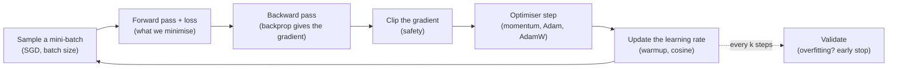
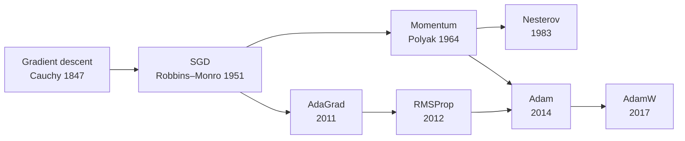
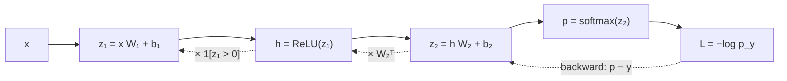

Training a neural network means choosing millions of numbers so that one number, the loss,
gets small on the data you have and *stays* small on data you haven't seen. Those are two
different problems:

- **Optimisation**: make the training loss small, quickly and without blowing up.
- **Generalisation**: make sure that a small training loss means a small test loss too.

The thing that took me longest to appreciate is that the *same knobs* control both. The
learning rate, the batch size and the choice of optimiser decide how fast the loss drops,
and they also decide *which* solution you land in and therefore how well it generalises. So
this post goes through both problems in the order the ideas were discovered: each idea arrives
as the fix for something the previous one couldn't do.

How to read it: the main text is intuition and pictures, and most sections have an
interactive demo you can poke. Every derivation is folded into a **Maths** card you can open
when you want the "why", and skip when you don't. The code is the from-scratch NumPy that
interviews tend to ask for, plus the PyTorch one-liner you'd use in practice. There's a bank
of interview questions at the end.

## The whole post in one picture

Every idea below ends up as one or two lines in the standard training loop:



And here is the cast of characters, in order of appearance:



<details>
<summary><b>Notation used in the maths cards</b></summary>

| Symbol | Meaning |
|---|---|
| $\theta$ | all trainable parameters, flattened into one vector of size $d$ |
| $x_i, y_i$ | the $i$-th input and its target; $N$ examples in total |
| $\ell(\hat y, y)$ | per-example loss (squared error, cross-entropy) |
| $L(\theta)$ | average training loss over the $N$ examples |
| $\nabla L(\theta)$ | gradient: the vector of partial derivatives $\partial L/\partial\theta_j$ |
| $g_t$ | the gradient actually used at step $t$ (often a noisy mini-batch estimate) |
| $\eta$ | learning rate (step size) |
| $B$ | mini-batch size |
| $H$ | Hessian: the matrix of second derivatives of $L$; $\lambda_{\max}$ is its largest eigenvalue |
| $\lambda$ | regularisation / weight-decay strength (context makes clear which $\lambda$) |

</details>

## Learning is minimising a number

We want a model that's right on the *true* distribution of data. We can't measure that; we
only have $N$ samples. So we do the only thing available: minimise the average loss on the
samples, and hope it transfers. Training only ever sees the **training loss**. The thing we
care about is the **test loss**. The difference between them is the **generalisation gap**,
and the second half of this post is about keeping it small.

<details>
<summary><b>Maths: true risk, empirical risk, and the gap</b></summary>

The true risk is the expected loss over the data distribution $\mathcal D$; the empirical risk
is its sample average (Empirical Risk Minimisation, ERM):

$$
R(\theta) = \mathbb{E}_{(x,y)\sim\mathcal{D}}\big[\ell(f(x;\theta),y)\big]
\qquad
L(\theta) = \frac{1}{N}\sum_{i=1}^{N} \ell(f(x_i;\theta),y_i)
$$

Training minimises $L$. The generalisation gap is $R(\theta) - L(\theta)$. For a *fixed*
$\theta$, $L$ is an unbiased estimate of $R$. But $\theta$ was chosen by looking at the same
samples, so at the trained $\theta$, $L$ is optimistically biased. It's the same reason the
sample variance divides by $N-1$: the mean was fitted to the same data.

</details>

### Losses are likelihoods in disguise

Where do the standard losses come from? Almost all of them are the same recipe: assume a
probability model for the target, then pick the parameters that make the observed data most
likely (maximum likelihood). Take the negative log and you get a loss:

| If you assume the target is... | ...maximum likelihood gives you |
|---|---|
| prediction + Gaussian noise | mean squared error (MSE) |
| prediction + Laplace (spiky, heavy-tailed) noise | mean absolute error (MAE), robust to outliers |
| a coin flip with probability $\sigma(z)$ | binary cross-entropy |
| one of $K$ classes with probabilities $\text{softmax}(z)$ | cross-entropy |

Two facts from this that come back later. First, the gradient of softmax + cross-entropy with
respect to the logits is just **predicted probabilities minus the one-hot truth**, $p - y$.
Second, choosing a regulariser turns out to be choosing a *prior* in the same framework; we'll
see that L2 is a Gaussian prior on the weights.

<details>
<summary><b>Maths: MSE from Gaussian noise, cross-entropy from a categorical model</b></summary>

**The principle.** With a conditional model $p_\theta(y\mid x)$ and independent samples,
maximum likelihood is

$$
\hat\theta = \arg\max_\theta \prod_{i} p_\theta(y_i\mid x_i) = \arg\min_\theta\; -\frac1N\sum_{i}\log p_\theta(y_i\mid x_i).
$$

The average negative log-likelihood *is* an empirical risk.

**Gaussian noise gives MSE.** Let $y = f_\theta(x) + \varepsilon$ with
$\varepsilon\sim\mathcal N(0,\sigma^2)$:

$$
-\log p_\theta(y\mid x) = \frac{(y-f_\theta(x))^2}{2\sigma^2} + \tfrac12\log(2\pi\sigma^2).
$$

With $\sigma$ fixed, that's squared error plus a constant. Laplace noise
$p(\varepsilon)\propto e^{-|\varepsilon|/b}$ gives $|y - f(x)|$ instead. The MSE minimiser is
the conditional *mean*; the MAE minimiser is the conditional *median*, which is why MAE shrugs
off outliers.

**Categorical gives cross-entropy.** With $p = \text{softmax}(z)$ and true class $c$:

$$
\ell = -\log p_c = -z_c + \log\sum_j e^{z_j}
\quad\Rightarrow\quad
\frac{\partial \ell}{\partial z_k} = p_k - \mathbb 1[k=c].
$$

**Why not MSE for classification?** With a sigmoid output $p=\sigma(z)$ and MSE,
$\partial\ell/\partial z = (p-y)\,p(1-p)$. When the model is *confidently wrong*
($p\approx 0$, $y=1$), the factor $p(1-p)\approx 0$ kills the gradient exactly when you need it
most. Cross-entropy cancels that factor and leaves $p - y$. MSE on a sigmoid is also
non-convex in the weights of a logistic regression; cross-entropy is convex.

**MLE minimises KL to the data.** As $N\to\infty$, the average NLL tends to
$H(p_\text{data}) + \text{KL}(p_\text{data}\,\|\,p_\theta)$. The entropy term doesn't depend on
$\theta$, so MLE minimises forward KL, which punishes the model hard for putting near-zero
probability on anything that actually happens.

</details>

## Gradient descent: walking downhill in fog

You're on a mountain at night with a torch that lights only the ground at your feet. You
can't see the valley. But you can feel which way the ground tilts. So: take a step in the
steepest downhill direction, look again, repeat. That's gradient descent, proposed by Cauchy
in 1847 to compute planetary orbits:

$$
\theta_{t+1} = \theta_t - \eta\,\nabla L(\theta_t)
$$

The **gradient** $\nabla L$ is a vector that points in the direction the loss *increases*
fastest, and its length says how steep that is. So $-\nabla L$ points downhill, and the
**learning rate** $\eta$ sets the stride. Every optimiser in this post is a smarter way to use
that local tilt.

One thing the picture gets right and intuition often gets wrong: "steepest downhill" is *not*
"towards the minimum". The gradient is always perpendicular to the contour line you're
standing on, so in a stretched bowl it points mostly across the valley, not along it.

<figure class="ml-diagram">
<svg viewBox="0 0 860 300" role="img" aria-label="Contours of the stretched bowl x squared plus 4 y squared. From the point (1, 1), the steepest-descent arrow is perpendicular to the contour and points mostly downward, while the direct line to the minimum points diagonally.">
  <defs><marker id="ml-arrow" viewBox="0 0 10 10" refX="9" refY="5" markerWidth="7" markerHeight="7" orient="auto-start-reverse"><path d="M0,0 L10,5 L0,10 z"/></marker></defs>
  <ellipse class="arrow plain" cx="330" cy="160" rx="78" ry="39"/>
  <ellipse class="arrow plain" cx="330" cy="160" rx="111" ry="55"/>
  <ellipse class="arrow plain" cx="330" cy="160" rx="156" ry="78"/>
  <ellipse class="arrow plain" cx="330" cy="160" rx="198" ry="99"/>
  <circle class="box sand" cx="330" cy="160" r="5"/>
  <text class="note" x="330" y="182">minimum</text>
  <circle class="box rose" cx="400" cy="90" r="6"/>
  <text class="note rose" x="425" y="80">you are here (1, 1)</text>
  <line class="arrow" x1="400" y1="90" x2="375" y2="187"/>
  <line class="arrow dashed" x1="400" y1="90" x2="337" y2="153"/>
  <text class="name left" x="560" y="120">−∇L: steepest way down</text>
  <text class="note left" x="560" y="142">perpendicular to the contour,</text>
  <text class="note left" x="560" y="162">dominated by the steep y-direction</text>
  <text class="name left" x="560" y="202">dashed: straight to the minimum</text>
  <text class="note left" x="560" y="224">not where the gradient points</text>
</svg>
<figcaption>Contours of L = x² + 4y². The bowl is four times steeper in y than in x, so the gradient at (1, 1) is (2, 8): mostly "down", hardly "left".</figcaption>
</figure>

<details>
<summary><b>Maths: why −∇L is the steepest way down, and why a small step always helps</b></summary>

**The directional derivative.** For a unit vector $u$, the rate at which $L$ changes when you
move from $\theta$ along $u$ is

$$
D_u L(\theta) = \lim_{h\to 0}\frac{L(\theta+hu)-L(\theta)}{h} = \nabla L(\theta)^\top u .
$$

**The steepest direction.** By Cauchy–Schwarz,
$\nabla L^\top u = \lVert\nabla L\rVert\cos\varphi \ge -\lVert\nabla L\rVert$, with equality
only when $u$ points exactly opposite the gradient ($\varphi = 180°$). Any direction within
$90°$ of $-\nabla L$ still goes downhill, and moving at exactly $90°$ keeps you on the same
contour: that's why the gradient is perpendicular to contour lines.

**The descent lemma.** Keep the second-order term of Taylor's theorem. If the curvature is
bounded (every eigenvalue of the Hessian is at most $M$), then for the step
$\Delta = -\eta\nabla L$:

$$
L(\theta - \eta\nabla L) \;\le\; L(\theta) - \eta\Big(1 - \frac{M\eta}{2}\Big)\lVert\nabla L\rVert^2 .
$$

The bracket is positive whenever $\eta < 2/M$, so the loss is guaranteed to drop. Keep that
$2/M$; it comes back in the next card as $2/\lambda_{\max}$.

**Gradient descent as a tiny optimisation problem.** The GD step exactly minimises a linear
model of the loss plus a penalty for moving far:

$$
\theta_{t+1} = \arg\min_{\theta'}\Big[L(\theta_t) + \nabla L(\theta_t)^\top(\theta'-\theta_t) + \frac{1}{2\eta}\lVert\theta'-\theta_t\rVert_2^2\Big].
$$

"Steepest" was measured with ordinary Euclidean length. Measure distance with the Hessian,
$\Delta^\top H\Delta$, and the same recipe gives Newton's method; with a per-coordinate scaling
you get Adam-like updates. So $-\nabla L$ is steepest descent *for one particular geometry*,
which is why rescaling features changes how well GD works.

**Worked example.** $L = x^2 + 4y^2$ at $(1,1)$: $\nabla L = (2, 8)$, length $\sqrt{68}\approx 8.25$.

| Direction (unit vector) | Rate of change $\nabla L^\top u$ |
|---|---|
| $-\nabla L/\lVert\nabla L\rVert \approx (-0.243, -0.970)$ | $-8.25$ (steepest) |
| straight to the minimum, $(-0.707, -0.707)$ | $-7.07$ |
| along $-x$ only, $(-1, 0)$ | $-2.00$ |
| along the contour, $(0.970, -0.243)$ | $0.00$ |

</details>

### How big a step? The learning-rate limit

The stride is where things go wrong. Too small and you crawl. Too big and you overshoot the
valley floor and land *higher* on the opposite wall; the next step overshoots by even more,
and the loss explodes. Near a minimum each step multiplies your distance from the bottom by
$(1 - \eta\lambda)$ along a direction of curvature $\lambda$. That factor shrinks the error only
while it's between $-1$ and $1$, which gives the single most useful formula about learning rates:

$$
\eta < \frac{2}{\lambda_{\max}}
$$

The *sharpest* direction of the loss sets the ceiling for *every* direction. Try it below.
Push η past $2/\lambda_{\max}$ and watch the steep wall blow up; then set η just under the
limit and look at the flat floor.



Three regimes, all visible in the demo:

| $\eta\lambda_{\max}$ | What you see |
|---|---|
| below 1 | smooth decay along the steep direction |
| between 1 and 2 | zig-zag: you overshoot every step but each overshoot is smaller |
| above 2 | each overshoot is bigger than the last: divergence |

The demo also shows the real problem. With η pinned just under $2/\lambda_{\max}$ so the walls
stay stable, the flat floor (curvature 1) only shrinks by a factor $(1 - \eta)$ per step, which
is barely anything when $\lambda_{\max}$ is large. The ratio
$\kappa = \lambda_{\max}/\lambda_{\min}$ is the **condition number**, and GD needs roughly
$\kappa$ steps per factor-of-$e$ improvement. A long, narrow valley is the normal case in deep
learning, not an exotic one. Momentum and Adam are both attacks on exactly this.

<details>
<summary><b>Maths: the 2/λ_max limit and the condition number</b></summary>

Near a minimum $\theta^*$, approximate the loss by a quadratic with Hessian $H$:

$$
L(\theta) \approx L(\theta^*) + \tfrac12(\theta-\theta^*)^\top H(\theta-\theta^*)
\quad\Rightarrow\quad
\theta_{t+1}-\theta^* = (I-\eta H)(\theta_t-\theta^*).
$$

Write the error in the eigenvector basis of $H$ (eigenvalues
$\lambda_1\ge\dots\ge\lambda_d>0$). Along eigenvector $i$ the error is multiplied by
$(1-\eta\lambda_i)$ every step, so it shrinks iff $|1-\eta\lambda_i|<1$, i.e.
$0<\eta<2/\lambda_i$. All directions must be stable, so $\eta<2/\lambda_{\max}$.

With the best constant step, $\eta = 2/(\lambda_{\max}+\lambda_{\min})$, the worst direction
shrinks by $(\kappa-1)/(\kappa+1)$ per step, where $\kappa=\lambda_{\max}/\lambda_{\min}$.
For large $\kappa$ that's about $1 - 2/\kappa$, so you need on the order of $\kappa$ steps per
factor-of-$e$ reduction.

For reference, the classical guarantees: if $L$ is convex with curvature at most $M$, GD with
$\eta=1/M$ reaches error $O(1/t)$; if it's also $\mu$-strongly convex the error shrinks like
$(1-\mu/M)^t$. Neural nets aren't convex, so treat these as intuition. In the non-convex case
GD is only guaranteed to find a point with a small gradient.

</details>

The same experiment in four lines of Python, the version I'd write on a whiteboard:

```python {title="lr_threshold.py"}
def run_gd(a, eta, theta0=1.0, steps=20):
    theta, traj = theta0, [theta0]
    for _ in range(steps):
        theta -= eta * a * theta          # gradient of 0.5 * a * theta^2 is a * theta
        traj.append(theta)
    return traj

a = 10.0                                  # curvature, so the limit is 2 / a = 0.2
for eta in [0.05, 0.1, 0.19, 0.21]:
    print(eta, [round(v, 3) for v in run_gd(a, eta)[:6]])
```

```text {title="Output"}
0.05 [1.0, 0.5, 0.25, 0.125, 0.062, 0.031]
0.1 [1.0, 0.0, 0.0, 0.0, 0.0, 0.0]
0.19 [1.0, -0.9, 0.81, -0.729, 0.656, -0.59]
0.21 [1.0, -1.1, 1.21, -1.331, 1.464, -1.611]
```

At $\eta = 1/a$ it lands on the minimum in one step; at $0.19$ it flips sign every step but
shrinks; at $0.21$ it flips sign and grows.

**Feature scaling is conditioning.** For a linear model with squared loss the Hessian is
$X^\top X/N$. If one feature is in metres and another in millimetres, one direction is
a million times steeper than the other, $\kappa$ is enormous, and GD crawls. Standardising
inputs (zero mean, unit variance) makes the bowl rounder. That is the whole reason for input
normalisation, and part of the reason for BatchNorm and LayerNorm.

### Code: linear and logistic regression by gradient descent

The two most common "implement it from scratch" questions. Note the gradients have the same
shape: *(prediction − target) × input*, averaged. That's not a coincidence; it holds for every
generalised linear model with its natural link function.


```python {title="linear regression (GD)"}
import numpy as np

def linreg_gd(X, y, eta=0.1, steps=1000):
    n, d = X.shape
    w, b = np.zeros(d), 0.0
    for _ in range(steps):
        err = X @ w + b - y              # (n,) prediction minus target
        w -= eta * X.T @ err / n         # gradient of 0.5 * mean(err ** 2)
        b -= eta * err.mean()
    return w, b

rng = np.random.default_rng(0)
X = rng.uniform(-1, 1, size=(200, 1))
y = 3 * X[:, 0] + 2 + 0.1 * rng.standard_normal(200)
print(linreg_gd(X, y, eta=0.5, steps=500))   # w ~ [3.0], b ~ 2.0
```
```python {title="closed form"}
import numpy as np

def linreg_closed_form(X, y):
    Xb = np.c_[X, np.ones(len(X))]                  # append a bias column
    theta, *_ = np.linalg.lstsq(Xb, y, rcond=None)  # stable solve of the normal equations
    return theta[:-1], theta[-1]

# Never write np.linalg.inv(X.T @ X): forming X^T X squares the condition number.
# lstsq (SVD) or QR is the numerically safe way to solve X^T X w = X^T y.
```
```python {title="logistic regression (GD)"}
import numpy as np

def sigmoid(z):
    return 1 / (1 + np.exp(-z))

def logreg_gd(X, y, eta=0.5, steps=2000, lam=0.0):
    n, d = X.shape
    w, b = np.zeros(d), 0.0
    for _ in range(steps):
        p = sigmoid(X @ w + b)               # predicted P(y = 1)
        w -= eta * (X.T @ (p - y) / n + lam * w)   # cross-entropy gradient + L2
        b -= eta * (p - y).mean()
    return w, b

rng = np.random.default_rng(0)
X = rng.standard_normal((500, 3))
y = (rng.uniform(size=500) < sigmoid(X @ np.array([2.0, -1.0, 0.5]))).astype(float)
print(logreg_gd(X, y)[0])                    # roughly [2, -1, 0.5]
```


<details>
<summary><b>Maths: Newton's method, and why deep learning mostly avoids it</b></summary>

If GD's problem is that one step size can't suit every curvature, why not divide each
direction by its own curvature? That's Newton's method. Minimise the second-order Taylor model
$L + g^\top\Delta + \tfrac12\Delta^\top H\Delta$ exactly:

$$
\Delta_\text{Newton} = -H^{-1} g .
$$

In the eigenbasis it divides the step along each direction by $\lambda_i$, so every direction
converges at the same rate and the condition number stops mattering. Near a minimum it
converges *quadratically*: the number of correct digits roughly doubles each step. For small
convex problems (logistic regression with a few hundred features) it's the method of choice;
for logistic regression it's called IRLS, iteratively reweighted least squares.

Why not for deep nets:

1. **Cost.** $H$ has $d^2$ entries and solving with it costs $O(d^3)$. At $d = 10^9$, no.
2. **Non-convexity.** $H$ has negative eigenvalues near saddles, and pure Newton happily walks
   *towards* saddles and maxima: it treats every stationary point as the target.
3. **Noise.** Mini-batch curvature estimates are noisy, and inverting a noisy matrix amplifies
   the noise along its small eigenvalues.

What survives: Hessian-vector products (cheap, about two backward passes) for *measuring*
sharpness, L-BFGS for small full-batch problems, and structured approximations (K-FAC,
Shampoo) for large ones. Adam's per-coordinate denominator is sometimes called "diagonal
second-order", but it's built from squared *gradients*, not curvature (more in the Adam
section).

</details>

## Where the gradient comes from: backprop in one page

Gradient descent needs $\nabla L$, one number per weight. The obvious way to get it is to
nudge each weight a tiny bit, rerun the network, and see how much the loss moved. That's one
full forward pass *per weight*. For a network with $10^8$ weights, one gradient step would
cost $10^8$ forward passes. Hopeless.

**Backpropagation** gets all $10^8$ partial derivatives for roughly the price of two forward
passes. The trick is blame assignment run backwards. The loss is a long
chain of simple operations (multiply, add, ReLU, softmax, log). Start at the loss, whose
sensitivity to itself is 1. Each earlier quantity's sensitivity is the sum, over everything it
feeds into, of *(downstream sensitivity) × (local derivative)*. Sweep from the loss back to the
inputs once, and every weight gets its share of the blame; nothing is computed twice.



The price is memory: every activation from the forward pass has to be kept for the backward
pass. That's why activation memory, not parameter memory, is usually what limits batch size.

<details>
<summary><b>Maths: the backward pass for a two-layer network</b></summary>

For a batch $X$ ($B\times d_\text{in}$) with one-hot targets $Y$ ($B\times K$):

$$
Z_1 = XW_1 + b_1,\quad H = \text{ReLU}(Z_1),\quad Z_2 = HW_2 + b_2,\quad P = \text{softmax}(Z_2),\quad L = -\tfrac1B\textstyle\sum_{i,k} Y_{ik}\log P_{ik}.
$$

Backward, one line per node, each using only the line above and stored forward values:

$$
\begin{aligned}
\delta_2 &= \partial L/\partial Z_2 = (P - Y)/B\\
\partial L/\partial W_2 &= H^\top\delta_2, \qquad \partial L/\partial b_2 = \textstyle\sum_i \delta_{2,i}\\
\delta_1 &= \partial L/\partial Z_1 = (\delta_2 W_2^\top)\odot\mathbb 1[Z_1>0]\\
\partial L/\partial W_1 &= X^\top\delta_1, \qquad \partial L/\partial b_1 = \textstyle\sum_i\delta_{1,i}
\end{aligned}
$$

The general recursion for layer $l$ is
$\delta^{(l)} = (\delta^{(l+1)}W^{(l+1)\top})\odot\sigma'(z^{(l)})$. The gradient reaching
layer 1 is a *product* of one such factor per layer. If each factor shrinks vectors a little,
early layers get vanishing gradients; if each grows them, gradients explode. Initialisation,
normalisation and residual connections exist to keep that product near 1.

**Why reverse mode?** Forward-mode differentiation costs one pass per *input* variable;
reverse mode costs one pass per *output*. A loss is one scalar and there are millions of
weights, so reverse mode wins by a factor of millions.

</details>

The from-scratch version, which is also the test bed for the optimisers later. Always check a
hand-written backward pass against finite differences; a relative error around $10^{-7}$ means
it's right, around $10^{-2}$ means a bug.


```python {title="two-layer net"}
import numpy as np

def make_spirals(n_per_class=100, K=3, seed=0):
    rng = np.random.default_rng(seed)
    X, y = [], []
    for k in range(K):
        r = np.linspace(0.0, 1, n_per_class)
        t = np.linspace(k * 4, (k + 1) * 4, n_per_class) + 0.2 * rng.standard_normal(n_per_class)
        X.append(np.c_[r * np.sin(t), r * np.cos(t)])
        y.append(np.full(n_per_class, k))
    return np.vstack(X), np.concatenate(y)

X, y = make_spirals()
D, H_DIM, K = 2, 100, 3
rng = np.random.default_rng(1)
params = {
    "W1": rng.standard_normal((D, H_DIM)) * np.sqrt(2 / D),      # He init
    "b1": np.zeros(H_DIM),
    "W2": rng.standard_normal((H_DIM, K)) * np.sqrt(2 / H_DIM),
    "b2": np.zeros(K),
}

def forward_backward(p, Xb, yb):
    B = Xb.shape[0]
    # forward: keep what backward needs
    Z1 = Xb @ p["W1"] + p["b1"]
    H = np.maximum(0, Z1)
    Z2 = H @ p["W2"] + p["b2"]
    Z2 = Z2 - Z2.max(axis=1, keepdims=True)                     # stable softmax
    P = np.exp(Z2) / np.exp(Z2).sum(axis=1, keepdims=True)
    loss = -np.log(P[np.arange(B), yb]).mean()
    # backward
    d2 = P.copy()
    d2[np.arange(B), yb] -= 1                                   # P - Y
    d2 /= B
    g = {"W2": H.T @ d2, "b2": d2.sum(0)}
    d1 = (d2 @ p["W2"].T) * (Z1 > 0)                            # ReLU passes gradient where z > 0
    g["W1"] = Xb.T @ d1
    g["b1"] = d1.sum(0)
    return loss, g

for step in range(3000):
    loss, g = forward_backward(params, X, y)
    for k in params:
        params[k] -= 1.0 * g[k]                                 # plain full-batch GD
    if step % 1000 == 0:
        print(step, round(loss, 4))
```
```python {title="gradient check"}
def grad_check(p, Xb, yb, key, n_checks=5, eps=1e-5, seed=0):
    rng = np.random.default_rng(seed)
    _, g = forward_backward(p, Xb, yb)
    for _ in range(n_checks):
        idx = tuple(rng.integers(s) for s in p[key].shape)
        old = p[key][idx]
        p[key][idx] = old + eps; lp, _ = forward_backward(p, Xb, yb)
        p[key][idx] = old - eps; lm, _ = forward_backward(p, Xb, yb)
        p[key][idx] = old
        num = (lp - lm) / (2 * eps)                              # centred finite difference
        rel = abs(num - g[key][idx]) / max(1e-12, abs(num) + abs(g[key][idx]))
        print(key, idx, f"relative error {rel:.1e}")

grad_check(params, X[:20], y[:20], "W1")
```
```python {title="PyTorch"}
import torch

W = torch.randn(2, 3, requires_grad=True)
x = torch.randn(5, 2)
loss = (x @ W).relu().sum()
loss.backward()            # reverse-mode autodiff over the recorded graph
print(W.grad.shape)        # torch.Size([2, 3])
```


## Stochastic gradient descent: poll a few, step often

The training loss is an average over all $N$ examples, so its gradient is the average of the
per-example gradients. Full-batch GD computes that whole average before every single step.
On ImageNet, that's 1.2 million images per step.

But you don't need to ask a million voters to know which way an election is leaning; a random
poll of a few hundred gets you close. **Stochastic gradient descent** does the same: estimate
the gradient from a random **mini-batch** of $B$ examples, take the step, repeat. Each step is
noisier but $N/B$ times cheaper, so by the time full-batch GD has taken its first step, SGD has
taken thousands. Robbins and Monro worked out the theory in 1951, and
it has been the default whenever data is plentiful and compute is the bottleneck.

| Strategy | Steps per epoch | Direction used |
|---|---|---|
| Full-batch GD | 1 | the exact gradient |
| SGD, $B = 1$ | $N$ | a very noisy estimate |
| Mini-batch SGD, $1 < B \ll N$ | $N/B$ | a less noisy estimate; what everyone means by "SGD" today |

Two facts carry everything that follows:

- The mini-batch gradient is **unbiased**: on average it equals the true gradient.
- Its noise **shrinks like $1/\sqrt{B}$**: quadrupling the batch only halves the noise.

A common confusion is worth clearing up: you can *compute* the gradient one example at a time
and still take one exact full-batch step, by adding up the per-example gradients before you
update. That's **gradient accumulation**, and it changes memory, not maths. What makes SGD
stochastic is *updating* after each batch, so the next gradient is evaluated at new weights.

### The noise ball

Here's the catch. Stand exactly at the minimum. Full-batch GD sees a zero gradient and stops.
SGD sees a mini-batch gradient that is zero *on average* but not on this particular batch,
because individual examples disagree. So it gets kicked off the answer, every step, forever.
With a constant learning rate, SGD doesn't converge to a point; it settles into a **noise
ball** around the minimum whose size grows with η and shrinks with B.



Play with it and three things fall out. Halving η halves the floor. Doubling B also halves the
floor. And a decaying schedule drives the cloud below the floor. That last point is the whole
reason learning-rate schedules exist, and why validation loss often drops sharply the moment
the learning rate is cut.

<details>
<summary><b>Maths: unbiased, variance Σ/B, and the size of the noise ball</b></summary>

Sample a batch $\mathcal B_t$ of $B$ indices uniformly at random:

$$
g_t = \frac1B\sum_{i\in\mathcal B_t}\nabla\ell_i(\theta_t),\qquad
\mathbb E[g_t] = \nabla L(\theta_t),\qquad
\text{Cov}[g_t]\approx\frac{\Sigma(\theta_t)}{B},
$$

where $\Sigma$ is the covariance of per-example gradients. (Sampling without replacement adds
a finite-population factor $(N-B)/(N-1)$, which is exactly 0 at $B = N$.)

**The noise ball on a 1-D quadratic.** Take $L = \tfrac12 a\theta^2$ and a noisy gradient
$g = a\theta + \xi$ with $\text{Var}(\xi) = \sigma^2/B$. One step is
$\theta_{t+1} = (1-\eta a)\theta_t - \eta\xi_t$. The mean shrinks geometrically, like GD.
The variance $v_t$ obeys $v_{t+1} = (1-\eta a)^2 v_t + \eta^2\sigma^2/B$, which settles at

$$
v_\infty = \frac{\eta^2\sigma^2/B}{1-(1-\eta a)^2} = \frac{\eta\,\sigma^2}{B\,a\,(2-\eta a)} \;\approx\; \frac{\eta}{B}\cdot\frac{\sigma^2}{2a}.
$$

Proportional to $\eta/B$. With $\sigma = 0$ (full batch) it's zero, so constant-η GD
converges exactly; with noise you must send $\eta\to0$ (or $B\to\infty$) to shrink the ball.
The demo's dashed line is this formula summed over its two directions.

</details>

<details>
<summary><b>Maths: the Robbins–Monro conditions (why the decay has to be "just right")</b></summary>

To converge exactly with noisy gradients, the step sizes must satisfy

$$
\sum_{t=1}^{\infty}\eta_t = \infty \qquad\text{and}\qquad \sum_{t=1}^{\infty}\eta_t^2 < \infty .
$$

**The second condition kills the noise.** The accumulated kicks $\sum_t\eta_t\xi_t$ are
independent, so their variances add: $\sigma^2\sum_t\eta_t^2$. If that sum is infinite, the
iterate random-walks forever. Constant η gives $\eta^2 T\to\infty$: the noise ball.

**The first condition lets you arrive.** Ignoring noise, the error after $T$ steps is at most
$|\theta_0|\exp(-a\sum_t\eta_t)$. If $\sum\eta_t$ is finite you run out of fuel before
reaching a distant minimum. $\eta_t = 1/t^2$ has total $\pi^2/6\approx1.64$, so from far away
you never get there.

$\eta_t = c/t$ sits in the gap: the harmonic series diverges, $\sum 1/t^2$ converges. Any
$c/t^p$ with $\tfrac12 < p\le 1$ works.

**Simulation** ($a=1$, $\sigma=1$, $\theta_0=5$, 20,000 steps, 500 runs):

| Schedule $\eta_t$ | $\sum\eta_t$ | $\sum\eta_t^2$ | final $\mathbb E[\theta^2]$ |
|---|---|---|---|
| full GD (no noise), 0.1 | ∞ | ∞ | 0 (exact) |
| SGD, 0.1 | ∞ | ∞ | 0.049 (noise ball ≈ η/(2−η) = 0.053) |
| SGD, 0.01 | ∞ | ∞ | 0.0046 (10× smaller η, 10× smaller ball) |
| SGD, 1/(t+10) | ∞ | finite | 0.00006 (converging) |
| SGD, 1/(t+10)² | finite | finite | 20.7 (stuck near the start; θ₀² = 25) |

```python {title="robbins_monro.py"}
import numpy as np

rng = np.random.default_rng(0)
a, sigma = 1.0, 1.0

def run(schedule, T=20000, theta0=5.0, runs=500, noisy=True):
    theta = np.full(runs, theta0)
    for t in range(1, T + 1):
        noise = sigma * rng.standard_normal(runs) if noisy else 0.0
        theta = theta - schedule(t) * (a * theta + noise)   # SGD step on a/2 * theta^2
    return np.mean(theta ** 2)

print("full GD, 0.1   :", run(lambda t: 0.1, noisy=False))
print("SGD, 0.1       :", run(lambda t: 0.1))
print("SGD, 0.01      :", run(lambda t: 0.01))
print("SGD, 1/(t+10)  :", run(lambda t: 1 / (t + 10)))
print("SGD, 1/(t+10)^2:", run(lambda t: 1 / (t + 10) ** 2))
```

Deep learning uses a relaxed version: a big, roughly constant rate early (fast progress), then
decay towards zero at the end (shrink the ball). We rarely want the exact minimiser anyway; a
bit of noise turns out to help generalisation, as the last section shows.

</details>

### Shuffle every epoch

Iterating through the data in a fresh random order each epoch (**random reshuffling**) beats
drawing examples independently with replacement. With replacement, about 37% of the data is
skipped in any given "epoch" while other examples are seen twice, so the noise never averages
out. With reshuffling, every example contributes exactly once, so over an epoch the noise
*cancels*: the epoch behaves almost like one full-batch step. A fixed order also sees each
example once, but if the order is correlated with anything (sorted by class, by time, by
source), the model is pulled towards whatever comes last, every epoch.

<details>
<summary><b>Maths and simulation: why reshuffling's noise ball is η² instead of η</b></summary>

With a small learning rate, weights barely move during one epoch, so approximate every
gradient in the epoch as if evaluated at the starting point $w_0$:
$\Delta w_\text{epoch}\approx-\eta\sum_{t=1}^N\nabla\ell_{i_t}(w_0)$.

- **Reshuffling:** each index appears once, so the sum is exactly $N\nabla L(w_0)$. Zero noise
  to first order. The leftover error comes from the weights drifting within the epoch, which is
  second order in η.
- **With replacement:** the sum is $N\nabla L(w_0)$ plus an error of variance $N\sigma^2$.

So the noise ball is $\propto\eta\sigma^2$ with replacement but $\propto\eta^2$ with reshuffling.
The finite-population formula says the same thing: the variance of the mean of the first $k$
draws is $\frac{\sigma^2}{k}\cdot\frac{N-k}{N-1}$ without replacement, exactly zero at $k=N$.

Least squares, $N=200$, $d=5$, constant step, 100 epochs, squared distance to the exact
minimiser, 20 seeds:

| η | with replacement | random reshuffling | ratio |
|---|---|---|---|
| 0.02 | 1.6 × 10⁻² | 6.7 × 10⁻³ | 2.3× |
| 0.01 | 7.7 × 10⁻³ | 1.5 × 10⁻³ | 5.1× |
| 0.005 | 3.5 × 10⁻³ | 2.4 × 10⁻⁴ | 14.8× |

Halving η halves the with-replacement error but cuts the reshuffling error by 4–6×, and the gap
widens as η shrinks. Theory agrees: for smooth strongly convex problems, reshuffling's error
falls like $1/K^2$ in the number of epochs versus $1/K$ for with-replacement
SGD.

```python {title="reshuffle_vs_replacement.py"}
import numpy as np

rng = np.random.default_rng(0)
N, d = 200, 5
X = rng.standard_normal((N, d)); y = X @ rng.standard_normal(d) + 0.5 * rng.standard_normal(N)
w_star = np.linalg.lstsq(X, y, rcond=None)[0]               # exact minimiser

def run(order, eta, epochs=100, seed=0):
    r = np.random.default_rng(seed); w = np.zeros(d)
    for _ in range(epochs):
        idx = r.integers(0, N, N) if order == "with_replacement" else r.permutation(N)
        for i in idx:
            w -= eta * (X[i] @ w - y[i]) * X[i]                # gradient of 0.5 * (x.w - y)^2
    return np.sum((w - w_star) ** 2)

for eta in [0.02, 0.01, 0.005]:
    for order in ["with_replacement", "reshuffle"]:
        print(eta, order, np.mean([run(order, eta, seed=s) for s in range(20)]))
```

</details>

### Batch size: the compute side

- **Hardware.** A GPU processes a batch of 256 almost as fast as a batch of 32, because the
  matrix multiplies run in parallel. Tiny batches waste the hardware.
- **Diminishing returns.** Past some point the gradient estimate is already good and more
  examples buy almost nothing. McCandlish et al. call this the **critical batch
  size**: below it, doubling B roughly halves the number of steps
  needed; above it, steps barely drop and you just burn compute. It's estimated from the ratio
  of gradient noise to gradient signal, and it grows as training progresses.
- **Memory.** Activations for the backward pass scale linearly with B. When the batch you want
  doesn't fit, accumulate gradients over several smaller ones.


```python {title="mini-batch SGD (NumPy)"}
def iterate_minibatches(X, y, B, rng):
    idx = rng.permutation(len(X))          # fresh order every epoch
    for start in range(0, len(X), B):
        j = idx[start:start + B]
        yield X[j], y[j]

rng = np.random.default_rng(0)
B, eta, epochs = 32, 0.5, 100
for epoch in range(epochs):
    for Xb, yb in iterate_minibatches(X, y, B, rng):
        loss, g = forward_backward(params, Xb, yb)    # the two-layer net from above
        for k in params:
            params[k] -= eta * g[k]
```
```python {title="gradient accumulation (PyTorch)"}
accum = 4                                          # effective batch = 4 x loader batch
opt.zero_grad()
for i, (xb, yb) in enumerate(loader):
    loss = loss_fn(model(xb), yb) / accum           # divide so the summed grads are an average
    loss.backward()                                 # .grad accumulates across calls
    if (i + 1) % accum == 0:
        opt.step()
        opt.zero_grad()
```


## The learning rate, and how to change it over time

The learning rate is usually the most important hyperparameter. Tune it first, tune it on a
log scale, and almost always change it during training. From the last two sections, η
controls three things at once:

- **stability** along the sharpest direction (it must stay below about $2/\lambda_{\max}$),
- **speed** along the flat directions,
- **exploration noise**: the SGD noise ball is proportional to η.

| Symptom | Likely cause |
|---|---|
| loss becomes NaN or explodes in the first steps | η far too large |
| loss spikes, recovers, spikes again | η near the edge of stability, or no warmup |
| loss falls fast, then plateaus at a high value | η too large to settle; decay it |
| loss falls very slowly and steadily | η too small |
| training loss good, validation much worse | not an η problem on its own; see overfitting below |

### Big steps early, small steps late

Early in training you're far from anything good: big steps make fast progress, and the noise
helps you explore. Late in training you want to settle into the bottom of a basin, and noise
just keeps you bouncing above the floor. So you decay η. The demo below runs the schedules
people actually use on a noisy quadratic with 200 directions of different curvature, and
plots the expected excess loss.



A few things to notice. The constant rate makes the fastest early progress and then stalls on
its noise floor forever. Step decay produces the familiar staircase: each drop instantly
shrinks the noise ball. Cosine does the same smoothly. What decides the final number is almost
entirely **the shape of the end of the schedule**: how long you spend at a small learning rate.

The schedules worth knowing:

- **Step decay** (the classic ResNet recipe): multiply η by 0.1 at fixed epochs.
- **Cosine annealing**: $\eta_t = \eta_{\min} + \tfrac12(\eta_{\max}-\eta_{\min})(1+\cos(\pi t/T))$.
  Flat at the top, a smooth glide, and a long time near zero at the end.
- **Linear warmup**: ramp η from near 0 to $\eta_{\max}$ over the first
  few hundred or thousand steps, then hand over to the main schedule.
- **One-cycle**: warm up to a high peak, then anneal to almost zero.
- **Warmup–stable–decay (WSD)**: warm up, hold η constant for most of training, then decay
  quickly at the end. Because the decay is a short add-on, you can branch off from any
  checkpoint and finish it, without committing to a total length in advance.

<details>
<summary><b>Maths and simulation: step decay vs cosine, which is better?</b></summary>

**Short answer:** well tuned, they end up about the same. Cosine is the better *default*,
because it gets close to the best possible schedule with nothing to tune but the total length
$T$, while step decay is only as good as its drop points.

**Why the end of the schedule decides.** Take a noisy quadratic with directions of curvature
$a_i$ and gradient noise $\sigma_i^2$. Along each direction the expected squared error after
$T$ steps splits exactly into two parts:

$$
\mathbb E[\theta_{i,T}^2] =
\underbrace{\theta_{i,0}^2\prod_{t}(1-\eta_t a_i)^2}_{\text{bias: needs a large total }\sum\eta_t}
+
\underbrace{\sigma_i^2\sum_{t}\eta_t^2\prod_{s>t}(1-\eta_s a_i)^2}_{\text{noise: kicks at step }t\text{, damped by every later step}} .
$$

A kick at step $t$ is damped by all later steps, at a rate set by the curvature. Sharp
directions forget old kicks within about $1/(2\eta a_i)$ steps, so they only care about the
*final* learning rate. Flat directions have long memory: they care about η averaged over the
last $\sim 1/(\eta a_i)$ steps. Drop η abruptly and the noise injected just before the drop is
still sitting in the flat directions at the end. The bias term almost never decides anything:
any sensible schedule has a large enough area $\sum\eta_t$.

So the ideal schedule lowers η gradually and then spends many steps near zero. Near its end,
cosine behaves like $\eta_{\max}\tfrac{\pi^2}{4}\big(\tfrac{T-t}{T}\big)^2$: it approaches zero
*quadratically* and lingers there. Linear decay approaches zero only linearly, which is why it
does worse below despite the same area.

**Simulation** (1,000 directions, curvatures $10^{-3}$ to 1, $\sigma_i^2 = a_i$,
$\eta_{\max}=1$, $T=5000$, exact):

| Schedule | Final excess loss | Bias part | Noise part |
|---|---|---|---|
| constant | 50.3 | 0.000 | 50.3 |
| step ×0.1 at 30%, 60%, 90% | 0.416 | 0.001 | 0.415 |
| cosine | 0.526 | 0.000 | 0.526 |
| step ×0.1 at 10%, 20% | 0.562 | 0.019 | 0.543 |
| step ×0.1 at 50%, 75% (classic) | 0.581 | 0.000 | 0.581 |
| linear to 0 | 0.882 | 0.000 | 0.882 |
| step ×0.1 at 80%, 95% | 1.193 | 0.000 | 1.193 |

Across all 171 two-drop step schedules with drop points on a 5% grid, the final loss ranged
from 0.48 (best) through 0.58 (median) to 1.58 (worst). Cosine's 0.53 is near the best of them
with nothing to tune. Step decay has a higher ceiling if you search; a much lower floor if you
don't. A practical bonus: cosine is defined relative to $T$, so it rescales when the budget
changes, whereas step milestones are usually hard-coded in epochs.

```python {title="schedule_sim.py"}
import numpy as np, math

d, T, eta_max = 1000, 5000, 1.0
a = np.logspace(-3, 0, d)            # curvature of each direction
sigma2 = a.copy()                    # gradient-noise variance per direction

cosine = lambda t: 0.5 * eta_max * (1 + math.cos(math.pi * t / T))
step = lambda ms: (lambda t: eta_max * 0.1 ** sum(t >= m * T for m in ms))

def final_loss(sched):
    bias, noise = np.ones(d), np.zeros(d)        # E[theta^2] = bias + noise, per direction
    for t in range(T):
        e = sched(t)
        bias = (1 - e * a) ** 2 * bias
        noise = (1 - e * a) ** 2 * noise + e ** 2 * sigma2
    return 0.5 * np.sum(a * bias), 0.5 * np.sum(a * noise)

for name, s in [("cosine", cosine), ("step 50/75", step([0.5, 0.75])), ("step 80/95", step([0.8, 0.95]))]:
    b, n = final_loss(s)
    print(f"{name:12s} bias {b:.4f}  noise {n:.4f}  total {b + n:.4f}")
```

</details>

### Warmup: the beginning is the most fragile moment

Warmup starts η near zero and ramps it up, usually linearly, over the first 1–5% of training.
It's one extra line in the schedule, and it handles three separate problems that all peak in
the first few hundred steps:

1. **The loss is sharpest at the start.** At a random initialisation $\lambda_{\max}$ is often
   large, and early training then *reduces* it as the network moves into flatter
   regions. So the safe step size $2/\lambda_{\max}$ grows during early
   training, and warmup tracks it. Without warmup, the very first full-size step can violate
   the limit: a loss spike, a NaN, or a jump into a bad region the model never fully leaves.
2. **Adam's first steps are full-size in every direction.** After one gradient, Adam's update
   is $\eta\cdot\text{sign}(g)$ for *every* parameter, whether its gradient was meaningful or
   pure noise. For a million parameters that's a step of length $\eta\sqrt{d}$. And for the
   next few hundred steps Adam's scale estimate is an average of very few squared gradients, so
   it's noisy and some coordinates take enormous steps.
3. **Large batches mean large learning rates.** The linear scaling rule (later) says bigger
   batches call for proportionally bigger η, which makes problem 1 much worse. Goyal et al.
   needed a 5-epoch warmup to train ImageNet with batch 8,192 at small-batch
   accuracy.

Why not just use a small η throughout? Because the large η is what you want for the rest of
training: faster progress, and (as we'll see) better generalisation. Warmup lets you use it
*after* the fragile phase.

<details>
<summary><b>Maths and code: Adam's first step is η · sign(g)</b></summary>

After one gradient $g_1$, bias correction gives $\hat m_1 = g_1$ and $\hat v_1 = g_1^2$, so each
coordinate moves by

$$
\Delta\theta_1 = -\eta\,\frac{\hat m_1}{\sqrt{\hat v_1}+\epsilon} = -\eta\,\frac{g_1}{|g_1|+\epsilon}\approx-\eta\,\text{sign}(g_1).
$$

Every coordinate moves by η regardless of how big its gradient was. Bias correction fixes the
*average* of $\hat v$, not its variance: it takes roughly $1/(1-\beta_2)$ steps (about 1,000 for
$\beta_2=0.999$) before $\hat v$ has averaged enough squared gradients to be trustworthy.

```python {title="adam_first_step.py"}
import numpy as np

rng = np.random.default_rng(0)
d, lr, b1, b2, eps = 1_000_000, 1e-3, 0.9, 0.999, 1e-8
g = rng.standard_normal(d) * 10.0 ** rng.uniform(-6, 0, d)   # gradients spanning 6 orders of magnitude
m, v = (1 - b1) * g, (1 - b2) * g ** 2                        # Adam state after one step
step = lr * (m / (1 - b1)) / (np.sqrt(v / (1 - b2)) + eps)    # bias-corrected first update

print("Adam update norm:", np.linalg.norm(step))              # ~0.997 = lr * sqrt(d)
print("SGD update norm, same lr:", lr * np.linalg.norm(g))     # ~0.19
print("median |step|:", np.median(np.abs(step)))              # ~1e-3: every coordinate moves ~lr
```

</details>

Signs you need (more) warmup: loss explodes or goes NaN in the first few hundred steps; an
early spike followed by slow recovery; training works at a lower peak η but not a higher one.
Remedies, roughly in order: add or lengthen warmup, lower the peak η, clip gradients, and for
Adam use a smaller $\beta_2$ such as 0.95 so the scale estimate adapts faster.

### Finding a good learning rate

The **LR range test** is a cheap search: start with a tiny η, multiply it by a
constant every mini-batch, and record the loss. The loss falls, bottoms out, then explodes.
Pick a value 3–10× below where the loss is lowest. Short of that, sweep on a log grid
(1e-4, 3e-4, 1e-3, 3e-3, ...). Typical starting points: 0.1 for SGD with momentum on a
ResNet, 1e-4 to 1e-3 for Adam/AdamW.


```python {title="warmup + cosine"}
import math

def lr_at(step, total, warmup, lr_max, lr_min=0.0):
    if step < warmup:
        return lr_max * (step + 1) / warmup                      # linear warmup
    progress = (step - warmup) / max(1, total - warmup)          # 0 -> 1
    return lr_min + 0.5 * (lr_max - lr_min) * (1 + math.cos(math.pi * progress))

# PyTorch: set it every step
# for g in optimizer.param_groups: g["lr"] = lr_at(step, total_steps, warmup_steps, 3e-4)
# or: torch.optim.lr_scheduler.LambdaLR(opt, lambda s: lr_at(s, T, Tw, 1.0))
```
```python {title="LR range test"}
import copy, math, torch

def lr_range_test(model, loss_fn, loader, opt_cls, lr_min=1e-7, lr_max=10, steps=100):
    model = copy.deepcopy(model)                       # don't touch the real model
    opt = opt_cls(model.parameters(), lr=lr_min)
    mult = (lr_max / lr_min) ** (1 / steps)
    lrs, losses, it = [], [], iter(loader)
    for _ in range(steps):
        try:
            xb, yb = next(it)
        except StopIteration:
            it = iter(loader); xb, yb = next(it)
        loss = loss_fn(model(xb), yb)
        opt.zero_grad(); loss.backward(); opt.step()
        lrs.append(opt.param_groups[0]["lr"]); losses.append(loss.item())
        if not math.isfinite(loss.item()) or loss.item() > 4 * min(losses):
            break                                      # it has exploded; stop
        for g in opt.param_groups:
            g["lr"] *= mult
    return lrs, losses                                 # plot losses vs lrs on a log x-axis
```


## Momentum: give the ball some mass

Plain gradient descent is a hiker with no inertia: every step goes exactly where the local
slope points. In a ravine the slope across the valley flips left, right, left, right, and the
hiker zig-zags while inching along the floor. Polyak's fix (1964) was to make the hiker a
**heavy ball**: keep a running velocity of past gradients and step along that instead.

- Across the valley, the gradient keeps flipping sign, so the velocity in that direction
  **averages out** to almost nothing.
- Along the floor, the gradient always points the same way, so the velocity **builds up** and
  the ball speeds up.
- Small bumps and shallow dips get rolled through instead of stopping the ball.

$$
v_{t+1} = \beta v_t + g_t,\qquad \theta_{t+1} = \theta_t - \eta\,v_{t+1},\qquad \beta\approx0.9
$$

Race them yourself. Start with the ravine, then try the tilted ravine and the saddle; the
adaptive optimisers in the list are explained in the next section.



On the ravine, plain GD needs about 140 steps to get within $10^{-3}$ of the minimum, because
its η is capped by the steep wall. Momentum gets there in about 40. Sutskever et al. showed
momentum, with careful initialisation, was what made deep networks trainable with SGD in the
first place, and SGD + momentum 0.9 is still the strongest choice for
many convolutional vision models when well tuned.

<details>
<summary><b>Maths: unrolling momentum, the effective learning rate, and √κ</b></summary>

**Unroll the recursion** (a favourite interview ask):

$$
v_t = g_t + \beta g_{t-1} + \beta^2 g_{t-2} + \dots = \sum_{k\le t}\beta^{t-k}g_k .
$$

An exponentially weighted sum of past gradients, with memory of about $1/(1-\beta)$ steps
(10 steps for $\beta = 0.9$). If the gradient were constant, $v\to g/(1-\beta)$, so the
**effective learning rate** in a consistent direction is $\eta/(1-\beta)$: 10η for
$\beta=0.9$. Change β and you've also changed the effective step size.

**Why it beats GD on ravines.** On a quadratic with condition number κ, the best tuned GD
shrinks the error by $(\kappa-1)/(\kappa+1)$ per step. Heavy-ball momentum with the optimal η
and β achieves

$$
\frac{\sqrt\kappa-1}{\sqrt\kappa+1},
$$

so about $\sqrt\kappa$ steps instead of κ. For $\kappa = 10{,}000$ that's 100 steps instead
of 10,000.

**Two conventions.** PyTorch uses $v\leftarrow\beta v + g$. Others write the exponential moving
average $m\leftarrow\beta m + (1-\beta)g$, a true average of recent gradients. They're the same
method with η rescaled by $(1-\beta)$. Adam uses the EMA form.

</details>

### Nesterov: look before you leap

Nesterov's version (1983) evaluates the gradient at the point momentum is *about to carry you
to*, rather than where you are. If momentum is about to overshoot, the gradient there already
points back, so it brakes earlier and oscillates less. For smooth convex problems it attains
the optimal $O(1/t^2)$ rate (GD gets $O(1/t)$). In deep learning the difference from classical
momentum is usually small, but it's free.

<details>
<summary><b>Maths: the Nesterov update and the form PyTorch uses</b></summary>

The look-ahead form:

$$
v_{t+1} = \beta v_t + \nabla L(\theta_t - \eta\beta v_t),\qquad \theta_{t+1} = \theta_t - \eta v_{t+1}.
$$

Computing a gradient at a point other than the current weights is awkward in a framework, so
implementations substitute $\tilde\theta = \theta - \eta\beta v$ and get an equivalent update
that only needs the gradient at the current (shifted) weights:

$$
v_{t+1} = \beta v_t + g_t,\qquad \theta_{t+1} = \theta_t - \eta\,(g_t + \beta v_{t+1}).
$$

</details>

```python {title="sgd_momentum.py"}
import numpy as np

class SGDMomentum:
    def __init__(self, params, lr=0.1, beta=0.9, nesterov=False):
        self.p, self.lr, self.beta, self.nesterov = params, lr, beta, nesterov
        self.v = {k: np.zeros_like(w) for k, w in params.items()}

    def step(self, grads):
        for k in self.p:
            self.v[k] = self.beta * self.v[k] + grads[k]
            d = grads[k] + self.beta * self.v[k] if self.nesterov else self.v[k]
            self.p[k] -= self.lr * d

# Ravine: curvature 4 across, 0.04 along. Count steps to get the loss below 1e-3.
loss = lambda p: 0.02 * p["w"][0] ** 2 + 2 * p["w"][1] ** 2
grad = lambda p: {"w": np.array([0.04, 4.0]) * p["w"]}
for name, kw in [("GD", dict(lr=0.45, beta=0.0)), ("momentum", dict(lr=0.15)), ("nesterov", dict(lr=0.15, nesterov=True))]:
    p = {"w": np.array([-2.7, 1.6])}
    opt = SGDMomentum(p, **kw)
    steps = 0
    while loss(p) >= 1e-3:
        opt.step(grad(p))
        steps += 1
    print(f"{name:9s} {steps} steps")

# PyTorch: torch.optim.SGD(model.parameters(), lr=0.1, momentum=0.9, nesterov=True)
```

```text {title="Output"}
GD        138 steps
momentum  40 steps
nesterov  33 steps
```

## Adaptive optimisers: a learning rate per parameter

Momentum fixes the zig-zag but still uses one η for every parameter. In a real network the
gradient scales differ wildly between parameters: embeddings for rare words get a gradient
once in a while, the last layer's gradients can be 100× the first layer's. The adaptive idea:
**divide each parameter's step by a running estimate of how big its gradients usually are.**

### Why the gradient already "scaling each step" isn't enough

A fair objection: with one η, each parameter already gets its own step, $\eta g_i$, bigger
where the gradient is bigger. The problem is that the gradient measures *steepness*, not
*distance to the minimum*. Picture two valleys, one steep and one shallow, and stand the same
distance from the bottom of each:

<figure class="ml-diagram">
<svg viewBox="0 0 860 270" role="img" aria-label="Two valleys. In the steep one, a ball at distance 50 from the bottom has a large gradient and its step overshoots to the far wall. In the shallow one, a ball at the same distance has a tiny gradient and its step barely moves it.">
  <defs><marker id="ml-arrow" viewBox="0 0 10 10" refX="9" refY="5" markerWidth="7" markerHeight="7" orient="auto-start-reverse"><path d="M0,0 L10,5 L0,10 z"/></marker></defs>
  <rect class="group" x="20" y="10" width="400" height="250" rx="14"/>
  <text class="label" x="220" y="36">steep direction (curvature 100)</text>
  <path class="arrow plain" d="M130,50 Q220,390 310,50"/>
  <circle class="box rose" cx="170" cy="167" r="7"/>
  <path class="arrow dashed" d="M176,160 Q230,95 284,116"/>
  <line class="arrow plain both" x1="170" y1="236" x2="220" y2="236"/>
  <text class="note" x="195" y="230">d</text>
  <text class="note rose" x="300" y="200">big gradient,</text>
  <text class="note rose" x="300" y="218">overshoots</text>
  <rect class="group" x="440" y="10" width="400" height="250" rx="14"/>
  <text class="label" x="640" y="36">flat direction (curvature 1)</text>
  <path class="arrow plain" d="M460,160 Q640,280 820,160"/>
  <circle class="box blue" cx="590" cy="208" r="7"/>
  <line class="arrow" x1="598" y1="196" x2="610" y2="196"/>
  <line class="arrow plain both" x1="590" y1="236" x2="640" y2="236"/>
  <text class="note" x="615" y="230">d</text>
  <text class="note blue" x="730" y="110">tiny gradient,</text>
  <text class="note blue" x="730" y="128">tiny step: crawls</text>
</svg>
<figcaption>Same distance d to the bottom in both; the gradient is 100× bigger on the left. Steps proportional to the gradient get it backwards: the steep direction needs a short, careful step and the flat one could take a big one.</figcaption>
</figure>

Steps proportional to the gradient are backwards here. The steep direction, which needs a
short careful step, gets the biggest push and overshoots; the shallow one, which could safely
take a big step, gets the smallest. And one η can't fix both: any η big enough to move the flat
parameter quickly blows up the steep one.

| Two parameters, curvatures (100, 1), both distance 1 from the minimum | Steps to get within 0.001 |
|---|---|
| one η = 0.019 (just under 2/100) | 361: the flat parameter shrinks only 1.9% per step |
| one η = 0.021 (just over 2/100) | never: the steep parameter diverges |
| per-parameter $\eta_i = 1/a_i$ (if we knew the curvature) | 1 |
| RMSProp, η = 0.01 (knows nothing about curvature) | 131 |

<details>
<summary><b>Maths: the gradient mixes curvature and distance</b></summary>

Near a minimum, approximate the loss along parameter $i$ as a quadratic with curvature $a_i$
and distance $\delta_i = \theta_i - \theta_i^*$:

$$
L \approx \sum_i \tfrac12 a_i\delta_i^2 \quad\Rightarrow\quad g_i = a_i\delta_i .
$$

The step that lands exactly on the minimum is $\delta_i = g_i/a_i$: the ideal per-parameter
learning rate is $1/a_i$. One shared η instead gives $\delta_i\leftarrow(1-\eta a_i)\delta_i$,
stable only if $\eta<2/a_i$ for every $i$, i.e. $\eta < 2/a_{\max}$. Every flatter direction
then shrinks by only $(1 - a_i/a_{\max})$ per step: the condition-number problem again, one
parameter at a time.

We don't know $a_i$ (it's the Hessian diagonal, expensive to estimate). RMSProp and Adam use
$\sqrt{\text{average of } g_i^2}$ instead: a cheap per-parameter scale that's large where
gradients are consistently large, which tends to be the steep directions. It's an imperfect
stand-in for curvature, but it removes most of the "one η must serve all" problem.

```python {title="two_hills.py"}
import numpy as np

a = np.array([100.0, 1.0])               # curvatures: steep, flat
theta0 = np.array([1.0, 1.0])            # same distance from the minimum (at 0)

def steps_to_converge(update, tol=1e-3, max_steps=10_000):
    th = theta0.copy()
    for t in range(1, max_steps + 1):
        th = th - update(a * th)         # gradient of 0.5 * sum(a * theta^2)
        if np.abs(th).max() > 1e12: return "diverged"
        if np.all(np.abs(th) < tol): return t
    return "not converged"

print("one eta = 0.019:", steps_to_converge(lambda g: 0.019 * g))
print("one eta = 0.021:", steps_to_converge(lambda g: 0.021 * g))
print("eta_i = 1/a_i:  ", steps_to_converge(lambda g: g / a))

s = np.zeros(2)
def rmsprop(g, lr=0.01, rho=0.9):
    global s
    s = rho * s + (1 - rho) * g ** 2     # running average of squared gradients
    return lr * g / (np.sqrt(s) + 1e-8)
print("RMSProp:        ", steps_to_converge(rmsprop))
```

</details>

### AdaGrad, then RMSProp: divide by the gradient's size

**AdaGrad** keeps a running *sum* of each parameter's squared gradients
and divides the step by its square root. Rarely updated parameters keep large steps, which is
great for sparse features. The flaw: the sum only grows, so the effective learning rate decays
towards zero and long training stalls.

**RMSProp** is one change: replace the sum with an exponential moving average, so old
gradients are forgotten. Hinton introduced it in a Coursera lecture and never formally
published it. Dividing by the root-mean-square of recent gradients makes
every coordinate's step about η in size, whatever its raw gradient scale.

<details>
<summary><b>Maths: the AdaGrad and RMSProp updates</b></summary>

All operations are elementwise; $\epsilon\approx10^{-8}$ avoids division by zero.

$$
\text{AdaGrad:}\quad s_t = s_{t-1} + g_t^2,\qquad \theta_{t+1} = \theta_t - \frac{\eta}{\sqrt{s_t}+\epsilon}\,g_t
$$

$$
\text{RMSProp:}\quad s_t = \rho\,s_{t-1} + (1-\rho)\,g_t^2,\qquad \theta_{t+1} = \theta_t - \frac{\eta}{\sqrt{s_t}+\epsilon}\,g_t,\qquad \rho\approx0.9\text{–}0.99
$$

In AdaGrad, $s_t$ grows roughly linearly in $t$, so the effective step decays like
$1/\sqrt t$: fine for convex problems, bad for long non-convex training. RMSProp's $s_t$ tracks
the *recent* mean square, so the step size stays stationary.

</details>

### Adam: momentum + RMSProp + bias correction

Adam keeps two running averages per parameter: the mean of the gradients
(momentum: which way to go) and the mean of the squared gradients (RMSProp: how big a step).
The update is roughly **mean(g) / RMS(g)**, a per-coordinate signal-to-noise ratio:

- When a parameter's gradients consistently agree, the ratio is close to ±1 and the step is
  about η.
- When they're mostly noise, the mean is near zero and the step is small.

So Adam takes confident steps only where the signal is reliable. It's also invariant to
rescaling the gradient by a constant, which makes one η work across layers and architectures,
and is why it became the "just works" default.

<details>
<summary><b>Maths: the Adam update and why bias correction is needed</b></summary>

Defaults $\beta_1=0.9$, $\beta_2=0.999$, $\epsilon=10^{-8}$:

$$
\begin{aligned}
m_t &= \beta_1 m_{t-1} + (1-\beta_1)\,g_t &&\text{(EMA of gradients: direction)}\\
v_t &= \beta_2 v_{t-1} + (1-\beta_2)\,g_t^2 &&\text{(EMA of squared gradients: scale)}\\
\hat m_t &= \frac{m_t}{1-\beta_1^t},\qquad \hat v_t = \frac{v_t}{1-\beta_2^t} &&\text{(bias correction)}\\
\theta_{t+1} &= \theta_t - \eta\,\frac{\hat m_t}{\sqrt{\hat v_t}+\epsilon}
\end{aligned}
$$

**Why bias correction?** $m$ and $v$ start at zero, so early on they're biased towards zero.
Unrolling, $m_t = (1-\beta_1)\sum_{i\le t}\beta_1^{t-i}g_i$. If the gradients have a stationary
mean, $\mathbb E[m_t] = (1-\beta_1^t)\,\mathbb E[g]$, because the geometric weights sum to
$1-\beta_1^t$, not 1. Dividing by $(1-\beta_1^t)$ removes the bias. It matters most for $v$:
with $\beta_2=0.999$, the uncorrected $v_1$ is 1000× too small, so if you corrected $m$ but
not $v$, the first step would be $\sqrt{1000}\approx32$ times too big.

**Is Adam second-order?** Mostly no. $\sqrt{\hat v}$ is the root of the diagonal of the
gradient's second moment (the "empirical Fisher"), not the Hessian. Even where the two agree,
Newton would divide by $\lambda$, not $\sqrt\lambda$. As $\beta_2\to0$ Adam becomes sign
descent. The accurate description is a diagonal, adaptive preconditioner that normalises step
sizes per parameter.

</details>

Adam isn't perfect. Reddi et al. built simple convex problems where it fails to converge and
proposed AMSGrad as a fix. Wilson et al. found adaptive methods can
generalise worse than well-tuned SGD on some vision tasks. And go back to
the playground and pick the **tilted ravine**: it's the same valley rotated 45°, and Adam
goes from one of the fastest to one of the slowest. Its per-coordinate scaling can only
stretch along the axes; when the steep direction is diagonal, each coordinate sees a mix of
steep and flat and the trick stops working. Momentum doesn't care about rotation at all.

### AdamW: weight decay done right

Much of Adam's generalisation gap turned out to be about how weight decay was applied. For
plain SGD, adding an L2 penalty $\tfrac\lambda2\lVert\theta\rVert^2$ to the loss and shrinking
the weights a little every step ("weight decay") are *identical*. In Adam they're not. The L2
term $\lambda\theta$ is part of the gradient, so it gets divided by $\sqrt{\hat v}$ along with
everything else. Parameters with a large gradient history get their decay divided by a large
number and are barely regularised: the opposite of what you want.

AdamW decouples the two. Adam runs on the loss gradient alone; the decay is
applied to the weights directly:

<figure class="ml-diagram">
<svg viewBox="0 0 860 345" role="img" aria-label="Two pipelines. Adam with an L2 penalty adds lambda theta to the gradient before dividing by the root of v hat, so the decay is scaled down for parameters with large gradients. AdamW divides only the loss gradient and adds lambda theta afterwards, so every weight decays at the same rate.">
  <defs><marker id="ml-arrow" viewBox="0 0 10 10" refX="9" refY="5" markerWidth="7" markerHeight="7" orient="auto-start-reverse"><path d="M0,0 L10,5 L0,10 z"/></marker></defs>
  <rect class="group" x="20" y="10" width="820" height="140" rx="14"/>
  <text class="label" x="430" y="34">Adam with an L2 penalty (torch.optim.Adam(weight_decay=λ))</text>
  <rect class="box rose" x="45" y="50" width="220" height="80" rx="8"/>
  <text class="name" x="155" y="84">g + λθ</text>
  <text class="note rose" x="155" y="108">loss gradient plus L2 pull</text>
  <rect class="box violet" x="320" y="50" width="220" height="80" rx="8"/>
  <text class="name" x="430" y="84">÷ (√v̂ + ε)</text>
  <text class="note violet" x="430" y="108">scales the decay too</text>
  <rect class="box sand" x="595" y="50" width="220" height="80" rx="8"/>
  <text class="name" x="705" y="84">θ ← θ − η·(…)</text>
  <text class="note sand" x="705" y="108">big-gradient weights barely decay</text>
  <line class="arrow" x1="268" y1="90" x2="316" y2="90"/>
  <line class="arrow" x1="543" y1="90" x2="591" y2="90"/>
  <rect class="group" x="20" y="170" width="820" height="165" rx="14"/>
  <text class="label" x="430" y="194">AdamW: decoupled weight decay (torch.optim.AdamW)</text>
  <rect class="box rose" x="45" y="210" width="220" height="80" rx="8"/>
  <text class="name" x="155" y="244">g</text>
  <text class="note rose" x="155" y="268">loss gradient only</text>
  <rect class="box violet" x="320" y="210" width="220" height="80" rx="8"/>
  <text class="name" x="430" y="244">÷ (√v̂ + ε)</text>
  <text class="note violet" x="430" y="268">per-parameter scaling</text>
  <rect class="box green" x="595" y="210" width="220" height="80" rx="8"/>
  <text class="name" x="705" y="244">θ ← θ − η·(… + λθ)</text>
  <text class="note green" x="705" y="268">every weight decays at rate ηλ</text>
  <line class="arrow" x1="268" y1="250" x2="316" y2="250"/>
  <line class="arrow" x1="543" y1="250" x2="591" y2="250"/>
  <path class="arrow dashed" d="M155,293 V312 H705 V294"/>
  <text class="note" x="430" y="328">λθ bypasses the divider</text>
</svg>
<figcaption>The whole difference between Adam + L2 and AdamW is where λθ enters.</figcaption>
</figure>

With the fix, Adam-family optimisers generalise much better, and AdamW is the standard for
transformers and most modern networks. Typical λ is 0.01–0.1, and biases and normalisation
parameters are usually excluded from decay. One trap: `torch.optim.Adam(..., weight_decay=λ)`
is the coupled L2 version, *not* AdamW.

<details>
<summary><b>Maths: the AdamW update</b></summary>

$$
\theta_{t+1} = \theta_t - \eta\left(\frac{\hat m_t}{\sqrt{\hat v_t}+\epsilon} + \lambda\,\theta_t\right)
$$

Compare Adam + L2, where $\hat m_t$ and $\hat v_t$ are built from $g_t + \lambda\theta_t$: the
effective decay on parameter $i$ is then about $\lambda/\sqrt{\hat v_i}$. Loshchilov and Hutter
also found that decoupling makes the best η and λ more independent of each other (easier to
tune), and that the best λ gets *smaller* the longer you train. PyTorch multiplies the decay
by the scheduled η as written above, so the per-step shrink factor is $(1-\eta\lambda)$.

Note the Bayesian reading of L2 (it's a Gaussian prior, see the regularisation section) only
holds for SGD-style updates; AdamW's decay isn't MAP under a Gaussian prior.

</details>

### Code: RMSProp, Adam and AdamW from scratch

These plug into the same `params` / `grads` dictionaries as the two-layer network above.
AdamW with `weight_decay=0` is plain Adam.


```python {title="AdamW"}
import numpy as np

class AdamW:
    def __init__(self, params, lr=1e-3, betas=(0.9, 0.999), eps=1e-8,
                 weight_decay=0.01, no_decay=("b1", "b2")):
        self.p, self.lr, (self.b1, self.b2), self.eps = params, lr, betas, eps
        self.wd, self.no_decay, self.t = weight_decay, set(no_decay), 0
        self.m = {k: np.zeros_like(w) for k, w in params.items()}
        self.v = {k: np.zeros_like(w) for k, w in params.items()}

    def step(self, g):
        self.t += 1
        for k in self.p:
            self.m[k] = self.b1 * self.m[k] + (1 - self.b1) * g[k]
            self.v[k] = self.b2 * self.v[k] + (1 - self.b2) * g[k] ** 2
            m_hat = self.m[k] / (1 - self.b1 ** self.t)
            v_hat = self.v[k] / (1 - self.b2 ** self.t)
            update = m_hat / (np.sqrt(v_hat) + self.eps)
            if k not in self.no_decay:
                update = update + self.wd * self.p[k]      # decoupled: NOT divided by sqrt(v_hat)
            self.p[k] -= self.lr * update
```
```python {title="Adam + L2 (the coupled version)"}
class AdamL2(AdamW):
    """What torch.optim.Adam(weight_decay=...) does: L2 goes into the gradient."""
    def step(self, g):
        g = {k: g[k] + (0 if k in self.no_decay else self.wd) * self.p[k] for k in g}
        wd, self.wd = self.wd, 0.0                          # no separate decay
        super().step(g)
        self.wd = wd
```
```python {title="RMSProp"}
class RMSProp:
    def __init__(self, params, lr=1e-3, rho=0.9, eps=1e-8):
        self.p, self.lr, self.rho, self.eps = params, lr, rho, eps
        self.s = {k: np.zeros_like(w) for k, w in params.items()}

    def step(self, g):
        for k in self.p:
            self.s[k] = self.rho * self.s[k] + (1 - self.rho) * g[k] ** 2
            self.p[k] -= self.lr * g[k] / (np.sqrt(self.s[k]) + self.eps)
```
```python {title="PyTorch"}
import torch

# Decoupled weight decay on matrices only: no decay on biases and norm gains.
decay = [p for p in model.parameters() if p.dim() > 1]
no_decay = [p for p in model.parameters() if p.dim() <= 1]
opt = torch.optim.AdamW(
    [{"params": decay, "weight_decay": 0.05},
     {"params": no_decay, "weight_decay": 0.0}],
    lr=3e-4, betas=(0.9, 0.999),
)
```


I checked the from-scratch `AdamW` against `torch.optim.AdamW` on the same gradient sequence;
they agree to floating-point precision, so it's a faithful reference if you're asked to write it.

### Which optimiser, when

| Optimiser | Extra state per parameter | What it fixes | Typical defaults | Where it shines |
|---|---|---|---|---|
| SGD | none | baseline | | simple convex problems |
| SGD + momentum | 1 (velocity) | zig-zag in ravines | η = 0.1, β = 0.9 | CNNs for vision; often the best generalisation when tuned |
| AdaGrad | 1 (sum of g²) | one η for all parameters | η = 0.01 | sparse, convex problems |
| RMSProp | 1 (EMA of g²) | AdaGrad's vanishing step | η = 1e-3, ρ = 0.9 | recurrent nets, RL |
| Adam | 2 (m, v) | momentum + scaling together | η = 1e-3, β = (0.9, 0.999) | a fast default for almost anything |
| AdamW | 2 (m, v) | Adam's broken weight decay | η = 3e-4, λ = 0.01–0.1 | transformers and most modern nets |

Beyond AdamW, briefly: **Adafactor** factorises the second-moment estimate into row and column
statistics to save memory; **LAMB/LARS** rescale each layer's update relative to its weight
norm, for very large batches; **Lion** was found by automated search and uses
only the *sign* of a momentum mix (one state buffer instead of two); and **Shampoo** and
**Muon** use non-diagonal preconditioners (Muon orthogonalises each weight
matrix's momentum), which addresses exactly the tilted-ravine blind spot. The common thread:
every optimiser here is gradient descent with a better estimate of the direction (momentum)
and a better estimate of the local geometry (the preconditioner).

## Keeping gradients alive: initialisation, normalisation, clipping

An optimiser can only follow gradients that actually reach the parameters. Backprop multiplies
one factor per layer, so if each layer shrinks the signal by 10%, fifty layers leave
$0.9^{50}\approx 0.005$ of it; if each grows it by 10%, fifty layers give 117×. Sigmoids made
this worse (their derivative is at most 0.25), which is a big part of why deep nets were
considered untrainable before about 2010. Four fixes, each one line in a modern model:

- **Initialisation that preserves variance.** Scale random weights so each layer's output has
  the same variance as its input: Xavier/Glorot for tanh, He/Kaiming for
  ReLU. Never initialise all weights to the same value: every unit would
  compute the same thing and get the same gradient forever.
- **Normalisation layers** (BatchNorm, LayerNorm, RMSNorm) re-standardise activations inside
  the network, allowing much higher learning rates. I go through them in detail in the
  [transformers post](/blog/transformers-intuitively/).
- **Residual connections**, $a + F(a)$, give the backward pass an identity path, so gradients
  reach early layers undiminished.
- **Gradient clipping**: if the global gradient norm exceeds a threshold,
  rescale it down. The direction is kept and only the step length is capped, so one bad batch
  or a cliff in the loss can't throw the weights far away. Clipping at norm 1.0 is standard for
  transformers.

<details>
<summary><b>Maths: where the He and Xavier scales come from</b></summary>

For $z=\sum_{j=1}^{n_\text{in}}w_jx_j$ with independent zero-mean weights and inputs,
$\text{Var}(z) = n_\text{in}\,\text{Var}(w)\,\text{Var}(x)$. To keep the variance constant
layer to layer, set $\text{Var}(w) = 1/n_\text{in}$. Glorot and Bengio balanced the forward and
backward passes; He et al. noted ReLU zeroes half its inputs, halving the variance, so it needs
twice as much:

$$
\text{Xavier: } \text{Var}(w) = \frac{2}{n_\text{in}+n_\text{out}}\qquad
\text{He: } \text{Var}(w) = \frac{2}{n_\text{in}}
$$

Clipping by global norm $c$: $g\leftarrow g\cdot\min\big(1, c/\lVert g\rVert\big)$.

</details>


```python {title="clip by global norm (NumPy)"}
import numpy as np

def clip_by_global_norm(grads, max_norm=1.0):
    total = np.sqrt(sum((g ** 2).sum() for g in grads.values()))   # one norm over ALL parameters
    scale = min(1.0, max_norm / (total + 1e-6))
    return {k: g * scale for k, g in grads.items()}, total

# PyTorch, between backward() and step():
# torch.nn.utils.clip_grad_norm_(model.parameters(), max_norm=1.0)
```
```python {title="watch gradients vanish (PyTorch)"}
import torch, torch.nn as nn

def grad_norms(act, init, depth=30, width=256):
    torch.manual_seed(0)
    layers = []
    for _ in range(depth):
        lin = nn.Linear(width, width)
        init(lin.weight); nn.init.zeros_(lin.bias)
        layers += [lin, act()]
    net = nn.Sequential(*layers)
    net(torch.randn(64, width)).pow(2).mean().backward()
    norms = [l.weight.grad.norm().item() for l in net if isinstance(l, nn.Linear)]
    return [f"{n:.1e}" for n in norms[::6]]          # every 6th layer, first to last

print("sigmoid, std 0.01:", grad_norms(nn.Sigmoid, lambda w: nn.init.normal_(w, std=0.01)))
print("ReLU, He init:    ", grad_norms(nn.ReLU, lambda w: nn.init.kaiming_normal_(w, nonlinearity="relu")))
# sigmoid, std 0.01: ['0.0e+00', '0.0e+00', '0.0e+00', '6.2e-17', '1.4e-08']   early layers learn nothing
# ReLU, He init:     ['8.2e-01', '2.0e+00', '2.1e+00', '2.3e+00', '2.0e+00']   same order at every depth
```


## Overfitting, underfitting, and bias–variance

Everything so far was about making the training loss small. But the optimiser only ever sees
the training set, and a model with enough capacity can drive training loss to zero by
memorising every point, noise included. **Overfitting** is when the training loss keeps
improving while held-out loss gets worse: the model is learning quirks of its sample rather
than the pattern. **Underfitting** is the opposite: the model is too simple (or trained too
little) to capture the pattern at all, so both losses are high.

The classic picture is fitting a polynomial to fifteen noisy points. Slide the degree up and
watch the curve go from too stiff, to right, to threading through every point.



Things to try. At degree 1, both errors are high and close together: underfitting. Around
degree 3–5, train error sits near the noise floor σ² and test error is close to it. At degree
14–15 with 15 points, training error drops *below* the noise floor (the model is fitting the
noise itself) and test error explodes. Then keep degree 15 and raise λ: the wiggles flatten and
test error comes back down, without changing the model class at all. Or add training points:
more data is still the most reliable cure.

To *measure* this honestly you need three splits:

- **Training set**: used to compute gradients.
- **Validation set**: used to choose hyperparameters (η, B, λ, architecture, when to stop).
  Because you make decisions with it, it slowly becomes "seen".
- **Test set**: touched once at the end, for the number you report.

Watch for leakage: duplicates across splits, normalisation statistics computed on all the
data, or future data leaking into the past in time series.

### Bias and variance

Imagine retraining the same model on many different random training sets and looking at its
prediction at one point. Two things can go wrong, and they're independent:

<figure class="ml-diagram">
<svg viewBox="0 0 860 250" role="img" aria-label="Four dartboards. Low bias low variance: darts clustered on the bullseye. Low bias high variance: darts scattered around the bullseye. High bias low variance: darts clustered off-centre. High bias high variance: darts scattered off-centre.">
  <defs><marker id="ml-arrow" viewBox="0 0 10 10" refX="9" refY="5" markerWidth="7" markerHeight="7" orient="auto-start-reverse"><path d="M0,0 L10,5 L0,10 z"/></marker></defs>
  <circle class="arrow plain" cx="115" cy="105" r="80"/><circle class="arrow plain" cx="115" cy="105" r="52"/><circle class="arrow plain" cx="115" cy="105" r="26"/><circle class="box sand" cx="115" cy="105" r="7"/>
  <circle class="arrow plain" cx="320" cy="105" r="80"/><circle class="arrow plain" cx="320" cy="105" r="52"/><circle class="arrow plain" cx="320" cy="105" r="26"/><circle class="box sand" cx="320" cy="105" r="7"/>
  <circle class="arrow plain" cx="525" cy="105" r="80"/><circle class="arrow plain" cx="525" cy="105" r="52"/><circle class="arrow plain" cx="525" cy="105" r="26"/><circle class="box sand" cx="525" cy="105" r="7"/>
  <circle class="arrow plain" cx="730" cy="105" r="80"/><circle class="arrow plain" cx="730" cy="105" r="52"/><circle class="arrow plain" cx="730" cy="105" r="26"/><circle class="box sand" cx="730" cy="105" r="7"/>
  <circle class="box rose" cx="120" cy="101" r="4.5"/><circle class="box rose" cx="109" cy="108" r="4.5"/><circle class="box rose" cx="117" cy="112" r="4.5"/><circle class="box rose" cx="112" cy="99" r="4.5"/><circle class="box rose" cx="123" cy="107" r="4.5"/><circle class="box rose" cx="108" cy="103" r="4.5"/>
  <circle class="box rose" cx="360" cy="85" r="4.5"/><circle class="box rose" cx="285" cy="135" r="4.5"/><circle class="box rose" cx="330" cy="155" r="4.5"/><circle class="box rose" cx="275" cy="80" r="4.5"/><circle class="box rose" cx="345" cy="140" r="4.5"/><circle class="box rose" cx="305" cy="60" r="4.5"/><circle class="box rose" cx="370" cy="115" r="4.5"/>
  <circle class="box rose" cx="565" cy="70" r="4.5"/><circle class="box rose" cx="572" cy="76" r="4.5"/><circle class="box rose" cx="560" cy="78" r="4.5"/><circle class="box rose" cx="569" cy="65" r="4.5"/><circle class="box rose" cx="576" cy="70" r="4.5"/><circle class="box rose" cx="561" cy="66" r="4.5"/>
  <circle class="box rose" cx="770" cy="50" r="4.5"/><circle class="box rose" cx="735" cy="95" r="4.5"/><circle class="box rose" cx="795" cy="90" r="4.5"/><circle class="box rose" cx="745" cy="45" r="4.5"/><circle class="box rose" cx="790" cy="40" r="4.5"/><circle class="box rose" cx="760" cy="110" r="4.5"/><circle class="box rose" cx="800" cy="65" r="4.5"/>
  <text class="name" x="115" y="212">low bias, low variance</text>
  <text class="note" x="115" y="234">the goal</text>
  <text class="name" x="320" y="212">low bias, high variance</text>
  <text class="note" x="320" y="234">overfitting: right on average</text>
  <text class="name" x="525" y="212">high bias, low variance</text>
  <text class="note" x="525" y="234">underfitting: reliably wrong</text>
  <text class="name" x="730" y="212">high bias, high variance</text>
  <text class="note" x="730" y="234">both</text>
</svg>
<figcaption>Each dart is the prediction of a model trained on a different random training set. The bullseye is the truth.</figcaption>
</figure>

- **Bias** is the error that remains even if you averaged over infinitely many training sets:
  the model class (or training procedure) systematically misses the truth. High bias is
  underfitting.
- **Variance** is how much the prediction changes depending on *which* training set you drew.
  High variance is overfitting: the model fits each sample's noise, so it lands somewhere
  different every time.
- On top of both sits **irreducible noise**, which no model can remove.

For squared loss, expected test error is exactly *noise + bias² + variance*.
Classically, more capacity lowers bias and raises variance, giving a U-shaped test-error curve
with a sweet spot in the middle: exactly the right-hand panel of the demo.

<details>
<summary><b>Maths: deriving the bias–variance decomposition</b></summary>

Let $y = f(x)+\varepsilon$ with $\mathbb E[\varepsilon]=0$, $\text{Var}(\varepsilon)=\sigma^2$.
Train $\hat f_D$ on a random dataset $D$ and let $\bar f(x) = \mathbb E_D[\hat f_D(x)]$ be the
average prediction. For a fixed test point $x$ whose noise is independent of $D$, add and
subtract $\bar f$:

$$
\begin{aligned}
\mathbb E_{D,\varepsilon}\big[(y-\hat f_D(x))^2\big]
&= \mathbb E\big[(f+\varepsilon-\bar f+\bar f-\hat f_D)^2\big]\\
&= \underbrace{\sigma^2}_{\text{noise}} + \underbrace{(f(x)-\bar f(x))^2}_{\text{bias}^2} + \underbrace{\mathbb E_D\big[(\hat f_D(x)-\bar f(x))^2\big]}_{\text{variance}} .
\end{aligned}
$$

The cross terms vanish because $\mathbb E[\varepsilon]=0$ with $\varepsilon$ independent of $D$,
and $\mathbb E_D[\bar f-\hat f_D]=0$ by definition. For neural nets, "which training set" also
includes the random initialisation and data order.

How the usual levers move the terms:

| Lever | Bias | Variance |
|---|---|---|
| more capacity (features, width, depth) | ↓ | ↑ classically (but see double descent) |
| more data | — | ↓ |
| regularisation (L2, dropout, early stopping, augmentation) | ↑ | ↓ |
| bagging / ensembling / weight averaging | ≈ | ↓ |
| boosting | ↓ | may ↑ |
| a better inductive bias (convolutions, invariances) | ↓ | ↓ |

For 0–1 loss the terms don't add so cleanly (variance can even *help* where the average
prediction is wrong), so treat squared loss as the exact case and the rest as analogy.

**Simulation.** Fit polynomials to 30 noisy points, 500 independent training sets each:

```python {title="bias_variance.py"}
import numpy as np

rng = np.random.default_rng(0)
f = lambda x: np.sin(2 * np.pi * x); sigma = 0.3
x_test = np.linspace(0, 1, 200)

def fit_predict(degree, n=30, lam=0.0):
    x = rng.uniform(0, 1, n); y = f(x) + sigma * rng.standard_normal(n)
    Phi = np.vander(x, degree + 1, increasing=True)
    Phi_t = np.vander(x_test, degree + 1, increasing=True)
    w = np.linalg.solve(Phi.T @ Phi + lam * np.eye(degree + 1), Phi.T @ y)   # ridge
    return Phi_t @ w

for deg, lam in [(1, 0), (3, 0), (9, 1e-8), (9, 1e-3)]:
    P = np.stack([fit_predict(deg, lam=lam) for _ in range(500)])     # 500 training sets
    bias2 = ((P.mean(0) - f(x_test)) ** 2).mean(); var = P.var(0).mean()
    print(f"degree {deg:2d}, lambda {lam:g}: bias^2 {bias2:.3f}  variance {var:.3f}")
```

```text {title="Output"}
degree  1, lambda 0: bias^2 0.200  variance 0.024
degree  3, lambda 0: bias^2 0.005  variance 0.018
degree  9, lambda 1e-08: bias^2 0.001  variance 0.341
degree  9, lambda 0.001: bias^2 0.007  variance 0.046
```

The straight line is all bias. Degree 3 has both terms small. Degree 9 with almost no penalty
has the lowest bias but its variance is 14× degree 3's; a small ridge penalty cuts the variance
7× for a few thousandths of extra bias. That trade is what every regulariser in the next
section is making.

</details>

### Reading loss curves

Most training problems are visible in two curves, training loss and validation loss, plotted
against steps:

<figure class="ml-diagram">
<svg viewBox="0 0 860 250" role="img" aria-label="Four small loss-curve sketches. Underfitting: train and validation both plateau high and close. Good fit: both fall low and stay close. Overfitting: train keeps falling while validation turns up. Learning rate too high: a spiky, unstable training curve.">
  <defs><marker id="ml-arrow" viewBox="0 0 10 10" refX="9" refY="5" markerWidth="7" markerHeight="7" orient="auto-start-reverse"><path d="M0,0 L10,5 L0,10 z"/></marker></defs>
  <rect class="group" x="20" y="10" width="190" height="230" rx="12"/>
  <path class="arrow plain" d="M40,35 V170 H200"/>
  <path class="arrow plain" style="stroke:#4f7aa6;stroke-width:2" d="M42,60 C80,110 120,118 198,121"/>
  <path class="arrow plain dashed" style="stroke:#a66b4f;stroke-width:2" d="M42,56 C80,104 120,111 198,113"/>
  <text class="name" x="115" y="200">underfitting</text>
  <text class="note" x="115" y="222">both high, both close</text>
  <rect class="group" x="230" y="10" width="190" height="230" rx="12"/>
  <path class="arrow plain" d="M250,35 V170 H410"/>
  <path class="arrow plain" style="stroke:#4f7aa6;stroke-width:2" d="M252,50 C280,140 330,156 408,160"/>
  <path class="arrow plain dashed" style="stroke:#a66b4f;stroke-width:2" d="M252,48 C280,132 330,148 408,151"/>
  <text class="name" x="325" y="200">good fit</text>
  <text class="note" x="325" y="222">both low, small gap</text>
  <rect class="group" x="440" y="10" width="190" height="230" rx="12"/>
  <path class="arrow plain" d="M460,35 V170 H620"/>
  <path class="arrow plain" style="stroke:#4f7aa6;stroke-width:2" d="M462,50 C490,140 540,160 618,166"/>
  <path class="arrow plain dashed" style="stroke:#a66b4f;stroke-width:2" d="M462,48 C490,128 520,136 618,96"/>
  <text class="name" x="535" y="200">overfitting</text>
  <text class="note" x="535" y="222">validation turns up</text>
  <rect class="group" x="650" y="10" width="190" height="230" rx="12"/>
  <path class="arrow plain" d="M670,35 V170 H830"/>
  <path class="arrow plain" style="stroke:#4f7aa6;stroke-width:2" d="M672,50 L690,105 L700,80 L715,125 L725,70 L742,132 L752,48 L770,128 L780,95 L795,140 L805,44 L818,118"/>
  <text class="name" x="745" y="200">η too high</text>
  <text class="note" x="745" y="222">spikes, or NaN</text>
</svg>
<figcaption>Solid blue: training loss. Dashed orange: validation loss. Loss is on the vertical axis, steps on the horizontal.</figcaption>
</figure>

| What you see | Likely diagnosis | What to try |
|---|---|---|
| training loss flat from the start | η too small, dead ReLUs, a bug in data or labels | LR range test; check you can overfit one batch |
| training loss NaN | η too large, log(0), overflow | lower η, warmup, clipping, a stable log-softmax |
| long plateau, then a sudden drop | a saddle point | momentum, better init, patience |
| periodic spikes | edge of stability, bad batches | warmup, clipping, lower peak η, smaller β₂ for Adam |
| train ↓, validation ↓ then ↑ | overfitting | regularise, more data, early stopping |
| train and validation both high and close | underfitting | bigger model, train longer, *less* regularisation |
| sudden drop at a fixed step | the LR decay kicking in | expected: it shrinks the noise ball |

**The sanity check before any long run**: make the model overfit a
single small batch to near-zero loss. If it can't, you have a bug, not a hyperparameter
problem. Also check the initial loss: for $K$ balanced classes it should be about $\ln K$.

<details>
<summary><b>Deep dive: deep learning breaks the U-curve (double descent, memorising random labels)</b></summary>

Zhang et al. trained standard image networks on CIFAR-10 with *completely random labels*, and
the networks still reached zero training error. So these models
can memorise anything, yet on real labels they generalise well. Capacity alone (VC dimension,
parameter counts) can't explain that; the explanation has to involve the data and the
*training procedure*.

**Double descent**: as model size grows, test error goes down, up,
and then down again. The peak sits at the **interpolation threshold**, where the model has
just enough capacity to fit the training data exactly and is forced into a contorted,
high-variance solution. Beyond it there are many ways to fit the data exactly, and gradient
descent started from small weights picks a smooth, low-norm one. The bias–variance identity
still holds exactly; what fails is the assumption that parameter count measures complexity.
Nakkiran et al. also saw an epoch-wise version: test error rising and then falling again with
longer training. So "bigger model = more overfitting" is often false for deep nets, and
stopping at the first bump can be premature.

**Implicit bias.** When many parameter settings give zero training loss, *which* one you get
depends on the optimiser. Two clean results: GD on underdetermined least squares started at
zero converges to the minimum-norm solution; GD on logistic regression with separable data
converges in direction to the maximum-margin separator, like an SVM, with no explicit
regulariser at all. The optimiser is part of the model.

</details>

## Regularisation: making the simple answer cheaper

Regularisation is anything that shrinks the generalisation gap, usually by making complicated
solutions more expensive, at a small cost in training fit. The tools, roughly in the order
I'd reach for them: more data and augmentation, weight decay, dropout, early stopping, label
smoothing.

### L2 and weight decay: a rubber band to the origin

Add $\tfrac\lambda2\lVert\theta\rVert^2$ to the loss. Its gradient is $\lambda\theta$, so every
SGD step first shrinks all weights by a constant factor and then applies the data gradient:

$$
\theta_{t+1} = (1-\eta\lambda)\,\theta_t - \eta\,g_t
$$

That's why it's called **weight decay**. Think of a rubber band pulling every weight back
towards zero, with a pull proportional to how far out it is. Among all the settings that fit
the data about equally well, it prefers small weights, which give smoother functions that are
less sensitive to noise in the inputs. In the polynomial demo, it's what flattens the wiggles.

<details>
<summary><b>Maths: L2 is a Gaussian prior (MAP), and what λ means</b></summary>

Maximum a posteriori (MAP) estimation maximises $p(\theta\mid D)\propto p(D\mid\theta)\,p(\theta)$:

$$
\hat\theta_\text{MAP} = \arg\min_\theta\Big[-\sum_i\log p(y_i\mid x_i,\theta) - \log p(\theta)\Big].
$$

With a Gaussian likelihood $\mathcal N(y_i;\,w^\top x_i,\,\sigma^2)$ and a Gaussian prior
$w\sim\mathcal N(0,\tau^2 I)$:

$$
-\log p(w\mid D) = \frac{1}{2\sigma^2}\lVert y-Xw\rVert^2 + \frac{1}{2\tau^2}\lVert w\rVert^2 + \text{const}
\;\Longrightarrow\;
\hat w = (X^\top X+\lambda I)^{-1}X^\top y,\quad \lambda = \frac{\sigma^2}{\tau^2}.
$$

So λ is the **noise-to-prior variance ratio**: noisier data or a tighter prior means more
shrinkage. As $N$ grows the data term grows like $N$ while the prior stays fixed, so MAP tends
to plain maximum likelihood.

**What ridge does geometrically.** In the SVD basis $X = UDV^\top$, ridge shrinks the
component along singular direction $j$ by $d_j^2/(d_j^2+\lambda)$. Directions with small
singular values, the ones the data barely pins down and where plain least squares has huge
variance, get shrunk the most.

**Two caveats for deep nets.** Under AdamW the decoupled decay isn't this MAP gradient. And in
networks with BatchNorm or LayerNorm the function doesn't change if you scale a weight matrix
up, so weight decay mostly acts by keeping weight norms small, which *raises* the effective
learning rate on those layers. It's less a complexity penalty and
more a control on training dynamics.

</details>

### L1 and sparsity: why some weights become exactly zero

Swap the squared norm for the sum of absolute values, $\lambda\lVert\theta\rVert_1$ (the
**lasso**), and something qualitatively different happens: many
weights become *exactly* zero, so the model does feature selection for you. The picture
explains why. Constrain the weights to a budget and find where the loss contours first touch
the allowed region. L2's region is a circle; L1's is a diamond, whose corners sit on the axes.



The gradient view is the one interviewers want, and it's simple:

- **L2's pull is $\lambda w$.** It shrinks *proportionally*: as a weight gets small, the pull
  gets small too, so weights approach zero but never quite reach it.
- **L1's pull is $\lambda\cdot\text{sign}(w)$.** It's *constant*: a tiny weight is pulled just as
  hard as a big one, so it gets pushed all the way to zero. And at zero, as long as the data
  gradient on that weight is smaller than λ, nothing can push it back out. Zero is a stable
  resting point.

<details>
<summary><b>Maths: soft thresholding and the Laplace prior</b></summary>

**Why zero is stable.** $|w|$ isn't differentiable at 0; its subdifferential there is the whole
interval $[-1, 1]$. The optimality condition for weight $j$ at $w_j = 0$ is

$$
0 \in \frac{\partial L_\text{data}}{\partial w_j} + \lambda[-1,1]
\quad\Longleftrightarrow\quad
\Big|\frac{\partial L_\text{data}}{\partial w_j}\Big| \le \lambda .
$$

Any weight whose data gradient at zero is weaker than λ stays at exactly zero.

**Soft thresholding.** The proximal step for $\lambda\lVert w\rVert_1$ is, coordinate-wise,

$$
w \leftarrow \text{sign}(u)\,\max(|u|-\eta\lambda,\,0),\qquad u = w - \eta\nabla L_\text{data}(w).
$$

Take a normal gradient step, then shrink every weight towards zero by $\eta\lambda$, clamping
anything that would cross zero to exactly zero. Repeating this is ISTA (proximal gradient
descent). For an orthonormal design the lasso solution is exactly the soft-thresholded least
squares solution. Note that plain (sub)gradient descent on the L1 penalty oscillates around
zero instead of landing on it, which is why lasso solvers use proximal steps or coordinate
descent.

**Bayesian view.** L1 is MAP with a Laplace prior $p(w_j)\propto e^{-|w_j|/b}$, which has a
sharp cusp at 0. (The *posterior mean* under a Laplace prior isn't sparse; the sparsity comes
from taking the mode.)

**If L1 gives sparsity, why use L2 at all?** L2 makes the objective strongly convex (a unique,
stable solution), is differentiable everywhere, has a closed form, and handles correlated
features gracefully by spreading weight across them, where the lasso picks one arbitrarily and
can flip between them across resamples. Elastic net mixes the two.

</details>


```python {title="ridge (closed form)"}
import numpy as np

def ridge(X, y, lam):
    d = X.shape[1]
    return np.linalg.solve(X.T @ X + lam * np.eye(d), X.T @ y)   # (X^T X + lam I) w = X^T y
```
```python {title="lasso (ISTA)"}
import numpy as np

def soft_threshold(u, t):
    return np.sign(u) * np.maximum(np.abs(u) - t, 0.0)

def lasso_ista(X, y, lam, steps=2000):
    """Minimise (1/2n)||y - Xw||^2 + lam * ||w||_1 by proximal gradient descent."""
    n, d = X.shape
    eta = n / np.linalg.norm(X, 2) ** 2          # 1 / Lipschitz constant of the smooth part
    w = np.zeros(d)
    for _ in range(steps):
        grad = X.T @ (X @ w - y) / n
        w = soft_threshold(w - eta * grad, eta * lam)   # gradient step, then shrink-and-clamp
    return w

rng = np.random.default_rng(0)
X = rng.standard_normal((300, 50)); w_true = np.zeros(50); w_true[:5] = [3, -2, 1.5, 1, -1]
y = X @ w_true + rng.standard_normal(300)
w = lasso_ista(X, y, lam=0.1)
print("non-zero weights:", np.sum(w != 0), "of 50")       # close to the 5 true ones
w_ridge = np.linalg.solve(X.T @ X + 10.0 * np.eye(50), X.T @ y)
print("ridge non-zeros: ", np.sum(np.abs(w_ridge) > 1e-8), "of 50")   # all 50: small, never zero
```


### Dropout: train an ensemble for the price of one

Large networks overfit partly through **co-adaptation**: neurons that only work when specific
other neurons are present. Training a big ensemble of different networks would fix that but
costs too much. **Dropout** fakes it: during training, zero each
activation independently with probability $p$, and scale the survivors by $1/(1-p)$ so the
expected activation is unchanged ("inverted dropout"). At test time, use every unit with no
scaling. Each mini-batch trains a different random sub-network, all sharing weights; no neuron
can rely on a particular partner, so each has to be useful on its own. Typical $p$: 0.1 in
transformers, 0.5 in the fully connected layers of older CNNs.

```python {title="dropout.py"}
import numpy as np

def dropout(h, p, train, rng):
    if not train or p == 0:
        return h                                   # test time: identity, no rescaling
    mask = rng.random(h.shape) >= p                # keep each unit with probability 1 - p
    return h * mask / (1 - p)                      # inverted dropout: E[output] = h

rng = np.random.default_rng(0)
h = np.ones((10_000, 100))
print(dropout(h, 0.5, True, rng).mean())           # ~1.0: expectation matches test time
print(dropout(h, 0.5, False, rng).mean())          # exactly 1.0
# Backward: the gradient flows only through kept units, times 1/(1-p): grad_h = grad_out * mask / (1-p)
```

In PyTorch, `model.train()` turns dropout on and `model.eval()` turns it off. Forgetting
`model.eval()` before validation is one of the most common bugs there is.

### Early stopping: the cheapest regulariser

Track validation loss, keep the checkpoint with the best value, and stop once it hasn't
improved for a set number of evaluations (the **patience**). It's free and nearly always worth
doing. It also has a precise interpretation: training time limits how far the weights can
travel from their small initial values, which is the same thing L2 does.

<details>
<summary><b>Maths: early stopping ≈ L2 with λ ≈ 1/(ηt)</b></summary>

Least squares, GD from $w_0 = 0$ with step η. In the SVD basis of $X$ (singular values $d_j$,
working with $L = \tfrac12\lVert Xw - y\rVert^2$), component $j$ after $t$ steps is

$$
w_j^{(t)} = \big[1-(1-\eta d_j^2)^t\big]\,w_j^\text{OLS},
\qquad\text{while ridge gives}\qquad
w_j^\text{ridge} = \frac{d_j^2}{d_j^2+\lambda}\,w_j^\text{OLS}.
$$

Both filters are about 1 for large $d_j^2$ (well-determined directions) and about 0 for small
$d_j^2$. Matching where they switch over gives $\lambda\approx1/(\eta t)$. The number of
training steps acts as an *inverse* regularisation strength, which is also why "train longer"
can increase a model's effective capacity. Given double descent, be generous with patience.

</details>

```python {title="early_stopping.py"}
class EarlyStopping:
    def __init__(self, patience=10, min_delta=0.0):
        self.patience, self.min_delta = patience, min_delta
        self.best, self.bad, self.best_state = float("inf"), 0, None

    def step(self, val_loss, model):
        if val_loss < self.best - self.min_delta:
            self.best, self.bad = val_loss, 0
            self.best_state = {k: v.detach().clone() for k, v in model.state_dict().items()}
        else:
            self.bad += 1
        return self.bad >= self.patience           # True -> stop, then load best_state
```

### Data-side regularisation

- **Data augmentation**: random crops, flips, colour jitter or noise create new examples that
  encode invariances you know are true. Often the single most effective regulariser in vision.
  **Mixup** trains on blends of pairs of inputs and their labels.
- **Label smoothing**: replace the one-hot target with $1-\alpha$ on the true class and
  $\alpha/K$ spread over all $K$ classes (typically $\alpha=0.1$). It stops the network pushing
  logits towards infinity to become ever more confident, which usually improves
  calibration. In PyTorch:
  `nn.CrossEntropyLoss(label_smoothing=0.1)`.
- **Weight averaging**: an exponential moving average of the weights, or Stochastic Weight
  Averaging, averages a trajectory that bounces across a flat valley and lands
  near its centre. Cheap, and it usually helps.
- **More data**: still the most reliable cure for overfitting, when you can get it.

One rule that saves a lot of time: **underfitting is fixed by capacity, not by regularisation.**
First make the model big enough (or train it long enough) that training loss is clearly below
validation loss; only then regularise.

## How batch size and learning rate change what the model learns

Here's where the two halves of the post meet. Train the same network to the same training
loss with different learning rates and batch sizes, and it generalises differently. In the
2010s, large-batch training (needed to use many GPUs at once) kept losing several points of
test accuracy, and understanding why produced the scaling rules everyone
uses now.

### Noise as temperature

For SGD, the learning rate and batch size act mostly through one number: the **noise scale**,
roughly $\eta/B$. Think of it as a temperature. A hot system jitters a lot: it can't stay
inside a narrow, sharp basin because the noise keeps kicking it out, but it can sit in a wide,
flat one. A cold system settles into whichever basin it falls into first.

That matters because **flat minima tend to generalise better than sharp ones**. The test-loss
surface is roughly the training-loss surface, shifted a little (the test data is a different
sample). In a wide basin a small shift barely changes the loss; in a narrow basin, the same
shift can put you halfway up the wall. The demo has a sharp basin that's *deeper* on training
loss and a flat basin that's shallower, with the test surface drawn shifted to the right.



Run it at the default (small η, large B: cold) and about 60% of runs end up in the sharp basin,
which has the best *training* loss and noticeably worse *test* loss. Turn η up to about 0.25 at
B = 16 and every run ends up in the flat basin: training loss is a bit worse, test loss is the
best it gets. Push further (B = 1) and nothing can settle anywhere, so even training loss
suffers: that's underfitting from too much noise. There's an optimal temperature, and it's not
zero; Smith and Le found the same in real networks.

There's a second, separate mechanism in the demo: once η exceeds $2/\lambda$ for the sharp
basin, runs *can't settle at its bottom at all*, noise or not: it's the stability limit from
the start of the post. So **the learning rate is a filter on how sharp a solution can be**.
Cohen et al. found that full-batch training of real networks pushes the sharpness up until it
reaches about $2/\eta$ and then hovers there, the "edge of stability".
Larger η, flatter solutions.

One honest caveat: sharpness can be changed by reparameterising a network without changing the
function it computes, so "flat generalises" is a strong heuristic, not a law.
It's useful enough that **Sharpness-Aware Minimisation** (SAM), which explicitly minimises the
worst-case loss in a small neighbourhood, often improves test accuracy.

<details>
<summary><b>Maths: SGD as a noisy differential equation, and why η/B is the temperature</b></summary>

Write the SGD step as the exact gradient step plus noise $\xi_t = g_t - \nabla L(\theta_t)$,
zero mean and covariance about $\Sigma/B$:

$$
\theta_{t+1} = \theta_t - \eta\,\nabla L(\theta_t) - \eta\,\xi_t,\qquad \text{Cov}[\eta\,\xi_t]\approx\frac{\eta^2\Sigma}{B}.
$$

Treat each step as a time increment of length η. The drift per unit time is $-\nabla L$, and
the noise variance per unit time is $(\eta^2\Sigma/B)/\eta = \eta\Sigma/B$. That's the
stochastic differential equation

$$
d\theta = -\nabla L(\theta)\,dt + \sqrt{\frac{\eta}{B}\,\Sigma(\theta)}\;dW_t .
$$

The dynamics depend on η and B mainly through $\eta/B$. For a quadratic basin with curvature
$a$ this reproduces the noise-ball result $v\approx(\eta/B)\,\sigma^2/(2a)$: the stationary
spread is temperature over curvature, so sharp basins are where a hot iterate fits worst.

The approximation needs η small enough that individual steps are "infinitesimal". At large η
the discrete stability limit $2/\lambda_{\max}$ binds regardless of B, which is one reason
the scaling rules below eventually break.

</details>

### The linear scaling rule

If $\eta/B$ is what matters, then multiplying the batch size by $k$ should be matched by
multiplying the learning rate by $k$. With that rule plus 5 epochs of warmup, Goyal et al.
trained ResNet-50 on ImageNet with batch 8,192 in one hour at small-batch
accuracy. Smith et al. flipped the rule around: *increasing* the batch size
during training has the same effect as decaying the learning rate, with fewer parameter
updates.

It breaks down eventually: past the critical batch size, extra batch stops buying fewer steps,
and at very large η the stability limit binds. **For Adam the analogous rule is closer to
square-root scaling**, $\eta\propto\sqrt B$, because Adam already
normalises the gradient by its own noise level. In practice, re-tune η whenever you change B
substantially, for any optimiser.

### The large-batch "generalisation gap" is partly a budget artefact

With a fixed number of epochs, a larger batch means fewer updates: 10 epochs over a million
examples is 39,000 steps at B = 256 but only 1,220 at B = 8,192. Hoffer et al. showed much of
the gap closes if large-batch runs get more updates and a scaled learning
rate. Shallue et al. ran a large study and found that with careful tuning
of η, momentum and schedule *per batch size*, batch size mainly changed how many steps were
needed, and had much less effect on final quality than earlier papers suggested.

So the honest summary: large batches don't inherently generalise worse, but they remove some
of SGD's implicit regularisation, and they need retuning (larger η, warmup, sometimes more
steps or explicit regularisation) to get it back.

A related result explains why "warm up to a high peak, then decay" beats "small constant rate"
even when both reach zero training loss: a phase of large η early on learns the broad,
easy-to-generalise patterns first, while a small η from the start tends to memorise hard,
noisy examples early.

| Change (everything else fixed) | Gradient noise | Optimisation | Generalisation |
|---|---|---|---|
| increase η | ↑ | faster, until instability near $2/\lambda_{\max}$ | flatter minima, less overfitting; too large diverges or underfits |
| decrease η | ↓ | slower; tighter noise ball | can settle in sharper minima; more memorisation |
| increase B | ↓ | fewer, more accurate steps; better hardware use | less implicit regularisation; may overfit more unless η is scaled up |
| decrease B | ↑ | more, noisier steps; worse hardware use | more implicit regularisation; too small can underfit or be unstable |
| increase B and η together (×k) | ≈ same | same trajectory in fewer steps, up to a limit | roughly unchanged within the linear-scaling regime, with warmup |
| decay η late in training | ↓ | loss drops as the noise ball shrinks | validation usually improves |

### An experiment you can run

A small MLP on a 5-class problem where 20% of the training labels are random, so memorising is
easy to see. Every run gets the same number of steps (6,000), so we compare noise levels, not
budgets:

```python {title="lr_batch_sweep.py"}
import torch, torch.nn as nn, itertools

torch.manual_seed(0)
N, D, K = 4000, 20, 5
Wtrue = torch.randn(D, K)
X = torch.randn(N, D); y = (X @ Wtrue).argmax(1)
flip = torch.rand(N) < 0.2
y[flip] = torch.randint(0, K, (int(flip.sum()),))          # 20% label noise
Xtr, ytr, Xte, yte = X[:2000], y[:2000], X[2000:], y[2000:]

def run(lr, B, steps=6000):
    torch.manual_seed(1)
    model = nn.Sequential(nn.Linear(D, 512), nn.ReLU(), nn.Linear(512, 512), nn.ReLU(), nn.Linear(512, K))
    opt = torch.optim.SGD(model.parameters(), lr=lr, momentum=0.9)
    lossf = nn.CrossEntropyLoss()
    for _ in range(steps):                                  # same number of steps for every run
        idx = torch.randint(0, len(Xtr), (B,))
        loss = lossf(model(Xtr[idx]), ytr[idx])
        opt.zero_grad(); loss.backward(); opt.step()
    with torch.no_grad():
        acc = lambda Xs, ys: (model(Xs).argmax(1) == ys).float().mean().item()
        return acc(Xtr, ytr), acc(Xte, yte)

for lr, B in itertools.product([0.003, 0.03], [16, 512]):
    tr, te = run(lr, B)
    print(f"lr={lr:<6} B={B:<4} eta/B={lr/B:.1e}  train acc {tr:.3f}  test acc {te:.3f}  gap {tr-te:+.3f}")
```

```text {title="Output (CPU, one seed)"}
lr=0.003  B=16   eta/B=1.9e-04  train acc 0.994  test acc 0.607  gap +0.387
lr=0.003  B=512  eta/B=5.9e-06  train acc 1.000  test acc 0.594  gap +0.406
lr=0.03   B=16   eta/B=1.9e-03  train acc 1.000  test acc 0.629  gap +0.371
lr=0.03   B=512  eta/B=5.9e-05  train acc 1.000  test acc 0.593  gap +0.407
```

Every run memorised the noisy labels (train accuracy ≈ 100%), so implicit regularisation alone
doesn't save you here; this is a job for explicit regularisation and early stopping. But the
ordering is the one the theory predicts: the hottest run (η/B = 1.9e-3) generalises best and
the two coldest are worst. It's one seed and a 3.5-point spread, so treat it as a demonstration
of direction, not size.

### Practical guidance

1. Choose B for the hardware first: the largest batch that fits comfortably and keeps the GPU
   busy, below the critical batch size if you know it.
2. Then tune η for that B, with an LR range test or a coarse log sweep.
3. If you later change B by $k\times$, scale η by $k$ for SGD or about $\sqrt k$ for Adam as a
   starting guess, lengthen warmup, and re-check.
4. If a large-batch run overfits more than a small-batch one, first give it more steps and a
   higher η; then add explicit regularisation.
5. Compare runs at equal steps *and* equal compute, not just equal epochs, so you know which
   effect you're measuring.

## Putting it together: a complete training loop

Every idea in the post, as one or two lines. The data here is synthetic so the script runs
anywhere; swap in your own `Dataset`.

```python {title="train.py"}
import math, torch, torch.nn as nn
from torch.utils.data import DataLoader, TensorDataset, random_split

torch.manual_seed(0)
device = "cuda" if torch.cuda.is_available() else "cpu"

# ---- data: train/val split, reshuffled every epoch ----
N, D, K = 12_000, 64, 10
X = torch.randn(N, D); y = (X @ torch.randn(D, K)).argmax(1)
noisy = torch.rand(N) < 0.1
y[noisy] = torch.randint(0, K, (int(noisy.sum()),))                      # 10% label noise
train_set, val_set = random_split(TensorDataset(X, y), [10_000, 2_000])
B = 128
train_loader = DataLoader(train_set, batch_size=B, shuffle=True, drop_last=True)
val_loader = DataLoader(val_set, batch_size=1024)

# ---- model: residual blocks with LayerNorm and dropout ----
class Block(nn.Module):
    def __init__(self, d, p):
        super().__init__()
        self.net = nn.Sequential(nn.LayerNorm(d), nn.Linear(d, 4 * d), nn.GELU(), nn.Dropout(p), nn.Linear(4 * d, d))
    def forward(self, x):
        return x + self.net(x)

model = nn.Sequential(nn.Linear(D, 256), Block(256, 0.1), Block(256, 0.1), nn.LayerNorm(256), nn.Linear(256, K)).to(device)

# ---- AdamW, no decay on biases / norm gains; label smoothing ----
decay = [p for p in model.parameters() if p.dim() > 1]
no_decay = [p for p in model.parameters() if p.dim() <= 1]
opt = torch.optim.AdamW([{"params": decay, "weight_decay": 0.05},
                         {"params": no_decay, "weight_decay": 0.0}], lr=1e-3)
loss_fn = nn.CrossEntropyLoss(label_smoothing=0.1)

# ---- schedule: linear warmup + cosine ----
epochs, base_lr = 20, 1e-3
total = epochs * len(train_loader); warmup = int(0.03 * total)
def lr_at(step):
    if step < warmup:
        return base_lr * (step + 1) / warmup
    return 0.5 * base_lr * (1 + math.cos(math.pi * (step - warmup) / max(1, total - warmup)))

@torch.no_grad()
def evaluate():
    model.eval()                                                          # dropout off
    loss_sum, correct, n = 0.0, 0, 0
    for xb, yb in val_loader:
        out = model(xb.to(device)); yb = yb.to(device)
        loss_sum += nn.functional.cross_entropy(out, yb, reduction="sum").item()
        correct += (out.argmax(1) == yb).sum().item(); n += len(yb)
    model.train()
    return loss_sum / n, correct / n

best, bad, patience, step = float("inf"), 0, 4, 0
for epoch in range(epochs):
    for xb, yb in train_loader:
        for g in opt.param_groups:
            g["lr"] = lr_at(step)                                         # schedule
        loss = loss_fn(model(xb.to(device)), yb.to(device))              # forward
        opt.zero_grad(set_to_none=True)
        loss.backward()                                                   # backprop
        gnorm = torch.nn.utils.clip_grad_norm_(model.parameters(), 1.0)   # clipping
        opt.step()                                                        # AdamW
        step += 1
    val_loss, val_acc = evaluate()
    print(f"epoch {epoch:2d}  val loss {val_loss:.3f}  val acc {val_acc:.3f}  grad norm {gnorm:.2f}  lr {lr_at(step):.1e}")
    if val_loss < best:                                                   # early stopping
        best, bad = val_loss, 0
        torch.save(model.state_dict(), "best.pt")
    else:
        bad += 1
        if bad >= patience:
            print("early stop"); break
```

On CPU it runs in about half a minute. Validation loss bottoms out at 0.877 in epoch 4 (77%
accuracy; with 10% of labels random, about 91% is the ceiling) and then climbs as the model
starts fitting the noisy labels, so early stopping ends the run after epoch 8 and keeps the
epoch-4 weights.

And the recipe I'd follow on a new problem, roughly Karpathy's:

1. **Get a baseline working end to end** with a small model and boring defaults: AdamW,
   η = 3e-4 to 1e-3, B = 32–256, warmup + cosine.
2. **Overfit one batch.** Loss must go near zero on one or two batches. If not, it's a bug.
3. **Find the learning rate.** It matters more than anything else.
4. **Scale up until you overfit.** Grow the model or train longer until training loss is
   clearly below validation loss. You can't regularise your way out of underfitting.
5. **Then regularise**: augmentation and more data first, then weight decay, dropout and
   label smoothing, with early stopping throughout.
6. **Tune the rest**: batch size (then re-tune η), warmup length, β₂ (0.95 is common for large
   transformers), weight decay.
7. **Log** training and validation loss, learning rate and gradient norm. Most failures are
   visible in those four curves.
8. **Change one thing at a time**, and use several seeds before trusting small differences.

## Interview questions

These are the questions I've seen come up repeatedly in ML interviews, many of them collected in
Chip Huyen's interview book. The answers are short; each links back to the
section with the detail.

<details>
<summary><b>Why move opposite the gradient? Is that the direction to the minimum?</b></summary>

Among all directions of a given length, $-\nabla L$ decreases the loss fastest to first order
(Cauchy–Schwarz). It is *not* the direction to the minimum: it's perpendicular to the current
contour, so in a stretched bowl it points mostly across the valley. "Steepest" also depends on
the geometry: under a different distance (the Hessian, a per-coordinate scale) the steepest
direction changes, which is what Newton and Adam exploit. See
[gradient descent](#gradient-descent-walking-downhill-in-fog).
</details>

<details>
<summary><b>What happens if the learning rate is too large? Derive the limit.</b></summary>

On a quadratic, GD multiplies the error along each Hessian eigenvector by $1-\eta\lambda_i$.
That shrinks iff $|1-\eta\lambda_i|<1$, so stability needs $\eta<2/\lambda_{\max}$. Between
$1/\lambda_{\max}$ and $2/\lambda_{\max}$ it oscillates but converges; above, it diverges. If
doubling η makes the loss explode, the one-line diagnosis is that $\eta\lambda_{\max}$ crossed 2.
</details>

<details>
<summary><b>Why does feature scaling speed up gradient descent? What if you don't scale for logistic regression?</b></summary>

For linear models the Hessian is $X^\top X/N$ (weighted by $p(1-p)$ for logistic). Features on
very different scales make it ill-conditioned: large κ, zig-zagging, slow convergence. For
unregularised logistic regression the optimum just rescales the coefficients, but (1)
optimisation is slower, (2) with L1/L2 the penalty hits features unequally, so the solution
changes, and (3) coefficient sizes stop being comparable as importances. Trees don't care.
</details>

<details>
<summary><b>Is the mini-batch gradient unbiased? When does it become biased?</b></summary>

With uniform sampling, yes: $\mathbb E[g_B]=\nabla L$, with covariance about $\Sigma/B$. It
becomes biased when the loss couples examples within a batch (BatchNorm statistics, contrastive
losses with in-batch negatives), when sampling is non-uniform without importance weights, when
data is streamed in a correlated order, or after clipping (a nonlinear transform of the
gradient).
</details>

<details>
<summary><b>Why doesn't SGD with a constant learning rate converge? What fixes it?</b></summary>

At the minimum the average gradient is zero but individual batches still disagree, so SGD keeps
getting kicked away. It settles in a noise ball of size about $(\eta/B)\,\sigma^2/(2a)$. Fixes:
decay η (Robbins–Monro: $\sum\eta_t=\infty$, $\sum\eta_t^2<\infty$), grow B, or average the
iterates. See [the noise ball](#the-noise-ball).
</details>

<details>
<summary><b>Why shuffle every epoch instead of sampling with replacement?</b></summary>

Reshuffling uses every example exactly once per epoch, so the gradient noise cancels to first
order over an epoch; the noise ball scales like η² instead of η, and convergence is provably
faster on strongly convex problems. With replacement, about 37% of examples are skipped in any
$N$ draws. A fixed order risks systematic bias if the order correlates with anything.
</details>

<details>
<summary><b>What happens as batch size goes to 1? To the full dataset?</b></summary>

$B=1$: maximum noise (strong implicit regularisation, escapes sharp regions), needs a small η,
wastes hardware, breaks BatchNorm. Full batch: deterministic GD, no noise, expensive steps,
possibly sharper solutions, and diminishing returns past the critical batch size. Most of the
reported large-batch generalisation gap disappears with re-tuned η, warmup and enough steps.
</details>

<details>
<summary><b>How should you change the learning rate when you change the batch size? For Adam?</b></summary>

SGD: keep $\eta/B$ fixed (linear scaling), with warmup. Adam: closer to $\eta\propto\sqrt B$,
because it normalises by the gradient's own scale. Both break past the critical batch size.
Re-tune warmup, and consider β₂ and weight decay too, since the decay per step is ηλ and there
are fewer steps.
</details>

<details>
<summary><b>Write momentum and unroll it. What's the effective learning rate?</b></summary>

$v_t=\beta v_{t-1}+g_t$, $\theta_{t+1}=\theta_t-\eta v_t$. Unrolled,
$v_t=\sum_k\beta^{t-k}g_k$: an exponentially weighted sum with memory ~$1/(1-\beta)$. For a
constant gradient $v\to g/(1-\beta)$, so the effective step is $\eta/(1-\beta)$ (10× at β = 0.9).
Oscillating components cancel, consistent ones accumulate; on quadratics the step count goes
from ~κ to ~√κ.
</details>

<details>
<summary><b>Nesterov vs classical momentum?</b></summary>

Nesterov evaluates the gradient at the look-ahead point $\theta-\eta\beta v$, so if momentum is
about to overshoot it already sees the slope pointing back and brakes earlier. It's provably
optimal ($O(1/t^2)$) for smooth convex problems; in deep learning it's usually a small,
free improvement. Implementations use an equivalent form: step along $g+\beta v$.
</details>

<details>
<summary><b>Why does Adam need bias correction?</b></summary>

$m$ and $v$ start at zero, so $\mathbb E[m_t]=(1-\beta_1^t)\mathbb E[g]$: biased low early on.
Dividing by $1-\beta^t$ removes it. Without correcting $v$ (β₂ = 0.999), $v_1$ is 1000× too
small and the first step about 32× too big if $m$ is corrected.
</details>

<details>
<summary><b>Why does Adam need warmup?</b></summary>

Three reasons. Its first step is $\eta\,\text{sign}(g)$ in every coordinate, and for hundreds of
steps $\hat v$ averages too few squared gradients to be reliable (bias correction fixes the
mean, not the variance; RAdam addresses this analytically). Early sharpness is high and falling,
so a full-size η can break $\eta\lambda_{\max}<2$. And deep residual stacks can blow up
activations before normalisation statistics settle. See [warmup](#warmup-the-beginning-is-the-most-fragile-moment).
</details>

<details>
<summary><b>Adam vs AdamW: what exactly is the difference?</b></summary>

Adam + L2 adds $\lambda\theta$ to the gradient, which then gets divided by $\sqrt{\hat v}$, so
parameters with large gradient history are barely regularised. AdamW applies
$\theta\leftarrow\theta-\eta\lambda\theta$ outside the adaptive step, so every weight decays at
the same rate. For SGD the two are identical; for Adam they're not. `torch.optim.Adam(weight_decay=)`
is the coupled one.
</details>

<details>
<summary><b>Is Adam a second-order method?</b></summary>

Not really. It divides by the root of the diagonal of $\mathbb E[g^2]$ (an empirical Fisher),
not the Hessian, and even where those agree Newton would use $1/\lambda$, not $1/\sqrt\lambda$.
It's a diagonal adaptive preconditioner: robust to scale differences between parameters, but
blind to rotated curvature (the tilted ravine in the playground).
</details>

<details>
<summary><b>Why don't we use Newton's method for deep networks?</b></summary>

$O(d^2)$ memory and $O(d^3)$ solves; indefinite Hessians make Newton attracted to saddles;
noisy mini-batch curvature is amplified by inversion; and first-order methods already work.
Instead: diagonal preconditioners (Adam), structured ones (K-FAC, Shampoo, Muon), Hessian-vector
products for analysis, L-BFGS for small full-batch problems.
</details>

<details>
<summary><b>Why does L1 give sparsity and L2 doesn't? Use the gradients, not just the diamond.</b></summary>

L2's pull is $\lambda w$: it fades as $w\to0$, so the balance with a non-zero data gradient
sits at a non-zero weight. L1's pull is $\lambda\,\text{sign}(w)$: constant magnitude, so it
drives small weights all the way to zero, and at zero any data gradient smaller than λ can't
move it back (the subgradient $[-\lambda,\lambda]$ absorbs it). Proximal steps make this
explicit as soft thresholding. See [L1 and sparsity](#l1-and-sparsity-why-some-weights-become-exactly-zero).
</details>

<details>
<summary><b>Derive why L2 regularisation is a Gaussian prior. What is λ?</b></summary>

MAP: minimise $-\log p(D\mid w)-\log p(w)$. Gaussian likelihood (variance σ²) plus prior
$\mathcal N(0,\tau^2I)$ gives $\frac{1}{2\sigma^2}\lVert y-Xw\rVert^2+\frac{1}{2\tau^2}\lVert w\rVert^2$,
i.e. ridge with $\lambda=\sigma^2/\tau^2$: the noise-to-prior variance ratio. As data grows,
MAP → MLE. L1 is the same with a Laplace prior.
</details>

<details>
<summary><b>Some models multiply the weights by a number slightly below 1 after every step. Why? Is it L2?</b></summary>

It's weight decay, $\theta\leftarrow(1-\eta\lambda)\theta-\eta g$. For plain SGD it's exactly L2
(MAP with a Gaussian prior). For adaptive optimisers it isn't (that's AdamW). In networks with
normalisation layers the loss doesn't depend on the weights' scale, so decay mostly keeps
$\lVert w\rVert$ small and thereby controls the effective learning rate.
</details>

<details>
<summary><b>How does dropout behave at train vs test time? Where does the scaling go?</b></summary>

Train: $\tilde h = m\odot h/(1-p)$ with $m\sim\text{Bernoulli}(1-p)$, so $\mathbb E[\tilde h]=h$.
Test: use $h$ unchanged. (The original paper instead scaled weights by $1-p$ at test time; the
two are equivalent in expectation.) Backward: gradients flow only through kept units, times
$1/(1-p)$. The test network approximates averaging the exponentially many sub-networks.
</details>

<details>
<summary><b>Show that early stopping is a form of regularisation.</b></summary>

For least squares with GD from zero, component $j$ in the SVD basis after $t$ steps is
$[1-(1-\eta d_j^2)^t]\,w^\text{OLS}_j$, while ridge gives $\frac{d_j^2}{d_j^2+\lambda}w^\text{OLS}_j$.
Both pass well-determined directions and suppress poorly determined ones; matching gives
$\lambda\approx1/(\eta t)$. Fewer steps = stronger regularisation.
</details>

<details>
<summary><b>Explain bias and variance. Where do regularisation, bagging and boosting sit?</b></summary>

Expected squared test error = noise + bias² + variance (cross terms vanish). Bias falls with
capacity, variance rises (classically), giving a U-curve. Regularisation trades a little bias
for less variance; bagging cuts variance at about constant bias; boosting cuts bias. Modern
caveat: over-parameterised models show double descent, so parameter count is the wrong x-axis.
</details>

<details>
<summary><b>Can a linear model overfit? It's just a line.</b></summary>

Yes. With $d\ge N$ it can interpolate any labels; with polynomial, one-hot or interaction
features "linear" (in the parameters) can be very flexible; high-leverage outliers drag it;
and near-collinear features make $\text{Var}(\hat\beta)=\sigma^2(X^\top X)^{-1}$ explode, so
coefficients flip sign between resamples. Fixes: ridge/lasso, robust losses, more data,
cross-validation.
</details>

<details>
<summary><b>Why cross-entropy rather than MSE for classification?</b></summary>

Cross-entropy is the negative log-likelihood of a categorical model, it's convex in the logits
(and in the weights for logistic regression), and its gradient is $p-y$. MSE on a sigmoid has
gradient $(p-y)p(1-p)$, which vanishes when the model is confidently wrong, and it's
non-convex for logistic regression.
</details>

<details>
<summary><b>What does label smoothing do?</b></summary>

It mixes the one-hot target with the uniform distribution, which adds a penalty pulling
predictions towards uniform. That stops logits growing without bound, usually improves
calibration, and acts as a regulariser. Downsides: it can make the model under-confident and
erases information about class similarity in the logits, which hurts knowledge distillation.
</details>

<details>
<summary><b>Validation loss is consistently lower than training loss. Why?</b></summary>

Regularisation that only runs at train time (dropout, augmentation, label smoothing) makes
the training task harder; training loss is averaged over an epoch while the weights improve,
whereas validation is measured at the end; the validation set may be easier or differently
distributed; or there's leakage. Diagnose by evaluating the training set in eval mode at the
same checkpoint.
</details>

<details>
<summary><b>Training accuracy is 99%, validation 60%. What do you do, in order?</b></summary>

(1) Rule out bugs and leakage: preprocessing fitted differently, eval-mode mistakes,
duplicates, a validation set from a different distribution. (2) Check the split is
representative (stratification, groups, time). (3) If it's real variance: more data or
augmentation, weight decay, dropout, label smoothing, early stopping, a smaller or
better-suited architecture, ensembling. (4) Plot learning curves against training-set size to
see whether more data will help. (5) Slice the errors by class and source.
</details>

<details>
<summary><b>When building a new model, should you overfit or underfit first?</b></summary>

Overfit first. Drive the loss to near zero on one small batch: that verifies the data
pipeline, labels, loss and gradient flow. Also check the initial loss is about $\ln K$. Then add
data and regularisation to close the gap.
</details>

<details>
<summary><b>The loss spikes at step 10k, or goes NaN. Walk through it.</b></summary>

(1) Data: is it reproducible at the same step with the same seed? Then suspect a bad batch;
log per-example losses. (2) Optimiser state: Adam's $\hat v$ for rarely active parameters
decays towards zero, so a sudden large gradient makes a huge step; try larger ε, smaller β₂
(0.95), clipping. (3) Sharpness: η too high for current curvature; lower the peak, lengthen
warmup. (4) Numerics: fp16 overflow (use bf16 or loss scaling), log/division without ε,
softmax without max-subtraction. (5) Recover: roll back to a checkpoint, skip the batches,
lower η, resume. Look at gradient norm and per-layer update norms rather than guessing.
</details>

<details>
<summary><b>Your weights fluctuate a lot during training. What does that mean and what do you do?</b></summary>

η is high relative to curvature and noise, so the final weights depend on exactly when you
stop: high variance across checkpoints and seeds. Lower or decay η, increase B, clip, or
*average the iterates* (EMA of weights, SWA), which often improves generalisation because
averaging a trajectory bouncing across a flat valley lands near its centre.
</details>

<details>
<summary><b>Why decay the learning rate? Are there exceptions?</b></summary>

Constant η leaves you in a noise ball ∝ η/B; decaying shrinks it, and the early large η both
makes fast progress and biases towards flatter regions. Exceptions: warmup (η goes *up*
first), warm restarts, WSD (constant until a short final decay, so training can be extended),
and online or non-stationary learning, where you want to keep adapting.
</details>

<details>
<summary><b>You must scale a run from batch 256 to 8,192 on 32× more GPUs. What changes?</b></summary>

Estimate the critical batch size first; beyond it extra batch buys little. Scale η (linear
for SGD, about √ for Adam) and lengthen warmup. Steps drop 32×, so re-derive the schedule in
steps and re-tune weight decay (decay per step is ηλ). Consider LARS/LAMB. Watch loss vs
*samples* against the baseline, gradient norms, update-to-weight ratios and the validation
gap; if a gap appears, add steps or regularisation.
</details>

## Cheat sheet

| Idea | Origin | Problem it solved | Core rule |
|---|---|---|---|
| Gradient descent | Cauchy, 1847 | minimise without a closed form | $\theta\leftarrow\theta-\eta\nabla L$; stable iff $\eta<2/\lambda_{\max}$ |
| SGD | Robbins & Monro, 1951 | full gradients too expensive | unbiased mini-batch gradient; noise ∝ η/B |
| Momentum | Polyak, 1964 | zig-zag in ravines | $v\leftarrow\beta v+g$; ~√κ steps instead of κ |
| Nesterov | 1983 | momentum overshoot | gradient at the look-ahead point |
| Backprop | Linnainmaa 1970, Werbos 1974, Rumelhart et al. 1986 | gradients for millions of weights | reverse-mode chain rule, ~2 forward passes |
| AdaGrad | Duchi et al., 2011 | one η for all parameters | divide by √(sum of g²) |
| RMSProp | Hinton, 2012 | AdaGrad's step decays to zero | divide by √(EMA of g²) |
| Adam | Kingma & Ba, 2014 | momentum and scaling together | $\hat m/(\sqrt{\hat v}+\epsilon)$ with bias correction |
| AdamW | Loshchilov & Hutter, 2017 | L2 broken inside Adam | decay weights outside the adaptive step |
| Warmup + cosine | Goyal 2017; Loshchilov 2016 | early instability; the noise floor | ramp up, then glide to ~0 |
| L2 / weight decay | Tikhonov; Hoerl & Kennard 1970 | variance from many weak directions | Gaussian prior; $(1-\eta\lambda)$ shrink |
| L1 / lasso | Tibshirani, 1996 | too many features | Laplace prior; soft thresholding |
| Dropout | Hinton et al., 2012–14 | co-adaptation | drop units, rescale by $1/(1-p)$ |
| Linear scaling rule | Goyal et al., 2017 | large-batch accuracy loss | B × k → η × k, plus warmup |

Three ideas tie it together:

1. **Curvature bounds the step size.** $\eta<2/\lambda_{\max}$ explains divergence, warmup, why
   adaptive methods help, and why a large η selects flat minima.
2. **Noise is a regulariser.** SGD's temperature η/B links batch size and learning rate to
   generalisation.
3. **The optimiser is part of the model.** When many zero-loss solutions exist, which one you
   reach, and how well it generalises, depends on the optimiser, its hyperparameters, and how
   long you train.


