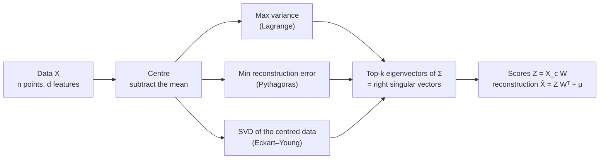

Principal component analysis is the first thing I reach for when a dataset has too many
columns. It answers a simple question: **if I could keep only $k$ directions in this data,
which $k$ should they be?** The answer turns out to be "the top $k$ eigenvectors of the
covariance matrix", and that one sentence is what most people remember.

The trouble is that the sentence hides everything interesting. Why eigenvectors, of all
things? Why the covariance and not the raw data? Why do the directions come out orthogonal
without anyone asking for it? Why does every library compute it with an SVD instead of an
eigendecomposition? What do you do when you have more features than examples? Interviewers
know the one-liner is memorised, so these are exactly the questions they ask.

This post derives all of it. I start from why PCA was invented, prove every piece of linear
algebra it leans on (covariance matrices are symmetric and positive semi-definite, symmetric
matrices have real eigenvalues and orthogonal eigenvectors, the Rayleigh quotient is maximised by
the top eigenvector), and then derive PCA three different ways that all land on the same
answer. After that come the practical parts: a worked example by hand, implementations, how to
choose $k$, the probabilistic version, whitening, and the extensions (kernel PCA, linear
autoencoders, randomized SVD for big data).

How to read it: the main text carries the intuition, and the longer proofs sit in **Maths**
cards you can open when you want the details. Every code block is NumPy from scratch, every
printed output comes from an actual run, and the blocks build on each other in order (I say so
where one depends on an earlier one). Two banks of interview questions are at the end.

## The whole post in one picture

Three different questions, one answer:

| Question | What you optimise | Answer |
|---|---|---|
| Which direction has the most spread? (Hotelling) | maximise $w^\top \Sigma w$ subject to $\lVert w\rVert = 1$ | top eigenvector of $\Sigma$ |
| Which line or plane is closest to the points? (Pearson) | minimise $\frac1n\sum_i \lVert x_i - \hat x_i\rVert^2$ | the same eigenvectors |
| What is the best rank-$k$ approximation of the data matrix? (Eckart–Young) | minimise $\lVert X_c - B\rVert_F$ over rank-$k$ $B$ | truncated SVD; the right singular vectors are the same eigenvectors |
| What is the most likely low-rank Gaussian model? (Tipping–Bishop) | maximise the likelihood of $x \sim \mathcal N(\mu,\ WW^\top + \sigma^2 I)$ | the same subspace, with $\sigma^2$ = the average discarded eigenvalue |



The one fact that makes it all work: **the covariance matrix is symmetric and positive
semi-definite**, so it has an orthonormal basis of eigenvectors with non-negative eigenvalues,
and in that basis the data's spread is a diagonal list of numbers. PCA is just "rotate to that
basis and keep the biggest numbers".

<details>
<summary><b>Notation used in the maths cards</b></summary>

| Symbol | Meaning |
|---|---|
| $n$, $d$, $k$ | number of examples, number of features, number of components kept |
| $X$ | the $n\times d$ data matrix; row $i$ is the example $x_i^\top$ |
| $\mu = \frac1n\sum_i x_i$ | the mean vector (a $d$-vector) |
| $\mathbf 1$ | the all-ones $n$-vector |
| $H = I - \frac1n \mathbf 1\mathbf 1^\top$ | the centring matrix |
| $X_c = HX$ | the centred data; row $i$ is $(x_i - \mu)^\top$ |
| $\Sigma = \frac1n X_c^\top X_c$ | the sample covariance ($d\times d$). Libraries divide by $n-1$; see below |
| $\lambda_1\ge\dots\ge\lambda_d\ge 0$, $q_1,\dots,q_d$ | eigenvalues and orthonormal eigenvectors of $\Sigma$ |
| $Q$, $\Lambda$ | $Q = [q_1,\dots,q_d]$, $\Lambda = \operatorname{diag}(\lambda_1,\dots,\lambda_d)$, so $\Sigma = Q\Lambda Q^\top$ |
| $W$ | a $d\times k$ matrix with orthonormal columns ($W^\top W = I_k$); PCA picks $W = Q_k$, the first $k$ columns of $Q$ |
| $Z = X_c W$ | the scores: each example's coordinates along the $k$ directions |
| $X_c = USV^\top$ | thin SVD; singular values $s_1\ge s_2\ge\dots\ge 0$ |
| $\operatorname{tr}(A)$ | the trace, the sum of the diagonal |

**$1/n$ or $1/(n-1)$?** I use $1/n$ in derivations because the algebra is cleaner. NumPy's
`np.cov` and scikit-learn divide by $n-1$ (Bessel's correction, which makes the variance
estimate unbiased). The two matrices differ by the constant factor $n/(n-1)$, so they have
**exactly the same eigenvectors**, eigenvalues that differ by that factor, and identical
explained-variance ratios. Nothing in PCA depends on the choice except the printed eigenvalues.

</details>

## Why PCA was invented

PCA was invented twice, for two different reasons, and the two reasons are the two main
derivations in this post.

**Pearson, 1901: the closest line.** Karl Pearson wanted to fit a line (or plane) to a cloud
of points when no variable is special. Ordinary regression of $y$ on
$x$ minimises *vertical* distances, which treats $x$ as exact and $y$ as noisy; regress $x$ on
$y$ instead and you get a different line. Pearson asked for the line that minimises the
*perpendicular* distances, treating all coordinates symmetrically, and showed that it passes
through the centroid along the longest axis of the ellipsoid describing the cloud's spread.
That is the minimum reconstruction error view.

**Hotelling, 1933: a few underlying factors.** Harold Hotelling was working with
psychological test scores: many tests, all correlated with each other, presumably because a few
underlying abilities drive them. He wanted a small number of new
variables, linear combinations of the old ones, that are uncorrelated with each other and
capture as much of the total variance as possible, one after another. He called them the
*principal components*. That is the maximum variance view, and the constrained maximisation
he set up is derivation 1 below.[^kl] Jolliffe's book is the standard reference for the whole
story.

[^kl]: It was reinvented at least once more: in probability and signal processing the same
decomposition, applied to a random process, is the Karhunen–Loève transform. Same eigenvectors,
different name.

The reasons people use it today are the same reasons, generalised:

- **Redundancy.** Real features are correlated. Height in centimetres and height in inches are
  two columns but one fact. Even softer correlations (income and house size) mean the data
  occupies fewer "effective" dimensions than it has columns. PCA finds those effective
  directions.
- **The curse of dimensionality.** In high dimensions, distances concentrate (all points look
  equally far apart), you need exponentially more data to cover the space, and models have more
  parameters to overfit with. If the data really lives near a $k$-dimensional flat sheet, working
  in those $k$ coordinates is cheaper and often better.
- **Compression.** Store $k$ numbers per example plus one $d\times k$ matrix instead of $d$
  numbers per example. It's the best linear compression in squared error, a fact we'll prove.
- **Visualisation.** Project onto the top two or three components and plot. It's the first
  look at almost any dataset.
- **Denoising.** If the signal lives in a few high-variance directions and the noise is spread
  evenly over all of them, dropping the low-variance directions removes mostly noise.
- **Decorrelation and whitening.** The scores along different components are uncorrelated by
  construction. Rescale them to unit variance and every direction looks the same to a downstream
  algorithm, which helps gradient descent and is required by methods like ICA.
- **Conditioning.** Near-collinear features make regression coefficients unstable. Regressing
  on the top principal components (principal components regression) sidesteps that, at a cost
  I'll get to.

The key word in all of them is **linear**. PCA finds a flat subspace. If the data lives on a
curved surface (a Swiss roll, a circle), PCA will use more dimensions than the surface has, and
that's where kernel PCA, autoencoders, t-SNE and UMAP come in.

## The linear algebra, derived

Everything in PCA reduces to properties of one matrix, the covariance. This section proves
those properties from scratch. If you're comfortable with the spectral theorem you can skim
the statements and skip the cards.

### Centring, and the centring matrix

PCA works with deviations from the mean, $x_i - \mu$. Subtracting the mean from every row can
be written as a single matrix multiplication:

$$
X_c = HX, \qquad H = I_n - \tfrac1n \mathbf 1 \mathbf 1^\top .
$$

To see it, look at what $\frac1n\mathbf 1\mathbf 1^\top X$ does: $\mathbf 1^\top X$ is the row
of column sums, dividing by $n$ makes it the row of column means $\mu^\top$, and multiplying by
$\mathbf 1$ stacks $n$ copies of it. So $HX = X - \mathbf 1\mu^\top$: every row has had the mean
subtracted.

$H$ has three properties worth knowing, each a one-line check:

- **Symmetric:** $H^\top = I - \frac1n(\mathbf 1\mathbf 1^\top)^\top = H$.
- **Idempotent** ($H^2 = H$): centring twice is the same as centring once.
  $H^2 = I - \frac2n\mathbf 1\mathbf 1^\top + \frac1{n^2}\mathbf 1(\mathbf 1^\top\mathbf 1)\mathbf 1^\top
  = I - \frac2n\mathbf 1\mathbf 1^\top + \frac1n\mathbf 1\mathbf 1^\top = H$, using
  $\mathbf 1^\top\mathbf 1 = n$.
- **It kills constants:** $H\mathbf 1 = \mathbf 1 - \frac1n\mathbf 1\, n = 0$. Equivalently,
  every column of $X_c$ sums to zero: $\mathbf 1^\top X_c = 0$.

A symmetric idempotent matrix is an orthogonal projection: $H$ projects $\mathbb R^n$ onto the
$(n-1)$-dimensional subspace of vectors whose entries sum to zero. Its eigenvalues are $0$ (once,
along $\mathbf 1$) and $1$ ($n-1$ times), so $\operatorname{rank}(H) = n-1$. That $n-1$ will
come back when we count non-zero eigenvalues.

**Why centre at all?** Because PCA is about spread *around the centre*, and the uncentred
second-moment matrix mixes in where the centre is. With $\frac1n X^\top X = \Sigma + \mu\mu^\top$
(expand $x_i = (x_i - \mu) + \mu$ and the cross terms vanish because deviations sum to zero),
the "variance" along a direction $w$ becomes

$$
\tfrac1n \lVert Xw\rVert^2 = w^\top\Sigma w + (\mu^\top w)^2 .
$$

The second term rewards pointing at the mean. If the data sits far from the origin, the top
"component" of uncentred data is essentially the direction of $\mu$, which tells you where the
cloud is, not how it's shaped. The code later shows this happening: on a dataset with mean of
length about 13, the uncentred first component has cosine 1.0 with the mean direction and 0.02
with the true first component. We'll also see a cleaner reason from the reconstruction view:
the best-fitting affine subspace always passes through the mean.

### The covariance matrix, and the variance of a projection

The sample covariance is

$$
\Sigma = \frac1n \sum_{i=1}^n (x_i - \mu)(x_i - \mu)^\top = \frac1n X_c^\top X_c ,
$$

a $d\times d$ matrix whose $(j,l)$ entry is the covariance between features $j$ and $l$, and
whose diagonal holds the variances. The second form holds because $X_c^\top X_c = \sum_i
(\text{row } i)^\top(\text{row } i)$, a sum of outer products.

The single most important identity in PCA: **the variance of the data projected onto a unit
vector $w$ is $w^\top \Sigma w$.**

Project each centred point onto $w$ to get a number $z_i = w^\top(x_i - \mu)$, its coordinate
along $w$. These numbers have mean zero (they're projections of deviations that sum to zero),
so their variance is the mean of their squares:

$$
\begin{aligned}
\operatorname{Var}(z) = \frac1n \sum_i z_i^2
&= \frac1n \sum_i \big(w^\top (x_i-\mu)\big)\big((x_i-\mu)^\top w\big) \\
&= w^\top \Big(\frac1n \sum_i (x_i-\mu)(x_i-\mu)^\top\Big) w
= w^\top \Sigma\, w .
\end{aligned}
$$

The trick in the middle is that a scalar equals its own transpose, so
$(w^\top a)^2 = (w^\top a)(a^\top w)$, and then $w$ comes out of the sum. In matrix form,
$z = X_c w$ and $\operatorname{Var}(z) = \frac1n\lVert X_c w\rVert^2 = \frac1n w^\top X_c^\top X_c w$.

The same computation with several directions at once: if $W$ is $d\times k$ and
$Z = X_c W$, the covariance of the scores is

$$
\operatorname{Cov}(Z) = \tfrac1n Z^\top Z = \tfrac1n W^\top X_c^\top X_c W = W^\top \Sigma W .
$$

So $\Sigma$ is a machine that, fed a direction, tells you how spread out the data is along it.
PCA asks which directions get the biggest answers.

### The covariance is symmetric and positive semi-definite

**Symmetric:** $\Sigma^\top = \frac1n (X_c^\top X_c)^\top = \frac1n X_c^\top X_c = \Sigma$. Or
directly: $\operatorname{Cov}(x_j, x_l) = \operatorname{Cov}(x_l, x_j)$.

**Positive semi-definite (PSD)** means $w^\top\Sigma w \ge 0$ for every vector $w$. For the
covariance this is almost a tautology once you have the projection identity: $w^\top\Sigma w$ is a
variance, and variances can't be negative. Written out,

$$
w^\top \Sigma w = \tfrac1n\, w^\top X_c^\top X_c w = \tfrac1n (X_c w)^\top (X_c w) = \tfrac1n \lVert X_c w\rVert^2 \ \ge\ 0 .
$$

Any matrix of the form $A^\top A$ is PSD by exactly this argument. That covers covariance
matrices, Gram matrices, kernel matrices built from feature vectors, and the $X^\top X$ in
[least squares](/blog/linear-and-logistic-regression/).

**Positive definite (PD)** means strictly positive for every $w\ne 0$. From the same line,
$w^\top\Sigma w = 0$ exactly when $X_c w = 0$: when the direction $w$ has zero spread, i.e.
the linear combination $w^\top x$ is *the same constant* for every data point. So:

> $\Sigma$ is positive definite $\iff$ no non-trivial linear combination of the features is
> constant on the data $\iff$ $X_c$ has full column rank $d$.

### When the covariance is singular, and its rank

There are two ways to get a zero-variance direction, and both happen in practice.

**Collinear features.** If one feature is an exact linear combination of others (a total
column that's the sum of its parts, temperature in both °C and °F, a one-hot encoding plus an
intercept), then some $w$ has $X_c w = 0$. That $w$ is an eigenvector of $\Sigma$ with
eigenvalue 0, and PCA hands you the exact linear relation as its last component. Near-collinear
features give near-zero eigenvalues: the smallest components are a diagnostic for
multicollinearity, the problem that makes regression coefficients unstable.

**Fewer examples than features.** The rank of $\Sigma$ is at most $\min(n-1,\ d)$. Two steps:

1. $\operatorname{rank}(X_c^\top X_c) = \operatorname{rank}(X_c)$, because the two matrices
   have the same null space: if $X_c^\top X_c w = 0$ then $w^\top X_c^\top X_c w =
   \lVert X_c w\rVert^2 = 0$, so $X_c w = 0$; the converse is immediate.
2. $\operatorname{rank}(X_c) \le n-1$, because its $n$ rows sum to zero ($\mathbf 1^\top X_c = 0$),
   so they're linearly dependent. Equivalently, $X_c = HX$ and $\operatorname{rank}(H) = n-1$.
   And of course $\operatorname{rank}(X_c)\le d$.

So with $n=50$ images of $10{,}000$ pixels, the $10{,}000\times 10{,}000$ covariance has at most
49 non-zero eigenvalues; the other $9{,}951$ are exactly zero. Two points always lie on a line,
three on a plane: $n$ points always fit in an $(n-1)$-dimensional affine subspace, and centring
is what removes the extra one. This is also why you should never invert a sample covariance
when $n$ is not much bigger than $d$ without regularising it first.

### Eigenvalues and eigenvectors, briefly

A non-zero vector $q$ is an **eigenvector** of a square matrix $A$ with **eigenvalue**
$\lambda$ if

$$
A q = \lambda q :
$$

$A$ doesn't rotate $q$, it only stretches it by $\lambda$. Rearranging, $(A - \lambda I)q = 0$
has a non-zero solution, so $A - \lambda I$ is singular, so the eigenvalues are the roots of the
**characteristic polynomial**

$$
p(\lambda) = \det(A - \lambda I) ,
$$

a polynomial of degree $d$. For each root, the eigenvectors are the non-zero vectors in the null
space of $A - \lambda I$. Two facts that come straight from the polynomial and are handy
checks: the eigenvalues sum to the trace, $\sum_i \lambda_i = \operatorname{tr}(A)$, and multiply
to the determinant, $\prod_i\lambda_i = \det A$.

For a general matrix, eigenvalues can be complex (a 2-D rotation has none that are real) and
eigenvectors needn't be orthogonal or even span the space. Symmetric matrices are much better
behaved, and that's the next result.

### The spectral theorem for real symmetric matrices

> **Spectral theorem.** If $A$ is a real symmetric $d\times d$ matrix, then (1) all its
> eigenvalues are real, (2) eigenvectors for different eigenvalues are orthogonal, and (3) it has
> an orthonormal basis of eigenvectors, so $A = Q\Lambda Q^\top = \sum_{i} \lambda_i q_i q_i^\top$
> with $Q^\top Q = I$.

Each part is a few lines.

**(1) The eigenvalues are real.** Let $Aq = \lambda q$ where, for now, $\lambda$ and $q$ are
allowed to be complex. Write $q^*$ for the conjugate transpose. Multiply on the left by $q^*$:

$$
q^* A q = \lambda\, q^* q .
$$

The number $q^* A q$ is real: its complex conjugate is $(q^*Aq)^* = q^* A^* q = q^*Aq$, because
$A$ is real and symmetric, so $A^* = A^\top = A$. The number $q^*q = \sum_j \lvert q_j\rvert^2$ is
real and positive. So $\lambda = q^*Aq / q^*q$ is real. Since $A - \lambda I$ is then a real
singular matrix, its null space contains real vectors, so the eigenvectors can be taken real too.

**(2) Eigenvectors of distinct eigenvalues are orthogonal.** Let $Aq_1 = \lambda_1 q_1$ and
$Aq_2 = \lambda_2 q_2$ with $\lambda_1\ne\lambda_2$. Compute $q_2^\top A q_1$ two ways:

$$
q_2^\top (A q_1) = \lambda_1\, q_2^\top q_1,
\qquad
q_2^\top A q_1 = (A^\top q_2)^\top q_1 = (A q_2)^\top q_1 = \lambda_2\, q_2^\top q_1 .
$$

Subtract: $(\lambda_1 - \lambda_2)\, q_2^\top q_1 = 0$, and since $\lambda_1\ne\lambda_2$,
$q_2^\top q_1 = 0$. Symmetry is used exactly once, to move $A$ from one side to the other.

**(3) An orthonormal eigenbasis exists, even with repeated eigenvalues.** Part (2) alone
doesn't cover repeated eigenvalues, so use induction on the dimension. The characteristic
polynomial has at least one root, real by (1); take a unit eigenvector $q_1$ for it. Now the key
observation: **the orthogonal complement $q_1^\perp$ is invariant under $A$**. If $x\perp q_1$,
then

$$
q_1^\top (Ax) = (Aq_1)^\top x = \lambda_1 q_1^\top x = 0 ,
$$

so $Ax\perp q_1$ too. Pick any orthonormal basis of the $(d-1)$-dimensional space $q_1^\perp$;
in that basis $A$ acts as a real symmetric $(d-1)\times(d-1)$ matrix, which by induction has an
orthonormal eigenbasis $q_2,\dots,q_d$ inside $q_1^\perp$. Together with $q_1$ that's an
orthonormal eigenbasis of $\mathbb R^d$. Stack them as columns of $Q$: then $AQ = Q\Lambda$, and
since $Q^\top Q = I$ means $Q^{-1} = Q^\top$,

$$
A = Q\Lambda Q^\top = \sum_{i=1}^d \lambda_i\, q_i q_i^\top .
$$

The second form says a symmetric matrix is a weighted sum of rank-one projections onto
orthogonal directions. For the covariance it says: **the data's spread decomposes into
independent amounts $\lambda_i$ along orthogonal axes $q_i$.** That's PCA in one line; the rest
of the post is about why those axes are the right ones to keep.

Applied to $\Sigma$, the theorem tells us the principal directions will automatically be
orthogonal. Nobody imposed orthogonality on PCA: it falls out of the symmetry of the covariance.

### PSD if and only if every eigenvalue is non-negative

> A symmetric matrix $A$ is PSD $\iff$ all its eigenvalues are $\ge 0$. It is PD $\iff$ all are $> 0$.

**($\Rightarrow$)** Take $w = q_i$, a unit eigenvector: $q_i^\top A q_i = \lambda_i q_i^\top q_i = \lambda_i$.
PSD says this is $\ge 0$.

**($\Leftarrow$)** Write any $w$ in the eigenbasis, $c = Q^\top w$ (so $w = Qc$). Then

$$
w^\top A w = w^\top Q\Lambda Q^\top w = c^\top \Lambda c = \sum_{i=1}^d \lambda_i c_i^2 \ \ge\ 0
$$

when every $\lambda_i\ge 0$. For PD, every $\lambda_i>0$ and $c\ne 0$ (because $Q$ is invertible)
make the sum strictly positive.

For PCA: the eigenvalues of $\Sigma$ are variances along the eigen-directions, so they are
non-negative, they sum to the **total variance** $\operatorname{tr}(\Sigma) = \sum_j
\operatorname{Var}(x_j)$, and the number of zero eigenvalues is the number of independent exact
linear constraints in the data. In floating point, the zero ones come out as tiny numbers of either
sign (you'll see $-1.6\times 10^{-11}$ in one of the outputs below); clip them at zero.

### The Rayleigh quotient

The last tool is the one that turns "find the best direction" into "find an eigenvector". For
symmetric $A$ and $w\ne 0$, the **Rayleigh quotient** is

$$
R(w) = \frac{w^\top A w}{w^\top w} .
$$

It doesn't depend on the length of $w$, only its direction, and for a unit $w$ it is exactly
the projected variance $w^\top\Sigma w$ when $A = \Sigma$.

> $\lambda_d \le R(w) \le \lambda_1$ for every $w\ne 0$, with the maximum attained at
> $w = q_1$ and the minimum at $w = q_d$.

**Proof.** In the eigenbasis, $w = Qc$, so $w^\top w = c^\top Q^\top Q c = \sum_i c_i^2$ and,
as above, $w^\top A w = \sum_i\lambda_i c_i^2$. So

$$
R(w) = \frac{\sum_i \lambda_i c_i^2}{\sum_i c_i^2} ,
$$

a **weighted average of the eigenvalues** with weights $c_i^2/\sum_j c_j^2$ that are
non-negative and sum to 1. A weighted average lies between the smallest and largest values
being averaged, so $\lambda_d\le R(w)\le\lambda_1$. It equals $\lambda_1$ only if all the weight
is on eigenvalues equal to $\lambda_1$, i.e. $w$ lies in the top eigenspace; $w = q_1$ achieves
it.

This weighted-average picture is the intuition I keep coming back to. Any direction you pick
gets a blend of the eigen-variances; to get the most, put all your weight on the biggest one.

There's a sharper version, the **Courant–Fischer** min-max theorem: restricted to directions
orthogonal to $q_1,\dots,q_{j-1}$, the maximum of $R$ is $\lambda_j$, attained at $q_j$. Same
proof: orthogonality to the first $j-1$ eigenvectors forces $c_1=\dots=c_{j-1}=0$, so the
weighted average only involves $\lambda_j,\dots,\lambda_d$.

## Derivation 1: maximise the variance

Hotelling's question: find the unit direction $w$ along which the projected data has the
largest variance. By the projection identity, that's

$$
\max_{w}\ w^\top \Sigma w \quad\text{subject to}\quad w^\top w = 1 .
$$

The constraint matters. Without it you could scale $w$ up and make $w^\top\Sigma w$ as large
as you like; we care about the direction, so we fix the length. (A maximum exists because the
unit sphere is closed and bounded and $w^\top\Sigma w$ is continuous.)

### The first component

The Rayleigh quotient result already answers this: the maximum is $\lambda_1$, at $w = q_1$.
But the Lagrange-multiplier derivation is what interviewers usually ask for, and it's the one
that generalises, so here it is.

Form the Lagrangian with multiplier $\lambda$ for the constraint:

$$
\mathcal L(w, \lambda) = w^\top \Sigma w - \lambda\,(w^\top w - 1) .
$$

At a constrained optimum the gradient with respect to $w$ is zero. Using
$\nabla_w (w^\top A w) = 2Aw$ for symmetric $A$ and $\nabla_w(w^\top w) = 2w$:

$$
\nabla_w \mathcal L = 2\Sigma w - 2\lambda w = 0
\quad\Longrightarrow\quad
\boxed{\ \Sigma w = \lambda w\ } .
$$

So **every stationary point is an eigenvector of $\Sigma$**, and the Lagrange multiplier is its
eigenvalue. Which eigenvector? Plug the condition back into the objective:

$$
w^\top \Sigma w = w^\top (\lambda w) = \lambda\, w^\top w = \lambda .
$$

The variance captured by an eigenvector *is* its eigenvalue. To maximise, take the largest:
**the first principal direction is $q_1$, and the variance along it is $\lambda_1$.** The other
eigenvectors are also stationary points (saddle points of the variance on the sphere, except
$q_d$ which is the minimum), which is why "set the gradient to zero" alone isn't enough and you
need the plug-back step.

Geometrically, $\Sigma w = \lambda w$ says something nice: at the optimum, the gradient of the
objective ($2\Sigma w$) is parallel to the gradient of the constraint ($2w$), i.e. it points
straight out of the sphere. There's no way to slide along the sphere and increase the variance.

### The second component

Now find the direction of largest variance *among those uncorrelated with the first score*.
The scores $q_1^\top x$ and $w^\top x$ have covariance $q_1^\top\Sigma w = \lambda_1 q_1^\top w$,
so (for $\lambda_1 > 0$) uncorrelated means orthogonal, $w^\top q_1 = 0$. Two constraints, two
multipliers:

$$
\mathcal L(w, \lambda, \phi) = w^\top\Sigma w - \lambda\,(w^\top w - 1) - \phi\, w^\top q_1 .
$$

Setting the gradient to zero:

$$
2\Sigma w - 2\lambda w - \phi\, q_1 = 0 .
$$

The new multiplier $\phi$ looks like it could spoil the eigenvector equation. It doesn't.
Multiply the equation on the left by $q_1^\top$:

$$
2 q_1^\top\Sigma w - 2\lambda\, q_1^\top w - \phi\, q_1^\top q_1 = 0 .
$$

Each term simplifies: $q_1^\top\Sigma w = (\Sigma q_1)^\top w = \lambda_1 q_1^\top w = 0$ (symmetry
of $\Sigma$, then the constraint), $q_1^\top w = 0$ (the constraint), and $q_1^\top q_1 = 1$. So
the equation reads $0 - 0 - \phi = 0$, i.e. **$\phi = 0$**. The orthogonality constraint is
"free": it is automatically satisfied by the solution of the unconstrained-in-direction problem
restricted to $q_1^\perp$. With $\phi = 0$ we're back to

$$
\Sigma w = \lambda w, \qquad w\perp q_1, \qquad w^\top\Sigma w = \lambda ,
$$

so $w$ is an eigenvector orthogonal to $q_1$ with the largest possible eigenvalue: **$q_2$, with
variance $\lambda_2$**. (If $\lambda_1 = \lambda_2$, any unit vector in that two-dimensional
eigenspace orthogonal to your chosen $q_1$ works; more on non-uniqueness later.)

### All k components, and the trace form

**By induction.** Suppose the first $j-1$ components are $q_1,\dots,q_{j-1}$. The $j$-th
maximises $w^\top\Sigma w$ subject to $\lVert w\rVert = 1$ and $w\perp q_1,\dots,q_{j-1}$. The
Lagrangian has multipliers $\phi_1,\dots,\phi_{j-1}$ for the orthogonality constraints; multiplying
the stationarity equation by each $q_m^\top$ kills everything but $\phi_m$, exactly as above, so
all $\phi_m = 0$, $\Sigma w = \lambda w$, and the best remaining eigenvector is $q_j$. So the
principal directions are $q_1, q_2, \dots, q_k$ in order, with variances
$\lambda_1\ge\lambda_2\ge\dots\ge\lambda_k$.

**The scores are uncorrelated.** With $W = Q_k = [q_1,\dots,q_k]$, the score covariance is
$W^\top\Sigma W = Q_k^\top Q\Lambda Q^\top Q_k = \Lambda_k = \operatorname{diag}(\lambda_1,\dots,\lambda_k)$,
diagonal. PCA rotates the data so that its new coordinates are uncorrelated, and sorts them by
variance.

**All at once.** The greedy, one-at-a-time construction could in principle be worse than
choosing all $k$ directions jointly. It isn't. The joint problem is to maximise the *total*
variance captured by a $k$-dimensional orthonormal frame,

$$
\max_{W\in\mathbb R^{d\times k}}\ \operatorname{tr}(W^\top\Sigma W) \quad\text{subject to}\quad W^\top W = I_k ,
$$

because $\operatorname{tr}(W^\top\Sigma W) = \sum_{j=1}^k w_j^\top\Sigma w_j$ is the sum of
variances along the columns. **Ky Fan's maximum principle** says the
maximum is $\lambda_1+\dots+\lambda_k$, achieved by $W = Q_k$ (and by $Q_k R$ for any $k\times k$
orthogonal $R$: only the *subspace* matters for the total).

<details>
<summary><b>Maths: proof of Ky Fan's maximum principle</b></summary>

Let $W$ have orthonormal columns, and write $C = Q^\top W$ (the coordinates of $W$'s columns in
the eigenbasis; it's $d\times k$). Then

$$
\operatorname{tr}(W^\top\Sigma W) = \operatorname{tr}(W^\top Q\Lambda Q^\top W) = \operatorname{tr}(C^\top\Lambda C)
= \sum_{i=1}^d \lambda_i \underbrace{\sum_{j=1}^k C_{ij}^2}_{p_i} .
$$

The weights $p_i$ have two properties:

- **$0\le p_i\le 1$.** $p_i = \sum_j (q_i^\top w_j)^2 = \lVert W^\top q_i\rVert^2$ is the squared length
  of the projection of the unit vector $q_i$ onto the column space of $W$, which can't exceed 1.
- **$\sum_i p_i = k$.** $\sum_i p_i = \lVert C\rVert_F^2 = \lVert Q^\top W\rVert_F^2 = \lVert W\rVert_F^2 = k$,
  since $Q^\top$ preserves lengths and $W$ has $k$ unit columns.

So the question becomes: maximise $\sum_i\lambda_i p_i$ over weights in $[0,1]$ that sum to $k$.
With the $\lambda_i$ sorted in decreasing order, the best you can do is fill the top $k$ slots
to capacity: $p_1=\dots=p_k=1$, the rest 0. (Any weight on a lower $\lambda_i$ could be moved to
an unfilled higher one without decreasing the sum.) The maximum is
$\lambda_1+\dots+\lambda_k$, and $W = Q_k$ achieves it. If $\lambda_k > \lambda_{k+1}$, the
maximising subspace is unique; if they tie, any mix within the tied eigenspace is equally good.

The same argument with the inequality reversed shows the *minimum* is
$\lambda_{d-k+1}+\dots+\lambda_d$, attained by the bottom $k$ eigenvectors.

</details>

## Derivation 2: minimise the reconstruction error

Pearson's question: find the $k$-dimensional flat (an affine subspace) closest to the points,
measured by squared perpendicular distance. This view is the one I find most intuitive, because
of one right triangle.

### Projections

Let the subspace be the column space of $W$, with $W^\top W = I_k$. The closest point to a
(centred) $x$ in that subspace is its **orthogonal projection**

$$
\hat x = W W^\top x = Px, \qquad P = WW^\top .
$$

Read it right to left: $W^\top x$ is the $k$-vector of coordinates along the columns (the
scores), and multiplying by $W$ turns those coordinates back into a $d$-vector in the subspace.
Two properties make $P$ a projection:

- **Idempotent:** $P^2 = W(W^\top W)W^\top = WW^\top = P$. Projecting twice changes nothing.
- **Symmetric:** $P^\top = P$. This is what makes it *orthogonal*: the residual $x - Px$ is
  perpendicular to the subspace, since $W^\top(x - Px) = W^\top x - W^\top W W^\top x = 0$.

$I - P$ is also a symmetric idempotent matrix: it projects onto the orthogonal complement,
and the residual is $(I-P)x$.

### Error = total variance − captured variance

Each centred point splits into a part in the subspace and a residual perpendicular to it.
Perpendicular vectors obey Pythagoras:

$$
\lVert x\rVert^2 = \lVert Px\rVert^2 + \lVert (I-P)x\rVert^2 ,
$$

and $\lVert Px\rVert^2 = x^\top W W^\top W W^\top x = \lVert W^\top x\rVert^2$, the squared length
of the score vector. Rearranged, the reconstruction error of one point is

$$
\lVert x - \hat x\rVert^2 = \lVert x\rVert^2 - \lVert W^\top x\rVert^2 .
$$

<figure class="ml-diagram">
<svg viewBox="0 0 860 330" role="img" aria-label="A cloud of points scattered around a line through their mean. One highlighted point x is joined to the mean mu. Its orthogonal projection onto the line is marked, with a solid arrow from the mean to the foot of the projection (the kept part) and a dashed arrow from the foot up to x (the residual, which is lost). A right-angle mark sits at the foot. The text states that the squared distance from the mean equals the squared score plus the squared residual.">
  <defs><marker id="ml-arrow" viewBox="0 0 10 10" refX="9" refY="5" markerWidth="7" markerHeight="7" orient="auto-start-reverse"><path d="M0,0 L10,5 L0,10 z"/></marker></defs>
  <line class="arrow plain" x1="69" y1="293" x2="791" y2="57"/>
  <text class="note blue" x="190" y="318">w: the principal direction, a line through the mean</text>
  <circle class="box blue" cx="151" cy="287" r="5"/>
  <circle class="box blue" cx="176" cy="237" r="5"/>
  <circle class="box blue" cx="211" cy="215" r="5"/>
  <circle class="box blue" cx="292" cy="236" r="5"/>
  <circle class="box blue" cx="338" cy="247" r="5"/>
  <circle class="box blue" cx="346" cy="176" r="5"/>
  <circle class="box blue" cx="420" cy="210" r="5"/>
  <circle class="box blue" cx="481" cy="137" r="5"/>
  <circle class="box blue" cx="561" cy="158" r="5"/>
  <circle class="box blue" cx="669" cy="134" r="5"/>
  <circle class="box blue" cx="694" cy="115" r="5"/>
  <circle class="box blue" cx="752" cy="96" r="5"/>
  <line class="arrow plain" x1="430" y1="175" x2="586" y2="40"/>
  <line class="arrow" x1="430" y1="175" x2="607" y2="117"/>
  <line class="arrow dashed" x1="611" y1="116" x2="589" y2="49"/>
  <path class="arrow plain" d="M599.3,119.8 L595.6,108.4 L607.0,104.7"/>
  <circle class="box sand" cx="430" cy="175" r="7"/>
  <circle class="box rose" cx="586" cy="40" r="7"/>
  <text class="name" x="412" y="168">μ</text>
  <text class="name" x="568" y="36">x</text>
  <text class="note" x="478" y="96">x − μ</text>
  <text class="note rose left" x="620" y="72">residual (lost)</text>
  <text class="note violet" x="560" y="196">score z = wᵀ(x − μ) (kept)</text>
  <text class="name" x="230" y="50">‖x − μ‖² = z² + ‖residual‖²</text>
  <text class="note" x="230" y="74">the total is fixed, so more kept means less lost</text>
</svg>
<figcaption>Pythagoras, once per point. The squared distance of a point from the mean is fixed by the data. Choosing the line splits it into a kept part (the squared score) and a lost part (the squared residual). Maximising the kept part on average and minimising the lost part on average are the same problem.</figcaption>
</figure>

Average over the data. The first term is the total variance, $\frac1n\sum_i\lVert x_i\rVert^2 =
\operatorname{tr}(\Sigma)$ (for centred data; the trace of $\frac1n X_c^\top X_c$ is the sum of all
squared entries over $n$). The second is the captured variance,
$\frac1n\sum_i\lVert W^\top x_i\rVert^2 = \operatorname{tr}(W^\top\Sigma W)$. So

$$
\boxed{\ \frac1n\sum_{i=1}^n \lVert x_i - WW^\top x_i\rVert^2 \;=\; \operatorname{tr}(\Sigma) - \operatorname{tr}(W^\top\Sigma W)\ } .
$$

$\operatorname{tr}(\Sigma)$ doesn't depend on $W$, so **minimising reconstruction error is exactly
maximising captured variance**: Pearson's and Hotelling's problems are the same problem. By Ky
Fan, the optimum is $W = Q_k$ and the minimum error is

$$
\operatorname{tr}(\Sigma) - \sum_{i\le k}\lambda_i = \sum_{i=k+1}^d \lambda_i ,
$$

the **sum of the discarded eigenvalues**. That's a formula you can check numerically, and the
code below does.

This also explains why the error criterion is *perpendicular* distance and not vertical distance
as in regression: there's no target variable; all coordinates are treated alike, and the closest
point in a subspace is the perpendicular foot.

### Why the best subspace passes through the mean

So far I assumed the data was centred. Let's derive that instead. Allow an affine subspace,
$\{b + Wz\}$, with an offset $b$ to be chosen. The closest point to $x_i$ on it is
$b + P(x_i - b)$, so the residual is $(I-P)(x_i - b)$ and the error is

$$
E(b) = \sum_i \lVert (I-P)(x_i - b)\rVert^2 .
$$

Its gradient in $b$ (using $(I-P)^\top(I-P) = I-P$) is $-2(I-P)\sum_i(x_i - b) = -2n(I-P)(\mu - b)$.
Setting it to zero gives $(I-P)(\mu - b) = 0$: the offset can be anything such that $\mu - b$ lies
in the subspace, i.e. **the optimal flat contains the mean**. The natural choice is $b = \mu$, and
then the problem is exactly the centred one. Centring isn't a convention you're asked to
remember; it's what the optimisation says to do.

### The best low-rank matrix: Eckart–Young–Mirsky

Stack the reconstructions as a matrix: $\hat X_c = X_c W W^\top$, which has rank at most $k$.
Over all $n$ points, the reconstruction error is the squared Frobenius norm
$\lVert X_c - X_cWW^\top\rVert_F^2$. Eckart and Young asked the matrix version of the question:
over **all** matrices $B$ of rank at most $k$, which is closest to $X_c$?

> **Eckart–Young–Mirsky.** If $X_c = \sum_i s_i u_i v_i^\top$ is the SVD, the best rank-$k$
> approximation in Frobenius norm (and in spectral norm, and in every unitarily invariant
> norm) is the truncated SVD $X_k = \sum_{i\le k} s_i u_i v_i^\top$, with error
> $\lVert X_c - X_k\rVert_F^2 = \sum_{i>k} s_i^2$ and $\lVert X_c - X_k\rVert_2 = s_{k+1}$.

The Frobenius part follows from what we already have. Any rank-$k$ matrix $B$ has a row space
of dimension at most $k$; let $W$ be an orthonormal basis for (a $k$-dimensional space containing)
it. Given that row space, the best $B$ is the one whose rows are the projections of the rows of
$X_c$, namely $X_cWW^\top$ (each row is approximated independently, and the closest point in a
subspace is the projection). So

$$
\min_{\operatorname{rank}B\le k}\lVert X_c - B\rVert_F^2 = \min_{W^\top W = I_k} \lVert X_c - X_cWW^\top\rVert_F^2
= n\Big(\operatorname{tr}\Sigma - \max_W\operatorname{tr}(W^\top\Sigma W)\Big) ,
$$

and Ky Fan finishes it: the optimum is $W = Q_k = V_k$ (we'll see in a moment that the
eigenvectors of $\Sigma$ are the right singular vectors), and $X_cV_kV_k^\top = U_kS_kV_k^\top =
X_k$. **PCA reconstruction and the truncated SVD are the same matrix.** This is the bridge to
the third derivation.

## Derivation 3: the SVD

Every real matrix has a **singular value decomposition**. For the centred data, the thin form is

$$
X_c = U S V^\top, \qquad U\in\mathbb R^{n\times r},\ S = \operatorname{diag}(s_1,\dots,s_r),\ V\in\mathbb R^{d\times r},
$$

with $r = \min(n,d)$, orthonormal columns $U^\top U = V^\top V = I_r$, and singular values
$s_1\ge\dots\ge s_r\ge 0$. Geometrically: any linear map is a rotation ($V^\top$), then an
axis-aligned stretch ($S$), then another rotation ($U$).

### The covariance from the SVD

Substitute the SVD into the covariance:

$$
\Sigma = \frac1n X_c^\top X_c = \frac1n V S U^\top U S V^\top = V\,\frac{S^2}{n}\,V^\top .
$$

Compare with the spectral decomposition $\Sigma = Q\Lambda Q^\top$. They're the same kind of
object (orthonormal columns, diagonal middle), so:

- **The principal directions are the right singular vectors**: $Q = V$ (up to sign, and up to
  rotations within tied eigenvalues).
- **The eigenvalues are squared singular values over $n$**: $\lambda_i = s_i^2/n$, or
  $s_i^2/(n-1)$ with the library convention.
- **The scores come for free**: $Z = X_cV = USV^\top V = US$. Column $i$ of the scores is
  $s_i u_i$, so the score columns are orthogonal with squared lengths $s_i^2$, which is the
  "uncorrelated, variance $\lambda_i$" statement again.
- **The other side**: $X_cX_c^\top = US^2U^\top$, so the left singular vectors are the
  eigenvectors of the $n\times n$ Gram matrix of inner products between examples. That's the
  key to the $d\gg n$ trick below.

So PCA *is* the SVD of the centred data matrix. The eigendecomposition view explains *why* those
directions; the SVD view is *how* you should compute them.

### Why libraries use the SVD and not XᵀX

Forming $X_c^\top X_c$ squares the condition number. If the data matrix has singular values
ranging from $s_1$ to $s_r$, the covariance's eigenvalues range from $s_1^2$ to $s_r^2$. In
double precision, an eigensolver applied to $X_c^\top X_c$ can only resolve eigenvalues down to
about $\varepsilon\,s_1^2$ (with $\varepsilon\approx 2.2\times 10^{-16}$), which means
singular values below roughly $\sqrt{\varepsilon}\,s_1\approx 1.5\times 10^{-8}s_1$ are lost to
rounding *before the eigensolver even starts*. The SVD works on $X_c$ directly and resolves
singular values down to about $\varepsilon\, s_1$: eight more orders of
magnitude.

The classic demonstration is Läuchli's matrix, two nearly parallel columns:

```python {title="conditioning.py"}
import numpy as np

# Läuchli's matrix: two nearly parallel columns. Its singular values are sqrt(2 + eps^2) and eps.
eps = 1e-8
A = np.array([[1.0, 1.0],
              [eps, 0.0],
              [0.0, eps]])

s_svd = np.linalg.svd(A, compute_uv=False)          # works on A directly
gram = A.T @ A                                        # 1 + eps^2 rounds to exactly 1.0 in float64
ev_gram = np.linalg.eigvalsh(gram)[::-1]

print("A^T A =\n", gram)
print("smallest singular value via SVD of A      :", s_svd[-1])
print("smallest eigenvalue of A^T A (should be 1e-16):", ev_gram[-1])
print("condition number of A    :", f"{np.linalg.cond(A):.2e}")
print("condition number of A^T A:", f"{np.linalg.cond(gram):.2e}")
```

```text {title="Output"}
A^T A =
 [[1. 1.]
 [1. 1.]]
smallest singular value via SVD of A      : 9.999999999999999e-09
smallest eigenvalue of A^T A (should be 1e-16): 0.0
condition number of A    : 1.41e+08
condition number of A^T A: 5.96e+16
```

(This block and the next one only need `import numpy as np`; the later blocks build on the
[implementation section](#implementing-pca-from-scratch).) The SVD recovers the small singular value
$10^{-8}$ to full precision. The Gram matrix has already rounded $1 + 10^{-16}$ to $1$, so it
is exactly singular and the information is gone. For PCA on well-scaled data this rarely bites,
but it's the reason `sklearn.decomposition.PCA` calls an SVD routine, and it's a favourite
interview follow-up. The same argument is why least squares should be solved by QR or SVD rather
than the normal equations, which I covered in the
[regression post](/blog/linear-and-logistic-regression/).

The counterpoint: when $n\gg d$, forming the $d\times d$ covariance is a single pass over the
data, costs $O(nd^2)$, and is trivially parallel or streamable; then an eigendecomposition of
the small matrix is $O(d^3)$. That's often the practical choice for very tall data with moderate
$d$, as long as the conditioning is fine.

### More features than examples: the Gram trick

Images, genomics, text: often $d\gg n$. With 40 images of $100\times 100$ pixels, the covariance
is $10{,}000\times 10{,}000$ (800 MB in float64, and $O(d^3)$ to decompose) even though, by the
rank argument, it has at most 39 non-zero eigenvalues. Work with the $n\times n$ Gram matrix
$G = X_cX_c^\top$ instead.

If $G u = \mu u$ with $\mu > 0$, then $v = X_c^\top u$ is an eigenvector of $X_c^\top X_c$ with the
same eigenvalue:

$$
(X_c^\top X_c)(X_c^\top u) = X_c^\top (X_c X_c^\top u) = X_c^\top(\mu u) = \mu\,(X_c^\top u) .
$$

Its length is $\lVert X_c^\top u\rVert^2 = u^\top X_cX_c^\top u = \mu\, u^\top u = \mu$, so the unit
principal direction is $v = X_c^\top u/\sqrt\mu$. Cost: $O(n^2 d)$ to form $G$ plus $O(n^3)$ to
decompose it, instead of $O(nd^2 + d^3)$. This is exactly the trick that made eigenfaces
practical in 1987–1991, and it's the linear-kernel
special case of kernel PCA. (A thin SVD gets you the same thing directly; the trick is worth
knowing because it's the idea behind kernel methods.)

```python {title="gram_trick.py"}
# Few samples, many features: 40 "images" of 10,000 pixels each.
rng = np.random.default_rng(1)
n_img, d_pix = 40, 10_000
imgs = rng.standard_normal((n_img, 5)) @ rng.standard_normal((5, d_pix)) \
       + 0.1 * rng.standard_normal((n_img, d_pix))
Xc_img = imgs - imgs.mean(axis=0)

# The d x d covariance would be 10,000 x 10,000 (800 MB in float64). Use the n x n Gram matrix.
G = Xc_img @ Xc_img.T                       # (40, 40): inner products between images
mu_g, Ug = np.linalg.eigh(G)
mu_g, Ug = mu_g[::-1], Ug[:, ::-1]          # descending

k = 5
# If G u = mu u, then (Xc^T Xc)(Xc^T u) = Xc^T (Xc Xc^T) u = mu (Xc^T u):
# Xc^T u is an eigenvector of the big matrix with the same eigenvalue, and its norm is sqrt(mu).
V_gram = Xc_img.T @ Ug[:, :k] / np.sqrt(mu_g[:k])   # (10000, k), unit-norm columns

_, s_img, Vt_img = np.linalg.svd(Xc_img, full_matrices=False)
print("rank of centred data (<= n-1 = 39):", np.linalg.matrix_rank(Xc_img))
print("top-5 Gram eigenvalues == top-5 s^2:", np.allclose(mu_g[:k], s_img[:k] ** 2))
print("|cos| between Gram and SVD directions:", np.round(np.abs(np.sum(V_gram * Vt_img[:k].T, axis=0)), 6))
print("smallest Gram eigenvalue (centring kills one):", f"{mu_g[-1]:.1e}")
```

```text {title="Output"}
rank of centred data (<= n-1 = 39): 39
top-5 Gram eigenvalues == top-5 s^2: True
|cos| between Gram and SVD directions: [1. 1. 1. 1. 1.]
smallest Gram eigenvalue (centring kills one): -1.6e-11
```

Rank 39, not 40: centring removed one dimension, exactly as $\operatorname{rank}(H) = n-1$
predicts, and the corresponding Gram eigenvalue is zero up to rounding (it comes out slightly
negative, which is why you clip before taking square roots).

## A worked example by hand

Before any code, here is PCA done on paper, small enough to check every number. Four points in
2-D:

$$
x_1 = (5, 3),\quad x_2 = (1, -1),\quad x_3 = (4, 0),\quad x_4 = (2, 2) .
$$

**Step 1: centre.** The mean is $\mu = \big(\tfrac{5+1+4+2}{4},\ \tfrac{3-1+0+2}{4}\big) = (3, 1)$.
Subtracting it:

$$
X_c = \begin{pmatrix} 2 & 2\\ -2 & -2\\ 1 & -1\\ -1 & 1\end{pmatrix} .
$$

Each column sums to zero, as it must.

**Step 2: covariance.** $\sum x^2 = 4+4+1+1 = 10$, $\sum y^2 = 10$, and $\sum xy = 4+4-1-1 = 6$.
Dividing by $n = 4$:

$$
\Sigma = \frac14 X_c^\top X_c = \frac14\begin{pmatrix}10 & 6\\ 6 & 10\end{pmatrix} = \begin{pmatrix}2.5 & 1.5\\ 1.5 & 2.5\end{pmatrix} .
$$

Symmetric, positive diagonal, and the two features are positively correlated
($\rho = 1.5/2.5 = 0.6$).

**Step 3: characteristic polynomial and eigenvalues.**

$$
\det(\Sigma - \lambda I) = (2.5-\lambda)^2 - 1.5^2 = \lambda^2 - 5\lambda + 4 = (\lambda - 4)(\lambda - 1) ,
$$

so $\lambda_1 = 4$ and $\lambda_2 = 1$. Checks: they sum to the trace ($2.5+2.5 = 5$) and multiply
to the determinant ($6.25 - 2.25 = 4$). Both positive, so $\Sigma$ is positive definite. (With
only two points, the centred data would have rank $n-1 = 1$ and one eigenvalue would be zero.)

**Step 4: eigenvectors.** For $\lambda_1 = 4$:

$$
(\Sigma - 4I)q = \begin{pmatrix}-1.5 & 1.5\\ 1.5 & -1.5\end{pmatrix}\begin{pmatrix}a\\ b\end{pmatrix} = 0
\ \Longrightarrow\ a = b
\ \Longrightarrow\ q_1 = \tfrac{1}{\sqrt2}(1, 1) .
$$

For $\lambda_2 = 1$: $\begin{pmatrix}1.5 & 1.5\\ 1.5 & 1.5\end{pmatrix}q = 0$ gives $a = -b$, so
$q_2 = \tfrac1{\sqrt2}(-1, 1)$. They're orthogonal ($q_1^\top q_2 = 0$), as the spectral theorem
promised. PC1 is the diagonal, PC2 the anti-diagonal.

**Step 5: scores.** Project each centred point: $z_{i1} = q_1^\top(x_i - \mu)$ and
$z_{i2} = q_2^\top(x_i-\mu)$.

| point | centred | $z_1 = (a+b)/\sqrt2$ | $z_2 = (b-a)/\sqrt2$ |
|---|---|---|---|
| $(5,3)$ | $(2,2)$ | $2\sqrt2 \approx 2.828$ | $0$ |
| $(1,-1)$ | $(-2,-2)$ | $-2\sqrt2$ | $0$ |
| $(4,0)$ | $(1,-1)$ | $0$ | $-\sqrt2$ |
| $(2,2)$ | $(-1,1)$ | $0$ | $\sqrt2$ |

The variance of the $z_1$ column is $(8+8+0+0)/4 = 4 = \lambda_1$ and of the $z_2$ column
$(0+0+2+2)/4 = 1 = \lambda_2$. The explained-variance ratio of PC1 is $4/5 = 80\%$. For
comparison, the original $x$-axis captures $\Sigma_{11} = 2.5$, which sits between the two
eigenvalues, as the Rayleigh quotient said it must.

**Step 6: reconstruct from one component.** $\hat x_i = \mu + z_{i1}q_1$. The first two points lie
on the diagonal through the mean, so they're reconstructed exactly. The last two collapse onto
the mean $(3,1)$, each with squared error $1^2+1^2 = 2$. The mean squared reconstruction error is
$(0+0+2+2)/4 = 1 = \lambda_2$: the discarded eigenvalue, as derivation 2 predicted.

The same thing in NumPy (this block is self-contained):

```python {title="hand_example.py"}
import numpy as np

# The four points from the hand calculation, one row per point.
X = np.array([[5.0, 3.0], [1.0, -1.0], [4.0, 0.0], [2.0, 2.0]])
n = len(X)

mu = X.mean(axis=0)                  # the mean point, (3, 1)
Xc = X - mu                          # centre: every column now sums to zero
S = Xc.T @ Xc / n                    # covariance with 1/n, as in the hand calculation

evals, evecs = np.linalg.eigh(S)     # eigh is for symmetric matrices: real, ascending
order = np.argsort(evals)[::-1]      # flip to descending
evals, evecs = evals[order], evecs[:, order]

print("mean        :", mu)
print("covariance  :\n", S)
print("eigenvalues :", evals)
print("eigenvectors (one per column):\n", np.round(evecs, 4))

Z = Xc @ evecs                       # scores: each point's coordinates in the new basis
print("scores:\n", np.round(Z, 4))
print("variance of each score column:", np.round(Z.var(axis=0), 10))   # = the eigenvalues

X1 = mu + np.outer(Z[:, 0], evecs[:, 0])   # keep only PC1, map back to the original space
print("rank-1 reconstruction:\n", np.round(X1, 4))
print("mean squared reconstruction error:",
      round(((X - X1) ** 2).sum(axis=1).mean(), 10))     # = the discarded eigenvalue
```

```text {title="Output"}
mean        : [3. 1.]
covariance  :
 [[2.5 1.5]
 [1.5 2.5]]
eigenvalues : [4. 1.]
eigenvectors (one per column):
 [[ 0.7071 -0.7071]
 [ 0.7071  0.7071]]
scores:
 [[ 2.8284  0.    ]
 [-2.8284  0.    ]
 [ 0.     -1.4142]
 [ 0.      1.4142]]
variance of each score column: [4. 1.]
rank-1 reconstruction:
 [[ 5.  3.]
 [ 1. -1.]
 [ 3.  1.]
 [ 3.  1.]]
mean squared reconstruction error: 1.0
```

Every number matches the hand calculation, including the signs this time. Another library (or
another version of LAPACK) could just as well return $-q_1$; that's not a bug, and I'll come back
to it.

## Implementing PCA from scratch

The whole algorithm is five lines of linear algebra. The pipeline, with the part that has to be
fitted on training data only:

<figure class="ml-diagram">
<svg viewBox="0 0 860 330" role="img" aria-label="The PCA pipeline in six boxes. Top row: raw data X, then centre by subtracting the mean, then an SVD of the centred data (or an eigendecomposition of the covariance). An arrow drops to the bottom row: keep the top k right singular vectors as W, project to get scores Z, and reconstruct as Z W transpose plus the mean.">
  <defs><marker id="ml-arrow" viewBox="0 0 10 10" refX="9" refY="5" markerWidth="7" markerHeight="7" orient="auto-start-reverse"><path d="M0,0 L10,5 L0,10 z"/></marker></defs>
  <rect class="group" x="20" y="10" width="820" height="310" rx="14"/>
  <text class="label" x="430" y="36">fit μ and W on training data; reuse them unchanged for any new data</text>
  <rect class="box sand" x="45" y="55" width="220" height="80" rx="8"/>
  <text class="name" x="155" y="89">Data X</text>
  <text class="note sand" x="155" y="113">n × d raw features</text>
  <rect class="box violet" x="320" y="55" width="220" height="80" rx="8"/>
  <text class="name" x="430" y="89">Centre</text>
  <text class="note violet" x="430" y="113">Xc = X − 1μᵀ</text>
  <rect class="box blue" x="595" y="55" width="220" height="80" rx="8"/>
  <text class="name" x="705" y="89">Decompose</text>
  <text class="note blue" x="705" y="113">Xc = U S Vᵀ (or eig of Σ)</text>
  <rect class="box green" x="45" y="215" width="220" height="80" rx="8"/>
  <text class="name" x="155" y="249">Keep top k</text>
  <text class="note green" x="155" y="273">W = first k columns of V</text>
  <rect class="box rose" x="320" y="215" width="220" height="80" rx="8"/>
  <text class="name" x="430" y="249">Project</text>
  <text class="note rose" x="430" y="273">Z = Xc W, n × k scores</text>
  <rect class="box sand" x="595" y="215" width="220" height="80" rx="8"/>
  <text class="name" x="705" y="249">Reconstruct</text>
  <text class="note sand" x="705" y="273">X̂ = Z Wᵀ + 1μᵀ</text>
  <line class="arrow" x1="268" y1="95" x2="316" y2="95"/>
  <line class="arrow" x1="543" y1="95" x2="591" y2="95"/>
  <path class="arrow" d="M705,139 V175 H155 V211"/>
  <line class="arrow" x1="268" y1="255" x2="316" y2="255"/>
  <line class="arrow" x1="543" y1="255" x2="591" y2="255"/>
</svg>
<figcaption>PCA as a pipeline. The learned state is just the mean μ and the d × k matrix W; transforming new data reuses both.</figcaption>
</figure>

Two implementations, with the same interface as scikit-learn's (`components_` holds one
direction per row, `explained_variance_` uses $n-1$). The eigendecomposition version calls
`np.linalg.eigh`, not `np.linalg.eig`.[^eigh] The dataset is synthetic with a known
answer: five observed features driven by **two** hidden factors, plus a little isotropic noise
of variance $0.3^2 = 0.09$, plus non-zero means. Run the eigendecomposition tab first: it creates
the data and the helpers, and the SVD tab reuses them. Everything after this section builds on
these two.

[^eigh]: `eigh` is for symmetric (Hermitian) matrices: it uses the spectral theorem, so it
returns real eigenvalues in ascending order and orthonormal eigenvectors, and it's faster. The
general `eig` doesn't know about symmetry, so it may return complex dtypes with tiny imaginary
parts, unsorted values, and vectors that are only approximately orthogonal.



```python {title="pca_eig.py"}
import numpy as np

# A dataset with known structure: 5 observed features driven by 2 hidden factors plus noise.
rng = np.random.default_rng(0)
n, d = 500, 5
factors = rng.standard_normal((n, 2)) * np.array([3.0, 1.5])  # hidden factor strengths 3 and 1.5
mixing = rng.standard_normal((2, d))                           # how each factor shows up in each feature
X = factors @ mixing + 0.3 * rng.standard_normal((n, d))       # small isotropic noise on top
X += np.array([10.0, -5.0, 0.0, 2.0, 7.0])                     # non-zero means, so centring matters


def flip_signs(V):
    """Eigenvectors are only defined up to sign. Make the largest-|.| entry of each column
    positive so that two implementations give identical output."""
    idx = np.argmax(np.abs(V), axis=0)
    return V * np.sign(V[idx, np.arange(V.shape[1])])


class PCAEig:
    """PCA via the eigendecomposition of the sample covariance matrix."""

    def __init__(self, k):
        self.k = k

    def fit(self, X):
        n = X.shape[0]
        self.mean_ = X.mean(axis=0)                 # 1. centre the data
        Xc = X - self.mean_
        C = Xc.T @ Xc / (n - 1)                      # 2. d x d covariance (n-1, like numpy/sklearn)
        evals, evecs = np.linalg.eigh(C)             # 3. symmetric => eigh: real values, orthonormal vectors
        order = np.argsort(evals)[::-1]              #    eigh sorts ascending; PCA wants descending
        evals, evecs = evals[order], flip_signs(evecs[:, order])
        self.all_variances_ = evals                  # every eigenvalue, for scree plots
        self.components_ = evecs[:, :self.k].T       # (k, d): one principal direction per row
        self.explained_variance_ = evals[:self.k]    # variance of the data along each direction
        self.explained_variance_ratio_ = evals[:self.k] / evals.sum()   # sum of eigenvalues = tr(C)
        return self

    def transform(self, X):
        return (X - self.mean_) @ self.components_.T   # scores, (n, k): centre, then project

    def inverse_transform(self, Z):
        return Z @ self.components_ + self.mean_       # back to feature space, (n, d)


pca = PCAEig(k=2).fit(X)
np.set_printoptions(precision=4, suppress=True)
print("all eigenvalues          :", pca.all_variances_)
print("explained variance ratio :", pca.explained_variance_ratio_,
      " total:", pca.explained_variance_ratio_.sum().round(4))
print("components (rows):\n", pca.components_)

Z = pca.transform(X)
print("score covariance (should be diag of the top eigenvalues):\n", np.cov(Z, rowvar=False))
```

```python {title="pca_svd.py"}
class PCASVD:
    """PCA via the thin SVD of the centred data matrix. Never forms X^T X."""

    def __init__(self, k):
        self.k = k

    def fit(self, X):
        n = X.shape[0]
        self.mean_ = X.mean(axis=0)
        Xc = X - self.mean_
        # Thin SVD: Xc = U @ diag(s) @ Vt, with U (n, r), s (r,), Vt (r, d), r = min(n, d).
        # numpy returns s already sorted in descending order.
        U, s, Vt = np.linalg.svd(Xc, full_matrices=False)
        V = flip_signs(Vt.T)                         # right singular vectors = principal directions
        self.singular_values_ = s
        self.all_variances_ = s**2 / (n - 1)         # eigenvalues of the covariance: s_i^2 / (n-1)
        self.components_ = V[:, :self.k].T
        self.explained_variance_ = self.all_variances_[:self.k]
        self.explained_variance_ratio_ = self.explained_variance_ / self.all_variances_.sum()
        return self

    transform = PCAEig.transform                     # same projection and reconstruction
    inverse_transform = PCAEig.inverse_transform


p_eig, p_svd = PCAEig(k=2).fit(X), PCASVD(k=2).fit(X)
print("eigenvalues match :", np.allclose(p_eig.all_variances_, p_svd.all_variances_))
print("components match  :", np.allclose(p_eig.components_, p_svd.components_))
print("scores match      :", np.allclose(p_eig.transform(X), p_svd.transform(X)))

# Scores two ways: project the data (Xc V) or read them off the SVD (U S). Same thing.
U, s, Vt = np.linalg.svd(X - X.mean(0), full_matrices=False)
print("Xc V == U S       :", np.allclose((X - X.mean(0)) @ Vt.T, U * s))

# Forget to centre, and the "first component" mostly points at the mean.
v1_raw = np.linalg.svd(X, full_matrices=False)[2][0]
mean_dir = X.mean(0) / np.linalg.norm(X.mean(0))
print("|cos(PC1 uncentred, mean direction)|:", round(abs(v1_raw @ mean_dir), 4))
print("|cos(PC1 uncentred, true PC1)|      :", round(abs(v1_raw @ p_svd.components_[0]), 4))
```



```text {title="Output (pca_eig.py, then pca_svd.py)"}
all eigenvalues          : [30.8976  2.6237  0.1014  0.0916  0.08  ]
explained variance ratio : [0.9143 0.0776]  total: 0.9919
components (rows):
 [[-0.6398 -0.193  -0.0975 -0.1602  0.7199]
 [ 0.0764  0.7884 -0.2224  0.4487  0.349 ]]
score covariance (should be diag of the top eigenvalues):
 [[30.8976 -0.    ]
 [-0.      2.6237]]
eigenvalues match : True
components match  : True
scores match      : True
Xc V == U S       : True
|cos(PC1 uncentred, mean direction)|: 1.0
|cos(PC1 uncentred, true PC1)|      : 0.0206
```

What to read off it:

- **Two big eigenvalues, then a floor.** $30.9$ and $2.6$ are the two hidden factors (their
  variances, $3^2$ and $1.5^2$, scaled by how strongly the mixing spreads them). The last three,
  $0.10$, $0.09$, $0.08$, all sit near the noise variance $0.09$: isotropic noise adds $\sigma^2$ to
  *every* eigenvalue, and in directions with no signal that's all there is. A flat tail of
  eigenvalues is what "this is noise" looks like.
- **Two components keep 99.2% of the variance.** The data is, to that accuracy, a 2-D sheet
  sitting in 5-D.
- **The scores are uncorrelated** and their variances are exactly the top eigenvalues.
- **Both implementations agree to machine precision**, and the scores really are $US$.
- **Without centring**, the first right singular vector of the raw data is the mean direction
  (cosine 1.0 to four decimals) and nearly orthogonal to the real first component.

## Power iteration and deflation

`np.linalg.eigh` and `np.linalg.svd` are black boxes. The simplest algorithm that opens the box
is **power iteration**: start with a random vector and keep multiplying by $\Sigma$. It's how you
compute the top components when $d$ is huge and you can only afford matrix-vector products, it's
the idea behind PageRank,[^pagerank] and its convergence rate is a standard interview question.

[^pagerank]: PageRank is the top eigenvector of a (non-symmetric, stochastic) link matrix,
computed by exactly this repeated multiplication. The symmetric case here is the easy one.

**Why it converges.** Expand the random start in the eigenbasis, $v_0 = \sum_i c_iq_i$. Each
multiplication scales the $i$-th coordinate by $\lambda_i$, so after $t$ steps

$$
\Sigma^t v_0 = \sum_i c_i\lambda_i^t q_i = c_1\lambda_1^t\Big(q_1 + \sum_{i\ge2}\frac{c_i}{c_1}\Big(\frac{\lambda_i}{\lambda_1}\Big)^t q_i\Big) .
$$

If $\lambda_1 > \lambda_2$, every ratio $(\lambda_i/\lambda_1)^t\to 0$, and the normalised vector
$v_t = \Sigma^tv_0/\lVert\Sigma^tv_0\rVert$ turns towards $\pm q_1$. The big eigenvalue wins a race
of repeated multiplication. Normalising each step just keeps the numbers from overflowing; it
doesn't change the direction.

**How fast.** Measure the error by the angle $\theta_t$ between $v_t$ and $q_1$. The component
along $q_1$ is $c_1\lambda_1^t$ and the rest has length $\sqrt{\sum_{i\ge2}c_i^2\lambda_i^{2t}}$, so

$$
\tan\theta_t = \frac{\sqrt{\sum_{i\ge2}c_i^2\lambda_i^{2t}}}{\lvert c_1\rvert\lambda_1^t}
\ \le\ \Big(\frac{\lambda_2}{\lambda_1}\Big)^t\frac{\sqrt{\sum_{i\ge2}c_i^2}}{\lvert c_1\rvert}
= \Big(\frac{\lambda_2}{\lambda_1}\Big)^t\tan\theta_0 .
$$

The error shrinks geometrically with ratio $\lambda_2/\lambda_1$: linear convergence, fast when
there's a big gap between the top two eigenvalues and painfully slow when they're close. The
eigenvalue estimate converges twice as fast. The Rayleigh quotient $R(v_t)$ is a weighted average
of eigenvalues with weight $\sin^2\theta_t$ on the ones other than $\lambda_1$, so
$0\le\lambda_1 - R(v_t)\le(\lambda_1-\lambda_d)\sin^2\theta_t = O\big((\lambda_2/\lambda_1)^{2t}\big)$.

**What can go wrong.** If $c_1 = 0$ (the start is exactly orthogonal to $q_1$) the iteration
never sees $q_1$; a random start makes this a probability-zero event, and rounding errors would
rescue you anyway. If $\lambda_1 = \lambda_2$ there's no unique top eigenvector, and the iteration
converges to *some* vector in the top eigenspace, which is all the problem defines. The rate is
$\lvert\lambda_2\rvert/\lvert\lambda_1\rvert$ for general symmetric matrices; covariances are PSD, so
magnitudes and values coincide.

**Deflation** gets the next components. Once you have $(\lambda_1, q_1)$, subtract that piece of the
spectral decomposition:

$$
\Sigma' = \Sigma - \lambda_1 q_1q_1^\top = \sum_{i\ge2}\lambda_iq_iq_i^\top .
$$

$\Sigma'$ has the same eigenvectors, with $q_1$'s eigenvalue set to zero ($\Sigma'q_1 = \lambda_1q_1 -
\lambda_1q_1 = 0$, and $\Sigma'q_i = \lambda_iq_i$ for $i\ge2$ by orthogonality). Its top eigenvector
is $q_2$; run power iteration again. Errors in $q_1$ leak into later components, which is why
production code uses block methods (orthogonal iteration, Lanczos as in ARPACK) that refine all
$k$ vectors together.

```python {title="power_iteration.py"}
def power_iteration(C, iters=1000, tol=1e-12, seed=0):
    """Top eigenpair of a symmetric PSD matrix C by repeated multiplication."""
    v = np.random.default_rng(seed).standard_normal(C.shape[0])
    v /= np.linalg.norm(v)                  # random start: almost surely not orthogonal to q1
    for it in range(1, iters + 1):
        w = C @ v                           # multiply: amplifies q_i by lambda_i
        w /= np.linalg.norm(w)              # renormalise so it neither blows up nor vanishes
        done = min(np.linalg.norm(w - v), np.linalg.norm(w + v)) < tol   # converged up to sign
        v = w
        if done:
            break
    return v @ C @ v, v, it                 # Rayleigh quotient = the eigenvalue estimate


def top_k_by_deflation(C, k):
    """Find k eigenpairs: take the top one, subtract it out (deflate), repeat."""
    C = C.copy()
    vals, vecs = [], []
    for _ in range(k):
        lam, v, it = power_iteration(C)
        vals.append(lam); vecs.append(v)
        C -= lam * np.outer(v, v)           # remove lambda v v^T: q1 now has eigenvalue 0
        print(f"  found lambda = {lam:.4f} after {it} iterations")
    return np.array(vals), flip_signs(np.array(vecs).T)


C = np.cov(X, rowvar=False)                 # the 5 x 5 covariance of the dataset from before
vals, vecs = top_k_by_deflation(C, k=3)
print("power+deflation:", vals)
print("eigh           :", PCAEig(k=3).fit(X).explained_variance_)
print("directions match:", np.allclose(vecs.T, PCAEig(k=3).fit(X).components_, atol=1e-6))

# The convergence rate: the angle error shrinks like (lambda2/lambda1)^t.
lam = np.linalg.eigvalsh(C)[::-1]
q1 = np.linalg.eigh(C)[1][:, -1]
v = np.random.default_rng(0).standard_normal(5); v /= np.linalg.norm(v)
print(f"\nlambda2/lambda1 = {lam[1] / lam[0]:.4f}")
print(" t   tan(angle to q1)   ratio to previous")
prev = None
for t in range(0, 11):
    tan = np.linalg.norm(v - (v @ q1) * q1) / abs(v @ q1)
    print(f"{t:2d}   {tan:.3e}          {'' if prev is None else f'{tan / prev:.4f}'}")
    prev = tan
    v = C @ v; v /= np.linalg.norm(v)
```

```text {title="Output"}
  found lambda = 30.8976 after 13 iterations
  found lambda = 2.6237 after 10 iterations
  found lambda = 0.1014 after 226 iterations
power+deflation: [30.8976  2.6237  0.1014]
eigh           : [30.8976  2.6237  0.1014]
directions match: True

lambda2/lambda1 = 0.0849
 t   tan(angle to q1)   ratio to previous
 0   1.320e+00          
 1   6.164e-02          0.0467
 2   5.227e-03          0.0848
 3   4.438e-04          0.0849
 4   3.769e-05          0.0849
 5   3.200e-06          0.0849
 6   2.718e-07          0.0849
 7   2.308e-08          0.0849
 8   1.959e-09          0.0849
 9   1.664e-10          0.0849
10   1.413e-11          0.0849
```

The table is the theorem in action: after the first step, every iteration multiplies the
error by exactly $\lambda_2/\lambda_1 = 0.0849$. The iteration counts tell the same story. The
first two components converge in about a dozen steps because their gaps are large
($\lambda_2/\lambda_1 = 0.085$ and $\lambda_3/\lambda_2 = 0.039$). The third takes 226, because after
deflation it's competing with the fourth: $\lambda_4/\lambda_3 = 0.0916/0.1014 \approx 0.90$, and
$0.9^{226}\approx 10^{-10}$. Noise-floor eigenvalues are nearly tied, and nearly tied eigenvalues
are slow to separate, both for power iteration and, as we'll see, for the stability of the
components themselves.

A stochastic version of the same idea, updating $w$ one example at a time with
$w \leftarrow w + \eta\, z\,(x - zw)$ where $z = w^\top x$, is **Oja's rule**, a
Hebbian neuron that learns the first principal component. It's power iteration where each
"multiplication by $\Sigma$" is replaced by a single sample $xx^\top$.

## How many components?

### What the eigenvalues mean

Each eigenvalue $\lambda_i$ is the variance of the data along $q_i$, in the squared units of the
features. Their sum is the total variance, $\sum_i\lambda_i = \operatorname{tr}(\Sigma)$, so the
**explained-variance ratio** of component $i$ is

$$
\frac{\lambda_i}{\sum_{j=1}^d\lambda_j} ,
$$

and the cumulative ratio $\sum_{i\le k}\lambda_i/\sum_j\lambda_j$ is the fraction of total
variance a $k$-component projection keeps. One minus it is the fraction lost, which by
derivation 2 is the reconstruction error divided by the total variance. So "95% explained
variance" and "the rank-$k$ reconstruction has 5% relative squared error" are the same
statement.

The shape of the spectrum carries information beyond the sum. A few large eigenvalues followed by
a flat tail is the signature of *low-rank signal plus isotropic noise*: noise with variance
$\sigma^2$ in every direction adds $\sigma^2$ to every eigenvalue, so the directions with no signal
all sit at the same floor. A smoothly decaying spectrum with no floor (common for images and
text) means there's no "true" $k$, only a trade-off.

### Explained variance and the scree plot

This uses the dataset and `PCASVD` from the implementation section:

```python {title="choose_k.py"}
full = PCASVD(k=d).fit(X)
lam = full.all_variances_                     # all 5 eigenvalues, descending
cum = np.cumsum(lam) / lam.sum()              # cumulative explained-variance ratio

print(" k   eigenvalue   cum. ratio   recon. error   sum of dropped eigenvalues")
for k in range(0, d + 1):
    p = PCASVD(k=k).fit(X)
    X_hat = p.inverse_transform(p.transform(X))
    # Average squared distance per point, with the same n-1 convention as the covariance.
    err = ((X - X_hat) ** 2).sum() / (n - 1)
    ev = f"{lam[k - 1]:9.4f}" if k else " " * 9
    cr = f"{cum[k - 1]:9.4f}" if k else f"{0:9.4f}"
    print(f"{k:2d}   {ev}   {cr}    {err:11.4f}    {lam[k:].sum():11.4f}")

# A text scree plot: bar length proportional to each eigenvalue's share.
print("\nscree:")
for i, r in enumerate(lam / lam.sum(), 1):
    print(f"PC{i} {r:6.1%} " + "#" * max(1, round(60 * r)))

print("\nsmallest k with >= 95% variance:", int(np.searchsorted(cum, 0.95) + 1))
print("Kaiser rule (on the correlation matrix, eigenvalue > 1):",
      int((np.linalg.eigvalsh(np.corrcoef(X, rowvar=False)) > 1).sum()))
```

```text {title="Output"}
 k   eigenvalue   cum. ratio   recon. error   sum of dropped eigenvalues
 0                  0.0000        33.7943        33.7943
 1     30.8976      0.9143         2.8967         2.8967
 2      2.6237      0.9919         0.2730         0.2730
 3      0.1014      0.9949         0.1716         0.1716
 4      0.0916      0.9976         0.0800         0.0800
 5      0.0800      1.0000         0.0000         0.0000

scree:
PC1  91.4% #######################################################
PC2   7.8% #####
PC3   0.3% #
PC4   0.3% #
PC5   0.2% #

smallest k with >= 95% variance: 2
Kaiser rule (on the correlation matrix, eigenvalue > 1): 2
```

The reconstruction-error column equals the sum of dropped eigenvalues to every printed digit:
the boxed identity from derivation 2, checked. At $k = 0$ the "reconstruction" is the mean, and
the error is the total variance.

### Rules for choosing k

There is no single right answer, because "how many dimensions does this data have" depends on
what you're going to do with it. The common rules:

| Rule | How it works | When it's sensible |
|---|---|---|
| Cumulative variance | smallest $k$ with, say, 90–99% explained | compression and preprocessing; easy to explain |
| Scree / elbow | plot $\lambda_i$ against $i$, cut where the curve flattens into the noise floor | when there's a clear elbow; subjective otherwise |
| Kaiser | on the *correlation* matrix, keep $\lambda_i > 1$ | quick heuristic: a standardised feature has variance 1, so keep components worth more than one original feature. Tends to keep too many when $d$ is large |
| Parallel analysis | keep components whose eigenvalue beats the same-rank eigenvalue of data with the columns independently shuffled | a principled noise floor; my preferred heuristic for exploratory work |
| Downstream validation | treat $k$ as a hyperparameter of the whole pipeline and cross-validate the final metric | whenever PCA feeds a supervised model; the only rule that measures what you care about |
| Likelihood | probabilistic PCA's held-out log-likelihood, or Minka's Bayesian evidence | when you want a model-based answer with no task attached |

One trap worth knowing: **you cannot choose $k$ by held-out reconstruction error.** The error of
projecting a test point onto the top-$k$ subspace, $\lVert x\rVert^2 - \lVert W_k^\top x\rVert^2$, can
only go down as $k$ grows, because the subspaces are nested and a bigger subspace always contains
the old projection. Held-out error is monotone, so it always says "keep everything". You need a
model that pays for extra dimensions, which is exactly what the probabilistic version provides.

## Probabilistic PCA

Plain PCA is a geometric procedure, not a model: it has no likelihood, so it can't tell you how
surprising a new point is, can't handle missing entries, and can't be compared with other models
on held-out data. Tipping and Bishop gave it a probabilistic story (Roweis
independently, with an EM algorithm).

### The model

Each point is generated from a $k$-dimensional latent variable, mapped linearly into $d$
dimensions, plus isotropic Gaussian noise:

$$
z\sim\mathcal N(0, I_k), \qquad x = Wz + \mu + \varepsilon, \qquad \varepsilon\sim\mathcal N(0, \sigma^2 I_d) .
$$

A linear function of Gaussians is Gaussian, so the marginal distribution of $x$ is Gaussian with
mean $\mu$ and covariance

$$
C = \mathbb E\big[(Wz+\varepsilon)(Wz+\varepsilon)^\top\big] = W\,\mathbb E[zz^\top]\,W^\top + \mathbb E[\varepsilon\varepsilon^\top] = WW^\top + \sigma^2 I ,
$$

(the cross terms vanish because $z$ and $\varepsilon$ are independent with mean zero). This is a
**low-rank-plus-noise** covariance: $k$ directions of extra variance on top of a spherical floor,
exactly the spectrum shape described above.

### The maximum-likelihood solution

The answer has a closed form:

$$
\mu_{\text{ML}} = \bar x, \qquad
\sigma^2_{\text{ML}} = \frac{1}{d-k}\sum_{i=k+1}^d\lambda_i, \qquad
W_{\text{ML}} = Q_k\,(\Lambda_k - \sigma^2_{\text{ML}} I)^{1/2}\,R ,
$$

where $\lambda_i, q_i$ are the eigenpairs of the sample covariance and $R$ is any $k\times k$
orthogonal matrix. In words: **the noise variance is the average discarded eigenvalue, and $W$
spans the ordinary PCA subspace**, with each direction scaled by how far its variance rises
above the noise floor.

<details>
<summary><b>Maths: deriving the PPCA maximum-likelihood solution</b></summary>

**The log-likelihood.** For $n$ i.i.d. points with sample covariance $\Sigma$ (dividing by $n$),

$$
\log p(X) = -\frac n2\Big(d\log 2\pi + \log\det C + \operatorname{tr}(C^{-1}\Sigma)\Big) ,
$$

using $\sum_i(x_i-\mu)^\top C^{-1}(x_i-\mu) = \operatorname{tr}\big(C^{-1}\sum_i(x_i-\mu)(x_i-\mu)^\top\big)$
(a scalar is its own trace, and the trace is cyclic). The gradient in $\mu$ is
$C^{-1}\sum_i(x_i - \mu)$, zero at $\mu = \bar x$.

**Stationarity in $W$.** Two matrix-calculus facts: $\partial\log\det C/\partial W = 2C^{-1}W$ and
$\partial\operatorname{tr}(C^{-1}\Sigma)/\partial W = -2C^{-1}\Sigma C^{-1}W$ (both for $C = WW^\top +
\sigma^2I$). Setting the gradient to zero:

$$
C^{-1}W = C^{-1}\Sigma C^{-1}W \quad\Longleftrightarrow\quad \Sigma\, C^{-1}W = W .
$$

**Simplify $C^{-1}W$ with the push-through identity.** $(WW^\top+\sigma^2I)W = W(W^\top W + \sigma^2 I)$
(expand both sides). Multiply on the left by $C^{-1}$ and on the right by
$(W^\top W+\sigma^2I)^{-1}$: $C^{-1}W = W(W^\top W + \sigma^2I)^{-1}$. So the condition becomes

$$
\Sigma W = W(W^\top W + \sigma^2 I) .
$$

**Read it in the SVD of $W$.** Write $W = ULR^\top$ ($U$ is $d\times k$ with orthonormal columns,
$L$ diagonal with entries $l_j\ge 0$, $R$ orthogonal). Then $W^\top W = RL^2R^\top$ and the condition
is $\Sigma ULR^\top = UL(L^2+\sigma^2I)R^\top$. Multiply by $R$ on the right and look at column $j$
with $l_j\ne0$:

$$
\Sigma u_j = (\sigma^2 + l_j^2)\,u_j .
$$

So each column direction $u_j$ is an **eigenvector of the sample covariance**, with eigenvalue
$\lambda_j = \sigma^2 + l_j^2$, i.e. $l_j = \sqrt{\lambda_j - \sigma^2}$. That gives the form
$W = U_k(\Lambda_k - \sigma^2I)^{1/2}R$ for *some* choice of $k$ eigenvectors.

**The noise variance.** With $W$ of that form, $C$ has eigenvalue $\lambda_j$ along each chosen
eigenvector and $\sigma^2$ along the other $d-k$ (where $WW^\top$ contributes nothing). Then
$C^{-1}\Sigma$ has eigenvalues $1$ (chosen) and $\lambda_i/\sigma^2$ (others), so

$$
\log\det C + \operatorname{tr}(C^{-1}\Sigma) = \sum_{\text{chosen}}\log\lambda_j + (d-k)\log\sigma^2 + k + \frac{1}{\sigma^2}\sum_{\text{others}}\lambda_i .
$$

The derivative in $\sigma^2$ is $(d-k)/\sigma^2 - \sum_{\text{others}}\lambda_i/\sigma^4$, zero at
$\sigma^2 = \frac{1}{d-k}\sum_{\text{others}}\lambda_i$: the average of the discarded eigenvalues.

**Which eigenvectors.** Tipping and Bishop show that the maximum is attained by keeping the $k$
*largest* eigenvalues (the other choices are saddle points), which recovers the PCA subspace.
The leftover $R$ is a genuine non-identifiability: rotating the latent space, $z\mapsto R^\top z$,
leaves the distribution of $x$ unchanged because $z$ is spherical.

**Back to PCA.** The posterior over the latent is
$z\mid x\sim\mathcal N\big(M^{-1}W^\top(x-\mu),\ \sigma^2M^{-1}\big)$ with $M = W^\top W + \sigma^2 I$. As
$\sigma^2\to0$, the posterior mean becomes $(W^\top W)^{-1}W^\top(x-\mu) = \Lambda_k^{-1/2}Q_k^\top(x-\mu)$
(taking $R=I$): the PCA scores, whitened. For $\sigma^2>0$ the posterior mean is shrunk towards
zero, because a point's position is partly explained by noise.

</details>

### What the model buys you

- **A likelihood.** You can score held-out data, compare values of $k$ properly, compare PPCA
  with other density models, and flag anomalies by low likelihood. The covariance
  $WW^\top+\sigma^2I$ is always invertible, unlike a raw sample covariance with $n < d$.
- **Missing data and EM.** The EM algorithm alternates computing the posterior over each $z_i$
  (E-step) with a least-squares update of $W$ (M-step), costs $O(ndk)$ per iteration, never forms
  a $d\times d$ matrix, and handles missing entries by marginalising them out of each
  point's likelihood.
- **Building blocks.** Mixtures of PPCA (local linear models of a curved manifold) and Bayesian
  PCA, where a prior on $W$ switches off unneeded columns and so picks $k$ automatically. Minka's
  closed-form approximation to the evidence is what scikit-learn uses for
  `n_components="mle"`.

### PPCA versus factor analysis

**Factor analysis** is the same model with one change: the noise is diagonal but not isotropic,
$\varepsilon\sim\mathcal N(0,\Psi)$ with $\Psi = \operatorname{diag}(\psi_1,\dots,\psi_d)$, so every
feature gets its own "unique" noise variance. That small change has real consequences:

| | PCA / PPCA | Factor analysis |
|---|---|---|
| Noise model | isotropic $\sigma^2I$ | per-feature $\Psi$ (diagonal) |
| Closed-form solution | yes (eigendecomposition) | no (EM or other iterative fit) |
| Rescaling one feature | changes the answer | the answer rescales with it (equivariant) |
| Rotating the data space | the answer rotates with it | changes the answer |
| What it explains | all variance, shared or not | only the *shared* covariance; unique variance goes into $\Psi$ |

A feature with large but idiosyncratic noise will grab a principal component of its own in PCA;
factor analysis puts that variance in $\psi_j$ instead and looks for structure shared across
features. That's why psychometrics, where Hotelling started, mostly uses factor analysis.

### Choosing k by held-out likelihood

A harder dataset than before (20 features, 3 true factors, noise variance $0.5^2 = 0.25$, and
only 60 training rows), fitted with the closed form above and scored on 2,000 held-out rows. This
block is self-contained apart from `import numpy as np`:

```python {title="ppca.py"}
def ppca_fit(X, k):
    """Closed-form maximum-likelihood probabilistic PCA (Tipping & Bishop)."""
    n, d = X.shape
    mu = X.mean(axis=0)
    lam, Q = np.linalg.eigh(np.cov(X, rowvar=False, bias=True))   # ML uses the 1/n covariance
    lam, Q = lam[::-1], Q[:, ::-1]
    sigma2 = lam[k:].mean()                     # noise = average of the discarded eigenvalues
    W = Q[:, :k] * np.sqrt(np.maximum(lam[:k] - sigma2, 0))   # W = Q_k (Lambda_k - sigma^2 I)^(1/2)
    return mu, W, sigma2


def gaussian_loglik(X, mu, C):
    """Average log N(x | mu, C) over the rows of X."""
    d = X.shape[1]
    _, logdet = np.linalg.slogdet(C)
    D = X - mu
    maha = np.einsum("ij,ij->i", D, np.linalg.solve(C, D.T).T)   # (x-mu)^T C^{-1} (x-mu), per row
    return -0.5 * (d * np.log(2 * np.pi) + logdet + maha).mean()


# A harder case for choosing k: 20 features, 3 true factors, only 60 training rows.
rng = np.random.default_rng(3)
D_, K_ = 20, 3
mix = rng.standard_normal((K_, D_))
make = lambda m: (rng.standard_normal((m, K_)) * [3.0, 2.0, 1.0]) @ mix + 0.5 * rng.standard_normal((m, D_))
P_tr, P_te = make(60), make(2000)

# Fit on the training rows only, score held-out rows: the held-out likelihood picks k.
print(" k   sigma^2   train loglik   test loglik")
for k in [0, 1, 2, 3, 4, 5, 8, 12, 19]:
    mu, W, s2 = ppca_fit(P_tr, k)
    C_model = W @ W.T + s2 * np.eye(D_)         # the PPCA covariance: low rank + isotropic noise
    print(f"{k:2d}   {s2:7.4f}   {gaussian_loglik(P_tr, mu, C_model):12.3f}"
          f"   {gaussian_loglik(P_te, mu, C_model):11.3f}")
```

```text {title="Output"}
 k   sigma^2   train loglik   test loglik
 0   17.9860        -57.275       -58.413
 1    5.7939        -47.828       -48.445
 2    1.0118        -33.505       -34.361
 3    0.2224        -21.956       -23.713
 4    0.2013        -21.621       -24.026
 5    0.1811        -21.287       -24.438
 8    0.1479        -20.897       -25.043
12    0.1156        -20.626       -25.767
19    0.0617        -20.398       -26.777
```

Training likelihood rises with every extra dimension, as it must (each extra column of $W$ is
more freedom). Held-out likelihood peaks at $k = 3$, the true number of factors, and then falls:
the extra directions are fitting the quirks of 60 samples. The estimated noise at $k=3$ is $0.22$,
a little below the true $0.25$, because the smallest eigenvalues of a small-sample covariance are
biased low. At $k = 19 = d-1$ the model is a full Gaussian, and it generalises worst of all.

## Practical details that bite

### Standardise or not?

PCA maximises variance, and variance depends on units. Change a feature from metres to
millimetres and its variance grows by $10^6$; the first component will swing round to point at it.
Here are three features (height, weight, which is correlated with height, and an independent
age), with height in two different units:

```python {title="scaling.py"}
# Two strongly correlated measurements and one independent one. Same information,
# but height is recorded in millimetres.
rng = np.random.default_rng(2)
m = 1000
height_m = 1.7 + 0.1 * rng.standard_normal(m)
weight_kg = 70 + 80 * (height_m - 1.7) + 6 * rng.standard_normal(m)   # correlated with height
age_yr = 40 + 12 * rng.standard_normal(m)                             # independent
for unit, h in (("metres", height_m), ("millimetres", 1000 * height_m)):
    F = np.c_[h, weight_kg, age_yr]
    pc1 = PCASVD(k=1).fit(F).components_[0]
    pc1_std = PCASVD(k=1).fit((F - F.mean(0)) / F.std(0, ddof=1)).components_[0]
    print(f"height in {unit:11s}  PC1 raw: {np.round(pc1, 3)}   PC1 standardised: {np.round(pc1_std, 3)}")
```

```text {title="Output"}
height in metres       PC1 raw: [0.   0.03 1.  ]   PC1 standardised: [0.707 0.707 0.012]
height in millimetres  PC1 raw: [0.997 0.081 0.   ]   PC1 standardised: [0.707 0.707 0.012]
```

Same data, opposite conclusions. In metres, height's variance ($0.01$) is negligible, so the raw
PC1 is age (variance 144 beats weight's 100). In millimetres, height's variance is $10^4$ and PC1
is height. After standardising, the answer is the same in both units and is the one a human would
give: height and weight move together (correlation about 0.8), age is separate.

Standardising each column to unit variance is the same as running PCA on the **correlation
matrix** $R = D^{-1/2}\Sigma D^{-1/2}$, with $D = \operatorname{diag}(\Sigma)$. Its eigenvectors are
*not* just rescaled eigenvectors of $\Sigma$; it's a genuinely different analysis. The rule I use:

- **Standardise** when features are in different units or have arbitrary scales (most tabular
  data).
- **Don't** when they're in the same units and the variance is meaningful: pixels, audio
  spectra, gene expression on a common scale, word counts after the same transform. Standardising
  there would blow up near-constant, noisy features (a pixel that's almost always black) to the same
  importance as informative ones.

### Signs, ties, and stability

**Signs are arbitrary.** If $\Sigma q = \lambda q$ then $\Sigma(-q) = \lambda(-q)$. The SVD has the same
freedom ($u_i, v_i\to-u_i,-v_i$). Nothing about the data prefers one sign, so different libraries,
versions or even runs can flip any component. It matters when you compare components across runs,
average them across bootstrap samples or folds, or tell a story like "PC1 is high for large
houses". Fix a convention, as `flip_signs` above does.[^svdflip]

[^svdflip]: scikit-learn applies its own deterministic convention (an internal `svd_flip`
helper), which needn't match mine; compare components up to sign, as the check at the end does.

**Tied eigenvalues mean only the subspace is defined.** If $\lambda_j = \lambda_{j+1}$, any orthonormal
basis of their two-dimensional eigenspace is an equally valid pair of components. The extreme case
is isotropic data ($\Sigma = \sigma^2 I$): every direction is a principal direction, and PCA has
nothing to say.

**Nearly tied eigenvalues mean unstable components.** The Davis–Kahan theorem bounds how far an
estimated eigenvector (or eigenspace) can rotate when the matrix is perturbed by $E$ (say, by
sampling noise): the sine of the angle is at most about $\lVert E\rVert/\text{gap}$, where the gap is
the distance from that eigenvalue to the rest of the spectrum. Small gap,
big rotation. Practically: don't interpret individual components inside a cluster of similar
eigenvalues. The subspace they span together can still be stable.

### Reading the components: loadings and biplots

The entries of $q_i$ are the weights that build score $i$ from the (centred) features:
$z_i = \sum_j q_{ji}(x_j - \mu_j)$. A large $\lvert q_{ji}\rvert$ means feature $j$ matters for component
$i$. In the five-feature example, PC1 is dominated by features 1 and 5 with opposite signs.

People also report **loadings** scaled by the component's standard deviation, because they have a
cleaner meaning. The covariance between the original features and score $i$ is

$$
\operatorname{Cov}(x, z_i) = \operatorname{Cov}\big(x,\ q_i^\top x\big) = \Sigma q_i = \lambda_i q_i ,
$$

so the correlation between feature $j$ and component $i$ is

$$
\operatorname{Corr}(x_j, z_i) = \frac{\lambda_i q_{ji}}{\sigma_j\sqrt{\lambda_i}} = \frac{q_{ji}\sqrt{\lambda_i}}{\sigma_j} .
$$

On standardised data ($\sigma_j = 1$), the loading $q_{ji}\sqrt{\lambda_i}$ *is* the correlation of
feature $j$ with component $i$, and the squared loadings of a feature summed over all components
equal 1.

A **biplot** draws both on the PC1–PC2 plane: the scores as points and each
feature as an arrow from its loadings. With correlation scaling, arrows pointing the same way are
positively correlated features, opposite arrows are negatively correlated, perpendicular arrows
are roughly uncorrelated, and a long arrow means the feature is well represented by the two
components.

Two cautions about interpretation. Components are **mixtures of all features**, so PCA is feature
*extraction*, not feature *selection*; if you want components that use only a few features, see
sparse PCA below. And a component is a direction of variance, not a cause: nothing guarantees it
lines up with a meaningful real-world factor.

### Whitening: PCA and ZCA

The scores are uncorrelated but have different variances $\lambda_i$. Divide each by its standard
deviation and you get **whitened** data with identity covariance:

$$
x_{\text{PCA-white}} = \Lambda^{-1/2}Q^\top(x - \mu), \qquad
\operatorname{Cov} = \Lambda^{-1/2}Q^\top\,\Sigma\,Q\Lambda^{-1/2} = \Lambda^{-1/2}\Lambda\Lambda^{-1/2} = I .
$$

Whitening matrices aren't unique. If $W_w$ whitens, so does $RW_w$ for any orthogonal $R$, since
$RW_w\Sigma W_w^\top R^\top = RR^\top = I$. Conversely, every whitening matrix has this form: if
$W_w\Sigma W_w^\top = I$ then $R = W_w\Sigma^{1/2}$ satisfies $RR^\top = I$. Choosing $R = Q$ rotates
the whitened data back to the original axes and gives **ZCA whitening** (zero-phase component
analysis):

$$
W_{\text{ZCA}} = Q\Lambda^{-1/2}Q^\top = \Sigma^{-1/2} .
$$

Among all whitening transforms, ZCA changes the data the least: it minimises
$\mathbb E\lVert W_w(x-\mu) - (x-\mu)\rVert^2$. With $W_w = R\Sigma^{-1/2}$, that
expectation is $\operatorname{tr}(I) - 2\operatorname{tr}(R\Sigma^{1/2}) + \operatorname{tr}(\Sigma)$, and
$\operatorname{tr}(R\Sigma^{1/2}) = \sum_i\sqrt{\lambda_i}\,q_i^\top Rq_i\le\sum_i\sqrt{\lambda_i}$ because
$q_i^\top Rq_i\le1$ for an orthogonal $R$, with equality at $R = I$. So for image data, ZCA-whitened
images still look like (edge-enhanced) images, while PCA-whitened ones are scrambled coefficient
vectors.

```python {title="whitening.py"}
def whiten(X, kind="pca", eps=1e-8):
    """Return whitened data (identity covariance, up to eps).
    kind="pca": rotate onto the eigenvectors, then rescale each axis to unit variance.
    kind="zca": the same, then rotate back, so the result stays close to the original."""
    Xc = X - X.mean(axis=0)
    lam, Q = np.linalg.eigh(np.cov(Xc, rowvar=False))
    lam, Q = lam[::-1], Q[:, ::-1]
    W_pca = np.diag(1.0 / np.sqrt(lam + eps)) @ Q.T   # Lambda^{-1/2} Q^T; eps guards tiny eigenvalues
    W = W_pca if kind == "pca" else Q @ W_pca          # ZCA: Q Lambda^{-1/2} Q^T (symmetric)
    return Xc @ W.T


Xc = X - X.mean(axis=0)
for kind in ("pca", "zca"):
    Xw = whiten(X, kind)
    dev = np.abs(np.cov(Xw, rowvar=False) - np.eye(d)).max()
    dist = ((Xw - Xc) ** 2).sum(axis=1).mean()        # how far each point moved, on average
    print(f"{kind}: max |cov - I| = {dev:.1e}   mean squared distance moved = {dist:.3f}")
```

```text {title="Output"}
pca: max |cov - I| = 1.2e-07   mean squared distance moved = 47.785
zca: max |cov - I| = 1.1e-07   mean squared distance moved = 22.584
```

Both have identity covariance (the $10^{-7}$ is the `eps` regulariser, relative to the smallest
eigenvalue of $0.08$). ZCA moves the points about half as far. The `eps` is not cosmetic:
whitening divides by $\sqrt{\lambda_i}$, so directions with tiny eigenvalues, which are often pure
noise, get amplified enormously. In practice you either add a larger `eps` or whiten only the top
$k$ components.

Two more facts worth having in your pocket. **Mahalanobis distance is Euclidean distance after
whitening:** $(x-\mu)^\top\Sigma^{-1}(x-\mu) = \sum_i z_i^2/\lambda_i$, which is the squared length of
the whitened vector. And **uncorrelated is not independent**: whitening removes all second-order
structure, but only for Gaussian data does that make the coordinates independent. Finding
independent non-Gaussian directions after whitening is the job of ICA.

### PCA inside a pipeline: fit on training data only

PCA is a fitted transform. Its mean and directions are learned from data, so they must be learned
from **training data only** and then applied unchanged to validation and test data, exactly like
a scaler. Fitting PCA on the full dataset before splitting leaks information about the test
distribution into the features, and the leak is invisible in the code. In cross-validation, refit
PCA inside each fold (scikit-learn's `Pipeline` does this for you), and choose $k$ inside the
loop too.

**Principal components regression** (regress $y$ on the top-$k$ scores) is the classic use, and
has a classic flaw: PCA never looks at $y$. The direction that predicts the target can have tiny
variance, and PCA will throw it away first. Ridge regression is the soft
version of the same idea, shrinking the coefficient along principal direction $j$ by
$s_j^2/(s_j^2+\lambda)$ instead of keeping or dropping it outright (derived in the
[ridge section of the regression post](/blog/linear-and-logistic-regression/#ridge-shrink-by-a-factor));
it usually predicts at least as well. If you want supervised directions, partial
least squares or LDA are the tools.

## Kernel PCA

PCA can only find flat structure. Two concentric rings have no direction of variance that
separates them: every line through the centre cuts both. The fix, due to Schölkopf, Smola and
Müller, is the kernel trick: map the data through a nonlinear feature map
$\varphi$ into a (possibly infinite-dimensional) space where the structure is flat, do PCA
there, and never compute $\varphi$ explicitly.


### The derivation

Assume for now that the mapped points are centred, $\sum_i\varphi(x_i) = 0$. Stack them as rows of
$\Phi$ (shape $n\times D$, with $D$ possibly infinite). The feature-space covariance is
$C_\varphi = \frac1n\Phi^\top\Phi$, and we want its eigenvectors, $C_\varphi v = \lambda v$.

**Step 1: the eigenvectors live in the span of the data.** For $\lambda\ne0$,

$$
v = \frac{1}{n\lambda}\sum_i\varphi(x_i)\big(\varphi(x_i)^\top v\big) ,
$$

a linear combination of the mapped points. So $v = \Phi^\top\alpha = \sum_i\alpha_i\varphi(x_i)$ for some
$n$-vector $\alpha$. We've traded an unknown $D$-vector for an unknown $n$-vector.

**Step 2: the eigenproblem in terms of the kernel.** Substitute $v = \Phi^\top\alpha$ into
$\frac1n\Phi^\top\Phi v = \lambda v$:

$$
\tfrac1n\Phi^\top\Phi\Phi^\top\alpha = \lambda\,\Phi^\top\alpha .
$$

Multiply on the left by $\Phi$ and write $K = \Phi\Phi^\top$, the kernel matrix with entries
$K_{ij} = \varphi(x_i)^\top\varphi(x_j) = k(x_i, x_j)$:

$$
\tfrac1n K^2\alpha = \lambda K\alpha
\quad\Longleftarrow\quad
K\alpha = n\lambda\,\alpha .
$$

So the coefficients are eigenvectors of the $n\times n$ kernel matrix, with eigenvalues
$\mu = n\lambda$. (Solutions of the left equation that aren't solutions of the right one differ by a
vector in the null space of $K$, which contributes $\Phi^\top\alpha = 0$ to $v$, so nothing is lost.)
Everything is now in terms of $k(x_i,x_j)$; $\varphi$ itself has disappeared.

**Step 3: normalise.** We want $\lVert v\rVert = 1$:

$$
\lVert v\rVert^2 = \alpha^\top\Phi\Phi^\top\alpha = \alpha^\top K\alpha = \mu\,\lVert\alpha\rVert^2 ,
$$

so take a unit eigenvector $a$ of $K$ and set $\alpha = a/\sqrt{\mu}$.

**Step 4: project.** The score of any point $x$ on component $v$ is

$$
v^\top\varphi(x) = \sum_i\alpha_i\,\varphi(x_i)^\top\varphi(x) = \sum_i\alpha_i\,k(x_i, x) .
$$

For the training points, the vector of scores is $K\alpha = \mu a/\sqrt\mu = \sqrt{\mu}\,a$.

With the linear kernel $k(x,y) = x^\top y$, $K$ is the Gram matrix $X_cX_c^\top$, and this is exactly
the Gram trick from derivation 3. Kernel PCA *is* the dual form of PCA, with inner products
swapped for a kernel.

### Centring in feature space

We can't subtract the feature-space mean $\bar\varphi = \frac1n\sum_i\varphi(x_i)$ directly, but we can
work out what centring does to the kernel. The centred features are the rows of $H\Phi$, so the
centred kernel is

$$
\tilde K = (H\Phi)(H\Phi)^\top = HKH ,
$$

or entry by entry, expanding $(\varphi_i - \bar\varphi)^\top(\varphi_j - \bar\varphi)$:

$$
\tilde K_{ij} = K_{ij} - \frac1n\sum_l K_{il} - \frac1n\sum_l K_{lj} + \frac1{n^2}\sum_{l,m}K_{lm} :
$$

subtract the row mean and the column mean, add back the grand mean. A **new point** must be
centred with the *training* mean: for its kernel row $k_x = [k(x, x_1),\dots,k(x,x_n)]$,

$$
\tilde k(x, x_j) = k(x,x_j) - \frac1n\sum_l k(x, x_l) - \frac1n\sum_l K_{lj} + \frac1{n^2}\sum_{l,m}K_{lm} .
$$

That's why the fitted model stores the column means of $K$ and its grand mean. Forgetting to
centre $K$ is the kernel-PCA version of forgetting to centre $X$, with the same symptom: the first
component describes where the data is, not its shape.

### Choosing the kernel width

For the RBF kernel $k(x,y) = \exp(-\gamma\lVert x-y\rVert^2)$, the width $1/\sqrt\gamma$ sets the scale
at which points count as similar, and both extremes fail in instructive ways.

- **$\gamma\to0$ (very wide): kernel PCA becomes linear PCA.** Expand
  $K_{ij}\approx 1 - \gamma\lVert x_i\rVert^2 - \gamma\lVert x_j\rVert^2 + 2\gamma\,x_i^\top x_j$. Centring
  kills the constant (since $H\mathbf 1 = 0$) and the terms that depend on only $i$ or only $j$ (they're
  of the form $a\mathbf 1^\top$ or $\mathbf 1a^\top$), leaving $\tilde K\approx 2\gamma X_cX_c^\top$: the
  linear Gram matrix, scaled.
- **$\gamma\to\infty$ (very narrow): no structure at all.** Every point is similar only to itself,
  $K\to I$, $\tilde K\to H$, and all non-zero eigenvalues are equal.

In between is where the nonlinear structure shows up. This uses `PCASVD` from earlier for the
linear baseline:

```python {title="kernel_pca.py"}
def rbf_kernel(A, B, gamma):
    """K[i, j] = exp(-gamma * ||a_i - b_j||^2), computed without a Python loop."""
    sq = (A**2).sum(1)[:, None] + (B**2).sum(1)[None, :] - 2 * A @ B.T
    return np.exp(-gamma * np.maximum(sq, 0))


class KernelPCA:
    def __init__(self, k, gamma):
        self.k, self.gamma = k, gamma

    def fit(self, X):
        n = len(X)
        self.X_fit_ = X
        K = rbf_kernel(X, X, self.gamma)
        self.K_col_mean_ = K.mean(axis=0)                 # needed again to centre test kernels
        self.K_mean_ = K.mean()
        H = np.eye(n) - np.ones((n, n)) / n               # centring matrix
        Kc = H @ K @ H                                    # = kernel of the centred feature vectors
        mu, A = np.linalg.eigh(Kc)
        mu, A = mu[::-1][:self.k], A[:, ::-1][:, :self.k]   # top-k eigenpairs, descending
        # Unit-norm eigenvectors a give feature-space directions v = Phi^T a with ||v||^2 = mu,
        # so divide by sqrt(mu) to make the principal directions unit length.
        self.alphas_ = A / np.sqrt(mu)
        self.eigenvalues_ = mu
        return self

    def transform(self, X_new):
        Kt = rbf_kernel(X_new, self.X_fit_, self.gamma)   # (m, n) kernel against training points
        # Centre in feature space: subtract the training mean of phi from both arguments.
        Kt_c = Kt - Kt.mean(axis=1, keepdims=True) - self.K_col_mean_ + self.K_mean_
        return Kt_c @ self.alphas_                         # scores, (m, k)


def best_threshold_acc(z, y):
    """Best accuracy of a single threshold on a 1-D feature (either direction)."""
    order = np.argsort(z)
    ys = y[order]
    left_pos = np.r_[0, np.cumsum(ys)]                     # positives at or below each cut
    left_cnt = np.arange(len(y) + 1)
    acc = (left_pos + ((len(y) - left_cnt) - (ys.sum() - left_pos))) / len(y)
    return max(acc.max(), (1 - acc).max())


# Two concentric rings: no straight line separates them.
rng = np.random.default_rng(4)
m_ring = 200
theta = rng.uniform(0, 2 * np.pi, 2 * m_ring)
radius = np.r_[np.full(m_ring, 0.3), np.full(m_ring, 1.0)]
rings = np.c_[radius * np.cos(theta), radius * np.sin(theta)] + 0.05 * rng.standard_normal((2 * m_ring, 2))
labels = np.r_[np.zeros(m_ring), np.ones(m_ring)]

lin1 = PCASVD(k=1).fit(rings).transform(rings)[:, 0]
kp = KernelPCA(k=2, gamma=5.0).fit(rings)
kz = kp.transform(rings)
print("1-D accuracy, linear PC1:", best_threshold_acc(lin1, labels))
print("1-D accuracy, kernel PC1:", best_threshold_acc(kz[:, 0], labels))

# Sanity check of the derivation: the training scores are sqrt(mu) times the eigenvectors of Kc.
H = np.eye(len(rings)) - 1 / len(rings)
mu, A = np.linalg.eigh(H @ rbf_kernel(rings, rings, 5.0) @ H)
print("transform(train) == sqrt(mu) a:", np.allclose(np.abs(kz[:, 0]), np.abs(np.sqrt(mu[-1]) * A[:, -1])))

# New points from the same two rings, projected with the fitted model.
theta_new = rng.uniform(0, 2 * np.pi, 200)
r_new = np.r_[np.full(100, 0.3), np.full(100, 1.0)]
rings_new = np.c_[r_new * np.cos(theta_new), r_new * np.sin(theta_new)] + 0.05 * rng.standard_normal((200, 2))
print("1-D accuracy, kernel PC1 on new points:",
      best_threshold_acc(kp.transform(rings_new)[:, 0], np.r_[np.zeros(100), np.ones(100)]))

# The kernel width matters: too wide is nearly linear, too narrow only sees local neighbourhoods.
for gamma in (1.0, 2.0, 5.0, 15.0):
    z = KernelPCA(k=1, gamma=gamma).fit(rings).transform(rings)[:, 0]
    print(f"gamma = {gamma:4.1f}: kernel PC1 accuracy = {best_threshold_acc(z, labels):.3f}")
```

```text {title="Output"}
1-D accuracy, linear PC1: 0.725
1-D accuracy, kernel PC1: 1.0
transform(train) == sqrt(mu) a: True
1-D accuracy, kernel PC1 on new points: 1.0
gamma =  1.0: kernel PC1 accuracy = 0.695
gamma =  2.0: kernel PC1 accuracy = 1.000
gamma =  5.0: kernel PC1 accuracy = 1.000
gamma = 15.0: kernel PC1 accuracy = 0.755
```

The score is "how well can one threshold on the first component separate the rings". Linear PC1
manages 72.5%, and only by cutting off the far end of the outer ring. Kernel PC1 at $\gamma = 5$
separates the rings perfectly, on training points and on fresh ones projected with the
out-of-sample formula. At $\gamma = 1$ the kernel is too wide and behaves much like a low-order
polynomial; at $\gamma = 15$ it's too narrow and the leading components describe local clumps
instead of the global ring structure. The kernel and its width are hyperparameters, best chosen
by validating whatever you do with the components next.

The costs are the usual kernel-method costs: an $n\times n$ matrix ($O(n^2)$ memory, $O(n^3)$ to
decompose, $O(n)$ kernel evaluations to project each new point), which is why large-scale uses
approximate $K$ with Nyström or random features. And there's no free way back: a point in feature
space generally has no exact **pre-image** in input space, so denoising or reconstruction with
kernel PCA needs an extra approximate optimisation.

## Linear autoencoders learn the PCA subspace

An autoencoder compresses $x$ to a code $z = Ex$ ($E$ is $k\times d$) and decodes it back to
$\hat x = Dz$ ($D$ is $d\times k$), trained to minimise squared reconstruction error. With no
nonlinearities, what does it learn?

**The PCA subspace, and nothing more specific.** Fix the decoder $D$ (full column rank). The best
code for a point $x$ is the least-squares solution of $\min_z\lVert x - Dz\rVert^2$, namely
$z = (D^\top D)^{-1}D^\top x$, so the best encoder makes $DE = D(D^\top D)^{-1}D^\top$: the orthogonal
projection onto the column space of $D$. By derivation 2, the error of a projection is
$\operatorname{tr}\Sigma - \operatorname{tr}(P\Sigma)$, minimised exactly when the column space is the
top-$k$ eigenspace. So at the optimum, **the decoder's columns span the PCA subspace** and the
error equals the sum of the discarded eigenvalues. Baldi and Hornik showed more: this loss has no
bad local minima; every other critical point is a saddle.

But the factorisation isn't unique. For any invertible $k\times k$ matrix $A$, the pair $(DA,\ A^{-1}E)$
gives the same reconstruction. So the learned $D$ needn't have orthonormal columns, and its
columns needn't be the individual principal directions or be sorted by variance. To get the
actual components back, take an SVD of $D$ (or run PCA on the codes). Adding L2 regularisation on
both weight matrices breaks the symmetry: the decoder's left singular vectors then are the
principal directions. This block trains one with PyTorch on the five-feature
dataset:

```python {title="linear_autoencoder.py"}
import torch

torch.manual_seed(0)
Xt = torch.tensor(X - X.mean(axis=0), dtype=torch.float32)   # the 5-feature dataset, centred

k = 2
enc = torch.nn.Linear(d, k, bias=False)       # z = E x      (5 -> 2)
dec = torch.nn.Linear(k, d, bias=False)       # x_hat = D z  (2 -> 5), no nonlinearity anywhere
opt = torch.optim.Adam([*enc.parameters(), *dec.parameters()], lr=1e-2)
for step in range(3000):
    loss = ((dec(enc(Xt)) - Xt) ** 2).sum(dim=1).mean()       # mean squared reconstruction error
    opt.zero_grad(); loss.backward(); opt.step()

D = dec.weight.detach().numpy().astype(np.float64)             # (5, 2): columns span the learned subspace
Q_ae, _ = np.linalg.qr(D)                                       # orthonormal basis of that subspace
V_pca = PCASVD(k=k).fit(X).components_.T                        # (5, 2): the PCA basis

# Principal angles between two subspaces: cosines are the singular values of Q1^T Q2.
cosines = np.linalg.svd(Q_ae.T @ V_pca, compute_uv=False)
lam_n = PCASVD(k=d).fit(X).all_variances_ * (n - 1) / n          # 1/n eigenvalues, to match .mean()
print("autoencoder loss               :", round(loss.item(), 4))
print("PCA rank-2 error (dropped lams):", round(lam_n[k:].sum(), 4))
print("cosines of principal angles    :", np.round(cosines, 6))
print("decoder columns orthonormal?   :", np.allclose(D.T @ D, np.eye(k), atol=1e-2))
print("D^T D =\n", np.round(D.T @ D, 3))
```

```text {title="Output"}
autoencoder loss               : 0.2725
PCA rank-2 error (dropped lams): 0.2725
cosines of principal angles    : [1. 1.]
decoder columns orthonormal?   : False
D^T D =
 [[1.135 0.59 ]
 [0.59  0.811]]
```

The autoencoder reaches the PCA error exactly, and the subspace it found is the PCA subspace (both
principal angles are zero: cosines of 1). But $D^\top D$ is far from the identity: the columns are
neither unit length nor orthogonal. Same subspace, arbitrary basis. A *nonlinear* autoencoder is
the generalisation that can follow curved manifolds, at the cost of a non-convex fit and no closed
form.

## PCA at scale: randomized and incremental

A full SVD of an $m\times n$ matrix costs $O(mn\min(m,n))$. When the matrix is large and you only
want the top $k\ll\min(m,n)$ components, there are better options.

**Randomized SVD**. The idea: multiply $A$ by a small random matrix
$\Omega$ ($n\times(k+p)$, Gaussian). Each column of $Y = A\Omega$ is a random combination of $A$'s
columns, so it's dominated by the top singular directions; $k+p$ of them almost surely span
something very close to the top-$k$ column space. Orthonormalise ($Y = QR$), project
($B = Q^\top A$, a small $(k+p)\times n$ matrix), and take the exact SVD of $B$. Then
$A\approx QQ^\top A = (QU_B)S_BV_B^\top$.

Two knobs make it reliable. **Oversampling** ($p\approx 5$ to $10$ extra columns) makes it very
unlikely that the random sample misses part of the top-$k$ space. **Power iterations** replace $A$
with $(AA^\top)^qA$, which has the same singular vectors and singular values $s_i^{2q+1}$; raising
the spectrum to a power exaggerates the gap between the components you want and the tail, which
matters when the spectrum decays slowly. The cost is a few passes over the data, $O(mnk)$ each.
This block is self-contained apart from NumPy:

```python {title="randomized_svd.py"}
def randomized_svd(A, k, oversample=10, n_iter=2, seed=0):
    """Halko-Martinsson-Tropp randomized SVD: top-k singular triplets of A."""
    rng = np.random.default_rng(seed)
    Omega = rng.standard_normal((A.shape[1], k + oversample))   # random test vectors
    Y = A @ Omega                                               # samples of A's range
    for _ in range(n_iter):                                     # power iterations sharpen the spectrum:
        Y, _ = np.linalg.qr(Y)                                  # re-orthonormalise for stability, then
        Y = A @ (A.T @ Y)                                       # multiply by A A^T (raises s_i to s_i^3, ...)
    Qb, _ = np.linalg.qr(Y)                                     # orthonormal basis, (m, k + p)
    B = Qb.T @ A                                                # small (k + p, n) matrix
    Ub, s, Vt = np.linalg.svd(B, full_matrices=False)           # cheap exact SVD of the small matrix
    return (Qb @ Ub)[:, :k], s[:k], Vt[:k]


# A 3000 x 1000 matrix with a decaying spectrum, like real data.
rng = np.random.default_rng(5)
Ua, _ = np.linalg.qr(rng.standard_normal((3000, 1000)))
Va, _ = np.linalg.qr(rng.standard_normal((1000, 1000)))
spectrum = 1.0 / np.arange(1, 1001) ** 1.0                      # s_i = 1/i
Big = (Ua * spectrum) @ Va.T

s_exact = np.linalg.svd(Big, compute_uv=False)[:10]
for q in (0, 1, 2):
    _, s_rand, _ = randomized_svd(Big, k=10, n_iter=q)
    print(f"power iterations = {q}: max relative error of top-10 singular values = "
          f"{np.max(np.abs(s_rand - s_exact) / s_exact):.2e}")
```

```text {title="Output"}
power iterations = 0: max relative error of top-10 singular values = 1.90e-01
power iterations = 1: max relative error of top-10 singular values = 3.57e-03
power iterations = 2: max relative error of top-10 singular values = 1.25e-04
```

The spectrum $s_i = 1/i$ decays slowly, a hard case. Without power iterations the 10th singular
value is off by 19%; one iteration brings that to 0.4%, two to 0.01%. For PCA, apply it to the
centred data (or subtract the mean implicitly inside the matrix products if the data is sparse
and centring would make it dense). scikit-learn's `PCA` switches to a randomized solver on its
own for large inputs when few components are requested.

**When the data doesn't fit in memory.** If $d$ is moderate, one streaming pass that accumulates
$\sum_ix_i$ and $\sum_ix_ix_i^\top$ gives the exact covariance; then eigendecompose the $d\times d$
matrix. Compute it stably, with Welford-style running updates or after subtracting a rough mean,
because $\frac1n\sum xx^\top - \mu\mu^\top$ cancels catastrophically when the mean is large compared
with the spread. If $d$ is large too, **incremental PCA** keeps a running rank-$k$ SVD and updates
it with each mini-batch (scikit-learn's `IncrementalPCA`), and Oja's rule from the power iteration
section is the one-sample-at-a-time extreme.

## Eigenfaces

The application that made PCA famous in machine learning. Sirovich and Kirby showed that face
images can be represented compactly in a PCA basis, and Turk and
Pentland turned that into a recognition system:

1. Flatten each aligned, same-size face image into a vector: a $100\times100$ image becomes a
   point in $\mathbb R^{10{,}000}$.
2. Subtract the **mean face**.
3. With a few hundred faces and ten thousand pixels, $d\gg n$, so use the Gram trick: decompose the
   $n\times n$ matrix of inner products between faces, then map the eigenvectors back with
   $v = X_c^\top u/\sqrt\mu$.
4. Reshape the principal directions back into images. They look like ghostly faces, hence
   **eigenfaces**. Every face is approximately the mean face plus a weighted sum of a few dozen of
   them.
5. **Recognise** by nearest neighbour on the weight vectors. **Detect** non-faces by their
   reconstruction error, the "distance from face space": an image that isn't a face is poorly
   reconstructed by face directions.

It also shows the core limitation. The largest source of variance among face photos is often
lighting and pose, not identity, so the top eigenfaces can encode illumination rather than who
the person is. Maximum variance is not maximum usefulness, which is exactly what LDA-based
"Fisherfaces" addressed.

TODO: (optional) an eigenfaces figure from a public face dataset, if you'd like one here.

## Limitations, and what to use instead

### Outliers

PCA minimises *squared* error, so a single far-away point can dominate. Here 200 points lie along
a diagonal, and I add one corrupted row:

```python {title="outlier.py"}
# 200 points spread along the diagonal, then a single corrupted row.
rng = np.random.default_rng(6)
t = rng.standard_normal(200)
clean = np.c_[t, t + 0.3 * rng.standard_normal(200)]
dirty = np.r_[clean, [[0.0, 25.0]]]                 # one bad row: 0.5% of the data

v_clean = PCASVD(k=1).fit(clean).components_[0]
for name, data in (("clean", clean), ("+ 1 outlier", dirty)):
    v = PCASVD(k=1).fit(data).components_[0]
    angle = np.degrees(np.arccos(min(1.0, abs(v @ v_clean))))
    print(f"{name:12s} PC1 = {np.round(v, 3)}   rotated by {angle:5.1f} degrees")
```

```text {title="Output"}
clean        PC1 = [0.695 0.719]   rotated by   0.0 degrees
+ 1 outlier  PC1 = [0.275 0.961]   rotated by  28.1 degrees
```

One row in 201 rotates the first component by 28°. The remedies: look at the data and the scores
first (outliers are often obvious on a PC1–PC2 scatter); use a robust covariance estimate (such as
the minimum covariance determinant) and eigendecompose that; or use **robust PCA** in the sense of
Candès et al., which splits the data matrix into a low-rank part plus a sparse
part, $X = L + S$, by minimising $\lVert L\rVert_* + \lambda\lVert S\rVert_1$ (the nuclear norm, a convex
stand-in for rank, plus an L1 penalty that lets a few entries be arbitrarily corrupted).

### Interpretability: sparse PCA

Every component mixes all $d$ features, which makes "what is PC3?" hard to answer when $d$ is in
the thousands. **Sparse PCA** asks for components with few non-zero loadings. Constraining the
number of non-zeros directly is NP-hard; Zou, Hastie and Tibshirani recast PCA as a regression
problem and added an elastic-net penalty, which gives sparse loadings with an efficient
algorithm. The price: each sparse component explains less variance than the
corresponding principal component, and sparse components are generally no longer exactly
orthogonal or uncorrelated.

### PCA versus the alternatives

| Method | Uses labels? | Linear? | What it preserves | Typical use |
|---|---|---|---|---|
| PCA | no | yes | global variance; best linear reconstruction | preprocessing, compression, denoising, a first look |
| LDA | yes | yes | ratio of between-class to within-class variance; at most $C-1$ dimensions for $C$ classes | supervised reduction before classification |
| ICA | no | yes | statistical independence of non-Gaussian sources | blind source separation (mixed audio, EEG artefacts) |
| Kernel PCA | no | no (implicit map) | variance in a kernel feature space | nonlinear structure at moderate $n$ |
| Autoencoder | no | no | reconstruction through a learned bottleneck | large data, curved manifolds, learned features |
| t-SNE | no | no | local neighbourhoods (who is near whom) | 2-D/3-D visualisation only |
| UMAP | no | no | a neighbourhood graph, with somewhat more global structure than t-SNE | visualisation, faster, can embed new points |

The PCA-versus-LDA contrast is the one interviewers like. Imagine two classes that differ along a
direction with little variance, while a nuisance direction has a lot. PCA keeps the nuisance
direction and may discard the discriminative one; LDA, which looks at the labels, does the
opposite. t-SNE and UMAP are not substitutes for PCA either: their axes have no meaning, distances
between clusters and cluster sizes are not reliable, and they're for looking, not for feeding
models. A common recipe is to reduce to around 50 dimensions with PCA first (to denoise and speed
things up) and run t-SNE or UMAP on that.

## Checking against scikit-learn

The last block compares my implementations with scikit-learn's. It needs the
earlier blocks (the five-feature `X`, `PCASVD`, `rings` and the fitted `kp`) and runs only if
scikit-learn is installed.

```python {title="sklearn_check.py"}
try:
    from sklearn.decomposition import PCA, KernelPCA as SkKernelPCA
except ImportError:
    print("scikit-learn is not installed here; skipping the comparison.")
else:
    sk = PCA(n_components=2, svd_solver="full").fit(X)
    mine = PCASVD(k=2).fit(X)
    print("explained variance match:", np.allclose(sk.explained_variance_, mine.explained_variance_))
    print("ratio match             :", np.allclose(sk.explained_variance_ratio_, mine.explained_variance_ratio_))
    # Signs may differ: compare |cosine| between matching components instead of raw entries.
    print("|cos| per component     :", np.round(np.abs(np.sum(sk.components_ * mine.components_, axis=1)), 8))
    print("scores match up to sign :", np.allclose(np.abs(sk.transform(X)), np.abs(mine.transform(X))))
    sk_k = SkKernelPCA(n_components=1, kernel="rbf", gamma=5.0, eigen_solver="dense").fit(rings)
    print("kernel PCA match up to sign:",
          np.allclose(np.abs(sk_k.transform(rings)[:, 0]), np.abs(kp.transform(rings)[:, 0]), atol=1e-6))
```

```text {title="Output"}
explained variance match: True
ratio match             : True
|cos| per component     : [1. 1.]
scores match up to sign : True
kernel PCA match up to sign: True
```

Everything agrees, including kernel PCA, once the sign ambiguity is accounted for.

## Interview questions

The questions I've seen most often (many are also in Chip Huyen's interview
book), with the standard textbooks for depth.
Answers are short and point back to the detail.

### The common ones

<details>
<summary><b>What is PCA, in one paragraph?</b></summary>

An orthogonal change of basis for centred data, chosen so that the first new axis has the largest
possible variance, the second the largest variance among directions orthogonal to the first, and so
on. The axes are the eigenvectors of the covariance matrix and their variances are the eigenvalues.
Keeping the first $k$ axes gives the best $k$-dimensional linear approximation of the data in
squared error. It's used for compression, visualisation, denoising, decorrelation and as
preprocessing.
</details>

<details>
<summary><b>Derive the first principal component.</b></summary>

Maximise the projected variance $w^\top\Sigma w$ subject to $w^\top w = 1$. Lagrangian
$w^\top\Sigma w - \lambda(w^\top w - 1)$; gradient $2\Sigma w - 2\lambda w = 0$, so $\Sigma w = \lambda w$.
Plugging back, the objective equals $\lambda$, so take the eigenvector with the largest eigenvalue.
Bonus: the projected-variance identity $\operatorname{Var}(w^\top x) = w^\top\Sigma w$ itself, one line
from the definition. See [derivation 1](#derivation-1-maximise-the-variance).
</details>

<details>
<summary><b>Why are the principal components orthogonal?</b></summary>

Because the covariance matrix is symmetric, and eigenvectors of a symmetric matrix with different
eigenvalues are orthogonal: $q_2^\top\Sigma q_1$ equals both $\lambda_1q_2^\top q_1$ and $\lambda_2q_2^\top q_1$,
so $(\lambda_1-\lambda_2)q_2^\top q_1 = 0$. With repeated eigenvalues an orthonormal basis can still be
chosen (spectral theorem). Orthogonal directions also give uncorrelated scores:
$\operatorname{Cov}(q_i^\top x, q_j^\top x) = q_i^\top\Sigma q_j = \lambda_j q_i^\top q_j = 0$.
</details>

<details>
<summary><b>Why do you have to centre the data?</b></summary>

PCA describes spread around the mean. Without centring, the matrix you decompose is
$\Sigma + \mu\mu^\top$, and the "variance" along $w$ picks up $(\mu^\top w)^2$, so the first component
points towards the mean instead of along the spread (in the code above, cosine 1.0 with the mean
direction). From the reconstruction view, the optimal affine subspace provably passes through the
mean. Kernel PCA has the same requirement, applied to the kernel matrix as $HKH$.
</details>

<details>
<summary><b>Should you standardise features before PCA?</b></summary>

If they're in different units or arbitrary scales, yes: PCA maximises variance, which is
unit-dependent, and the largest-scale feature will dominate (metres vs millimetres flips PC1 in
[the example](#standardise-or-not)). Standardising is equivalent to PCA on the correlation matrix.
If features share units and variance is meaningful (pixels, spectra), don't: you'd inflate noisy
low-variance features.
</details>

<details>
<summary><b>What do the eigenvalues mean? What is explained variance?</b></summary>

$\lambda_i$ is the variance of the data along component $i$. They sum to the total variance
$\operatorname{tr}\Sigma$, so $\lambda_i/\sum_j\lambda_j$ is the fraction of variance component $i$ explains,
and one minus the cumulative fraction is the relative reconstruction error of keeping $k$
components. A flat tail of equal small eigenvalues is the signature of isotropic noise.
</details>

<details>
<summary><b>How do you choose the number of components?</b></summary>

Cumulative explained variance (90–99%), the scree-plot elbow, Kaiser's rule (eigenvalues of the
correlation matrix above 1), parallel analysis against shuffled data, cross-validation of the
downstream model, or held-out likelihood under probabilistic PCA. If PCA feeds a model, the
downstream validation score is the one that matters. See [how many components](#how-many-components).
</details>

<details>
<summary><b>How are PCA and SVD related? Which do you use to compute PCA?</b></summary>

If the centred data is $X_c = USV^\top$, then $\Sigma = VS^2V^\top/(n-1)$: the right singular vectors are
the principal directions, $\lambda_i = s_i^2/(n-1)$, and the scores are $US = X_cV$. Compute with
the SVD of $X_c$: forming $X_c^\top X_c$ squares the condition number and loses small components to
rounding. For huge data, randomized SVD. See [derivation 3](#derivation-3-the-svd).
</details>

<details>
<summary><b>Is PCA supervised? Can it hurt a classifier?</b></summary>

It's unsupervised: it never sees labels. It can hurt, because the most discriminative direction can
have low variance and be discarded (the classic picture: two long parallel class clouds separated
along their short axis). Use LDA or a supervised method if the goal is discrimination, or at least
choose $k$ by validating the classifier.
</details>

<details>
<summary><b>PCA vs LDA?</b></summary>

PCA: unsupervised, maximises total variance, up to $d$ components. LDA: supervised, maximises the
ratio of between-class to within-class variance, at most $C-1$ components for $C$ classes, and it
assumes roughly Gaussian classes with shared covariance. PCA is often run first to make LDA's
within-class covariance invertible when $d$ is large.
</details>

<details>
<summary><b>PCA vs t-SNE / UMAP?</b></summary>

PCA is linear, deterministic, has a closed form, preserves global variance, gives a transform you
can apply to new data, and its axes and distances mean something. t-SNE and UMAP are nonlinear,
stochastic, preserve local neighbourhoods, and are for visualisation: cluster sizes and
inter-cluster distances aren't reliable. A common pipeline is PCA to ~50 dimensions, then t-SNE or
UMAP.
</details>

<details>
<summary><b>Is PCA feature selection?</b></summary>

No, it's feature extraction. Each component is a linear combination of all features, so you still
need every original feature to compute the scores. For components built from only a few features,
use sparse PCA; for actual selection, use something like L1-regularised models.
</details>

<details>
<summary><b>On which data do you fit PCA in a train/validation/test setup?</b></summary>

Training data only, then apply the same mean and components to validation and test. Fitting on all
the data leaks test-set information into the features. In cross-validation, refit inside each fold
(a pipeline does this), including the choice of $k$.
</details>

<details>
<summary><b>What are PCA's main limitations?</b></summary>

Linear only (curved manifolds need kernel PCA or autoencoders); variance is not importance (it may
drop what predicts the target); scale-dependent; sensitive to outliers (squared error); components
mix all features and are hard to interpret; only second-order statistics (uncorrelated isn't
independent unless Gaussian); components are unstable when eigenvalues are close.
</details>

### The tougher ones

<details>
<summary><b>Prove the covariance matrix is positive semi-definite. When is it positive definite?</b></summary>

$w^\top\Sigma w = \frac1n w^\top X_c^\top X_cw = \frac1n\lVert X_cw\rVert^2\ge0$. It's zero exactly when
$X_cw = 0$: the linear combination $w^\top x$ is constant across the data. So $\Sigma$ is PD iff $X_c$
has full column rank: no exactly collinear features and $n-1\ge d$. Equivalently, via the spectral
theorem, all eigenvalues are $\ge0$ (PSD) or $>0$ (PD), proved by taking $w = q_i$ one way and
expanding $w$ in the eigenbasis the other way.
</details>

<details>
<summary><b>Show that maximising variance and minimising reconstruction error give the same answer.</b></summary>

For centred $x$ and $P = WW^\top$ with $W^\top W = I$, Pythagoras gives
$\lVert x\rVert^2 = \lVert W^\top x\rVert^2 + \lVert x - Px\rVert^2$. Averaging,
$\text{error} = \operatorname{tr}\Sigma - \operatorname{tr}(W^\top\Sigma W)$. The first term is fixed, so
minimising error is maximising captured variance, and the minimum is the sum of the discarded
eigenvalues. See [derivation 2](#derivation-2-minimise-the-reconstruction-error).
</details>

<details>
<summary><b>Prove that the second principal component is the second eigenvector.</b></summary>

Maximise $w^\top\Sigma w$ with $w^\top w = 1$ and $w^\top q_1 = 0$. Stationarity:
$2\Sigma w - 2\lambda w - \phi q_1 = 0$. Left-multiply by $q_1^\top$: $q_1^\top\Sigma w = \lambda_1q_1^\top w = 0$
and $q_1^\top w = 0$, leaving $\phi = 0$. So $\Sigma w = \lambda w$ with $w\perp q_1$, and the objective is
$\lambda$, maximised by $q_2$. Induction gives the rest; Ky Fan shows the greedy choice is also
jointly optimal.
</details>

<details>
<summary><b>You have 50 samples and 10,000 features. How many non-zero eigenvalues does the covariance have, and how do you compute PCA efficiently?</b></summary>

At most 49: $\operatorname{rank}(X_c)\le\min(n-1,d)$, because centring makes the rows sum to zero. Don't
form the $10{,}000\times10{,}000$ covariance. Use the thin SVD of $X_c$, or the Gram trick: eigendecompose
the $50\times50$ matrix $X_cX_c^\top$; if $X_cX_c^\top u = \mu u$, then $X_c^\top u/\sqrt\mu$ is a unit principal
direction with the same eigenvalue. That's how eigenfaces were computed.
</details>

<details>
<summary><b>Why not just call eig on XᵀX?</b></summary>

Three reasons. Numerically, $\kappa(X^\top X) = \kappa(X)^2$, so singular values below about
$\sqrt{\varepsilon}\,s_1\approx10^{-8}s_1$ are destroyed by rounding when you form the product (the
Läuchli example). Use `eigh`, not `eig`, if you do decompose a covariance: `eig` doesn't know the
matrix is symmetric, can return complex numbers with tiny imaginary parts, and doesn't sort. And
when $d\gg n$, the $d\times d$ matrix is the expensive side. The case for $X^\top X$: tall data with
small $d$, where one streaming pass builds it cheaply.
</details>

<details>
<summary><b>Why can't you pick k by held-out reconstruction error?</b></summary>

Because it decreases monotonically in $k$ even on held-out data: the top-$k$ subspaces are nested,
and projecting onto a bigger subspace can only shrink the residual. There's no overfitting penalty
in the criterion. Use a model that pays for dimensions (held-out PPCA likelihood peaks at the true
$k$, as in the [PPCA example](#choosing-k-by-held-out-likelihood)), or validate a downstream task.
</details>

<details>
<summary><b>What happens when two eigenvalues are equal, or nearly equal?</b></summary>

Equal: the eigenspace is unique but the individual components aren't; any orthonormal basis of it is
valid, and different runs or libraries may return different ones. Nearly equal: components are
unstable under small data perturbations (Davis–Kahan: rotation $\lesssim\lVert E\rVert/\text{gap}$),
and power iteration converges slowly (rate $\lambda_{j+1}/\lambda_j\approx1$). Interpret the span, not
the individual vectors.
</details>

<details>
<summary><b>Derive the convergence rate of power iteration. When does it fail?</b></summary>

Write $v_0 = \sum_ic_iq_i$; then $\Sigma^tv_0 = \sum_ic_i\lambda_i^tq_i$, and
$\tan\theta_t\le(\lambda_2/\lambda_1)^t\tan\theta_0$. Linear convergence with ratio $\lambda_2/\lambda_1$; the
Rayleigh-quotient eigenvalue estimate converges at the squared rate. It fails if $c_1 = 0$ (start
orthogonal to $q_1$; probability zero for a random start) and stalls if $\lambda_1 = \lambda_2$ (it
then converges to some vector in the top eigenspace). Block methods and Lanczos fix the slow cases.
See [power iteration](#power-iteration-and-deflation).
</details>

<details>
<summary><b>A linear autoencoder trained with MSE: what does it learn? Is it PCA?</b></summary>

It learns the PCA subspace: for a fixed decoder the best encoder makes the map an orthogonal
projection onto the decoder's column space, and the best such subspace is the top-$k$ eigenspace.
The loss has no spurious local minima (Baldi–Hornik). But the weights are only determined up to an
invertible $A$, $(DA, A^{-1}E)$, so the decoder columns are not orthonormal, not individually the
principal directions, and not ordered. Recover them with an SVD of $D$, or add L2 regularisation.
</details>

<details>
<summary><b>Kernel PCA: why centre the kernel matrix, how do you project a new point, and what happens with a linear kernel?</b></summary>

The feature-space data must be centred, and $\tilde K = HKH$ is the kernel of the centred features.
Eigenvectors $a$ of $\tilde K$ with eigenvalue $\mu$ give coefficients $\alpha = a/\sqrt\mu$ (so the
feature-space direction has unit norm). A new point's score is $\sum_i\alpha_i\tilde k(x_i,x)$, where its
kernel row is centred using the *training* row, column and grand means. With a linear kernel, $\tilde K
= X_cX_c^\top$ and kernel PCA is exactly ordinary PCA in its dual (Gram) form.
</details>

<details>
<summary><b>PCA vs probabilistic PCA vs factor analysis?</b></summary>

PCA is a geometric procedure with no likelihood. PPCA is a latent Gaussian model
$x = Wz+\mu+\varepsilon$ with isotropic noise $\sigma^2I$; its ML solution is the PCA subspace with
$\sigma^2$ = the mean discarded eigenvalue, and as $\sigma^2\to0$ it becomes PCA. Factor analysis uses
diagonal noise $\Psi$: no closed form, invariant to rescaling individual features but not to
rotations, and it models only shared covariance. PPCA gives likelihoods, handles missing data via
EM, and lets you choose $k$ by held-out likelihood.
</details>

<details>
<summary><b>PCA whitening vs ZCA whitening: what's the difference, and why use ZCA for images?</b></summary>

Both give identity covariance. PCA whitening is $\Lambda^{-1/2}Q^\top(x-\mu)$: rotate to the eigenbasis,
rescale. ZCA is $Q\Lambda^{-1/2}Q^\top(x-\mu) = \Sigma^{-1/2}(x-\mu)$: the same, rotated back. All whitening
matrices are $R\Sigma^{-1/2}$ for orthogonal $R$; ZCA ($R=I$) is the one closest to the original
data in squared error, so whitened images still look like images. Both amplify noise along
small-eigenvalue directions, so add an epsilon.
</details>

<details>
<summary><b>Does PCA make features independent?</b></summary>

It makes them **uncorrelated** (the score covariance is diagonal). Independence is stronger and
follows only for jointly Gaussian data. For non-Gaussian data, uncorrelated components can still be
dependent; ICA looks for independent directions after whitening.
</details>

<details>
<summary><b>Is PCA invariant to translation, rotation and scaling of the data?</b></summary>

Translation: yes, centring removes it. Rotation: equivariant; rotate the data by orthogonal $R$ and
the covariance becomes $R\Sigma R^\top$, so the components rotate by $R$ and the eigenvalues are
unchanged. Per-feature scaling: no, the components change (the metres-vs-millimetres example);
standardise if that matters. Uniform scaling by $c$ scales every eigenvalue by $c^2$ and leaves the
directions alone.
</details>

<details>
<summary><b>What happens to PCA if you duplicate a feature?</b></summary>

That feature's variance now counts twice. The two copies only ever vary along $(1,1)/\sqrt2$ in
their plane, and the projection onto that direction is $\sqrt2\,x_j$: duplicating a feature is
equivalent to scaling it by $\sqrt2$ (plus one new zero-variance direction, $(1,-1)/\sqrt2$). So the
leading components tilt towards it. One more reason to think about which features go in.
</details>

<details>
<summary><b>One huge outlier: what does it do and how do you defend against it?</b></summary>

Squared error lets it dominate: a single bad row out of 201 rotated PC1 by 28° in
[the example](#outliers). Inspect score plots, remove or winsorise obvious errors, use a robust
covariance (minimum covariance determinant), or robust PCA (low-rank plus sparse decomposition via
nuclear norm + L1).
</details>

<details>
<summary><b>How can PCA be used for anomaly detection?</b></summary>

Two complementary scores. The reconstruction error (squared prediction error, the "distance from
face space") catches points that leave the principal subspace. Hotelling's $T^2 = \sum_{i\le k}z_i^2/\lambda_i$,
a Mahalanobis distance within the subspace, catches points that are in the subspace but unusually
far out along it. Fit on normal data only, and set thresholds on a validation set.
</details>

<details>
<summary><b>State the Eckart–Young–Mirsky theorem and connect it to PCA.</b></summary>

The best rank-$k$ approximation of a matrix in Frobenius norm (and spectral norm) is its truncated
SVD $\sum_{i\le k}s_iu_iv_i^\top$, with squared Frobenius error $\sum_{i>k}s_i^2$ and spectral error
$s_{k+1}$. For centred data, the truncated SVD equals the PCA reconstruction $X_cV_kV_k^\top$, so PCA is
the optimal rank-$k$ approximation of the data matrix, and the error is $(n-1)$ times the sum of the
discarded eigenvalues.
</details>

## Cheat sheet

| Concept | One-line answer |
|---|---|
| Goal | orthonormal directions of maximum variance = best $k$-dim linear reconstruction |
| Centre | $X_c = HX$, $H = I - \frac1n\mathbf 1\mathbf 1^\top$ (symmetric, idempotent, rank $n-1$) |
| Covariance | $\Sigma = \frac1n X_c^\top X_c$; symmetric, PSD; rank $\le\min(n-1,d)$ |
| Projected variance | $\operatorname{Var}(w^\top x) = w^\top\Sigma w$; for several, $\operatorname{Cov}(Z) = W^\top\Sigma W$ |
| Spectral theorem | real eigenvalues, orthogonal eigenvectors, $\Sigma = Q\Lambda Q^\top$ |
| PSD | $\iff$ all $\lambda_i\ge0$; PD $\iff$ all $>0$ $\iff$ $X_c$ has full column rank |
| Rayleigh quotient | weighted average of eigenvalues; max $\lambda_1$ at $q_1$ |
| Max variance | Lagrange: $\Sigma w = \lambda w$; variance captured $= \lambda$; orthogonality multiplier is 0 |
| Joint optimum | Ky Fan: $\max\operatorname{tr}(W^\top\Sigma W) = \sum_{i\le k}\lambda_i$ at $W = Q_k$ |
| Min error | error $= \operatorname{tr}\Sigma - \operatorname{tr}(W^\top\Sigma W) = \sum_{i>k}\lambda_i$; best flat passes through $\mu$ |
| SVD | $X_c = USV^\top$: $Q = V$, $\lambda_i = s_i^2/(n-1)$, scores $= US = X_cV$ |
| Eckart–Young | truncated SVD is the best rank-$k$ approximation; equals PCA reconstruction |
| Numerics | use SVD, not $X^\top X$ ($\kappa$ squares); `eigh` not `eig` |
| $d\gg n$ | Gram trick: eigvecs $u$ of $X_cX_c^\top$ give $v = X_c^\top u/\sqrt\mu$ |
| Power iteration | error $\propto(\lambda_2/\lambda_1)^t$; eigenvalue error squared; deflate with $\Sigma - \lambda_1q_1q_1^\top$ |
| Choosing $k$ | cumulative %, scree, Kaiser, parallel analysis, downstream CV, PPCA likelihood; not held-out recon. error |
| PPCA | $C = WW^\top+\sigma^2I$; $\sigma^2$ = mean discarded eigenvalue; $W = Q_k(\Lambda_k-\sigma^2I)^{1/2}R$ |
| Factor analysis | diagonal noise $\Psi$; scale-equivariant; no closed form |
| Scaling | covariance PCA is unit-dependent; standardise = correlation-matrix PCA |
| Signs / ties | $\pm q$ both valid; tied eigenvalues define only a subspace; small gap = unstable |
| Loadings | $\operatorname{Corr}(x_j, z_i) = q_{ji}\sqrt{\lambda_i}/\sigma_j$ |
| Whitening | PCA: $\Lambda^{-1/2}Q^\top$; ZCA: $\Sigma^{-1/2}$ (closest to the input) |
| Kernel PCA | $\tilde K = HKH$, $\tilde K a = \mu a$, $\alpha = a/\sqrt\mu$, score $= \sum_i\alpha_i\tilde k(x_i,x)$ |
| Linear autoencoder | learns the PCA subspace, not the orthonormal components |
| Large data | randomized SVD (oversample, power iterations), incremental PCA, Oja's rule |
| Pipelines | fit on training data only; PCR can drop the predictive direction; ridge is the soft version |

The three ideas that tie it together:

1. **Variance along a direction is a quadratic form, $w^\top\Sigma w$.** Maximising a quadratic form
   on the unit sphere is an eigenvalue problem, and the Rayleigh quotient says the answer is the top
   eigenvector.
2. **Kept plus lost is fixed.** Pythagoras makes maximum variance and minimum reconstruction error
   the same problem, and Eckart–Young makes it the truncated SVD.
3. **Symmetric PSD is everything.** The covariance being symmetric gives real eigenvalues and
   orthogonal components; being PSD makes the eigenvalues variances. Every other result in this post
   is a consequence of those two facts.


