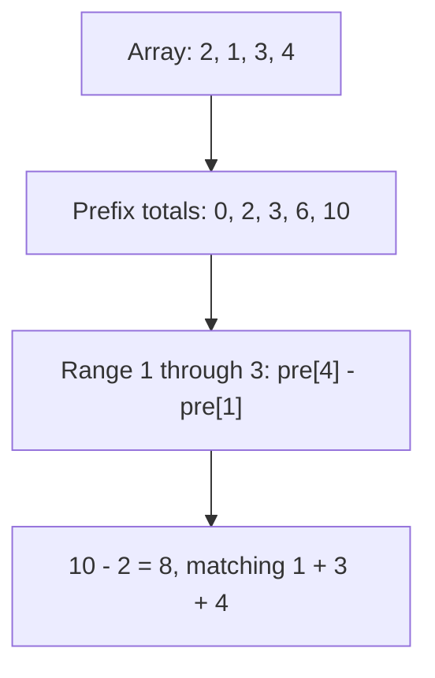

I use a prefix sum to cache the total *before* each position. An interval is the difference of two cached totals, so repeated range queries need no repeated scan.

## 1D prefix sums

Let $\mathrm{pre}[k]=\sum_{i=0}^{k-1}a[i]$, including $\mathrm{pre}[0]=0$. For an inclusive range $[l,r]$,

$$
\sum_{i=l}^{r}a[i]=\mathrm{pre}[r+1]-\mathrm{pre}[l].
$$



Building the table takes $O(n)$ time and $O(n)$ additional space. Each valid query takes $O(1)$. Negative entries work too: the subtraction identity does not rely on monotonicity.

```cpp
vector<long long> pre(n + 1, 0);
for (int i = 0; i < n; i++) pre[i + 1] = pre[i] + a[i];
// sum of a[l..r] (inclusive)
auto query = [&](int l, int r) { return pre[r + 1] - pre[l]; };
```

## 2D prefix sums

For a one-indexed matrix, let $S_{i,j}$ sum rows $1$ through $i$ and columns $1$ through $j$, with a zero row and column at index zero. Adding the upper and left rectangles double-counts their overlap, which must be subtracted:

$$
S_{i,j} = a_{i,j} + S_{i-1,j} + S_{i,j-1} - S_{i-1,j-1}.
$$

The inclusive rectangle from $(r_1,c_1)$ to $(r_2,c_2)$ then sums to

$$
S_{r_2,c_2}-S_{r_1-1,c_2}-S_{r_2,c_1-1}+S_{r_1-1,c_1-1}.
$$

For an $R$-by-$C$ matrix, preprocessing costs $O(RC)$ time and space; each rectangle query costs $O(1)$.

## Difference arrays

Add $v$ to every element of $[l, r]$ in $O(1)$: `d[l] += v; d[r + 1] -= v;`, then take a
prefix sum at the end.

Allocate a sentinel entry at index $n$ so an update ending at $r=n-1$ can write `d[r + 1]`. If I am adding updates to an existing array, I either initialize `d` from its differences or accumulate updates separately and add the final prefix values to the original array. The constant-time update is an offline operation: to query after every update, I need a different structure, such as a Fenwick tree. In all versions, choose a numeric type that can hold the largest total; `long long` is helpful only if the input bounds fit it.
