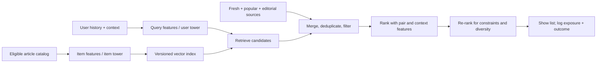

Suppose I am building the "read next" row in an article app. At request time I have a user, the articles they could actually open, and a few slots. My product target is **a useful next read**, with meaningful reading as an imperfect observed proxy. A click is easier to log, but a sensational headline can earn clicks without delivering value. I would define the event window, eligibility rules, and guardrails before choosing a model.

There are two separate computational questions. Which few articles should I inspect out of the whole eligible catalog? And how should I order those few for this user right now? Matrix factorization and two-tower models are ways to build candidate sets; a richer ranker and a final re-ranker decide what appears. The architecture below is a design pattern, not a claim about the current internals of any particular product. A two-stage candidate-and-ranking design appeared in Covington and colleagues' 2016 system paper, and the general candidate, scoring, re-ranking decomposition remains a useful teaching frame. 



## Content, behavior, and the cold-start problem

A content-based recommender uses article features such as topic, text, author, and publication time to find items resembling a user's observed interests. It can represent a new article as soon as its features exist. It may also stay too close to the user's history: if I only recommend more of the same topic, I never learn whether another topic would have worked.

Collaborative filtering uses patterns across users and items. Two people who engaged with some of the same articles may reveal a connection between other articles even when their text looks different. This can discover associations that metadata misses, but a brand-new user or article has little interaction history. A practical candidate pool can blend collaborative, content, fresh-item, and popularity sources, then measure each source's contribution. Popularity is a useful fallback, but logging only what was previously shown feeds its own exposure back into the model. 

The word "negative" needs care here. A user who explicitly rated an article poorly gave a negative signal. An article they never opened may simply never have been shown. A shown-but-skipped article is more informative, though position, attention, and context still affect that observation. Those distinctions shape the loss function and the evaluation set.

## Matrix factorization starts with observed ratings

For explicit ratings, let $\Omega$ be the observed user-item pairs. Associate user $u$ with vector $x_u\in\mathbb R^d$ and article $i$ with vector $y_i\in\mathbb R^d$. The dot product captures latent compatibility. A common model includes a global mean and biases:

$$
\hat r_{ui}=\mu+b_u+b_i+x_u^\top y_i.
$$

The biases absorb a generous rater and an item everyone tends to rate highly; the vectors then model the remaining interaction. One regularized squared-error objective is

$$
\min_{\mu,b,x,y}\ \sum_{(u,i)\in\Omega}
(r_{ui}-\mu-b_u-b_i-x_u^\top y_i)^2
+\lambda\!\left(\sum_u\|x_u\|^2+\sum_i\|y_i\|^2+
\sum_u b_u^2+\sum_i b_i^2\right).
$$

This is the familiar biased factorization model.  The critical symbol is $\Omega$. Missing ratings are **not** silently filled with zero and treated as observed dislikes. Factorization learns from a sparse matrix while regularization controls how much a user or item vector can stretch to explain a few entries. Rating RMSE is meaningful when the target really is a rating, but a low RMSE does not guarantee a good top-of-feed ordering. The article app mostly observes reading events, so it needs a different formulation.

## Implicit feedback: confidence is not preference

Let $r_{ui}$ count observed interactions, perhaps reads after a well-defined threshold. Hu, Koren, and Volinsky define a binary preference proxy $p_{ui}=\mathbf 1[r_{ui}>0]$ and a confidence $c_{ui}=1+\alpha r_{ui}$ for $\alpha>0$. Their weighted factorization objective is

$$
\min_{X,Y}\ \sum_{u,i}c_{ui}(p_{ui}-x_u^\top y_i)^2
+\lambda\left(\sum_u\|x_u\|^2+\sum_i\|y_i\|^2\right).
$$

This sum includes unobserved pairs. For those pairs $p_{ui}=0$ and $c_{ui}=1$: the model applies a *low-confidence* pull toward zero, while repeated observed activity gets larger weight. It is a modeling assumption about missing data, **not** evidence that a particular missing article was disliked. Depending on the product, interaction counts may need capping or another confidence transform; replaying the same article many times need not imply linear growth in preference. 

The "ALS" in weighted ALS is alternating least squares. Hold item vectors fixed and optimize one user vector at a time; then hold user vectors fixed and optimize item vectors. If $Y$ stacks item vectors as rows, $C_u$ is diagonal with entries $c_{ui}$, and $p_u$ stacks the proxies, the user subproblem is

$$
\min_{x_u}(p_u-Yx_u)^\top C_u(p_u-Yx_u)+\lambda x_u^\top x_u.
$$

Set its gradient to zero: $-2Y^\top C_u(p_u-Yx_u)+2\lambda x_u=0$. Therefore

$$
(Y^\top C_uY+\lambda I)x_u=Y^\top C_up_u.
$$

Solving this $d$-dimensional linear system yields the next $x_u$; the item update is symmetric. This explains why alternating updates are tractable even though the full problem is not jointly convex in $X$ and $Y$. In code, I would solve the linear system rather than explicitly form a matrix inverse.

Bayesian Personalized Ranking (BPR) answers a different question. For an observed item $i$ and sampled unobserved item $j$ for user $u$, encourage $s_{ui}>s_{uj}$ by minimizing

$$
\mathcal L_{\text{BPR}}
=-\sum_{(u,i,j)\in\mathcal D}\log\sigma(s_{ui}-s_{uj})
+\lambda\|\Theta\|^2,\qquad s_{ui}=x_u^\top y_i.
$$

Weighted ALS fits confidence-weighted pointwise preference proxies across pairs; BPR optimizes pairwise orderings over sampled triples. Neither identifies true dislikes from missing observations. BPR's answer depends on how $j$ is sampled, and its score need not be a calibrated probability of a read. 


## From factors to a two-tower retrieval model

A matrix factorization score is already a cheap dot product. A two-tower model extends the idea: one function encodes the user and request context into $q(u,c)$, and another independently encodes item features into $v(i)$. The retrieval score can be $q^\top v$. Because the item tower does **not** need this particular user as input, I can precompute item vectors and put them in a vector index. At request time I compute the query vector and search for high-scoring items. Approximate nearest-neighbor (ANN) search trades some exact top-neighbor accuracy for lower retrieval work; I would measure its recall against exact search on a sample. 

The independence is the useful constraint. It rules out a candidate model that runs an expensive, arbitrary user-item cross network for every catalog item. I can put those richer interactions in the ranker after retrieval has narrowed the set. A two-tower architecture does not require two deep networks; the point is separable query and item representations with a fast similarity score. Content features in the item tower can give a new article a vector before it gets interactions, although the model must still be trained to use those features well.

Dot product and cosine similarity are not synonyms. For nonzero vectors,
$ q^\top v=\|q\|\,\|v\|\cos(q,v)$.
For a fixed query, an item's norm can change its dot-product order; cosine discards that magnitude and compares direction. If I L2-normalize both sides, their order is identical. Whether the norm carries useful confidence or unwanted popularity is learned from the data and objective; I would test the choice rather than normalize by habit. 

Training needs negative examples or a contrastive denominator. In-batch negatives make other positive items in a minibatch cheap comparisons, but an item clicked by another user may also be relevant to this user: it is a **false negative** for that comparison. When batches sample observed interactions roughly uniformly, frequently observed items appear more often. The sampled distribution can then differ from the full catalog and bias a naive loss; a different batch sampler changes that distribution. A sampled-softmax correction or a deliberately chosen sampling distribution can address one bias; neither creates ground-truth dislikes. Exposure-aware negatives are useful when impression logs exist, but a skipped item near the bottom of a page is still not equivalent to an explicit dislike. The sampling process belongs in the model specification and in offline evaluation. 

## Retrieval sets a ceiling for ranking

Let $C_u$ be the retrieved candidates for a user and $R_u$ be a fixed set of known relevant eligible items in the evaluation universe. Any ranker that only orders $C_u$ can return relevant items only from $C_u\cap R_u$. For a nonempty relevance set and a final list of at most $K$ items,

$$
\operatorname{Recall@K}_{\text{final}}
\le \frac{\min\{K,|C_u\cap R_u|\}}{|R_u|}
\le \frac{|C_u\cap R_u|}{|R_u|}
=\operatorname{candidate\ recall}(u).
$$

The first bound is attainable by an oracle that puts all available relevant candidates first, subject to $K$ slots. Candidate recall is a looser bound when there are more relevant candidates than slots. Both concern this fixed relevance set, not unseen user satisfaction. It also does not mean that increasing candidate count always improves the displayed list: noisy candidates can make ranking harder or more expensive. I would measure candidate recall by source, exact-versus-ANN retrieval recall, final ranking quality, and serving latency separately. [Recall@K and NDCG](/blog/ml-nlp-metrics/) answer different questions: recall counts retrieved relevant items, while NDCG rewards placing graded relevance near the top.

Here is a deliberately small example. The query is $[1,0]$, so dot-product retrieval uses each item's first coordinate. The ranker scores are an illustrative independent signal, not fitted model outputs. Items B and E are relevant; the candidate stage keeps A, B, C. Even a perfect ranker on those candidates cannot show E.

```python {title="retrieval_ceiling.py"}
import numpy as np

names = np.array(["A", "B", "C", "D", "E"])
query = np.array([1.0, 0.0])
items = np.array([
    [0.95, 0.0],
    [0.85, 0.2],
    [0.80, 0.1],
    [0.30, 0.9],
    [0.20, 1.0],
])
relevant = {"B", "E"}
ranker_score = np.array([0.2, 0.9, 0.1, 0.8, 1.5])

retrieval_score = items @ query
candidates = np.argsort(-retrieval_score, kind="stable")[:3]
K = 2
final = candidates[np.argsort(-ranker_score[candidates], kind="stable")[:K]]
full_catalog = np.argsort(-ranker_score, kind="stable")[:K]
relevant_candidates = len(set(names[candidates]) & relevant)
best_possible_recall = min(K, relevant_candidates) / len(relevant)

def recall(indices):
    return len(set(names[indices]) & relevant) / len(relevant)

print("retrieved:", ", ".join(names[candidates]))
print(f"candidate recall: {recall(candidates):.2f}")
print("ranked top 2:", ", ".join(names[final]))
print(f"final recall: {recall(final):.2f}")
print(f"best possible final recall from candidates: {best_possible_recall:.2f}")
print("full-catalog top 2:", ", ".join(names[full_catalog]))
print(f"full-catalog recall: {recall(full_catalog):.2f}")
```

```text {title="Output"}
retrieved: A, B, C
candidate recall: 0.50
ranked top 2: B, A
final recall: 0.50
best possible final recall from candidates: 0.50
full-catalog top 2: E, B
full-catalog recall: 1.00
```

The script is also in [retrieval_ceiling.py](retrieval_ceiling.py). The full-catalog comparison isolates the retrieval bottleneck; a real catalog may have other relevant items we never observed, making the measured ceiling itself incomplete.

## Ranking, re-ranking, and a request that actually serves

After merging and deduplicating candidate sources, a ranker can use features unavailable to the retrieval dot product: recent user behavior, article freshness, language match, prior exposure, author affinity, and interactions between user and item. I would choose a target tied to the product goal, such as a defined meaningful-read event conditional on exposure, and check calibration if the score is interpreted as a probability. A ranker trained on clicks alone may learn to reward curiosity rather than a useful read.

Re-ranking acts on the ordered set to enforce eligibility and list-level concerns: remove already read or unavailable articles, avoid near-duplicates, respect safety rules, and choose a sensible mix of topics or sources. This stage can improve the list a user sees even when it slightly lowers the ranker's sum of item scores. Hard eligibility filters must also apply consistently at candidate generation and evaluation; a model should not get credit for recommending an article that could not have been shown. 

The serving path needs more than a model file. I would version the user/query tower, item tower, feature definitions, and ANN index together. If the query encoder changes while the index still contains vectors from an incompatible item encoder, dot products lose their learned meaning. New or edited articles need a path into the index; deleted or ineligible items need prompt removal or filtering. On request failure, a safe eligible fallback can keep the row usable. Logging the exact candidate set, model/index versions, scores, final positions, exposure, and eventual outcomes makes debugging and later evaluation possible without guessing what the user actually saw.

## Offline evidence and online decisions

For an offline test, I would reconstruct what was knowable **as of** each request: user history only up to that time, article features and availability at that time, and the catalog eligible then. Randomly splitting interactions can put a future event into training while evaluating an earlier request. Even a per-user "last interaction" holdout can leak global future information through other users or item statistics. Feature preprocessing, factor fitting, negative sampling rules, and candidate generation must respect the training cutoff. [Cross-Validation and Data Leakage](/blog/cross-validation-and-data-leakage/) develops this boundary in more detail. 

I would report warm-user/warm-item results separately from new-user and new-item cohorts. A model that looks excellent when every entity has history may fail the cold-start cases that content features or exploration are meant to handle. I would also examine item coverage, popularity concentration, freshness, and performance by meaningful segments. Evaluating only against a small set of sampled "negative" items can make top-$K$ metrics look different from ranking against the eligible catalog; sampled-metric protocols need explicit justification. 

Finally, an offline improvement is a reason to run a controlled online experiment, not proof that the product improved. I would define the primary outcome and guardrails before the experiment: for this article row, meaningful reads or return visits might be primary, with latency, complaints, accidental clicks, and concentration of exposure as guardrails. The 2016 YouTube paper explicitly distinguished offline model checks from live experiments; that lesson is general, even though its particular system is historical. 


## Interview questions and harder follow-ups

**1. Why not set every missing rating to zero and run ordinary matrix factorization?** In an explicit-rating task, a blank cell has no observed value. Filling it with zero invents negative ratings and lets missingness dominate the loss. The explicit objective sums only over $\Omega$. Implicit weighted ALS does include missing pairs, but deliberately gives them lower confidence than observed interactions; it is a different modeling assumption.

**2. What does the user bias do if the dot product is already flexible?** It captures a user who systematically rates high or low. The item bias captures generally well-rated items, and $\mu$ captures the global level. Without these terms, factors must spend capacity explaining baseline effects before learning user-item deviations. I would regularize biases too, especially for entities with few ratings.

**3. Why does weighted ALS have a closed-form user update but not a single closed-form solution for all factors?** With $Y$ fixed, the user objective is quadratic in $x_u$ and leads to a linear system. With both $X$ and $Y$ unknown, their product is bilinear and the objective is not jointly convex. Alternating the two sets of tractable subproblems finds a local solution, not a guaranteed global optimum.

**4. Is BPR the same as implicit ALS with a different optimizer?** No. ALS minimizes confidence-weighted squared error against binary preference proxies. BPR minimizes a pairwise logistic loss that asks an observed item to outrank a sampled unobserved one. They can use the same dot-product score, but they optimize different targets and make different use of missing pairs. 

**5. Why can the item tower be precomputed?** Its input is the item and its features, independent of the current user. The user tower runs for the current request and searches the stored item vectors. If an item encoder needs this user's live history, its output is no longer a reusable per-item vector; that interaction belongs in the ranker or requires another retrieval design.

**6. When do dot product and cosine produce the same order?** For nonzero vectors normalized to unit length, the dot product equals cosine. For a fixed query without normalization, candidate item norms can change the order. A high-norm item can win despite a worse angle. Whether that is desirable depends on what the training objective put into norms.

**7. Can a very strong ranker compensate for weak candidate retrieval?** It can sort only the candidates it receives. If a relevant article is absent, the ranker cannot select it; final recall is bounded by candidate recall for a fixed labeled relevant set. A ranker can still improve precision and NDCG within the candidate set. I would inspect per-source candidate recall before spending all effort on ranker features.

**8. Are other items in the batch valid negatives for a two-tower loss?** They are cheap comparisons, not certified dislikes. Another user's positive item may be relevant to this user, and popular items are sampled more often. That can create false negatives and distribution bias. I would track the sampler, filter known positives when possible, and evaluate against the serving candidate universe. 

**9. Why is a random interaction split risky for a recommender?** It can let the model learn from interactions, item popularity, or features that occur after the evaluation request. Reconstructing user history and article eligibility as of the request time is closer to the actual prediction task. I would also keep new-user and new-item cohorts visible rather than silently dropping them for lack of history. 

**10. What breaks when an ANN index is stale?** A new article may be absent, an expired one may still appear, and changed item embeddings may not match the query tower's version. I would version encoder and index artifacts together, monitor index age and exact-neighbor recall, and apply an eligibility filter at serving time. The fallback should return only eligible items.

**11. Why can offline Recall@K improve while an online experiment gets worse?** The offline labels reflect past exposure and a chosen proxy, not every article the user might have valued. Candidate distribution, position, novelty, and latency can change online behavior. I would verify the as-of split and sampling protocol, then read the experiment's primary outcome and guardrails rather than promote a model on one offline number.



