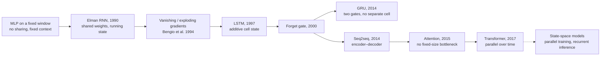
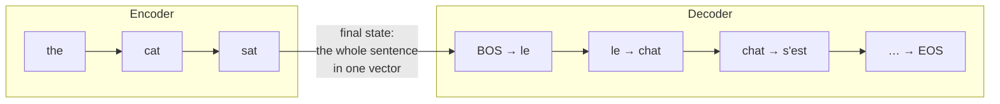

Transformers run almost everything now, but recurrent networks are still the clearest place to
learn the core problem of sequence modelling: how do you squeeze an arbitrarily long past into a
fixed amount of memory, and how do you train that memory with gradients? Every idea in this
post, from backpropagation through time to the LSTM's cell state to attention, is an answer to
one of those two questions. They also come up constantly in interviews, usually as "derive the
gradient of an RNN" followed by "so why do LSTMs fix vanishing gradients?", and the honest
answer to the second one is more subtle than "because of the gates".

The plan: I'll motivate each architecture by the specific failure of the one before it, derive
every backward pass by hand, and implement all three cells in PyTorch twice: once with plain
tensor ops and a hand-written backward (checked against autograd to about $10^{-16}$), and once
with `nn.RNN` / `nn.LSTM` / `nn.GRU` with the weights copied over, to pin down PyTorch's exact
conventions. Then a toy task where the vanilla RNN fails and the gated ones don't, a measurement
of vanishing gradients, and the practical machinery (packing, bidirectional and stacked RNNs,
dropout, teacher forcing, seq2seq). The interview questions are at the end.

The code blocks are meant to run **in order in one Python session**: later blocks reuse imports
and functions from earlier ones, and the first few switch PyTorch to float64 so the gradient
checks are tight. Every output shown is from an actual run (PyTorch 2.14, CPU).

## The whole post in one picture

Three architectures, each a fix for the previous one's failure:

| | Vanilla (Elman) RNN | LSTM | GRU |
|---|---|---|---|
| State carried between steps | $h_t$ | $h_t$ and a cell $c_t$ | $h_t$ |
| Update | $h_t = \tanh(W_{xh}x_t + W_{hh}h_{t-1} + b)$ | $c_t = f_t\odot c_{t-1} + i_t\odot g_t$, $h_t = o_t\odot\tanh(c_t)$ | $h_t = z_t\odot h_{t-1} + (1-z_t)\odot n_t$ (PyTorch's convention) |
| Gates | none | input, forget, output (+ candidate) | update, reset (+ candidate) |
| Step-to-step Jacobian along the main path | $\text{diag}(1-h_t^2)\,W_{hh}$ | $\text{diag}(f_t)$ | $\text{diag}(z_t)$ (plus terms through the gates) |
| Parameters (one bias per gate) | $H(H+D)+H$ | $4\,[H(H+D)+H]$ | $3\,[H(H+D)+H]$ |
| What goes wrong | gradients vanish or explode over long spans | still sequential; 4× the compute of an RNN | same; slightly less expressive than LSTM |

The step-to-step Jacobian row is the whole story. In a vanilla RNN, the gradient flowing back
one step gets multiplied by a weight matrix and a squashing derivative, every single step, so
over 50 steps it shrinks or blows up exponentially. The LSTM and GRU add a path where the
gradient is multiplied only by a gate value the network can learn to hold near 1.



<details>
<summary><b>Notation used in the maths cards</b></summary>

| Symbol | Meaning |
|---|---|
| $B, T, D, H, V$ | batch size, sequence length, input size, hidden size, number of output classes |
| $x_t \in \mathbb R^D$ | input at step $t$ (one example; code uses rows of a $B\times D$ matrix) |
| $h_t \in \mathbb R^H$ | hidden state after step $t$; $h_0$ is the initial state (usually zeros) |
| $a_t$ | pre-activation, the thing inside the $\tanh$ or the sigmoids |
| $s_t$, $p_t$ | output scores (logits) and $p_t = \text{softmax}(s_t)$ |
| $y_t$, $e_{y_t}$ | target class at step $t$ and its one-hot vector |
| $L = \sum_t L_t$ | total loss, $L_t = -\log p_{t,y_t}$ |
| $\bar v$ | shorthand for $\partial L/\partial v$, the gradient of the total loss with respect to $v$, same shape as $v$ |
| $\delta_t$ | $\bar a_t = \partial L/\partial a_t$ |
| $\odot$ | element-wise product; $\text{diag}(v)$ is the diagonal matrix with $v$ on the diagonal |
| $\sigma$ | the logistic sigmoid $1/(1+e^{-x})$; note $\sigma' = \sigma(1-\sigma)$ and $\tanh' = 1-\tanh^2$ |

</details>

## Why sequences need their own architecture

Text, audio, sensor streams, user click histories, time series: lots of data arrives as an
ordered list of vectors $x_1, x_2, \dots, x_T$ where $T$ changes from example to example and
order carries meaning. "The dog bit the man" and "the man bit the dog" have the same words.

### What goes wrong with a fixed window or a bag of words

The obvious things to try first both break:

- **Bag of words (sum or average the inputs).** Handles any length, but throws away order
  completely. "Not good, actually bad" and "not bad, actually good" become the same vector.
- **An MLP on a fixed window of the last $k$ inputs.** Keeps order, but now the model can't see
  anything older than $k$ steps, and the window has to be padded or truncated to size. Worse,
  there's **no parameter sharing across positions**: the first layer has separate weights for
  "position 3" and "position 7", so a pattern like "not good" learned at positions 3–4 has to be
  learned again at positions 7–8. Parameters grow linearly with $k$, and so does the data needed.

What we want is a model whose parameters don't depend on $T$ or on position, that processes
the sequence in order, and that can in principle carry information from arbitrarily far back.
The recurrent answer is: apply **the same small function at every step**, and let it pass a
state vector forward to itself.

$$
h_t = f_\theta(h_{t-1}, x_t).
$$

The same $\theta$ at every step is exactly the weight sharing a CNN does across space, done
across time instead. It's what lets an RNN trained on 20-step sequences run on 200-step ones.[^cnn]

[^cnn]: A 1-D convolution also shares weights across time, but its receptive field is fixed by
the kernel size and depth. An RNN's receptive field is, in principle, the whole past.

### Four shapes of sequence task

Where the inputs and outputs sit in time determines how you wire the model:

| Shape | Input → output | Examples | How an RNN does it |
|---|---|---|---|
| One-to-many | one vector → sequence | image captioning, music from a seed | feed the vector as $h_0$ (or $x_1$), then generate |
| Many-to-one | sequence → one label | sentiment, spam, activity recognition | read everything, classify from the last $h_T$ (or a pooled $h$) |
| Many-to-many, aligned | one output per input | part-of-speech tagging, NER, frame-wise speech labels, next-character prediction | an output head on every $h_t$ |
| Many-to-many, unaligned | sequence → sequence of a different length | translation, summarisation, speech → text | encoder RNN reads, decoder RNN writes ([seq2seq](#sequence-to-sequence-and-the-road-to-attention)) |

### The hidden state is a lossy running summary

The hidden state $h_t$ is the only thing the model carries from the past into the future. It
has a fixed size $H$, however long the past was, so it has to be a **compressed, lossy summary**
of $x_1,\dots,x_t$: ideally keeping exactly what will help predict what comes next and
dropping everything else. When you read a sentence, you don't keep every word in working
memory; you keep the gist, the subject, whether you're inside a quotation. Training an RNN is
teaching it what gist to keep.

That framing explains the rest of the post. A vanilla RNN rewrites its whole summary at every
step through a matrix multiply and a squashing function, which makes it hard to *keep*
something unchanged for 50 steps and hard to *learn* that it should. LSTMs and GRUs make
"leave this part of the summary alone" the easy default. Attention gives up on the fixed-size
summary altogether.

## The vanilla RNN

The simple recurrent network, usually called the Elman network after Elman's 1990 paper
, makes $f_\theta$ an affine map followed by $\tanh$:

$$
\begin{aligned}
a_t &= W_{xh}\,x_t + W_{hh}\,h_{t-1} + b_h && \text{(pre-activation, } H\text{)}\\
h_t &= \tanh(a_t) && \text{(new state)}\\
s_t &= W_{hy}\,h_t + b_y && \text{(scores, } V\text{)}\\
p_t &= \text{softmax}(s_t), \qquad L = \sum_{t=1}^{T} -\log p_{t,\,y_t} .
\end{aligned}
$$

$W_{xh}$ ($H\times D$) reads the input, $W_{hh}$ ($H\times H$) mixes the previous state, and
$W_{hy}$ ($V\times H$) reads out a prediction. The loss above is for the aligned
many-to-many case (a prediction at every step, like a character-level language model); for
many-to-one you'd keep only $L_T$.

Why $\tanh$? It keeps the state bounded in $(-1, 1)$ no matter how long the sequence runs, it's
zero-centred so it can push the state either way, and its derivative at zero is 1. A ReLU state
is unbounded: if $W_{hh}$ has an eigenvalue above 1 the activations themselves blow up in the
forward pass, not just the gradients. (ReLU RNNs can work with careful initialisation, see
[IRNN](#remedies-clipping-initialisation-and-gating) below.)

Parameter count: $H\cdot D + H\cdot H + H$ for the recurrence, plus $V\cdot H + V$ for the
readout, independent of $T$.

### Unrolling: a deep network with tied weights

Draw one box per time step and the recurrence becomes an ordinary feed-forward graph, $T$
layers deep, where every layer uses **the same** $W_{xh}$, $W_{hh}$, $b_h$:

<figure class="ml-diagram">
<svg viewBox="0 0 860 320" role="img" aria-label="An RNN unrolled over four time steps. Each input x_t feeds a hidden box h_t through W_xh; each hidden box feeds the next through W_hh and an output box through W_hy. The initial state h_0 enters from the left.">
  <defs><marker id="ml-arrow" viewBox="0 0 10 10" refX="9" refY="5" markerWidth="7" markerHeight="7" orient="auto-start-reverse"><path d="M0,0 L10,5 L0,10 z"/></marker></defs>
  <rect class="box" x="20" y="132" width="70" height="56" rx="8"/>
  <text class="name" x="55" y="166">h₀</text>
  <rect class="box green" x="150" y="12" width="100" height="50" rx="8"/>
  <text class="name" x="200" y="43">ŷ₁ , L₁</text>
  <rect class="box green" x="330" y="12" width="100" height="50" rx="8"/>
  <text class="name" x="380" y="43">ŷ₂ , L₂</text>
  <rect class="box green" x="510" y="12" width="100" height="50" rx="8"/>
  <text class="name" x="560" y="43">ŷ₃ , L₃</text>
  <rect class="box green" x="690" y="12" width="100" height="50" rx="8"/>
  <text class="name" x="740" y="43">ŷ₄ , L₄</text>
  <rect class="box violet" x="135" y="125" width="130" height="70" rx="8"/>
  <text class="name" x="200" y="155">h₁</text>
  <text class="note violet" x="200" y="177">tanh(a₁)</text>
  <rect class="box violet" x="315" y="125" width="130" height="70" rx="8"/>
  <text class="name" x="380" y="155">h₂</text>
  <text class="note violet" x="380" y="177">tanh(a₂)</text>
  <rect class="box violet" x="495" y="125" width="130" height="70" rx="8"/>
  <text class="name" x="560" y="155">h₃</text>
  <text class="note violet" x="560" y="177">tanh(a₃)</text>
  <rect class="box violet" x="675" y="125" width="130" height="70" rx="8"/>
  <text class="name" x="740" y="155">h₄</text>
  <text class="note violet" x="740" y="177">tanh(a₄)</text>
  <rect class="box blue" x="150" y="258" width="100" height="50" rx="8"/>
  <text class="name" x="200" y="289">x₁</text>
  <rect class="box blue" x="330" y="258" width="100" height="50" rx="8"/>
  <text class="name" x="380" y="289">x₂</text>
  <rect class="box blue" x="510" y="258" width="100" height="50" rx="8"/>
  <text class="name" x="560" y="289">x₃</text>
  <rect class="box blue" x="690" y="258" width="100" height="50" rx="8"/>
  <text class="name" x="740" y="289">x₄</text>
  <line class="arrow" x1="94" y1="160" x2="131" y2="160"/>
  <line class="arrow" x1="269" y1="160" x2="311" y2="160"/>
  <line class="arrow" x1="449" y1="160" x2="491" y2="160"/>
  <line class="arrow" x1="629" y1="160" x2="671" y2="160"/>
  <text class="note" x="290" y="150">W_hh</text>
  <text class="note" x="470" y="150">W_hh</text>
  <text class="note" x="650" y="150">W_hh</text>
  <line class="arrow" x1="200" y1="254" x2="200" y2="199"/>
  <line class="arrow" x1="380" y1="254" x2="380" y2="199"/>
  <line class="arrow" x1="560" y1="254" x2="560" y2="199"/>
  <line class="arrow" x1="740" y1="254" x2="740" y2="199"/>
  <text class="note left" x="208" y="232">W_xh</text>
  <text class="note left" x="388" y="232">W_xh</text>
  <text class="note left" x="568" y="232">W_xh</text>
  <text class="note left" x="748" y="232">W_xh</text>
  <line class="arrow" x1="200" y1="121" x2="200" y2="66"/>
  <line class="arrow" x1="380" y1="121" x2="380" y2="66"/>
  <line class="arrow" x1="560" y1="121" x2="560" y2="66"/>
  <line class="arrow" x1="740" y1="121" x2="740" y2="66"/>
  <text class="note left" x="208" y="98">W_hy</text>
  <text class="note left" x="388" y="98">W_hy</text>
  <text class="note left" x="568" y="98">W_hy</text>
  <text class="note left" x="748" y="98">W_hy</text>
</svg>
<figcaption>An RNN unrolled over four steps. Every horizontal arrow is the same W_hh, every vertical one the same W_xh or W_hy. Backpropagation through time is ordinary backprop on this graph, with the gradients of the shared weights summed over steps.</figcaption>
</figure>

This picture gives you the training algorithm for free: it's a feed-forward net, so run
backprop on it. The only twists are that the depth is $T$ (often hundreds), and that each
weight is used $T$ times, so its gradient is the **sum** of the gradients at each use.

### Shapes, and the code

In code everything is batched and **batch-first**: the input is a $(B, T, D)$ tensor, the
state is $(B, H)$, and since each example is a row, the matrix products are transposed
relative to the maths: $a_t = x_t W_{xh}^\top + h_{t-1}W_{hh}^\top + b_h$, with
$x_t$ of shape $(B, D)$. I name and shape the parameters exactly like PyTorch's `nn.RNN`
(`weight_ih_l0` is $H\times D$, `weight_hh_l0` is $H\times H$) so the weights can be copied
straight across later.

The forward pass is a Python loop over time. The cross-entropy is summed over time and averaged
over the batch. I'll show the full block, including the backward pass and the checks, after
deriving the backward pass in the next section.

## Backpropagation through time, derived

Backpropagation through time (BPTT) is the name for "unroll, then backprop"; Werbos' 1990
paper is the classic description. If you know backprop for an MLP (see
[backprop in one page](/blog/optimizers-and-generalization/#where-the-gradient-comes-from-backprop-in-one-page)
or the [two-layer net post](/blog/neural-nets-and-cnns/)), there's exactly one new idea: a
hidden state is used in **two places**, so its gradient has two incoming terms.

### The two paths into a hidden state

$h_t$ influences the loss through the output at the same step ($h_t \to s_t \to L_t$) and
through the next state ($h_t \to a_{t+1} \to h_{t+1} \to \dots$, which carries all the future
losses). The multivariable chain rule says: add the contributions of every path.

<figure class="ml-diagram">
<svg viewBox="0 0 860 250" role="img" aria-label="Gradient flow at one time step. The gradient of the loss with respect to h_t receives two contributions: from the output layer at step t, and from delta at step t+1 through W_hh transposed. It is multiplied element-wise by one minus h_t squared to give delta_t, which feeds the weight gradients and flows on to step t-1.">
  <defs><marker id="ml-arrow" viewBox="0 0 10 10" refX="9" refY="5" markerWidth="7" markerHeight="7" orient="auto-start-reverse"><path d="M0,0 L10,5 L0,10 z"/></marker></defs>
  <rect class="box green" x="300" y="10" width="260" height="62" rx="8"/>
  <text class="name" x="430" y="36">from the output at t</text>
  <text class="note green" x="430" y="58">W_hyᵀ (p_t − e_yt)</text>
  <rect class="box rose" x="620" y="94" width="220" height="62" rx="8"/>
  <text class="name" x="730" y="120">from step t+1</text>
  <text class="note rose" x="730" y="142">W_hhᵀ δ_t+1</text>
  <rect class="box violet" x="300" y="94" width="260" height="62" rx="8"/>
  <text class="name" x="430" y="120">h̄_t = ∂L/∂h_t</text>
  <text class="note violet" x="430" y="142">sum of both paths</text>
  <rect class="box blue" x="300" y="180" width="260" height="62" rx="8"/>
  <text class="name" x="430" y="206">δ_t = h̄_t ⊙ (1 − h_t²)</text>
  <text class="note blue" x="430" y="228">through the tanh</text>
  <rect class="box sand" x="20" y="180" width="240" height="62" rx="8"/>
  <text class="name" x="140" y="206">to step t−1: W_hhᵀ δ_t</text>
  <text class="note sand" x="140" y="228">and dW += δ_t (x_t, h_t−1)ᵀ</text>
  <line class="arrow" x1="430" y1="76" x2="430" y2="90"/>
  <line class="arrow" x1="616" y1="125" x2="564" y2="125"/>
  <line class="arrow" x1="430" y1="160" x2="430" y2="176"/>
  <line class="arrow" x1="296" y1="211" x2="264" y2="211"/>
</svg>
<figcaption>One step of BPTT. The gradient walks right to left through time, picking up the local output gradient at every step.</figcaption>
</figure>

<details>
<summary><b>Maths: the full BPTT derivation for the Elman RNN</b></summary>

Work with one example (column vectors); the batch version just sums over examples.

**Step 1, the output layer.** For softmax followed by cross-entropy, the gradient with respect
to the scores is the famous "prediction minus target" (derived in the
[softmax post](/blog/softmax-numerical-stability/#the-backward-pass)):

$$
\frac{\partial L_t}{\partial s_t} = p_t - e_{y_t} .
$$

Only $L_t$ depends on $s_t$, so this is also $\bar s_t = \partial L/\partial s_t$. Since
$s_t = W_{hy}h_t + b_y$, and $W_{hy}$ is used at every step:

$$
\bar W_{hy} = \sum_{t=1}^{T} (p_t - e_{y_t})\,h_t^\top ,\qquad
\bar b_y = \sum_{t=1}^{T} (p_t - e_{y_t}) .
$$

(For a linear map $s = Wh$, $\partial L/\partial W = \bar s\, h^\top$: each entry $W_{ij}$
multiplies $h_j$ into $s_i$.)

**Step 2, the hidden state.** $h_t$ feeds $s_t$ and $a_{t+1}$. The chain rule over both paths:

$$
\bar h_t
= \Big(\frac{\partial s_t}{\partial h_t}\Big)^{\!\top}\bar s_t + \Big(\frac{\partial a_{t+1}}{\partial h_t}\Big)^{\!\top}\bar a_{t+1}
= W_{hy}^\top (p_t - e_{y_t}) + W_{hh}^\top\,\delta_{t+1},
$$

with $\delta_{T+1} = 0$ because there is no step $T+1$. This is the line that makes it
"through time": the gradient at step $t$ needs the gradient from step $t+1$, so you have to
sweep **backwards** from $t = T$ to $t = 1$.

**Step 3, through the tanh.** $h_t = \tanh(a_t)$ element-wise, so the Jacobian is diagonal with
entries $\tanh'(a_t) = 1 - \tanh^2(a_t) = 1 - h_t^2$:

$$
\delta_t = \bar a_t = \bar h_t \odot (1 - h_t \odot h_t) .
$$

Note that it's written in terms of the *output* $h_t$, which we stored in the forward pass;
no need to keep $a_t$.

Putting steps 2 and 3 together gives the **BPTT recurrence**:

$$
\boxed{\;\delta_t = (1 - h_t^2) \odot \big(W_{hy}^\top (p_t - e_{y_t}) + W_{hh}^\top \delta_{t+1}\big),\qquad \delta_{T+1} = 0\;}
$$

**Step 4, the shared weights.** $a_t = W_{xh}x_t + W_{hh}h_{t-1} + b_h$. Pretend for a moment
that each step had its own copy $W_{hh}^{(t)}$. Then $\partial L/\partial W_{hh}^{(t)} = \delta_t h_{t-1}^\top$.
The real $W_{hh}$ equals all the copies at once, so a small change to it changes every copy, and
its gradient is the sum:

$$
\bar W_{hh} = \sum_{t=1}^{T}\delta_t\,h_{t-1}^\top,\qquad
\bar W_{xh} = \sum_{t=1}^{T}\delta_t\,x_t^\top,\qquad
\bar b_h = \sum_{t=1}^{T}\delta_t .
$$

**Step 5, the inputs and the initial state.**

$$
\bar x_t = W_{xh}^\top \delta_t ,\qquad \bar h_0 = W_{hh}^\top \delta_1 .
$$

$\bar x_t$ is what you'd pass to an embedding layer or a lower RNN layer; $\bar h_0$ is what
you'd pass to an encoder whose final state initialised this RNN.

**Batched, batch-first version** (what the code does). With rows as examples,
$\Delta_t$ is $B\times H$, $X_t$ is $B\times D$, and the sums over examples become matrix products:
$\bar W_{hh} \mathrel{+}= \Delta_t^\top H_{t-1}$, $\bar W_{xh} \mathrel{+}= \Delta_t^\top X_t$,
$\bar b_h \mathrel{+}= \textstyle\sum_{\text{rows}}\Delta_t$,
$\bar X_t = \Delta_t W_{xh}$, and the message to the previous step is $\Delta_t W_{hh}$. If the
loss is averaged over the batch, divide $p_t - e_{y_t}$ by $B$.

**Cost.** The backward sweep does the same matrix products as the forward pass (about twice
as many), so it's $O(T)$ time. But it needs every $h_t$ from the forward pass, so memory is
$O(T\cdot B\cdot H)$: that's what truncated BPTT trades away.

</details>

### Code: forward, hand-written BPTT, and the checks

Here is the whole thing: a forward pass written with tensor ops, the backward pass from the
derivation above with no autograd, then autograd on the same forward function as the referee,
and finally `nn.RNN` with the weights copied in to confirm the forward matches PyTorch.
`nn.RNN` has two bias vectors, `bias_ih` and `bias_hh`, that are simply added together; I put
mine in one and zero the other.

```python {title="rnn_bptt.py"}
import torch
import torch.nn.functional as F

torch.manual_seed(0)
torch.set_default_dtype(torch.float64)   # float64 so gradient checks are tight

B, T, D, H, V = 3, 6, 4, 5, 7            # batch, time, input dim, hidden dim, classes

# Parameters, named and shaped like PyTorch's nn.RNN (weight_ih_l0 is H x D, etc.)
params = {
    "W_xh": torch.randn(H, D) * 0.5,
    "W_hh": torch.randn(H, H) * 0.5,
    "b_h":  torch.zeros(H),
    "W_hy": torch.randn(V, H) * 0.5,
    "b_y":  torch.zeros(V),
}
x  = torch.randn(B, T, D)                # batch-first inputs
y  = torch.randint(0, V, (B, T))         # one target class per time step
h0 = torch.zeros(B, H)


def rnn_forward(x, y, h0, p):
    """Elman RNN + softmax readout. Returns the loss and a cache for backward."""
    B, T, _ = x.shape
    hs, probs = [h0], []
    loss = 0.0
    for t in range(T):
        a = x[:, t] @ p["W_xh"].T + hs[-1] @ p["W_hh"].T + p["b_h"]   # (B, H)
        h = torch.tanh(a)
        logits = h @ p["W_hy"].T + p["b_y"]                            # (B, V)
        logp = torch.log_softmax(logits, dim=1)
        loss = loss - logp[torch.arange(B), y[:, t]].sum()             # sum over batch
        hs.append(h)
        probs.append(logp.exp())
    return loss / B, (x, y, hs, probs)                                 # mean over batch


def rnn_backward(cache, p):
    """Backpropagation through time, written out by hand. No autograd."""
    x, y, hs, probs = cache
    B, T, _ = x.shape
    g = {k: torch.zeros_like(v) for k, v in p.items()}
    dx = torch.zeros_like(x)
    dh_next = torch.zeros_like(hs[0])          # dL/dh_t arriving from step t+1
    for t in reversed(range(T)):
        h, h_prev = hs[t + 1], hs[t]
        dlogits = probs[t].clone()             # softmax + CE: p - onehot ...
        dlogits[torch.arange(B), y[:, t]] -= 1
        dlogits /= B                           # ... divided by B (mean over batch)
        g["W_hy"] += dlogits.T @ h
        g["b_y"]  += dlogits.sum(0)
        dh = dlogits @ p["W_hy"] + dh_next     # two paths into h_t: output and future
        da = dh * (1 - h * h)                  # through tanh: tanh' = 1 - h^2
        g["W_xh"] += da.T @ x[:, t]
        g["W_hh"] += da.T @ h_prev
        g["b_h"]  += da.sum(0)
        dx[:, t]  = da @ p["W_xh"]
        dh_next   = da @ p["W_hh"]             # send the gradient one step back
    return g, dx, dh_next                      # dh_next is now dL/dh0


# --- manual gradients
loss, cache = rnn_forward(x, y, h0, params)
grads, dx, dh0 = rnn_backward(cache, params)

# --- autograd gradients on the same function
p_ag = {k: v.clone().requires_grad_() for k, v in params.items()}
x_ag, h0_ag = x.clone().requires_grad_(), h0.clone().requires_grad_()
loss_ag, _ = rnn_forward(x_ag, y, h0_ag, p_ag)
loss_ag.backward()

print(f"loss manual {loss.item():.6f}  autograd {loss_ag.item():.6f}")
for k in params:
    print(f"max |manual - autograd|  d{k:5s}: {(grads[k] - p_ag[k].grad).abs().max():.2e}")
print(f"max |manual - autograd|  dx    : {(dx - x_ag.grad).abs().max():.2e}")
print(f"max |manual - autograd|  dh0   : {(dh0 - h0_ag.grad).abs().max():.2e}")

# --- the hidden states match nn.RNN once its weights are copied in
rnn = torch.nn.RNN(D, H, batch_first=True)
with torch.no_grad():
    rnn.weight_ih_l0.copy_(params["W_xh"]); rnn.weight_hh_l0.copy_(params["W_hh"])
    rnn.bias_ih_l0.copy_(params["b_h"]);    rnn.bias_hh_l0.zero_()   # two biases, one sum
out, h_T = rnn(x, h0.unsqueeze(0))
print(f"max |h_manual - nn.RNN|        : {(torch.stack(cache[2][1:], 1) - out).abs().max():.2e}")
```

```text {title="Output"}
loss manual 11.736770  autograd 11.736770
max |manual - autograd|  dW_xh : 4.44e-16
max |manual - autograd|  dW_hh : 1.67e-16
max |manual - autograd|  db_h  : 1.67e-16
max |manual - autograd|  dW_hy : 1.11e-16
max |manual - autograd|  db_y  : 2.22e-16
max |manual - autograd|  dx    : 1.11e-16
max |manual - autograd|  dh0   : 1.11e-16
max |h_manual - nn.RNN|        : 2.22e-16
```

Every gradient agrees with autograd to the last couple of bits of a float64. Two lines carry
the whole derivation: `dh = dlogits @ W_hy + dh_next` (two paths in) and
`dh_next = da @ W_hh` (one path out to the past).

### The same backward as a reusable layer

Autograd only agreeing with *my forward function* proves the backward is right for that
function. `torch.autograd.gradcheck` goes one step further and compares against finite
differences. Wrapping the recurrence in a `torch.autograd.Function` also turns it into a layer
you can drop into a model: the backward now receives $\partial L/\partial h_t$ for every $t$
from whatever sits on top, instead of hard-coding a softmax head. This block reuses `torch` from
the previous one (and its float64 default).

```python {title="rnn_function.py"}
class ElmanRNNFunction(torch.autograd.Function):
    """The recurrent layer alone: (x, h0, W_xh, W_hh, b) -> all hidden states (B, T, H).
    backward receives dL/dh_t for every t from whatever sits on top."""

    @staticmethod
    def forward(ctx, x, h0, W_xh, W_hh, b):
        hs = [h0]
        for t in range(x.shape[1]):
            hs.append(torch.tanh(x[:, t] @ W_xh.T + hs[-1] @ W_hh.T + b))
        H_all = torch.stack(hs, 1)                  # (B, T+1, H), includes h0
        ctx.save_for_backward(x, H_all, W_xh, W_hh)
        return H_all[:, 1:]

    @staticmethod
    def backward(ctx, dH):                          # dH: (B, T, H), upstream dL/dh_t
        x, H_all, W_xh, W_hh = ctx.saved_tensors
        dx = torch.zeros_like(x)
        dW_xh, dW_hh = torch.zeros_like(W_xh), torch.zeros_like(W_hh)
        db = torch.zeros(W_hh.shape[0], dtype=x.dtype)
        dh_next = torch.zeros_like(H_all[:, 0])
        for t in reversed(range(x.shape[1])):
            h, h_prev = H_all[:, t + 1], H_all[:, t]
            da = (dH[:, t] + dh_next) * (1 - h * h)
            dW_xh += da.T @ x[:, t]
            dW_hh += da.T @ h_prev
            db += da.sum(0)
            dx[:, t] = da @ W_xh
            dh_next = da @ W_hh
        return dx, dh_next, dW_xh, dW_hh, db


# gradcheck compares our backward with finite differences of our forward
inputs = (torch.randn(2, 5, 3, requires_grad=True), torch.randn(2, 4, requires_grad=True),
          torch.randn(4, 3, requires_grad=True), torch.randn(4, 4, requires_grad=True),
          torch.randn(4, requires_grad=True))
print("gradcheck passed:", torch.autograd.gradcheck(ElmanRNNFunction.apply, inputs))


class ManualRNN(torch.nn.Module):
    """Drop-in layer with our hand-written backward inside."""
    def __init__(self, D, H):
        super().__init__()
        k = H ** -0.5                               # PyTorch's init: U(-1/sqrt(H), 1/sqrt(H))
        self.W_xh = torch.nn.Parameter(torch.empty(H, D).uniform_(-k, k))
        self.W_hh = torch.nn.Parameter(torch.empty(H, H).uniform_(-k, k))
        self.b = torch.nn.Parameter(torch.zeros(H))

    def forward(self, x, h0=None):
        if h0 is None:
            h0 = x.new_zeros(x.shape[0], self.W_hh.shape[0])
        return ElmanRNNFunction.apply(x, h0, self.W_xh, self.W_hh, self.b)


layer = ManualRNN(3, 4)
print("output shape:", tuple(layer(torch.randn(2, 5, 3)).shape))
```

```text {title="Output"}
gradcheck passed: True
output shape: (2, 5, 4)
```

`gradcheck` needs float64: with float32, the finite-difference error of a step of size
$10^{-6}$ is larger than the tolerance and it fails for reasons that have nothing to do with
your backward.

### Truncated BPTT

Full BPTT on a long stream (a book, an hour of audio) is impractical: memory grows with $T$
because every $h_t$ is stored for the backward pass, and you only get one update per pass over
the whole sequence. **Truncated BPTT** cuts the stream into chunks of $K$ steps (say 35 to 200)
and does a forward and backward pass per chunk:

1. Run the forward pass over a chunk, starting from the final hidden state of the previous chunk.
2. Backprop only within the chunk, then take an optimiser step.
3. Carry the final hidden state forward to the next chunk, but **detach** it.

Detaching (`h = h.detach()`) keeps the *values* but cuts the *graph*. The model still sees an
unbroken memory in the forward pass; gradients just stop at the chunk boundary. Without the
detach, the graph of chunk 10 would hang onto chunks 1–9: memory grows without bound, and since
PyTorch frees a graph's buffers after `backward()`, the second chunk's backward fails with
"Trying to backward through the graph a second time".

The cost is that no gradient ever connects an output to an input more than $K$ steps earlier,
so the model is never *trained* to carry information further than that, even though its state
can carry it. In practice the information it carries beyond $K$ is a by-product of what it
learned to keep within $K$. The [character-level model](#a-character-level-language-model)
below uses truncated BPTT.

## Vanishing and exploding gradients

Here's the problem that drove the next 25 years of sequence modelling. Bengio, Simard and
Frasconi showed in 1994 that learning long-term dependencies with gradient descent is hard
for any recurrent network that stores information robustly;
Hochreiter had analysed the same effect in his 1991 diploma thesis. Pascanu, Mikolov and Bengio
later gave the clean linear-algebra version and the standard fixes.

### The gradient is a product of Jacobians

Take one loss term $L_T$ at the end and ask how much it depends on an early state $h_k$.
Each step contributes a Jacobian, and the chain rule multiplies them:

$$
\frac{\partial h_t}{\partial h_{t-1}} = \text{diag}(1 - h_t^2)\,W_{hh}
\qquad\Longrightarrow\qquad
\frac{\partial h_T}{\partial h_k} = \prod_{t=k+1}^{T} \text{diag}(1-h_t^2)\,W_{hh} ,
$$

an ordered product with the latest step on the left. The gradient that reaches $h_k$ is
$\big(\partial h_T/\partial h_k\big)^\top \partial L_T/\partial h_T$: the error signal multiplied
by $T-k$ matrices. Products of many matrices behave like powers of a number: they shrink to zero
or grow without bound, exponentially in the number of factors.

<details>
<summary><b>Maths: bounding the product with singular values</b></summary>

**Linear warm-up.** Drop the $\tanh$ and take $W_{hh} = Q\Lambda Q^{-1}$ diagonalisable. Then
$\partial h_T/\partial h_k = W_{hh}^{T-k} = Q\Lambda^{T-k}Q^{-1}$. Components along eigenvectors
with $\lvert\lambda\rvert < 1$ decay like $\lvert\lambda\rvert^{T-k}$; those with
$\lvert\lambda\rvert > 1$ grow like it. With $\lvert\lambda\rvert = 0.9$ and $T-k = 50$, that's
$0.9^{50} \approx 0.005$; with $1.1$ it's $1.1^{50}\approx 117$.

**With the nonlinearity.** Use the spectral norm (largest singular value) and its
submultiplicativity, $\lVert AB\rVert \le \lVert A\rVert\,\lVert B\rVert$. Let $\sigma_{\max}$ be
the largest singular value of $W_{hh}$ and $\gamma$ an upper bound on the activation's derivative
($\gamma = 1$ for $\tanh$, $1/4$ for the sigmoid). Since $\lVert\text{diag}(1-h_t^2)\rVert = \max_j (1-h_{t,j}^2) \le \gamma$:

$$
\Big\lVert \frac{\partial h_T}{\partial h_k} \Big\rVert
\le \prod_{t=k+1}^{T} \lVert \text{diag}(1-h_t^2)\rVert\,\lVert W_{hh}\rVert
\le (\gamma\,\sigma_{\max})^{T-k}.
$$

So **$\sigma_{\max} < 1/\gamma$ is sufficient for vanishing**: the gradient from $T$ to $k$
decays at least exponentially. Turning it around, **$\sigma_{\max} > 1/\gamma$ is necessary for
exploding**: below that the norm can't grow. These are Pascanu et al.'s two
conditions. Note the asymmetry: a large $W_{hh}$ doesn't guarantee
explosion, because saturated units have $1-h^2\approx 0$ and kill the product. That's why tanh
RNNs mostly *vanish* in practice and explode in occasional bursts.

**Why this is a dilemma, not a bug.** Bengio et al.'s argument: to store
a bit of information robustly for a long time, the state has to sit in a region where small
perturbations die out (an attractor), which means $\lVert\partial h_t/\partial h_{t-1}\rVert < 1$
there, which is exactly the condition under which gradients vanish. Remembering and being
trainable to remember pull in opposite directions in a vanilla RNN.

</details>

### Why that makes long-range dependencies hard to learn

The total gradient is not zero; it's dominated by the wrong terms. Expand $\bar W_{hh}$ by
how far back each contribution reaches:

$$
\bar W_{hh} = \sum_{t}\sum_{k \le t}
\underbrace{\Big[\Big(\frac{\partial h_t}{\partial h_k}\Big)^{\!\top}\frac{\partial L_t}{\partial h_t} \odot (1-h_k^2)\Big]h_{k-1}^\top}_{\text{how changing the step-}k\text{ update affects } L_t} .
$$

The terms with $t - k$ small (short-range) are of normal size; the terms with $t - k = 50$ are
multiplied by a Jacobian product of norm around $0.6^{50}$. Gradient descent follows the sum, so
it happily learns short-range patterns (the next character depends on the last few) and gets
essentially no signal about long-range ones (this quote closes the one opened 80 characters ago).
The model isn't told it's failing at them; the signal is buried under the short-range terms.

### Seeing it: gradient norms through time

Measure it. Unroll 100 steps, put a loss on the last hidden state only, and print
$\lVert \partial L/\partial h_t\rVert$ going back in time. `retain_grad()` keeps the gradient of
each intermediate state so we can read it off. I'm including LSTM rows here for contrast (the
LSTM is two sections down). This block uses `torch` from earlier.

```python {title="vanishing.py"}
def grad_norms_through_time(cell, T=100, B=32, D=8, seed=0):
    """Unroll a cell for T steps, put a loss on the LAST hidden state only,
    and return ||dL/dh_t|| for every t (averaged over the batch)."""
    torch.manual_seed(seed)
    x = torch.randn(B, T, D)
    H = cell.hidden_size
    h = torch.zeros(B, H)
    c = torch.zeros(B, H)
    hs = []
    for t in range(T):
        if isinstance(cell, torch.nn.LSTMCell):
            h, c = cell(x[:, t], (h, c))
        else:
            h = cell(x[:, t], h)
        h.retain_grad()                      # keep dL/dh_t for this intermediate tensor
        hs.append(h)
    loss = hs[-1].sum()                      # depends on h_T only
    loss.backward()
    return [hs[t].grad.norm(dim=1).mean().item() for t in range(T)]


torch.manual_seed(0)
D, H = 8, 64
cells = {
    "RNN, default init":      torch.nn.RNNCell(D, H),
    "RNN, W_hh x3":           torch.nn.RNNCell(D, H),
    "RNN, orthogonal W_hh":   torch.nn.RNNCell(D, H),
    "LSTM, default init":     torch.nn.LSTMCell(D, H),
    "LSTM, forget bias = 1":  torch.nn.LSTMCell(D, H),
    "LSTM, forget bias = 3":  torch.nn.LSTMCell(D, H),
}
with torch.no_grad():
    cells["RNN, W_hh x3"].weight_hh.mul_(3.0)
    torch.nn.init.orthogonal_(cells["RNN, orthogonal W_hh"].weight_hh)
    for name, fb in [("LSTM, forget bias = 1", 1.0), ("LSTM, forget bias = 3", 3.0)]:
        cells[name].bias_ih[H:2 * H].fill_(fb)      # PyTorch's gate order is i, f, g, o
        cells[name].bias_hh[H:2 * H].fill_(0.0)

steps_back = [0, 5, 10, 20, 40, 60, 99]
print(f"{'||dL/dh_t||, t = T-k':24s}" + "".join(f"{'k=' + str(k):>10s}" for k in steps_back))
for name, cell in cells.items():
    g = grad_norms_through_time(cell)
    print(f"{name:24s}" + "".join(f"{g[-1 - k]:10.1e}" for k in steps_back))
```

```text {title="Output"}
||dL/dh_t||, t = T-k           k=0       k=5      k=10      k=20      k=40      k=60      k=99
RNN, default init          8.0e+00   2.6e-01   1.9e-02   7.7e-05   2.5e-09   8.3e-14   1.6e-22
RNN, W_hh x3               8.0e+00   1.3e+01   2.0e+01   4.0e+01   2.2e+02   1.1e+03   5.6e+04
RNN, orthogonal W_hh       8.0e+00   3.8e+00   1.9e+00   4.4e-01   2.6e-02   1.6e-03   7.3e-06
LSTM, default init         8.0e+00   1.2e-01   1.2e-02   1.6e-04   2.7e-08   3.4e-12   1.1e-19
LSTM, forget bias = 1      8.0e+00   4.5e-01   1.9e-01   3.3e-02   9.3e-04   3.7e-05   4.6e-08
LSTM, forget bias = 3      8.0e+00   5.5e-01   4.9e-01   4.3e-01   3.8e-01   3.3e-01   9.7e-01
```

Read it row by row:

- **Default RNN:** the gradient shrinks by about 0.5–0.6× per step, and by 20 steps back it's
  $10^{-5}$ of where it started. Whatever happened 20 steps ago is invisible to training.
- **$W_{hh}$ scaled 3×:** explodes, growing about 1.1× per step: $5.6\times10^4$ at 99 steps
  back. Far slower than "3× bigger matrix" suggests, because the larger weights also saturate
  more units ($1-h^2\approx 0$), which is the asymmetry from the bound above.
- **Orthogonal $W_{hh}$:** all singular values are exactly 1, so only the $\tanh'$ factors shrink
  the signal. Much better, but still decays: $\tanh' \le 1$ is a leak at every step.
- **LSTM at PyTorch's default init vanishes too.** This surprises people. The forget gate starts
  at $\sigma(\approx 0)\approx 0.5$, and the cell-state path multiplies by $f_t$ each step, so
  it's $0.5^k$ decay. The LSTM doesn't *start* with long memory; it makes long memory *learnable*.
- **Forget bias 1 and 3:** $\sigma(1)\approx 0.73$ and $\sigma(3)\approx 0.95$. With bias 3 the
  gradient 99 steps back is still order 1. That's why initialising the forget bias to 1 (or more)
  is standard advice.

### Remedies: clipping, initialisation, and gating

**Gradient clipping (for exploding).** If the gradient's global norm exceeds a threshold $c$,
rescale it:

$$
g \leftarrow g\cdot\min\!\Big(1,\ \frac{c}{\lVert g\rVert}\Big).
$$

The clipped gradient is a positive multiple of the original, so it **points in exactly the same
direction**; only the step length is capped (at $\eta c$ for SGD with learning rate $\eta$). It's
still a descent direction: $\langle -\alpha g,\, g\rangle = -\alpha\lVert g\rVert^2 < 0$ for
$\alpha > 0$. Pascanu et al.'s picture is that exploding gradients are steep cliffs in the loss
surface: the gradient at the cliff face is huge, and an unclipped step launches the parameters
far away, undoing many steps of progress. Clipping takes a sane step in
the right direction instead.

Two details matter. Clip the **global** norm over all parameters together (what
`clip_grad_norm_` does), not each tensor separately and not element-wise: clipping each element to
$[-c, c]$ (`clip_grad_value_`) changes the direction. And clipping does nothing for *vanishing*
gradients: you can't rescale a signal that isn't there.

```python {title="clipping.py"}
def clip_by_global_norm(grads, max_norm):
    """Scale ALL gradients by one common factor so their joint L2 norm is <= max_norm."""
    total = torch.sqrt(sum((g * g).sum() for g in grads))
    scale = min(1.0, max_norm / (total.item() + 1e-6))
    return [g * scale for g in grads], total


torch.manual_seed(0)
net = torch.nn.RNN(4, 8, batch_first=True)
with torch.no_grad():
    net.weight_hh_l0.mul_(4.0)                               # provoke an explosion
out, _ = net(torch.randn(2, 60, 4))
out[:, -1].sum().backward()
grads = [p.grad.clone() for p in net.parameters()]

mine, before = clip_by_global_norm(grads, max_norm=1.0)
torch_before = torch.nn.utils.clip_grad_norm_(net.parameters(), max_norm=1.0)  # in place
flat = lambda gs: torch.cat([g.flatten() for g in gs])
print(f"norm before: {before:.3e} (torch reports {torch_before:.3e})")
print(f"norm after : {flat(mine).norm():.4f}")
print(f"max |mine - torch|: {(flat(mine) - flat([p.grad for p in net.parameters()])).abs().max():.1e}")
print(f"cosine(original, clipped): {F.cosine_similarity(flat(grads), flat(mine), dim=0):.6f}")
```

```text {title="Output"}
norm before: 5.589e+01 (torch reports 5.589e+01)
norm after : 1.0000
max |mine - torch|: 0.0e+00
cosine(original, clipped): 1.000000
```

Cosine similarity 1: same direction, 56× shorter. Note `clip_grad_norm_` returns the norm
*before* clipping, which is worth logging: a training run whose gradient norm keeps hitting the
threshold is telling you something. (More on clipping and its cousins in the
[optimisers post](/blog/optimizers-and-generalization/#keeping-gradients-alive-initialisation-normalisation-clipping).)

**Initialisation (for vanishing, partly).** Make $W_{hh}$ orthogonal so all its singular
values are 1 and it neither shrinks nor stretches; the table above shows the improvement. Le,
Jaitly and Hinton's **IRNN** goes further: ReLU activations, $W_{hh} = I$, zero bias
. At initialisation the state just accumulates its inputs,
$h_t = \text{ReLU}(h_{t-1} + W_{xh}x_t)$, and the backward Jacobian is the identity on active
units, so gradients pass through undamped. They report it competitive with LSTMs on toy
long-range tasks like the adding problem. The catch is the one from earlier: ReLU is unbounded, so
once training pushes $W_{hh}$'s spectral radius above 1 the *activations* explode, and IRNNs tend
to need small learning rates and clipping.

**Gating (the real fix).** Instead of hoping $W_{hh}$ stays well-conditioned, change the
architecture so the step-to-step Jacobian along some path is a diagonal matrix of learned
numbers between 0 and 1, with no weight matrix and no squashing derivative in it. When the
network wants to remember, it sets those numbers near 1 and the gradient flows back undamped.
That's the LSTM.

## LSTM: a memory you edit instead of overwrite

The Long Short-Term Memory network of Hochreiter and Schmidhuber starts from
the diagnosis above. If the gradient through a step is multiplied by $\text{diag}(1-h^2)W_{hh}$,
it decays. What if there were a state whose update was simply $c_t = c_{t-1} + \text{(something)}$?
Then $\partial c_t/\partial c_{t-1} = I$ and an error signal could flow back through any number
of steps unchanged. They called this the **constant error carousel**.

A pure accumulator can't be the whole story, though: you need control over *what* gets added and
*when* the stored value is read out, or every input pollutes the memory and every step sees all of
it. So the LSTM wraps the accumulator in multiplicative **gates**: small sigmoid layers that
output numbers in $(0, 1)$ and act as soft, learned switches. The 1997 LSTM had input and output
gates; the **forget gate**, which lets the cell erase itself, was added by Gers, Schmidhuber and
Cummins in 2000 and is part of every LSTM you'll meet today.

### The equations

Every gate looks at the same two things, the current input and the previous hidden state:

$$
\begin{aligned}
i_t &= \sigma(W_i x_t + U_i h_{t-1} + b_i) && \text{input gate: how much to write}\\
f_t &= \sigma(W_f x_t + U_f h_{t-1} + b_f) && \text{forget gate: how much to keep}\\
g_t &= \tanh(W_g x_t + U_g h_{t-1} + b_g) && \text{candidate: what to write}\\
o_t &= \sigma(W_o x_t + U_o h_{t-1} + b_o) && \text{output gate: how much to expose}\\[4pt]
c_t &= f_t \odot c_{t-1} + i_t \odot g_t && \text{cell state: erase, then write}\\
h_t &= o_t \odot \tanh(c_t) && \text{hidden state: read}
\end{aligned}
$$

The candidate $g_t$ is often written $\tilde c_t$ (as in Olah's well-known
explainer); PyTorch calls it `g`. In practice the four
$W$s are stacked into one $4H\times D$ matrix and the four $U$s into one $4H\times H$ matrix, so
a step is one big matrix multiply followed by slicing. PyTorch stores them as `weight_ih_l0` and
`weight_hh_l0`, in the order **i, f, g, o**.

<figure class="ml-diagram">
<svg viewBox="0 0 860 400" role="img" aria-label="The LSTM cell. The cell state runs along the top, multiplied by the forget gate and then added to by the input gate times the candidate. Below, four gate boxes (forget, input, candidate, output) all read the previous hidden state and the current input from a shared bus. The new cell state passes through tanh and is multiplied by the output gate to give the new hidden state.">
  <defs><marker id="ml-arrow" viewBox="0 0 10 10" refX="9" refY="5" markerWidth="7" markerHeight="7" orient="auto-start-reverse"><path d="M0,0 L10,5 L0,10 z"/></marker></defs>
  <text class="name" x="32" y="76">cₜ₋₁</text>
  <text class="name" x="832" y="76">cₜ</text>
  <line class="arrow" x1="62" y1="70" x2="210" y2="70"/>
  <line class="arrow" x1="250" y1="70" x2="395" y2="70"/>
  <line class="arrow" x1="435" y1="70" x2="808" y2="70"/>
  <rect class="box sand" x="214" y="54" width="32" height="32" rx="16"/>
  <text class="name" x="230" y="76">×</text>
  <rect class="box sand" x="399" y="54" width="32" height="32" rx="16"/>
  <text class="name" x="415" y="76">+</text>
  <rect class="box sand" x="399" y="124" width="32" height="32" rx="16"/>
  <text class="name" x="415" y="146">×</text>
  <rect class="box rose" x="185" y="200" width="90" height="50" rx="8"/>
  <text class="name" x="230" y="222">f  σ</text>
  <text class="note rose" x="230" y="242">forget</text>
  <rect class="box green" x="315" y="200" width="90" height="50" rx="8"/>
  <text class="name" x="360" y="222">i  σ</text>
  <text class="note green" x="360" y="242">input</text>
  <rect class="box blue" x="425" y="200" width="90" height="50" rx="8"/>
  <text class="name" x="470" y="222">g  tanh</text>
  <text class="note blue" x="470" y="242">candidate</text>
  <rect class="box violet" x="535" y="200" width="90" height="50" rx="8"/>
  <text class="name" x="580" y="222">o  σ</text>
  <text class="note violet" x="580" y="242">output</text>
  <rect class="box sand" x="645" y="110" width="90" height="40" rx="8"/>
  <text class="name" x="690" y="136">tanh</text>
  <rect class="box sand" x="674" y="209" width="32" height="32" rx="16"/>
  <text class="name" x="690" y="231">×</text>
  <line class="arrow" x1="230" y1="196" x2="230" y2="90"/>
  <path class="arrow" d="M360,196 V140 H395"/>
  <path class="arrow" d="M470,196 V140 H435"/>
  <line class="arrow" x1="415" y1="120" x2="415" y2="90"/>
  <line class="arrow" x1="690" y1="70" x2="690" y2="106"/>
  <line class="arrow" x1="690" y1="154" x2="690" y2="205"/>
  <line class="arrow" x1="629" y1="225" x2="670" y2="225"/>
  <path class="arrow" d="M690,245 V340 H808"/>
  <text class="name" x="832" y="346">hₜ</text>
  <path class="arrow plain" d="M62,340 H120 V290"/>
  <text class="name" x="32" y="346">hₜ₋₁</text>
  <line class="arrow plain" x1="150" y1="372" x2="150" y2="290"/>
  <text class="name" x="150" y="392">xₜ</text>
  <line class="arrow plain" x1="120" y1="290" x2="580" y2="290"/>
  <line class="arrow" x1="230" y1="290" x2="230" y2="254"/>
  <line class="arrow" x1="360" y1="290" x2="360" y2="254"/>
  <line class="arrow" x1="470" y1="290" x2="470" y2="254"/>
  <line class="arrow" x1="580" y1="290" x2="580" y2="254"/>
  <text class="note rose left" x="240" y="118">erase: f ⊙ cₜ₋₁</text>
  <text class="note green left" x="440" y="112">write: i ⊙ g</text>
  <text class="note violet left" x="714" y="230">read: o ⊙ tanh(cₜ)</text>
  <text class="note left" x="200" y="310">every gate reads [hₜ₋₁, xₜ]</text>
</svg>
<figcaption>The LSTM cell. The top line is the cell state: along it, the only operations are a multiplication by the forget gate and an addition, so the gradient flowing back along it is just multiplied by f. Everything nonlinear happens off to the side, in the gates.</figcaption>
</figure>

### What each gate does

Think of the cell state $c$ as a notepad and the four gate outputs as instructions, one number
per notepad line:

- **Forget gate $f_t$, erase.** Multiplies each line of the notepad by a number in $(0,1)$: 1 keeps
  the line, 0 wipes it. A language model might wipe "the subject is plural" when it hits a full stop.
- **Candidate $g_t$, what to write.** A proposed new content for each line, in $(-1,1)$. It uses
  $\tanh$, not a sigmoid, because writes need a sign: they can push a line up or down.
- **Input gate $i_t$, whether to write.** Scales the candidate: 0 means "ignore this input for that
  line", 1 means "write the full candidate". Separating *what* from *whether* lets the network
  compute a candidate freely and decide independently if it's worth storing.
- **Output gate $o_t$, what to expose.** The cell can hold information that isn't useful *right
  now* (that a quotation is open, say). $o_t$ decides which lines go into $h_t$, which is what the
  rest of the network and the gates at the next step see. The $\tanh$ on $c_t$ squashes the cell
  back into $(-1,1)$, since after many additions it can drift outside that range.

The result is two kinds of state with different jobs: $c_t$ is the long-term memory, edited
gently; $h_t$ is the working output, recomputed every step from what's on the notepad.

### Why the cell state fixes vanishing gradients

Hold the gates fixed and differentiate the cell update:

$$
c_t = f_t \odot c_{t-1} + i_t \odot g_t
\quad\Longrightarrow\quad
\frac{\partial c_t}{\partial c_{t-1}}\Big|_{\text{direct}} = \text{diag}(f_t),
\qquad
\frac{\partial c_T}{\partial c_k}\Big|_{\text{direct}} = \text{diag}\Big(\prod_{t=k+1}^{T} f_t\Big).
$$

Compare with the vanilla RNN's $\prod \text{diag}(1-h_t^2)W_{hh}$. Three things are gone:

1. **No weight matrix.** Nothing to have the wrong spectral radius. The gradient on line $j$ of
   the cell is multiplied by line $j$'s forget gate, and nothing mixes lines.
2. **No squashing derivative.** The update is additive, so no $\tanh'$ factor is applied along
   this path at every step.
3. **The decay rate is learned and input-dependent.** If remembering helps the loss, gradient
   descent pushes $f_t$ toward 1 for the lines that need it, and the gradient through those lines
   survives for as long as they're held.

That's the precise sense of "additive updates fix vanishing gradients". In the 1997 LSTM there
was no forget gate, so $f_t \equiv 1$ and the direct path was exactly the identity, the literal
constant error carousel.[^truncate] Gers et al. added the forget gate because a cell that can
never be reset grows without bound on long continuous inputs, saturating the $\tanh(c_t)$ and
the gates. The price is that $f_t < 1$ reintroduces decay, which is why the
[measurement above](#seeing-it-gradient-norms-through-time) showed a default-initialised LSTM
vanishing at $0.5^k$.

[^truncate]: The original paper went further and truncated the gradient so that error crossed
time steps *only* through the cell. Modern LSTMs are trained with full BPTT through every path.

<details>
<summary><b>Maths: the full Jacobian, not just the direct path</b></summary>

The gates depend on $h_{t-1} = o_{t-1}\odot\tanh(c_{t-1})$, so there are extra paths from
$c_{t-1}$ to $c_t$. Writing $\phi_{t-1} = \text{diag}\big(o_{t-1}\odot(1-\tanh^2 c_{t-1})\big)$
for $\partial h_{t-1}/\partial c_{t-1}$:

$$
\begin{aligned}
\frac{\partial c_t}{\partial c_{t-1}} = \text{diag}(f_t) \;&+\; \Big[\text{diag}(c_{t-1})\,\text{diag}(f_t(1-f_t))\,U_f \\
&+\; \text{diag}(g_t)\,\text{diag}(i_t(1-i_t))\,U_i \\
&+\; \text{diag}(i_t)\,\text{diag}(1-g_t^2)\,U_g\Big]\,\phi_{t-1}.
\end{aligned}
$$

The bracketed terms are vanilla-RNN-like: a weight matrix times derivative factors (sigmoid
derivatives are at most $1/4$), so over many steps they vanish or explode just like before. The
LSTM doesn't remove those paths; it adds one more, $\text{diag}(f_t)$, that doesn't decay when
$f_t\approx 1$. A sum of matrices whose product along one path stays near the identity is enough
for the gradient to survive. The LSTM also does nothing to stop the bracketed paths from
*exploding*, which is why LSTMs are still trained with gradient clipping.

</details>

### Forget-gate bias, peepholes, and the parameter count

**Initialise the forget bias to 1 (or more).** With zero bias, $f_t\approx\sigma(0)=0.5$ at
the start of training, and the cell forgets half of itself every step, as measured. A bias of 1
gives $f\approx 0.73$, and the network starts out remembering. Jozefowicz, Zaremba and Sutskever
found this one change closed the gap between the LSTM and the GRU in their large architecture
search. PyTorch does **not** do it for you; Keras's LSTM does by
default (`unit_forget_bias=True`). In PyTorch, fill slice `[H:2H]` of `bias_ih` (and keep
`bias_hh` for that slice at zero, since the two are added).

**Peephole connections** let the gates also look at the cell state directly (a diagonal weight
from $c_{t-1}$ into $i_t$, $f_t$, and from $c_t$ into $o_t$), the idea being that precise timing is
easier if the gates can see the memory and not only its squashed, gated version $h_{t-1}$. Greff et
al.'s large comparison of LSTM variants found peepholes made no significant difference, while the
forget gate and the output activation were the critical components. PyTorch's
`nn.LSTM` has no peepholes.

**Parameters.** Four blocks, each with an input matrix, a recurrent matrix and a bias:

$$
\#\text{params}_{\text{LSTM}} = 4\,\big(H\cdot D + H\cdot H + H\big) = 4\,\big(H(H+D) + H\big).
$$

PyTorch keeps two bias vectors (`bias_ih` and `bias_hh`, for compatibility with cuDNN), so its
count is $4(H(H+D)+2H)$. For $D=H=512$: about 2.1M per layer, four times a vanilla RNN of the same
width. The [shapes block](#shapes-in-pytorch) below checks these formulas against PyTorch.

## The LSTM backward pass, derived

Same strategy as BPTT for the RNN, with one more state. At step $t$, two gradients arrive from
the future: $\bar h_t$ (from the output at $t$ plus from step $t+1$'s gates) and the cell gradient
from step $t+1$, which is $f_{t+1}\odot\bar c_{t+1}$. Walk backwards through the six equations,
bottom to top.

<details open>
<summary><b>Maths: one step of LSTM backprop</b></summary>

Let $\tau_t = \tanh(c_t)$ (stored in the forward pass), and let $\bar h_t$ already include both
the output-layer gradient and the gradient from step $t+1$.

**1. Through $h_t = o_t\odot\tau_t$.** Two factors, product rule:

$$
\bar o_t = \bar h_t\odot\tau_t,
\qquad
\text{contribution to }\bar c_t:\ \ \bar h_t\odot o_t\odot(1-\tau_t^2).
$$

**2. Total cell gradient.** $c_t$ feeds $h_t$ (just done) and $c_{t+1} = f_{t+1}\odot c_t + \dots$:

$$
\bar c_t = \bar h_t\odot o_t\odot(1-\tau_t^2) + f_{t+1}\odot\bar c_{t+1}.
$$

The second term is the carousel: the future's cell gradient arrives multiplied only by $f_{t+1}$.

**3. Through $c_t = f_t\odot c_{t-1} + i_t\odot g_t$.** Each factor's gradient is the other factor
times $\bar c_t$:

$$
\bar f_t = \bar c_t\odot c_{t-1},\qquad
\bar i_t = \bar c_t\odot g_t,\qquad
\bar g_t = \bar c_t\odot i_t,\qquad
\bar c_{t-1}\ \text{gets}\ \bar c_t\odot f_t .
$$

**4. Through the gate nonlinearities**, using $\sigma' = \sigma(1-\sigma)$ and
$\tanh' = 1-\tanh^2$, written with the stored outputs:

$$
\bar a^i_t = \bar i_t\odot i_t(1-i_t),\quad
\bar a^f_t = \bar f_t\odot f_t(1-f_t),\quad
\bar a^g_t = \bar g_t\odot (1-g_t^2),\quad
\bar a^o_t = \bar o_t\odot o_t(1-o_t).
$$

Stack them in the same order as the weights: $\bar a_t = [\bar a^i_t;\ \bar a^f_t;\ \bar a^g_t;\ \bar a^o_t]\in\mathbb R^{4H}$.

**5. Into the weights, the input and the previous hidden state.** All four pre-activations are
$a_t = W x_t + U h_{t-1} + b$ with the stacked $W$ ($4H\times D$) and $U$ ($4H\times H$), so exactly as
in the RNN:

$$
\bar W = \sum_t \bar a_t\,x_t^\top,\qquad
\bar U = \sum_t \bar a_t\,h_{t-1}^\top,\qquad
\bar b = \sum_t \bar a_t,\qquad
\bar x_t = W^\top\bar a_t,
$$

and $U^\top\bar a_t$ is added to $\bar h_{t-1}$ (along with whatever the output layer at $t-1$
contributes). If the bias is split PyTorch-style into $b_{ih} + b_{hh}$, both get the same
gradient $\sum_t\bar a_t$.

**Boundary conditions.** At $t = T$, the "from the future" gradients are whatever the loss puts on
the final state $(h_T, c_T)$, often zero. At the end of the sweep, $\bar h_0$ and $\bar c_0$ are the
gradients for the initial state.

</details>

The structure is worth noticing: steps 1–4 are all element-wise and cheap; the only matrix
products are in step 5, and they're the same shapes as the forward pass's. That's why an LSTM's
backward costs about twice its forward, like any other layer.

### Code: LSTM by hand, against autograd and nn.LSTM

The backward function takes the upstream gradient $\partial L/\partial h_t$ for every step (shape
$(B, T, H)$) plus gradients on the final $(h_T, c_T)$, so it can sit under any head. For the check
I use a loss that touches all of those: random linear functions of every $h_t$, $h_T$ and $c_T$, whose
gradients are just the random tensors themselves. The parameters use PyTorch's packed layout and
gate order so the weights can be copied into `nn.LSTM` directly. Runs after the earlier blocks
(still float64).

```python {title="lstm_manual.py"}
torch.manual_seed(1)
B, T, D, H = 3, 6, 4, 5

# Same packed layout as nn.LSTM: rows [0:H]=i, [H:2H]=f, [2H:3H]=g, [3H:4H]=o
lp = {
    "W_ih": torch.randn(4 * H, D) * 0.5,
    "W_hh": torch.randn(4 * H, H) * 0.5,
    "b_ih": torch.randn(4 * H) * 0.1,
    "b_hh": torch.randn(4 * H) * 0.1,
}
x  = torch.randn(B, T, D)
h0 = torch.randn(B, H) * 0.1
c0 = torch.randn(B, H) * 0.1


def lstm_forward(x, h0, c0, p):
    B, T, _ = x.shape
    H = h0.shape[1]
    h, c = h0, c0
    hs, cache = [], []
    for t in range(T):
        a = x[:, t] @ p["W_ih"].T + p["b_ih"] + h @ p["W_hh"].T + p["b_hh"]   # (B, 4H)
        i = torch.sigmoid(a[:, 0*H:1*H])      # input gate: how much to write
        f = torch.sigmoid(a[:, 1*H:2*H])      # forget gate: how much to keep
        g = torch.tanh(a[:, 2*H:3*H])         # candidate: what to write
        o = torch.sigmoid(a[:, 3*H:4*H])      # output gate: how much to expose
        c_new = f * c + i * g                 # additive cell update
        tc = torch.tanh(c_new)
        h_new = o * tc
        cache.append((x[:, t], h, c, i, f, g, o, tc))
        h, c = h_new, c_new
        hs.append(h)
    return torch.stack(hs, 1), (h, c), cache


def lstm_backward(dH, dh_T, dc_T, cache, p):
    """dH: upstream dL/dh_t for every t, (B, T, H). dh_T, dc_T: gradient on the final state."""
    g_ = {k: torch.zeros_like(v) for k, v in p.items()}
    T = len(cache)
    dx = torch.zeros(dH.shape[0], T, p["W_ih"].shape[1])
    dh_next, dc_next = dh_T.clone(), dc_T.clone()
    for t in reversed(range(T)):
        x_t, h_prev, c_prev, i, f, g, o, tc = cache[t]
        dh = dH[:, t] + dh_next                       # output path + future path
        do = dh * tc                                  # h = o * tanh(c)
        dc = dc_next + dh * o * (1 - tc * tc)         # cell: future path + through tanh(c)
        di, df, dg = dc * g, dc * c_prev, dc * i      # c = f*c_prev + i*g
        dc_next = dc * f                              # the constant error carousel
        da = torch.cat([di * i * (1 - i),             # through the sigmoids / tanh
                        df * f * (1 - f),
                        dg * (1 - g * g),
                        do * o * (1 - o)], dim=1)     # (B, 4H), same gate order
        g_["W_ih"] += da.T @ x_t
        g_["W_hh"] += da.T @ h_prev
        g_["b_ih"] += da.sum(0)
        g_["b_hh"] += da.sum(0)                       # both biases get the same gradient
        dx[:, t] = da @ p["W_ih"]
        dh_next = da @ p["W_hh"]
    return g_, dx, dh_next, dc_next


# A loss that touches every h_t and the final (h_T, c_T): random linear functionals
G, Gh, Gc = torch.randn(B, T, H), torch.randn(B, H), torch.randn(B, H)

hs, (hT, cT), cache = lstm_forward(x, h0, c0, lp)
grads, dx, dh0, dc0 = lstm_backward(G, Gh, Gc, cache, lp)

p_ag = {k: v.clone().requires_grad_() for k, v in lp.items()}
x_ag, h0_ag, c0_ag = (v.clone().requires_grad_() for v in (x, h0, c0))
hs_ag, (hT_ag, cT_ag), _ = lstm_forward(x_ag, h0_ag, c0_ag, p_ag)
((hs_ag * G).sum() + (hT_ag * Gh).sum() + (cT_ag * Gc).sum()).backward()

for k in lp:
    print(f"max |manual - autograd|  d{k:4s}: {(grads[k] - p_ag[k].grad).abs().max():.2e}")
for name, mine, ref in [("dx", dx, x_ag), ("dh0", dh0, h0_ag), ("dc0", dc0, c0_ag)]:
    print(f"max |manual - autograd|  {name:5s}: {(mine - ref.grad).abs().max():.2e}")

# Copy the weights into nn.LSTM and compare outputs and final states
lstm = torch.nn.LSTM(D, H, batch_first=True)
with torch.no_grad():
    lstm.weight_ih_l0.copy_(lp["W_ih"]); lstm.weight_hh_l0.copy_(lp["W_hh"])
    lstm.bias_ih_l0.copy_(lp["b_ih"]);   lstm.bias_hh_l0.copy_(lp["b_hh"])
out, (hT_ref, cT_ref) = lstm(x, (h0.unsqueeze(0), c0.unsqueeze(0)))
print(f"max |manual - nn.LSTM|  outputs: {(hs - out).abs().max():.2e}")
print(f"max |manual - nn.LSTM|  h_T, c_T: {(hT - hT_ref[0]).abs().max():.2e}, "
      f"{(cT - cT_ref[0]).abs().max():.2e}")
```

```text {title="Output"}
max |manual - autograd|  dW_ih: 4.44e-16
max |manual - autograd|  dW_hh: 5.55e-17
max |manual - autograd|  db_ih: 2.22e-16
max |manual - autograd|  db_hh: 2.22e-16
max |manual - autograd|  dx   : 1.11e-16
max |manual - autograd|  dh0  : 2.78e-17
max |manual - autograd|  dc0  : 5.55e-17
max |manual - nn.LSTM|  outputs: 1.11e-16
max |manual - nn.LSTM|  h_T, c_T: 8.33e-17, 1.11e-16
```

The forward matches `nn.LSTM` once the weights are copied as-is, which confirms the packed
order i, f, g, o and that the two biases are simply summed. Note that `nn.LSTM` takes and returns
the state with a leading `num_layers * num_directions` dimension, hence the `unsqueeze(0)` and
`[0]`.

## GRU: the same idea with fewer parts

Cho et al. introduced the gated recurrent unit in 2014, in the same paper that proposed the
RNN encoder–decoder for translation. It asks: does the LSTM need a separate
cell and hidden state, and three gates? The GRU keeps the essential trick (a path where the old
state is carried forward multiplied only by a gate) and drops the rest:

- **One state, no separate cell.** $h_t$ is both memory and output; there's no output gate.
- **Forget and input are coupled.** Instead of independent $f$ and $i$, one **update gate** $z_t$
  interpolates between the old state and a candidate. Keeping more of the old automatically
  means writing less of the new.
- **A reset gate** $r_t$ controls how much of the old state the candidate gets to look at. With
  $r\approx 0$ the candidate is computed from the input alone, as if starting fresh. Cho et al.
  observed that units capturing short-term structure tend to have active reset gates, and units
  capturing long-term structure tend to have active update gates.

### The equations, and two conventions to watch

The form most papers and tutorials use (including Chung et al. and Olah
):

$$
\begin{aligned}
z_t &= \sigma(W_z x_t + U_z h_{t-1} + b_z) && \text{update gate}\\
r_t &= \sigma(W_r x_t + U_r h_{t-1} + b_r) && \text{reset gate}\\
\tilde h_t &= \tanh\big(W_h x_t + U_h(r_t\odot h_{t-1}) + b_h\big) && \text{candidate}\\
h_t &= (1-z_t)\odot h_{t-1} + z_t\odot\tilde h_t && z = \text{how much to update}
\end{aligned}
$$

PyTorch's `nn.GRU` (which follows cuDNN) computes something slightly different:

$$
\begin{aligned}
r_t &= \sigma(W_{ir}x_t + b_{ir} + W_{hr}h_{t-1} + b_{hr})\\
z_t &= \sigma(W_{iz}x_t + b_{iz} + W_{hz}h_{t-1} + b_{hz})\\
n_t &= \tanh\big(W_{in}x_t + b_{in} + r_t\odot(W_{hn}h_{t-1} + b_{hn})\big)\\
h_t &= z_t\odot h_{t-1} + (1-z_t)\odot n_t && z = \text{how much to keep}
\end{aligned}
$$

Two differences, and they're not the same kind:

1. **$z$ versus $1-z$.** In PyTorch, $z_t\to 1$ *keeps* the old state; in the textbook form it
   *replaces* it. This is a pure relabelling: $1-\sigma(a) = \sigma(-a)$, so negating the gate's
   weights and bias converts one into the other. Same model family, but if you port weights
   between implementations or read a paper's equations next to PyTorch code, you have to know
   which one you're looking at.
2. **Where the reset gate goes.** Textbook: reset the state, *then* multiply,
   $U_h(r\odot h_{t-1})$. PyTorch: multiply, *then* reset, $r\odot(W_{hn}h_{t-1} + b_{hn})$. This is a
   genuinely different function, not a reparametrisation. The reason is speed: with the reset
   applied after the matrix product, $W_{hh}h_{t-1}$ for all three gates is one fused matmul that
   doesn't have to wait for $r_t$. It's also why the GRU needs two bias vectors for real: $b_{hn}$
   sits inside the reset and can't be merged into $b_{in}$, unlike the LSTM's two biases, which
   are redundant.

From here on I use PyTorch's convention, since that's what the code checks against. The gates
are packed in the order **r, z, n**.

<figure class="ml-diagram">
<svg viewBox="0 0 860 410" role="img" aria-label="The GRU cell in PyTorch's convention. The hidden state runs along the top into an interpolation box that outputs z times the old state plus one minus z times the candidate. Below, an update gate z, a reset gate r and a candidate n read the previous state and the input. The reset gate scales the recurrent part of the candidate.">
  <defs><marker id="ml-arrow" viewBox="0 0 10 10" refX="9" refY="5" markerWidth="7" markerHeight="7" orient="auto-start-reverse"><path d="M0,0 L10,5 L0,10 z"/></marker></defs>
  <text class="name" x="32" y="76">hₜ₋₁</text>
  <text class="name" x="832" y="76">hₜ</text>
  <line class="arrow" x1="62" y1="70" x2="576" y2="70"/>
  <rect class="box sand" x="580" y="40" width="140" height="60" rx="8"/>
  <text class="name" x="650" y="66">interpolate</text>
  <text class="note sand" x="650" y="88">z⊙h + (1−z)⊙n</text>
  <line class="arrow" x1="724" y1="70" x2="808" y2="70"/>
  <rect class="box rose" x="255" y="200" width="90" height="50" rx="8"/>
  <text class="name" x="300" y="222">z  σ</text>
  <text class="note rose" x="300" y="242">update</text>
  <rect class="box green" x="425" y="200" width="90" height="50" rx="8"/>
  <text class="name" x="470" y="222">r  σ</text>
  <text class="note green" x="470" y="242">reset</text>
  <rect class="box blue" x="625" y="200" width="90" height="50" rx="8"/>
  <text class="name" x="670" y="222">n  tanh</text>
  <text class="note blue" x="670" y="242">candidate</text>
  <path class="arrow" d="M300,196 V130 H600 V104"/>
  <line class="arrow" x1="670" y1="196" x2="670" y2="104"/>
  <line class="arrow" x1="519" y1="225" x2="621" y2="225"/>
  <text class="note green" x="570" y="278">r ⊙ (Wₕₙhₜ₋₁ + bₕₙ)</text>
  <path class="arrow plain" d="M90,70 V300 H670"/>
  <line class="arrow plain" x1="150" y1="380" x2="150" y2="300"/>
  <text class="name" x="150" y="400">xₜ</text>
  <line class="arrow" x1="300" y1="300" x2="300" y2="254"/>
  <line class="arrow" x1="470" y1="300" x2="470" y2="254"/>
  <line class="arrow" x1="670" y1="300" x2="670" y2="254"/>
  <text class="note rose left" x="310" y="118">z → 1 keeps the old state</text>
  <text class="note left" x="190" y="322">every gate reads [hₜ₋₁, xₜ]</text>
</svg>
<figcaption>The GRU in PyTorch's convention. The top line carries the state; the interpolation is the GRU's version of the LSTM's "erase then write", with keep = z and write = 1 − z tied together. The reset gate only touches the recurrent half of the candidate.</figcaption>
</figure>

**The gradient highway.** Differentiate $h_t = z_t\odot h_{t-1} + (1-z_t)\odot n_t$ holding the
gates and candidate fixed: $\partial h_t/\partial h_{t-1}|_{\text{direct}} = \text{diag}(z_t)$. It's
the LSTM's $\text{diag}(f_t)$ again (or $\text{diag}(1-z_t)$ in the textbook convention). A unit
that sets its gate to "keep" passes the gradient straight back.

**Parameters.** Three blocks instead of four:

$$
\#\text{params}_{\text{GRU}} = 3\,\big(H(H+D) + H\big),
$$

or $3(H(H+D)+2H)$ in PyTorch: 25% fewer than an LSTM of the same width.

### The GRU backward pass, derived

<details open>
<summary><b>Maths: one step of GRU backprop (PyTorch convention)</b></summary>

Name the pieces: $q_t = W_{hn}h_{t-1} + b_{hn}$ is the recurrent half of the candidate
(stored in the forward pass), and $a^r_t, a^z_t, a^n_t$ are the pre-activations, with
$a^n_t = W_{in}x_t + b_{in} + r_t\odot q_t$. Let $\bar h_t$ include the output gradient and the
gradient from step $t+1$.

**1. Through the interpolation $h_t = z_t\odot h_{t-1} + (1-z_t)\odot n_t$:**

$$
\bar n_t = \bar h_t\odot(1-z_t),\qquad
\bar z_t = \bar h_t\odot(h_{t-1} - n_t),\qquad
\bar h_{t-1}\ \text{gets}\ \bar h_t\odot z_t\ \ \text{(the direct path)}.
$$

The update gate's gradient is the gap between what it chose between: if old and new agree,
$z$ doesn't matter.

**2. Through the candidate's tanh:** $\bar a^n_t = \bar n_t\odot(1-n_t^2)$.

**3. Through $a^n_t = \dots + r_t\odot q_t$:**

$$
\bar r_t = \bar a^n_t\odot q_t,\qquad \bar q_t = \bar a^n_t\odot r_t .
$$

**4. Through the gate sigmoids:** $\bar a^r_t = \bar r_t\odot r_t(1-r_t)$,
$\bar a^z_t = \bar z_t\odot z_t(1-z_t)$.

**5. Into the weights.** The input side and the hidden side now receive *different* gradients,
because the reset sits between $W_{hn}h_{t-1}$ and $a^n_t$:

$$
\begin{aligned}
\text{input side: } & \bar\gamma^{\,x}_t = [\bar a^r_t;\ \bar a^z_t;\ \bar a^n_t], &
\bar W_{ih} &= \textstyle\sum_t \bar\gamma^{\,x}_t x_t^\top, & \bar b_{ih} &= \textstyle\sum_t\bar\gamma^{\,x}_t, & \bar x_t &= W_{ih}^\top\bar\gamma^{\,x}_t,\\
\text{hidden side: } & \bar\gamma^{\,h}_t = [\bar a^r_t;\ \bar a^z_t;\ \bar q_t], &
\bar W_{hh} &= \textstyle\sum_t \bar\gamma^{\,h}_t h_{t-1}^\top, & \bar b_{hh} &= \textstyle\sum_t\bar\gamma^{\,h}_t . &&
\end{aligned}
$$

**6. Total gradient to the previous state**, the direct path plus everything through the gates:

$$
\bar h_{t-1} = \bar h_t\odot z_t + W_{hh}^\top\bar\gamma^{\,h}_t\ \ (+\ \text{the output gradient at } t-1).
$$

</details>

### Code: GRU by hand, against autograd and nn.GRU

Same harness as the LSTM. The one line that differs structurally is `dgh`, which uses `dhn`
(gradient through the reset) in the $n$ slice where `dgi` uses `dan`. Runs after the earlier blocks.

```python {title="gru_manual.py"}
torch.manual_seed(2)
B, T, D, H = 3, 6, 4, 5

# Same packed layout as nn.GRU: rows [0:H]=r, [H:2H]=z, [2H:3H]=n
gp = {
    "W_ih": torch.randn(3 * H, D) * 0.5,
    "W_hh": torch.randn(3 * H, H) * 0.5,
    "b_ih": torch.randn(3 * H) * 0.1,
    "b_hh": torch.randn(3 * H) * 0.1,
}
x  = torch.randn(B, T, D)
h0 = torch.randn(B, H) * 0.1


def gru_forward(x, h0, p):
    B, T, _ = x.shape
    H = h0.shape[1]
    h, hs, cache = h0, [], []
    for t in range(T):
        gi = x[:, t] @ p["W_ih"].T + p["b_ih"]        # input part of all three, (B, 3H)
        gh = h @ p["W_hh"].T + p["b_hh"]              # hidden part, kept separate because
        r = torch.sigmoid(gi[:, :H] + gh[:, :H])      #   r multiplies only gh's n-slice
        z = torch.sigmoid(gi[:, H:2*H] + gh[:, H:2*H])
        hn = gh[:, 2*H:]                              # W_hn h + b_hn
        n = torch.tanh(gi[:, 2*H:] + r * hn)          # candidate state
        h_new = (1 - z) * n + z * h                   # PyTorch: z keeps the OLD state
        cache.append((x[:, t], h, r, z, n, hn))
        h = h_new
        hs.append(h)
    return torch.stack(hs, 1), cache


def gru_backward(dH, cache, p):
    g_ = {k: torch.zeros_like(v) for k, v in p.items()}
    T = len(cache)
    dx = torch.zeros(dH.shape[0], T, p["W_ih"].shape[1])
    dh_next = torch.zeros_like(dH[:, 0])
    for t in reversed(range(T)):
        x_t, h_prev, r, z, n, hn = cache[t]
        dh = dH[:, t] + dh_next
        dn = dh * (1 - z)                             # h = (1-z)*n + z*h_prev
        dz = dh * (h_prev - n)
        dan = dn * (1 - n * n)                        # pre-activation of n
        dr = dan * hn                                 # n = tanh(gi_n + r * hn)
        dhn = dan * r
        dar = dr * r * (1 - r)
        daz = dz * z * (1 - z)
        dgi = torch.cat([dar, daz, dan], dim=1)       # grads of gi = W_ih x + b_ih
        dgh = torch.cat([dar, daz, dhn], dim=1)       # grads of gh = W_hh h + b_hh (note dhn)
        g_["W_ih"] += dgi.T @ x_t
        g_["b_ih"] += dgi.sum(0)
        g_["W_hh"] += dgh.T @ h_prev
        g_["b_hh"] += dgh.sum(0)
        dx[:, t] = dgi @ p["W_ih"]
        dh_next = dh * z + dgh @ p["W_hh"]            # direct (gated) path + through gates
    return g_, dx, dh_next


G = torch.randn(B, T, H)
hs, cache = gru_forward(x, h0, gp)
grads, dx, dh0 = gru_backward(G, cache, gp)

p_ag = {k: v.clone().requires_grad_() for k, v in gp.items()}
x_ag, h0_ag = x.clone().requires_grad_(), h0.clone().requires_grad_()
hs_ag, _ = gru_forward(x_ag, h0_ag, p_ag)
(hs_ag * G).sum().backward()

for k in gp:
    print(f"max |manual - autograd|  d{k:4s}: {(grads[k] - p_ag[k].grad).abs().max():.2e}")
print(f"max |manual - autograd|  dx   : {(dx - x_ag.grad).abs().max():.2e}")
print(f"max |manual - autograd|  dh0  : {(dh0 - h0_ag.grad).abs().max():.2e}")
print("db_ih == db_hh?  r,z slices:", torch.allclose(grads["b_ih"][:2*H], grads["b_hh"][:2*H]),
      " n slice:", torch.allclose(grads["b_ih"][2*H:], grads["b_hh"][2*H:]))

gru = torch.nn.GRU(D, H, batch_first=True)
with torch.no_grad():
    gru.weight_ih_l0.copy_(gp["W_ih"]); gru.weight_hh_l0.copy_(gp["W_hh"])
    gru.bias_ih_l0.copy_(gp["b_ih"]);   gru.bias_hh_l0.copy_(gp["b_hh"])
out, hT_ref = gru(x, h0.unsqueeze(0))
print(f"max |manual - nn.GRU|   outputs: {(hs - out).abs().max():.2e}")
```

```text {title="Output"}
max |manual - autograd|  dW_ih: 4.44e-16
max |manual - autograd|  dW_hh: 2.22e-16
max |manual - autograd|  db_ih: 5.55e-16
max |manual - autograd|  db_hh: 3.33e-16
max |manual - autograd|  dx   : 4.44e-16
max |manual - autograd|  dh0  : 1.11e-16
db_ih == db_hh?  r,z slices: True  n slice: False
max |manual - nn.GRU|   outputs: 1.39e-16
```

The bias line is the reset-placement point made concrete: for the $r$ and $z$ slices the two
biases are interchangeable (same gradient), but for the $n$ slice they're not, because $b_{hn}$
is scaled by $r_t$ and $b_{in}$ isn't.

## LSTM vs GRU (vs vanilla), on a task that needs memory

The **adding problem** is one of the long-range tasks from the original LSTM paper
. Each input step has two numbers: a random value in $[0,1]$ and a marker
that's 1 at exactly two positions (one in each half of the sequence) and 0 elsewhere. The target,
read only at the last step, is the sum of the two marked values. Predicting the constant 1.0
gives MSE $\text{Var}(U_1 + U_2) = 2/12 \approx 0.167$, so anything near that has learned nothing.
To solve it the network has to notice a marker, store the value next to it, hold it across up to
49 distractor steps, and add the second one.

Same model shape for all three (64 hidden units, a linear head on the last step), same optimiser,
data and seed, gradient clipping at 1. PyTorch's default initialisation, so the LSTM's forget bias
is *not* set to 1. This block is self-contained and takes about 45 seconds on 4 CPU threads.

```python {title="adding_problem.py"}
import time
import torch
import torch.nn as nn
import torch.nn.functional as F

torch.set_default_dtype(torch.float32)        # back to float32 for training
torch.set_num_threads(4)                      # tiny matrices: more CPU threads only add overhead


def adding_batch(B, T, gen):
    """Hochreiter & Schmidhuber's adding problem. Channel 0: random numbers in [0, 1].
    Channel 1: a marker on exactly two positions, one in each half.
    Target: the sum of the two marked numbers."""
    vals = torch.rand(B, T, generator=gen)
    mark = torch.zeros(B, T)
    first = torch.randint(0, T // 2, (B,), generator=gen)
    second = torch.randint(T // 2, T, (B,), generator=gen)
    mark[torch.arange(B), first] = 1.0
    mark[torch.arange(B), second] = 1.0
    return torch.stack([vals, mark], dim=-1), (vals * mark).sum(1)


class Regressor(nn.Module):
    def __init__(self, kind, H=64):
        super().__init__()
        self.rnn = getattr(nn, kind)(2, H, batch_first=True)   # nn.RNN / nn.LSTM / nn.GRU
        self.head = nn.Linear(H, 1)

    def forward(self, x):
        out, _ = self.rnn(x)
        return self.head(out[:, -1]).squeeze(1)                # read only the last step


T, steps = 50, 2000
print(f"T = {T}. Always answering 1.0 gives MSE {2 / 12:.3f}; that's the bar to beat.")
x_test, y_test = adding_batch(1000, T, torch.Generator().manual_seed(123))
models = {}
for kind in ["RNN", "LSTM", "GRU"]:
    torch.manual_seed(0)
    gen = torch.Generator().manual_seed(0)
    model = Regressor(kind)
    opt = torch.optim.Adam(model.parameters(), lr=3e-3)
    t0, curve = time.time(), []
    for step in range(1, steps + 1):
        x, y = adding_batch(64, T, gen)
        loss = F.mse_loss(model(x), y)
        opt.zero_grad()
        loss.backward()
        torch.nn.utils.clip_grad_norm_(model.parameters(), 1.0)
        opt.step()
        if step % 250 == 0:
            curve.append(loss.item())
    with torch.no_grad():
        test_mse = F.mse_loss(model(x_test), y_test).item()
    models[kind] = model
    print(f"{kind:4s} train loss every 250 steps: " + " ".join(f"{v:.3f}" for v in curve)
          + f"   test MSE {test_mse:.4f}   ({time.time() - t0:.0f}s)")

# What did the LSTM learn to do with its forget gate?
lstm = models["LSTM"].rnn
H = lstm.hidden_size
with torch.no_grad():
    a = x_test[:200] @ lstm.weight_ih_l0.T + lstm.bias_ih_l0 + lstm.bias_hh_l0
    hs, _ = lstm(x_test[:200])
    h_prev = torch.cat([torch.zeros(200, 1, H), hs[:, :-1]], dim=1)
    a = a + h_prev @ lstm.weight_hh_l0.T
    f = torch.sigmoid(a[..., H:2 * H])                        # forget gate at every step
top = f.mean((0, 1)).topk(5).values
print("forget gate: mean over all units {:.2f}; the 5 most 'remembering' units {}".format(
    f.mean().item(), " ".join(f"{v:.3f}" for v in top)))
```

```text {title="Output"}
T = 50. Always answering 1.0 gives MSE 0.167; that's the bar to beat.
RNN  train loss every 250 steps: 0.159 0.138 0.158 0.147 0.178 0.175 0.191 0.144   test MSE 0.1553   (11s)
LSTM train loss every 250 steps: 0.155 0.134 0.159 0.006 0.001 0.001 0.000 0.000   test MSE 0.0008   (9s)
GRU  train loss every 250 steps: 0.149 0.004 0.005 0.001 0.000 0.000 0.001 0.000   test MSE 0.0001   (24s)
```

Three different stories:

- **The vanilla RNN never gets off the baseline**: test MSE 0.155 against 0.167 for a constant.
  It's not a capacity problem. In a side run with the identical setup (not shown), the same RNN
  gets its training loss below 0.01 when $T = 10$, and breaks through after about 1,500 steps at
  $T = 20$. At $T = 50$, the gradient connecting the answer to the first marker starts out around
  the $10^{-9}$ of the vanishing table, and 2,000 steps isn't enough to find it.
- **The LSTM sits on a plateau for ~750 steps, then solves it.** That plateau is the default
  forget bias: at the start, its cells forget half their content per step, just like the
  measurement showed. Once some units learn to hold their forget gates high, the problem collapses.
- **The GRU solves it almost immediately.** One task and one seed, so don't read a general
  ranking into it; but it's consistent with Jozefowicz et al.'s finding that a default-initialised
  LSTM lags the GRU until you add the forget bias.

The last line looks inside the trained LSTM:

```text {title="Output (continued)"}
forget gate: mean over all units 0.51; the 5 most 'remembering' units 0.967 0.964 0.909 0.830 0.780
```

On average the forget gate is still about 0.5. But a handful of units learned to hold it near
0.97, which means they keep about $0.97^{25}\approx 47\%$ of their content across half the
sequence instead of $0.5^{25}\approx 3\times10^{-8}$. A few long-memory cells and many short-memory
ones: the network allocates memory where the task needs it.

### When to pick which

| | LSTM | GRU |
|---|---|---|
| State | $h$ and $c$ | $h$ only |
| Gates | input, forget, output | update, reset |
| Parameters / compute per step | $4(H(H+D)+H)$ | $3(H(H+D)+H)$, 25% fewer |
| Keep and write | independent: can keep everything *and* write | coupled: keep $z$, write $1-z$ |
| State range | $c$ can grow well past $\pm 1$, so it can count | $h$ is a convex mix, stays in $(-1, 1)$ |

What the literature says: Chung et al.'s empirical evaluation found both gated units clearly
better than a tanh RNN on polyphonic music and speech modelling, with no consistent winner between
the two. Jozefowicz et al. found the GRU ahead of the LSTM on most tasks
except language modelling, and the gap closing once the LSTM's forget bias was set to 1
. On the theory side, Weiss, Goldberg and Yahav showed that LSTMs can
learn to count (the unbounded cell can act as a counter, e.g. to recognise $a^nb^n$) while GRUs,
whose state is a bounded interpolation, can't do it in practice.

My rule of thumb: start with a GRU when the data or compute budget is small and you want fewer
parameters and faster steps; use an LSTM (with forget bias 1) when the task may need counting or
very precise long memory, or when you're matching an existing strong baseline, which in older
NLP and speech work is usually an LSTM. Either way, the difference between them is usually smaller
than the difference made by tuning, regularisation and data.

## Practical machinery

The cells are the easy part. Real RNN code is mostly about shapes, padding, and regularisation.

### Stacked and bidirectional RNNs

**Stacking** (`num_layers=L`) feeds the hidden-state sequence of layer $\ell$ as the input sequence
of layer $\ell+1$: $h^{(\ell)}_t = \text{cell}^{(\ell)}(h^{(\ell)}_{t-1},\ h^{(\ell-1)}_t)$. Lower layers
tend to capture local patterns and higher layers longer-range, more abstract ones, the same depth
argument as for CNNs. Two to four layers is typical; Sutskever et al.'s translation model used four
. Deeper stacks need residual connections between layers to train well.

**Bidirectional** RNNs run one RNN left-to-right and a second, separate one right-to-left over
the same input, and concatenate their states at each step: $[\overrightarrow{h}_t;\ \overleftarrow{h}_t]$,
so each position's representation depends on the whole sequence. That's a big win for tagging,
classification and encoding, where the whole input is available up front: whether "bank" is a
river or a building often depends on words to its right.

It's useless for **generation or streaming**. A language model predicting $x_{t+1}$ can't use a
backward RNN that has already read $x_{t+1}$: that's reading the answer. And a streaming system
can't run the backward pass until the input has ended. So: bidirectional encoders, unidirectional
decoders.

### Shapes in PyTorch

The one block that answers most "why is my shape wrong" questions. It also checks the parameter
count formulas from above. Self-contained.

```python {title="shapes.py"}
import torch

D, H = 10, 20
for name, cls, k in [("RNN", torch.nn.RNN, 1), ("GRU", torch.nn.GRU, 3), ("LSTM", torch.nn.LSTM, 4)]:
    m = cls(D, H)
    n_torch = sum(p.numel() for p in m.parameters())
    one_bias = k * (H * (H + D) + H)          # the textbook count: one bias per gate
    print(f"{name:4s}  PyTorch {n_torch:5d}   k*(H(H+D)+H) = {one_bias:5d}   "
          f"+ k*H extra bias = {one_bias + k * H:5d}")

# Shapes for a 2-layer bidirectional LSTM on a batch-first input
B, T = 4, 7
lstm = torch.nn.LSTM(D, H, num_layers=2, bidirectional=True, batch_first=True)
out, (h_n, c_n) = lstm(torch.randn(B, T, D))
print("out:", tuple(out.shape), " h_n:", tuple(h_n.shape), " c_n:", tuple(c_n.shape))

# out holds the LAST layer for every t; h_n holds the LAST t for every layer and direction
h_n = h_n.view(2, 2, B, H)                    # (num_layers, num_directions, B, H)
print("forward  dir: out[:, -1, :H] == h_n[-1, 0]:", torch.allclose(out[:, -1, :H], h_n[-1, 0]))
print("backward dir: out[:, 0, H:]  == h_n[-1, 1]:", torch.allclose(out[:, 0, H:], h_n[-1, 1]))
```

```text {title="Output"}
RNN   PyTorch   640   k*(H(H+D)+H) =   620   + k*H extra bias =   640
GRU   PyTorch  1920   k*(H(H+D)+H) =  1860   + k*H extra bias =  1920
LSTM  PyTorch  2560   k*(H(H+D)+H) =  2480   + k*H extra bias =  2560
out: (4, 7, 40)  h_n: (4, 4, 20)  c_n: (4, 4, 20)
forward  dir: out[:, -1, :H] == h_n[-1, 0]: True
backward dir: out[:, 0, H:]  == h_n[-1, 1]: True
```

The things people get wrong:

- `out` is $(B, T, \text{dirs}\cdot H)$: the **top layer** at **every step**. `h_n` is
  $(\text{layers}\cdot\text{dirs}, B, H)$: the **last step** of **every layer**. `batch_first=True`
  changes `out` and the input, but **not** `h_n` / `c_n`, whose batch is always dimension 1.
- For a bidirectional model, the backward direction's "final" state is at **$t = 0$**, not
  $t = T-1$ (it read the sequence right to left). `out[:, -1]` gives you the forward direction's
  summary of everything but the backward direction's summary of one token. For a sequence
  summary use `h_n[-1, 0]` and `h_n[-1, 1]` concatenated, or pool over `out`.
- Gate order in the packed weights: **i, f, g, o** for LSTM, **r, z, n** for GRU.

### Padding, masking and packed sequences

Batches need rectangular tensors, so shorter sequences get padded. The RNN doesn't know the
padding isn't real data and keeps stepping through it, which changes the final state. Two fixes:
**pack** the batch so the RNN stops each sequence at its true length, or run on the padded batch
and **gather** the output at position `length - 1`. Self-contained:

```python {title="packing.py"}
import torch
from torch.nn.utils.rnn import pad_sequence, pack_padded_sequence, pad_packed_sequence

torch.manual_seed(0)
D, H = 3, 4
gru = torch.nn.GRU(D, H, batch_first=True)
seqs = [torch.randn(5, D), torch.randn(2, D), torch.randn(3, D)]   # three lengths
lengths = torch.tensor([len(s) for s in seqs])

# Reference: run each sequence on its own, no padding at all
h_true = torch.stack([gru(s.unsqueeze(0))[1][0, 0] for s in seqs])

padded = pad_sequence(seqs, batch_first=True)          # (3, 5, D), zeros after the end
_, h_naive = gru(padded)                               # keeps stepping through the zeros

packed = pack_padded_sequence(padded, lengths, batch_first=True, enforce_sorted=False)
out_packed, h_packed = gru(packed)                     # stops each sequence at its length
out, out_lens = pad_packed_sequence(out_packed, batch_first=True)

print("lengths:", lengths.tolist())
print("max |h_naive  - h_true|:", f"{(h_naive[0] - h_true).abs().max():.2e}")
print("max |h_packed - h_true|:", f"{(h_packed[0] - h_true).abs().max():.2e}")
print("padded outputs are zero past each length:", out[1, 2:].abs().max().item() == 0.0)

# Alternative without packing: gather the output at position length-1
out_all, _ = gru(padded)
h_gather = out_all[torch.arange(3), lengths - 1]
print("max |gather - h_true|  :", f"{(h_gather - h_true).abs().max():.2e}  (fine one-way; wrong for bidirectional)")
```

```text {title="Output"}
lengths: [5, 2, 3]
max |h_naive  - h_true|: 3.16e-01
max |h_packed - h_true|: 0.00e+00
padded outputs are zero past each length: True
max |gather - h_true|  : 0.00e+00  (fine one-way; wrong for bidirectional)
```

The naive final state is off by 0.3: three steps of feeding zeros moved it. Packing fixes it
exactly and also skips the wasted computation on padding. Gathering works for a unidirectional
RNN but not a bidirectional one, because the backward direction would start reading from the
padding. Packing also returns `h_n` already taken at each sequence's true end. `enforce_sorted=False`
lets PyTorch sort by length internally (and unsort the results), so you don't have to.

For per-step losses (tagging, language modelling) the other half is **masking the loss**: pad the
targets with a value like `-100` and use `F.cross_entropy(..., ignore_index=-100)`, or multiply
the per-token loss by a 0/1 mask and divide by the number of real tokens, not by $B\cdot T$.

### Dropout in RNNs

Standard dropout on the recurrent connection, with a **fresh mask at every time step**, works
badly: the state gets corrupted by new noise every step, and over a long sequence the memory is
destroyed, which is the opposite of what an LSTM is for. Two fixes:

- **Only drop non-recurrent connections** (inputs to each layer, and the output), never the
  $h_{t-1}\to h_t$ path. Zaremba, Sutskever and Vinyals showed this regularises large LSTM
  language models well. It's what PyTorch's `nn.LSTM(..., dropout=p)` does:
  dropout on the outputs of every layer *except the last*, between layers only. With
  `num_layers=1` that argument does nothing (and PyTorch warns); add your own `nn.Dropout` on the
  output.
- **Variational dropout**: sample one mask per sequence and reuse it at every time step, on the
  inputs, outputs *and* the recurrent state. Gal and Ghahramani derived this from a Bayesian view
  of dropout. Because the same units are dropped all the way through, the
  network sees a consistently thinned recurrent network rather than per-step noise. Not built
  into `nn.LSTM` (cuDNN's fused kernel doesn't support a recurrent mask), so it needs a custom cell
  loop.

AWD-LSTM, a strong LSTM language model, combined variational dropout on inputs and outputs with
**DropConnect on the recurrent weight matrix** $W_{hh}$ itself (one mask per batch, shared across
time), which regularises the recurrence while keeping the fast fused kernel
.

### Normalisation

BatchNorm is awkward in RNNs: statistics would differ per time step, sequences have different
lengths, and test sequences can be longer than any seen in training. **Layer normalisation** was
introduced with exactly this in mind: it normalises across the hidden units of a single example at
a single step, so it doesn't care about batch or time. A layer-norm LSTM
normalises the gate pre-activations (and often $c_t$ before the $\tanh$), which stabilises the
hidden-state dynamics and speeds up training. It isn't in `nn.LSTM`, so again it means a custom
cell. (The transformer post covers [why LayerNorm won](/blog/transformers-intuitively/#batchnorm-vs-layernorm-which-numbers-share-a-mean)
there too.)

## Sequence to sequence, and the road to attention

For unaligned many-to-many tasks like translation, Sutskever, Vinyals and Le (and, concurrently,
Cho et al.) proposed the **encoder–decoder**:

1. An **encoder** RNN reads the source sentence and its final state $(h_T, c_T)$ becomes a single
   fixed-size vector summarising it.
2. A **decoder** RNN, initialised with that vector, generates the target one token at a time,
   feeding each generated token back in as the next input, until it emits an end-of-sentence token.



Sutskever et al. used 4-layer LSTMs and found a simple trick helped a lot: **reverse the source
sentence**. With the source reversed, the first source words sit right next to the first target
words in time, creating short-range dependencies that give the optimiser an easy foothold.

### Teacher forcing and exposure bias

How do you train the decoder? At step $t$ its input should be the previous target token. During
training you have two choices: feed the **ground-truth** previous token (**teacher forcing**), or
feed the model's **own** previous prediction. Teacher forcing is the standard: every step gets the
correct context, so the per-step losses are the clean conditional log-likelihoods
$\log p(y_t\mid y_{<t}, x)$, gradients are stable, and early in training the model isn't trying to
continue from its own garbage.

The cost is a train/test mismatch called **exposure bias**: at test time the model conditions on
its own predictions, which it never saw during training, so a single early mistake puts it in an
unfamiliar state where errors compound. **Scheduled sampling** mixes the two during training,
starting with ground truth and gradually feeding more of the model's own predictions
. Beam search at inference also softens the problem. The
[character model below](#a-character-level-language-model) shows both modes: it trains with teacher
forcing (true previous characters) and generates by feeding back its own samples.

### The bottleneck that motivated attention

Squeezing a 50-word sentence into one vector of a few hundred numbers is the hidden-state-is-lossy
problem at its worst: the decoder has to work from a single summary, and translation quality of
these early models fell off as sentences got longer. Bahdanau, Cho and Bengio's fix
: keep **all** the encoder states $h_1,\dots,h_T$ (from a bidirectional
encoder), and at every decoder step compute a fresh weighted average of them,

$$
e_{tj} = v^\top\tanh(W s_{t-1} + U h_j),\qquad
\alpha_{tj} = \frac{\exp(e_{tj})}{\sum_k \exp(e_{tk})},\qquad
\text{context}_t = \sum_j \alpha_{tj}\,h_j ,
$$

where $s_{t-1}$ is the decoder state. The decoder learns *where to look* in the source for each
output word, the weights $\alpha_{tj}$ turn out to be readable soft alignments, and the fixed-size
bottleneck is gone. It also shortens the gradient path: an output word is now one step away from
the encoder state of the word it translates, instead of $T$ steps.

Three years later, the transformer kept the attention and threw away the recurrence
. That story, and how queries, keys and values generalise $s_{t-1}$, $h_j$ and
the context vector, is in [transformers, intuitively](/blog/transformers-intuitively/).

## A character-level language model

Karpathy's "The Unreasonable Effectiveness of Recurrent Neural Networks"
 made character-level RNN language models famous: feed text one character at
a time, predict the next character, then sample from the model to generate new text. Here's a
miniature version that uses most of the machinery above: `nn.LSTM`, truncated BPTT with the
hidden state carried and detached between chunks, gradient clipping, teacher forcing in training,
and temperature sampling at generation. The text is tiny and repeated, so the model will mostly
memorise it, which is fine: the point is the mechanics, and memorising a 500-character passage
already requires the state to track where in the passage it is. Self-contained; it runs in a few
seconds.

```python {title="char_lstm.py"}
import time
import torch
import torch.nn as nn
import torch.nn.functional as F

torch.manual_seed(0)
torch.set_default_dtype(torch.float32)
torch.set_num_threads(4)

text = (
    "the rain fell on the river and the river ran to the sea. "
    "the sea sent the rain back to the hills, and the hills gave it to the river again. "
    "a network that reads this one letter at a time has to remember where it is in the word, "
    "which word it is in, and whether the sentence is about the rain, the river or the sea. "
    "it keeps all of that in a small vector that it rewrites at every step. "
    "the vector is the only memory it has, so it learns to keep what helps it guess the next "
    "letter and to forget the rest. "
) * 3
chars = sorted(set(text))
stoi = {c: i for i, c in enumerate(chars)}
itos = {i: c for c, i in stoi.items()}
data = torch.tensor([stoi[c] for c in text])
V = len(chars)
print(f"{len(text)} characters, vocabulary of {V}")


class CharLSTM(nn.Module):
    def __init__(self, V, E=32, H=128):
        super().__init__()
        self.emb = nn.Embedding(V, E)
        self.lstm = nn.LSTM(E, H, batch_first=True)
        self.head = nn.Linear(H, V)

    def forward(self, idx, state=None):
        out, state = self.lstm(self.emb(idx), state)
        return self.head(out), state


model = CharLSTM(V)
opt = torch.optim.Adam(model.parameters(), lr=3e-3)

# Truncated BPTT: B parallel streams through the text, chunks of K steps.
# The hidden state is carried across chunks (the model keeps its memory) but
# detached (gradients stop at the chunk boundary).
B, K = 4, 25
stream_len = (len(data) - 1) // B
starts = torch.arange(B) * stream_len
t0 = time.time()
step = 0
for epoch in range(30):
    state = None                                    # reset memory at the start of a pass
    for pos in range(0, stream_len - K, K):
        idx = torch.stack([data[s + pos: s + pos + K] for s in starts])
        tgt = torch.stack([data[s + pos + 1: s + pos + K + 1] for s in starts])
        if state is not None:
            state = tuple(s.detach() for s in state)  # cut the graph, keep the values
        logits, state = model(idx, state)
        loss = F.cross_entropy(logits.reshape(-1, V), tgt.reshape(-1))
        opt.zero_grad()
        loss.backward()
        torch.nn.utils.clip_grad_norm_(model.parameters(), 1.0)
        opt.step()
        step += 1
    if epoch % 10 == 9:
        print(f"epoch {epoch + 1:3d}  step {step:4d}  loss {loss.item():.3f}")
print(f"trained in {time.time() - t0:.0f}s")


@torch.no_grad()
def sample(model, prompt, n, temperature):
    g = torch.Generator().manual_seed(1)
    idx = torch.tensor([[stoi[c] for c in prompt]])
    logits, state = model(idx)                      # warm up the state on the prompt
    out = prompt
    for _ in range(n):
        probs = F.softmax(logits[0, -1] / temperature, dim=0)
        nxt = torch.multinomial(probs, 1, generator=g).item()
        out += itos[nxt]
        logits, state = model(torch.tensor([[nxt]]), state)   # one step, O(1) memory
    return out


for temp in [0.3, 1.0, 2.0]:
    print(f"\n--- temperature {temp}")
    print(sample(model, "the river ", 160, temp))
```

```text {title="Output"}
1515 characters, vocabulary of 26
epoch  10  step  150  loss 0.364
epoch  20  step  300  loss 0.034
epoch  30  step  450  loss 0.015
trained in 1s

--- temperature 0.3
the river or the sea. it keeps all of that in a small vector that it rewrites at every step. the vector is the only memory it has, so it learns to keep what helps it gues

--- temperature 1.0
the river again. a network that reads this one letter the sea sette the rain back to the hills, and the hills gave it to the hillss aa in tue worit has, so it learns to k

--- temperature 2.0
the river again. at is to oeromtl ra tim.  sea it, wetteradd ts it, lenndy neltory that it kpes to kner . ehhellyto nemmela dwhit hheat net xee centtrcers tce iitor at a
```

Things to notice in the code:

- **The stream layout.** The text is cut into $B = 4$ contiguous streams, and chunk $k$ of the batch
  holds characters $[kK, (k+1)K)$ of every stream. That's what makes carrying the state across
  chunks meaningful: row $b$ of the next chunk really does continue row $b$ of this one.
- **`state = tuple(s.detach() for s in state)`** is truncated BPTT in one line, as discussed
  [earlier](#truncated-bptt). The LSTM's state is a tuple $(h, c)$, and both need detaching.
- **Teacher forcing** is implicit: the input at every position is the true previous character,
  even when the model would have predicted something else.
- **Generation is recurrent**: each sampled character is fed back with the carried state, one step
  at a time, using constant memory however long the output gets.

### Sampling and temperature

The model outputs scores $s$; sampling uses $p_i \propto \exp(s_i/\tau)$. Dividing the scores by
the temperature $\tau$ before the softmax sharpens ($\tau < 1$) or flattens ($\tau > 1$) the
distribution: $\tau\to 0$ becomes greedy argmax, $\tau = 1$ samples from the model as trained,
$\tau\to\infty$ becomes uniform over the vocabulary. The three samples show it: at 0.3 the model
recites the training text, at 1.0 it wanders between memorised fragments and makes up words
("worit"), at 2.0 the rare characters get enough probability to turn it into noise. Note the
continuation of "the river " has several valid answers in the training text ("and", "ran", "or",
"again"); at low temperature the model commits to one, at higher temperature it takes different
branches. (More on what temperature does to a softmax in the
[softmax post](/blog/softmax-numerical-stability/).)

## Why transformers replaced RNNs, and where RNNs still matter

Per layer, for sequence length $T$ and width $H$ (the first three rows follow the comparison in
Vaswani et al.'s paper; the last is the inference-time view):

| | Recurrent layer | Self-attention layer |
|---|---|---|
| Sequential steps (can't be parallelised) | $O(T)$ | $O(1)$ |
| Longest path between two positions | $O(T)$ | $O(1)$ |
| Compute per layer | $O(T H^2)$ | $O(T^2 H + T H^2)$ |
| Memory per generated token at inference | $O(H)$: just the state | $O(T H)$: the KV cache grows |

The first two rows are why transformers won:

1. **Parallelism over time.** An RNN can't compute $h_t$ until $h_{t-1}$ is done, so training on a
   1,000-token sequence is 1,000 dependent steps of small matrix products, which uses a GPU badly.
   A transformer processes all positions in one batch of big matrix products. Same hardware, far more
   data per hour; and at scale, data per hour is what matters.
2. **Path length.** For an RNN to relate token 1 to token 500, the signal has to survive 500 state
   updates forward and 500 Jacobians backward. Gating helps, but it's still a long, lossy path
   through a fixed-size state. In attention every pair of positions is one step apart, and nothing
   has to be compressed into a single vector.

The last two rows are where RNNs keep an edge. Attention's cost grows quadratically with length
and its inference memory grows linearly, while an RNN's per-step cost and memory are **constant**.
That matters for **streaming** (on-device speech recognition, keyword spotting, sensor and control
loops where you process one sample at a time and can't wait for the end), for very long sequences,
and for tiny models on microcontrollers.

That edge is why recurrence is back in a new form. **State-space models** such as S4
 and Mamba are recurrences too, but with the nonlinearity
taken out of the step-to-step update: $h_t = A_t h_{t-1} + B_t x_t$. A linear recurrence composes
associatively, so the whole sequence of states can be computed with a parallel scan (the same idea
as a parallel [prefix sum](/blog/prefix-sums/)) or a convolution during training, getting the
transformer's parallelism, and then run as an ordinary $O(1)$-memory RNN at inference. The gates
come back as input-dependent $A_t$, which is Mamba's "selective" part and is a direct descendant of
the forget gate.

## Interview questions

The standard textbook treatment is chapter 10 of Goodfellow, Bengio and Courville
. Answers are short and link back to the detail.

### The common ones

<details>
<summary><b>Why use an RNN instead of an MLP for sequences?</b></summary>

Sequences have variable length and order matters. An MLP needs a fixed-size input, so you'd pad or
truncate to a window, lose everything older than the window, and learn separate weights for each
position (a pattern at positions 3–4 must be relearned at 7–8). An RNN applies the same weights at
every step and carries a state, so it handles any length, shares statistical strength across
positions, and can in principle use the whole past. Bag-of-words handles length but loses order.
See [why sequences need their own architecture](#why-sequences-need-their-own-architecture).
</details>

<details>
<summary><b>Write the vanilla RNN equations. What are the shapes and the parameter count?</b></summary>

$h_t = \tanh(W_{xh}x_t + W_{hh}h_{t-1} + b_h)$, $y_t = W_{hy}h_t + b_y$. $W_{xh}$ is $H\times D$,
$W_{hh}$ is $H\times H$, $W_{hy}$ is $V\times H$. Parameters: $H(H+D)+H$ for the recurrence plus
$V(H+1)$ for the head, independent of $T$. Batch-first in PyTorch: input $(B,T,D)$, output
$(B,T,H)$, `h_n` $(\text{layers}\cdot\text{dirs}, B, H)$.
</details>

<details>
<summary><b>What is backpropagation through time? Derive the gradient with respect to W_hh.</b></summary>

Unroll the RNN into a $T$-layer feed-forward net with tied weights and run backprop. The hidden
state feeds both the output and the next step, so
$\bar h_t = W_{hy}^\top(p_t - e_{y_t}) + W_{hh}^\top\delta_{t+1}$; through the tanh,
$\delta_t = \bar h_t\odot(1-h_t^2)$; and because $W_{hh}$ is used at every step, its gradient is
the sum $\bar W_{hh} = \sum_t\delta_t h_{t-1}^\top$. Sweep $t$ from $T$ down to 1 with
$\delta_{T+1}=0$. See [the derivation](#backpropagation-through-time-derived).
</details>

<details>
<summary><b>Why do RNN gradients vanish or explode?</b></summary>

The gradient from step $T$ back to step $k$ is multiplied by
$\prod_{t=k+1}^{T}\text{diag}(1-h_t^2)W_{hh}$. Its norm is bounded by $(\gamma\sigma_{\max})^{T-k}$
with $\gamma=1$ for tanh: if the largest singular value of $W_{hh}$ is below 1 it vanishes
exponentially; above 1 it *can* explode (saturation usually limits it). Long-range terms in the
gradient end up exponentially smaller than short-range ones, so the model learns only short-range
dependencies. See [vanishing and exploding gradients](#vanishing-and-exploding-gradients).
</details>

<details>
<summary><b>How does gradient clipping work? Why clip the norm and not each value?</b></summary>

If $\lVert g\rVert > c$, set $g \leftarrow g\,c/\lVert g\rVert$. The result is a positive multiple of
$g$, so the direction is unchanged and it's still a descent direction; only the step size is
capped. Clipping each element to $[-c, c]$ changes the direction, distorting the update. Use the
global norm across all parameters (`clip_grad_norm_`). It handles exploding gradients only; it
can't restore a vanished signal.
</details>

<details>
<summary><b>Explain each LSTM gate.</b></summary>

Forget $f$: what fraction of each cell entry to keep (erase). Input $i$: how much of the candidate
to write. Candidate $g$ (tanh): the signed values to write. Output $o$: how much of
$\tanh(c_t)$ to expose as $h_t$. $c_t = f\odot c_{t-1} + i\odot g$, $h_t = o\odot\tanh(c_t)$.
Gates use sigmoids because they're fractions in $(0,1)$; the candidate uses tanh because writes need
a sign. See [what each gate does](#what-each-gate-does).
</details>

<details>
<summary><b>How does an LSTM mitigate vanishing gradients?</b></summary>

The cell update is additive, so along the cell path
$\partial c_t/\partial c_{t-1} = \text{diag}(f_t)$: no weight matrix and no squashing derivative,
just a learned, per-unit gate. When the network needs to remember, it drives $f_t\to1$ and the
gradient flows back nearly unchanged (the constant error carousel). Caveats: other paths through
the gates still vanish or explode; with $f<1$ the cell path decays too (at default init
$f\approx0.5$); and LSTMs still need clipping. See
[why the cell state fixes vanishing gradients](#why-the-cell-state-fixes-vanishing-gradients).
</details>

<details>
<summary><b>How many parameters does an LSTM layer have?</b></summary>

$4(H(H+D)+H)$: four blocks (i, f, g, o), each with an $H\times D$ input matrix, $H\times H$ recurrent
matrix and a bias. PyTorch has two biases per block, so $4(H(H+D)+2H)$. GRU: $3(\cdot)$, vanilla:
$1(\cdot)$. Example $D=10$, $H=20$: 2,480 textbook, 2,560 in PyTorch.
</details>

<details>
<summary><b>LSTM vs GRU: what's different and which would you use?</b></summary>

GRU merges cell and hidden state, couples forget and input into one update gate (keep $z$, write
$1-z$), drops the output gate, and adds a reset gate on the candidate's recurrent input. 3 blocks
instead of 4, so 25% fewer parameters and faster. Empirically there's no consistent winner (Chung
et al.); a default-initialised LSTM can lag until you set the forget bias to 1 (Jozefowicz et al.).
LSTMs can count, GRUs can't in practice (Weiss et al.). GRU for small data/compute, LSTM for
counting-like tasks or strong legacy baselines. See [when to pick which](#when-to-pick-which).
</details>

<details>
<summary><b>What is teacher forcing? What is exposure bias?</b></summary>

Teacher forcing: during training, feed the decoder the ground-truth previous token rather than its
own prediction. It gives stable, parallel-friendly per-step losses and avoids compounding garbage
early in training. Exposure bias: at test time the model conditions on its own outputs, a
distribution it never trained on, so errors compound. Mitigations: scheduled sampling, beam search,
sequence-level training.
</details>

<details>
<summary><b>When can't you use a bidirectional RNN?</b></summary>

Whenever the output at step $t$ must not depend on the future: autoregressive generation (language
modelling, decoders) and streaming/online prediction. The backward RNN needs the whole sequence
first. Fine for tagging, classification and encoders.
</details>

<details>
<summary><b>How do you batch variable-length sequences?</b></summary>

Pad to the longest length, then either pack (`pack_padded_sequence`) so the RNN stops each sequence
at its true length, or gather outputs at `length - 1` (unidirectional only). Mask padded positions
out of the loss (`ignore_index`, or a mask normalised by the real token count). Optionally bucket
sequences by length to waste less compute. See [padding, masking and packed sequences](#padding-masking-and-packed-sequences).
</details>

<details>
<summary><b>What is truncated BPTT and why do you detach the hidden state?</b></summary>

Split a long stream into chunks of $K$ steps, backprop within each chunk, but carry the final
state forward as the next chunk's initial state. Detach it so the values carry over but the graph
doesn't: otherwise memory grows with the whole stream and PyTorch errors trying to backprop through
an already freed graph. The trade-off: no gradient connects events more than $K$ steps apart.
See [truncated BPTT](#truncated-bptt).
</details>

<details>
<summary><b>Why did transformers replace RNNs?</b></summary>

RNNs are sequential in time ($O(T)$ dependent steps), so training parallelises poorly; transformers
compute all positions at once. The path between two positions is $O(T)$ in an RNN (signals and
gradients pass through every intermediate state) and $O(1)$ in attention. And an RNN compresses the
past into a fixed vector, while attention can look back at every position directly. RNNs keep
constant memory and compute per step, which still matters for streaming and edge devices.
</details>

### The tougher ones

<details>
<summary><b>Does the LSTM completely solve the vanishing gradient problem?</b></summary>

No. It adds a path whose Jacobian is $\text{diag}(f_t)$, which preserves gradients only while
$f_t\approx 1$. At PyTorch's default init $f\approx\sigma(0)=0.5$, so the gradient along the cell
decays like $0.5^k$: in the measurement above, a fresh LSTM vanished as badly as a vanilla RNN. The
gates make long memory *learnable*, and the forget bias of 1 makes it the starting point. The
other paths (through $h_{t-1}$ into the gates) are RNN-like and can still vanish or explode, so
clipping is still needed. And LSTMs do degrade over hundreds to thousands of steps in practice.
</details>

<details>
<summary><b>If gradients vanish, why doesn't training stop altogether?</b></summary>

The total gradient is a sum over pairs (output step $t$, earlier step $k$). Only the long-range
terms vanish; the short-range ones are normal size. So the gradient is fine in magnitude but almost
entirely about short-range structure. The model happily learns local patterns and gets no signal
that it's failing on long-range ones. That's why a vanilla RNN language model produces locally
plausible text that loses the thread.
</details>

<details>
<summary><b>Derive ∂c_t/∂c_{t-1} including the gate paths. What exactly is the "constant error carousel"?</b></summary>

$\partial c_t/\partial c_{t-1} = \text{diag}(f_t) + [\text{diag}(c_{t-1})\text{diag}(f_t(1-f_t))U_f + \text{diag}(g_t)\text{diag}(i_t(1-i_t))U_i + \text{diag}(i_t)\text{diag}(1-g_t^2)U_g]\,\text{diag}(o_{t-1}\odot(1-\tanh^2c_{t-1}))$.
The first term is the direct path; the rest go through $h_{t-1}$ into the gates. In the original
1997 LSTM there was no forget gate, so the direct term was exactly $I$: an error stored in the
cell circulates unchanged indefinitely, the "constant error carousel". The original training also
truncated the gate paths so the carousel was the only route back in time.
</details>

<details>
<summary><b>Why tanh rather than ReLU in a vanilla RNN?</b></summary>

The same $W_{hh}$ is applied every step, so in the forward pass the state behaves like
$W_{hh}^t$. With ReLU and any eigenvalue above 1 the activations themselves grow without bound;
tanh keeps them in $(-1,1)$. Tanh is also zero-centred, so the state can move in both directions.
The price is $\tanh'\le 1$, which contributes to vanishing. ReLU RNNs can work with identity
initialisation (IRNN), small learning rates and clipping.
</details>

<details>
<summary><b>Why does the LSTM apply tanh to c_t before the output gate? Why have an output gate at all?</b></summary>

The cell is a sum of many writes and can drift outside $(-1,1)$; the tanh bounds $h_t$, which
feeds every gate at the next step and the layers above, keeping their inputs in a stable range.
The output gate lets the cell keep information that shouldn't influence the current output (that
a bracket is open) without exposing it; without it, everything stored would leak into every
prediction and every gate decision. Greff et al. found the output activation one of the most
important components.
</details>

<details>
<summary><b>Why do gates use sigmoid and the candidate use tanh?</b></summary>

A gate is a multiplicative switch: you want "fraction kept / fraction written", in $(0,1)$, and a
sigmoid gives exactly that, with 0 and 1 as soft off and on. The candidate is a value to add to the
cell; it needs to be able to increase or decrease it, so it should be signed and zero-centred:
tanh. A sigmoid candidate could only ever increase the cell.
</details>

<details>
<summary><b>In PyTorch's GRU, where is the reset gate applied, and why does it matter?</b></summary>

$n_t = \tanh(W_{in}x_t + b_{in} + r_t\odot(W_{hn}h_{t-1} + b_{hn}))$: the reset multiplies the
result of the recurrent matmul, not $h_{t-1}$ before it (as in the textbook form
$U(r\odot h_{t-1})$). That lets $W_{hh}h_{t-1}$ for all three gates be one fused matmul that doesn't
wait for $r_t$. It's a slightly different function, not a reparametrisation. Consequences: porting
weights between the two forms isn't exact, and $b_{hn}$ isn't redundant with $b_{in}$ (they get
different gradients). Also PyTorch uses $h_t = z\odot h_{t-1} + (1-z)\odot n$: $z$ means keep.
</details>

<details>
<summary><b>Why does standard dropout on the recurrent connections hurt? What does variational dropout do?</b></summary>

A new mask at every step injects fresh noise into the state at every step; across a long sequence
the noise compounds and wipes out exactly the long-term memory the model is supposed to keep.
Fixes: drop only non-recurrent connections (Zaremba et al.; what `nn.LSTM(dropout=p)` does,
between layers), or use one mask per sequence reused at every step, including on the recurrent
state (variational dropout, Gal & Ghahramani). AWD-LSTM drops recurrent *weights* instead
(DropConnect on $W_{hh}$).
</details>

<details>
<summary><b>Why isn't BatchNorm used in RNNs?</b></summary>

Batch statistics would need to be per time step (the distribution of $h_t$ changes with $t$),
sequences in a batch have different lengths so late steps have few samples, and at test time you
may see sequences longer than any in training, with no statistics for those steps. Small batches
in sequence models make the estimates noisy too. LayerNorm normalises per example per step and
avoids all of that.
</details>

<details>
<summary><b>For a bidirectional LSTM classifier, what's wrong with using out[:, -1] as the sequence summary?</b></summary>

`out[:, -1]` is the forward direction's state after reading everything, concatenated with the
backward direction's state after reading *only the last token*. The backward direction's complete
summary is at `out[:, 0, H:]`, which equals `h_n[-1, 1]`. Use `h_n` (both directions of the top
layer) or pool over all of `out`. With padding it's worse: `out[:, -1]` is a padded position for
short sequences unless you pack.
</details>

<details>
<summary><b>Why does PyTorch have two bias vectors per gate, and are they redundant?</b></summary>

For compatibility with cuDNN's formulation, which computes $W_{ih}x + b_{ih}$ and $W_{hh}h + b_{hh}$
as two separate products. In the RNN and LSTM they're simply added, so they're redundant (same
gradient; the model only sees the sum). In the GRU's $n$ gate, $b_{hn}$ sits inside the reset
multiplication, so it's a genuinely different parameter.
</details>

<details>
<summary><b>Why did reversing the source sentence help Sutskever et al.'s seq2seq?</b></summary>

In the plain order, the first target word is $T$ steps away from the first source word, and every
pair is roughly equally far. Reversed, the first few source and target words are adjacent in time,
creating short-range dependencies that gradient descent can latch onto, which then bootstraps
learning of the rest. The average distance is unchanged; the minimum distance shrinks a lot. It's a
symptom of the path-length problem that attention later fixed properly.
</details>

<details>
<summary><b>How can state-space models like Mamba train in parallel if they're recurrent?</b></summary>

Their recurrence is linear in the state, $h_t = A_th_{t-1} + B_tx_t$. Composing two such affine
steps gives another affine step, and composition is associative, so all the $h_t$ can be computed
with a parallel prefix scan in $O(\log T)$ depth (or, for time-invariant $A$, as a long
convolution). A tanh RNN can't do this, because $\tanh(W\tanh(W h + \dots) + \dots)$ doesn't
collapse. At inference they run step by step with $O(1)$ state, like any RNN.
</details>

<details>
<summary><b>How would you gradient-check a hand-written RNN backward pass?</b></summary>

Use float64. Compare against autograd on the same forward function, and against finite differences
(`torch.autograd.gradcheck`, or central differences $(L(\theta+\epsilon) - L(\theta-\epsilon))/2\epsilon$
for a few random coordinates), looking at relative error, which should be around $10^{-7}$ or better
for central differences and around $10^{-15}$ against autograd. Use a small random network with
non-zero biases and a non-zero initial state, a loss that touches every output (random linear
functionals are ideal), and $T \ge 3$ so the through-time terms are exercised. In float32 the
finite-difference noise exceeds sensible tolerances.
</details>

## Cheat sheet

| Concept | One-line answer |
|---|---|
| Elman RNN | $h_t = \tanh(W_{xh}x_t + W_{hh}h_{t-1} + b)$, $s_t = W_{hy}h_t + b_y$ |
| BPTT recurrence | $\delta_t = (1-h_t^2)\odot\big(W_{hy}^\top(p_t - e_{y_t}) + W_{hh}^\top\delta_{t+1}\big)$, $\delta_{T+1}=0$ |
| Shared-weight gradients | $\bar W_{hh} = \sum_t\delta_th_{t-1}^\top$, $\bar W_{xh} = \sum_t\delta_tx_t^\top$, $\bar b = \sum_t\delta_t$ |
| Inputs and initial state | $\bar x_t = W_{xh}^\top\delta_t$, $\bar h_0 = W_{hh}^\top\delta_1$ |
| Vanishing / exploding | $\partial h_T/\partial h_k = \prod\text{diag}(1-h_t^2)W_{hh}$, norm $\le(\gamma\sigma_{\max})^{T-k}$ |
| Clipping | $g\leftarrow g\min(1, c/\lVert g\rVert)$: same direction, capped length; global norm |
| LSTM | $c_t = f\odot c_{t-1} + i\odot g$, $h_t = o\odot\tanh(c_t)$; gates σ, candidate tanh |
| LSTM highway | $\partial c_t/\partial c_{t-1}\rvert_{\text{direct}} = \text{diag}(f_t)$; forget bias 1 |
| LSTM backward | $\bar c_t = \bar h_t\odot o_t(1-\tau_t^2) + f_{t+1}\odot\bar c_{t+1}$; $\bar f = \bar c\odot c_{t-1}$, $\bar i = \bar c\odot g$, $\bar g = \bar c\odot i$, $\bar o = \bar h\odot\tau$ |
| GRU (PyTorch) | $n = \tanh(W_{in}x + b_{in} + r\odot(W_{hn}h + b_{hn}))$, $h_t = z\odot h_{t-1} + (1-z)\odot n$ |
| GRU (textbook) | $\tilde h = \tanh(W x + U(r\odot h_{t-1}))$, $h_t = (1-z)\odot h_{t-1} + z\odot\tilde h$ |
| GRU backward | $\bar n = \bar h(1-z)$, $\bar z = \bar h(h_{t-1}-n)$, $\bar r = \bar a^n\odot q$, direct $\bar h_{t-1} \mathrel{+}= \bar h\odot z$ |
| Parameters | RNN $H(H+D)+H$; GRU $3\times$; LSTM $4\times$; PyTorch adds $kH$ for the second bias |
| PyTorch gate order | LSTM i, f, g, o; GRU r, z, n |
| PyTorch shapes | `out` $(B,T,\text{dirs}\cdot H)$ top layer all steps; `h_n` $(\text{layers}\cdot\text{dirs},B,H)$ last step all layers |
| Truncated BPTT | carry the state, `detach()` it; no gradient beyond $K$ steps |
| Dropout | between layers only (`dropout=`), or one mask per sequence (variational) |
| Bidirectional | not for generation or streaming; backward direction's summary is at $t=0$ |
| Seq2seq | encoder state → decoder; teacher forcing in training; attention removes the bottleneck |
| RNN vs transformer | $O(T)$ sequential vs $O(1)$; path $O(T)$ vs $O(1)$; $O(1)$ vs $O(T)$ memory per generated token |

The three ideas that tie it together:

1. **A recurrent network is a deep network with tied weights**, so its gradient is ordinary
   backprop plus a sum over time steps, and its training problems are deep-network problems with
   the depth set by the sequence length.
2. **Gradients through time are products of Jacobians**, so they vanish or explode exponentially
   unless some path has a Jacobian that stays near the identity.
3. **Gating builds that path**: an additive state multiplied only by a learned gate (the LSTM's
   $f$, the GRU's $z$). The same idea, a learned, input-dependent decay on a linear recurrence, is
   what today's state-space models are built on.


