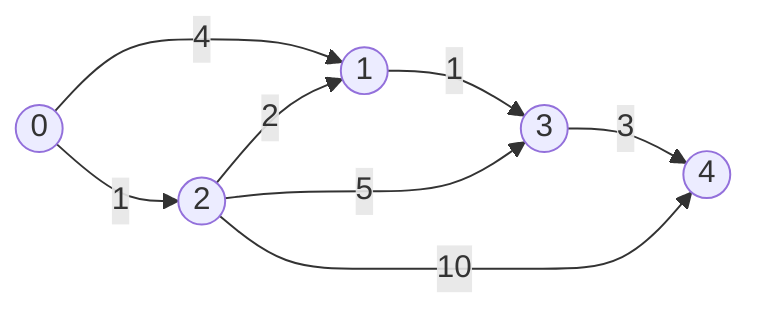

The first shortest-path question I ask is about the **edge weights**, not the graph size. A queue is enough when every edge costs one. A deque handles costs zero or one. A priority queue works with nonnegative costs. Negative edges require either an acyclic graph or an algorithm that can revise earlier guesses. Choosing the data structure before checking that property is how a plausible implementation returns a wrong answer.

I will use directed edges, a source $s$, and a distance $d[v]$. For an undirected edge I insert both directions. “Shortest” means the minimum cost over **walks**, so revisiting vertices is allowed. A reachable negative cycle makes the cost to its descendants unbounded below: keep looping to subtract more cost. That is different from asking for a shortest **simple** path, where revisiting is forbidden. The distinction matters when reporting negative cycles.

## One operation under every algorithm

To **relax** edge $u\to v$ of weight $w$, compare the current $d[v]$ with $d[u]+w$ and replace it if smaller. Initially $d[s]=0$ and all other distances are infinity. Every finite label is the cost of an actual discovered walk from $s$, so it is an upper bound on a finite optimum. Relaxation discovers a candidate walk by appending one edge. The algorithms differ mainly in *which vertex or edge to relax next* and when a label can be declared final. MIT's shortest-path notes frame the algorithms around this operation. 

| Edge promise | Algorithm | Why the order works | Typical time |
|---|---|---|---:|
| All edges cost one | BFS | Queue explores increasing edge count | $O(V+E)$ |
| Every weight is zero or one | 0–1 BFS | Deque keeps the next distance layer in front | $O(V+E)$ |
| All weights nonnegative | Dijkstra | Minimum tentative label can be finalized | $O((V+E)\log(V+E))$ with a lazy heap |
| Directed acyclic graph, any finite weights | Topological relaxation | Every predecessor is handled before its successor | $O(V+E)$ |
| Negative edges, cycles allowed | Bellman–Ford | Repeated passes cover longer paths | $O(VE)$ |

The Dijkstra bound is for the simple C++ heap that inserts a new pair after each improvement and discards old pairs when popped. It can hold $O(E)$ entries, giving a safe $\log(V+E)$ factor. On a simple graph $E=O(V^2)$, that logarithm is $O(\log V)$; with arbitrarily many parallel edges, writing $O(E\log V)$ for this exact implementation needs an extra assumption. A decrease-key heap has a different accounting. Bellman–Ford's table entry counts $V-1$ in-place edge scans, with $O(V)$ initialization. The teaching version below copies the distance and parent arrays each pass, so its total worst-case time is $O(V(V+E))$ and its auxiliary space is $O(V+E)$. The distinction matters when many vertices are isolated and $E$ is small. An early pass with no change can stop sooner.

## A graph where “first seen” is wrong



From zero to four, the best route is $0\to2\to1\to3\to4$, costing $1+2+1+3=7$. The direct discovery of vertex one costs four, but later going through two improves it to three. A program that marks one permanently visited when it is **pushed** would miss that improvement. Vertex five, omitted from the diagram, is unreachable. This example is also in the executable program below.

Set `parent[v]=u` only on an improving relaxation. Follow parents backward from a finite target to reconstruct a route; unreachable or negative-cycle-affected targets have no finite route.

## BFS and the zero–one deque

For unit weights, BFS discovers vertices by layers: source at distance zero, its neighbours at one, and so on. A FIFO queue ensures no path with fewer edges is waiting behind one with more. The first discovery of a vertex therefore gives its shortest distance, and each vertex is enqueued once. If all edges instead share the same *positive* weight $c$, BFS still minimises the number of edges and the total cost is $c$ times that count. For arbitrary weights, ordinary BFS's queue order no longer proves anything. 

When weights are only zero and one, a deque is enough. On an improving edge of weight zero, push the neighbour at the **front**: it belongs to the current distance layer. On weight one, push it at the **back**: it belongs to the next layer. At any moment, the live candidates are in the current layer or the next one; a zero-weight edge cannot jump farther. The code stores a distance with each deque entry and ignores it if a later improvement has made that entry stale. It is a specialised shortest-path method, not ordinary BFS pretending that a zero-cost edge counts as one. Each useful processing step scans outgoing edges, yielding $O(V+E)$ under the zero–one promise.

As a small check, use edges $0\to1$ of cost one, $0\to2$ of cost zero, $2\to1$ of cost zero, and $1\to3$ of cost one. The best cost to three is one, through vertex two; ordinary unit-edge BFS would count three edges along that route and answer a different question. Our program tests both algorithms on their respective inputs.

## Why Dijkstra needs nonnegative weights

Dijkstra repeatedly extracts the vertex with the smallest tentative distance and relaxes its outgoing edges. Once that vertex is extracted with its current label, the label is final **if all edges are nonnegative**. Suppose an extracted $u$ had a shorter path than $d[u]$. Walk along that path until its first not-yet-finalized vertex $x$. Its predecessor was finalized and would have relaxed the edge into $x$, so $d[x]$ is no greater than the path's prefix cost. Nonnegative remaining edges make that prefix no greater than the full allegedly shorter path. Then $x$ has a label smaller than $d[u]$, contradicting the choice of $u$. This is the finalization proof in the form I find easiest to remember. 

A negative edge breaks the “prefix no greater than full path” step. In a three-vertex counterexample, let $0\to1$ cost two, $0\to2$ cost five, and $2\to1$ cost $-10$. Dijkstra may finalize one at two before discovering the path through two with cost $-5$. Even for nonnegative weights, “visited when pushed” is wrong: edges $0\to1$ cost ten, $0\to2$ cost one, and $2\to1$ cost one make the first discovery of one cost ten, while the optimum is two.

`std::priority_queue` has no convenient decrease-key operation, so the code pushes each improved `(distance, vertex)` pair. A later pop is ignored if its stored distance is no longer equal to `dist[vertex]`. I can stop early for a single target only when that target is popped with a current minimum label, not when it is first pushed. Zero-weight edges are allowed; strict improvement keeps the parent chain from changing on equal-cost cycles.

## Bellman–Ford and the extra pass

Bellman–Ford scans the entire edge list repeatedly. After pass $k$, every vertex has a label no greater than the cost of any source path with at most $k$ edges. In the code, each pass reads the previous distance array and writes a new one, making that statement literal. In-place relaxation is also valid and can propagate farther in one pass, but the separate arrays make the proof easier to see. If there is no reachable negative cycle, some shortest path to each reachable vertex is simple and uses at most $V-1$ edges. Thus $V-1$ passes suffice. 

One further scan asks whether any reachable edge can still improve its destination. If so, a reachable negative cycle can affect that destination. Seed every such destination, then follow outgoing edges to mark **all descendants** as having distance $-\infty$. Do not mark a negative cycle that the source cannot reach. Do not mark a target merely because a reachable negative cycle exists elsewhere: the cycle must be able to reach that target.

For example, edges $0\to1$ cost four, $1\to2$ cost $-2$, and $2\to3$ cost three give distance five to three, with no cycle. Add $2\to1$ of cost one: the cycle $1\to2\to1$ costs $-1$. Now one, two, and three have no finite shortest-walk cost. A separate edge $0\to4$ of cost seven leaves vertex four's answer at seven. An isolated negative self-loop at five is irrelevant from source zero. The program checks all of these cases.

For an **undirected** negative edge, adding both directed arcs creates a two-edge negative walk by going across and back. If its component is reachable, distances to affected vertices are $-\infty$ under the walk definition. This does not mean a shortest simple path has cost $-\infty$; simple paths cannot loop. Interviews often leave that convention unstated, so I ask what “path” permits before applying Bellman–Ford mechanically.

## A DAG changes the answer again

A directed acyclic graph has a topological order. Set the source distance to zero, traverse vertices in that order, and relax each outgoing edge once. By the time I process a vertex, every possible predecessor has already been processed, so its shortest label is ready. Edge weights may be negative because there is no cycle to revisit. The work is $O(V+E)$ for topological sorting and relaxation. If the graph is cyclic, this order does not exist, and the argument fails. The idea is the same dependency ordering used in [dynamic programming](/blog/dynamic-programming-state-transitions/): states become final after their predecessors have supplied their contributions. Princeton's shortest-path treatment includes the DAG algorithm alongside Dijkstra and Bellman–Ford. 

## Executable C++17: paths, missing vertices, and cycles

The complete program is [shortest_paths.cpp](shortest_paths.cpp). It implements unit BFS and 0–1 BFS for small checks, then Dijkstra and Bellman–Ford on the worked graphs. It stores the edge list for Bellman–Ford and builds outgoing adjacency for heap/deque traversal and negative-cycle propagation. All inputs here satisfy its explicit contract: $1\le V\le100{,}000$, vertex IDs in range, and integer edge weights with magnitude at most $10^9$. With separate Bellman–Ford passes, a represented candidate uses at most $V$ edges, so its magnitude is at most $10^{14}$ and fits well below `INF = LLONG_MAX/4`; the code never adds to `INF`. Wider inputs need a wider type or checked arithmetic.

```cpp {title="shortest_paths.cpp"}
#include <algorithm>
#include <cassert>
#include <climits>
#include <deque>
#include <functional>
#include <iostream>
#include <queue>
#include <string>
#include <utility>
#include <vector>
using namespace std;

using ll = long long;
const ll INF = LLONG_MAX / 4;
struct Edge { int u, v; ll w; };
struct Result {
    vector<ll> dist;
    vector<int> parent;
    vector<char> neg;  // reachable from a reachable negative cycle
};

void check_input(int n, const vector<Edge>& edges, int s) {
    assert(1 <= n && n <= 100000 && 0 <= s && s < n);
    for (auto e : edges) {
        assert(0 <= e.u && e.u < n && 0 <= e.v && e.v < n);
        assert(-1000000000LL <= e.w && e.w <= 1000000000LL);
    }
}

vector<vector<pair<int, ll>>> adjacency(int n, const vector<Edge>& edges) {
    vector<vector<pair<int, ll>>> adj(n);
    for (auto e : edges) adj[e.u].push_back({e.v, e.w});
    return adj;
}

vector<ll> bfs_unit(int n, const vector<Edge>& edges, int s) {
    check_input(n, edges, s);
    for (auto e : edges) assert(e.w == 1);
    auto adj = adjacency(n, edges);
    vector<ll> dist(n, INF);
    queue<int> q;
    dist[s] = 0;
    q.push(s);
    while (!q.empty()) {
        int u = q.front(); q.pop();
        for (auto [v, w] : adj[u]) {
            if (dist[v] != INF) continue;
            dist[v] = dist[u] + w;
            q.push(v);
        }
    }
    return dist;
}

vector<ll> zero_one_bfs(int n, const vector<Edge>& edges, int s) {
    check_input(n, edges, s);
    for (auto e : edges) assert(e.w == 0 || e.w == 1);
    auto adj = adjacency(n, edges);
    vector<ll> dist(n, INF);
    deque<pair<ll, int>> dq;
    dist[s] = 0;
    dq.push_front({0, s});
    while (!dq.empty()) {
        auto [d, u] = dq.front(); dq.pop_front();
        if (d != dist[u]) continue;
        for (auto [v, w] : adj[u]) {
            if (d + w >= dist[v]) continue;
            dist[v] = d + w;
            if (w == 0) dq.push_front({dist[v], v});
            else dq.push_back({dist[v], v});
        }
    }
    return dist;
}

Result dijkstra(int n, const vector<Edge>& edges, int s) {
    check_input(n, edges, s);
    for (auto e : edges) assert(e.w >= 0);
    auto adj = adjacency(n, edges);
    Result out{vector<ll>(n, INF), vector<int>(n, -1), vector<char>(n, 0)};
    priority_queue<pair<ll, int>, vector<pair<ll, int>>, greater<pair<ll, int>>> pq;
    out.dist[s] = 0;
    pq.push({0, s});
    while (!pq.empty()) {
        auto [d, u] = pq.top(); pq.pop();
        if (d != out.dist[u]) continue;  // discard an obsolete heap entry
        for (auto [v, w] : adj[u]) {
            if (d + w >= out.dist[v]) continue;
            out.dist[v] = d + w;
            out.parent[v] = u;
            pq.push({out.dist[v], v});
        }
    }
    return out;
}

Result bellman_ford(int n, const vector<Edge>& edges, int s) {
    check_input(n, edges, s);
    Result out{vector<ll>(n, INF), vector<int>(n, -1), vector<char>(n, 0)};
    out.dist[s] = 0;
    for (int pass = 1; pass < n; ++pass) {
        auto next = out.dist;           // read only the previous pass
        auto next_parent = out.parent;
        bool changed = false;
        for (auto e : edges) {
            if (out.dist[e.u] == INF) continue;
            ll candidate = out.dist[e.u] + e.w;
            if (candidate < next[e.v]) {
                next[e.v] = candidate;
                next_parent[e.v] = e.u;
                changed = true;
            }
        }
        out.dist.swap(next);
        out.parent.swap(next_parent);
        if (!changed) break;
    }
    vector<vector<int>> adj(n);
    for (auto e : edges) adj[e.u].push_back(e.v);
    queue<int> q;
    for (auto e : edges) {
        if (out.dist[e.u] == INF) continue;
        if (out.dist[e.u] + e.w < out.dist[e.v] && !out.neg[e.v]) {
            out.neg[e.v] = 1;
            q.push(e.v);
        }
    }
    while (!q.empty()) {
        int u = q.front(); q.pop();
        for (int v : adj[u]) if (!out.neg[v]) {
            out.neg[v] = 1;
            q.push(v);
        }
    }
    return out;
}

vector<int> path_to(const Result& r, int s, int t) {
    assert(0 <= s && s < static_cast<int>(r.dist.size()));
    assert(0 <= t && t < static_cast<int>(r.dist.size()));
    if (r.dist[t] == INF || r.neg[t]) return {};
    vector<int> path;
    for (int v = t; v != -1; v = r.parent[v]) {
        path.push_back(v);
        if (v == s) {
            reverse(path.begin(), path.end());
            return path;
        }
        assert(path.size() <= r.dist.size());
    }
    return {};  // finite reachable vertices should never arrive here
}

void print_path(const vector<int>& path) {
    if (path.empty()) { cout << "no finite shortest path"; return; }
    for (size_t i = 0; i < path.size(); ++i)
        cout << (i ? "->" : "") << path[i];
}

int main() {
    vector<Edge> positive = {{0,1,4}, {0,2,1}, {2,1,2}, {1,3,1},
                             {2,3,5}, {3,4,3}, {2,4,10}};
    auto d = dijkstra(6, positive, 0);
    auto b_positive = bellman_ford(6, positive, 0);
    assert(d.dist == b_positive.dist && d.dist[4] == 7);
    assert(path_to(d, 0, 4) == vector<int>({0,2,1,3,4}));
    assert(path_to(d, 0, 5).empty());
    cout << "Dijkstra 0->4: distance=" << d.dist[4] << " path=";
    print_path(path_to(d, 0, 4)); cout << '\n';
    cout << "Dijkstra 0->5: "; print_path(path_to(d, 0, 5)); cout << '\n';

    vector<Edge> negative = {{0,1,4}, {0,2,5}, {1,2,-2},
                             {2,3,3}, {0,4,7}, {5,5,-1}};
    auto b = bellman_ford(6, negative, 0);
    assert(b.dist[3] == 5 && !b.neg[3]);
    assert(path_to(b, 0, 3) == vector<int>({0,1,2,3}));
    assert(b.dist[5] == INF && !b.neg[5]); // unreachable cycle is irrelevant
    cout << "Bellman-Ford 0->3: distance=" << b.dist[3] << " path=";
    print_path(path_to(b, 0, 3)); cout << '\n';

    negative.push_back({2,1,1}); // cycle 1->2->1 has weight -1
    auto cycle = bellman_ford(6, negative, 0);
    assert(!cycle.neg[0] && cycle.neg[1] && cycle.neg[2] && cycle.neg[3]);
    assert(!cycle.neg[4] && cycle.dist[4] == 7 && !cycle.neg[5]);
    assert(path_to(cycle, 0, 3).empty());
    cout << "reachable negative cycle: 1,2,3=-INF; 4=" << cycle.dist[4]
         << "; 5=unreachable\n";

    auto unit = bfs_unit(4, {{0,1,1},{0,2,1},{2,3,1}}, 0);
    auto binary = zero_one_bfs(4, {{0,1,1},{0,2,0},{2,1,0},{1,3,1}}, 0);
    assert(unit[3] == 2 && binary[3] == 1);
    cout << "BFS target=" << unit[3] << "; 0-1 BFS target=" << binary[3] << '\n';
}
```

```text {title="Output"}
Dijkstra 0->4: distance=7 path=0->2->1->3->4
Dijkstra 0->5: no finite shortest path
Bellman-Ford 0->3: distance=5 path=0->1->2->3
reachable negative cycle: 1,2,3=-INF; 4=7; 5=unreachable
BFS target=2; 0-1 BFS target=1
```

An empty reconstructed path means there is no finite shortest path: inspect `dist[t] == INF` for an unreachable target and `neg[t]` for one affected by a reachable negative cycle. Those are distinct states even though the path-printing helper uses one message.

The positive graph checks Dijkstra against Bellman–Ford. Assertions cover the route, unreachable vertex, and negative-cycle reachability.

## Pitfalls I check before submitting

I record whether edges are directed and whether parallel edges or self-loops are allowed. In an undirected graph, each input edge normally becomes two arcs. A zero-weight cycle is harmless to a shortest cost but can complicate parent logic if equal labels rewrite parents; strict improvements avoid that. A negative cycle reachable from the source must be propagated only to its reachable descendants.

I also check arithmetic. An `INF` sentinel is not a number to add to: relax only from finite sources. `int` may overflow when many large weights accumulate; `long long` still needs a stated bound or checked addition. For a target query, returning an empty parent chain for an unreachable vertex is different from reporting distance zero. Finally, I choose the algorithm from the **actual weight contract**, not a convenient sample input: one negative edge invalidates Dijkstra's finalization argument.

## Interview questions I would rehearse

**1. What does relaxation maintain?** A finite tentative distance is the cost of some discovered source walk. Relaxing $u\to v$ considers the walk to $u$ followed by that edge and lowers $d[v]$ if it helps.

**2. Why does BFS give shortest paths?** With unit weights, FIFO order explores all paths of $k$ edges before paths of $k+1$ edges. The first discovery of a vertex is therefore its minimum edge count.

**3. What changes for weights zero or one?** Use a deque. An improving zero edge goes to the front and a one edge to the back, preserving distance-layer order in linear time.

**4. When is a Dijkstra label final?** When the vertex is extracted with the current minimum tentative distance under nonnegative weights. Discovery or heap insertion is too early.

**5. Why do negative edges break Dijkstra?** A path through a not-yet-extracted vertex can later decrease an already finalized label. The proof needs every suffix to have nonnegative cost.

**6. What is a stale heap entry?** An old `(distance, vertex)` pair left after a better distance was inserted. Ignore it when its distance differs from the current `dist[vertex]`.

**7. How many Bellman–Ford passes are needed?** At most $V-1$ edge-list passes for finite distances without reachable negative cycles, because a shortest simple path has at most $V-1$ edges. An extra scan detects continued improvement.

**8. Does any negative cycle make every answer $-\infty$?** No. It must be reachable from the source, and the target must be reachable from that cycle. Other vertices can retain finite or unreachable status.

**9. Can a DAG have negative edges?** Yes. Topological order prevents cyclic reuse, so one relaxation of each edge in order handles arbitrary finite weights.

**10. How do I recover a route?** Save a parent on strict improvement, then trace from a finite target to the source and reverse. No finite route exists for an unreachable target or one affected by a negative cycle.

The common thread is relaxation; the weight structure tells me when an answer can be trusted. BFS trusts layers, Dijkstra trusts the minimum under nonnegative edges, a DAG trusts topological order, and Bellman–Ford trusts repeated passes before it asks whether a cycle can keep improving forever.


