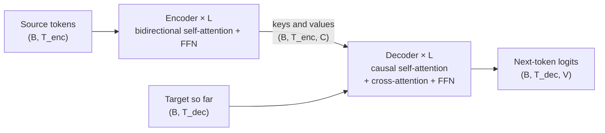

A transformer does one thing over and over: it takes a list of vectors, one per token, and
nudges each vector so it means a little more than it did before. The word "mole" enters as a
generic, context-free vector. A few dozen layers later, the vector in that slot knows it's
the *animal* mole, in a sentence about gardens, written in a children's book, and that the
next word is probably "dug".

Two kinds of layers do the nudging, alternating:

- **Attention** lets tokens *talk to each other*: each token gathers information from the
  other tokens that are relevant to it.
- **The feed-forward network (FFN)** lets each token *think on its own*: every vector is
  processed independently, and this is where much of the model's stored knowledge seems to
  live.

Everything else (positional embeddings, residual connections, LayerNorm, masks, multiple
heads, GQA) is engineering that makes those two ideas work, scale and train stably. This post
goes through each piece three ways: the intuition, the maths, and batched PyTorch with the
tensor shape at every step. The intuitions lean heavily on 3Blue1Brown's deep-learning
chapters on transformers, which I'd watch
alongside this. The architecture itself is from "Attention Is All You Need".

## The shape of the whole thing

Here is a decoder-only transformer (the GPT family) from end to end. The horizontal line is
the **residual stream**: one $C$-dimensional vector per token, flowing left to right. Each
block *reads* from the stream, computes something, and *adds* the result back.

<figure class="ml-diagram">
<svg viewBox="0 0 860 250" role="img" aria-label="Decoder-only transformer: embeddings feed a residual stream; each of L blocks reads it into attention and an FFN and adds their outputs back; the end is a LayerNorm and unembedding producing logits">
  <defs><marker id="ml-arrow" viewBox="0 0 10 10" refX="9" refY="5" markerWidth="7" markerHeight="7" orient="auto-start-reverse"><path d="M0,0 L10,5 L0,10 z"/></marker></defs>
  <rect class="group" x="175" y="10" width="490" height="228" rx="14"/>
  <text class="label" x="420" y="36">repeated L times (one block)</text>
  <rect class="box sand" x="15" y="150" width="130" height="70" rx="8"/>
  <text class="name" x="80" y="184">Embed</text>
  <text class="note sand" x="80" y="208">token + position</text>
  <rect class="box violet" x="200" y="55" width="200" height="70" rx="8"/>
  <text class="name" x="300" y="89">LN → Attention</text>
  <text class="note violet" x="300" y="113">tokens share information</text>
  <rect class="box green" x="440" y="55" width="200" height="70" rx="8"/>
  <text class="name" x="540" y="89">LN → FFN</text>
  <text class="note green" x="540" y="113">each token thinks alone</text>
  <rect class="box rose" x="700" y="150" width="145" height="70" rx="8"/>
  <text class="name" x="772" y="184">LN → Unembed</text>
  <text class="note rose" x="772" y="208">logits (B, T, V)</text>
  <line class="arrow" x1="149" y1="185" x2="696" y2="185"/>
  <path class="arrow" d="M230,185 V129"/>
  <line class="arrow" x1="370" y1="125" x2="370" y2="172"/>
  <circle class="box violet" cx="370" cy="185" r="9"/>
  <text class="name" x="370" y="190">+</text>
  <path class="arrow" d="M470,185 V129"/>
  <line class="arrow" x1="610" y1="125" x2="610" y2="172"/>
  <circle class="box green" cx="610" cy="185" r="9"/>
  <text class="name" x="610" y="190">+</text>
  <text class="note sand" x="490" y="222">residual stream, shape (B, T, C)</text>
</svg>
<figcaption>A decoder-only transformer. Every block reads the stream, computes an update, and adds it back.</figcaption>
</figure>

The symbols I'll use throughout, with GPT-2 small's values as a running
example:

| Symbol | Meaning | GPT-2 small |
|--------|---------|-------------|
| $B$ | batch size: sentences processed together | anything |
| $T$ | sequence length: tokens per sentence (after padding) | up to 1024 |
| $C$ | model width, $d_\text{model}$: numbers per token vector | 768 |
| $H$ | number of attention heads | 12 |
| $D$ | per-head width $d_k = d_v = C/H$ | 64 |
| $d_\text{ff}$ | FFN hidden width, usually $4C$ | 3072 |
| $V$ | vocabulary size | 50257 |
| $L$ | number of blocks (layers) | 12 |

Every activation in the stream has shape `(B, T, C)`. We always process a *batch*: even a
single sentence goes in as `B = 1`. PyTorch's `nn.Linear` acts on the last dimension and
treats all leading dimensions as "more examples", so the same code handles both.

## Embeddings: a lookup table that learns geometry

The tokenizer turns text into integers, `(B, T)`. The first layer, `nn.Embedding(V, C)`, is
just a $V \times C$ matrix $W_E$; token id $t$ picks out row $t$. Mathematically that's a
one-hot vector times the matrix, $e = \text{onehot}(t)\, W_E$, but nobody materialises the
one-hot; it's an index.

Nothing tells the model what those rows should contain. They start random and training moves
them wherever they make predictions easier. What falls out is geometry: **directions in the
space carry meaning**. The classic word2vec observation is that
$e_\text{king} - e_\text{man} + e_\text{woman}$ lands near $e_\text{queen}$: there is roughly
a "gender" direction, and moving along it changes that one aspect of the word. 3Blue1Brown
shows the same for plurality and nationality. The tool that reads these
directions is the **dot product**: $a \cdot b$ is large when two vectors point the same way,
zero when they're unrelated (perpendicular), negative when they're opposed. Keep that in
mind, because attention is built out of dot products.

The crucial limitation: the embedding is a lookup with **no context**. "Mole" gets the same
vector in "American shrew mole", "one mole of carbon dioxide" and "a biopsy of the mole".
Getting from that generic vector to the right meaning is the job of everything that
follows.

## Attention: tokens talking to each other

3Blue1Brown's running example is the phrase *"a fluffy blue
creature roamed the verdant forest"*. Suppose the only update we care about is adjectives
refining their nouns: "creature" should absorb "fluffy" and "blue" and become something like
*fluffy-blue-creature*. To do that, each token needs to answer three questions:

1. What am I looking for? (the noun "creature": *are there adjectives before me?*)
2. What do I have to offer? (the adjective "fluffy": *I'm an adjective describing texture*)
3. If someone picks me, what should I tell them? ("fluffy": *here's the fluffiness direction to add*)

Those are the query, the key and the value.

### What Q, K and V mean

Each token's vector $x_i$ is multiplied by three learned matrices:

$$
q_i = x_i W_Q, \qquad k_i = x_i W_K, \qquad v_i = x_i W_V .
$$

| | What it is | Analogy |
|---|---|---|
| **Query** $q_i$ | what token $i$ is looking for | the search box text |
| **Key** $k_j$ | what token $j$ advertises about itself | a page's title and tags |
| **Value** $v_j$ | what token $j$ hands over if selected | the page's actual content |

The analogy I find most useful is a *soft dictionary*. A Python dict does an exact lookup:
find the one key equal to the query and return its value. Attention compares the query with
**every** key, turns the similarities into weights that sum to 1, and returns a weighted
average of **all** the values. It's a fuzzy, differentiable lookup.

Two questions are worth asking about this design, and interviewers like both.

**Why are keys and values separate?** Because *what makes a token relevant* is different
from *what it should contribute*. In "the animal didn't cross the street because it was too
tired", the query from "it" is looking for "a singular noun that could get tired". The key
of "animal" matches on those features. But what "it" needs to *receive* is the animal's
content: that it's an animal, which one, what it was doing. Matching on one set of features
and copying another is exactly the split between $W_K$ and $W_V$.

**Why are queries and keys separate?** The score between tokens $i$ and $j$ is

$$
s_{ij} = q_i \cdot k_j = x_i\, W_Q W_K^\top\, x_j^\top .
$$

That's a learned bilinear form $W_Q W_K^\top$ asking "how relevant is $j$ to $i$?". With two
different matrices the relation can be **asymmetric**: "creature" looks for "fluffy", but
"fluffy" has no reason to look for "creature". If $W_Q = W_K$, the score would be symmetric
and every token would tend to match itself most strongly. Also note the product is a
$C \times C$ matrix of rank at most $D$: each head can only ask a narrow, low-dimensional
question, which is one reason to have many heads.

### The math, one step at a time

Stack the token vectors of one sentence as rows of $X \in \mathbb{R}^{T \times C}$. One
attention head is four lines:

$$
\begin{aligned}
Q &= X W_Q,\quad K = X W_K,\quad V = X W_V && Q, K \in \mathbb{R}^{T\times d_k},\ V \in \mathbb{R}^{T \times d_v} \\
S &= \frac{Q K^\top}{\sqrt{d_k}} + M && S \in \mathbb{R}^{T \times T},\ S_{ij} = \tfrac{q_i\cdot k_j}{\sqrt{d_k}} \\
A &= \operatorname{softmax}_\text{row}(S) && \textstyle A_{ij} \ge 0,\ \sum_j A_{ij} = 1 \\
Z &= A V && z_i = \textstyle\sum_j A_{ij}\, v_j
\end{aligned}
$$

Reading it in words:

- $S$ is the grid of every query dotted with every key: row $i$ says how well each token
  matches what token $i$ is looking for. $M$ is the mask (next section).
- $A$, the **attention pattern**, turns each row into a probability distribution with
  softmax. Row $i$ is "where token $i$ is looking".
- $z_i$ is a **weighted average of the values**, using those probabilities. If "creature"
  puts weight 0.42 on "fluffy" and 0.58 on "blue", it receives
  $0.42\,v_\text{fluffy} + 0.58\,v_\text{blue}$.

The output $z_i$ is then (after the output projection) **added** to $x_i$ in the residual
stream: $x_i \leftarrow x_i + \Delta x_i$. Attention doesn't replace the token's meaning; it
proposes a change to it.[^notation]

[^notation]: 3Blue1Brown draws queries and keys as *columns* and writes $K^\top Q$; the paper and
    PyTorch use *rows* and $QK^\top$. Same thing, transposed.

Two consequences worth noticing. First, $S$ is $T \times T$: memory and compute for the scores
grow **quadratically** with context length, which is why long context is hard. Second, nothing
in these equations refers to *where* a token sits in the sentence. Hold that thought until
the section on positions.

### Why divide by √d_k

If the components of $q$ and $k$ are independent with mean 0 and variance 1, their dot
product $q \cdot k = \sum_{m=1}^{d_k} q_m k_m$ is a sum of $d_k$ terms that each have
variance 1, so

$$
\operatorname{Var}(q\cdot k) = d_k, \qquad \operatorname{Var}\!\left(\frac{q\cdot k}{\sqrt{d_k}}\right) = 1 .
$$

I checked it with random vectors: the variance comes out at 15.8, 64.1, 252 and 1056 for
$d_k$ = 16, 64, 256 and 1024. Without the scaling, a 128-dimensional head produces scores
with a standard deviation around 11. Softmax of numbers that far apart is essentially
one-hot, and a one-hot softmax has almost **zero gradient**: its Jacobian
$\partial a_i/\partial s_j = a_i(\delta_{ij} - a_j)$ vanishes when one $a_i$ is 1 and the
rest are 0. Dividing by $\sqrt{d_k}$ keeps the scores at unit scale at initialisation, so the
model starts with soft attention and can learn where to sharpen it. It's the same knob as
softmax temperature; I wrote more about it in
[Softmax and numerical stability](/blog/softmax-numerical-stability/#temperature-and-the-d-scale).

### Masks: causal and padding

The mask $M$ is added to the scores before softmax. It holds $0$ where attention is allowed
and $-\infty$ where it isn't; since $e^{-\infty} = 0$, those weights come out as exactly zero
and the rest of the row still sums to 1. (Zeroing weights *after* softmax would break the
"sums to 1" property.)

**Causal mask.** A language model is trained to predict token $t+1$ from tokens $1..t$, and it
does this for *every position at once*. If position 3 could look at position 4, it could just
copy the answer. So $M_{ij} = -\infty$ for $j > i$: each token sees only itself and the past.
The mask is the lower triangle of a $T\times T$ matrix:

```text {title="Causal mask, T = 4 (✓ = may attend)"}
            key 0  key 1  key 2  key 3
query 0       ✓      ·      ·      ·
query 1       ✓      ✓      ·      ·
query 2       ✓      ✓      ✓      ·
query 3       ✓      ✓      ✓      ✓
```

**Padding mask.** Sentences in a batch have different lengths, but a tensor must be
rectangular, so short ones are padded to length $T$ with a filler token. Real tokens must
never attend to padding, so padded *key* columns get $-\infty$ too. In a batch the mask has
shape `(B, 1, T, T)` (one per sentence, shared across heads), or `(B, 1, 1, T)` for padding
alone, which broadcasts over heads and queries. A row where *every* key is masked turns into
NaN; I covered that edge case in
[the softmax post](/blog/softmax-numerical-stability/#masking-the-fully-masked-row).

### Multi-head attention

One head can only ask one kind of question (and, as we saw, a low-rank one). Language needs
many at once: adjectives finding nouns, pronouns finding referents, a verb finding its
subject, a token finding the previous occurrence of itself. So we run $H$ heads in parallel,
each with its own $W_Q^{(h)}, W_K^{(h)}, W_V^{(h)}$ of width $D = C/H$, concatenate their
outputs, and mix them with an output matrix $W_O \in \mathbb{R}^{C\times C}$:

$$
\operatorname{MHA}(X) = \big[\, Z^{(1)} \,\|\, Z^{(2)} \,\|\, \cdots \,\|\, Z^{(H)} \big]\, W_O .
$$

Splitting $C$ across heads keeps the cost equal to one full-width head. A nice way to see
$W_O$, from 3Blue1Brown and the Transformer Circuits paper:
cut $W_O$ into $H$ horizontal slabs $W_O^{(h)} \in \mathbb{R}^{D \times C}$. Then
concatenate-then-multiply is the same as a **sum of per-head writes**:

$$
\operatorname{MHA}(X) = \sum_{h=1}^{H} Z^{(h)}\, W_O^{(h)} = \sum_{h} A^{(h)}\, X\, \underbrace{W_V^{(h)} W_O^{(h)}}_{C \times C,\ \text{rank} \le D} .
$$

So each head reads the stream with its "value-down" matrix $W_V^{(h)}$ (C → D), and writes
back with its "value-up" matrix $W_O^{(h)}$ (D → C). Every head proposes its own
$\Delta x_i$, and they're all added together. 3Blue1Brown calls these $\text{Value}_\downarrow$
and $\text{Value}_\uparrow$; papers just staple all the $\text{Value}_\uparrow$ slabs together
and call it the output matrix.

### Code: one head, three ways

The same head written three times. The first loops over every number, mirroring the
equations (slow, but you can see each dot product). The second does the same with batched
matrix multiplications. The third hands the whole thing to PyTorch's fused kernel. All three
take a batch `x` of shape `(B, T, C)`.


```python {title="Naive: loops"}
import math
import torch

def attention_naive(x, W_q, W_k, W_v, causal=True):
    """One attention head, one dot product at a time.
    x:        (B, T, C)  a batch of B sentences, T tokens each, C numbers per token
    W_q, W_k: (C, d_k)   W_v: (C, d_v)
    returns   (B, T, d_v)
    """
    B, T, C = x.shape
    d_k, d_v = W_q.shape[1], W_v.shape[1]
    out = torch.zeros(B, T, d_v)
    for b in range(B):                                   # every sentence, independently
        for i in range(T):                               # token i asks a question...
            q_i = x[b, i] @ W_q                          # (C,) @ (C, d_k) -> (d_k,): "what am I looking for?"
            scores = torch.empty(T)
            for j in range(T):                           # ...and every token j answers
                k_j = x[b, j] @ W_k                      # (d_k,): "what do I contain?"
                scores[j] = (q_i @ k_j) / math.sqrt(d_k) # scalar: how well j matches i
                if causal and j > i:
                    scores[j] = float("-inf")            # no peeking at future tokens
            weights = torch.exp(scores - scores.max())   # softmax, written out (max-subtracted)
            weights = weights / weights.sum()            # (T,): non-negative, sums to 1
            for j in range(T):
                v_j = x[b, j] @ W_v                      # (d_v,): "what I hand over if picked"
                out[b, i] += weights[j] * v_j            # weighted average of the values
    return out
```
```python {title="Vectorised: matmuls"}
import math
import torch

def attention(x, W_q, W_k, W_v, causal=True):
    """The same maths for every token of every sentence at once.  x: (B, T, C) -> (B, T, d_v)"""
    B, T, C = x.shape
    q = x @ W_q                       # (B, T, C) @ (C, d_k) -> (B, T, d_k): all queries
    k = x @ W_k                       # (B, T, d_k): all keys
    v = x @ W_v                       # (B, T, d_v): all values

    # Every query against every key in one batched matmul:
    # (B, T, d_k) @ (B, d_k, T) -> (B, T, T), scores[b, i, j] = q_i . k_j
    scores = q @ k.transpose(-2, -1) / math.sqrt(k.size(-1))

    if causal:
        # Lower triangle is True: row i may look at columns j <= i.
        keep = torch.tril(torch.ones(T, T, dtype=torch.bool, device=x.device))  # (T, T)
        scores = scores.masked_fill(~keep, float("-inf"))   # (T, T) broadcasts over B

    weights = torch.softmax(scores, dim=-1)   # (B, T, T): softmax over keys, each row sums to 1
    return weights @ v                        # (B, T, T) @ (B, T, d_v) -> (B, T, d_v)
```
```python {title="Fused: SDPA"}
import torch.nn.functional as F

def attention_fused(x, W_q, W_k, W_v, causal=True):
    """Same result. PyTorch dispatches to a fused kernel (FlashAttention, memory-efficient, or
    plain maths, depending on hardware and dtype); the fused paths never store the full
    (B, T, T) score matrix."""
    q, k, v = x @ W_q, x @ W_k, x @ W_v                                # (B, T, d_k) x2, (B, T, d_v)
    return F.scaled_dot_product_attention(q, k, v, is_causal=causal)  # (B, T, d_v)
```


And a check that they agree, on a batch of 4 sentences of 8 tokens:

```python {title="check_single_head.py"}
B, T, C, d_k = 4, 8, 64, 16
x = torch.randn(B, T, C)                                          # (4, 8, 64)
W_q, W_k, W_v = (torch.randn(C, d_k) / math.sqrt(C) for _ in range(3))

a = attention_naive(x, W_q, W_k, W_v)
b = attention(x, W_q, W_k, W_v)
c = attention_fused(x, W_q, W_k, W_v)
print(a.shape, torch.allclose(a, b, atol=1e-5), torch.allclose(b, c, atol=1e-5))
```

```text {title="Output"}
torch.Size([4, 8, 16]) True True
```

The naive version runs $B \cdot T^2$ tiny Python-level operations; the vectorised one runs a
handful of large matrix multiplications that the GPU is built for. The fused one goes further:
FlashAttention computes the result in tiles with an online softmax,
so the $T\times T$ matrix never sits in GPU memory. It does the same arithmetic but far less
memory traffic.

### Code: multi-head attention

The naive way to get $H$ heads is literally $H$ head modules in a list, run one after another
and concatenated. The efficient way computes $Q$, $K$ and $V$ for all heads with **one**
matrix multiplication, then reshapes so that heads become just another batch dimension.


```python {title="Naive: a list of heads"}
import math
import torch
import torch.nn as nn

class Head(nn.Module):
    """One causal attention head with its own W_q, W_k, W_v (each C -> d_head)."""
    def __init__(self, C, d_head):
        super().__init__()
        self.query = nn.Linear(C, d_head, bias=False)   # y = x @ W.T; weight shape (d_head, C)
        self.key   = nn.Linear(C, d_head, bias=False)
        self.value = nn.Linear(C, d_head, bias=False)

    def forward(self, x):                               # x: (B, T, C)
        B, T, C = x.shape
        q, k, v = self.query(x), self.key(x), self.value(x)            # each (B, T, D)
        scores = q @ k.transpose(-2, -1) / math.sqrt(k.size(-1))       # (B, T, T)
        causal = torch.tril(torch.ones(T, T, dtype=torch.bool, device=x.device))
        scores = scores.masked_fill(~causal, float("-inf"))
        return torch.softmax(scores, dim=-1) @ v                       # (B, T, D)


class MultiHeadAttentionNaive(nn.Module):
    def __init__(self, C, n_heads):
        super().__init__()
        # ModuleList registers each head's parameters with this module (a plain list would not).
        self.heads = nn.ModuleList([Head(C, C // n_heads) for _ in range(n_heads)])
        self.proj = nn.Linear(C, C, bias=False)         # W_O: mixes the heads' outputs

    def forward(self, x):                               # x: (B, T, C)
        # H separate (B, T, D) outputs, glued along the last dim -> (B, T, H*D) = (B, T, C)
        y = torch.cat([head(x) for head in self.heads], dim=-1)
        return self.proj(y)                             # (B, T, C)
```
```python {title="Efficient: fused QKV + SDPA"}
import torch
import torch.nn as nn
import torch.nn.functional as F

class MultiHeadAttention(nn.Module):
    def __init__(self, C, n_heads, dropout=0.0):
        super().__init__()
        assert C % n_heads == 0, "C must split evenly across heads"
        self.n_heads, self.d_head = n_heads, C // n_heads
        self.qkv = nn.Linear(C, 3 * C, bias=False)   # W_Q, W_K, W_V for *all* heads, one matmul
        self.proj = nn.Linear(C, C, bias=False)      # W_O
        self.dropout = dropout

    def forward(self, x, pad_mask=None, causal=True):
        """x: (B, T, C). pad_mask: (B, T) bool, True = real token, False = padding."""
        B, T, C = x.shape
        H, D = self.n_heads, self.d_head

        q, k, v = self.qkv(x).split(C, dim=-1)      # (B, T, 3C) -> three (B, T, C)

        # Give each head its own slice of C, then move heads next to batch:
        # (B, T, C) -view-> (B, T, H, D) -transpose(1, 2)-> (B, H, T, D)
        q = q.view(B, T, H, D).transpose(1, 2)
        k = k.view(B, T, H, D).transpose(1, 2)
        v = v.view(B, T, H, D).transpose(1, 2)

        mask = None
        if pad_mask is not None:
            mask = pad_mask[:, None, None, :]        # (B, 1, 1, T): "key j is a real token"
            if causal:                               # combine with the (T, T) causal triangle
                mask = mask & torch.tril(torch.ones(T, T, dtype=torch.bool, device=x.device))
        # (B, H, T, D) in, (B, H, T, D) out; B and H are both treated as batch dimensions.
        # attn_mask is boolean with True = may attend. is_causal can't be combined with it.
        y = F.scaled_dot_product_attention(
            q, k, v,
            attn_mask=mask,
            is_causal=causal and mask is None,
            dropout_p=self.dropout if self.training else 0.0,
        )
        # Undo the reshape: (B, H, T, D) -> (B, T, H, D) -> (B, T, C). This is the "concat".
        y = y.transpose(1, 2).contiguous().view(B, T, C)
        return self.proj(y)                          # (B, T, C)
```


They compute exactly the same function. If you copy the naive heads' weights into the fused
`qkv` matrix (all query weights stacked, then all keys, then all values), the outputs match to
`1e-5`. The fused version also handles padding: a batch of four sentences of lengths 8, 5, 3
and 6 gives a `(4, 8, 64)` output with no NaNs, and changing the contents of sentence 2's
padding slots leaves its five real outputs unchanged.

### The PyTorch functions, explained

- **`nn.Linear(in, out)`** stores a weight of shape `(out, in)` and computes
  `y = x @ W.T + b` on the **last** dimension. Any leading dimensions pass through, so
  `(B, T, C)` becomes `(B, T, out)` with one call: every token of every sentence is
  multiplied by the same matrix.
- **`a @ b`** (`torch.matmul`) on 3-D or 4-D tensors is a *batched* matrix multiply: the last
  two dimensions are multiplied, the leading ones are matched (or broadcast). So
  `(B, H, T, D) @ (B, H, D, T)` is $B\cdot H$ independent $T\times D$ by $D\times T$ products.
- **`.transpose(-2, -1)`** swaps the last two dimensions, turning `(…, T, D)` keys into
  `(…, D, T)` so that $QK^\top$ is a plain `@`. It returns a view (no copy).
- **`torch.tril(m)`** keeps the lower triangle of a matrix and zeros the rest; on a boolean
  all-ones matrix it builds the causal mask.
- **`t.masked_fill(mask, value)`** returns a copy of `t` with `value` wherever `mask` is True.
  The mask broadcasts, so one `(T, T)` mask applies to every sentence and head.
- **`torch.softmax(t, dim=-1)`** normalises along the last dimension (the keys), so every row
  of the attention pattern sums to 1. It subtracts the row max internally for stability.
- **`.split(C, dim=-1)`** cuts the `(B, T, 3C)` output of the fused projection into three
  `(B, T, C)` tensors.
- **`.view(B, T, H, D)`** reinterprets the same memory with a new shape (no copy). It requires
  the memory to be laid out contiguously, which is why the reverse path calls
  **`.contiguous()`** after `transpose` (transpose only changes strides). `.reshape` would
  copy for you if needed.
- **`F.scaled_dot_product_attention(q, k, v, attn_mask, is_causal, dropout_p)`** computes
  $\operatorname{softmax}(QK^\top/\sqrt{d} + M)\,V$ in one call and picks the fastest
  available backend. A boolean `attn_mask` means **True = may
  attend**.[^maskpolarity]
- **`nn.ModuleList`** is a list that registers its modules, so their parameters show up in
  `.parameters()`, move with `.to(device)`, and get saved in the `state_dict`.
- **`torch.cat(list, dim=-1)`** glues tensors along a dimension; concatenating $H$ tensors of
  `(B, T, D)` gives `(B, T, H·D)`.

[^maskpolarity]: Watch out: the older `nn.MultiheadAttention` uses the opposite convention for
    `key_padding_mask`, where True means *ignore* this key. Mixing the two up silently masks
    the real tokens instead of the padding.

### Shapes for one sentence and for a batch

GPT-2 small sizes ($C = 768$, $H = 12$, $D = 64$, $d_\text{ff} = 3072$, $V = 50257$). The
single sentence is "the cat sat on the mat" ($T = 6$, pretending one token per word); the
batch is 4 sentences padded to $T = 8$.

| Step | Operation | One sentence | Batch of 4 |
|------|-----------|--------------|------------|
| Token ids | tokenizer | `(1, 6)` | `(4, 8)` + pad mask `(4, 8)` |
| Token embeddings | `tok_emb(idx)` | `(1, 6, 768)` | `(4, 8, 768)` |
| Position embeddings | `pos_emb(arange(T))` | `(6, 768)`, broadcast-added | `(8, 768)`, broadcast-added |
| Q, K, V | `qkv(x).split(C, -1)` | 3 × `(1, 6, 768)` | 3 × `(4, 8, 768)` |
| Split heads | `view` + `transpose(1, 2)` | `(1, 12, 6, 64)` | `(4, 12, 8, 64)` |
| Scores / weights | $QK^\top/\sqrt{D}$, mask, softmax | `(1, 12, 6, 6)` | `(4, 12, 8, 8)` |
| Weighted values | `weights @ v` | `(1, 12, 6, 64)` | `(4, 12, 8, 64)` |
| Merge heads, $W_O$ | `transpose`, `view`, `proj` | `(1, 6, 768)` | `(4, 8, 768)` |
| FFN up + GELU | `up`, `gelu` | `(1, 6, 3072)` | `(4, 8, 3072)` |
| FFN down | `down` | `(1, 6, 768)` | `(4, 8, 768)` |
| Logits | `ln_f`, `lm_head` | `(1, 6, 50257)` | `(4, 8, 50257)` |

Every block maps `(B, T, C)` to `(B, T, C)`, which is what lets us stack them. Only two
places change the shape: inside attention (heads, and the $T \times T$ pattern) and inside
the FFN (the $4\times$ wider hidden layer).

## Why positions are needed

### Attention cannot see order

Look back at the attention equations: the position of a token appears nowhere. Token $i$'s
output depends on its own query and on the *set* of keys and values around it, not on which
slot any of them sit in. Precisely: let $P$ be a permutation matrix that shuffles the rows of
$X$ (the tokens). Then

$$
\begin{aligned}
Q' &= (PX)W_Q = PQ, \quad K' = PK, \quad V' = PV \\
S' &= PQ\,(PK)^\top/\sqrt{d_k} = P\,S\,P^\top \\
A' &= \operatorname{softmax}(P S P^\top) = P\,A\,P^\top \quad \text{(row softmax doesn't care how rows and columns are ordered)} \\
Z' &= A'V' = P A P^\top P V = P\,(AV) = P Z \quad (P^\top P = I).
\end{aligned}
$$

**Shuffling the input tokens just shuffles the outputs in the same way**; every token's
output vector is *identical*. Attention is *permutation-equivariant*. The FFN, LayerNorm and
residual additions act on each token separately, so they are equivariant too, and so is the
whole stack. Anything pooled over tokens (a mean, or BERT's `[CLS]` output) is then fully
*invariant*: the model literally can't tell "dog bites man" from "man bites dog". Without
positions a transformer reads a **bag of words**. And the two copies of "the" in "the cat
sat on the mat" are indistinguishable: same embedding, same set of neighbours, so same
output, in every layer.

Try it. With both boxes unchecked, shuffle the words and watch the "change vs. original order"
column stay at zero. Then turn on positional encoding, or the causal mask, and shuffle again.



The same check in PyTorch, using the `MultiHeadAttention` from above:

```python {title="permutation_check.py"}
mha = MultiHeadAttention(C=64, n_heads=4).eval()
x = torch.randn(4, 8, 64)                      # (B, T, C)
perm = torch.randperm(8)                       # a random reordering of the 8 tokens

out          = mha(x,          causal=False)   # no mask, no positions
out_shuffled = mha(x[:, perm], causal=False)   # same tokens, shuffled
print(torch.allclose(out[:, perm], out_shuffled, atol=1e-5))   # True: outputs just moved

out_c = mha(x, causal=True)                    # with a causal mask...
print(torch.allclose(out_c[:, perm], mha(x[:, perm], causal=True), atol=1e-5))   # False

pos = torch.randn(8, 64)                       # ...or with positions added
print(torch.allclose(mha(x + pos, causal=False)[:, perm],
                     mha(x[:, perm] + pos, causal=False), atol=1e-5))            # False
```

The middle result is interesting. A causal mask is *not* symmetric under permutation
($PMP^\top \neq M$), so it leaks order: token 0 can only see itself, token 5 sees six
tokens, and a head that averages uniformly over what it can see effectively learns how far
along it is. Decoder-only models trained with **no** positional encoding do learn positional
information this way, and can generalise to longer inputs
better than some explicit schemes. Encoders like BERT have no causal mask,
so for them explicit positions are essential.

### Learned and sinusoidal positions

The fix is to make each token's vector depend on where it is. The simplest options *add* a
position vector to the token embedding before the first block: $x_t = e_\text{token} + p_t$.

**Learned absolute positions** (BERT, GPT-2): a second embedding table
`nn.Embedding(max_T, C)`, trained like the token table. Simple and effective, but the model
has never seen position 1025 if it trained on 1024, so it can't go longer.

**Sinusoidal positions** (the original Transformer): fixed, not learned.

$$
p_{t,\,2i} = \sin\!\left(\frac{t}{10000^{2i/C}}\right), \qquad
p_{t,\,2i+1} = \cos\!\left(\frac{t}{10000^{2i/C}}\right).
$$

The intuition is a bank of **clocks running at different speeds**. Each pair of dimensions
$(2i, 2i+1)$ is a clock hand at angle $\omega_i t$, with $\omega_i = 10000^{-2i/C}$. The first
pairs spin fast and tell neighbouring positions apart; the last pairs turn very slowly and
tell the beginning of a long document from its end. It's like the bits of a binary counter,
where the low bits flip every step and the high bits rarely, but smooth. And because
rotating a clock by $k$ steps is a fixed rotation,

$$
\begin{pmatrix} \sin\omega(t+k) \\ \cos\omega(t+k) \end{pmatrix} =
\begin{pmatrix} \cos\omega k & \sin\omega k \\ -\sin\omega k & \cos\omega k \end{pmatrix}
\begin{pmatrix} \sin\omega t \\ \cos\omega t \end{pmatrix},
$$

"$k$ positions later" is a linear map that doesn't depend on $t$, which should make relative
offsets easy for the model to use.

**Why add instead of concatenate?** In a high-dimensional space there's plenty of room for
position and meaning to live in nearly perpendicular directions, so adding them loses little,
and it keeps the width at $C$. The model can learn to read either part with a projection.

### Rotary embeddings (RoPE)

Most current LLMs don't add anything to the stream. **RoPE** instead
*rotates* the query and key vectors inside each attention layer by an angle proportional to
their position, and leaves the values alone. Take a single pair of dimensions and treat it as
a 2-D vector. Rotate the query at position $m$ by $m\theta$, and the key at position $n$ by
$n\theta$:

$$
\big(R_{m\theta}\, q\big)^\top \big(R_{n\theta}\, k\big) = q^\top R_{m\theta}^\top R_{n\theta}\, k = q^\top R_{(n-m)\theta}\, k .
$$

Rotations compose by adding angles, so the score depends only on the **offset** $n - m$, not
on the absolute positions. Do this for $D/2$ pairs with the same spread of speeds as the
sinusoidal clocks, and every head sees *relative* position directly in its dot products. I
checked it numerically with `apply_rope` below: the same query and key vectors placed at
positions (5, 2) and at (9, 6) give the same score (4.4145), while (5, 3) gives something
else.

Another relative scheme worth knowing is **ALiBi**: no embeddings at all,
just a penalty $-m_h\,|i - j|$ added to the scores, with a different slope $m_h$ per head, so
attention fades with distance.


```python {title="Learned (BERT, GPT-2)"}
import torch
import torch.nn as nn

class LearnedPositions(nn.Module):
    def __init__(self, max_T, C):
        super().__init__()
        self.pos_emb = nn.Embedding(max_T, C)        # one trainable C-vector per position

    def forward(self, tok):                          # tok: (B, T, C) token embeddings
        T = tok.size(1)
        pos = self.pos_emb(torch.arange(T, device=tok.device))   # (T, C)
        return tok + pos                             # (B, T, C) + (T, C) broadcasts over B
```
```python {title="Sinusoidal (original Transformer)"}
import torch

def sinusoidal_positions(T, C, base=10000.0):
    """(T, C) table of fixed position vectors; added to the (B, T, C) token embeddings."""
    pos = torch.arange(T).float()[:, None]           # (T, 1): positions 0..T-1
    i = torch.arange(0, C, 2).float()[None, :]       # (1, C/2): even channel indices 2i
    angle = pos / base ** (i / C)                    # (T, C/2): fast clocks first, slow last
    pe = torch.zeros(T, C)
    pe[:, 0::2] = torch.sin(angle)                   # even channels
    pe[:, 1::2] = torch.cos(angle)                   # odd channels
    return pe
```
```python {title="Rotary (RoPE)"}
import torch

def apply_rope(x, base=10000.0):
    """Rotate queries or keys by their position. x: (B, H, T, D) -> (B, H, T, D).
    Called on q and k inside attention (after the head split), never on v."""
    B, H, T, D = x.shape
    half = D // 2
    freqs = base ** (-torch.arange(half, device=x.device) / half)       # (D/2,): theta_i, fast -> slow
    angles = torch.arange(T, device=x.device)[:, None] * freqs[None, :] # (T, D/2): m * theta_i
    cos, sin = angles.cos(), angles.sin()                               # (T, D/2), broadcast over B, H
    x1, x2 = x[..., :half], x[..., half:]       # pair channel i with channel i + D/2
    # 2-D rotation of each (x1, x2) pair by its angle
    return torch.cat([x1 * cos - x2 * sin, x1 * sin + x2 * cos], dim=-1)
```


The RoPE snippet pairs channel $i$ with channel $i + D/2$ (the "rotate half" layout many
implementations use) rather than adjacent channels as in the paper. It's the same rotation
with the channels listed in a different order; what matters is that queries and keys use the
same layout.

## The feed-forward network

After attention has moved information *between* tokens, each token's vector goes through the
same small two-layer network, **independently**. No token sees any other here:

$$
\operatorname{FFN}(x) = \operatorname{GELU}(x\,W_\uparrow + b_\uparrow)\,W_\downarrow + b_\downarrow,
\qquad W_\uparrow \in \mathbb{R}^{C\times 4C},\ W_\downarrow \in \mathbb{R}^{4C\times C}.
$$

It looks unremarkable, but it holds **two thirds of the parameters** of each block (8C²
against attention's 4C²), and it's where the model seems to keep much of what it knows.
3Blue1Brown's chapter on it is titled "How might LLMs store facts".

### Up-projection, gate, down-projection

Read the matrix multiplications one column (or row) at a time:

<figure class="ml-diagram">
<svg viewBox="0 0 860 190" role="img" aria-label="FFN as three steps: up-projection computes 4C detector scores, the GELU gate keeps the detectors that fired, the down-projection adds each firing detector's value vector to the stream">
  <defs><marker id="ml-arrow" viewBox="0 0 10 10" refX="9" refY="5" markerWidth="7" markerHeight="7" orient="auto-start-reverse"><path d="M0,0 L10,5 L0,10 z"/></marker></defs>
  <rect class="box blue" x="45" y="40" width="220" height="80" rx="8"/>
  <text class="name" x="155" y="74">Up-projection</text>
  <text class="note blue" x="155" y="98">4C questions: x · kᵢ + bᵢ</text>
  <rect class="box sand" x="320" y="40" width="220" height="80" rx="8"/>
  <text class="name" x="430" y="74">GELU gate</text>
  <text class="note sand" x="430" y="98">mᵢ ≈ 0 unless it fired</text>
  <rect class="box green" x="595" y="40" width="220" height="80" rx="8"/>
  <text class="name" x="705" y="74">Down-projection</text>
  <text class="note green" x="705" y="98">add Σ mᵢ vᵢ to the stream</text>
  <line class="arrow" x1="268" y1="80" x2="316" y2="80"/>
  <line class="arrow" x1="543" y1="80" x2="591" y2="80"/>
  <text class="label" x="155" y="150">(B, T, C) → (B, T, 4C)</text>
  <text class="label" x="430" y="150">(B, T, 4C), elementwise</text>
  <text class="label" x="705" y="150">(B, T, 4C) → (B, T, C)</text>
</svg>
<figcaption>The FFN as a lookup: detectors ask questions of the token's vector; the ones that fire write their value vectors back.</figcaption>
</figure>

**Up-projection: asking questions.** Column $i$ of $W_\uparrow$ is a vector $k_i$, and the
$i$-th hidden unit computes $x \cdot k_i + b_i$: *how much does this token's vector point in
direction $k_i$?* There are $4C$ of these, so the up-projection asks the token $4C$ yes/no
questions in parallel. 3Blue1Brown's example: suppose earlier attention layers have made the
"Jordan" token's vector encode both "first name Michael" and "last name Jordan" as
directions. A detector $k_i = e_\text{Michael} + e_\text{Jordan}$ with bias $b_i = -1$ scores
$1 + 1 - 1 = 1$ for "Michael Jordan" and $\le 0$ for "Michael Phelps" or "Alexis Jordan".

**The nonlinearity: a gate.** GELU (or ReLU) zeroes negative scores and passes positive ones.
That turns the score into "fired / didn't fire", and it's what makes the detector an
**AND**: it fires only when both names are present. Without the nonlinearity the two matrices
would collapse into one linear map, and a linear map can't do AND.

**Down-projection: writing answers.** Row $i$ of $W_\downarrow$ is a vector $v_i$ in the
model's space, and the output is $\sum_i m_i\, v_i$, where $m_i$ is the gated activation.
Each detector that fires adds its own vector to the stream. If $v_i$ points along the
"basketball" direction, then any token that encodes Michael Jordan comes out of this layer
also encoding basketball, and the next-token prediction for "Michael Jordan plays the sport
of ___" becomes easy.

### A key-value memory for facts

Put the two halves together and the FFN is a **key-value memory**, the same shape as
attention, except that the keys and values are *learned parameters* rather than computed from
other tokens:

$$
\operatorname{FFN}(x) = \sum_{i=1}^{4C} \underbrace{\operatorname{GELU}(x\cdot k_i + b_i)}_{\text{how well } x \text{ matches memory } i}\; \underbrace{v_i}_{\text{what memory } i \text{ writes}} .
$$

Attention looks things up *in the context*; the FFN looks things up *in the weights*. This
isn't only a metaphor. Geva et al. found that individual FFN keys respond to
recognisable input patterns (shallow ones like "ends in a particular word" in lower layers,
more semantic topics higher up), and the corresponding values push the output distribution
towards the tokens that tend to follow those patterns. Meng et al. traced
factual recall ("The Space Needle is in the city of …") to mid-layer FFNs at the last token
of the subject, and edited individual facts with a rank-one change to one FFN weight matrix.

### Why 4×, and superposition

The factor of 4 is a convention from the original paper, not a law; it's a cheap way to give
the layer many detectors. But there's a deeper reason a few thousand dimensions can hold far
more than a few thousand facts. In high dimensions you can fit *vastly* more nearly
perpendicular directions than actual dimensions; 3Blue1Brown's chapter shows that the number
of vectors that are all within a few degrees of perpendicular grows exponentially with
dimension. So a model can store many more features than it has neurons
by giving each one a nearly orthogonal direction, accepting a little interference. This is
called **superposition**. The flip side is that a single neuron rarely means one clean thing;
features are spread across combinations of neurons, which is part of why interpretability is
hard.

**SwiGLU.** Llama-style models replace GELU with a gated variant: two
up-projections, one passed through SiLU and used to multiply the other,
$\operatorname{FFN}(x) = \big(\operatorname{SiLU}(xW_g) \odot xW_u\big) W_\downarrow$.
The gate decides *how much* each detector fires, separately from *what* it computes. With
three matrices instead of two, the hidden width is shrunk to about $\tfrac{8}{3}C$ to keep
the parameter count at roughly $8C^2$.

### Code: the FFN

The "neuron by neuron" version computes the key-value sum above literally, one memory at a
time. It's there for intuition; it gives the same output as the matrix version (checked to
`1e-4`).


```python {title="Neuron by neuron (the intuition)"}
import torch
import torch.nn.functional as F

def ffn_neuron_by_neuron(x, up, down):
    """x: (B, T, C); up = nn.Linear(C, 4C), down = nn.Linear(4C, C). Returns (B, T, C).
    Each hidden unit n is one memory: a key it matches against, a value it writes."""
    out = down.bias.expand_as(x).clone()           # (B, T, C), start from the output bias
    for n in range(up.out_features):               # 4C memories
        key = up.weight[n]                         # (C,): what this neuron detects
        value = down.weight[:, n]                  # (C,): what it adds when it fires
        match = F.gelu(x @ key + up.bias[n])       # (B, T): how strongly it fires, per token
        out = out + match[..., None] * value       # (B, T, 1) * (C,) -> (B, T, C)
    return out
```
```python {title="Matrix form (GPT-2, BERT)"}
import torch.nn as nn
import torch.nn.functional as F

class FFN(nn.Module):
    def __init__(self, C, hidden=None):
        super().__init__()
        hidden = hidden or 4 * C
        self.up = nn.Linear(C, hidden)      # all 4C keys at once
        self.down = nn.Linear(hidden, C)    # all 4C values at once

    def forward(self, x):                   # x: (B, T, C); every token independently
        h = F.gelu(self.up(x))              # (B, T, 4C): which memories fired
        return self.down(h)                 # (B, T, C): sum of their values
```
```python {title="SwiGLU (Llama)"}
import torch.nn as nn
import torch.nn.functional as F

class SwiGLU(nn.Module):
    def __init__(self, C, hidden=None):
        super().__init__()
        hidden = hidden or int(8 * C / 3)   # 3 matrices of C x 8C/3 ~ same params as 2 of C x 4C
        self.gate = nn.Linear(C, hidden, bias=False)
        self.up = nn.Linear(C, hidden, bias=False)
        self.down = nn.Linear(hidden, C, bias=False)

    def forward(self, x):                   # x: (B, T, C)
        # silu(z) = z * sigmoid(z); the gate scales each hidden unit of the up-projection
        return self.down(F.silu(self.gate(x)) * self.up(x))   # (B, T, hidden) -> (B, T, C)
```


## Residuals and normalization

### The residual stream

Every sublayer is wrapped as $x \leftarrow x + f(x)$: it computes an *update* and adds it.
That has two big effects. For optimisation, the identity path lets gradients flow straight
from the loss to the earliest layers, so we can stack dozens of blocks. For interpretation,
it makes the stream a shared **communication bus**: the embedding
writes the token's identity, each attention head reads some subspace and writes into
another, each FFN reads and writes facts, and the unembedding reads the final result. Because
it's all addition, information written by layer 2 is still there, unchanged, for layer 20 to
read, unless something writes over it.

### Why normalise at all

As a network trains, the scale of every activation drifts: weights grow or shrink, and each
layer's input distribution keeps shifting under it. If one layer's outputs become 10× larger,
the next layer's effective learning rate changes, softmax saturates, and gradients explode or
vanish. A normalisation layer pins its output to a fixed scale (mean 0, variance 1, then a
learned per-feature scale $\gamma$ and shift $\beta$), so every layer sees inputs in a
predictable range. The original BatchNorm paper explained the benefit
as reducing "internal covariate shift"; later work argues the bigger effect is a smoother,
better-conditioned loss landscape. Either way, normalised networks
tolerate larger learning rates and train faster.

A useful side effect is **scale invariance**. Normalising removes the overall scale of its
input, so $\operatorname{Norm}(\alpha x) = \operatorname{Norm}(x)$ for any $\alpha > 0$
(ignoring $\epsilon$). After a normalisation layer, the length of the incoming weights no
longer matters, only their direction. Keep that in mind for weight normalisation below.

### BatchNorm vs LayerNorm: which numbers share a mean

BatchNorm and LayerNorm use **the same formula**. They differ only in *which numbers get
averaged together*. Think of a `(B, T, C)` batch as a big table: one row per token (all
sentences flattened, $B\cdot T$ rows), one column per feature ($C$ columns).

<figure class="ml-diagram">
<svg viewBox="0 0 860 260" role="img" aria-label="A grid of tokens by features. BatchNorm averages down one feature column across all tokens of all sentences, including padding. LayerNorm averages across one token's row of features.">
  <defs><marker id="ml-arrow" viewBox="0 0 10 10" refX="9" refY="5" markerWidth="7" markerHeight="7" orient="auto-start-reverse"><path d="M0,0 L10,5 L0,10 z"/></marker></defs>
  <rect class="group" x="20" y="10" width="400" height="240" rx="14"/>
  <text class="label" x="220" y="36">BatchNorm: one feature, every token in the batch</text>
  <rect class="box" x="130" y="70" width="26" height="18" rx="3"/>
  <rect class="box" x="160" y="70" width="26" height="18" rx="3"/>
  <rect class="box violet" x="190" y="70" width="26" height="18" rx="3"/>
  <rect class="box" x="220" y="70" width="26" height="18" rx="3"/>
  <rect class="box" x="250" y="70" width="26" height="18" rx="3"/>
  <rect class="box" x="280" y="70" width="26" height="18" rx="3"/>
  <rect class="box" x="310" y="70" width="26" height="18" rx="3"/>
  <rect class="box" x="340" y="70" width="26" height="18" rx="3"/>
  <rect class="box" x="130" y="92" width="26" height="18" rx="3"/>
  <rect class="box" x="160" y="92" width="26" height="18" rx="3"/>
  <rect class="box violet" x="190" y="92" width="26" height="18" rx="3"/>
  <rect class="box" x="220" y="92" width="26" height="18" rx="3"/>
  <rect class="box" x="250" y="92" width="26" height="18" rx="3"/>
  <rect class="box" x="280" y="92" width="26" height="18" rx="3"/>
  <rect class="box" x="310" y="92" width="26" height="18" rx="3"/>
  <rect class="box" x="340" y="92" width="26" height="18" rx="3"/>
  <rect class="box" x="130" y="114" width="26" height="18" rx="3"/>
  <rect class="box" x="160" y="114" width="26" height="18" rx="3"/>
  <rect class="box violet" x="190" y="114" width="26" height="18" rx="3"/>
  <rect class="box" x="220" y="114" width="26" height="18" rx="3"/>
  <rect class="box" x="250" y="114" width="26" height="18" rx="3"/>
  <rect class="box" x="280" y="114" width="26" height="18" rx="3"/>
  <rect class="box" x="310" y="114" width="26" height="18" rx="3"/>
  <rect class="box" x="340" y="114" width="26" height="18" rx="3"/>
  <rect class="box" x="130" y="136" width="26" height="18" rx="3"/>
  <rect class="box" x="160" y="136" width="26" height="18" rx="3"/>
  <rect class="box violet" x="190" y="136" width="26" height="18" rx="3"/>
  <rect class="box" x="220" y="136" width="26" height="18" rx="3"/>
  <rect class="box" x="250" y="136" width="26" height="18" rx="3"/>
  <rect class="box" x="280" y="136" width="26" height="18" rx="3"/>
  <rect class="box" x="310" y="136" width="26" height="18" rx="3"/>
  <rect class="box" x="340" y="136" width="26" height="18" rx="3"/>
  <rect class="box" x="130" y="158" width="26" height="18" rx="3"/>
  <rect class="box" x="160" y="158" width="26" height="18" rx="3"/>
  <rect class="box violet" x="190" y="158" width="26" height="18" rx="3"/>
  <rect class="box" x="220" y="158" width="26" height="18" rx="3"/>
  <rect class="box" x="250" y="158" width="26" height="18" rx="3"/>
  <rect class="box" x="280" y="158" width="26" height="18" rx="3"/>
  <rect class="box" x="310" y="158" width="26" height="18" rx="3"/>
  <rect class="box" x="340" y="158" width="26" height="18" rx="3"/>
  <rect class="box rose" x="130" y="180" width="26" height="18" rx="3"/>
  <rect class="box rose" x="160" y="180" width="26" height="18" rx="3"/>
  <rect class="box rose" x="190" y="180" width="26" height="18" rx="3"/>
  <rect class="box rose" x="220" y="180" width="26" height="18" rx="3"/>
  <rect class="box rose" x="250" y="180" width="26" height="18" rx="3"/>
  <rect class="box rose" x="280" y="180" width="26" height="18" rx="3"/>
  <rect class="box rose" x="310" y="180" width="26" height="18" rx="3"/>
  <rect class="box rose" x="340" y="180" width="26" height="18" rx="3"/>
  <text class="note" x="218.0" y="60">C features →</text>
  <text class="note left" x="34" y="128">B·T tokens</text>
  <text class="note left" x="34" y="146">↓</text>
  <text class="note rose left" x="34" y="194">padding</text>
  <text class="note violet" x="220" y="232">μ, σ per column: mixes sentences and padding</text>
  <rect class="group" x="440" y="10" width="400" height="240" rx="14"/>
  <text class="label" x="640" y="36">LayerNorm: one token, all its features</text>
  <rect class="box" x="550" y="70" width="26" height="18" rx="3"/>
  <rect class="box" x="580" y="70" width="26" height="18" rx="3"/>
  <rect class="box" x="610" y="70" width="26" height="18" rx="3"/>
  <rect class="box" x="640" y="70" width="26" height="18" rx="3"/>
  <rect class="box" x="670" y="70" width="26" height="18" rx="3"/>
  <rect class="box" x="700" y="70" width="26" height="18" rx="3"/>
  <rect class="box" x="730" y="70" width="26" height="18" rx="3"/>
  <rect class="box" x="760" y="70" width="26" height="18" rx="3"/>
  <rect class="box" x="550" y="92" width="26" height="18" rx="3"/>
  <rect class="box" x="580" y="92" width="26" height="18" rx="3"/>
  <rect class="box" x="610" y="92" width="26" height="18" rx="3"/>
  <rect class="box" x="640" y="92" width="26" height="18" rx="3"/>
  <rect class="box" x="670" y="92" width="26" height="18" rx="3"/>
  <rect class="box" x="700" y="92" width="26" height="18" rx="3"/>
  <rect class="box" x="730" y="92" width="26" height="18" rx="3"/>
  <rect class="box" x="760" y="92" width="26" height="18" rx="3"/>
  <rect class="box green" x="550" y="114" width="26" height="18" rx="3"/>
  <rect class="box green" x="580" y="114" width="26" height="18" rx="3"/>
  <rect class="box green" x="610" y="114" width="26" height="18" rx="3"/>
  <rect class="box green" x="640" y="114" width="26" height="18" rx="3"/>
  <rect class="box green" x="670" y="114" width="26" height="18" rx="3"/>
  <rect class="box green" x="700" y="114" width="26" height="18" rx="3"/>
  <rect class="box green" x="730" y="114" width="26" height="18" rx="3"/>
  <rect class="box green" x="760" y="114" width="26" height="18" rx="3"/>
  <rect class="box" x="550" y="136" width="26" height="18" rx="3"/>
  <rect class="box" x="580" y="136" width="26" height="18" rx="3"/>
  <rect class="box" x="610" y="136" width="26" height="18" rx="3"/>
  <rect class="box" x="640" y="136" width="26" height="18" rx="3"/>
  <rect class="box" x="670" y="136" width="26" height="18" rx="3"/>
  <rect class="box" x="700" y="136" width="26" height="18" rx="3"/>
  <rect class="box" x="730" y="136" width="26" height="18" rx="3"/>
  <rect class="box" x="760" y="136" width="26" height="18" rx="3"/>
  <rect class="box" x="550" y="158" width="26" height="18" rx="3"/>
  <rect class="box" x="580" y="158" width="26" height="18" rx="3"/>
  <rect class="box" x="610" y="158" width="26" height="18" rx="3"/>
  <rect class="box" x="640" y="158" width="26" height="18" rx="3"/>
  <rect class="box" x="670" y="158" width="26" height="18" rx="3"/>
  <rect class="box" x="700" y="158" width="26" height="18" rx="3"/>
  <rect class="box" x="730" y="158" width="26" height="18" rx="3"/>
  <rect class="box" x="760" y="158" width="26" height="18" rx="3"/>
  <rect class="box rose" x="550" y="180" width="26" height="18" rx="3"/>
  <rect class="box rose" x="580" y="180" width="26" height="18" rx="3"/>
  <rect class="box rose" x="610" y="180" width="26" height="18" rx="3"/>
  <rect class="box rose" x="640" y="180" width="26" height="18" rx="3"/>
  <rect class="box rose" x="670" y="180" width="26" height="18" rx="3"/>
  <rect class="box rose" x="700" y="180" width="26" height="18" rx="3"/>
  <rect class="box rose" x="730" y="180" width="26" height="18" rx="3"/>
  <rect class="box rose" x="760" y="180" width="26" height="18" rx="3"/>
  <text class="note" x="638.0" y="60">C features →</text>
  <text class="note left" x="454" y="128">B·T tokens</text>
  <text class="note left" x="454" y="146">↓</text>
  <text class="note rose left" x="454" y="194">padding</text>
  <text class="note green" x="640" y="232">μ, σ per row: only this token's own numbers</text>
</svg>
<figcaption>Rows are tokens (all sentences in the batch, flattened), columns are features. The highlighted cells share one mean and variance.</figcaption>
</figure>

**BatchNorm** computes one mean and variance **per feature**, down a
column, pooling every token of every sentence in the batch:

$$
\mu_c = \frac{1}{BT}\sum_{b,t} x_{btc},\qquad
\sigma_c^2 = \frac{1}{BT}\sum_{b,t} (x_{btc}-\mu_c)^2,\qquad
y_{btc} = \gamma_c\,\frac{x_{btc}-\mu_c}{\sqrt{\sigma_c^2+\epsilon}} + \beta_c .
$$

Intuition: "is feature $c$ high *for this token compared with everything else in the
batch*?". Each feature is standardised against the batch population.

**LayerNorm** computes one mean and variance **per token**, across
its own $C$ features:

$$
\mu_{bt} = \frac{1}{C}\sum_{c} x_{btc},\qquad
\sigma_{bt}^2 = \frac{1}{C}\sum_{c} (x_{btc}-\mu_{bt})^2,\qquad
y_{btc} = \gamma_c\,\frac{x_{btc}-\mu_{bt}}{\sqrt{\sigma_{bt}^2+\epsilon}} + \beta_c .
$$

Intuition: "which of *this token's* features stand out, relative to its own other features?".
The token's vector keeps its direction (its pattern of features) but is rescaled to a
standard length. Nothing about other tokens or other sentences enters.

The other normalisations are the same formula over other axes. InstanceNorm averages over
positions for each (sentence, feature) pair; GroupNorm, popular in
vision when batches are small, averages over a group of channels within one example. The
learnable $\gamma_c, \beta_c$ are per feature in every case; only the statistics move.

### BatchNorm's train/inference gap, and how it's bridged

BatchNorm has a property almost no other layer has: **the output for one example depends on
the other examples in its batch**. During training that's tolerable, even helpful; the
batch-to-batch jitter in $\mu_c, \sigma_c$ acts as a mild regulariser. At inference it's a
problem. You don't want a prediction to change depending on whose requests were batched with
yours, and with a single example the batch statistics are meaningless (PyTorch refuses:
`Expected more than 1 value per channel when training`).

**The bridge: running statistics.** During training BatchNorm also keeps an exponential
moving average of the batch statistics, stored as buffers (not parameters):

$$
\hat\mu_c \leftarrow (1-m)\,\hat\mu_c + m\,\mu_c,\qquad
\hat\sigma_c^2 \leftarrow (1-m)\,\hat\sigma_c^2 + m\,\tfrac{n}{n-1}\sigma_c^2,
\qquad m = 0.1 \text{ in PyTorch}, \ n = BT.
$$

`model.eval()` switches the layer to use $\hat\mu, \hat\sigma$ instead of the batch's own
statistics. BatchNorm then becomes a **fixed per-feature affine map**, $y = a_c x + b_c$
with $a_c = \gamma_c/\sqrt{\hat\sigma_c^2+\epsilon}$ and $b_c = \beta_c - a_c\hat\mu_c$: each
example is processed on its own, deterministically. Because it's affine, it can even be
**folded** into the preceding linear or convolution layer ($W' = aW$, $b' = a(b-\hat\mu)+\beta$),
so at inference BatchNorm costs nothing. (I checked: the folded layer matches
linear-then-BatchNorm to `1e-5`.)

**Where the gap remains.** Training normalises with *this batch's* statistics; inference
normalises with *the population's*. Those agree only when batches are large and
representative:

- **Small batches are noisy.** The batch mean's standard deviation is $\sigma/\sqrt{n}$: for
  features with $\sigma = 2$ I measured 1.41, 0.71 and 0.25 for batches of 2, 8 and 64. The
  model trains on normalisations that jitter far more than the one it sees at test time.
  Even after 200 steps on a fixed data distribution, the same input gave outputs differing by
  up to 0.52 between train and eval mode.
- **The moving average is stale.** It blends statistics computed under older weights, which
  produced different activations.
- **The test data may differ** from the training data, so the stored population statistics
  are simply wrong for it.

The standard fixes, from simplest to most involved:

- **Normalise over a bigger batch.** By default each GPU computes statistics over its own
  slice of the batch; **SyncBatchNorm** gathers them across devices.
- **Recompute the statistics after training (PreciseBN).** Freeze the weights, run many
  training batches through in train mode, and store the true average, instead of trusting
  an EMA collected while the weights were still moving.
- **Freeze BatchNorm when fine-tuning with tiny batches (FrozenBN).** Keep its layers in eval
  mode, so they act as the fixed affine map computed during pre-training.
- **Batch Renormalization** makes training use the inference
  normalisation. Normalise with batch statistics, then correct with
  $r = \sigma_B/\hat\sigma$ and $d = (\mu_B-\hat\mu)/\hat\sigma$ (clipped, and treated as
  constants by backprop):
  $\frac{x-\mu_B}{\sigma_B}\,r + d = \frac{x-\hat\mu}{\hat\sigma}$. The forward pass matches
  inference, while gradients still flow through the batch statistics.
- **Remove the dependency.** Use a normalisation that doesn't look at the batch: GroupNorm in
  vision, LayerNorm in transformers.

Two classic bugs come from this switch. Forgetting `model.eval()` makes predictions depend on
the batch and silently overwrites the running statistics with test data. Forgetting
`model.train()` afterwards trains with frozen statistics.[^dropout]

[^dropout]: Dropout has the same train/eval switch. In training it zeroes each unit with
    probability $p$ and scales survivors by $1/(1-p)$ ("inverted dropout"), so the expected
    value matches eval mode, where dropout does nothing.

**LayerNorm has no gap at all.** It keeps no buffers and computes exactly the same thing in
train and eval mode, for a batch of one, or for one token at a time during generation.

### Weight normalisation

Weight normalisation takes a different route: it normalises the
**weights** rather than the activations. Each output unit's weight vector is rewritten as a
length times a direction:

$$
w_j = g_j\,\frac{v_j}{\lVert v_j\rVert},
\qquad y_j = g_j\,\frac{v_j\cdot x}{\lVert v_j\rVert} + b_j .
$$

The model learns $v_j$ (any length, only its direction matters) and $g_j$ (the length)
separately. Intuitively, it's the scale invariance that BatchNorm gives a layer for free, made
explicit and without looking at any data. The gradient with respect to $v$ is the weight
gradient projected to be perpendicular to $w$ and scaled by $g/\lVert v\rVert$, which keeps
the direction updates well behaved.

Because it uses no batch statistics, weight norm has **no batch dependence and no
train/inference gap**, and it's very cheap. The catch is that it doesn't control the scale
of the *activations*: if the inputs drift, the outputs drift with them. The paper relies on a
careful data-dependent initialisation of $g$ and $b$ to start activations at unit scale. In a
transformer, the thing that needs controlling is the activation scale of a residual stream
that grows layer by layer. A reparametrisation of the weights doesn't address that, which is
why weight norm never caught on there.

### Why transformers use LayerNorm (and RMSNorm)

Put together, BatchNorm is a poor fit for sequence models for five reasons:

1. **Padding and variable lengths** pollute the statistics. PyTorch's BatchNorm doesn't know
   which tokens are padding, so filler tokens get averaged into every feature's mean, and the
   statistics depend on how sentences happened to be bucketed.
2. **It leaks across tokens.** In training mode, token 0's normalisation includes tokens 5
   to 7 of the same sentence, and every other sentence in the batch. For a causal language
   model that's a peek at the future. I checked it: changing tokens 5 to 7 changes token 0's
   BatchNorm output, but not its LayerNorm output.
3. **Inference is one token at a time,** in batches of unrelated requests, which is exactly
   where BatchNorm's train/inference gap is widest.
4. **The statistics are unstable.** A systematic study of transformers on NLP tasks found
   that batch statistics fluctuate a lot across the batch dimension during training, and
   naive BatchNorm degrades performance.
5. **Large models have small per-device batches,** which pushes BatchNorm's statistics
   towards the noisy end.

BatchNorm still wins in many convolutional vision networks, for the opposite reasons. Batches
are large; each channel at each pixel means the same kind of thing across images; the batch
noise helps as a regulariser; and folded into the convolution, it's free at inference.

LayerNorm keeps the scale of each sublayer's input stable no matter how the stream grows,
with none of the batch problems. RMSNorm drops the mean-centring and
$\beta$, $\operatorname{RMSNorm}(x) = \gamma \odot x / \sqrt{\tfrac{1}{C}\sum_c x_c^2 +
\epsilon}$. It's slightly cheaper and works as well in practice, so most recent LLMs use it.

### Code: four normalisations

All four by hand on a `(B, T, C)` batch, each checked against PyTorch's built-in version
(`nn.BatchNorm1d`, `nn.LayerNorm`, `nn.RMSNorm`, `weight_norm`) to `1e-5`, including
BatchNorm's running statistics.


```python {title="BatchNorm by hand"}
import torch
import torch.nn as nn

class BatchNormByHand(nn.Module):
    """One mean/var per feature c, pooled over all B*T tokens. x: (B, T, C) -> (B, T, C)."""
    def __init__(self, C, momentum=0.1, eps=1e-5):
        super().__init__()
        self.gamma = nn.Parameter(torch.ones(C))    # learned per-feature scale
        self.beta = nn.Parameter(torch.zeros(C))    # learned per-feature shift
        self.momentum, self.eps = momentum, eps
        # Buffers: saved in state_dict and moved by .to(device), but not trained by the optimiser.
        self.register_buffer("running_mean", torch.zeros(C))
        self.register_buffer("running_var", torch.ones(C))

    def forward(self, x):
        if self.training:                                   # set by model.train()
            mean = x.mean(dim=(0, 1))                       # (C,): over sentences AND tokens
            var = x.var(dim=(0, 1), unbiased=False)         # (C,)
            with torch.no_grad():                           # the bridge to inference: an EMA
                n = x.shape[0] * x.shape[1]
                # lerp_(new, m): running = (1 - m) * running + m * new
                self.running_mean.lerp_(mean, self.momentum)
                self.running_var.lerp_(var * n / (n - 1), self.momentum)  # stored unbiased
        else:                                               # set by model.eval()
            mean, var = self.running_mean, self.running_var # fixed: output depends only on x
        return self.gamma * (x - mean) / torch.sqrt(var + self.eps) + self.beta
```
```python {title="LayerNorm and RMSNorm by hand"}
import torch
import torch.nn as nn

class LayerNormByHand(nn.Module):
    """One mean/var per token, over its C features. Identical in train and eval mode."""
    def __init__(self, C, eps=1e-5):
        super().__init__()
        self.gamma = nn.Parameter(torch.ones(C))
        self.beta = nn.Parameter(torch.zeros(C))
        self.eps = eps

    def forward(self, x):                                   # x: (B, T, C)
        mean = x.mean(dim=-1, keepdim=True)                 # (B, T, 1): one per token
        var = x.var(dim=-1, keepdim=True, unbiased=False)   # (B, T, 1)
        return self.gamma * (x - mean) / torch.sqrt(var + self.eps) + self.beta


class RMSNormByHand(nn.Module):
    """LayerNorm without the mean subtraction or beta: just rescale to unit RMS."""
    def __init__(self, C, eps=1e-6):
        super().__init__()
        self.gamma = nn.Parameter(torch.ones(C))
        self.eps = eps

    def forward(self, x):                                   # x: (B, T, C)
        rms = torch.sqrt(x.pow(2).mean(dim=-1, keepdim=True) + self.eps)   # (B, T, 1)
        return self.gamma * x / rms
```
```python {title="Weight norm by hand"}
import torch
import torch.nn as nn

class WeightNormLinear(nn.Module):
    """y = x @ W.T + b, with each output row of W rewritten as g * v / ||v||.
    Normalises weights, not activations: no statistics, no train/eval difference."""
    def __init__(self, C_in, C_out):
        super().__init__()
        self.v = nn.Parameter(torch.randn(C_out, C_in) / C_in**0.5)  # direction (any length)
        self.g = nn.Parameter(torch.ones(C_out))                     # length, per output unit
        self.b = nn.Parameter(torch.zeros(C_out))

    def forward(self, x):                                            # x: (B, T, C_in)
        W = self.g[:, None] * self.v / self.v.norm(dim=1, keepdim=True)  # (C_out, C_in), row j has norm g_j
        return x @ W.T + self.b                                      # (B, T, C_out)
```
```python {title="PyTorch built-ins"}
import torch
import torch.nn as nn

x = torch.randn(4, 8, 64)                    # (B, T, C)

bn = nn.BatchNorm1d(64)                      # expects (B, C, T): channels SECOND
y = bn(x.transpose(1, 2)).transpose(1, 2)    # so transpose in and out -> (B, T, C)

ln = nn.LayerNorm(64)                        # normalises the last dim; (B, T, C) as is
rms = nn.RMSNorm(64)                         # same, without mean-centring

lin = torch.nn.utils.parametrizations.weight_norm(nn.Linear(64, 64))
# lin.parametrizations.weight.original0 is g (64, 1); original1 is v (64, 64)

model = nn.Sequential(nn.Linear(64, 64), nn.BatchNorm1d(64))
model.train()                                # BatchNorm (and Dropout): batch statistics
model.eval()                                 # BatchNorm (and Dropout): running statistics
```


And the behaviour described above, measured:

```python {title="batch_vs_layer.py"}
torch.manual_seed(0)
B, T, C = 4, 8, 16
bn, ln = nn.BatchNorm1d(C), nn.LayerNorm(C)
run_bn = lambda x: bn(x.transpose(1, 2)).transpose(1, 2)
x = torch.randn(B, T, C)

# 1) Change the *other* sentences in the batch. Does sentence 0's output move?
x_other = x.clone(); x_other[1:] = torch.randn(B - 1, T, C) * 5
print("BatchNorm:", not torch.allclose(run_bn(x)[0], run_bn(x_other)[0]),
      "LayerNorm:", not torch.allclose(ln(x)[0], ln(x_other)[0]))

# 2) Change *future* tokens 5..7 of sentence 0. Does token 0's output move?
x_future = x.clone(); x_future[0, 5:] = torch.randn(T - 5, C) * 5
print("BatchNorm:", not torch.allclose(run_bn(x)[0, 0], run_bn(x_future)[0, 0]),
      "LayerNorm:", not torch.allclose(ln(x)[0, 0], ln(x_future)[0, 0]))

# 3) Train on 200 batches from one distribution, then compare train vs eval mode on a new batch.
bn = nn.BatchNorm1d(C)
for _ in range(200):
    run_bn(torch.randn(B, T, C) * 2 + 3)     # train mode: updates the running stats
x = torch.randn(B, T, C) * 2 + 3
y_train = run_bn(x)
bn.eval(); y_eval = run_bn(x)
print("train vs eval max diff: %.2f" % (y_train - y_eval).abs().max())
```

```text {title="Output"}
BatchNorm: True LayerNorm: False
BatchNorm: True LayerNorm: False
train vs eval max diff: 0.52
```

### Pre-norm vs post-norm

Where the LayerNorm sits relative to the residual add turns out to matter a lot.

<figure class="ml-diagram">
<svg viewBox="0 0 860 215" role="img" aria-label="Post-norm: input goes through the sublayer, is added to the skip, then LayerNorm. Pre-norm: input goes through LayerNorm then the sublayer, then is added to an untouched skip path.">
  <defs><marker id="ml-arrow" viewBox="0 0 10 10" refX="9" refY="5" markerWidth="7" markerHeight="7" orient="auto-start-reverse"><path d="M0,0 L10,5 L0,10 z"/></marker></defs>
  <rect class="group" x="10" y="10" width="410" height="195" rx="14"/>
  <text class="label" x="215" y="38">Post-norm: x = LN(x + f(x))</text>
  <text class="label" x="28" y="130">x</text>
  <line class="arrow" x1="38" y1="125" x2="66" y2="125"/>
  <rect class="box violet" x="70" y="100" width="110" height="50" rx="8"/>
  <text class="name" x="125" y="130">Sublayer</text>
  <line class="arrow" x1="180" y1="125" x2="206" y2="125"/>
  <circle class="box violet" cx="220" cy="125" r="10"/>
  <text class="name" x="220" y="130">+</text>
  <line class="arrow" x1="230" y1="125" x2="256" y2="125"/>
  <rect class="box sand" x="260" y="100" width="110" height="50" rx="8"/>
  <text class="name" x="315" y="130">LayerNorm</text>
  <line class="arrow" x1="370" y1="125" x2="406" y2="125"/>
  <path class="arrow" d="M50,125 V70 H220 V111"/>
  <text class="note sand" x="215" y="182">the skip path also passes through every LN</text>
  <rect class="group" x="440" y="10" width="410" height="195" rx="14"/>
  <text class="label" x="645" y="38">Pre-norm: x = x + f(LN(x))</text>
  <text class="label" x="458" y="130">x</text>
  <line class="arrow" x1="468" y1="125" x2="496" y2="125"/>
  <rect class="box sand" x="500" y="100" width="110" height="50" rx="8"/>
  <text class="name" x="555" y="130">LayerNorm</text>
  <line class="arrow" x1="610" y1="125" x2="636" y2="125"/>
  <rect class="box violet" x="640" y="100" width="110" height="50" rx="8"/>
  <text class="name" x="695" y="130">Sublayer</text>
  <line class="arrow" x1="750" y1="125" x2="776" y2="125"/>
  <circle class="box violet" cx="790" cy="125" r="10"/>
  <text class="name" x="790" y="130">+</text>
  <line class="arrow" x1="800" y1="125" x2="836" y2="125"/>
  <path class="arrow" d="M480,125 V70 H790 V111"/>
  <text class="note violet" x="645" y="182">a clean identity path from input to output</text>
</svg>
<figcaption>Post-norm (original Transformer, BERT) vs pre-norm (GPT-2 onwards, most LLMs).</figcaption>
</figure>

**Post-norm** (the original Transformer, BERT): $x_{l+1} = \operatorname{LN}\big(x_l + F_l(x_l)\big)$.
Unroll a few layers and the input reaches the output only *through* $L$ LayerNorms:

$$
\frac{\partial x_L}{\partial x_l} = \prod_{k=l}^{L-1} J_{\text{LN},k}\,\big(I + J_{F,k}\big).
$$

Each factor rescales the gradient, and the product over many layers is badly conditioned.
Xiong et al. showed that at initialisation post-norm transformers have
large gradients for the parameters near the output, which is why they need a careful
**learning-rate warmup** to train at all; skip it and training diverges.

**Pre-norm** (GPT-2 onwards, Llama, most LLMs): $x_{l+1} = x_l + F_l\big(\operatorname{LN}(x_l)\big)$.
Now the stream itself is never normalised, so unrolling gives a plain sum:

$$
x_L = x_l + \sum_{k=l}^{L-1} F_k\big(\operatorname{LN}(x_k)\big)
\quad\Longrightarrow\quad
\frac{\partial x_L}{\partial x_l} = I + \sum_{k=l}^{L-1} \frac{\partial F_k}{\partial x_l}.
$$

That $I$ is a gradient highway: whatever the sublayers do, the loss's gradient reaches every
layer at full strength. Pre-norm trains stably with little or no warmup and at larger
learning rates, which is why it won. Two costs: the stream's magnitude grows with depth (each
layer adds to it and nothing normalises it), so a late layer's update is a relatively small
change and deep layers can contribute less than you'd hope; and since the stream is never
normalised, you need **one extra LayerNorm at the very end**, before the unembedding.


```python {title="Pre-norm block (GPT-2, Llama)"}
import torch.nn as nn

class BlockPreNorm(nn.Module):
    def __init__(self, C, n_heads):
        super().__init__()
        self.ln1, self.attn = nn.LayerNorm(C), MultiHeadAttention(C, n_heads)
        self.ln2, self.ffn = nn.LayerNorm(C), FFN(C)

    def forward(self, x, pad_mask=None):              # x: (B, T, C)
        x = x + self.attn(self.ln1(x), pad_mask)      # talk: read normalised, add raw
        x = x + self.ffn(self.ln2(x))                 # think
        return x                                      # (B, T, C)
```
```python {title="Post-norm block (original, BERT)"}
import torch.nn as nn

class BlockPostNorm(nn.Module):
    def __init__(self, C, n_heads):
        super().__init__()
        self.attn, self.ln1 = MultiHeadAttention(C, n_heads), nn.LayerNorm(C)
        self.ffn, self.ln2 = FFN(C), nn.LayerNorm(C)

    def forward(self, x, pad_mask=None):              # x: (B, T, C)
        x = self.ln1(x + self.attn(x, pad_mask))      # add, then normalise the stream itself
        x = self.ln2(x + self.ffn(x))
        return x                                      # (B, T, C)
```


## The whole model, end to end

Putting the pieces together gives a small GPT. `idx` is a `(B, T)` tensor of token ids.

```python {title="tiny_gpt.py"}
import torch
import torch.nn as nn

class TinyGPT(nn.Module):
    def __init__(self, vocab_size, C, n_heads, n_layers, max_T):
        super().__init__()
        self.tok_emb = nn.Embedding(vocab_size, C)    # (V, C) lookup table: token id -> vector
        self.pos_emb = nn.Embedding(max_T, C)         # (max_T, C): position -> vector
        self.blocks = nn.ModuleList([BlockPreNorm(C, n_heads) for _ in range(n_layers)])
        self.ln_f = nn.LayerNorm(C)                   # the extra final norm pre-norm needs
        self.lm_head = nn.Linear(C, vocab_size, bias=False)   # unembedding: vector -> V logits
        self.lm_head.weight = self.tok_emb.weight     # weight tying: same (V, C) matrix both ends

    def forward(self, idx, pad_mask=None):            # idx: (B, T) int64
        B, T = idx.shape
        x = self.tok_emb(idx) + self.pos_emb(torch.arange(T, device=idx.device))  # (B, T, C)
        for block in self.blocks:
            x = block(x, pad_mask)                    # (B, T, C) -> (B, T, C)
        x = self.ln_f(x)
        return self.lm_head(x)                        # (B, T, V): a next-token score per position

model = TinyGPT(vocab_size=1000, C=64, n_heads=4, n_layers=2, max_T=32)
logits = model(torch.randint(1000, (4, 8)))           # batch of 4 sequences, 8 tokens each
```

Registering a forward hook on every submodule prints each output shape as the batch flows
through (two blocks; the second is identical to the first):

```text {title="Output: shape trace for B = 4, T = 8"}
tok_emb                (4, 8, 64)
pos_emb                (8, 64)          <- broadcast-added over the batch
blocks.0.ln1           (4, 8, 64)
blocks.0.attn.qkv      (4, 8, 192)      <- Q, K, V for all heads in one matmul (3C)
blocks.0.attn.proj     (4, 8, 64)
blocks.0.attn          (4, 8, 64)
blocks.0.ln2           (4, 8, 64)
blocks.0.ffn.up        (4, 8, 256)      <- 4C hidden units
blocks.0.ffn.down      (4, 8, 64)
blocks.0.ffn           (4, 8, 64)
blocks.0               (4, 8, 64)
blocks.1 ...           (same as blocks.0)
ln_f                   (4, 8, 64)
lm_head                (4, 8, 1000)     <- one score per vocabulary entry, at every position
```

Weight tying uses the input embedding matrix as the output projection too: the final vector
at each position is dotted with *every* token's embedding, and the most similar tokens get
the highest scores. It saves $V \times C$ parameters (38.6M for GPT-2 small) and makes
"predict a token" and "represent a token" live in the same space.

## Encoders, decoders, and both

The block is the same in all three families. What differs is the mask, what attends to what,
and the training objective.

| | Encoder-only | Decoder-only | Encoder-decoder |
|---|---|---|---|
| Examples | BERT, RoBERTa | GPT-2, Llama, Mistral | original Transformer, T5 |
| Self-attention mask | none: every token sees every token | causal: only the past | encoder: none; decoder: causal |
| Extra attention | none | none | decoder cross-attends to the encoder |
| Trained with | masked language modelling | next-token prediction | sequence-to-sequence denoising or translation |
| Output | a contextual vector per token | a next-token distribution per position | generated target text |
| Good at | classification, tagging, retrieval embeddings | generation, and nearly everything framed as generation | translation, summarisation |

An **encoder** reads the whole input at once, bidirectionally, and produces one rich vector
per token. A **decoder** reads left to right and is built to generate. An
**encoder-decoder** does both: the encoder reads the source sentence, and the decoder writes
the target while consulting it.



**Cross-attention** is ordinary attention where the queries come from one sequence and the
keys and values from another. In each decoder block, after causal self-attention:

$$
Q = X_\text{dec} W_Q \in \mathbb{R}^{T_\text{dec}\times D},\quad
K = H_\text{enc} W_K,\ V = H_\text{enc} W_V \in \mathbb{R}^{T_\text{enc}\times D},\quad
A \in \mathbb{R}^{T_\text{dec}\times T_\text{enc}} .
$$

Each target token asks "which source words are relevant to what I'm writing now?". In a
translation model the pattern often looks like a soft word alignment. There's no causal mask
here (the whole source is known), only padding masks on the source. In code it's the same
computation as `MultiHeadAttention` above, except that `q` is projected from the decoder
stream and `k`, `v` from the encoder output, so the scores have shape `(B, H, T_dec, T_enc)`.

## MLM vs next-token prediction

**Next-token prediction (NTP)**, also called causal language modelling, is the objective of
the GPT family. Given tokens $x_1, \dots, x_T$, maximise the probability of each one given
everything before it:

$$
\mathcal{L}_\text{NTP} = -\frac{1}{T}\sum_{t=1}^{T} \log p_\theta(x_t \mid x_{<t}).
$$

With a causal mask, one forward pass computes all $T$ predictions at once: position $t$'s
output vector predicts token $t+1$. Every token in the batch is a training target, and
during training the model always conditions on the *true* previous tokens (teacher forcing),
not its own guesses. In code (first tab below), the targets are just the input shifted by one.

**Masked language modelling (MLM)** is BERT's objective. Pick about 15%
of positions $\mathcal{M}$, corrupt them, and predict the originals from the corrupted
sequence $\tilde{x}$, using context on **both** sides:

$$
\mathcal{L}_\text{MLM} = -\frac{1}{|\mathcal{M}|}\sum_{t\in\mathcal{M}} \log p_\theta(x_t \mid \tilde{x}).
$$

Of the chosen positions, 80% become `[MASK]`, 10% become a random token, and 10% stay
unchanged. The reason: `[MASK]` never appears when the model is fine-tuned or used. If it
were the only corruption, the model could learn "only tokens shown as `[MASK]` need real
thinking". Mixing in random and unchanged tokens means any position might be one it will be
asked about, so it must build a good representation of every token.


```python {title="Next-token prediction"}
import torch.nn.functional as F

# idx: (B, T+1) token ids. Inputs are all but the last; targets are all but the first.
logits = model(idx[:, :-1])                  # (B, T, V): position t predicts token t+1
targets = idx[:, 1:]                         # (B, T)
loss = F.cross_entropy(                      # expects (N, V) logits and (N,) class ids
    logits.reshape(-1, logits.size(-1)),     # (B*T, V)
    targets.reshape(-1),                     # (B*T,)
)                                            # scalar: mean over all B*T predictions
```
```python {title="Masked language modelling"}
import torch
import torch.nn.functional as F

def mask_tokens(idx, mask_id, vocab_size, p=0.15):
    """idx: (B, T) ids -> (corrupted inputs (B, T), labels (B, T) with -100 = ignore)."""
    labels = idx.clone()
    chosen = torch.rand(idx.shape) < p                    # (B, T): ~15% of positions
    labels[~chosen] = -100                                # cross_entropy skips these
    r = torch.rand(idx.shape)
    inputs = idx.clone()
    inputs[chosen & (r < 0.8)] = mask_id                  # 80% of chosen -> [MASK]
    swap = chosen & (r >= 0.8) & (r < 0.9)                # 10% of chosen -> random token
    inputs[swap] = torch.randint(vocab_size, (int(swap.sum()),))
    return inputs, labels                                 # remaining 10%: left unchanged

inputs, labels = mask_tokens(idx, mask_id=MASK_ID, vocab_size=V)
logits = bert(inputs)                        # (B, T, V); bidirectional, no causal mask
loss = F.cross_entropy(logits.reshape(-1, V), labels.reshape(-1), ignore_index=-100)
```


(A real MLM pipeline also excludes `[CLS]`, `[SEP]` and padding from `chosen`.)

How they compare:

- **Context.** MLM sees both sides of a word, which is exactly what you want for
  understanding a sentence that already exists ("bank" in "river bank" is resolved by the
  word *after* it). NTP only sees the left side.
- **Signal per example.** NTP gets a loss at every position; MLM only at the ~15% that were
  masked, so it learns less per token of data.
- **Generation.** NTP *is* generation: sample a token, append it, repeat. MLM has no natural
  way to write text left to right, and predicts masked tokens independently of each other.
- **Train/use mismatch.** MLM trains on inputs containing `[MASK]` that never appear later;
  NTP trains on exactly the situation it's used in.

Encoders trained with MLM are still excellent for classification and retrieval embeddings.
But NTP's dense signal, its exact match between training and use, and the fact that almost
any task can be phrased as "continue this text" are big reasons decoder-only models now
dominate.

## BERT, concretely

BERT is a post-norm encoder-only transformer. BERT-base has 12 layers,
$C = 768$, 12 heads, $d_\text{ff} = 3072$ and a 30,522-token WordPiece vocabulary, about
110M parameters in total; BERT-large has 24 layers, $C = 1024$ and 16 heads (340M).

**Input.** Every example is packed as

```text
[CLS] my dog is cute [SEP] he likes playing [SEP]
  A    A   A   A   A    A    B    B     B      B      <- segment
  0    1   2   3   4    5    6    7     8      9      <- position
```

and each token's input vector is the sum of **three** embeddings: token, segment (A or B,
which sentence it belongs to) and learned position (up to 512):
$x_t = E_\text{tok}[x_t] + E_\text{seg}[s_t] + E_\text{pos}[t]$.

**Pre-training.** Two objectives: MLM as above, and **next sentence prediction (NSP)**, a
binary classifier on the `[CLS]` output that predicts whether segment B really followed A in
the corpus (50% of the time) or is a random sentence. RoBERTa later
found that dropping NSP, and training longer on more data with dynamic masking, works
better.

**The `[CLS]` token.** It's a token with no meaning of its own, at position 0. Because it
attends to every token in every layer, its final vector is a natural summary of the whole
input, and the pre-training classifier that reads it teaches it to be one. For fine-tuning
you put a small linear layer on top: `[CLS]` vector for sentence-level tasks (sentiment,
entailment), each token's vector for token-level tasks (named entities), and start/end
scores over tokens for extractive question answering. The whole network is fine-tuned, not
just the head.

## What an embedding means at each stage

"Embedding" gets used for vectors at every point in the network, and they mean different
things. Roughly, following one token through a decoder:

1. **Token embedding** $E[x_t]$: the context-free meaning of the token. Same vector for
   every "mole". Similar tokens sit nearby, and directions encode features like gender,
   plurality and part of speech.
2. **+ position**: now it encodes *what* and *where*. (With RoPE, position enters later,
   inside each attention score, instead of here.)
3. **Early layers**: local context. Sub-word pieces are glued into words ("un", "believ",
   "able"), neighbouring words are combined into phrases, and basic syntax is resolved.
4. **Middle layers**: contextual meaning. "Mole" now points towards *animal* or *chemistry*;
   "Harry" towards *Potter* or *the prince*, depending on what else is in the passage; FFNs
   have added facts associated with the entity.
5. **Late layers**: the vector at position $t$ increasingly encodes **what comes next**
   rather than what the token is. It is turning into a prediction.
6. **Final layer → logits**: after the last LayerNorm, the vector is dotted with every row of
   the unembedding matrix: $\text{logit}_v = h_t \cdot u_v$. The tokens whose output
   embeddings align best with $h_t$ win. With weight tying, $u_v$ is the same as the input
   embedding $E[v]$.

For an encoder like BERT, step 5 is different: the final vector at position $t$ is a
**contextual representation of token $t$ itself** (it was trained to reconstruct masked
tokens, not to predict the next one), which is why BERT vectors work well for tagging and
retrieval. Sentence embeddings for search are usually a `[CLS]` vector or the mean of the
token vectors from a model fine-tuned for similarity.

All of these are rough tendencies that interpretability research has found, not hard
boundaries; the model is free to use the stream however minimises its loss.

## Grouped-query attention

### The KV cache is the bottleneck

When a decoder generates text, it produces one token at a time. The new token's query needs
the keys and values of **every previous token**, in every layer. Recomputing them each step
would be wasteful, so they are stored: the **KV cache**. (There's no Q cache: a past token's
query is never needed again, because past outputs never change under a causal mask.)

The cache grows with every token:

$$
\text{KV bytes per token} = 2 \times L \times H_{kv} \times D \times \text{bytes per number}.
$$

For Llama 2 70B ($L = 80$, $D = 128$, 16-bit numbers), if all 64 heads
kept their own keys and values ($H_{kv} = 64$), that's $2 \times 80 \times 64 \times 128
\times 2$ bytes = **2.5 MiB per token**, or 10 GiB for one 4,096-token sequence. A batch of
16 such sequences needs 160 GiB of cache, before any weights. Worse, generating each token
means *reading the whole cache* from GPU memory, so decoding speed is bound by memory
bandwidth rather than arithmetic. Fewer bytes in the cache means directly faster
generation.

### MHA, MQA, GQA

<figure class="ml-diagram">
<svg viewBox="0 0 860 250" role="img" aria-label="Eight query heads each with its own key-value head (MHA); eight query heads sharing two key-value heads in groups of four (GQA); eight query heads sharing one key-value head (MQA)">
  <defs><marker id="ml-arrow" viewBox="0 0 10 10" refX="9" refY="5" markerWidth="7" markerHeight="7" orient="auto-start-reverse"><path d="M0,0 L10,5 L0,10 z"/></marker></defs>
  <rect class="group" x="20" y="10" width="250" height="230" rx="14"/>
  <text class="label" x="145" y="36">Multi-head (MHA)</text>
  <rect class="box violet" x="29" y="52" width="22" height="22" rx="4"/>
  <rect class="box violet" x="59" y="52" width="22" height="22" rx="4"/>
  <rect class="box violet" x="89" y="52" width="22" height="22" rx="4"/>
  <rect class="box violet" x="119" y="52" width="22" height="22" rx="4"/>
  <rect class="box violet" x="149" y="52" width="22" height="22" rx="4"/>
  <rect class="box violet" x="179" y="52" width="22" height="22" rx="4"/>
  <rect class="box violet" x="209" y="52" width="22" height="22" rx="4"/>
  <rect class="box violet" x="239" y="52" width="22" height="22" rx="4"/>
  <line class="arrow plain" x1="40" y1="74" x2="40" y2="150"/>
  <line class="arrow plain" x1="70" y1="74" x2="70" y2="150"/>
  <line class="arrow plain" x1="100" y1="74" x2="100" y2="150"/>
  <line class="arrow plain" x1="130" y1="74" x2="130" y2="150"/>
  <line class="arrow plain" x1="160" y1="74" x2="160" y2="150"/>
  <line class="arrow plain" x1="190" y1="74" x2="190" y2="150"/>
  <line class="arrow plain" x1="220" y1="74" x2="220" y2="150"/>
  <line class="arrow plain" x1="250" y1="74" x2="250" y2="150"/>
  <rect class="box green" x="29" y="150" width="22" height="22" rx="4"/>
  <rect class="box green" x="59" y="150" width="22" height="22" rx="4"/>
  <rect class="box green" x="89" y="150" width="22" height="22" rx="4"/>
  <rect class="box green" x="119" y="150" width="22" height="22" rx="4"/>
  <rect class="box green" x="149" y="150" width="22" height="22" rx="4"/>
  <rect class="box green" x="179" y="150" width="22" height="22" rx="4"/>
  <rect class="box green" x="209" y="150" width="22" height="22" rx="4"/>
  <rect class="box green" x="239" y="150" width="22" height="22" rx="4"/>
  <text class="note violet" x="145" y="202">8 query heads</text>
  <text class="note green" x="145" y="224">8 K/V heads: cache 8×</text>
  <rect class="group" x="305" y="10" width="250" height="230" rx="14"/>
  <text class="label" x="430" y="36">Grouped-query (GQA)</text>
  <rect class="box violet" x="314" y="52" width="22" height="22" rx="4"/>
  <rect class="box violet" x="344" y="52" width="22" height="22" rx="4"/>
  <rect class="box violet" x="374" y="52" width="22" height="22" rx="4"/>
  <rect class="box violet" x="404" y="52" width="22" height="22" rx="4"/>
  <rect class="box violet" x="434" y="52" width="22" height="22" rx="4"/>
  <rect class="box violet" x="464" y="52" width="22" height="22" rx="4"/>
  <rect class="box violet" x="494" y="52" width="22" height="22" rx="4"/>
  <rect class="box violet" x="524" y="52" width="22" height="22" rx="4"/>
  <line class="arrow plain" x1="325" y1="74" x2="370" y2="150"/>
  <line class="arrow plain" x1="355" y1="74" x2="370" y2="150"/>
  <line class="arrow plain" x1="385" y1="74" x2="370" y2="150"/>
  <line class="arrow plain" x1="415" y1="74" x2="370" y2="150"/>
  <line class="arrow plain" x1="445" y1="74" x2="490" y2="150"/>
  <line class="arrow plain" x1="475" y1="74" x2="490" y2="150"/>
  <line class="arrow plain" x1="505" y1="74" x2="490" y2="150"/>
  <line class="arrow plain" x1="535" y1="74" x2="490" y2="150"/>
  <rect class="box green" x="359" y="150" width="22" height="22" rx="4"/>
  <rect class="box green" x="479" y="150" width="22" height="22" rx="4"/>
  <text class="note violet" x="430" y="202">8 query heads</text>
  <text class="note green" x="430" y="224">2 K/V heads: cache 2×</text>
  <rect class="group" x="590" y="10" width="250" height="230" rx="14"/>
  <text class="label" x="715" y="36">Multi-query (MQA)</text>
  <rect class="box violet" x="599" y="52" width="22" height="22" rx="4"/>
  <rect class="box violet" x="629" y="52" width="22" height="22" rx="4"/>
  <rect class="box violet" x="659" y="52" width="22" height="22" rx="4"/>
  <rect class="box violet" x="689" y="52" width="22" height="22" rx="4"/>
  <rect class="box violet" x="719" y="52" width="22" height="22" rx="4"/>
  <rect class="box violet" x="749" y="52" width="22" height="22" rx="4"/>
  <rect class="box violet" x="779" y="52" width="22" height="22" rx="4"/>
  <rect class="box violet" x="809" y="52" width="22" height="22" rx="4"/>
  <line class="arrow plain" x1="610" y1="74" x2="715" y2="150"/>
  <line class="arrow plain" x1="640" y1="74" x2="715" y2="150"/>
  <line class="arrow plain" x1="670" y1="74" x2="715" y2="150"/>
  <line class="arrow plain" x1="700" y1="74" x2="715" y2="150"/>
  <line class="arrow plain" x1="730" y1="74" x2="715" y2="150"/>
  <line class="arrow plain" x1="760" y1="74" x2="715" y2="150"/>
  <line class="arrow plain" x1="790" y1="74" x2="715" y2="150"/>
  <line class="arrow plain" x1="820" y1="74" x2="715" y2="150"/>
  <rect class="box green" x="704" y="150" width="22" height="22" rx="4"/>
  <text class="note violet" x="715" y="202">8 query heads</text>
  <text class="note green" x="715" y="224">1 K/V head: cache 1×</text>
</svg>
<figcaption>Query heads (top) and the key/value heads they read (bottom). GQA is the middle ground.</figcaption>
</figure>

**Multi-query attention (MQA)** goes to the extreme: keep $H$ query heads,
but give them all **one** shared key head and one shared value head. The cache shrinks by a
factor of $H$ (64× for the example above), and decoding gets much faster. But quality drops
somewhat, and training can be less stable: every head now has to find what it needs in the
same keys and values.

**Grouped-query attention (GQA)** interpolates. Split the $H$ query heads
into $G$ groups; each group shares one K/V head. Query head $h$ uses K/V head
$\lfloor h / (H/G) \rfloor$. $G = H$ is ordinary MHA, $G = 1$ is MQA. The intuition: many
heads want to look at similar *things* (similar keys) and pull similar *content* (similar
values); they mostly differ in what they're *looking for*. So keep the queries diverse and
share the expensive, cached part. The GQA paper reports quality close to MHA at speed close
to MQA, and shows an existing MHA checkpoint can be converted by mean-pooling the K/V heads
within each group and then training a little more (about 5% of the original pre-training
compute). Llama 2 70B uses 64 query heads with 8 K/V heads: 320 KiB per token instead of 2.5
MiB, an 8× smaller cache. Mistral 7B uses GQA as well.

Only K and V shrink: $W_K$ and $W_V$ become $C \times (G\cdot D)$ instead of $C \times C$.
With 8 query heads and 2 K/V heads at $C = 64$, the attention layer has 10,240 parameters
instead of 16,384, but the compute for the attention itself is the same, since every query
head still does a full $T\times T$ attention.

### Code: GQA

The keys and values are computed with only `n_kv_heads` heads. Before attention, either
duplicate them so each query head has a partner (simple, but it materialises copies), or let
the fused kernel broadcast them without copying.


```python {title="Explicit: repeat K/V heads"}
import torch.nn as nn
import torch.nn.functional as F

class GroupedQueryAttention(nn.Module):
    def __init__(self, C, n_heads, n_kv_heads):
        super().__init__()
        assert n_heads % n_kv_heads == 0, "query heads must split evenly into groups"
        self.H, self.KV, self.D = n_heads, n_kv_heads, C // n_heads
        self.q_proj = nn.Linear(C, n_heads * self.D, bias=False)     # C -> H*D   (full)
        self.k_proj = nn.Linear(C, n_kv_heads * self.D, bias=False)  # C -> KV*D  (smaller)
        self.v_proj = nn.Linear(C, n_kv_heads * self.D, bias=False)  # C -> KV*D  (smaller)
        self.o_proj = nn.Linear(n_heads * self.D, C, bias=False)

    def forward(self, x):                                            # x: (B, T, C)
        B, T, C = x.shape
        H, KV, D = self.H, self.KV, self.D
        q = self.q_proj(x).view(B, T, H, D).transpose(1, 2)          # (B, H, T, D)
        k = self.k_proj(x).view(B, T, KV, D).transpose(1, 2)         # (B, KV, T, D)  <- cached
        v = self.v_proj(x).view(B, T, KV, D).transpose(1, 2)         # (B, KV, T, D)  <- cached
        # Copy each K/V head H/KV times, in order: [k0, k0, k0, k0, k1, k1, k1, k1] for H=8, KV=2,
        # so query head h is paired with K/V head h // (H/KV).
        k = k.repeat_interleave(H // KV, dim=1)                      # (B, H, T, D)
        v = v.repeat_interleave(H // KV, dim=1)                      # (B, H, T, D)
        y = F.scaled_dot_product_attention(q, k, v, is_causal=True)  # (B, H, T, D)
        y = y.transpose(1, 2).contiguous().view(B, T, H * D)         # (B, T, C)
        return self.o_proj(y)
```
```python {title="Efficient: enable_gqa"}
import torch.nn as nn
import torch.nn.functional as F

class GroupedQueryAttention(nn.Module):
    def __init__(self, C, n_heads, n_kv_heads):
        super().__init__()
        assert n_heads % n_kv_heads == 0, "query heads must split evenly into groups"
        self.H, self.KV, self.D = n_heads, n_kv_heads, C // n_heads
        self.q_proj = nn.Linear(C, n_heads * self.D, bias=False)
        self.k_proj = nn.Linear(C, n_kv_heads * self.D, bias=False)
        self.v_proj = nn.Linear(C, n_kv_heads * self.D, bias=False)
        self.o_proj = nn.Linear(n_heads * self.D, C, bias=False)

    def forward(self, x):                                            # x: (B, T, C)
        B, T, C = x.shape
        H, KV, D = self.H, self.KV, self.D
        q = self.q_proj(x).view(B, T, H, D).transpose(1, 2)          # (B, H, T, D)
        k = self.k_proj(x).view(B, T, KV, D).transpose(1, 2)         # (B, KV, T, D)
        v = self.v_proj(x).view(B, T, KV, D).transpose(1, 2)         # (B, KV, T, D)
        # enable_gqa lets K/V have fewer heads than Q; the kernel maps query head h to
        # K/V head h // (H/KV) without materialising the repeated copies.
        y = F.scaled_dot_product_attention(q, k, v, is_causal=True, enable_gqa=True)
        y = y.transpose(1, 2).contiguous().view(B, T, H * D)         # (B, T, C)
        return self.o_proj(y)
```


Both give identical outputs (checked on a `(4, 8, 64)` batch with 8 query heads and 2 K/V
heads). In a real inference engine the saving shows up in the cache: it stores the
`(B, KV, T, D)` tensors, not `(B, H, T, D)`.

## Interview questions

Short answers, with pointers back to the sections above.

<details>
<summary>What do Q, K and V represent?</summary>

The query is what a token is looking for, the key is what a token advertises about itself,
and the value is what it passes on if selected. Scores are query-key dot products; the
output is the softmax-weighted average of the values. It's a soft, differentiable dictionary
lookup. See [What Q, K and V mean](#what-q-k-and-v-mean).

</details>

<details>
<summary>Why scale the scores by 1/√d_k?</summary>

With unit-variance components, $q\cdot k$ has variance $d_k$. Large scores make softmax
nearly one-hot, and a one-hot softmax has near-zero gradient. Dividing by $\sqrt{d_k}$ brings
the variance back to 1 at initialisation.

</details>

<details>
<summary>Why softmax? Could you use something else?</summary>

Softmax gives non-negative weights that sum to 1 (so the output is a convex combination of
values, at a stable scale), it's differentiable, and it can approximate a hard choice while
still spreading gradient. Alternatives exist (sigmoid attention, linear attention with kernel
feature maps), mostly to trade quality for speed or remove the $T\times T$ normalisation.

</details>

<details>
<summary>Why do K and V need separate projections? Why not use K as the value?</summary>

Matching and content are different jobs. The features that make a token *relevant* to a
query (it's a singular animate noun) are not the features the query should *receive* (which
animal, what it did). Separate $W_K$ and $W_V$ let a head match on one subspace and copy
another.

</details>

<details>
<summary>Why multiple heads instead of one big head?</summary>

One head produces one attention pattern per token, so it can only follow one relation at a
time, and its $W_QW_K^\top$ has rank at most $D$. Multiple heads attend to different places
for different reasons at the same cost, since $C$ is split among them.

</details>

<details>
<summary>What is the time and memory complexity of self-attention?</summary>

Scores are $T\times T$ per head: $O(T^2 C)$ time and $O(T^2)$ memory per head (unless a
fused kernel avoids storing them). The projections and FFN cost $O(T C^2)$. Counting two
FLOPs per multiply-add, a block's linear layers cost about $24TC^2$ FLOPs and attention's two
matmuls ($QK^\top$ and $AV$) $4T^2C$, so attention dominates once $T > 6C$ (about 4,600 tokens for GPT-2 small's
$C = 768$).

</details>

<details>
<summary>What happens if you remove the positional embeddings?</summary>

Without a causal mask, the model becomes permutation-equivariant: shuffling the input
shuffles the outputs identically, so it sees a bag of words and duplicate tokens get
identical outputs. With a causal mask, order leaks in through who-can-see-whom, and decoders
can learn position implicitly. See [Attention cannot see order](#attention-cannot-see-order).

</details>

<details>
<summary>Is self-attention permutation invariant or equivariant?</summary>

Equivariant: $f(PX) = Pf(X)$. The outputs move with the inputs. Pooled outputs (a mean over
tokens, or `[CLS]` in a model without positions) are invariant.

</details>

<details>
<summary>Absolute vs relative positions? Why RoPE?</summary>

Absolute schemes add a vector per position to the input (learned or sinusoidal). Learned ones
can't go past the trained length. RoPE rotates queries and keys so that their dot product
depends only on the offset $n-m$, which gives relative position inside every attention
score, adds no parameters, and leaves values untouched. ALiBi adds a distance penalty to the
scores instead.

</details>

<details>
<summary>What does the FFN do, and why is it applied per token?</summary>

Attention moves information between tokens; the FFN processes what each token now holds. Its
up-projection columns are detectors, the activation gates them, and the down-projection rows
are what each firing detector writes back: a key-value memory in the weights. Evidence points
to it storing much factual knowledge. Per-token application means it costs $O(T)$ and is
trivially parallel.

</details>

<details>
<summary>Why is the FFN hidden size 4×?</summary>

Convention from the original paper: enough detectors to be expressive, at a clean multiple
for hardware. With SwiGLU's three matrices it's usually about $\tfrac{8}{3}\times$ to keep the
parameter count the same.

</details>

<details>
<summary>Why is the nonlinearity in the FFN necessary?</summary>

Without it, $xW_\uparrow W_\downarrow$ is a single linear map, which can't express "fire only
if A and B are both present". The activation turns each detector into a gate.

</details>

<details>
<summary>Pre-norm vs post-norm? Why do post-norm transformers need warmup?</summary>

Post-norm normalises the residual stream after each add, so gradients pass through every
LayerNorm and are badly scaled at initialisation (large near the output), and training
diverges without warmup. Pre-norm normalises only the sublayer input, leaving an identity
path whose gradient is $I + \dots$, so it trains stably. Its costs: the stream grows with
depth, and it needs a final LayerNorm. See [Pre-norm vs post-norm](#pre-norm-vs-post-norm).

</details>

<details>
<summary>Why LayerNorm and not BatchNorm? What's RMSNorm?</summary>

Same formula, different axes: BatchNorm averages each feature over all tokens in the batch;
LayerNorm averages each token over its own features. For sequence models, BatchNorm mixes in
padding and other sentences, leaks future tokens into a causal model's normalisation during
training, is noisy at small per-device batches, and has a train/inference gap made worse by
one-token-at-a-time decoding. LayerNorm depends only on the token itself and behaves
identically in training and inference. RMSNorm skips the mean-centring and bias; it's cheaper
and works as well. See [Why transformers use LayerNorm](#why-transformers-use-layernorm-and-rmsnorm).

</details>

<details>
<summary>How does BatchNorm differ between train and eval mode? How is the gap bridged?</summary>

In training it normalises with the current batch's mean and variance, and updates
exponential moving averages of them. In eval mode it uses those running averages, so it
becomes a fixed affine map that can be folded into the previous layer. The gap comes from
noisy small-batch statistics, stale averages and shifted test data. Fixes: larger
normalisation batches (SyncBatchNorm), recomputing population statistics after training
(PreciseBN), freezing BatchNorm when fine-tuning (FrozenBN), Batch Renormalization, or
switching to a batch-independent norm (GroupNorm, LayerNorm). See
[BatchNorm's train/inference gap](#batchnorms-traininference-gap-and-how-its-bridged).

</details>

<details>
<summary>What is weight normalization, and how is it different from BatchNorm and LayerNorm?</summary>

It reparametrises each weight vector as $w = g\,v/\lVert v\rVert$, separating length from
direction. It normalises weights, not activations, so it uses no data statistics, has no
batch dependence and no train/eval difference. But it doesn't control activation scale,
which is what a transformer's growing residual stream needs, so it's rarely used there.

</details>

<details>
<summary>Why do residual connections matter?</summary>

They give gradients an identity path to every layer, so deep stacks train. They also make
each layer an incremental edit to a shared stream instead of a full rewrite, so information
written early survives for later layers to read.

</details>

<details>
<summary>Encoder vs decoder vs encoder-decoder: when would you use each?</summary>

Encoder-only (bidirectional, MLM) for understanding tasks and embeddings: classification,
tagging, retrieval. Decoder-only (causal, NTP) for generation and anything you can phrase as
generation. Encoder-decoder when there's a distinct input to transform into an output, like
translation or summarisation.

</details>

<details>
<summary>What is cross-attention? What are its shapes?</summary>

Queries from the decoder, keys and values from the encoder output. With decoder states
`(B, T_dec, C)` and encoder states `(B, T_enc, C)`, the scores are `(B, H, T_dec, T_enc)` and
the output is `(B, T_dec, C)`. No causal mask; only source padding is masked.

</details>

<details>
<summary>MLM vs next-token prediction? Why can't BERT generate text well?</summary>

MLM predicts ~15% masked tokens from both sides; NTP predicts every token from its left
context. BERT was never trained to produce text left to right, its outputs at masked
positions are predicted independently, and its training inputs contain `[MASK]` tokens that
never appear at inference. NTP gives a loss at every position and matches how the model is
used.

</details>

<details>
<summary>Why does BERT use 80% [MASK], 10% random, 10% unchanged?</summary>

`[MASK]` never appears during fine-tuning. Random and unchanged tokens mean the model can't
tell which positions it will be asked about, so it must keep a good representation of every
token, not just the masked ones.

</details>

<details>
<summary>What does the [CLS] token represent?</summary>

A content-free token at position 0 that attends to everything in every layer. Its final
vector is trained (by NSP in pre-training and by the task head in fine-tuning) to summarise
the input, so it's used for sentence-level classification.

</details>

<details>
<summary>How do you implement the causal mask, and why −∞ rather than 0?</summary>

Build `torch.tril(torch.ones(T, T, dtype=bool))` and `masked_fill` the scores with `-inf`
where it's False, *before* softmax. A score of 0 would still get weight $e^0 = 1$; $-\infty$
gives exactly zero weight while keeping each row's weights summing to 1.

</details>

<details>
<summary>How is padding handled in a batch? Left or right padding?</summary>

A `(B, T)` boolean mask marks real tokens, broadcast to `(B, 1, 1, T)` so no query attends to
padded keys, and padded positions are excluded from the loss. For training either works. For
batched *generation* with a decoder, sequences are usually left-padded so that every
sequence's last real token is in the final column, where the next token is appended.

</details>

<details>
<summary>What is the KV cache? Why is there no Q cache?</summary>

During generation, each new token needs the keys and values of all previous tokens in every
layer; caching them avoids recomputing the whole prefix each step. Past queries are never
needed again, because under a causal mask earlier outputs don't change when tokens are
appended.

</details>

<details>
<summary>MHA vs MQA vs GQA: what's the trade-off?</summary>

They differ in how many K/V heads the query heads share: $H$ (MHA), $1$ (MQA) or $G$ groups
(GQA). Fewer K/V heads shrink the KV cache and the memory traffic of decoding by $H/G$, at
some cost in quality; GQA gets most of MQA's speed with quality close to MHA. Compute for
the attention scores doesn't change.

</details>

<details>
<summary>How many parameters does a transformer block have?</summary>

About $12C^2$: $4C^2$ for $W_Q, W_K, W_V, W_O$ and $8C^2$ for the FFN ($C\times 4C$ twice),
ignoring biases and norms. GPT-2 small: $12 \times 12 \times 768^2 \approx 85\text{M}$ in the
blocks, plus $50257\times 768 \approx 38.6\text{M}$ token embeddings (tied with the output)
and $0.8\text{M}$ positions, about 124M total.

</details>

<details>
<summary>What is weight tying?</summary>

Using the token embedding matrix as the output (unembedding) matrix. Logits become dot
products between the final hidden vector and each token's embedding. It saves $V\times C$
parameters and puts input and output tokens in the same space.

</details>

<details>
<summary>What does FlashAttention change?</summary>

Not the result: it's exact attention. It computes attention in tiles that fit in fast
on-chip memory, using an online softmax to combine tiles, so the $T\times T$ matrix is never
written to GPU memory. Memory becomes $O(T)$ and wall-clock time drops because the bottleneck
was memory traffic, not FLOPs.

</details>

<details>
<summary>Can attention weights be read as explanations?</summary>

With care. They show where a head moved information *from*, in one layer, but the value
vectors can be small, other heads and FFNs transform the result, and many layers compose.
High attention to a token isn't proof that it determined the output.

</details>

## Where to watch and read next

If you take one thing from this post, make it 3Blue1Brown's three chapters: the visual intro
and embeddings, attention step by step, and
how MLPs might store facts. The "Mathematical Framework for Transformer
Circuits" is the best next step for thinking in terms of the residual
stream, and the original paper is short and readable once the pieces
above are familiar.


