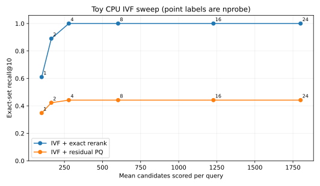

Suppose an encoder turns a question into a vector and we want the ten nearest document vectors. The definition is simple: score every document and keep the best ten. The engineering starts when scoring every document is too expensive for the collection and request rate. At that point, an index trades work, memory, build time, and sometimes accuracy for a smaller candidate set.

I find it useful to separate three decisions. **What does “near” mean?** **How do we find candidates?** **How accurately do we score those candidates?** HNSW answers the second question with a graph. An inverted file (IVF) answers it with coarse clusters. Product quantization (PQ) answers the third question with compact codes. These can be combined, but none repairs a poor embedding model or a mismatched distance metric. This post stays at the retrieval stage; the subsequent ranker in my [recommender systems post](/blog/recommender-systems-retrieval-ranking/) has a different job.

## Define the exact answer first

For a query $q$ and stored vectors $x_i$, exact top-$k$ under squared Euclidean distance is

$$
S_k(q)=\operatorname{arg\,min}_{|S|=k}\sum_{i\in S}\|q-x_i\|_2^2.
$$

In practice I sort the individual distances and take the first $k$; the expression names the target set. Squared L2 avoids a square root and preserves ordering. Inner product instead ranks by $q^\top x_i$ (largest first). Cosine similarity divides that dot product by both vector norms. If *both* query and database vectors have nonzero unit norm, cosine equals inner product, and $\|q-x\|_2^2=2-2q^\top x$; then all three rankings agree. Without normalization, a large-norm document can win inner product while having a worse cosine angle. Faiss describes exactly this distinction for its L2 and inner-product index metrics. 

```python {title="Metric sanity check"}
import numpy as np
q = np.array([1., 0.])
x = np.array([[10., 1.], [1., 0.]])
ip = x @ q                       # [10, 1]: first wins
cos = ip / (np.linalg.norm(x, axis=1) * np.linalg.norm(q))
print(ip, cos)                    # cosine: second wins
```

Normalize the vectors at the same point in training and serving. Decide how zero vectors are handled. Record which encoder version produced each stored vector; mixing versions can make a geometrically valid index return semantically meaningless neighbors. Exact search is therefore the baseline for *index* accuracy, while labeled retrieval relevance is the baseline for *embedding and search-system* quality. A perfect recall@10 against exact neighbors does not imply the ten neighbors answer the question.

Exact scanning evaluates $N$ vectors of dimension $d$, so its arithmetic grows with $Nd$ per query, and a simple float32 matrix holds $4Nd$ bytes before IDs and metadata. Batching, SIMD, GPUs, and cache behavior affect wall time. For a modest or changing collection, a well-implemented scan can be the sensible choice. Faiss calls its flat indexes the exact baseline and notes that they require no training. 

An axis-aligned tree such as a KD-tree is attractive in low dimensions because a bounding box can rule out distant regions. As dimension rises, the lower bound often stops excluding much: nearby and distant points become harder to separate for common synthetic distributions, and many branches are visited. That is a warning about a family of datasets and query distributions, not a theorem that all high-dimensional trees fail. Intrinsic dimension, clustering, metric, and workload matter. I would measure a tree before discarding it, but I would not assume low-dimensional pruning survives a new embedding space.

## HNSW: navigate a layered neighbor graph

HNSW stores proximity links. Points appear in a bottom layer; a random subset also appears in each higher, sparser layer. Search starts at an entry point near the top. It greedily follows a neighbor that improves the score, descends a layer, and repeats. At the bottom, a best-first candidate search explores alternatives rather than committing to one path. The original paper uses random levels and neighbor-selection heuristics to make those links navigable across scales. 

<figure class="ml-diagram">
<svg viewBox="0 0 860 260" role="img" aria-label="HNSW descends from sparse layers to a bottom layer with candidate expansion">
  <defs><marker id="ml-arrow" viewBox="0 0 10 10" refX="9" refY="5" markerWidth="7" markerHeight="7" orient="auto-start-reverse"><path d="M0,0 L10,5 L0,10 z"/></marker></defs>
  <rect class="box violet" x="35" y="35" width="220" height="65" rx="8"/>
  <text class="name" x="145" y="74">Sparse upper layer</text>
  <rect class="box blue" x="320" y="35" width="220" height="65" rx="8"/>
  <text class="name" x="430" y="74">Greedy descent</text>
  <rect class="box green" x="605" y="35" width="220" height="65" rx="8"/>
  <text class="name" x="715" y="74">Closer entry</text>
  <line class="arrow" x1="259" y1="68" x2="315" y2="68"/>
  <line class="arrow" x1="544" y1="68" x2="600" y2="68"/>
  <rect class="box sand" x="320" y="155" width="220" height="72" rx="8"/>
  <text class="name" x="430" y="190">Bottom layer</text>
  <text class="note sand" x="430" y="211">Best-first candidates</text>
  <path class="arrow" d="M715,105 V130 H430 V150"/>
</svg>
<figcaption>Conceptual path. The bottom search keeps several candidates and explores their neighbors.</figcaption>
</figure>

Three knobs have different roles. $M$ limits the neighborhood size in the graph implementation, affecting links and memory. `efConstruction` is the construction-time candidate-list size; a larger value gives insertion more choices, at additional build work. `efSearch` is the search-time exploration budget; increasing it commonly improves recall but scores more nodes. Faiss exposes `efSearch` as a runtime tuning parameter. The paper reports favorable scaling on its evaluated data, but I would not turn that into an unconditional $O(\log N)$ latency promise: graph quality, dimension, insertion order, recall target, and implementation affect the work. 

One greedy route can get stuck: a current node may have no closer *immediate* neighbor even though a useful path begins with a temporarily worse node. Best-first exploration keeps a candidate frontier to try those paths. In a full implementation, it also tracks a bounded set of current best results and a visited set; termination depends on the best frontier candidate relative to the worst retained result. Searching more broadly helps only if the graph has usable links. Raising `efSearch` cannot reconstruct connections omitted by a weak build.

HNSW is appealing when I can afford graph and vector memory and want adjustable query recall. It is not automatically the best choice under heavy updates, large metadata filters, or strict memory limits. For example, Faiss's documented HNSW variant supports adds but does not support removing vectors; another vector database may implement deletion through tombstones and rebuilding. The product's update contract, rather than the acronym, determines the behavior. 

## IVF: search some coarse cells

An IVF index first trains $C$ coarse centroids, commonly with k-means. Every database vector is assigned to one cell. A query scores the centroids, selects its `nprobe` nearest cells, then scores the vectors in those inverted lists. If those cells contain $L$ vectors altogether, its candidate-stage distance work is roughly $Cd + Ld$ for flat residual scoring, plus selection and memory overhead. The actual list lengths can be uneven, so `nprobe = 4` does not mean exactly four times the work of one probe. Faiss identifies `nprobe` as the main runtime IVF recall/work knob. 

The failure mode is a **cell boundary miss**. A query can fall just inside cell A while its true nearest vector lies just across the boundary in cell B. Probing only A cannot return that vector, no matter how accurately we rank A's contents. Increasing `nprobe` can recover it. At `nprobe = C`, IVF with full-precision scoring examines every vector and can match exact search; the centroid step is then pure overhead. This gives a useful endpoint for checking an implementation.

Training distribution matters. If the encoder or corpus distribution moves, centroids may become unbalanced or route poorly. New vectors can usually be assigned to existing cells, but eventually retraining and rebuilding may be worth the cost. I would record cell population statistics, recall on fresh held-out queries, and the time and memory needed for rebuilding. IVF makes a routing assumption; monitoring should test that assumption.

## PQ: represent each vector with small codes

PQ splits a $d$-dimensional vector into $m$ disjoint subspaces, each with $d/m$ dimensions. It learns $K_s$ centroids per subspace. Each stored vector keeps one centroid ID per subspace. With $K_s=256$, each ID fits in one byte, so the raw code is $m$ bytes instead of $4d$ bytes for float32. That comparison excludes codebooks, IDs, coarse assignments, padding, and index-specific overhead. The original PQ paper introduces this Cartesian-product codebook and asymmetric distance computation. 

For L2, an uncompressed query $q$ and PQ-coded vector $x$ have approximate squared distance

$$
\widehat D(q,x)=\sum_{j=1}^{m}\|q^{(j)}-c^{(j)}_{a_j(x)}\|_2^2,
$$

where $a_j(x)$ selects a learned centroid in subspace $j$. The query precomputes a small lookup table of distances to the $K_s$ centroids in each subspace. Each candidate then needs $m$ lookups and additions. This is **asymmetric distance computation**: the query remains full precision; the database vector is compressed. In IVFADC, we usually encode the residual $r=x-c_{\mathrm{cell}(x)}$, so the lookup for a query probing cell $i$ uses $q-c_i$. A separate table is needed for each probed cell in this straightforward formulation. Faiss documents `IndexIVFPQ` as IVF with PQ on residuals. 

Quantization can reorder neighbors even when the correct cell is probed. More codebooks or bits can reduce distortion at a memory and training cost, but the effect on *top-$k$ recall* depends on margin sizes between candidates. OPQ learns a transformation or rotation before PQ to make the subspace split more favorable; it is an optional improvement, not a synonym for ordinary PQ.  This is related to the choice of coordinates in [PCA](/blog/pca-derived/), although OPQ optimizes a quantization objective rather than just keeping the directions of greatest variance. A common refinement is to use compressed scores for a shortlist and rerank that shortlist with original vectors if those originals are available. That changes the memory and I/O story, so I would state it explicitly in a design review.

## A reproducible CPU experiment

The attached [ivf_pq_demo.py](ivf_pq_demo.py) creates a seeded 16-dimensional Gaussian mixture, trains 24 coarse cells, and encodes residuals with four 16-way subspace IDs. Each ID carries four bits of information, although the simple NumPy implementation stores it in a full `uint8` byte rather than packing two IDs per byte. It compares IVF with exact candidate scoring against IVF with residual-PQ asymmetric scoring. The code measures exact-set recall@10 over 100 separate synthetic queries and plots it against the mean number of candidates scored. Run it with `python3 ivf_pq_demo.py` after installing NumPy and Matplotlib. No Faiss or GPU is required.



Each point's label is `nprobe`. For one query, recall@10 is $|A_{10}(q)\cap S_{10}(q)|/10$, where $S$ is the exact top ten and $A$ is the approximate top ten. The plotted mean averages that fraction across queries. Candidate count is a transparent measure of this example's search work, not a latency measurement. The exact-rerank curve must reach recall 1 when all cells are probed; the script asserts it. PQ may still miss exact neighbors at that endpoint because its scores are approximate. It also uses only 4 bits per subspace, so its toy compression should not be confused with the 8-bit-per-subspace configuration in the storage example above.

The experiment deliberately leaves out graph construction and GPU kernels. It is a teaching model of routing and compression, with naive NumPy loops and synthetic points. It cannot establish Faiss throughput or a production recall target. Change the seed, cluster count, subspace count, codebook size, and query distribution; a curve that looks smooth for one mixture may bend quite differently for real embeddings.

## Choose a contract, then tune the index

I would start by writing down the request contract: distance metric and normalization; whether IDs can be deleted or updated; metadata filters; freshness deadline; top-$k$ and rerank depth; RAM budget; and target latency at a specified concurrency. Then I would construct an exact reference on a held-out set. Sweep `efSearch` or `nprobe`, record recall@k against that reference and query latency distribution under realistic concurrency, and also measure index build time and memory. Hold the embedding model fixed during the sweep. The resulting curve says what the *index* gives up for speed; relevance labels say whether the *whole retrieval system* is useful.

Filters deserve particular care. If a filter removes most graph neighbors or IVF candidates *after* approximate search, the output may contain fewer than $k$ eligible hits even when eligible vectors exist elsewhere. Pushing a filter into traversal, broadening the search budget, or partitioning the index may help, but each changes performance and sometimes recall. Similarly, a deletion tombstone can preserve serving semantics immediately while leaving stale graph links or list entries until compaction. Concurrent inserts need a consistent visibility and snapshot story. I would test these behaviors with the exact set restricted to the same eligible IDs, rather than comparing a filtered result to unfiltered ground truth.

Hybrid retrieval is a separate candidate-generation choice. BM25 can find rare literal terms that dense embeddings smooth over; dense search can find semantic paraphrases. Reciprocal rank fusion combines ranked lists with a score such as $\sum_r 1/(c+\operatorname{rank}_r(d))$ for document $d$, where $c$ is a chosen constant. It avoids pretending that raw BM25 and cosine numbers share a scale, but it still needs evaluation on labeled queries. The original RRF paper evaluates rank fusion; it is no guarantee of better quality on every corpus.  A downstream reranker can reorder the union, but it cannot rescue a relevant document absent from every candidate list.

## Interview questions

1. **Why do cosine and inner product sometimes return different neighbors?** Vector norms affect inner product; normalization removes that difference for nonzero vectors.
2. **When does L2 produce the same order as cosine?** When the query and all stored vectors are unit normalized, since squared L2 becomes $2-2\cos(q,x)$.
3. **What does `efSearch` change?** The breadth of HNSW's query exploration, with a recall/work tradeoff specific to the graph and data.
4. **Why can increasing `efSearch` fail to fix recall?** The needed path may be absent from a weakly built graph, or the vector may be ineligible under a filter.
5. **Why can IVF miss a close vector?** The vector can be assigned to a cell outside the query's probed centroids.
6. **What happens at `nprobe = nlist` with IVFFlat?** Every cell is scanned; with the same metric and full-precision scores, it can return the exact top-$k$.
7. **What is asymmetric PQ distance?** A full-precision query is compared with compressed database codes using per-subspace lookup tables.
8. **What extra error appears when PQ is added to IVF?** Even a candidate in a probed cell may be ordered incorrectly by compressed distances.
9. **Why use residual PQ inside IVF?** The coarse centroid accounts for the cell's large-scale location, so the code represents the local residual.
10. **What should filtered recall be compared against?** Exact top-$k$ among the same eligible IDs, under the same metric and freshness snapshot.
11. **Can perfect ANN recall prove the search product is good?** No; it only matches the exact neighbors of the chosen embeddings and metric. Relevance needs separate evidence.


