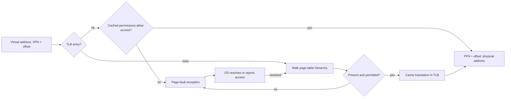

A pointer is an address in a process's **virtual** address space. It is not generally a physical RAM address. The CPU and operating system cooperate to translate it, check permissions, and make memory appear available when an application first touches it. That indirection lets processes use convenient private-looking address spaces while the kernel can place, share, reclaim, or protect the underlying pages. "Private-looking" matters: shared libraries, shared mappings, and copy-on-write pages can refer to the same physical frames.

I find virtual memory easier to reason about as a series of questions. Which page and byte does this address name? Is a translation cached? If not, is there a valid page-table mapping? If the mapping is absent or disallows the access, can the OS resolve that fault, or must it reject the program's access? A TLB miss and a page fault answer different questions, and confusing them makes almost every performance explanation wrong.

## Split an address into a page and an offset

Assume 4 KiB pages for a concrete example. Since $4096=2^{12}$, the low 12 bits of a virtual address are the **offset** within a page. The remaining bits name the virtual page number (VPN). A resident page-table entry maps that VPN to a physical frame number (PFN), and translation is

$$
\text{physical address}=\text{PFN}\cdot4096+\text{offset}.
$$

For virtual address `0x1234`, VPN is `0x1` and offset is `0x234`. If its mapping points at PFN `0xA`, the physical address is `0xA234`. Two addresses on the same 4 KiB virtual page use the same mapping but different offsets: `0x1ABC` becomes `0xAABC`. This arithmetic is architecture-independent for the stated page size. Which virtual addresses are legal, and how the page tables are arranged, are architecture and OS choices. 

For a second, explicitly **x86-style illustrative** example, take a 48-bit canonical address in 4-level paging with 4 KiB pages. Four 9-bit indices select one of 512 entries at each level, followed by the 12-bit offset:

```text
bits:      47..39 | 38..30 | 29..21 | 20..12 | 11..0
meaning:   level 4 | level 3 | level 2 | level 1 | offset
width:        9    |    9    |    9    |    9    |   12
```

At `0x0000123456789ABC`, those indices are $(36,209,179,393)$ and the offset is `0xABC`. They identify a path through tables; they are not four different physical addresses. The 48-bit layout is not a universal property of 64-bit pointers. x86 can also use 5-level paging with 57-bit canonical addresses, adding another 9-bit index. Linux's generic memory-management code describes **five software levels** and folds unused levels on systems that do not have that many hardware levels. I keep those two facts separate: a five-level source-code abstraction does not mean every running CPU performs a five-level walk. 



## Why page tables are hierarchical

A flat table with an entry for every possible 4 KiB page in a 48-bit virtual space would need $2^{48-12}=2^{36}$ entries. At an illustrative eight bytes per entry, that is $2^{39}$ bytes, or 512 GiB, for one completely populated flat table. That is a terrible way to represent a sparse process address space. A hierarchy allocates lower-level tables only for populated regions. With 512 eight-byte entries, one table page is 4 KiB. A process with only a small code region, stack, and heap needs entries and tables along those paths, rather than an entry for every possible address. This is a structural saving, not a promise that page tables have zero cost. 

A leaf page-table entry can identify a physical frame and access properties. Present/valid status, user versus supervisor access, write permission, and execute permission are typical concepts, although exact bit layouts differ by architecture. It may also hold or imply information needed when the page is swapped or lazily allocated. The page-table hierarchy itself consumes physical memory, and sparse mappings can still need many table pages if they are spread across the address space. A huge-page mapping can terminate the walk at an upper level and cover a larger aligned region with one mapping. 

The kernel owns the policy and mappings: it creates address spaces, chooses frames, updates permissions, and handles faults. The hardware memory-management unit (MMU) checks translations and permissions on accesses. On hardware-managed TLB systems such as common x86 configurations, it can walk page tables after a TLB miss; other architectures may involve software more directly on a miss. In either case, the OS must keep stale translations from granting access after a mapping changes, by invalidating or otherwise coordinating TLB entries, including on other CPUs when necessary.

### Stale translations are a correctness problem

Suppose a process unmaps a writable page, but a CPU keeps an old VPN-to-PFN entry in its TLB. If that entry were allowed to serve later accesses, the process could keep writing a frame the kernel has reassigned. Changing the page table is therefore only part of the operation: the kernel must invalidate or otherwise coordinate stale translations before the old access can be used again. On a multicore machine, a translation may be cached on another CPU too. Linux exposes TLB flush operations for a page, range, or address space, with the required effect extending to relevant processors. 

This does not mean every context switch must flush every TLB entry. Architectures can tag translations by address space or use other mechanisms, and the exact behavior varies. It also does not mean a TLB flush is the same thing as evicting a data-cache line: one caches address translations and the other caches contents. When explaining the cost of a mapping change, I distinguish the update to page-table memory, coordination of cached translations, and later misses that refill them. The Python model intentionally leaves this coordination out because it never changes an existing mapping after insertion.

## TLB miss, page fault, and what the OS does

The translation lookaside buffer (TLB) caches recent VPN-to-PFN translations and relevant permissions. A **TLB hit** avoids a full page-table lookup. A **TLB miss** means the translation is not cached; a page-table walk may find a valid resident mapping and complete the access with no page fault. A **page fault** is an exception because translation or permission checking cannot complete the attempted access as-is. It may be expected and recoverable, or it may end in a signal or other failure. A protection fault on a forbidden write is still a page fault; "fault" does not mean "read from disk." 

Consider three cases. First, a newly reserved anonymous page may have no physical frame yet. On its first write, the OS can allocate a zero-filled frame, map it, and resume the instruction: a demand-zero fault, with no file read. Second, a file-backed page may already be in the page cache; mapping it into this process can require a fault but no storage I/O. Third, a page absent from RAM may require reading from storage, often the expensive case. Linux reports **minor** faults serviced without I/O and **major** faults that required I/O, though the exact work behind each event depends on the mapping and system. TLB misses are not these fault counters. 


### A translation trace I can check

This small [Python model](translation_model.py) has a two-entry LRU TLB, two initially resident pages, and one permitted demand-zero allocation. Its output is a *simulation* of the decisions above, not a measurement of a Linux page walker. After the third distinct VPN is touched, the first translation has been evicted from the tiny TLB, but its page remains resident. Touching it again is a TLB miss **without** a page fault.


```python {title="translation_model.py"}
"""A teaching model for 4 KiB pages and a two-entry LRU TLB.

It is not a hardware benchmark or a model of every possible page fault.
Run with python3 translation_model.py.
"""

from collections import OrderedDict

PAGE_BITS = 12
PAGE_SIZE = 1 << PAGE_BITS
INDEX_MASK = (1 << 9) - 1

example = 0x0000123456789ABC
indices = tuple((example >> shift) & INDEX_MASK for shift in (39, 30, 21, 12))
print("48-bit address indices:", indices, "offset:", hex(example & (PAGE_SIZE - 1)))

page_table = {1: 0xA, 2: 0xC}  # VPN -> resident physical frame number
tlb = OrderedDict()
capacity = 2


def access(virtual_address):
    vpn, offset = divmod(virtual_address, PAGE_SIZE)
    if vpn in tlb:
        frame = tlb.pop(vpn)
        event = "TLB hit"
    else:
        if vpn not in page_table:
            if vpn != 3:
                raise MemoryError(f"VPN {vpn} has no permitted mapping")
            page_table[vpn] = 0xD  # Simulated demand-zero fault and mapping.
            event = "page fault: demand-zero"
        else:
            event = "TLB miss: resident mapping"
        frame = page_table[vpn]
    tlb[vpn] = frame  # Most recently used.
    if len(tlb) > capacity:
        tlb.popitem(last=False)
    physical_address = frame * PAGE_SIZE + offset
    print(f"VA {virtual_address:#06x} -> PA {physical_address:#06x} ({event})")


for address in (0x1234, 0x1ABC, 0x2ABC, 0x3ABC, 0x1234, 0x3ABC):
    access(address)
```

```text {title="Output"}
48-bit address indices: (36, 209, 179, 393) offset: 0xabc
VA 0x1234 -> PA 0xa234 (TLB miss: resident mapping)
VA 0x1abc -> PA 0xaabc (TLB hit)
VA 0x2abc -> PA 0xcabc (TLB miss: resident mapping)
VA 0x3abc -> PA 0xdabc (page fault: demand-zero)
VA 0x1234 -> PA 0xa234 (TLB miss: resident mapping)
VA 0x3abc -> PA 0xdabc (TLB hit)
```

## Demand allocation, copy-on-write, and process boundaries

A process can reserve a virtual range without having a separate physical frame behind every page at that instant. On first touch, the fault handler can supply a zeroed page or connect the address to an already cached file page. The mapping can also be invalid: touching an unmapped address or writing to a read-only region is rejected rather than made magically valid. The distinction is about the OS policy for that address, not about whether the exception is called a page fault.

`fork()` makes a child with an address space based on its parent. On Linux, copy-on-write (COW) lets the parent and child initially share physical frames for private pages, with write protection arranged so a later write can fault, allocate a private copy, and resume. A read may need no copy. A COW write fault can be **minor** because copying an already resident frame needs no storage input. `exec()` is different: it replaces the current process image with a new program's mappings; it does not keep the old address space as a child clone. This is why "fork copies all of RAM" and "every fork fault reads disk" are poor descriptions. 

Process isolation comes from separate address spaces and permission checks, not a rule that every frame belongs to only one process. Processes can intentionally map the same shared file page or shared-memory region. They can also share read-only code pages and temporarily share private pages through COW. The kernel controls which mappings are authorized. A pointer value printed in one process therefore does not give another process access to the same object just by repeating that number.

## `mmap`: a mapping is not the page cache

`mmap` establishes a virtual-memory mapping to a file or anonymous memory, with access permissions and sharing policy. With `MAP_PRIVATE`, writes are copy-on-write and are not carried back to the underlying file. With `MAP_SHARED`, changes are visible to other processes mapping the same region and are carried through to the file-backed object. For a file-backed mapping, `msync` is the explicit way to request synchronization of dirty mapped data with the filesystem; simply calling `munmap` is not a precise durability protocol. Closing the file descriptor after a successful mapping does not itself unmap the region. 

The **page cache** is the kernel's cached file data. A process page-table entry is a translation and permission record for one virtual page in one address space. Several processes can have different PTEs referring to a file page backed by the same cache entry; a private write can instead create a new anonymous COW page. Conversely, mapping a file does not mean every byte has immediately become resident: faults can populate mappings as accessed. Keeping "mapping," "resident frame," and "cached file data" separate prevents a lot of misleading memory accounting claims.

## Locality, replacement, and huge pages

If a program repeatedly visits a small working set of pages, translations and data can stay hot in the TLB and RAM. If its active working set exceeds the frames available to it, reclaim may evict pages that it soon needs again. Repeated faults and I/O with little useful computation are **thrashing**. Replacement policies approximate which pages will be useful again; exact future knowledge is unavailable. A jump in major faults may indicate storage-backed misses, while a jump in minor faults may reflect demand allocation or COW. Neither counter alone proves thrashing; I would pair them with latency, memory pressure, and the program's access pattern. 

Larger pages cover more bytes per TLB entry and need fewer leaf entries. In our 4 KiB example, one 2 MiB page covers the range of 512 ordinary pages. That can reduce TLB pressure and page-table memory for suitable contiguous accesses. It can also waste memory for sparse use, require costly allocation or compaction, and make a small write or COW event involve a larger mapping. Huge pages are a tradeoff, not a default cure for every TLB miss. Linux's page-table documentation describes where walks can stop early, and its transparent-hugepage documentation describes both TLB benefits and memory/compaction costs. 

## What I would measure

On Linux, `getrusage` reports `ru_minflt` and `ru_majflt`: faults serviced without I/O and faults requiring I/O. The process's `/proc/PID/maps` shows mapped ranges and permissions; `/proc/PID/smaps` adds per-mapping resident and shared/private accounting. These views answer different questions. A large virtual range in `maps` does not imply the same number of bytes is resident, and RSS does not mean all resident bytes are exclusively owned. `/proc/PID/pagemap` exposes lower-level mapping information, but Linux restricts physical frame numbers for unprivileged readers, so it is not a portable or universally available way to prove a physical address. 

I would compare measurements before and after a *specific* workload change, and I would avoid treating one run's fault counts as an architecture constant. Page cache warmth, allocator behavior, THP settings, memory pressure, and other processes can change them. The Python example above is deliberately deterministic because it models the rules; it cannot measure real hardware TLB hits.


## Interview questions and follow-ups

**1. Is a virtual address the same thing as a physical address?** No. A virtual address identifies a location in an address space; translation maps its virtual page to a physical frame while preserving the offset. The same virtual number can map to different frames in different processes, and different virtual numbers can intentionally map to one shared frame.

**2. How do you split a 4 KiB-page address?** The low 12 bits are the offset because $4096=2^{12}$. The remaining bits identify a virtual page. For `0x1234`, VPN is `0x1` and offset is `0x234`; mapping that VPN to PFN `0xA` gives physical address `0xA234`.

**3. Why use multiple page-table levels?** A flat table covering every possible virtual page is enormous and mostly empty for a sparse process. A hierarchy allocates lower tables along populated regions. The price is extra table memory and potentially more work on a walk; TLB caching makes most repeated translations cheaper.

**4. Does every TLB miss cause a page fault?** No. On a miss, a walk can find a valid resident mapping and refill the TLB. A fault arises when the attempted translation or access cannot complete under the current mapping and permissions. The OS may resolve it by allocating, copying, or loading a page, or reject it.

**5. Does every page fault read from disk?** No. A first write to a demand-zero page or a COW copy of a resident page can be serviced without storage I/O. A major fault on Linux counts a fault that required I/O; a minor one did not. Neither category is a synonym for a TLB miss. 

**6. Does `fork` immediately duplicate every physical page?** Linux generally sets up copy-on-write mappings for private memory. Parent and child can read shared frames; a later write faults and creates a private copy as needed. Their page tables and metadata still cost work and memory. `exec` replaces a process image instead of cloning the old one.

**7. What is the difference between `MAP_PRIVATE` and `MAP_SHARED`?** A private file mapping uses copy-on-write for modifications, which do not reach the underlying file. Shared modifications are visible through compatible mappings and can be written back. For explicit synchronization with the file, use `msync` with the required semantics; `munmap` alone is not the durability step. 

**8. Is a page-cache page the same as a PTE?** No. A page-cache page holds cached file data. A PTE records how a virtual page in one address space maps and what access is allowed. Multiple PTEs can refer to the same cached frame, while a private write can split one mapping away through COW.

**9. Why can huge pages help and hurt?** One large mapping covers more bytes per TLB entry and can reduce page-table overhead. It may also consume memory for sparsely touched regions, need compaction, and make some copy or allocation events more expensive. The useful choice depends on access locality and memory pressure.

**10. What is thrashing?** It is repeated eviction and refaulting of pages a workload still needs, so much of its time goes to memory management and I/O instead of useful work. A working set larger than available RAM can trigger it. I would check fault rates, latency, pressure, and access patterns together rather than diagnose it from one counter.

**11. Does a large virtual size mean the process owns that much RAM?** No. Virtual mappings can reserve address ranges without resident frames, and resident frames may be shared. `maps` describes ranges; `smaps` reports resident and sharing information for them. Even RSS is not a count of exclusively owned physical bytes.

**12. Why does Linux code show five page-table levels on a four-level x86 machine?** Linux's generic page-table API names five levels and folds an unused level on architectures or modes with fewer. Four-level x86 paging uses a 48-bit canonical-address scheme; enabled five-level paging can use 57-bit canonical addresses. The software abstraction and the active hardware walk should not be conflated. 



